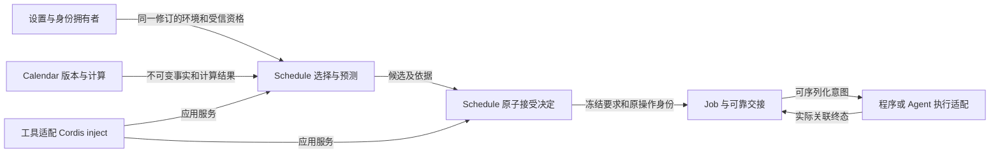

# 日程函数、并发协调与时间契约

本说明细化 [SPEC](../SPEC.md) 的依据、接受、恢复与生命周期不变量，不引入另一套 DTO。当前公开类型归 [schedule-contract](../../schedule-contract/README.md)，实现和模型的对应范围见 [verification](../verification/README.md)。Calendar 的计算定义与全化由[日历成员](../../../calendar/calendar/docs/functions-and-totalization.md)拥有。

## 函数边界及领域关系

Schedule 是带身份、修订、控制和政策的工作意图，不只是计算输入。创建者可以是人、agent 或系统。来源会话、执行会话和结果返回目标相互独立，不能以有无 Session 推导有无 Job。



身份与设置、Calendar、Session、Agent、通知各自保留权威。工具通过注入应用服务消费能力，不承载第二份领域逻辑。程序 Job 不依赖 Session/Agent；agent Job 冻结 instruction 和目标意图，由 Session intake 决定消息角色。新会话冻结 AgentDefinition 身份，到实际启动采用最新合法发布并记录版本；已有会话沿原采用，目标失效不能改成新会话。

## 选择、预测和接受

```text
select(owner, binding, versionPolicy, environmentRevision,
       catalog, providerCapabilities, authorityObservation) ⇀ Basis
predict(frozenDefinition, Basis, fixedCutoff, policies, budget) → Result
accept(candidate, currentFacts, originalOperation) → Decision
```

第一行的外部事实先由端口读取，选择函数只消费固定投影。目录、能力与资格分别解释“有什么”“能算什么”“能否读”，不能互相授权。`owner` 含受信租户及归属；系统归属需要明确系统 scope。

`followUserEnvironment` 的时区与日历来自同一环境修订。`explicit` 不随环境切换，但 `latest` 仍跟随该日历发布；`pinned` 缺失时失败，不回退当前版。无用户环境的系统安排不能 follow。不需要日历规则的计算允许没有 Calendar 依据，不能强制选一个日历。一次解析 latest 后，计算固定该版本，不能边扫边换。

候选是可重算的建议，接受才形成工作事实。预测保持只读；接受时重新保护当前依据、资格和控制，不以预览成功授权。全化结果区分非法/未定义、有限未完成、提供者失败及未知效果；遵守 Calendar 的 T1–T4。多层预测必须限制候选数、Calendar 调用数、解释数与总时限，不能每层重置预算后形成无界工作。

## 并发必须用状态机守护

纯函数没有表达“两个进程同时提交”的历史。把共享状态记为 S，操作记为 A，总化转移为 `δ: S × A → S × Outcome`，拒绝、冲突和未知都是明确结果。外部效果通过具名请求与回执继续建模，不藏在 `δ` 内成为不可见副作用。

安全证明采用 `Init ⇒ I` 与 `I ∧ Next ⇒ I′`。`Next` 包含任意合法交错、重试及故障动作。真实实现还须说明操作的线性化点和到模型状态的映射；不能因为一个函数返回 Result 就声称并发正确。

| 守护 | 必须保持的性质 | 责任边界 |
| --- | --- | --- |
| G1 | 受信租户/owner、当前访问资格隔离，引用不授权 | 身份/授权提供事实，本域在关键入口消费 |
| G2 | follow 的同一环境修订及接受时有效性 | 设置拥有版本，本域接受协调 |
| G3 | latest 在接受线性化点仍是该发布；pinned 保持原身份 | Calendar 发布权威，本域保护采用 |
| G4 | 接受/启动/控制竞态有可解释顺序，旧控制不能继续放行 | 本域工作控制与执行适配协议 |
| G5 | 同一租户语义来源至多一个 Job；原操作回执、次数及可靠交接意图无半提交 | 本域持久接受协调，外部参与者履行协议 |
| G6 | 已接受的内容、依据与工作身份不被后来环境/日历/定义变化改写 | 本域冻结与持久化 |
| G7 | 排队、受理、执行结束、通知送达与结果发布分别成立；责任可靠承接前不遗失 | 本域聚合，各效果拥有者确认事实 |

当前 TLA 模型只检查 G1–G6 的有限投影，G7 及真实多方事务未被证明。原子 `Accept` 是目标原子性假设，不是已有跨进程事务实现。先读 latest 再远程接受存在竞态；TTL、签名、JSON 或 Cordis 同进程调用都不能代替权威拥有者的条件提交/栅栏协调。机制未成立时阻止依赖它的接受，不降低承诺。

语义来源键按租户和逻辑工作定界。重算版本变化不自动生成另一逻辑工作。回执超时按原键查询，不能换键重试；传输去重不等于副作用 exactly-once。取消已发送不等于外部执行已停止，停止与启动竞争需要执行方可验证的序代及原操作查询。

## 时钟与定时器

[时间能力组](../../../time/README.md)目前没有具名服务或公开接口。本域在消费端定义必要前提，不擅自建立系统 Clock 服务，也不代替时间源拥有者实现。

| 时间量 | 用途 | 不能做什么 |
| --- | --- | --- |
| 民用时刻及业务时区 | recurrence、DST、到期与补跑截止 T | 直接测量操作耗时，假设不会回拨 |
| 同一运行代际的单调时间 | 本次计算耗时、等待上限 | 跨进程/重启比较，直接持久化为可恢复的业务截止 |
| 运行代际 | 识别本地时间轴和在途回调的有效范围 | 冒充持久 worker 栅栏或业务所有权 |
| 持久控制序代/栅栏 | 协调多执行者与旧执行者失效 | 仅用本机时间或租约到期推导已阻止远端效果 |

给定本次本地操作的 `(epoch₀, mono₀, duration)`，设 `deadline = mono₀ + duration`。完成边界的资格判定是全函数：

```text
qualify(epoch, mono, operationLive) =
  invalidated   if epoch ≠ epoch₀
  closed        if not operationLive
  limited       if mono ≥ deadline
  eligible      otherwise
```

同一 epoch 内，单调读数非递减，因此一旦过期就不因民用时间回拨而恢复。重启时不拿旧 deadline 比新 mono；旧在途操作失效或沿原持久身份恢复。`operationLive` 指该操作的完成资格，**不是**应用的新请求准入开关。关闭服务可以拒绝新请求并排空已准入操作，不能据此丢弃已经成立的结果。

有限 Clock 模型的 `ok` 仅表示完成资格通过，不代表查询答案或 Job 成功。定时器是唤醒提示，允许早到、迟到、重复、乱序或丢失。回调须重新取得有效观察并检查必要业务守卫；从“醒了”不能推出“到了应执行时间”。进程重启、时钟跳变或漏醒依靠持久扫描/恢复接续，不依赖一次回调保存工作事实。

调度恢复对一轮选择固定 T、候选集与政策。相同输入应得相同补跑集合。进入下一轮的 T 可以不同；不得把一次钟回拨或每批重新取 T 伪装成同一轮一致。民用时钟跳变、DST gap/fold、晚醒如何影响候选和提醒窗口，继续由 SPEC 的业务政策决定，不能由时钟库默认值决定。

## 证明义务与开发准入

| ID | 性质及必要假设 | 持续验证 |
| --- | --- | --- |
| S1 | 固定定义、依据、T 和政策的成功预测确定；合法无候选须完整检查，limited 不等于无候选 | 纯算法/公共预测入口符合性与 Calendar 组合用例 |
| S2 | G1–G6 在发布、环境切换、撤权、控制和重复请求交错中保持 | 有限接受模型与具名反例；实现阶段增加真实多进程提交、故障切点 |
| S3 | 过期、失效代际或完成资格撤销后，不能把晚到读取判作合格完成 | Clock 有限模型；后续真实时钟注入、关闭排空、重启与晚到回调用例 |
| S4 | 两个 scanner 不重复接受；次数、回执、Job、交接责任同提交或同一协调决定 | Job 实施前细化事务状态模型；SQLite 多连接/进程故障与恢复 |
| S5 | 取消与启动线性化，旧执行者不启动新动作，已发生效果不谎报撤回 | 执行适配实施前扩充控制/栅栏模型及负控；真实执行方契约测试 |
| S6 | 原键恢复、有限重试及公平调度下，最终完成或明确受阻，责任不丢 | 为对应阶段声明可用性、介质、队列及公平性前提，再做活性模型与故障验证 |

S4–S6 是必须履行的义务，目前没有对应完整模型通过证据。基础守护先落盘，不表示这些后续功能已被证明；每个实现切片开工的第一件事是补齐该切片状态模型、正负控和映射，缺失就不能开始依赖它的产品实现。

安全性说明什么绝不发生；活性说明在什么前提下最终推进；稳定性还需要背压、队列上限、资源释放和真实压力/故障证据。弱公平不保证毫秒延迟，有限 TLC 成功不等于任意规模证明，形式模型通过不等于源码已经精化。
