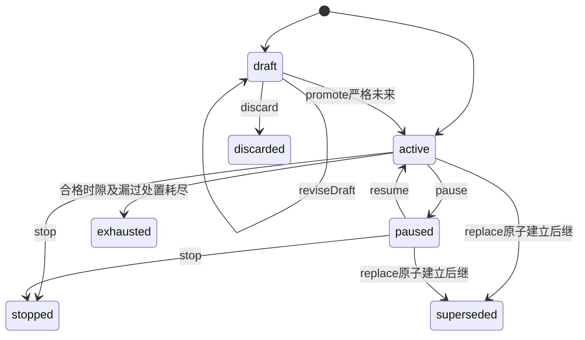

# 日程与 Job 内部设计

本页是完整目标设计，尚未实现。必要行为归 [SPEC](../SPEC.md)，唯一公开形状与端口归[公开 API 设计](public-api-design.md)。问题轴分为 Schedule 意图与管理、日期计算、Job 接受、实际执行、外部结果、调用入口；各轴拥有者分别负责其事实，Cordis 不定义领域。

## 必要身份与分别成立的状态

ScheduleId 标识一份安排；sourceScheduleKey 保留 Python 源 job_id，不能当目标 JobId。JobId 标识一次已接受工作，PreparationId 标识耐久计算证明，ReceiptId/occurrenceKey 标识来源窗口判决，operationRef 标识可认回操作。sourceKey 保留原 civil 来源，多个 source 合并的有效时刻、rule revision、attemptId、executionRef、notificationIntentId、notificationId、resultSeriesId、resultEntryId 与 providerGeneration 各自独立。晚到结果只能入原身份，不能按最近 timestamp 猜对象。

Schedule 管理轴为 draft/active/paused/stopped/exhausted/discarded/superseded。standing 为 ready/blocked/terminallyInvalidated，和 paused 可并存。Job 的 execution 与 notification body 是判别分支；stopRequested、executionOutcome、delivery、masterReturn、publication、archive 各自记录，不把一种成功投影成全部成功。unknown 不是 terminal evidence，不释放 replace 等待。

终局 standing 另外禁止新接受，不能由 restore、重授或同名新对象复活。replace 保留双向 lineage；旧 Job 和全部 revision 不迁给后继。非重要文字 update 不改 identity 或管理状态；draft 可完整修订。promote 的当前人/agent、同意、quota、依赖和未来时刻复核与结果一起保存。

## 完整定义保存与日期组合

## 5. 时间规则、算法与 Node 技术映射

纯函数不得调用 `Date.now()`、读取数据库、取得当前用户设置或访问网络。调用方传入时间、不可变日历依据、版本和边界。Clock 提供 UTC instant 与单调耗时两个能力，不能以 wall-clock 计算租约已耗时。

### 5.1 规则表达

- `once`：唯一无 offset 的本地日期时间，保存时固定相对表达。创建时过去或 DST gap 拒绝。默认既有源 UTC 仅用于导入 explicit 记录，follow 创建必须解析用户环境，缺失则拒绝。
- `cron`：标准五字段，分钟精度。拒绝秒字段、宏、随机散列和 provider 专有语法。DOM/DOW 同时受限时为 OR。星期 0/7 都是周日，规范化为 0。
- `rrule`：正文只保存规则属性，DTSTART/COUNT/UNTIL 只能在独立字段出现。支持源可表达的 FREQ、INTERVAL、BYMONTH、BYMONTHDAY、BYYEARDAY、BYWEEKNO、BYDAY、BYSETPOS、BYHOUR、BYMINUTE、BYSECOND、WKST，以及目标日/周/月/自然季度/年编排。秒精度允许用于 rrule，最短间隔受产品资源策略限制，不能静默截成分钟。
- 目标位置规则补充：某月/自然季度/年内第 N 或最后一个指定 weekday/工作日，workday 需真实日历。不能把周一到周五当法定工作日，也不能用多个 Schedule 代替同规则多值。
- begin 包含，until 包含且晚于 begin，eligibleLimit 与 until 合取，excludeDates 最多 366 项，按规则时区排除整日。不存在月日/位置直接跳过。

源 rrule 具体接受语法以源验证器和对照样例为准，Node parser 能解析不等于新增承诺。合法源规则全部属于复刻范围。若对照发现 Node 暂不支持，开发者必须补 adapter 或替换库，未补齐则该交付验收失败；不能以 `unsupported_rule` 声称完成。该错误仅用于本来就不在已接受规则集合内的输入。开发阶段须建立源 dateutil 与 Node 的固定输入 golden corpus。

### 5.2 唯一计算顺序

1. 在本地 civil time 上枚举基础候选，保留 sourceKey、原日期与 selector。
2. 对原日期应用 begin/until、首次启用边界及 excludeDates。
3. 执行明确 calendar predicate 和 adjust。保持原日、跳过、前移、后移均保留本地时刻。
4. 对结果日期再次应用边界与排除。被排除就丢弃，不能继续平移找下一个日期。
5. 以 IANA timezone 物化 instant。gap 跳过，fold 取第一个 instant。保存实际 offset 与 disposition。
6. 同一 Schedule 的不同来源落在同一 instant 时合并，保留全部来源。eligibleLimit 在此时计一次：过滤、排除、DST gap、越界均不耗额，不在基础枚举时交给库扣 COUNT。
7. 同已有已接受或已处理来源冲突则记录 skipped/duplicate，不回填旧 Job。根据预算及次数返回结果或明确受阻。

calendar predicate 支持 workingDay / nonWorkingDay / holiday。nonWorkingDay 是所有非工作日，包含 holiday 与普通休息日；补班周末若标为工作日就不属于它。holiday 是其中有法定假日分类的子集。调整支持 skip / previousWorkingDay / nextWorkingDay。只有 predicate 未满足时才调整，源导入保留原声明。目标直接“保持原日”表示没有过滤/平移，不抹除 workday 位置规则的日历依赖。

路径需要的任何日期缺覆盖，返回 `coverage_insufficient`，不能猜普通工作日。查询范围合法但没有结果返回完整的 empty；遇到搜索预算不能说“没有下一次”。

### 5.3 有界性与版本

每次 resolver 最多扫描 100,000 个基础候选或 400 个 civil 年，先达到者返回 `search_limit`，附 observedThrough 和 continuation diagnostic。该数值是当前目标资源上限，不是源产品承诺。交互预览不得自动循环直到成功；后台治理显式记录受阻。

日期算术遵循[技术基础](../../../../docs/architecture/technical-foundations.md)已采用的 @js-temporal/polyfill 0.5.1。rrule 2.8.1 与 cron-parser 5.10.3 是社区候选，后者和旧探针 5.4.0 不能混称同一验证版本；rrule-temporal 2.2.8 可作对照，均未在本包安装或采用。库只枚举 civil，不让默认 COUNT、DST 或 strict 模式改产品语义。Temporal earlier/later 后 round-trip 本地字段，两者都不等为 gap，有效取较早 instant；记录 tzdb/ICU，升级跑完整 golden corpus。

源材料的5个接缝探针在 Node26、tz2026a、ICU78.3，只涉及纽约 gap/fold/正常日、第一个周一与 cron DOM/DOW OR；本包没有重跑，也不能把它当Node24、完整源语法或运行能力证据。开发必须补固定源 dateutil 全语法对照，纽约、Lord Howe、Apia、调休、跨年、工作日位置、平移后排除和碰撞案例。预算数字为当前目标资源边界，变更走显式治理，不能静默多算或截断后报完整。

## 最终校验、受理与耐久责任

Preparation 固定 definitionRevision、stateRevision、候选来源、计算时区、实际 calendarVersion/environmentRevision、DST、purpose、工作/提醒内容、admissionDeadline 与政策 hash。preparation 是耐久计算证明，不消费 Job 次数，不代表执行接受或通知发送。

同一 preparationKey 的重复请求返回旧证明。不同 fingerprint 不能覆写旧证明。新定义或环境生成新 preparation，旧 proof 被明确 rejected/stale，原始来源去重仍跨证明成立。

采用目标 canonicalization `calendar-schedule/v1`：RFC 8785 JSON Canonicalization Scheme 的确定键序与数值约束，UTF-8、UTC instant 统一 `Z`、civil 字段不改时区、禁止 NaN/undefined，SHA-256。源 Python 是排序紧凑 JSON v1，**不得把两者 fingerprint 当相同**。导入时同时保留 sourceFingerprint 与 targetFingerprint。精确规范和 golden 字节见[公开协议](public-api-design.md#共同编码与可信上下文)的共同字段与跨语言 golden 义务。

### 10.1 第一个单机提供者的事务边界

采用目标 storage 组合提交：参与者在同一 SQLite Worker/connection 内执行具名命令。组合至少含：Schedule 状态/CAS、已处理 sourceKey、occurrence 唯一索引、receipt、Job及对应通知交接意图、次数、outbox、日历 publication generation guard、有效环境及权限 revocation generation guard。

explicit pinned 只校验不可变版本及访问资格，不因current pointer变更而强行采用新版；latest解析才校验publicationGeneration，follow另校验environmentRevision。

日历供应和接受共享的是同提交的 generation guard 公共参与契约，不是 Schedule 越权读取 calendar 私有表。每个拥有者注册自己的 participant。callback 不能跨 Worker 携带任意异步应用逻辑。计算和网络 I/O 在事务外完成，事务内只校验快照版本与提交决定；失配则退出并重算。

若授权权威在远端，不能用本地缓存读后写冒充强撤权竞争保证。必须由其提供可 fence 的接受资格协议，并在同一保护边界承认它；否则该装配不满足目标 INV-SJ07，禁止放行依赖该保证的后台接受。这是具名接口建设依赖，不是把责任交给 Cordis。

storage 原结果保持 `committed / rolled_back / unknown / identity_conflict / rejected_before_accept`。业务 unknown 返回可查询 operationRef，不能转换普通失败。查询 notCommitted 只有达到 storage 的完整否定证据时才允许同原键重试。回执及 Job 已提交但通知/唤醒失败，只恢复 outbox。

## 实际存储能力与未闭合保证

真实 sql-contract/sqlite-provider 已有实现，调用根为 registerCombination、commit、query、read，不能沿旧文档说存储缺失。领域只发具名、版本化命令，participant 在 Worker 同步执行；不得传 async transaction callback、SQL 或任意主线程闭包。一次 commit 只覆盖同一事务域，跨库不自动原子。各拥有者提供自己的材料/迁移和 guard participant；这些本域材料、guard 与 outbox 尚未实现。

| 实际限制 | 对本设计的影响与闭合义务 |
| --- | --- |
| L-1 资格 check→commit 窗口 | 当前存储不提供强撤权排序。必须由权限拥有者提供与接受同边界的 fence/participant；缺失则依赖此保证的后台接受 blocked，不能仅加缓存核验后声称满足 INV-SJ07 |
| L-2 真实可合并窗口未证实 | 不声明 G2 批写收益或吞吐；真实轨迹验证，不影响业务原子单元 |
| L-3 写 Worker 无空闲关闭且 maxWorkers 有限 | 有限域容量可拒绝 domain_unavailable；不能无限开域或把它当无待办 |
| L-4 跨进程写者排除不保证 | 首版限制一个有效进程写者；未来多实例须另建真实排除/围栏证据，当前 provider 不能授予跨进程唯一接受 |
| L-5 单 SQL CPU/内存无硬限，卡死恢复无时间界 | 有界 handler/输入/查询并测实际负载；不承诺固定取消/恢复时限，不把结束观察当物理终止 |
| L-6 慢语句下持续提交内存上界未探 | 验证真实队列/字节/背压；满载返回 capacity_exceeded，不丢已有责任 |
| L-7 摘要核对/加载竞态 | 采用受信构建材料目录；摘要不是防攻击者安全域 |
| L-8 WAL阈值非磁盘硬限 | 应用监控空间，磁盘故障保持 unknown/未完责任，不能承诺永不耗尽 |
| L-9 authorizer默认时间函数可见性待实测 | participant/schema 禁止非确定时间输入；等待真实SQLite验证，不依赖未证实阻断 |
| L-10 打开中未知scope Worker不列 residuals | incomplete 与租约仍成立；本域不把空 residuals 当全部收场，也不伪造scope |
| L-11 FIFO query与writesPerControlTurn未实现 | 认回延迟受 admissionQueueLimit 而非该配置控制，不承诺控制插队；结果慢仍保留原 identity |

限制唯一正文归 [sqlite-provider SPEC](../../../storage/sqlite-provider/SPEC.md#已知限制)，操作否定证据、read、取消和关闭归 [sql-contract SPEC](../../../storage/sql-contract/SPEC.md)。storage commit 的 committed/rolled_back/unknown/identity_conflict/rejected_before_accept 原样解释；unknown 不能改普通失败。notCommitted 需旧写代际排除、旧事务终止、恢复完成、权威读成功、未进队列五项证明。一般 read 的 not-found 不提供这些证明。

Snapshot read 保证单次快照，跨页按 queryHash、observationRevision 与稳定 key，无法保持则 stale_cursor/changed/unavailable，不能拼混版。read 取消不打断运行 SQL；域外启动围栏不是 SQL 写代际。FULL/进程终止和真实断电验证分开，本轮没有执行 SQL-T01。

## 补跑、重叠及控制顺序

周期 execution 的补跑只有 `none` 与 `latest N`，N 为正整数。设备恢复、日历恢复及积压扫描使用同一选择算法，入口或记录来源不改变选中集合。`ScheduleDefinition` 不含 `dueSelection`，不提供旧模式开关。

1. 在本轮扫描/恢复时固定 T 和待处理区间。候选须在首次启用之后、原定截止内，并且尚未接受或明确处理。按最新合法日期依据得到有效时刻。
2. 对有效时刻严格早于 T 的候选，none 全部记不补；latest N 选择最近至多 N 个，更早部分明确记不补。选择及丢弃事实可恢复，后续 tick 不得把同一区间分页补光。
3. T 当刻的正常候选不占 N。将其与选中的补跑按原定时刻升序处理，每项重新核验当前资格、重叠和剩余次数。被 overlap=skip 拒绝的项不从更早区间补位。
4. 最旧 pending 仅是尚未处理的来源，不获得优先权。一次性 execution 沿 lapse/awaitRecovery，环境不相容恢复沿当前时刻重锚，reminder 沿提醒窗口，这些规则不套用周期补跑。已接受 Job 的等待与恢复继续原工作，不占 N、不重计次数。

例如 T 前有 08:00、09:00、10:00 三个未接受时刻，T 为10:30。none 不接受三者；latest 1 仅选择10:00；latest 2 选择09:00、10:00。保存了08:00 pending也不改变结果。若10:30本身是合法候选，它另按正常候选参与升序处理。

源基线的普通 due/设备恢复先发 pending 再取 tail，calendar recovery 才取最近 N。这是源设备恢复契约的真实差异。本次明确选择统一目标语义，不把差异说成源缺陷或声称行为等价。源导入只转换数据表示，不保留该运行时分支。

计算预算耗尽时明确记录 `catchup_degraded` 及 skipped 区间，按 none 重锚，不能静默装作完整计算。源最新实现已有这项降级，不再使用旧基线“catch_up 未实现”的结论。

重叠在最终接受判断同一 Schedule 的全部实际前序，skip 不建 Job，parallel 建独立执行关联，wait 先固定 Job 后等待，replace 先接纳再请求旧动作停止。只有原执行拥有者报告所需真实停止证据才启动替换，归档/Run终态/停止请求受理不足。新 Job 被取消不会撤销已发旧控制；notification 尾责不独占执行互斥锁，未知纯通知主动作仍阻挡所需顺序。

## 执行、成果及原工作接续

Work 是本域不可变执行意图，不是 Session 的消费模型。JobExecutor.inspect 把程序/agent 适配器的当前能力、权限与目标状态投影成 prerequisiteProof；start/query/requestStop 保留稳定 jobId/attemptId。program 必须无 Session/Agent 装载即可运行，注册程序版本和 JSON input 经 schema 校验，不接受自由脚本。

agent/new 只幂等建立一个会话；agent/existing 只向明确会话提交固定 instruction。适配器调用 Session 公开 intake/inbound，由 Session 决定消息类型和推进。existing 的排队、turn 和关联终态不能由 Job 核心推断，目标失效也不能回退 new。start unknown 先查原 execution，重试不再次建会话或投指令。源 handoff 映射 agent/new+exact profile+opaque returnTo，不成为第三种引擎。

实际执行承接和目标检查成立才记 started。CurrentJob/进度/问题/候选成果都绑定原 executionRef 与 Job，模型不能换目标。恢复先查取消、原终态、未完调用、消费位置及通知责任，不把新 attempt 当业务重跑。Session 归档的业务取消和原动作物理停止分别记录。原执行迟到结果保留，不被旧 providerGeneration 变成新动作。

## 14. 定时 subagent handoff 与 master 回传

本节由外部Agent执行/结果回传适配器实现。源handoff映射为Work.agent：session.mode=new，agentProfileRef绑定同租户exact immutable Blueprint release，instruction保存工作要求，returnTo.targetRef保存originating master的opaque引用，并保留结果政策。Job核心不解析master或Blueprint领域对象。它不保存凭证快照，也不取得“以后永远可执行”的资格。

仅此handoff profile 的每个执行 occurrence 接受后新建一次 child 工作，与源 master 有明确归属。handoff 默认 overlap=skip，无显式 parallel 时前序未终态就记录 skipped；源兼容 profile 不默认排队。master idle 不妨碍按已固定 target 直接派发，无需先叫醒 master 重选目标。重复 start 查询原 execution receipt，不能多建 child。child 执行终态与 raw report 先耐久保存，再形成独立 MasterReturnIntent。

master 可运行则投递一份内部触发；busy 则保存有界待收结果。队列满返回 blocked 并由结果拥有者保留责任，禁止丢弃或无限内存积压。master dormant 可按其既有唤醒协议恢复；用户归档则 blocked；永久删除则 terminally blocked，不能改投新 master。

master return 的幂等键为 jobId+resultVersion+masterRef。收到返回不代表用户 publication，也不代表 archive。原始 child report 不被 master 改写，master 产出的用户 artifact 独立引用来源。

## 15. Agent 作者身份与分级同意

Agent authoring 管理的是自己在当前合法 master/owner 范围内创建的安排意图。人工 owner 保有查看、修改、暂停、终止权。工具可发现与命令被授权是两个判断。

读取、预览不要求写入同意。granular 模式的 Agent create 无需等待用户在场，应用服务直接落 draft，零未来接受；Agent 可自主 reviseDraft/discard 自己的 draft。owner 的 promote 就是逐条确认。在 granular 模式且没有适用的 standing blanket 同意时，对已生效安排的修改、取消、替换仍逐命令确认，覆盖规范 payload hash、动作、owner、target、purpose 及 originating context，批准不得移用于另一份内容。

授权包含两轴：粒度 granular/blanket 与范围 session/standing。blanket+standing 跨会话和重启有效，无隐含过期；权威显式设置的到期仍遵守。Schedule 保存 grantRef/generation 和 adoptionKind。撤销 blanket 只阻塞依赖它的安排，独立仍有效的 granular grant 不失效。重授不自动恢复：owner 使用 reconfirmConsent(scheduleId,newConsentRef,expectedRevision) 逐条确认，原子更新 adoption、撤销阻塞锁和审计，再按当前其他依赖重算 standing。它不改变 paused，也不能复活终态。

standing work 配额由既有资源/许可治理拥有，Schedule 使用 QuotaParticipant。计量为每 owner+author 的非终态未来意图，draft、active、paused、blocked 均占一份；不按 occurrence 数或 Job 数重复收费。create 原子保留一份，draft promote 不另收费，replace 同事务转移一份，discard/stop/exhausted/invalidated 释放，superseded 仅转移不双减。两并发 create 的 reservation/CAS 与 Schedule 命令同提交，超额返回 capacity_exceeded 且零部分写入。策略值来自拥有者，不在本设计编造数值。

Agent 经已授权 official capability 间接形成未来工作的路径沿该 capability 自身授权，不额外套本作者工具确认门。两条路径仍在实际接受、执行和披露边界检查当前资格。

同意检查属于应用服务及其 authority port。Tool 不能自己记“用户同意过”并跳过服务检查，也不能将整个多命令 tool 视为一个不可区分权限。

## 16. 结果发布与主题归档

四项结果分别成立：execution、masterReturn、publication、archive。每项都有 state、operationRef、artifactRef 或真实失败。查询不得因执行成功把其余三项标为成功。

ResultPolicy 将 audience、attention、archive 三轴分开。audience=masterInternal 时结果只回 master，默认无用户交付物、普通 feed 或通知；可显式 archive。audience=userDeliverable 时 master 先生成用户可理解的正式 artifact，再由 publication provider 接受。默认站内可见，不自行升级 push。raw child report 只作不可变来源。归档 provider 拥有主题分类、容器及存储语义，schedule 只传稳定目标引用，不把外域 taxonomy 搬入 Routine。

重复工作持有稳定 resultSeriesId，每次 occurrence 的 resultEntryId 独立且不可覆盖前一期。series 查询按 scheduledAt、entryId 稳定排序，保留来源及 artifactVersion。两类 audience 都可归档，internal archive 不因此公开到普通结果中心。

每项外部请求使用稳定 operationKey，超时先查询，支持 query 不代表外部 exactly-once。provider 无查询能力时记录 unknown 和人工处置入口，不盲目重发有副作用操作。发布已成功而归档失败，只续接归档。用户通知是 publication 后的独立反应，失败不重执行 Job。

## 通知交接与整份结算

## 11. 纯提醒与通知

Reminder purpose 与 execution 互斥。目标用 notification Job 承载一次已接受提醒工作，保持现行纯通知 Job 契约。它没有 Agent 执行 Session、Run、Dispatch，不执行能力、工具或模型，不占 execution budget；接受仍计一次 jobLimit。Job 保存固定要求、取消及整体结果，notification 拥有实际通知与各 route 的投递原事实，不制造空 agent 工作。

提醒内容 title 可空且最多 200 Unicode code points；body 为 1–16,384 UTF-8 字节，禁止 trim 或隐式规范化。源 reminder profile 为 fleet、无设备目标、无 execution payload、catchUp=none，源兼容映射显式选择 overlap=parallel，保留各期独立通知责任；它不替代目标原生通知工作的可配置 overlap。提醒接受后等待通知主动作完成，已有未知主动作按明确 overlap 处理，不假定 transport 已完成。目标原生纯通知若选择 wait/replace，仍遵守目标真实停止及等待约束。once reminder 不带 calendar overlay。

政策 `reminder-window-v1`：首次通知接受允许半开窗口 `[W, deadline)`，`deadline=min(W+300s,nextEffectiveSlot)`；没有下一有效时隙时取 W+300s。nextEffectiveSlot 已经过规则边界、排除、日历处理、DST 与碰撞合并，不是下一基础 civil 候选。T 等于 deadline 即 missed。deadline 随 Preparation 冻结，admit 不另从当前定义猜测。超窗后保存 missed 判决，不补发。若窗口内已经耐久接受，传输可晚于窗口，不变为 missed，也不重建另一通知。长停机用有界 lapse span 保存已判错过的区间及规则/版本，不为每分钟无限造行。

接受必须把 occurrence receipt、notification Job 与通知 intent 的可靠交接放进同一保护边界或明确的耐久 outbox。纯通知主动作以目标租户耐久可取回为成功依据，外部推送、已读、ack 独立。取消与该边界竞争，未阻止已成立通知时不得报撤回。notificationId 只能引用真实已接受的通知，pending intent 仅有 intentId。发送失败/重试不重新接受 occurrence。

### 11.1 通知接缝

通知拥有者提供 acceptIntent、queryIntent、readInbox、acknowledge 及合法投递能力。schedule 只提交获准 owner、内容、来源、语义去重键、attention/disclosure policy。通知接受、各 route attempt 的实际送达、用户确认分别记录；打开 inbox 不自动 acknowledge。信息型通知不自动 park Run。actionable 通知只引用已有 durable humanRequestRef，所有渠道共用这一份可回答请求，不创建副本，投递失败不回答或关闭它。

通知拥有者读取当前 route policy：用户设置、紧急度、quiet hours、rate limit、dedup/coalescing 和当前 route 资格。Agent 不能在 payload 指定越权 recipient 绕过它。external/deep-link preview 默认安全摘要，完整内容回到认证门面重新鉴权。受保护披露前重核当前资格。外部推送失败不删除 inbox 耐久事实，也不默认触发 master Run。没有 external push provider 时仍可交付 inbox，但产品读面必须显示未配置外部送达，不能报外部已送达。

### 11.2 Standing 转移通知

ready→blocked、blocked→ready、任意非终局→terminal 各形成一个 transitionId。相同 blocker 重复 tick 不生成新业务通知。notice key 为 `(scheduleId, standingGeneration, transitionKind)`，内容含当前 lifecycle、原因、受影响未来与历史保留事实。

通知失败不清除 blocker，不重做 standing 转移。恢复通知也不能说工作已补做。用户 paused 与 ready 并存时，文案说明依赖已恢复但用户仍暂停。过期 outbox 发出前校验是否已被更新状态替代，仍保留历史转移记录。

完整执行与通知 DTO 归[公开 API](public-api-design.md#6-结果通知及事件)，组合已选事件及整体成功仍按 INV-SJ16/17。源 purpose.execution/reminder 与组合事件声明分别投影，不能因源字段缺少而删掉目标原有已选事件义务。notification body 的 pending/unknown+coordinationReason 不当 failed，cancel intent 只有 cancelledBeforeAcceptance 才结算 cancelled；acceptedAlready 保留真实 durableAvailable，其他状态继续原责任。

## 提供者、生命周期及验证

纯领域函数接受显式值，纯应用服务由 repository、authority/environment/calendar 公共 ports、JobExecutor、notification/result ports、Clock 构造，不需要 Cordis。Cordis 4.0.4 的 ./cordis 定义唯一服务与键，provider 继承并绑定同一纯应用服务，tools 只 inject 应用服务，不取 provider 或 Session/Agent。准确键和动作映射归[API设计](public-api-design.md#cordis-采用约束)。资源属于 provider 宿主，不挂 caller ctx。

后台 next-due loop 读持久最早待办，以有上限 timer 等待，收到事件提前唤醒并周期反熵；醒后重读 wall clock 与当前守卫。耗时/lease 用 monotonic，不能跨进程比较单调值。大于2,147,483,647ms 的timer不能直接交Node延迟；不承诺timer精确到点。dispose 停新准入后对账/排空/可靠移交原责任，只清本实例贡献。旧 token 不能删新同名 tool，外部输出不被撤除逆转。

自定义接受/换代/控制协议须行为模型、切点故障/并发和真实介质证据。P0公共值、P1日期、P2日历供应、P3服务、P4耐久接受、P5执行、P6通知结果、P7工具与应用组合都是完整交付范围，不能以纯算法或空服务宣称完成。当前仅有空导出测试，本轮未运行产品验收或Node24。

## 后续技术采用

### Q-SJ02 精确身份、公开形状与只读查询

[公开API设计](public-api-design.md)已给唯一目标；实现全部判别联合/schema/CAS/错误与纯工厂。预览和agenda有明确资源上限、只读与分页，不能用方法名替代必要行为。

### Q-SJ03 时间算法与最新依据校验到接受

落实 civil→原边界/排除→日历处理→结果复核→DST→碰撞→eligible→接纳守卫的单一路径。完整源语法golden、已采用Temporal及候选RRULE/cron接缝分别验证。未覆盖合法源规则即完整验收失败，不以unsupported_rule绕过。

### Q-SJ04 耐久受理、补跑区间与控制竞争

按上述真实存储差额落实participant、唯一索引、同提交Job/receipt/来源/次数/outbox、原操作query与固定T区间处置。强撤权与多进程排除尚有具名缺口，不伪称现有provider已提供。不得引入第二套dueSelection路径或额外队列状态取代本域接受。

### Q-SJ05 执行、目标证据、停止与通知结算接入

落实program、agent/new、agent/existing三路真实JobExecutor适配；执行/通知结果各用正确receipt入账，source成功而通知未交付不可整份成功。self-wake与ProgressMonitor、master返回、publication/archive由各自外部拥有者完成，不进入本域强依赖。

### Q-SJ06 提供者、配置采用与生命周期符合性

落实IC、独立根入口、装配与真实tools贡献、旧引用、配置生效点、依赖失效和清理残留。社区队列不是首版前置：本地采用现有SQL outbox/inbox方向；未来外接队列只转运已提交意图，enqueue/ack均不当接受或执行成功。新候选库无安装、无性能或Node24验证声明。
