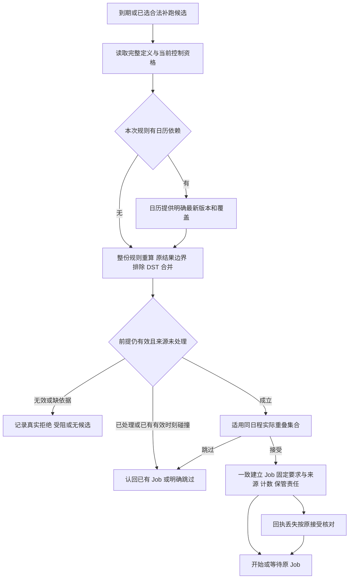
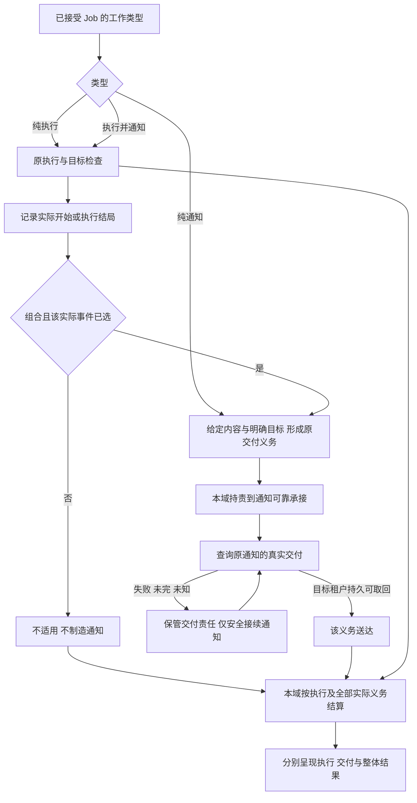
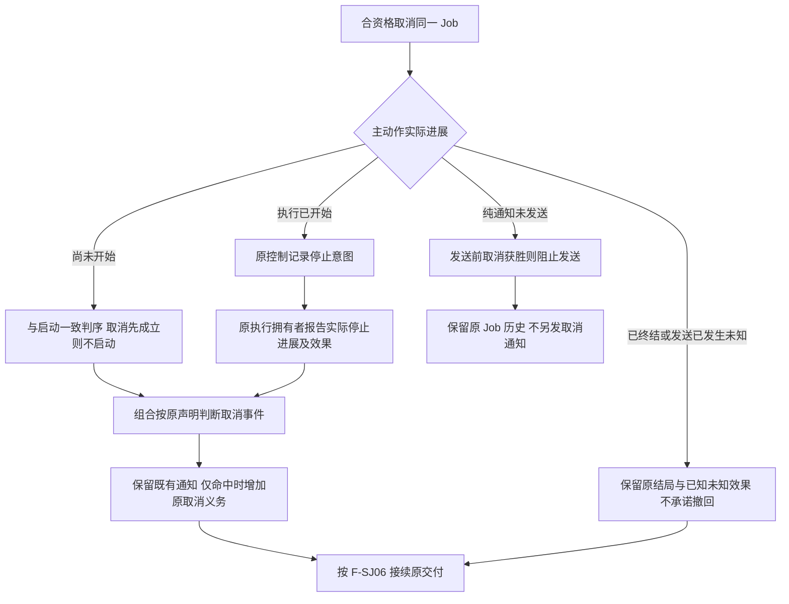

# 日程与作业协作设计候选

本页保存尚待技术采用的设计，不表示实现、产品接受或阶段承诺。完整必要行为见[schedule/schedule SPEC](../SPEC.md)，产品范围见[产品正文](../../../../.meta_harness/design/product/schedules-and-jobs/design.md)。

## F-SJ01 保存、预览与后续控制

对应 J-SJ01/J-SJ02，INV-SJ01–INV-SJ04/06/07/08/10/22。人/agent 提交完整意图，入口核对身份及当前资格，按工作类型校验声明和实际日期依据。preview 只读返回有界候选/原因；create/update 一致保存完整定义，创建启用、编辑保持管理状态。准入/计算拒绝不留半份生效；回执未知查原操作。pause/resume/stop 与接受有明确顺序，停止不取消旧 Job。预置只填入内容，不建立独立 Routine。

## F-SJ02 最终日期校验到可靠接受

对应 J-SJ02/J-SJ03，INV-SJ02–INV-SJ10。日常预算仅 t+1，到期/补跑才走接受。任何依据不足或当前条件不成立保留具体受阻，不以旧预算强行执行。

日期计算/资格是派生守卫；Job/来源处置/次数/责任是同提交业务单元；执行与通知是提交后交接。定义、日历、暂停/结束或去重前提变化要重核或冲突。调用顺序不足以证明跨拥有者一致性，Q-SJ03/Q-SJ04 提供机制证据。预算/预览不提前制造等待工作。

## F-SJ03 恢复区间与有界补跑

对应 J-SJ04，INV-SJ05–INV-SJ11/19/22/23。恢复认回已有 Job、控制及处理区间，以 T 为界求未处理合法漏过，按不补或最近 N 选取；排除更早积压并保存处置。T 当刻单独不占 N，再与选中工作合并按原定时刻逐项走 F-SJ02/F-SJ04。已有等待续原 Job，已处理跳过不重补，剩余次数不能被突破。原定截止内积压可截止后受理；手动 stop 后无新接受。恢复再次中断仍认回已接受及已处置部分，不能下一轮多补 N。

## F-SJ04 同安排重叠、排队与替换

对应 J-SJ05，INV-SJ08/10–INV-SJ12/18/19。跳过不建 Job；并行各自独立；等待先接受固定 Job，前序动作结束后在当前启动资格下继续；替换先接受再发前序控制，需停止的原动作确认后才开始。此前多个并行 Job 全部参与实际判断。确认失败/未知保持替换受阻，Session 归档或请求成功不代替停止。新 Job 取消不能撤销已发旧控制，日历新版不把等待 Job 再变候选。

## F-SJ06 实际事件、通知承接与整份工作

对应 J-SJ08，INV-SJ13–INV-SJ17/20/22。本域先固定本次事件声明，纯通知直接交给通知，组合只对已选实际事件形成义务。

源事件及义务共同可恢复，交接没有无人持责窗口。送达与已读/在线分开；通知失败不触发执行失败、不重做业务。组合成功仅在执行成功且全部已触发义务送达时成立；失败/取消的源执行不被送达洗成成功。回执丢失先查原通知，独立 send/成果提交不替原义务。

## F-SJ07 单次取消与启动、终结竞争

对应 J-SJ05/J-SJ09，INV-SJ11/12/16–INV-SJ20。查询资格和取消资格分开，不要求已有会话才可取消。

工作先开始则走停止，主动作先终结则不改其结局；旧停止控制与新 Job 取消分别保持。控制回执未知查原 Job，不假确认；重启/依赖恢复/目标检查不能复活已取消执行。任何分支都不退次数、不改 Schedule或其他 Job、不删除成果或回滚外部效果。

## F-SJ08 只读观察与提供者换代恢复

对应 J-SJ04/J-SJ10/J-SJ11，INV-SJ01/02/19–INV-SJ24。合资格查询读原定义/Job采用/结果和未完责任，投影滞后或故障如实显示；查询不触发写入、重跑或发送。换代停止新准入，原方保管区间/Job/控制/未知至可靠移交，接续方对账原执行/通知和取消后才续未完。无承接方明确受阻，不擦历史。资源释放仅撤自身贡献，晚到结果归原身份，实际残留报告。公共接口、配置和生命周期映射缺项见 Q-SJ02/Q-SJ04–Q-SJ06。

每个流程对应的 V-SJ01–V-SJ24 是持续验证义务。图、有限结构检查与作者自检均不证明并发、耐久、授权、目标判断或真实送达已经成立。
