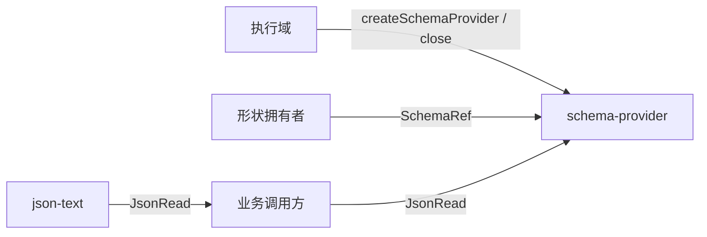

# Schema 提供者

本组只放形状校验的提供者。系统约束在[技术基础](../../docs/architecture/technical-foundations.md#schema提供者的检查与准入)。缓存键、并发首次编译、旧租约和失败不留成功缓存，由[缓存机制](../../docs/architecture/data-and-state.md#缓存懒加载与预热)规定。

本组不收集业务形状。每份公共形状仍由它自己的拥有者持有。本组不是治理领域，也不是 `util` 或 `common`。

## 责任与范围

本组拥有准入、首次编译、租约和槽位缓存。检查引擎是 Zod 4.6.5 与 Ajv 8。提供者在调用编译器之前遍历定义。

严格 JSON 读取归 `@omne-harness/json-text`。字段 codec 归形状拥有者。插件配置的 Standard Schema 留在原拥有者。

## 成员与依赖

| 成员 | 包名 | 拥有的能力 |
| --- | --- | --- |
| [schema-provider](schema-provider/README_ZH.md) | `@omne-harness/schema-provider` | 对 `JsonRead` 做校验，并持有本执行域的编译缓存 |

公开消费从该包的根入口开始。根入口不导入 Cordis。它依赖 `@omne-harness/json-text` 的公开类型。Zod 与 Ajv 只在实现编译时进入该包，不进入调用方的导入。

## 关键协作

形状拥有者发布 `SchemaRef`。业务调用方把 `JsonRead` 交给 `validate` 或 `lease`。执行域创建和关闭提供者。一个执行域一个提供者。Worker 不共享这份缓存。

## 组合验证

组内没有跨成员组合。读取失败的种类由 json-text 的测试锁定。准入、槽位和并发首次编译由 `schema-provider` 的测试锁定。

## 维护

新的业务形状留在原拥有者，不在本组新增成员。若要把循环 JSON Schema 的运行时检查开放出来，先接受那条检查，再改 `schema-provider` 的规格。不要把本组改成纯文本格式化或纯表示的收纳目录。
