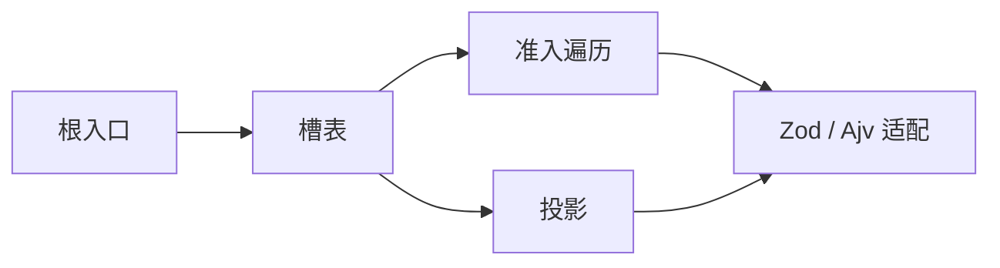
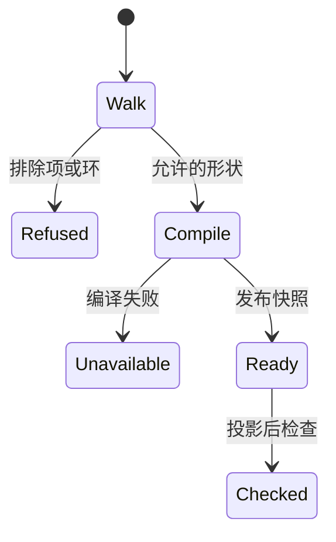
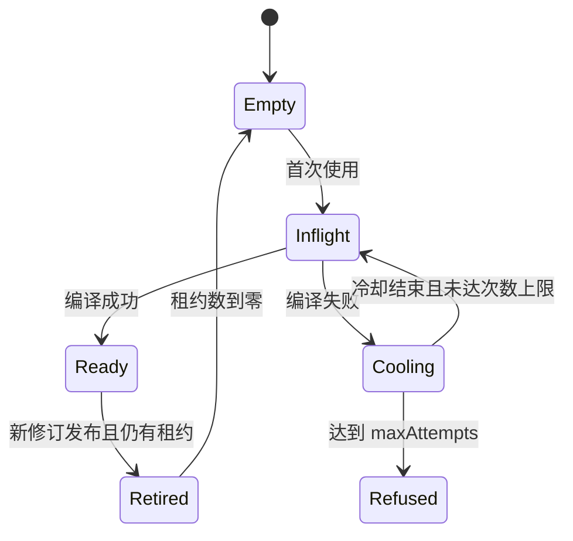

# Schema 提供者的内部结构

公开行为在 [SPEC.md](../SPEC.md)。本页说明这些行为落在哪些模块。

一次 `validate` 按这个顺序推进。

## 模块

根入口导出公开类型和函数。它不导入 Cordis，也不导入 Zod 或 Ajv 的类型。

准入遍历是纯函数。它在任何编译器调用之前阅读定义，选出拒绝原因，或算出结构摘要和依赖修订。摘要只在 `load` 之后计算一次。

投影是纯函数。它把 `JsonValue` 的 `lexeme` 和 `entries` 交给检查器。数字模式来自形状拥有者，没有全局默认。

引擎适配是唯一接触 Zod 和 Ajv 的模块。Zod 路径只在遍历通过后调用 `z.compile`。Ajv 路径关闭 coercion、default 和 remove。循环 JSON Schema 不到达 Ajv 编译。

提供者外壳持有槽表。它合并在途任务，发布快照，记录冷却，并持有租约计数。发布是对当前快照的一次替换。编译在临时区完成。失败不把临时区写成成功缓存。

## 状态

每个形状 id 的槽包含当前快照、至多一个在途任务、失败记录，以及仍有租约的旧快照。快照本身不可变。租约数是快照上唯一会变的计数。

Worker 不共享这张表。不跑校验的执行域不创建提供者。
