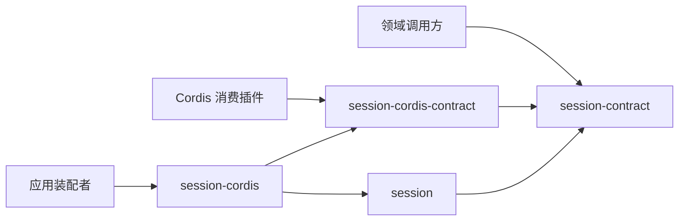

# 会话组的成员与外部协作

状态为待审技术设计。正式维护位置不授予技术接受、实施或支持；精确公开形状仍待定义。

## 后续拥有者与验证

Session成员须兑现受理同提交、输入承接、唯一推进、终态、归档和恢复协调。Agent成员兑现原位置求值和消费，Model与Tool成员兑现实际执行及各自交接。组合验证覆盖完整正常链及受理回执丢失、推进竞争、等待换代、取消和完成竞争、迟到与局部服务故障。

日志条目模型、原生业务事件语义、正交状态及完整批次转移、共同提交、原操作认回、固定分页及投影恢复已形成候选设计。精确公共 Schema/API、提交提供者及断电证据、跨能力实际发起围栏、控制/级联/ACK 协调、跨会话完整授权投递、在途内容耐久衔接、模式修改授权及租户时限配置仍须由实际拥有者完成。技术机制缺项不取消全部十七项完整支持目标，也不将本候选宣称为可直接施工的完整 API 设计。

## 成员与邻接依赖

本组按四种安装角色划分成员。内部受理、日志、Run、attempt、控制及消费角色是其设计责任，不自动拆成包、数据表、服务或进程。新增成员须有独立公开承诺及已接受边界，不因长文或存储选型新增治理层。

Agent 提供下一步求值，Model 与 Tool 提供真实执行及结果，HITL 提供原卡片有效答复，Context 提供请求输入，assembly 提供合法清单与安全采用，身份及设置提供当前资格和配置。session 通过公开事实和明确协调协议消费，治理关联不取得对方物理生命周期。

## 组合验证与维护

成员之间通过纯契约与唯一框架定义协作，组合性质来自 session 与邻接能力。成员承担不可变历史、原操作认回、共同治理提交和唯一推进；实际调用、控制、消费及共享源拥有者共同验证围栏、原等待、两条合法交接路径、归档级联和动态合法选择。持续资源随实际成员及协调者，不在组根建运行入口。

工程分解及邻接变化由组维护者同步入口和组合验证；精确算法、Schema/API、提供者和状态解释在 session 维护。具名维护人、可运行资源及尺度尚缺。后续技术义务见 [SW-M01](../session/docs/architecture/mechanisms.md#sw-m01-技术兑现义务)，图完整不代替兑现。

## 安装与源码依赖

纯契约及通用实现均不依赖 Cordis。Definitions 的绑定只从 `./cordis` 导出，根入口不加载绑定。具体提供者注入纯工厂，不反向决定契约。所有运行接口仍是候选。Session 是治理服务，Run 与 attempt 是逻辑对象；不增加第四种 runtime、每会话 Context 或实例目录。具体事务提供者尚未选择。

工厂配置与依赖聚合归 [session](../session/docs/public-api.md)；领域操作与提供者端口归 [session-contract](../session-contract/README.md)。
