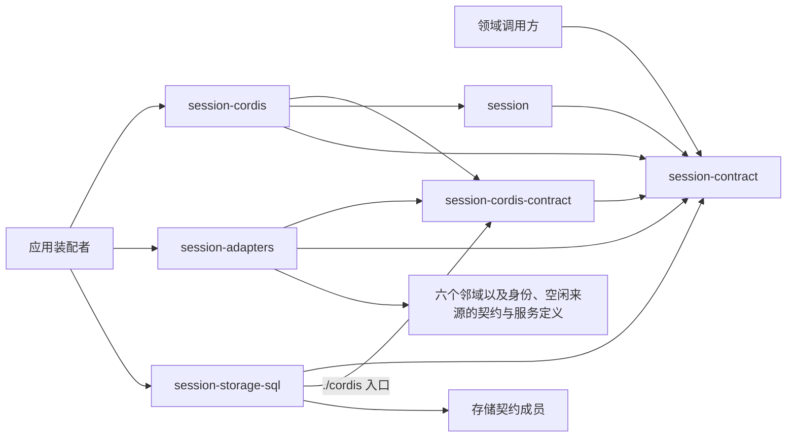

# 会话组的成员与外部协作

状态为候选技术设计。正式维护位置不授予技术接受、实施或支持。

## 成员分解与邻接协作

本组按六个成员划分：纯契约、唯一服务定义、通用机制、Cordis 服务实现、邻域适配和存储介质。分法依据是变化原因，不是对象。治理规则变了，改契约与通用机制；邻域契约变了，只改适配插件；换存储介质，只换存储成员。受理、日志、Run、执行尝试、控制和消费是设计责任，不自动拆成包、数据表、服务或进程。

Session 在六个邻域中扮演邻域契约里的通用角色：对 Agent 是外部协调者、提交参加者、事件消费者和恢复发现者；对 Model 是消费位置拥有者，以资格参加者协议闭合为前提参加它的受理点守卫；对 Tool 是启动围栏 ToolStartAuthority 的资格版本拥有者，撤销资格后调用 `invalidate`；对 Runtime Context 是作用域持有者与 `session.*` 块生产者；对 Request Context 是历史持有者；对执行环境只经两条间接线相接。完整角色表见[会话与工作](../../../docs/architecture/runtime/session-and-run.md#session-的三层与邻域角色)。Session 不发起或控制模型调用与工具执行，这些都由 Agent 发起。

## 安装与源码依赖

- `session-contract` 不依赖任何邻域契约，也不依赖 Cordis。出站端口的接口在这里声明：本域只说自己要什么。
- `session` 只依赖 `session-contract`，经本域端口与出站端口接口呼出，根入口不加载 Cordis。
- `session-cordis` 依赖前三者，不依赖邻域契约与存储后端。
- `session-adapters` 是唯一导入邻域契约的成员。它与 `session-cordis` 没有编译期依赖，出站端口的服务键由装配接上。
- `session-storage-sql` 依赖 `session-contract` 与存储契约成员。存储契约没有可依赖的成员时，它的 SPEC 写期望端口并标出依赖。

出站端口的形状与 Agent 契约把模型、上下文等端口交给外域提供者的做法相同：接口在契约成员，服务键在服务定义成员，实现在适配成员。服务实现按调用经 `ctx.get` 现取出站端口，不把它们写进 `inject`。

## 落位判据

新增一段代码时，按下表选成员。一段代码同时满足几条时，取最靠下的一条。

| 这段代码需要什么 | 放在 |
| --- | --- |
| 只用类型、值、身份与纯判断，不调用任何东西 | `session-contract` |
| 用替身就能跑完整个状态机 | `session` |
| 要碰真实时钟、通知总线或装配端口 | `session-cordis` |
| 要导入任何邻域契约 | `session-adapters` |
| 与存储介质相关 | `session-storage-sql` |

## Cordis 落位

| 成员 | 模板变体 | 根入口 | 提供什么 | 注入什么 |
| --- | --- | --- | --- | --- |
| `session-contract` | module | 无 Cordis | 类型、端口接口、领域服务 | 无 |
| `session-cordis-contract` | service-contract | 绑定只从 `./cordis` 导出 | 服务键 `session`，四个面挂同一个键；调用方类；出站端口的服务键；`Events` | 无 |
| `session` | module | 无 Cordis | 纯工厂与 `SchedulingPolicy` 等配置 | 无；依赖经工厂参数传入 |
| `session-cordis` | service-provider | 按模板 | `session` 服务实现、计时与通知订阅、扫描者 | 只有事务端口 `sessionTransactions` 与内部主体 `sessionPrincipals`。身份与证据桥、时钟、空闲与 Context 输入、通知者与出站端口按调用经 `ctx.get` 现取（[端口服务键](../session-cordis-contract/docs/cordis.md#端口服务键)） |
| `session-adapters` | cordis-module | 按模板 | 入站适配插件提供的邻域端口与登记；出站端口的实现 | `session` 服务（按调用方类）与各邻域的服务 |
| `session-storage-sql` | cordis-module | 按模板 | 事务端口、存储参加者模块与迁移片段 | 存储契约的服务 |

装配规则沿 [Cordis 集成约定](../../../docs/architecture/cordis-integration-conventions.md)：一个接缝一个服务定义，键写一次；只有缺席时整个服务不能成立的依赖用 `inject`，缺席只影响部分操作的端口按调用现取，数据不用 `inject`；租户是操作参数，不用 isolate 表达租户或会话；可调参数是配置字段，用 Standard Schema 校验；提交参加者的登记随插件生命周期，撤除插件不撤销已经提交的业务事实。每个租户一个扫描者，这一条第一版靠装配单实例兑现，见 [IC-19](../../../docs/architecture/cordis-integration-conventions.md#ic-19)。

## SOLID 与扩展边界

| 原则 | 本组的具体选择 | 必须防止的反例 |
| --- | --- | --- |
| 单一职责 | 六处各管一件事：领域服务裁定允许或拒绝，命令处理编排一次提交，调度器决定何时检查，协调器决定发出什么，适配插件决定怎样调用邻域，存储成员管介质 | 协调器里写允许或拒绝的规则；存储成员里写治理判断 |
| 开闭 | 新的控制种类、派生消息和恢复任务类型是目录与联合类型的新变体。开闭只对入站邻域成立：新的入站邻域是一个新适配插件，不改 `session-contract`。新增出站方向时，在 `session-contract` 加一个出站端口接口，这是唯一允许的契约改动，因为依赖倒置要求出站接口由本域声明 | 为接入一个新的入站邻域而改 `session-contract`；新增出站方向时让 `session` 直接导入邻域契约，绕过出站端口接口 |
| 里氏替换 | 存储、身份、时钟、空闲与 Context 输入的替身与真实实现可以互换；调度器可以整体换成外部工作流引擎，只要它仍只产生带同一操作身份的命令 | 替身返回真实实现不会给出的结局 |
| 接口隔离 | 四个面按调用方切分：受理方拿不到开始 Run，Agent 协调方拿不到创建会话，读取方拿不到任何变更操作 | 一个什么都能做的服务面 |
| 依赖倒置 | `session` 依赖端口接口；出站端口的接口在契约成员，键在服务定义成员，实现在适配成员 | `session` 直接导入邻域契约 |

各成员的 `docs/architecture.md` 再按同样三栏写本成员的选择。

## 组合验证与维护

成员之间通过纯契约与唯一服务定义协作，组合性质来自 Session 与邻域一起兑现。Session 一侧承担不可变历史、原操作认回、共同提交和唯一推进；调用、控制、消费和共享来源的拥有者共同验证围栏、原等待、两条交接路径、归档级联和作用域释放。持续验证资源随实际成员与协调者，不在组根建运行入口。

精确算法、事件与 API、提供者和状态解释在各成员维护。跨能力的兑现义务见 [SW-M01](../session/docs/architecture/mechanisms.md#sw-m01-技术兑现义务)。具名维护人、可运行资源及尺度仍缺。
