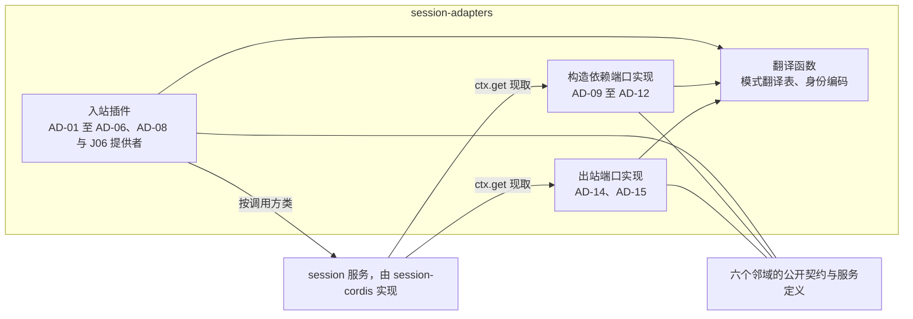

# 内部架构

本页的插件图描述候选装配；当前已交付的内存测试提供者见下文“共同日志内存提供者”。

本文件说明本成员怎样兑现 [SPEC.md](../SPEC.md)：模块划分、依赖方向、状态与资源归属、关键机制及理由。组级的成员分解与落位判据归[组架构](../../docs/architecture.md)，本页不复述。

## 模块与依赖

### 为什么只有本成员导入邻域契约

Session 认识全部邻域，邻域都不认识 Session（[五个锚点](../../session-contract/SPEC.md#五个锚点)第 2 条）。这条要求有两个后果：

1. 邻域契约里只出现通用角色。所以 Session 一侧必须有一处把 Session 的名称与形状翻译成这些通用角色的操作。
2. `session-contract` 与 `session` 不能依赖任何邻域契约，否则一个邻域契约的变化会改动治理规则与状态机。

本成员就是这一处。邻域契约变化时只改本成员（[组架构的成员分解](../../docs/architecture.md#成员分解与邻接协作)）。组的落位判据把「要导入任何邻域契约的代码」放在本成员（[落位判据](../../docs/architecture.md#落位判据)）。

### 边界

| 在本成员 | 不在本成员 |
| --- | --- |
| 邻域操作与 Session 命令之间的翻译 | 允许或拒绝的规则：归 `session-contract` 的领域服务 |
| 邻域结果到 Session 结果的对应 | 何时检查、何时重放：归 `session` 的调度器与协调器。唯一例外是作用域释放的重新释放子插件：只有本成员看得到执行环境提供者换代，它在换代后自己发起一轮按页重新释放，重试间隔与页大小是该子插件自己的配置字段，默认值只是配置初值 |
| 端口实现与入站插件的登记 | 服务实现、注入与扫描者：归 `session-cordis` |
| `session.modes` 的翻译表与块声明的翻译 | 块声明本身：归 `session-contract` |
| 可丢的派生物：句柄、订阅、上一份快照、前缀摘要缓存 | 会话事实、游标与任务：归会话日志，由 `session-storage-sql` 保存 |

### 模块

| 模块 | 持有的状态与资源 | 允许的依赖 |
| --- | --- | --- |
| 入站插件 | 订阅、句柄、上一份快照、前缀摘要缓存。都是派生物 | `session-contract` 类型；`session-cordis-contract` 的键与增补；邻域的契约与服务定义 |
| 构造依赖端口实现 | 无业务状态 | 同上，不调用 `session` 的写操作 |
| 出站端口实现 | 执行句柄；恢复授权的引用（由装配交入） | 同上 |
| 翻译函数 | 无。纯函数 | 只依赖两方的类型 |

依赖方向：

- 本成员依赖 `session-contract` 与 `session-cordis-contract`，不依赖 `session`、`session-cordis` 或 `session-storage-sql`。
- 本成员与 `session-cordis` 没有编译期依赖。出站端口与构造依赖端口的服务键由装配接上。
- 本成员不导入邻域的提供者实现，只导入邻域契约与服务定义（[IC-5](../../../../docs/architecture/cordis-integration-conventions.md#ic-5)）。
- 当前 `package.json` 为 `./testing` 声明 Agent、Session、Model、Tool 与公共值成员的直接依赖。根入口和 Cordis 入口仍无运行插件。上述服务键与插件依赖是候选装配的约束，不是已建立的运行关系。

## 共同日志内存提供者

`testing/factory.ts` 将公开 Session 纯函数、Agent 端口和归一逻辑接到一个 `(tenant, session)` 根。`root.ts` 独占草稿和发布点；`journal.ts`、`journal-receiving.ts` 与 `session.ts` 都在该根提交。没有包装第二个内存 store。调用者只看到已经发布的根，故障注入也位于该发布边界。

| 内部模块 | 责任 |
| --- | --- |
| `root.ts` | 同域根、原操作、当前资格与共享 gap 门、发布前后故障和通知 |
| `journal.ts`、`journal-receiving.ts` | Agent 全端口、原输入和控制、材料/received 交接及原答案 |
| `session.ts`、`session-sources.ts` | 调用 Session 纯决定/归并、Session 原答案和来源索引 |
| `history.ts`、`human.ts`、`control.ts`、`background.ts`、`model-settlement.ts` | 从原版本归一，不用当前 checkpoint 补历史 |
| `frontier.ts` | 捕获全部相关交入关系、预算续读、未知认回和当前根复核 |
| `result-preparation.ts` | 新结果参加前独立解释此前原 Pending 的登记 |

索引随原事实同批保存，作用域根持有直到内存后端释放。实现没有磁盘持久化或重启恢复。每次发布复制 Map 和相关数组，所以根复制成本仍随保留历史增长；预算和同根索引约束必要读取，不能证明总发布成本为常量。端口、夹具前提与验证边界见 [testing.md](testing.md)，行为承诺归 SPEC 的 AD-01/02/05。

## 关键机制与理由

### 每个插件一个调用方类

调用方类是对象形式 `inject` 的 intercept 配置。一个插件对一个服务键只有一份配置。所以一项适配需要两个调用方类时，拆成两个插件，例如 AD-03 的持有者与回放子插件。代价是多一个 fiber。好处是调用方类的核对保持简单，错误的组合在装配时就能看到。

### 翻译是确定的纯函数

身份编码与模式翻译不读时间、随机数或连接。崩溃前后同一意图得到同一邻域身份，所以邻域能认回原操作，本成员不必保存映射表。模式翻译在模式变化时算好，热路径只读取结果，不在请求时求值。

### 原生产者确认只从日志投影

生产者解除由 Agent 宿主的结果接收方发出。Tool 原确认经 AgentJournal.recordResult 保存在同一日志，AD-05 按 [JC-Release](../../session-contract/SPEC.md#jc-release) 核对并提交 receive(release)。AD-06 只解释 Tool 收场与账目。Model ACK 缺少合法公开到达路径时保持 pending。Session 不维护另一份释放映射，也不以 saved 冒充 ACK。

### 结果对应写成封闭表

每个插件把邻域的结果逐一对应到 Session 的结果。表外的结果按依赖不可用处理并报告。理由：一个翻译缺陷如果被对应成业务拒绝，会产生错误的耐久事实，例如把非准入的 `invalid` 当成拒收而写 SE35 rejected。

### 派生物可丢

上一份快照、前缀摘要与执行句柄只在进程内保存。丢失时取完整快照、重读或以 `resume` 取得新句柄。已提交事实与原生产者确认从同一日志恢复；完整 Tool 收场材料缺席则 unavailable，保留任务。

### 缺口不靠发明补齐

邻域缺少的能力写成具名前提，插件在闭合前不登记或返回不可用。本成员不为邻域发明操作。这样邻域拥有者能看到真实需求，本成员也不会依赖一个邻域从未承诺的行为。

## SOLID 与扩展边界

| 原则 | 本成员的具体选择 | 必须防止的反例 |
| --- | --- | --- |
| 单一职责 | 一个插件只适配一个邻域的一种角色。翻译函数只翻译，不判断允许或拒绝 | 在插件里写 `judgeAdvance` 之类的规则；一个插件同时担任历史持有者与生产者消费侧 |
| 开闭 | 新的入站邻域是一个新插件，不改 `session-contract`。邻域契约新增操作时，只改对应插件与它的对应表。新增出站方向时，先在 `session-contract` 加出站端口接口，再在本成员加实现 | 为接入新邻域而改 `session-contract` 的命令；在 `session` 里直接导入邻域契约 |
| 里氏替换 | 每个端口实现与替身返回同一组结果种类 | 用空页或默认允许冒充 unavailable |
| 接口隔离 | 插件只注入它用到的邻域服务，只以它需要的调用方类调用 `session` | 一个插件注入全部邻域服务，以 `maintainer` 做所有事 |
| 依赖倒置 | 出站与构造依赖端口的接口在 `session-contract`，键在 `session-cordis-contract`，实现在本成员 | 由本成员定义 Session 端口的形状或服务键 |

## 验证与维护

- 保证与验证的对应在 [SPEC 的组合与验证](../SPEC.md#组合与验证)。每个插件的对应表都要有覆盖每一行的测试。
- 邻域契约变化时，同步对应插件的翻译、对应表与 [docs/flows.md](flows.md) 中的流程，再复核 [SPEC 的插件清单](../SPEC.md#插件清单)。
- Session 契约的端口或命令变化时，同步对应插件，并复核 [docs/cordis.md](cordis.md) 的键与调用方类。
- 具名前提闭合时，更新插件状态、删除 SPEC 中对应的缺口行，并补上行为与验证。
- 本成员的维护人由负责人指定，见[组入口](../../README.md)。
