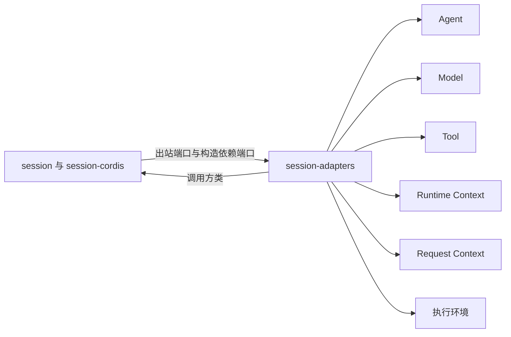

# 使用与定位

本页说明谁安装本成员、怎样使用它，以及它在系统里的位置。行为归 [SPEC.md](../SPEC.md)，Cordis 承载归 [cordis.md](cordis.md)。

## 使用方式

本成员只服务会话路径。独立使用 Agent、Model、Tool 或 Context 的调用方不需要它：邻域契约里只有通用角色，独立调用者按邻域自己的契约使用。

应用装配者按下列步骤使用本成员：

1. 装载 [session-cordis](../../session-cordis/README.md) 与一个存储提供者，例如 [session-storage-sql](../../session-storage-sql/README.md)。
2. 从 `@omne-harness/session-adapters/cordis` 装载需要的插件。插件清单与当前状态见 [SPEC 的插件清单](../SPEC.md#插件清单)。状态为「待」的插件不装载。
3. 由装配入口构造 AD-15，并交入应用装配层维护拥有者签发的恢复授权。
4. 在 Agent 宿主外侧装配结果接收方。由它取得 Model 与 Tool 的生产者读取资格，并把结果与账目写入同一会话日志。[AD-05](../SPEC.md#ad-05) 只读日志，不提供 Model owner 的受信证据适配器。Model ACK 到达路径仍按 [JC-Release](../../session-contract/SPEC.md#jc-release) 的未决义务处理，未确认时保持 pending。
5. 确认同一会话日志的 Journal 提供者在 `AgentJournal.capabilities.participants` 中声明 AD-01 的四种参加种类（[PA-04](../../session-contract/SPEC.md#pa-04)）。缺一种时，装配被拒绝。这个提供者与 Session 共用一个发布边界，不是另一个执行记录事实库。

只需要模式翻译或身份编码的测试与工具，从根入口导入纯函数，不装 Cordis。

## 消费者与定位

| 消费者 | 怎样使用本成员 | 读什么 |
| --- | --- | --- |
| session-cordis | 按调用经 `ctx.get` 现取出站端口与构造依赖端口，交给 `session` 的协调器 | [SPEC 的出站端口](../SPEC.md#出站端口的实现) |
| Agent 的执行记录提供者 | 在共同提交里调用 Session 参加者 | [AD-01](../SPEC.md#ad-01) |
| Agent 会话路径 | 调用消息准入与当前条件两个提供者；模型选择由应用装配适配 | [J06](../SPEC.md#j06-会话路径的两个-agent-提供者) |
| Request Context 的组装 | 经 `HistorySource` 读会话历史 | [AD-04](../SPEC.md#ad-04) |
| 应用装配者 | 选择插件、交入恢复授权、装配 Agent 宿主外侧的结果接收方 | 本页与 [cordis.md](cordis.md) |

Session 对六个邻域担任的通用角色见系统页的[邻域角色](../../../../docs/architecture/runtime/session-and-run.md#session-的三层与邻域角色)。本成员是这些角色在代码中的唯一位置。Session 不发起或控制模型调用与工具执行，这些都由 Agent 发起。本成员读取同日志的 Model/Tool 结果与账目。原生产者的读取与交付解除归 Agent 宿主结果接收方；Model ACK 仍未决，见 [JC-Release](../../session-contract/SPEC.md#jc-release)。
