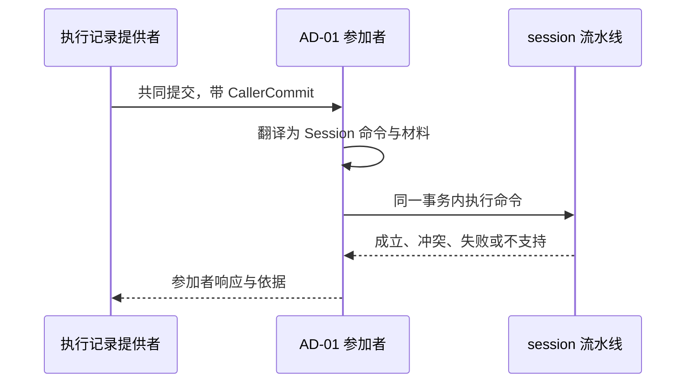
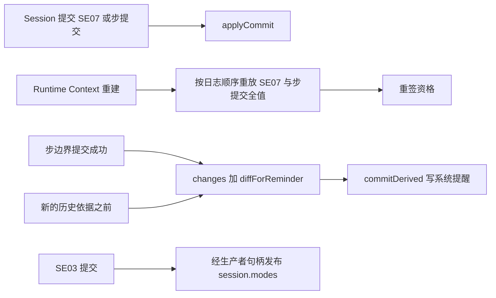
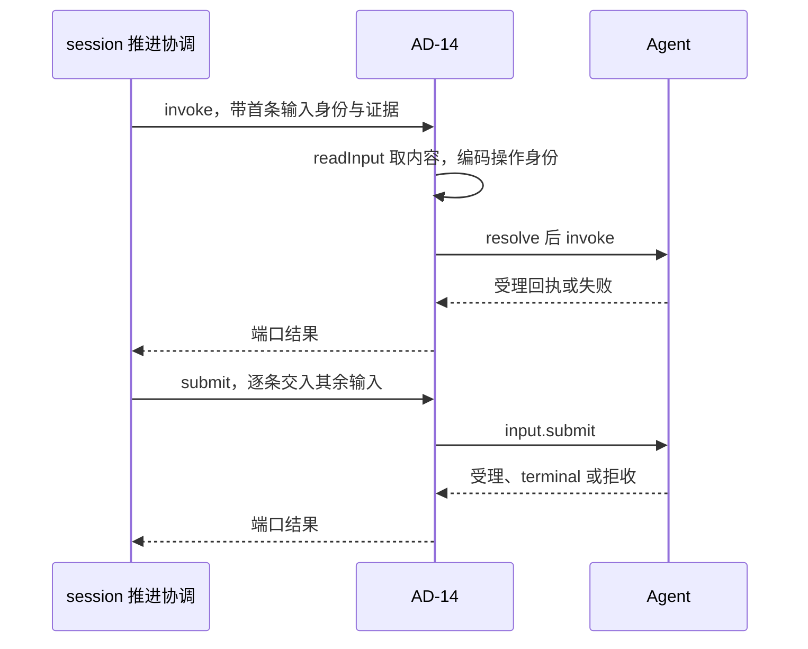
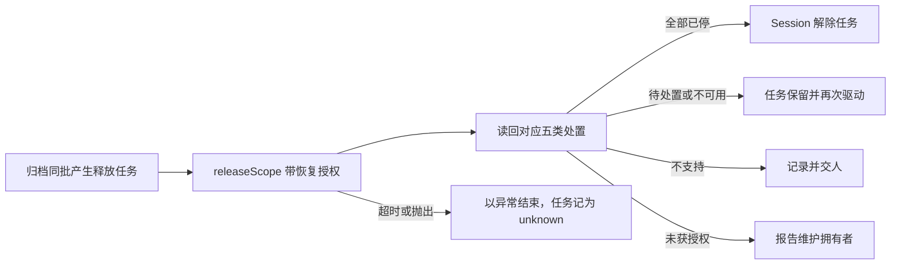

# 关键流程

本页为每个插件写一条流程：触发、步骤、数据去向与失败分支。行为条款归 [SPEC.md](../SPEC.md)，跨成员的流程归[组的协作入口](../../docs/key-flows.md)。本页不复述 Session 契约的条款，只写本成员一侧的步骤。

## 流程

### FA-01 Agent 共同提交中的参加

对应 [AD-01](../SPEC.md#ad-01)。

1. 执行记录提供者在一次共同提交里交来调用方交接。
2. 参加者按交接种类选命令：`message` 为 `recordMessage`，`context-transition` 为 `commitDerived(compaction)`，`custody` 为 `preserveResult`，`processed` 为 `completeConsumption`。
3. Session 流水线在同一事务里认回、读权威状态、裁定并写事实。
4. 参加者按 SPEC 的对应表回答参加、冲突、失败或不支持。冲突带当前事实作为依据。
5. 提交成功后，参加者把修订与回执交给 Session 记入 `ExecutionRef`。

只读核对走同一条路：`open` 与 `submit` 核来源依据，`tryFinish` 核待交输入与取消。核对不写 Session 条目。

### FA-02 Agent 事件到会话事实

对应 [AD-02](../SPEC.md#ad-02)。

1. 插件以 `readWork` 取 `readThrough`。
2. 插件从 `readThrough` 之后订阅 `output.events`，或以 `output.read` 按页读取。
3. 对每个产生条目的事件，插件以 `receive(agent-event)` 提交，身份为执行与序号。游标随条目同批保存。
4. 提交成功后，插件以 `output.acknowledge` 确认已持久的前缀。
5. 读到缺口时，插件以 `agentExecutionRecovery.load` 取快照，按快照对账后从缺口之后继续。

数据去向：承接、登记、等待、控制阶段与终态进会话日志。确认交回 Agent。

### FA-03 Runtime Context 的持有、供给与变化提醒

对应 [AD-03](../SPEC.md#ad-03)。

1. 注册：`change` 提交注册决定后，插件以 `applyCommit` 交给 Runtime Context。提交未知时，插件先查询原操作，不先应用。
2. 重放：Runtime Context 重建后，插件在该作用域第一次签发资格之前按日志顺序重放 SE07，交回每个 `checkpointed` 块的步提交全值，再重签资格。
3. 供给：SE03 提交后，插件发布 `session.modes` 的新值。重建后由按作用域供值的回调重新发布日志里的值。
4. 变化提醒：在两个必拉时点，插件以模型类读者的游标调 `changes`，再以上一份快照调 `diffForReminder`，然后以 `commitDerived(context-reminder)` 写系统提醒。
5. 压缩提交之后，插件重签模型类读者的资格。会话归档后，插件撤销该作用域的全部资格。

### FA-04 历史源读取与未结工作下界

对应 [AD-04](../SPEC.md#ad-04)。本流程待 [NP-01](../SPEC.md#np-01) 与 [NP-02](../SPEC.md#np-02) 闭合。

1. 一次组装开始时，插件先完成 FA-03 第 4 步的补拉，再给出历史依据：epoch、上界、作用域引用与访问身份。
2. Request Context 以 `HistorySource.read` 带依据、游标与字节预算读取。插件返回一页，每行带前缀摘要。
3. epoch 已变时，插件返回 `epoch-changed`。Request Context 用新依据重取。
4. 需要压缩时，插件以 `readWork` 与 `openWork` 求出未结工作的条目引用集合，交给压缩计划作为下界。
5. 压缩转换经 FA-01 的 `context-transition` 提交。提交之后的重签见 FA-03 第 5 步。

### FA-05 Model 的交付责任解除与账目

对应 [AD-05](../SPEC.md#ad-05)。

1. SE20 或 SE21 提交成功。插件由提交通知或恢复协调的读取得知。
2. 插件以 `consumption.acknowledge` 发出 ACK，证据取自该提交的原回执。
3. Model 确认后，插件以 `receive(release)` 写回确认。Model 未就绪时，`release` 保持 pending。
4. Agent 不在场时，插件以 `calls.inspect` 与 `calls.dispatches` 读收场与账目，以 `receive(execution)` 与 `receive(account)` 提交。

受理点守卫的参加不在本流程里：协议闭合之前，会话的 owner 声明为免守卫。

### FA-06 Tool 的交付责任解除、查询与后台结果

对应 [AD-06](../SPEC.md#ad-06)。

1. SE20 或 SE21 提交成功后，插件以 `commands.releaseDelivery` 解除交付责任。
2. 结果为 `released` 时，插件以 `receive(release)` 写回原生产者的回执。结果未知时，插件以 `queries.queryOperation` 查询。
3. 对账与恢复时，插件以 `queries.lookup`、`queries.readResult`、`content.read` 与 `queries.account` 读取，再以 `receive` 提交收场、转后台确认与账目。
4. Run 终态后到达、仍有投递资格的后台结果：插件先登记结果，再以 `accept(business)` 交给受理。原 Run 不复活。

### FA-07 模型选择

对应 [AD-07](../SPEC.md#ad-07)。

1. Agent 准备请求时调用 `ModelSelection.select`。
2. 插件取 `conditions.model` 作为当前选择的采用依据，从历史依据取模态要求。
3. 插件以 `modelProfiles.resolve` 解析档案，返回实际收件模型、档案、参数与证据。
4. 档案不可选或不相容时，插件返回失败。Agent 不发出这次请求。

### FA-08 受理拓展点

对应 [AD-08](../SPEC.md#ad-08)。本流程待 [NP-07](../SPEC.md#np-07) 闭合。

1. 输入到达。插件依次经过用途提醒、内容型斜杠命令展开与提示提交 hook。
2. 拦截时，插件返回原因，不保管正文。
3. 放行时，插件以 `accept` 提交输入与拓展点的留痕。
4. 提交之后，受理后一组做分流与推进条件检查，不改已提交的内容。

### FA-09 身份、证据、空闲与 Context 输入

对应 [AD-09](../SPEC.md#ad-09) 至 [AD-12](../SPEC.md#ad-12)。

1. Session 的命令处理按命令种类现取需要的端口。
2. 端口实现读邻域的公开契约，生成版本化的 `GuardCommand`。
3. Session 把材料放进同一次提交。材料不全时，命令不提交。
4. 端口不可用时，只有需要它的命令返回 `unavailable`。

证据桥在 `startRun` 与 `reload` 时把 Tool 在采用点给出的常驻工具、登记键与冻结判定放进候选采用材料。带回冻结判定时，命令返回 `frozen`，推进协调随后调用 `freeze`。

### FA-10 Tool 驻留端口

对应 [AD-13](../SPEC.md#ad-13)。本流程待 [P-8](../../session-contract/SPEC.md#具名前提与明确缺项) 闭合。

1. Tool 宿主的协调者调用 `ToolResidencyReader.referencing`。读取插件把登记键编码为 `ResidentKey`，以 `references` 逐页读取并返回。
2. Tool 宿主的协调者调用 `ToolResidencyActions.freeze`。动作插件取得租户，以 `freeze` 提交。重复调用认回原回执。

### FA-11 驱动 Agent

对应 [AD-14](../SPEC.md#ad-14)。

1. 推进协调调用 `invoke`。插件以 `readInput` 取首条输入的内容，取得 `AgentRuntime` 并发起执行，保留返回的句柄。
2. 推进协调逐条调用 `submit`。插件经句柄交入输入。
3. 接续时，插件以 `resume` 取得新挂接与新句柄。换代撤旧时，插件先 `load` 取挂接资格，再 `detach`。
4. 控制传播时，插件经句柄送达 `control`。
5. 结果未知时，推进协调调用 `query`。插件以 `agentExecutionRecovery.query` 查询。
6. 消息准入拒收时，插件返回 `invalid` 与拒收证据，推进协调以 `receive` 写拒收事实。

### FA-12 作用域释放

对应 [AD-15](../SPEC.md#ad-15)。

1. 归档协调或级联推进以任务的操作身份调用 `release`。
2. 插件解码作用域引用，带装配交入的恢复授权调用 `releaseScope`。
3. 插件把读回逐项对应为处置，交回 Session。Session 以 `receive(scope-release)` 写读回事实。
4. 执行环境提供者换代时，插件按页重新释放已归档会话的作用域。

### FA-13 Tool 启动资格失效

对应 [AD-16](../SPEC.md#ad-16)。

1. 撤销资格的提交成功后，控制传播、归档协调或推进协调调用 `invalidate`。
2. 插件编码 `StartGuard` 与操作身份，调用 `toolStartAuthority.invalidate`。
3. 成功时返回 `effective`，Session 以 `receive(start-fence)` 计入对账进度。其他结果使任务保留并重放。

## 失败与生命周期

| 情形 | 本成员的动作 | 不做 |
| --- | --- | --- |
| 邻域不可用 | 返回 `unavailable` 或保留任务 | 不回滚已提交的会话事实 |
| 邻域结果未知 | 按原身份查询，查询前不发出依赖它的效果 | 不换身份重发 |
| Session 提交未知 | 不向邻域确认，先查询原操作 | 不调用 `output.acknowledge`、`applyCommit` 或交付责任解除 |
| 翻译失败 | 报告翻译缺陷，按依赖不可用处理 | 不映射为业务拒绝 |
| 句柄不在 | `submit`、`control` 返回 `unavailable`；事件经快照对账 | 不声称已送达或已读到 |
| 依赖服务换代 | 插件体重跑，在途调用按原身份认回 | 不换身份 |
| 插件卸载 | 停止新调用与订阅，取消在途等待，撤除登记 | 不撤回已交给邻域的确认、释放或外部效果 |
