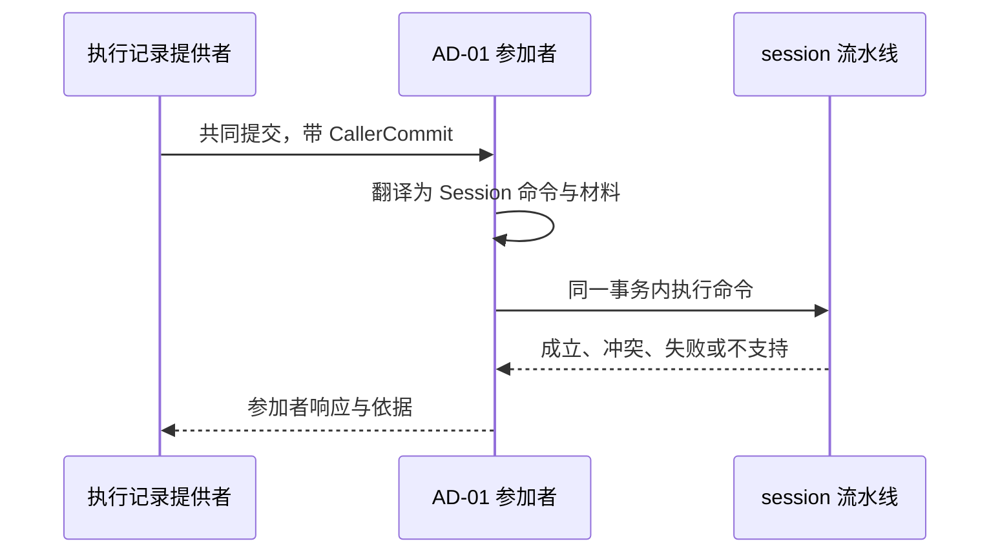
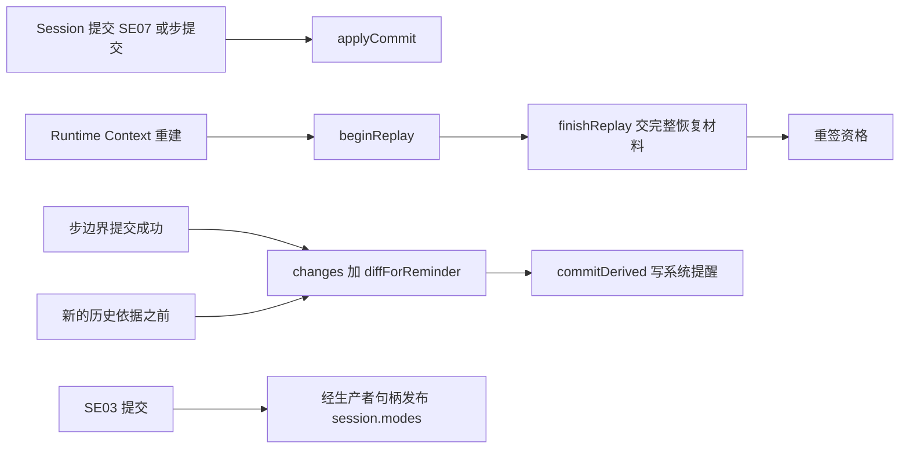
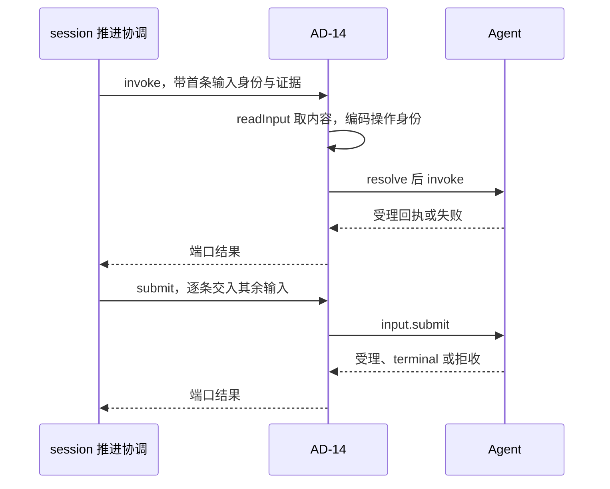
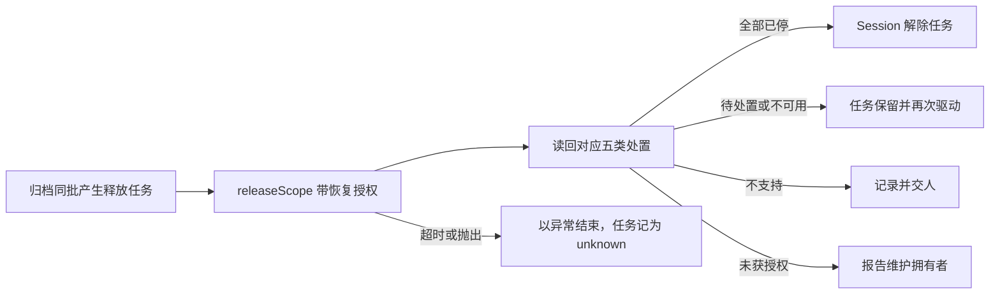
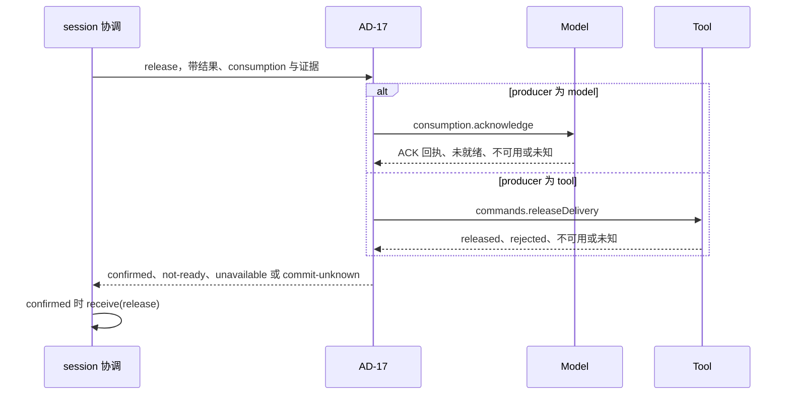

# 关键流程

本页为每个插件写一条流程：触发、步骤、数据去向与失败分支。行为条款归 [SPEC.md](../SPEC.md)，跨成员的流程归[组的协作入口](../../docs/key-flows.md)。本页不复述 Session 契约的条款，只写本成员一侧的步骤。

## 流程

### FA-01 Agent 共同提交中的参加

对应 [AD-01](../SPEC.md#ad-01)。

1. 执行记录提供者在一次共同提交里交来调用方交接。
2. 参加者按交接种类选命令：`message` 为 `recordMessage`，`context-transition` 为 `commitDerived(compaction)`，`custody` 为 `preserveResult`，`processed` 为 `completeConsumption`。
3. Session 流水线在同一事务里认回、读权威状态、裁定并写事实。
4. 参加者按 SPEC 的对应表回答参加、冲突、失败或不支持。冲突带当前事实作为依据。
5. 提交成功后，参加者把修订与回执交给 Session 记入 `ExecutionRef`。

只读核对走同一条路：`open` 与 `submit` 核来源依据，`tryFinish` 核待交输入与取消。核对不写 Session 条目。

### FA-02 同日志 Agent 事实解释

对应 [AD-02](../SPEC.md#ad-02)。本流程为待评审候选。

1. Agent 的首次提交共同发布原事实、适用的四类 CallerCommit 参加事实及 Agent 原操作答案。received、完整材料、消费绑定与 saved 同批。open/submit/tryFinish 的 Session 参加只读核对。
2. 解释器经同一 AgentJournal 提供者的 output.read / output.events 读取事件正文，经 load 读取 entries/results 等快照。每次读核对当前资格、租户、execution 与原 Run 绑定。readThrough 是事件序号，entries 提交顺序和 results 快照不能替代它。
3. 后续另一笔 Session 提交共同保存派生后果、解释进度与该次操作答案。只存原来源身份或引用，不复制事件正文，也不走 receive(agent-event) 副本确认。
4. 首次发布失败该批全无。后续解释失败不撤销 Agent 已提交事实，不推进解释进度。各批丢答复查询各自原操作。未解释事实计入未结工作。
5. Agent ended 已发布而 Session 尚未解释时，cancel 可先写 cancelled。后续 ended 只留原 Run 引用，不改终态或后继；冻结后的终态提交仍解除余下待处理资格。

### FA-03 Runtime Context 的持有、供给与变化提醒

对应 [AD-03](../SPEC.md#ad-03)。

1. 注册：原初始化计划的增加经 create 或 completeInitialization 提交 SE02/SE07，后续变更经 change。插件确认提交后，按 SE07 顺序以每项原 CommitRef、原 basedOn 和完整输入调用 applyCommit。多个注册不共用同一 Context 提交身份。提交未知时先查询原操作，不先应用；失败沿原决定恢复。注册完成不证明生产者已供值。身份与修订映射见 [Session 初始注册](../../session-contract/SPEC.md#初始注册的身份与修订)。
2. 恢复会话：Runtime Context 重建后，以及创建作用域时，插件在该作用域第一次签发资格之前用 [RC-09](../../../context/runtime-context-contract/SPEC.md#rc-09-作用域结束恢复会话与恢复后供值) 的恢复会话恢复作用域。插件先 `beginReplay`，再以 `finishReplay` 交出完整恢复材料。三部分全部限定于本次恢复的原 scope：该 scope 全部注册提交的耐久顺序、该 scope 每个 `checkpointed` 块的步提交全值、该 scope 已经确认的结束。旧 scope 的注册、检查点与结束不得重放到新 scope。然后重签资格。首次恢复前，本 scope 的注册、步提交和已确认结束三部分均无时，只交本 scope 空材料。代次绑定和新 scope 初始化的责任边界见 [J18](../../session-contract/SPEC.md#j18-作用域引用与结束事实)，本流程不补齐 #680 的新 scope 初始化。
3. 供给：SE03 提交后，插件经带租户的生产者句柄发布 `session.modes` 的新值，输入是作用域、租户与值。恢复完成后，第一次合法的普通读取遇到待刷新标记时，Runtime Context 调用供值回调，插件重新发布日志里的值。
4. 变化提醒：在两个必拉时点，插件以模型类读者的游标调 `changes`，再以上一份快照调 `diffForReminder`，然后以 `commitDerived(context-reminder)` 写系统提醒。
5. 压缩提交之后，插件重签模型类读者的资格。会话归档后，插件撤销该作用域的全部资格；作用域结束事实按 Session 契约的 [J18 候选](../../session-contract/SPEC.md#j18-作用域引用与结束事实) 在归档同批产生，物理释放仍等待独立读回。结束之后，签发、绑定、读取与发布都答 `scope-ended`。

### FA-04 历史源读取与未结工作下界

对应 [AD-04](../SPEC.md#ad-04)。本流程待 [NP-02](../SPEC.md#np-02) 闭合。

1. 一次组装开始时，插件先完成 FA-03 第 4 步的补拉，再以 `basis` 为 null 调 `readModelView` 取当前 epoch 与上界，给出历史依据：epoch、上界、作用域引用与访问身份。
2. Request Context 以 `HistorySource.read` 带依据、游标与字节预算读取。插件以 `readModelView` 读一页，原样交出每行的序号、条目位置、字节数、前缀摘要与消息。
3. `readModelView` 返回 `epoch-changed` 时，插件返回 epoch 已变与当前依据。Request Context 用新依据重取。`denied`、`invalid`、`unavailable` 分别交为无资格、无效与不可用。
4. 需要压缩时，插件以 `readWork` 与 `openWork` 求出未结工作的条目引用集合，交给压缩计划作为下界。
5. 压缩转换经 FA-01 的 `context-transition` 提交。提交之后的重签见 FA-03 第 5 步。

### FA-05 Model 日志结果与账目

对应 [AD-05](../SPEC.md#ad-05)。本流程为待评审候选。

1. Agent 宿主结果接收方将 received、完整材料、消费绑定与 saved 共同提交到 Session 日志。
2. 本插件经同一 AgentJournal 的 `load().entries` 选取 Model 的 received 条目。结果交付从 `delivery.accounts` 读取冻结账目快照，账目交付从 `delivery.account` 读取该 key 修订的账目；完整材料按条目的 material 引用经同提供者 AgentMaterials.read 读取并按 Agent J02 校验。entries 缺席返回 unavailable，材料不可读显式失败。load.results 不代替这条路径。事件正文另经 output.read / output.events 读。核对当前资格、原租户、执行、consumption 及版本，以原事实身份解释 Session 后果。
3. 后续 Session 提交共同保存后果、解释进度与该次答案；失败不撤销第 1 步事实，也不推进解释进度。
4. 读不到时保持未知。received/saved 不作为 ACK 确认，MODEL-ACK-ARRIVAL 未决期间保持 pending。

### FA-06 Tool 的查询与后台结果

对应 [AD-06](../SPEC.md#ad-06)。

1. 对账与恢复时，插件以 `queries.lookup`、`queries.readResult`、`content.read` 与 `queries.account` 读取，再以 `receive` 提交收场、转后台确认与账目。
2. Run 终态后到达、仍有投递资格的后台结果：插件先登记结果，再以 `accept(business)` 交给受理。原 Run 不复活。

交付释放由 FA-14 发出。

### FA-07 模型选择

对应 [AD-07](../SPEC.md#ad-07)。

1. Agent 准备请求时调用 `ModelSelection.select`。
2. 插件取 `conditions.model` 作为当前选择的采用依据，从历史依据取模态要求。
3. 插件以 `modelProfiles.resolve` 解析档案，返回实际收件模型、档案、参数与证据。
4. 档案不可选或不相容时，插件返回失败。Agent 不发出这次请求。

### FA-08 受理拓展点

对应 [AD-08](../SPEC.md#ad-08)。本流程待 [NP-07](../SPEC.md#np-07) 闭合。

编排归 `session` 的受理流水线（[EX](../../session/SPEC.md#ex-受理流水线的拓展点编排)）。它持有拓展点的有序清单，决定顺序与提交边界。本插件只翻译单个拓展点调用。

1. 输入到达受理流水线。流水线按用途提醒、内容型斜杠命令展开、提示提交 hook 的顺序，逐个把拓展点调用交给本插件。
2. 本插件把每个调用翻译为命令域或 hooks 的入口，再把结论交回流水线。拦截时结论带原因，本插件不保管正文。
3. 放行时，流水线以 `accept` 提交输入与拓展点的留痕。
4. 提交之后，受理后一组做分流与推进条件检查，不改已提交的内容。

### FA-09 身份、证据、空闲与 Context 输入

对应 [AD-09](../SPEC.md#ad-09) 至 [AD-12](../SPEC.md#ad-12)。

1. Session 的命令处理按命令种类请求需要的端口，session-cordis 按调用经 `ctx.get` 现取并交给它。
2. 端口实现读邻域的公开契约，生成版本化的 `GuardCommand`。
3. Session 把材料放进同一次提交。材料不全时，命令不提交。
4. 端口不可用时，只有需要它的命令返回 `unavailable`。

`GuardCommand.participant` 填材料的拥有者，不填存储参加者。初始化沿 [Session 自有编码](../../session-contract/SPEC.md#初始化守卫编码)穷举核对真实初始采用、完整计划、原绑定及成功事实，证据桥复用现有 prepare。SessionContextInput.prepare 的四类命令联合保持，不新增 completeInitialization 分支。

证据桥在 `startRun` 与 `reload` 时把 Tool 在采用点给出的常驻工具、登记键与冻结判定放进候选采用材料。带回冻结判定时，命令返回 `frozen`，`verdict` 就是这份判定。推进协调随后以它调用 `freeze`。会话已冻结时，`verdict` 为 null。

### FA-10 Tool 驻留端口

对应 [AD-13](../SPEC.md#ad-13)。本流程待 [P-8](../../session-contract/SPEC.md#具名前提与明确缺项) 闭合。

1. Tool 宿主的协调者调用 `ToolResidencyReader.referencing`。读取插件把登记键编码为 `ResidentKey`，以 `references` 逐页读取并返回。事务域目录缺席时，`references` 返回 `unavailable`，读取插件原样交回，不返回空页。
2. Tool 宿主的协调者调用 `ToolResidencyActions.freeze`。动作插件取得租户，以 `freeze` 提交。重复调用认回原回执。

### FA-11 驱动 Agent

对应 [AD-14](../SPEC.md#ad-14)。

1. 推进协调调用 `invoke`。插件以 `readInput` 取首条输入的内容，取得 `AgentRuntime` 并发起执行，保留返回的句柄。
2. 推进协调逐条调用 `submit`。插件经句柄交入输入。
3. 接续时，插件以 `resume` 取得新挂接与新句柄。换代撤旧时，插件先 `load` 取挂接资格，再 `detach`。
4. 控制传播时，插件经句柄送达 `control`。
5. 结果未知时，推进协调调用 `query`。插件以 `agentExecutionRecovery.query` 查询。
6. 消息准入拒收时，插件返回 `invalid` 与拒收证据，推进协调以 `receive` 写拒收事实。

### FA-12 作用域释放

对应 [AD-15](../SPEC.md#ad-15)。

1. 归档协调或级联推进以任务的操作身份调用 `release`。
2. 插件解码作用域引用，带装配交入的恢复授权调用 `releaseScope`。
3. 插件把读回逐项对应为处置，交回 Session。Session 以 `receive(scope-release)` 写读回事实。
4. 执行环境提供者换代时，重新释放子插件以 `releasedScopes` 按页取得已归档会话的作用域，按原任务的操作身份再调用 `releaseScope`。重新释放不写新的会话条目。
5. 事务域目录缺席或 `releasedScopes` 返回 `unavailable` 时，子插件停止本轮并报告不可用，按策略重试。它不把不可用当作没有作用域。

### FA-13 Tool 启动资格失效

对应 [AD-16](../SPEC.md#ad-16)。

1. 撤销资格的提交成功后，控制传播、归档协调或推进协调调用 `invalidate`。
2. 插件编码 `StartGuard` 与操作身份，调用 `toolStartAuthority.invalidate`。
3. 成功时返回 `effective`，Session 以 `receive(start-fence)` 计入对账进度。其他结果使任务保留并重放。

### FA-14 交付责任解除

对应 [AD-17](../SPEC.md#ad-17)，翻译依据在 [AD-05](../SPEC.md#ad-05) 与 [AD-06](../SPEC.md#ad-06)。

1. `preserveResult`、`completeConsumption` 或 `completeExternalConsumption` 提交成功后，发起提交的协调调用 `release`。恢复协调以 `pending(release)` 找回仍为 pending 的结果版本后重发。
2. 插件按 `ProducedResult.producer.kind` 选择生产者，按 AD-05 或 AD-06 的表翻译输入。
3. 生产者确认时，插件返回 `confirmed` 与来源。协调以 `receive(release)` 写回，`release` 改为 confirmed。
4. 其余结果都使 `release` 保持 pending。Session 以同一操作身份重发。
5. Tool 的结果未知后重发时，插件先以原操作引用查询，再决定是否再次释放。原操作引用丢失且交付未释放时，插件返回 `commit-unknown` 并报告。

## 失败与生命周期

| 情形 | 本成员的动作 | 不做 |
| --- | --- | --- |
| 邻域不可用 | 返回 `unavailable` 或保留任务 | 不回滚已提交的会话事实 |
| 邻域结果未知 | 按原身份查询，查询前不发出依赖它的效果 | 不换身份重发 |
| Session 提交未知 | 不向邻域确认，先查询原操作 | 不调用 `output.acknowledge`、`applyCommit` 或交付责任解除 |
| 翻译失败 | 报告翻译缺陷，按依赖不可用处理 | 不映射为业务拒绝 |
| 句柄不在 | `submit`、`control` 返回 `unavailable`；事件经快照对账 | 不声称已送达或已读到 |
| 依赖服务换代 | 插件体重跑，在途调用按原身份认回 | 不换身份 |
| 插件卸载 | 停止新调用与订阅，取消在途等待，撤除登记 | 不撤回已交给邻域的确认、释放或外部效果 |
