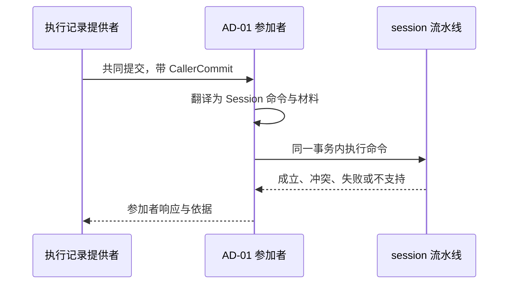
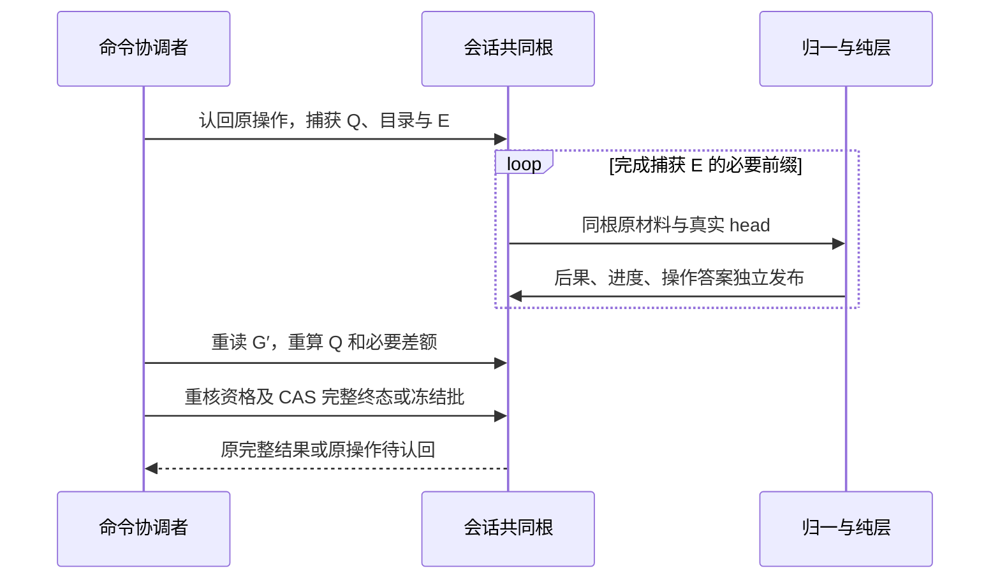
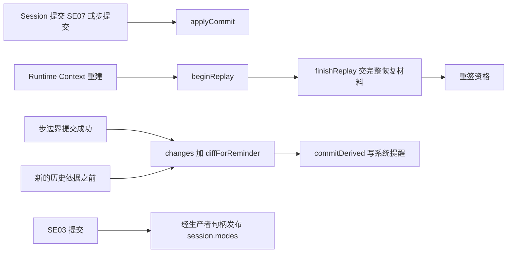
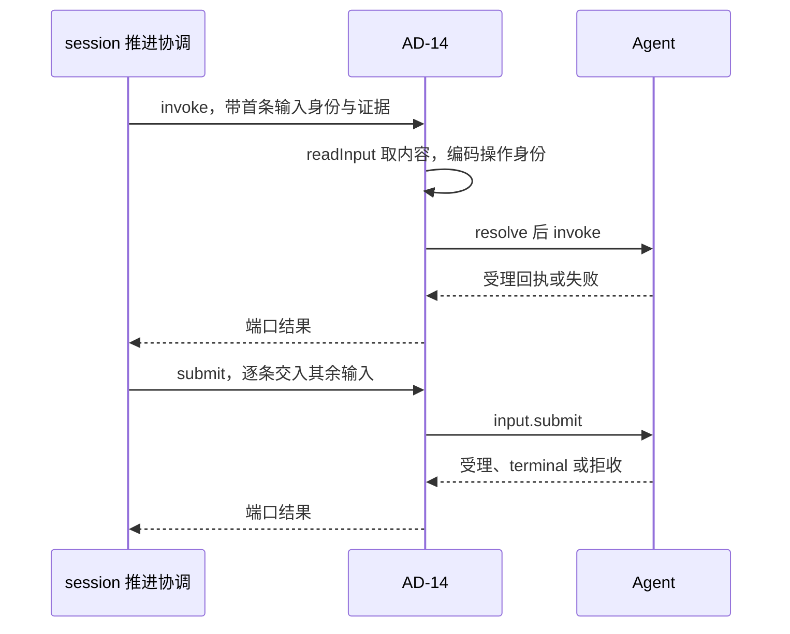
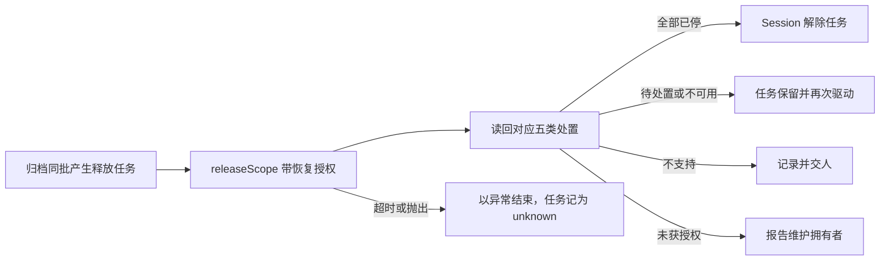

# 关键流程

本页为每个插件写一条流程：触发、步骤、数据去向与失败分支。行为条款归 [SPEC.md](../SPEC.md)，跨成员的流程归[组的协作入口](../../docs/key-flows.md)。本页不复述 Session 契约的条款，只写本成员一侧的步骤。

本页未交付的生产提供者、真实重启与装配场景均为「未执行：提供者或装配尚未交付」。规格映射或非耐久替身不证明这些场景已通过。

## 流程

### FA-01 Agent 共同提交中的参加

对应 [AD-01](../SPEC.md#ad-01)。

1. 执行记录提供者在一次共同提交里交来调用方交接。
2. 参加者按交接种类选命令：`message` 为 `recordMessage`，`context-transition` 为 `commitDerived(compaction)`，`custody` 为 `preserveResult`，`processed` 为 `completeConsumption`。
3. Session 流水线在同一事务里认回、读权威状态、裁定并写事实。
4. 参加者按 SPEC 的对应表回答参加、冲突、失败或不支持。冲突带当前事实作为依据。
5. 提交成功后，参加者把修订与回执交给 Session 记入 `ExecutionRef`。

只读核对走同一条路：`open` 与 `submit` 核来源依据，`tryFinish` 核待交输入与取消。核对不写 Session 条目。

### FA-02 同日志 Agent 事实解释

对应 [AD-02](../SPEC.md#ad-02)。本流程由 `./testing` 的内存提供者实现，生产插件尚未交付（见 [SPEC](../SPEC.md) 的状态行）。

1. Agent 的首次提交共同发布原事实、适用的四类 CallerCommit 参加事实及 Agent 原操作答案。received、完整材料、消费绑定与 saved 同批。open/attach/submit/tryFinish 的 Session 参加只读核对。
2. 解释器经同一 AgentJournal 提供者的 output.read / output.events 读取事件正文，经 load 读取 entries/results 等快照。每次读核对当前资格、租户、execution 与原 Run 绑定。readThrough 是事件序号，entries 提交顺序和 results 快照不能替代它。
3. 后续另一笔 Session 提交共同保存派生后果、解释进度与该次操作答案。只存原来源身份或引用，不复制事件正文，也不走 receive(agent-event) 副本确认。
4. 首次发布失败该批全无。后续解释失败不撤销 Agent 已提交事实，不推进解释进度。各批丢答复查询各自原操作。未解释事实计入未结工作。
5. Agent ended 已发布而 Session 尚未解释时，cancel 可先写 cancelled。后续 ended 只留原 Run 引用，不改终态或后继；冻结后的终态提交仍解除余下待处理资格。

#### FA-02 的相关前缀准备

此流程只用于 [FR-04](../../session-contract/SPEC.md#fr-04) 的后继消费和 SE38 路径。准备不解释 ended，独立正常 ended 解释仍按 PA-08 竞争。Q 缩小时先完成已捕获 E 的剩余前缀。最终 CAS 失败重读重算，前缀成功不授权沿用旧 pending。

首次 waiting/producer 先从原 pending、effect Authority 与 SE15 取得登记，再同批写 SE18/SE22 或 SE18/SE19。observation.source 保留原事实，revision/executionEvidence 取真实 head。Tool intent 先保存无 reference 的登记，后续关联保持原消费身份与固定位置。具体字段与失败见 [AD-02](../SPEC.md#ad-02)。

按相关条目和字节预算 yield，保持内部接续责任；它不是新业务结果。原事实可读而投影落后时主动补齐，真实不可读按 unavailable，已证权威损坏按 quarantined。PM-02 rejected 首输入与剩余 SE38、P-5 缺原前缀的限制均沿 FR-04，不改 finishRun 原准入。

### FA-03 Runtime Context 的持有、供给与变化提醒

对应 [AD-03](../SPEC.md#ad-03)。

1. 注册：原初始化计划的增加经 create 或 completeInitialization 提交 SE02/SE07，后续变更经 change。插件确认提交后，按 SE07 顺序以每项原 CommitRef、原 basedOn 和完整输入调用 applyCommit。多个注册不共用同一 Context 提交身份。提交未知时先查询原操作，不先应用；失败沿原决定恢复。注册完成不证明生产者已供值。身份与修订映射见 [Session 初始注册](../../session-contract/SPEC.md#初始注册的身份与修订)。
2. 恢复会话按 [AD-03 1a](../SPEC.md#ad-03-1a) 与 RC-09 进行。以原 scope、through/supersedes 及完整三部分材料 begin/finishReplay，只有 ready(open) 后按当前普通授权、可信绑定及所需注册重签资格，签发不等供给值恢复。合法普通读取触发待刷新供值，必要输入齐备后才发首个模型请求。新 scope 按 [J18](../../session-contract/SPEC.md#j18-作用域引用与结束事实) 经现有注册与提交路径初始化，不复制旧 scope。注册已提交但初始化未完即重启时，恢复原注册与已有检查点，再补供值并续原初始化。必要来源或资格有缺口时失败关闭，首请求保持暂停；恢复覆盖的普通提交不重复执行增量。
3. 供给：SE03 提交后，插件经带租户的生产者句柄发布 `session.modes` 的新值，输入是作用域、租户与值。恢复完成后，第一次合法的普通读取遇到待刷新标记时，Runtime Context 调用供值回调，插件重新发布日志里的值。
4. 变化提醒：在两个必拉时点，插件以模型类读者的游标调 `changes`，再以上一份快照调 `diffForReminder`，然后以 `commitDerived(context-reminder)` 写系统提醒。
5. 压缩提交之后，插件重签模型类读者的资格。会话归档后，插件撤销该作用域的全部资格；作用域结束事实按 Session 契约的 [J18](../../session-contract/SPEC.md#j18-作用域引用与结束事实) 在归档同批产生，物理释放仍等待独立读回。结束之后，签发、绑定、读取与发布都答 `scope-ended`。

### FA-04 历史源读取与未结工作下界

对应 [AD-04](../SPEC.md#ad-04)。生产来源尚未交付。

1. 补拉提醒后，固定真实 Access、显式 tenant/scope、epoch 与十进制 upper。以 read({ access, evidence, cursor, budgetBytes }) 读取固定页；空上界使用 empty。
2. 压缩读取 compactionContext({ access, evidence, coverTo })，交出同一 evidence 的最新合法 C、retained、未覆盖尾项、原配对与 open 证据。模型消息页不能代替完整窗口。
3. sourceCall 与 continues 只来自真实 Model 来源及固定前缀。CompactionPlan.basis 序列化恢复保留原依据，不补读新历史。最终 context-transition 仍核当前 epoch。
4. readWork/openWork 的未结下界沿 AD-04 保留原 SE18/SE22/SE24/SE25 及关联条目，未知不交空集合。
5. ContextSources 以同一目标整组 register/replace。旧代 withdraw 不撤后继，结束等在途与 Model 租约结清。四种 usage 状态及系统恢复边界沿 RQ 原规则，账目由 Agent 直接到 Context。

缺访问、可信绑定、完整历史或生产来源时 unavailable，不发布半套来源。

### FA-05 Model 日志结果与账目

对应 [AD-05](../SPEC.md#ad-05)。本流程由 `./testing` 的内存提供者实现，生产插件尚未交付（见 [SPEC](../SPEC.md) 的状态行）。

1. Agent 宿主结果接收方将 received、完整材料、消费绑定与 saved 共同提交到 Session 日志。
2. 本插件经同一 AgentJournal 的 `load().entries` 选取 Model 的 received 条目。结果交付从 `delivery.accounts` 读取冻结账目快照，账目交付从 `delivery.account` 读取该 key 修订的账目；完整材料按条目的 material 引用经同提供者 AgentMaterials.read 读取并按 Agent J02 校验。entries 缺席返回 unavailable，材料不可读显式失败。load.results 不代替这条路径。事件正文另经 output.read / output.events 读。核对当前资格、原租户、执行、consumption 及版本，以原事实身份解释 Session 后果。
3. 后续 Session 提交共同保存后果、解释进度与该次答案；失败不撤销第 1 步事实，也不推进解释进度。
4. 读不到时保持未知。received/saved 不作为 ACK 确认，MODEL-ACK-ARRIVAL 未决期间保持 pending。

### FA-06 Tool 日志消费与后台结果

对应 [AD-06](../SPEC.md#ad-06)。

1. 插件核本次 Access、租户、原 execution/Run、consumption、结果版本与材料绑定，读取同一 AgentJournal 的 entries/results 及 AgentMaterials。它不查询 Tool。
2. 公开材料完整且可信时，以原事实身份提交 receive(execution/account)。完整 Tool 收场材料不可读或未有公开承诺时 unavailable，保留任务，不造 schema。
3. Run 终态后的后台结果按 [EC-08](../../session-contract/SPEC.md#ec-08) 进入后继工作；已归档走 EC-07，原 Run 不复活。
4. Tool release 确认仍由 AD-05 按 JC-Release 投影。Model ACK 仍未决。

### FA-07 Agent 会话路径提供者与显示

对应 [J06 提供者](../SPEC.md#j06-会话路径的两个-agent-提供者)和[显示适配](../SPEC.md#实时显示适配)。模型选择归应用装配，不是本成员插件。

消息准入按 [J06](../SPEC.md#j06-会话路径的两个-agent-提供者) 核原来源和候选，返回准入证据，不提前写消息。模型回复、工具结果和 Agent 自生消息只因校验或保存失败拒收；外部内容政策在交给 Agent 前执行，本端口不追加业务否决。当前条件从真实 Authority/grant 及已采用事实构造，不补默认条件。显示仅观察 StreamObserver 的 snapshot/delta/gap/ended，缺口重新同步，结束不形成控制、保管、交付解除或 Run 终态。生产插件尚未交付。

### FA-08 受理拓展点

对应 [AD-08](../SPEC.md#ad-08)。本流程待 [NP-07](../SPEC.md#np-07) 闭合。

编排归 `session` 的受理流水线（[EX](../../session/SPEC.md#ex-受理流水线的拓展点编排)）。它持有拓展点的有序清单，决定顺序与提交边界。本插件只翻译单个拓展点调用。

1. 输入到达受理流水线。流水线按用途提醒、内容型斜杠命令展开、提示提交 hook 的顺序，逐个把拓展点调用交给本插件。
2. 本插件把每个调用翻译为命令域或 hooks 的入口，再把结论交回流水线。拦截时结论带原因，本插件不保管正文。
3. 放行时，流水线以 `accept` 提交输入与拓展点的留痕。
4. 提交之后，受理后一组做分流与推进条件检查，不改已提交的内容。

### FA-09 身份、证据、空闲与 Context 输入

对应 [AD-09](../SPEC.md#ad-09) 至 [AD-12](../SPEC.md#ad-12)。

1. Session 的命令处理按命令种类请求需要的端口，session-cordis 按调用经 `ctx.get` 现取并交给它。
2. 端口实现读邻域的公开契约，生成版本化的 `GuardCommand`。
3. Session 把材料放进同一次提交。材料不全时，命令不提交。
4. 端口不可用时，只有需要它的命令返回 `unavailable`。

`GuardCommand.participant` 填材料的拥有者，不填存储参加者。初始化沿 [Session 自有编码](../../session-contract/SPEC.md#初始化守卫编码)穷举核对真实初始采用、完整计划、原绑定及成功事实，证据桥复用现有 prepare。SessionContextInput.prepare 的四类命令联合保持，不新增 completeInitialization 分支。

证据桥在 `startRun` 与 `reload` 时把 Tool 在采用点给出的常驻工具、登记键与冻结判定放进候选采用材料。带回冻结判定时，命令返回 `frozen`，`verdict` 就是这份判定。推进协调随后以它调用 `freeze`。会话已冻结时，`verdict` 为 null。

### FA-10 常驻工具候选采用

常驻工具引用桥归应用装配，以显式 tenant 消费 Session references。Session 组不再登记驻留动作端口。新 Run 或 reload 的 planAdoption 带回冻结判定，经证据桥返回并由 Session 协调提交 freeze，见 [AD-10](../SPEC.md#ad-10) 与 [P-8](../../session-contract/SPEC.md#具名前提与明确缺项)。生产桥接未交付。

### FA-11 驱动 Agent

对应 [AD-14](../SPEC.md#ad-14)。

1. 推进协调调用 `invoke`。插件以 `readInput` 取首条输入的内容，取得 `AgentRuntime` 并发起执行，保留返回的句柄。
2. 推进协调逐条调用 `submit`。插件经句柄交入输入。
3. 接续时，插件以 `resume` 取得新挂接与新句柄。换代撤旧时，插件先 `load` 取挂接资格，再 `detach`。
4. 控制传播经 agentExecutionControl.control，不要求句柄或挂接。原意图到 Agent 控制、后续 resume 收束按 [AD-14 的 J07 映射](../SPEC.md#ad-14)，suspend 次序未决保持。
5. 结果未知时，推进协调调用 `query`。插件以 `agentExecutionRecovery.query` 查询。
6. 消息准入拒收时，插件返回 `invalid` 与拒收证据，推进协调以 `receive` 写拒收事实。

### FA-12 作用域释放

对应 [AD-15](../SPEC.md#ad-15)。

1. 归档协调或级联推进以任务的操作身份调用 `release`。
2. 插件消费获取方预先保存的 OriginalAcquisition，以 inspectAcquisition/inspectRecoveryAcquisition 认回原获取，不重新 acquire。归档以 releaseScope(scope, recoveryAccess, known?) 释放，两参数仍合法；系统认回沿 recoverOwned。
3. 资源和 acquisition 两路均完整枚举且全部结清才 released。空资源但 pendingAcquisitions 非空仍保留任务；unknown、LookupUnknown、目录缺席或第二页失败均不当空成功。逐项处置沿 [AD-15](../SPEC.md#ad-15)，Session 以 receive(scope-release) 保存读回。
4. 执行环境提供者换代时，重新释放子插件以 `releasedScopes` 按页取得已归档会话的作用域，按原任务的操作身份再调用 `releaseScope`。重新释放不写新的会话条目。
5. 已 end 而没有 SE25 的原任务也由租户 pending 扫描接续；目录与任务两路扫描互不替代。执行环境重启到重新释放之间的原窗口继续保留。
6. 事务域目录缺席或 `releasedScopes` 返回 `unavailable` 时，子插件停止本轮并报告不可用，按策略重试。它不把不可用当作没有作用域。

### FA-13 Tool 启动围栏

围栏由 Agent 日志的 start-fence 条目在 Tool 排序域生效，见 [Agent J03](../../../agent/agent-contract/SPEC.md#tool-启动围栏)。Session 不发另一套失效调用，不以本域撤销宣称 Tool 已阻止新发起。

### FA-14 原生产者确认的日志投影

沿 [JC-Release](../../session-contract/SPEC.md#jc-release)、[EC-04](../../session-contract/SPEC.md#ec-04) 与 EC-05。Tool 宿主收到 saved 后自己解除交付责任。Tool 原确认怎样写入同一日志未定（[JC-RELEASE-TOOL-PATH](../../session-contract/SPEC.md#jc-release-tool-path)）；日志中已有该确认时，AD-05 核对后提交 receive(release)。原确认未到则 pending，Session 提交未知先认回原 operation。Model ACK 到达未决，扫描只报告，不直接调用生产者。

## 失败与生命周期

| 情形 | 本成员的动作 | 不做 |
| --- | --- | --- |
| 邻域不可用 | 返回 `unavailable` 或保留任务 | 不回滚已提交的会话事实 |
| 邻域结果未知 | 按原身份查询，查询前不发出依赖它的效果 | 不换身份重发 |
| Session 提交未知 | 不向邻域确认，先查询原操作 | 不调用 `output.acknowledge`、`applyCommit` 或交付责任解除 |
| 翻译失败 | 报告翻译缺陷，按依赖不可用处理 | 不映射为业务拒绝 |
| 句柄不在 | `submit`、`control` 返回 `unavailable`；事件经快照对账 | 不声称已送达或已读到 |
| 依赖服务换代 | 插件体重跑，在途调用按原身份认回 | 不换身份 |
| 插件卸载 | 停止新调用与订阅，取消在途等待，撤除登记 | 不撤回已交给邻域的确认、释放或外部效果 |
