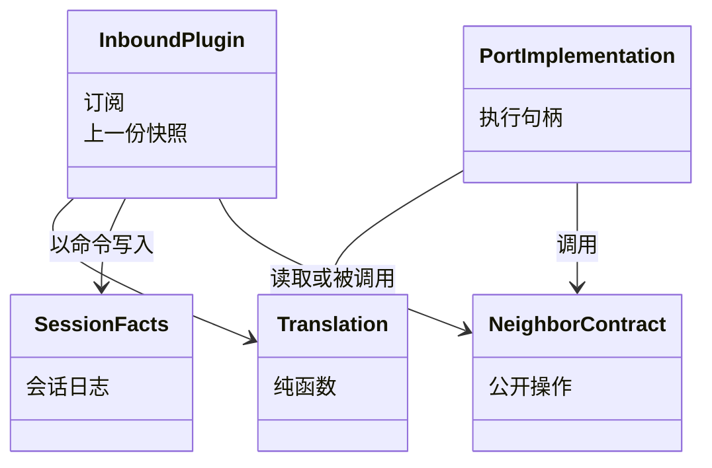

# 对象模型

本成员没有自己的领域对象。会话、Run、attempt、消费与任务的对象归 [session-contract 的对象模型](../../session-contract/docs/object-model/README.md)。邻域的对象归各邻域契约。本页说明本成员持有的运行对象与它们和两侧对象的关系。

## 对象与关系

本成员只有三类运行对象：插件、端口实现与翻译函数。它们不是数据契约，不跨进程，也不进会话日志。

| 运行对象 | 关联的 Session 对象 | 关联的邻域对象 | 持有什么 |
| --- | --- | --- | --- |
| 入站插件（AD-01 至 AD-08、AD-13） | 命令、`ProducerFact`、`ModelViewRead` | `CallerCommit`、同一会话日志里的 Agent 条目与事件正文、`HistorySource`、`SelectedModel` | 上一份已过滤快照、前缀摘要缓存。解释进度不在插件内保存，它在 Session 日志的 `ExecutionRef.readThrough` 里 |
| 构造依赖端口实现（AD-09 至 AD-12） | `GuardCommand`（`participant` 为材料拥有者）、`ContextMaterial`、`FreezeVerdict` | 身份材料、候选采用、`NeedBinding` | 无业务状态 |
| 出站端口实现（AD-14 至 AD-17） | `AdvanceRef`、`ExecutionRef`、`DurableEvidence`、作用域引用、`ReleasedScope`、`ProducedResult` | `AgentRuntime`、执行句柄、`StartGuard`、`RecoveryAccess`、ACK、`releaseDelivery` 的操作引用 | 执行句柄；恢复授权的引用；Tool 释放操作引用的对应 |
| 翻译函数 | 操作身份、模式值 | 邻域的操作身份、`DecisionMode`、元能力宿主的两个布尔值 | 无。纯函数 |

身份的对应：

| Session 一侧 | 邻域一侧 | 对应方式 |
| --- | --- | --- |
| `SessionOperationId` 与出站操作身份 | Agent、Model 的操作身份 | 确定编码，不另存映射 |
| `DeliveryReleasePort.release` 的操作身份 | Tool `releaseDelivery` 的操作引用 | Tool 为每次调用分配新引用。AD-17 在进程内保存对应，丢失时按 AD-06 的认回步骤处理 |
| `ProducedResult.producer` | Model 的原调用；Tool 的原调用引用 | 按 `kind` 选生产者，`call` 原样交出 |
| `ModelViewRow.entry` | `RecordEntryRef` | 按 message 包的编码 |
| `ExecutionRef.execution` | `AgentExecutionId` | 经 Agent 的受信解码 |
| `ConsumptionId` | Agent 的 `ConsumptionId`；Model、Tool 的原调用 | 经 Agent 的受信解码；原调用按生产者的引用 |
| 作用域引用 | Runtime Context 与执行环境的作用域引用 | 经 Runtime Context 根入口的解码函数 |
| `ResidentKey` | Tool 的登记键 | 按 Tool 契约编码，待 P-8 |
| `EntryId` | `RecordEntryRef` | 按 message 包的编码 |

## 生命周期

- 插件与端口实现随插件 fiber 装载与卸载。卸载不改变任何会话事实。
- 执行句柄从 `invoke` 或 `resume` 取得，执行结束、句柄失效或插件卸载时丢弃。
- Tool 释放操作引用的对应在 `releaseDelivery` 返回时记下，交付确认、插件卸载或进程结束时丢弃。
- 上一份已过滤快照在每次成功读取后替换，游标作废或进程结束时丢弃。
- 前缀摘要缓存按 epoch 键入，只淘汰，不失效。
- 恢复授权的生命周期归签发它的维护拥有者，本成员只持有引用。
