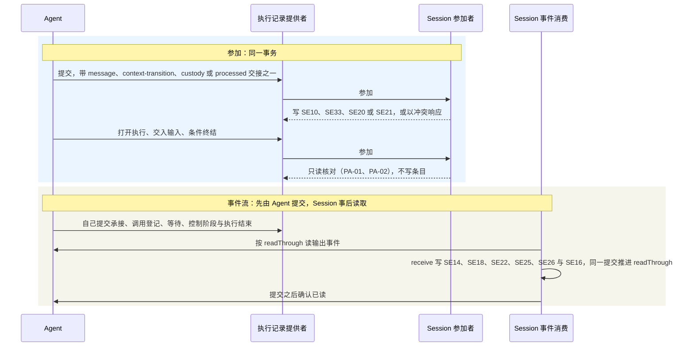

# Session长期行为规格

状态：会话与 Run 的协作身份、日志提交与查询认回、控制及逻辑终态、恢复与跨成员结果承接已由[技术接受](https://github.com/nemori-ai/omne-harness-lite/issues/262#issuecomment-6186972289)采用，是本卡范围的现行协作契约。本页及所引专题中上述范围的采用状态以此处和接受记录为准。其余专有候选及明确未定的机制保留原状态；设计接受不表示生产实现或运行验证已完成。

目标成员为`packages/session/session-contract`，本成员已初始化，公开治理接口尚未实现。本规格表达已具依据的必要行为，不定义尚未确定的公开类型、存储提供者或认领协议。

业务含义归[产品稿](../../../.meta_harness/design/product/sessions-and-work/design.md)，数据结构与算法归[领域架构](../session/docs/architecture/mechanisms.md)。术语以[当前统一语言](../../../.meta_harness/design/ubiquitous_language/index.md)为锚点，系统保证沿[数据与状态](../../../docs/architecture/data-and-state.md)及已接受运行架构。旧输入快照只用于追溯，不授予冲突设计继续采用。

## 阶段范围与采用边界

本规格沿产品负责人已确认的全部能力完整支持目标，在 0.0.0 -> 0.1.0 承接 CAP-SW01 至 CAP-SW18 全部十八项能力的完整行为及失败、并发和恢复义务。不以公开类型存在或只有共同契约替代实际支持。能力含义和阶段决定只由产品正文拥有，以下表格定位技术承接。

| 能力 | 本规格承接位置 | 验证重点 |
| --- | --- | --- |
| CAP-SW01 | [创建与固定事实](#固定事实及当前状态) | 固定归属、定义标识及合法创建 |
| CAP-SW02 | [固定事实与版本采用](#固定事实及当前状态)、[换代](#批次run与attempt) | 普通恢复保版、显式 reload、原调用保持 |
| CAP-SW03 | [日志不变量](#session-log-的长期不变量)、[读取与恢复](#日志读取投影及恢复) | 只追加、不可变、分页、投影和多模态引用 |
| CAP-SW04 | [耐久受理](#耐久及受理确认)、[日志提交](#日志提交与查询结果) | 同次提交认回、共同成立及未知结果 |
| CAP-SW05 | [分流](#分流及命令边界)、[批次](#批次run与attempt) | 原去处、完整批次和唯一承接 |
| CAP-SW06 | [提醒与命令](#分流及命令边界) | 受理前确认、合法展开和业务拥有者 |
| CAP-SW07 | [推进治理](#批次run与attempt) | 单推进、fence、独立执行生命周期 |
| CAP-SW08 | [等待](#等待与结果交接)、[人工答复](#hitl等待与单次授权) | 原位置接续、不回答逐卡处理和无默认批准 |
| CAP-SW09 | [终态](#终态与控制) | 完成检查、取消竞争及不可反转 |
| CAP-SW10 | [模式](#自动归档与模式变化) | 合法用户操作、三个独立维度和恢复 |
| CAP-SW11 | [目标控制](#终态与控制) | 插队、明确范围及可恢复传播 |
| CAP-SW12 | [归档](#归档与撤销) | 逻辑生效、真实收尾及撤销不复活 |
| CAP-SW13 | [会话关系](#归档与撤销)、[自动归档](#自动归档与模式变化) | 子方级联、独立 handoff 及常驻互斥 |
| CAP-SW14 | [自动归档](#自动归档与模式变化) | 默认关闭、租户配置、时钟和主会话豁免 |
| CAP-SW15 | [可靠交接](#等待与结果交接)、[恢复](#日志读取投影及恢复) | 原操作对账、不重发和跨故障恢复 |
| CAP-SW16 | [追溯与账目](#故障读取与维护) | 原归属、未知费用、查询资格及消费区分 |
| CAP-SW17 | [模型选择与切换](#模型选择与切换) | 合法目标、持久选择、固定请求不改及失败不回滚 |
| CAP-SW18 | [常驻工具与会话冻结](#常驻工具与会话冻结)、[I-F1](#i-f1) 至 [I-F5](#i-f5) | 唯一提交点、冻结不可逆、冻结后不开新 Run、在途 Run 照常收场、冻结独立于归档；VC-F01 至 VC-F07 |

完整支持的阶段目标不表示本候选已获技术接受、实际实现完整或验证已运行。提供者、精确公共签名、介质协议及尚未对齐的流式在途责任仍须形成实际交付依据；这些缺项不能缩减阶段目标。

## 业务不变式索引

以下条目定位本成员必须持续保持的业务性质。完整条件、例外及处置继续由所引章节拥有，索引不建立第二份规则。各项验证沿[持续验证义务](#持续验证义务与未覆盖)对应反例开展；明确记录不表示实现已经符合。

| 标识 | 持续保持的性质 | 完整行为位置 |
| --- | --- | --- |
| SW-I01 | 同一 Session 的租户、AgentDefinition 标识、执行类型及必需身份集合随创建固定 | [固定事实](#固定事实及当前状态) |
| SW-I02 | 同一 Run 恢复保留采用版本；合法 reload 不丢原调用或改绑定义身份 | [版本采用](#固定事实及当前状态)、[换代](#批次run与attempt) |
| SW-I03 | 已提交历史只追加且不可变，原操作认回与治理变化共同成立 | [SL01至SL14](#session-log-的长期不变量)、[提交](#日志提交与查询结果) |
| SW-I04 | 已受理输入有可恢复去处，T1完整批界确定，同一输入至多一次有效承接 | [受理](#耐久及受理确认)、[批次](#批次run与attempt) |
| SW-I05 | 同 Session 至多一个未终结 Run，同 Run 至多一个有效推进者；失效推进者无新动作 | [推进资格](#批次run与attempt) |
| SW-I06 | 等待和接续不改变原执行身份或重发原调用；可靠责任交接不留双方空档 | [结果交接](#等待与结果交接) |
| SW-I07 | 终态至多一次有效成立，归档/撤销不复活已取消工作，迟到效果和费用如实保留 | [终态](#终态与控制)、[归档](#归档与撤销) |
| SW-I08 | HITL答复仅回原等待，不回答不授予批准，普通消息不冒充答复 | [人工答复](#hitl等待与单次授权) |
| SW-I09 | 模式变化不得突破结构化禁止。本会话租户可以改模式。Agent 要改模式必须走 HITL，并由人显式授权。恢复保留会话当前值 | [模式](#自动归档与模式变化) |
| SW-I10 | 常驻与子会话关系互斥，自动归档按有效租户配置及真实连续空闲判断 | [归档规则](#自动归档与模式变化) |
| SW-I11 | 模型选择与实际请求分开，已固定请求不被切换改写，后续请求失败不回滚选择 | [模型切换](#模型选择与切换) |
| SW-I12 | 逻辑工作控制不冒称物理停止；工具转后台不另建执行，runtime释放不自动取消独立调用 | [交接](#等待与结果交接)、[控制](#终态与控制) |

## 消费者、资格与输入

交付面、受理接入、装配协调者、Agent推进者、恢复者、控制方及读取者通过本成员契约访问会话工作。它们必须提供可核实主体、适用租户、目标Session及操作所需资格，不由连接当前选中租户反推已有工作归属。

治理登录入口显式租户冲突时遵循身份契约拒绝，不能暗中切换。系统后台入口须提供其可信身份和限定操作资格，不伪造人登录。私有查询、控制、消费和历史读取分别检查当前资格。组织管理员账目读取不自动获得其他租户正文或执行控制。

创建要求明确租户、AgentDefinition身份及执行类型。工作区可选，指定后须合法可加载，失败不降为无工作区。初始任务可以没有，专用派发或Job入口条件性必需输入沿其契约。本成员不从磁盘目录、外部消息正文或最近使用值猜身份与工作区。

## 固定事实及当前状态

| 状态类别 | 必须保留与解释 |
| --- | --- |
| 固定身份 | Session、租户、定义身份、创建事实、用途和执行类型及类型必需身份集合 |
| 会话当前值 | 当前模式、工作区选择、模型选择、允许的覆盖或继承声明、Context注册及自有恢复数据 |
| 采用依据 | 实际清单、来源及版本、每次调用实际输入及消费者关联 |
| 工作事实 | Run、承接批次、attempt开始序号、等待、消费进度、取消、终态、结果和原因 |
| 真实外部关联 | 原调用、实际效果及费用来源、迟到、未结及控制责任 |
| 派生视图 | 队列、当前Run、等待及成本视图的来源和覆盖进度 |

Session固定归属不随账号切换。同一 Session 的 AgentDefinition 标识不可变，定义版本及实现允许合法变化。新 Run 采用该标识最新合法发布版本；同一 Run 的普通恢复保留原采用，不重新求值。会话不固定任何能力的版本；延续靠按记下的形状核对同形可用的实现（[按形状核对，不钉版本](../../../docs/architecture/runtime/assembly-and-change.md#按形状核对不钉版本)）。显式 reload 经候选校验及安全交接后，可在同一 Run 采用同标识新版本并建立新 attempt，候选失败保留原合法状态。实例重建本身不改绑定义标识，不重发原调用，也不丢失原等待、卡片或结果消费责任。

通用创建的模式初值取适用默认后成为会话值；专用入口已有有效必填初值时须显式满足，缺值不得借默认创建。恢复不重新套租户新默认。会话选择和注册变化只影响本会话，明确修改共享源须由该源拥有者确认。

创建事实进入第一份有效日志批次，携带固定身份、初始值/采用依据及创建操作认回信息。初始化尚未完成的项保存明确状态和接续责任，随后追加结果，不用空值伪装就绪。无检查点重建从该创建事实开始；缺失起点、解释版本或初始依据时报告不可恢复，不从当前默认补造过去状态。

新 Run 或显式 reload 的定义与资格采用须有跨源可核验的有效裁定边界。此前已生效的新发布或撤权使旧候选重算或拒绝，Session 尾部未变不能证明外部依据仍有效。无法核验时不发布新采用，保留原合法状态或报告不可用。裁定后变化沿动态规则处理，后续实际动作仍核对当前资格；历史采用记录不永久授权。协调责任见[固定与动态输入](../session/docs/architecture/mechanisms.md#固定输入与动态输入)。

日志结构及算法见领域架构的[Session log](../session/docs/architecture/mechanisms.md#session-log-的事件模型)，以下条款拥有消费者可依赖的行为。Context共享当前值及权限不因历史引用变成会话自有源。

## 模型选择与切换

本成员保存当前选中的模型路由名、初始采用依据及切换事实；模型档案、合法集合、凭据和实际请求由模型拥有者维护。当前选择和每次实际调用分别可查，上一调用记录不因切换改写。恢复保留会话已保存选择，不按最新默认重新初始化。

用户切换须满足对应会话操作资格及当前合法目标。Agent 只代表明确的合法用户指令代办，不能自主换名；代办模型切换不授予修改三轴模式的资格。缺凭据的合法目标仍可选，并说明暂时无法调用；非法目标明确拒绝且原选择不变。目标合法性由原拥有者提供可核验依据，与会话采用沿有效裁定边界保持一致，不靠历史批准或本地 CAS 推断。

选择变更条目、当前值及原操作回执共同提交。确认后后续请求采用新选择，下一请求失败不撤销切换；提交未知继续原身份认回。切换本身不产生新 Run 或 attempt，不替换 AgentDefinition，不重发或打断在途调用。

每次尚未固定的请求按当前选择重新求有效模型及组装输入。已经固定或发出的请求保持原模型、参数和内容；单独中断仍须明确控制。新请求经适用压缩仍无法满足输入条件时，按原工作规则失败，选择和历史保留，不暗换其他模型。具体分工及合法性源见[模型选择设计](../session/docs/architecture/mechanisms.md#模型选择与切换)。

## Session log 的长期不变量

- SL01。Session 拥有跨 Run 的记录条目序列，每条保存已发生事实，具有 event 性质。消息和非消息都可成为条目，不强制关联尚不存在的 Run 或 attempt。待执行命令、工程日志、遥测及通知不能冒充已提交会话事实。
- SL02。日志 append only。可靠持久提交后，条目内容、身份、租户与会话归属、因果关联及提交顺序不可原地修改或删除。更正、补充、撤销、控制和状态变化追加新条目，显式关联原事实。压缩、卸载、归档、终态、ACK、重建投影和格式演进均不构成覆写例外。
- SL03。每条记录的身份和位置稳定，提交批次中的顺序固定。时间戳不能替代提交顺序裁定并发；晚到执行事实保留原调用及实际发生时间，不重排过去历史，也不虚构新的物理执行。
- SL04。Session 治理是日志的唯一业务写入口，生产者提交获准事实或操作，不能直接改日志与治理索引。运行恢复、控制、结果保管分别沿其资格提交，旧 attempt 无新推进资格不阻止合格消费者保存原调用的真实结果。
- SL05。纯日志投影只能由已提交日志确定性派生，不成为第二份权威。需要当前权限、共享资产、Context 数据或执行账目的视图必须标明外部来源；其当前值不能凭历史日志推测。
- SL06。已提交消息与在途流式内容分别处理。在途内容由生产者保管，Session 不逐片落盘。用户可见内容只来自两处：已提交日志的历史投影，与只发布生产者已保管批次的在途通道（[在途内容的局部对账](../../../docs/architecture/runtime/streaming-and-consumption.md#在途内容的局部对账)）。收场或中断后，实际采用内容作为历史条目提交，提交后不可覆写。中断内容不能伪装完整回复。逐片展示的耐久边界是生产者的保管，不能由收场保存或 ACK 推出；Session 不逐片落盘，也不因此允许丢失已展示的内容。

“落盘不可变”约束持久条目的身份、内容及历史语义，不要求数据库物理页、索引或副本文件永远保留相同字节布局。更换编码或存储提供者须保留原条目及其可解释依据，不通过重写历史实施业务修订。副本清理另按保留、引用及恢复责任执行，不能让应保存的历史失效。

## 日志提交与查询结果

SL07。同次操作按适用租户、Session、可信来源及原操作标识认回。相同身份及相同操作取得原提交回执；相同身份不同操作须拒绝。新的独立输入即使文本相同仍是独立操作。认回已提交操作先于检查新的尾部进度，不因后来追加或换代而产生第二批原条目；查询仍检查当前访问资格，不授予原操作再次执行的许可。

SL08。条目批次、操作认回依据、共同治理变更及其权威读取进度在一次不可分割的业务提交中成立。提供者必须在跨进程写入竞争下提供一致裁定与耐久可见点；单个进程内锁、分别成功的两次保存或独立存储上的孤立 CAS 不能兑现。可异步维护的展示投影不在该共同提交内，但不得用于裁定当前资格。具体共同对象见[提交结构](../session/docs/architecture/mechanisms.md#条目与提交结构)。

受理内容与待处理资格、完整批次承接与资格解除、attempt 换代与旧推进资格撤销、Run 终态与新发起资格撤销分别保持其共同条件。必要外部内容须先达到可恢复引用的保管条件，再确认依赖它的条目已提交；准备失败不报告受理成功，未被提交引用的准备副本不能自行成为业务事实。

| 追加或原操作查询结果 | 必须对外提供的含义 |
| --- | --- |
| 已提交 | 返回原提交身份、条目范围及回执；已达到声明的耐久边界 |
| 本次尝试拒绝或未提交 | 该次尝试未生效；原操作有未决尝试时仍为未知，不能据此确认整个原操作未受理 |
| 原操作明确未提交 | 符合 SL09 的权威证据，原业务提交当时未成立且先前在途尝试不能晚到生效；后续按原身份重试仍须当前准入 |
| 并发条件已变化 | 不拼接旧的预计算条目；重新核对原操作是否已提交，再按当前事实重新判断 |
| 结果未知 | 保留原操作及处置责任，通过原身份查询或对账，不能换身份盲重做 |

SL09。查询“未找到”须来自足够新的权威操作状态，只表示该读取时刻未见已提交操作，不证明另一个在途同身份提交必然失败。若重试，继续使用同一身份，由共同提交及唯一性裁定。查询服务不可用或数据损坏时保持未知，不用空记录回答。

原操作级“明确未提交”还须有持久裁定/围栏依据，终止该裁定以前的全部提交尝试；否则只能说明本次尝试被拒，原操作仍未知。之后允许重试时使用同一原操作身份及新的存储提交尝试代次，旧代次不能恢复写入。提交尝试代次与 Run 的 attempt 分别管理，裁定证据由提供者恢复，不由日志里暂时没有条目推断。

提交不把模型真实发出、工具副作用、外部物理停止或生产侧 ACK 纳入数据库事务。持久处置责任和对方执行契约各自对账；不能把“记录了发起意图”报告为“原调用确实执行”。通知发生在提交之后，同一条记录重复投递不产生新条目。丢失通知由权威状态补查恢复，不以订阅一直在线作为工作可靠性的前提。

## 日志读取、投影及恢复

SL10。每次读取、分页、导出及按原条目查询都检查当前资格。游标绑定租户、Session、来源身份、过滤条件、固定读取上界及续读位置；不得由调用方修改游标而扩大范围。错域、失效或无法核验的游标明确拒绝，不按其他会话位置继续。读取期间的新追加只在新一轮遍历中出现，同一轮不重读或漏读其固定范围内的获准条目。

SL11。分页按确定的提交位置续读，保存扫描进度，不能用最后一个可见条目代替实际扫描位置，也不能把权限过滤造成的空页误判成历史结束。没有可返回条目仍须能说明是否扫描完固定范围。权限后来撤回后不继续泄漏旧页的内容；授权范围变化不扩大原游标，需扩大过滤或范围时重新开始查询。

SL12。每份投影声明来源、确定性计算规则、覆盖到的完整提交位置、计算版本及失效条件。应用同一提交一次或重复一次得到同一结果，内容变更与覆盖位置可靠共同保存。缺批、来源不符、未知且不能证明无关的事件类型或计算版本不兼容时，停止相应投影并报告缺项，不能将未解释事实当作无待办、无 Run 或完成消费。

SL13。治理决策必须使用与当前权威尾部一致的治理状态。展示投影可以落后并公开进度，不能用落后数据授予推进、拒绝必要控制或报告确定空队列。恢复先验证检查点的来源、输入范围与计算版本，再重算尾段；无有效检查点时可从日志起点重建。重建只解释事实，不重新调用模型、执行工具、回答卡片或发送外部效果。

SL14。检查点和索引损坏可从有效权威事实重建；权威已提交日志出现缺口、损坏或未知提交状态时，隔离受影响会话并保留处置责任，不清空会话或静默丢弃已提交尾部。临时、未提交材料的处理不能误删已经提交但回执未到的批次。校验和核对完整性，不单独证明业务语义或权限正确。

当前状态、待处理输入及原等待位置有直接可定位的索引，正常推进不全量扫描历史。分页、检查点恢复、内容读取及导出按实际条目和字节控制资源。跨 Run 历史、多模态内容、块标注及压缩引用维持原保留责任；日志不要求每次模型请求读取全部历史，也不提供无限容量或未经验证的固定延迟保证。

## 原生事实与状态转移

SL15。当前采用业务的完整语义沿[原生事件目录](docs/object-model/session-log-events.md)维护，必要形状继承共同封套。记入标准见架构[必须进入日志的事实](../../../docs/architecture/runtime/session-and-run.md#必须进入日志的事实)。本规格规定种类准入、效力、整批提交，以及一条事实能否改变推进资格或 Run 终态。生产者不能任填种类或自报留痕取得准入。SystemMessage 不成为历史条目，流协议的 finish 不成为 Run 终态。具体公开枚举及兼容编码由实际成员拥有，不将目录的 SE 编号当已发布 Schema。

SL16。会话初始化/归档、Run、attempt、普通输入资格、原调用、等待/消费、控制传播、关系/空闲分别维护，沿[逻辑状态](docs/object-model/session-state-transitions.md#正交状态与唯一依据)从已提交依据解释。活跃由未终结 Run 决定，休眠允许后台执行；最大 attempt 序号仍须满足 Run 未终结、无有效取消及原资格未交还/撤销。可选退出报告不单独决定资格，缺退出报告可恢复。

SL17。每次意图形成完整业务结果，沿[命令守卫](docs/object-model/session-state-transitions.md#命令守卫与完整结果)同批满足必要条件。新 Run 与完整首批承接共同成立；首次采用和 attempt 资格保留。合法 reload 共同采用与换代。归档使仍未终结的原 Run 在同批落唯一被取消终态，归档仅引用该终态；原先已完成或失败不改写。等待结束从原结果/答复的处理或有效控制派生，不新增第二份等待结束权威，也不新增活跃/休眠事实。

SL18。归约只用已提交依据和适用解释版本，校验完整结果及末状态不变量。留痕不能暗中改变推进或恢复责任；当前权限、时钟、共享配置与外部执行查询只用于新的合法决定或组合视图。未知相关类别、缺项或因果矛盾不发布部分治理状态，不能自行补事实使其通过。Agent Loop 的阶段和扩展语义仍归 Agent，Session 不在重放时重新执行判断、授权、答卡或发效果。

这些条款细化既有 SW-I03、SW-I05、SW-I06、SW-I07、SW-I12 的表达，不建立第二套类型或状态规范。SE12、SE17 的纯留痕与日志的存储/解释可见性分别处理；同一恢复义务不能藏在瞬态通知或被误标的留痕里。

## 耐久及受理确认

凡对外确认受理、设置或控制成立，必要数据已达到普通进程崩溃、操作系统崩溃与断电后的耐久边界。介质可读及声明部署条件是前提。引用的多模态内容必须在所需期内可恢复，不能仅保存临时路径而确认全文耐久。

普通输入内容或有效引用、来源、租户、Session、同次提交标识及待处理资格在同一次不可分割业务提交中成立。没有已提交事实不得报告受理成功；拒绝留痕不取得待处理资格。卡片、控制和系统业务输入分别保存原目标与可恢复处置责任，不套普通队列状态。

受理标识先于首次发送取得并保留，在租户、Session和来源范围认回同次提交。回执丢失后查询及重试只认回原事实，不新增消息、承接或Run。用户新的提交可以同文，不按内容哈希去重。已受理内容不可被同标识不同内容覆写。未受理重试仍过当前准入，查询原事实也须当前访问资格。

| 保存结果 | 所需行为 |
| --- | --- |
| 原操作明确未提交 | 按 SL09 的权威证据确定当时未受理且旧尝试不能晚到生效，发送侧保留输入，可按原身份重新准入 |
| 已提交未承接 | 本成员保存并恢复待处理责任，不要求发送方继续在线 |
| 已承接 | 沿原Run和批次继续，不排给另一个Run |
| 结果未知 | 保留原提交身份，查询、等待或对账；不能报告确定未受理并新建提交 |

受理成功不等待Trigger送达。通知可以重复、合并或重建，丢通知不丢业务工作。

## 分流及命令边界

普通消息按原输入顺序入待处理视图。卡片答复认回原卡片；扩展所发卡片回原扩展等待，Tool 内部 Ask 回该 Tool 原等待，不交换接续位置。控制不进队列，系统业务输入交原流程。队列由受理输入扣除可靠承接及取消资格事实派生，不保存另一套独立决定其资格的源。

用途跑题提醒在受理前进行，不保存被拦正文或待办；确认后是新请求。消息准入拒绝另留必要干预及拒绝事实，用户拒绝可见，不能与跑题提醒的无受理前状态混同。

内容型斜杠命令采用受理时当前合法命令，展开全文和原命令关联保存，参数与Skill正文按其规则分块。失效命令明确拒绝，不当普通消息。流程命令只触发其拥有者并保留处置责任；受理摘要不能替代其实际生效依据。其他来源的`/xxx`是否识别由命令入口契约限定，本成员不自加通道。

## 批次、Run与attempt

已受理的普通输入由 Session 按业务规则调度交入执行：按到达顺序，不按来源另设优先级，只交给本会话未终结的 Run；没有未终结 Run 时先开 Run。T1承接当时已交入执行的全部普通输入，保存确定批界、顺序、Run及接续位置。已受理而尚未交入的输入保留待处理资格，留给后续批次。读取、收到唤醒、向模型发请求都不构成承接。承接及待处理解除可恢复一致，原输入保留，每输入至多一次有效承接。工程分块不能改变该轮逻辑批界，分块期间新到内容属于下一合法批次。

同Session至多一个未终结Run，同Run至多一个有效推进者。新Run成立须有合法待处理输入、没有未终结Run且当前入口准入满足。登录入口须确认登录有效；同Run恢复不重过新Run登录门，不因登录到期取消原已推进工作。后台和系统触发按其身份契约，不扩大登录条件。

Run开始须明确初始承接范围。无输入不造空Run，已有Run接续或等待不另造Run。原有效推进者继续原attempt；重新建立推进实例才产生新attempt。attempt序号在持久开始事实中明确，严格递增，不靠全历史条目计数。

新attempt生效后旧attempt不能追加输入承接、发起调用或提交推进事实。资格必须在实际发起及提交边界有效，而非仅创建时检查一次。旧执行迟到的结果与费用仍可按原身份保存，不将它们误作旧推进者越权。如何封闭检查与发出之间的竞态须由后续具体协议兑现。

恢复允许attempt有开始没有结束事实。缺失结束不等于数据损坏，也不证明调用失败。唯一推进判断、终态及队列须使用足够新的一致依据，不仅依赖可滞后的展示投影。

## 等待与结果交接

等待关联说明原工作、开始依据、目标调用或卡片、原消费位置及交付责任，不要求另建独立等待对象。释放Agent计算不解除这些关联，不取消独立Model或Tool。只查询不到句柄或执行状态时保持未知，不自动重发。

| 恢复所见 | 继续方式 |
| --- | --- |
| 原调用仍在执行 | 重取合法访问关系，继续原等待 |
| 已收场未交接 | 从原生产侧取回原结果，回原消费位置 |
| 已可靠交接但处理未完成 | 从消费侧内容或有效引用继续，不向已ACK模型重新领全文 |
| 查询故障 | 保持未知并按策略等待或报告，不新建原调用 |
| 原执行确实失去连续性 | 交Model或Tool自身契约处理，仍回原用途 |
| 原Run已终态或原调用不再等待 | 仅完成允许的历史、交付和结算，不恢复原工作 |

主流程、扩展、压缩和Run外消费位置分开。实际存在的原发起attempt和当前承接attempt分别可查。Run外调用保留真实调用身份和对应会话消费者，不伪造Run或attempt，不因接续重新计费，也不把内部模型判断当主流程回复。

不可用替换件沿原动作、工具身份和消费位置承接。它不是漏掉实际启动事实的半完成执行。归类、统计和是否补跑见[不可用应答的分类边界](../../../docs/architecture/runtime/tool-runtime.md#不可用应答的分类边界)。

内容或有效可恢复引用、原归属、原位置和后续责任可靠保存后，或者原消费处理已完成且必要完成事实保存后，才解除生产侧相应责任。交接和解除要可恢复一致，禁止双方都认为对方负责。展示、观察、收到通知和开始处理不等于可靠消费。

模型真实收场后由当前合法消费者按Model契约ACK，确认、清理、费用各自可查。Tool全文不自动采用此ACK，不因Run终态、归档或压缩删除。取消或归档按业务解除等待，仍保留事实及未完成交付和结算责任，不冒充消费完成。

## HITL等待与单次授权

HITL 成员拥有卡片、获准呈现、一次有效答复及可靠交回。本成员拥有原工作等待、去处和继续资格；工具或扩展解释其原问题，身份与授权解释批准。不能在会话日志另造第二个有效卡片决定，卡片记录只引用并承接原决定。信息或方案答复不自动获得授权含义。

卡片和答复关联原操作、生效参数及位置，本成员不生成另一份批准。等待不因服务超时、实例释放或单纯时间流逝结束。人明确不回答计入原卡已处理。扩展同批卡片全部处理后解除其批次阻塞，再回原扩展位置；选择不回答的卡片返回没有答案，其余答复照常返回。Tool 内部 Ask 只向该 Tool 的原等待交回其答复，不套用扩展批次屏障，也不能据此提前恢复 Agent 扩展。不回答不授予依赖批准的动作。参数或绑定变化后的决定可用性沿授权契约复核。

单次授权只覆盖明确批准动作，明确整批才覆盖该批。消费或所属Run终态后不得再使用，流水仍保留。会话授权归档后保留，撤销归档不复活取消卡片或已消费许可。全局租户授权写租户权限设置，由其拥有者校验资格及上界，不只保存在当前Session中。

## 终态与控制

Run终态只为完成、失败、被取消，每Run最多一次有效终结。完成候选先过原工作条件和适用终态前扩展，记录后才生效；后置扩展不得撤销。队列空、模型无动作、runtime退出及非常态上交均不自动证明完成。

终态成立后不新增原Run的attempt、输入承接、调用或外部动作。已发调用及未结费用可迟到保存。仍具合法后续投递资格的后台结果在未归档会话按既有输入规则交后继工作，原Run不复活。已因归档取消原业务资格的调用，其结果在撤销归档后仍不自动取得待处理资格或创建后继Run；取消提醒和结算不自造待处理资格。

控制先保存目标、发起主体、原因、级别及意图，随后按持久关联撤资格和传播，不依赖旧Agent句柄转发。请求受理不冒充实际生效或物理停止。

控制的最小对接是现行规则。租户身份是参数。缺租户或跨租户默认拒绝。内容块的形状不在本表。跨成员流程见 [F-SE03](../docs/key-flows.md#f-se03-控制传播)。

| 项 | 规则 |
| --- | --- |
| 关联身份 | Run 取消用该 Run。单调用控制用原调用身份。这一次操作用提交身份。 |
| 必要参数 | 租户、会话、目标身份、控制种类、发起者。 |
| 成功 | 意图已保存。Run 取消生效时，同时记录被取消终态并撤销新发起资格。 |
| 拒绝 | 无资格、目标不存在，或与已经生效的终态冲突。与终态冲突时，拒绝带回已经生效的终态，控制发起者可见。 |
| 未知 | 按原提交身份查询。不换身份重做。 |
| 同身份重试 | 相同提交身份返回原结果。 |
| 参数冲突 | 同一提交身份带上不同目标或不同种类则拒绝。 |

会话日志上的查询认回见[日志提交与查询结果](#日志提交与查询结果)。调用登记的发起字段归 [Agent](../../agent/agent-contract/SPEC.md#身份范围与归属)。模型受理归 [model](../../model/model-contract/SPEC.md#调用和各次真实发出)。工具的停止和交付解除归 [tool](../../tool/tool-contract/SPEC.md#必要持久事实与确认)。Context 的注册和读取归 [runtime-context](../../context/runtime-context-contract/SPEC.md#rc-02-块声明注册与参数)。请求组装归 [request-context](../../context/request-context-contract/SPEC.md#rq-02-组装的前置输入)。

会话控制请求工具转后台时沿工具许可及转换契约；控制受理不表示转换完成。工具侧保存实际转换/收场，会话和 Agent 可靠承接后改变原步骤等待，不建立第二次执行或释放仍在执行的并发名额。后台最终结果沿原消费契约交回，原身份、效果、全文和费用保持；不默认支持后台转回前台。工具内 Ask 等待的后台限制沿工具契约，不由会话控制绕过。

| 控制目标 | 传播范围 |
| --- | --- |
| 单次模型或工具 | 指定原调用，不自动影响其他调用或Run |
| Run取消 | 当前推进资格、该Run模型及前台工具；后台、子会话及无关Run外调用不自动跟随 |
| 仅替换Agent | 撤旧推进，接续同Run；原Model和Tool不因旧句柄销毁停止 |
| Session归档 | 原业务推进和等待、未承接任务、所有关联在途模型与前后台工具，以及子会话级联 |

取消一旦生效就记录被取消终态，并撤销新发起资格。优雅或强制只影响停止请求有多急，不改变终态时点。治理方继续跟踪真实收场。没有 Agent 时也继续跟踪。未收尾的外部效果保持未知。外部成功、失败和未知均如实保存，不能由错误或停止标签推导效果未发生。

插队保存共同的加急消息、处置决定、占位与提醒。已到响应及已发生效果最大程度保留，原Run不终结。允许后台的执行转换等待关系，其他按其契约请求中断。人工等待按主动插队控制记为明确拒绝回复，保留实际控制来源，不伪造用户未提交的卡片答案或授权。重复同次控制不重复插消息或发相同效果；独立多次插队仍各有原提交。

逻辑处置的原子性不表示外部执行物理停止与队列写入在一个数据库事务中。协调者须保存仍待传播及对账责任，并准确显示真实执行状态；不能给“已请求停止”显示为“物理已停止”。

## 归档与撤销

归档确认依赖业务取消、队列资格取消及后续处置责任成立，不等待全部独立执行物理停止。 同批终结仍未结束的原 Run 为被取消，归档条目只引用其唯一终态；已成立的完成或失败保持。没有原 Run 时不补造 Run 或终态。级联关系及未完成子会话处置须可恢复；独立handoff不级联。新任务与归档竞争只能为先受理后因归档取消，或明确拒绝，不得无痕丢失或归档后保持待执行资格。

归档后拒绝新任务，迟到结果与费用仍保存原归属但不入任务队列。执行方可继续真实收场，不能伪记物理中断，也不能据此恢复会话等待。归档不删除历史、会话授权、工作区或实际费用。

撤销归档回休眠；冻结的会话撤销归档后回到冻结（[常驻工具与会话冻结](#常驻工具与会话冻结)）。两种情形都从撤销时刻重新开始空闲计时，不恢复原取消任务、Run、调用或卡片，不顺带恢复子会话。原取消调用此后迟到的结果仍不自动入队，用户需要重新工作时须显式提交新任务。当前保存的模式和注册恢复，实时权限按当前来源核对。旧晚到reload或原调用不能重新启动已取消工作。

## 自动归档与模式变化

自动归档默认关闭，允许显式开启，并支持关闭配置与会话常驻豁免。没有有效的显式启用依据不得自动归档；仅启用、无豁免且符合连续空闲条件和时限时执行。常驻标记只允许主会话，子会话不能设置常驻。创建、标记修改、关系采用及恢复维持两者互斥；把子会话标记常驻的请求须拒绝，不静默清除标记或改变关系。不能用非法组合阻止或绕过父方的既定归档级联。常驻不是进程驻留、永久连接或手动归档禁止。

空闲判断覆盖本会话及级联相关子会话的未终结Run、待处理任务及在途Model和Tool。任何等待、后台工具或Run外调用使条件不成立；查看历史不开展工作。新工作与到期检查竞争须重新核对有效条件。成员失效不暂停或清零计时；普通重启计入可确认连续空闲，未知期间不冒充已达到条件。

权限处理、执行环境和协作模式的修改接受本会话租户的操作，实际提交边界核对当前资格。Agent 不能通过直接入口修改模式，也不能通过未经人授权的工具或委托修改模式。Agent 要改模式，必须走 HITL，由人显式授权。三个维度分别保存并可变化，不扩大结构化权限。创建默认只初始化，当前值跨恢复保留。模型可读模式变化按Context协议感知，已经固定的请求不回写。自动归档的启用开关与时限从本租户的合法设置取得，设置修改由相应拥有者校验当前修改资格。单会话常驻标记仅由具会话管理资格的用户维护自己的会话。开启自动归档或解除常驻时使用原已确认连续空闲，操作前提示可能立即归档，不重置为空闲起点；仍须重新核对无未完成工作及全部适用条件。撤销归档仍从撤销时刻重新计时。空闲时限须由本租户有效设置给出；精确配置契约仍待细化，不以旧三十天补值。

## 故障、读取与维护

必要保存不可用时，阻止依赖该保证的新动作并说明影响。提交未知先对账；读取故障不当空队列、无Run、无权限表达或执行失联。局部服务故障按责任限定，兜底优先无副作用，不授权绕过租户边界。

长会话当前状态、待处理及接续位置可直接取得，不每轮扫描全部历史。每投影声明权威来源、覆盖进度、失效和重建条件，展示迟延不能降低控制或推进正确性。分页与导出控制实际读取量，不声称所有查询常数成本。

账目真实归因到原调用；实际存在发起attempt或Run时记录相应关联和汇总，Run外按对应会话消费者，不造Run或attempt。未知费用继续待结，不当零；观察者和接续不重复收费。日志及遥测可定位原身份与因果，诊断内容按权限、隐私与外传规则筛选。

日志模型、原操作查询、共同提交及投影恢复算法已有[领域设计](../session/docs/architecture/mechanisms.md#session-log-的事件模型)。实际提供者、精确公共 Schema/API、介质协议、格式演进兑现及跨能力实际发起、认领和可靠交接协议仍须细化并验证。普通崩溃恢复不自动增加人工灾后开放审批，物理灾后恢复不恢复已撤资格或发明管理员角色。

## 关键旅程对应与验证

以下组合场景承接产品关键旅程，持续适用原不变量和[全部验证义务](#持续验证义务与未覆盖)。V-SW 是文档定位号，不新增事件、产品对象或测试通过记录。实际提供者与组合须分别取得行为证据。

### V-SW01 建立会话并更新同一定义版本

产品 [J-SW01](../../../.meta_harness/design/product/sessions-and-work/design.md#j-sw01)，协作 [F-SE10](../docs/key-flows.md#f-se10-新-run-开始的求值与重装判定)。能力 CAP-SW01、CAP-SW02 的行为归 [对应条款 1](#固定事实及当前状态)、[对应条款 2](#批次run与attempt)。

在未发送任务时创建会话，再注入指定工作区加载失败、初始化中断及创建回执丢失。核对原身份与接续责任不变；无 Run 的 reload 不得伪造 attempt，已终结 Run 的 reload 不得新增原 attempt 或恢复原工作。随后在原 Run 有在途调用及卡片时比较普通恢复、合法 reload、无效 reload 和取消先成立四条路径，检查采用版本、attempt、原调用及唯一资格。

### V-SW02 发送输入并确认工作去处

产品 [J-SW02](../../../.meta_harness/design/product/sessions-and-work/design.md#j-sw02)，协作 [F-SE01](../docs/key-flows.md#f-se01-一条输入从受理到推进)。能力 CAP-SW04、CAP-SW05、CAP-SW06 的行为归 [对应条款 1](#耐久及受理确认)、[对应条款 2](#分流及命令边界)、[对应条款 3](#批次run与attempt)。

让普通输入、命令、卡片答复、控制和业务输入经过同一入口，分别观察原去处。开启用途提醒并拒绝确认，核对系统未保管被拦正文。受理提交后丢回执和通知，按原标识恢复，再在 T1 边界并发追加输入，检查完整批界、顺序及无重复承接。另覆盖失效命令、存储不可用与归档竞争。

### V-SW03 等待执行并在故障后继续原工作

产品 [J-SW03](../../../.meta_harness/design/product/sessions-and-work/design.md#j-sw03)，协作 [F-SE05](../docs/key-flows.md#f-se05-恢复)、[F-SE09](../docs/key-flows.md#f-se09-三条流到日志)。能力 CAP-SW07、CAP-SW08、CAP-SW09、CAP-SW15 的行为归 [对应条款 1](#批次run与attempt)、[对应条款 2](#等待与结果交接)、[对应条款 3](#终态与控制)。

用两个恢复者接续同一有并行调用的 Run，检查唯一推进者、原调用和消费位置。分别在先保管后处理、先完成处理并保存必要事实两条路径切断消费者和 ACK 回执，验证无交接空档、不重发、不要求先完成分支额外保留全文。注入查询失败、不可用工具逻辑结果与模型流 finish，检查未知、无虚构执行及无提前 Run 终态。

### V-SW04 回答人工卡片并回到原等待位置

产品 [J-SW04](../../../.meta_harness/design/product/sessions-and-work/design.md#j-sw04)。能力 CAP-SW05、CAP-SW08、CAP-SW15 的行为归 [对应条款 1](#hitl等待与单次授权)、[对应条款 2](#等待与结果交接)。

使扩展发起的同批两张卡分别得到有效答复与明确不回答，在第二张处理前恢复 Agent。核对原批次保持阻塞，处理齐备才回原扩展位置，不回答不批准。另构造工具内部 Ask，核对答复只交回 Tool 原等待，不送入 Agent 扩展位置，也不套用扩展批次屏障。两类等待分别注入多端答同卡、交回中断、恢复及取消先成立后迟到答复；扩展路径另检查后续扩展再出卡。检查无第二决定、无伪造超时、无原工作复活。

### V-SW05 调整协作方式和后续请求使用的模型

产品 [J-SW05](../../../.meta_harness/design/product/sessions-and-work/design.md#j-sw05)。能力 CAP-SW10、CAP-SW17 的行为归 [对应条款 1](#自动归档与模式变化)、[对应条款 2](#模型选择与切换)。

在一个请求已固定时，合法用户改变一维模式并切换模型，核对其他维度及在途请求不变。令后续请求缺凭据或压缩后仍无法满足条件，确认已提交选择保持。覆盖 Agent 自主切换、Agent 借工具修改模式、非法目标、保存未知和恢复时租户默认变化，核对拒绝边界及原值恢复。

### V-SW06 插队或停止指定范围的工作

产品 [J-SW06](../../../.meta_harness/design/product/sessions-and-work/design.md#j-sw06)，协作 [F-SE03](../docs/key-flows.md#f-se03-控制传播)。能力 CAP-SW09、CAP-SW11 的行为归 [对应条款 1](#终态与控制)。

在模型等待、可后台工具、不可后台工具、人工卡片和取批阶段分别插队，检查加急输入只出现一次且原 Run 不终结。对单调用、Run 优雅取消、Run 强制取消分别注入控制传播失败和完成竞争，检查目标范围、唯一终态、可恢复处置及未明效果。工具转换与收场竞争沿 Tool 实际结果处理，不创建第二执行。

### V-SW07 归档会话并按需重新开启协作

产品 [J-SW07](../../../.meta_harness/design/product/sessions-and-work/design.md#j-sw07)，协作 [F-SE04](../docs/key-flows.md#f-se04-归档级联与作用域释放)。能力 CAP-SW12、CAP-SW13 的行为归 [对应条款 1](#归档与撤销)。

归档一个有未终结 Run、后台工具和子会话的父会话，并让一个子方暂时不可达。核对父方逻辑归档成立、原 Run 同批唯一被取消、子方进度独立可查。之后撤销父方归档并交回旧工具结果、旧卡片和旧 reload，检查回休眠、不自动复活子方或旧工作。独立 handoff 不纳入级联，已完成 Run 不改终态。

### V-SW08 配置自动归档并保留需要常驻的主会话

产品 [J-SW08](../../../.meta_harness/design/product/sessions-and-work/design.md#j-sw08)，协作 [F-SE04](../docs/key-flows.md#f-se04-归档级联与作用域释放)。能力 CAP-SW13、CAP-SW14 的行为归 [对应条款 1](#自动归档与模式变化)。

分别配置未开启、显式关闭、启用和主方常驻，并请求子方常驻，核对仅合法设置生效。积累可确认空闲后重启、变更成员资格、开启或解除常驻，检查原区间保持及操作前提醒。插入人工等待、后台工具、Run 外调用、子方工作和查询未知，检查不能归档。撤销归档按新起点，配置不得跨租户生效。

### V-SW09 回看历史并核对结果与费用

产品 [J-SW09](../../../.meta_harness/design/product/sessions-and-work/design.md#j-sw09)，协作 [F-SE08](../docs/key-flows.md#f-se08-时间线投影与在途收敛)。能力 CAP-SW03、CAP-SW15、CAP-SW16 的行为归 [对应条款 1](#session-log-的长期不变量)、[对应条款 2](#日志读取投影及恢复)、[对应条款 3](#故障读取与维护)。

在历史分页期间追加条目、改变访问资格并产生过滤空页，核对固定范围、扫描进度与当前资格。追加压缩、更正及中断消息，确认历史不可覆写且多模态引用可恢复。损坏派生检查点后从有效源恢复，权威损坏则隔离。对原调用重复通知、迟到费用和查询故障，检查无重复收费、不把未知当零、账目资格不扩张正文权限，并测量实际读取与重建成本。

## 持续验证义务与未覆盖

| 故障或反例 | 必须观察的结果 |
| --- | --- |
| 受理提交后回执丢失 | 同次查询或重试取得原事实，无第二消息或Run |
| 受理与Run结束竞争 | 合法输入由原或后继Run唯一承接，或被明确取消，不丢失 |
| T1工程分块及新消息并发 | 当轮批界和原顺序保持，新到按下一批次 |
| 两恢复者竞争及旧Agent恢复 | 一个有效推进者，旧实例无新动作，原执行真实结果仍保存 |
| 等待时回收Agent | 原Run、卡片、调用和消费位置接续，不重发 |
| 模型交接成功后ACK清理失败 | 消费側可继续，生产侧继续清理，不重复调用或收费 |
| 取消与完成同时到达 | 依据有效业务事实只形成一个终态，控制收尾可追溯 |
| Session归档时工具仍物理执行 | 归档可业务完成，迟到效果和费用真实保存，不恢复推进 |
| 归档与新输入竞争 | 先受理后取消或拒绝，无归档后隐式待执行输入 |
| 撤销归档与旧结果、reload迟到 | 不复活已取消工作，当前身份和选择不被旧候选覆盖 |
| 成员失效及空闲恢复 | 时钟不因身份变化重置，当前未知执行不冒充空闲 |
| 已确认保存后进程、OS崩溃或断电 | 必要事实及有效内容可恢复，各故障类型各有真实证据 |
| 尝试覆写已提交条目、块标注或原归属 | 修改被拒绝；获准更正追加新条目，原身份与位置不变 |
| 同操作同意图重试且尾部已推进 | 认回原回执，无第二批条目；不同意图复用标识拒绝 |
| 两进程同旧位置提交或旧发布者接管后回写 | 一个有效后继，旧发布者不能写；另一操作重新判断业务条件 |
| 提交批次、治理变更及回执保存切点崩溃 | 整份共同单元可认回或明确未提交，无半批事实与资格裂开 |
| 已提交但回执丢失，原操作查询仍不可用 | 保持未知，继续原身份对账，不盲重发或清理原提交 |
| 翻页期间追加、权限变化或过滤后空页 | 固定上界、正确扫描进度及当前资格保持，不漏原范围、不泄漏撤权内容 |
| 游标来自其他租户、Session或被篡改 | 明确拒绝，不泄漏内容或按错误起点续读 |
| 投影重放重复、缺批或未知相关格式 | 重复无额外变化；缺批或不能解释时停止对应投影，不报告无工作 |
| 检查点坏、覆盖位置落后或日志损坏 | 可从有效源重建派生数据；权威损坏隔离，恢复不执行外部动作 |
| 压缩、卸载或更换读取格式 | 原条目与标注不改，摘要及引用追加，所需历史仍可读 |
| 超长日志及稀疏过滤查询 | 热路径使用直接索引；计量实际扫描、内容字节、尾段追赶及完整重建成本 |
| 检查点全失且当前租户默认/定义已变化 | 从创建及初始化事实重建原状态，不按最新源补造初值 |
| 首次提交未知，查询未找到，重试因撤权被拒 | 原操作保持未知，旧提交仍按原身份对账；有持久围栏证据才可确认原操作未提交 |
| 读取定义/资格后新版本发布或资格撤销 | 按可核验采用边界重算或拒绝，Session CAS成功不单独证明旧共享依据有效 |
| 合法模型切换与在途请求、下一请求失败并存 | 当前选择可靠保存，在途模型及输入不改；下一请求用新选择，失败不回滚、不暗换模型或新建 attempt |
| 模型切换保存回执丢失或目标非法 | 未知按原操作认回；非法目标保留旧选择，不能报告切换成功 |
| Agent代办模型切换或试图自行换名/改模式 | 明确合法用户指令按当前资格处理；自主换名及借模型入口改模式拒绝 |
| 转后台控制重试或与原工具收场竞争 | 原执行与效果不重做；控制受理、转换和最终收场分别可查，等待只按有效结果处理 |
| 同卡从多个呈现端答复或与原等待终局竞争 | 沿原HITL认回一次有效决定，不创建第二批准，不恢复终局工作 |

新增事实与状态模型须覆盖以下语义反例。

| 反例 | 必须保持的结果 |
| --- | --- |
| 无 Run 的初始化就绪，或休眠但有后台调用 | 生命周期为休眠，后台执行独立；未知执行不形成连续空闲证明 |
| 最大序号 attempt 已交还或取消，收到重复触发 | 不获得推进资格；原事实和当前条件决定合法接续，通知不造新工作 |
| 归档时原 Run 等人或工具仍执行，随即撤销归档 | 同批唯一被取消终态保持，撤销回休眠；原卡片/调用不复活，真实收尾可继续 |
| 成本或结果仅留痕，却被用作恢复/解除责任 | 必需依据缺项明确报告，不让留痕隐式改变状态或伪称责任解除 |
| HITL 一张已答、一张未答，或后续扩展另出卡 | 依原经过和批次保持阻塞，不提前执行获准部分，不再生成原决定 |
| 普通消息、扩展内部模型或流 finish 被误认成其他类别 | 普通输入由合法受理路径生成；内部结果回原位置，finish 不自动落 Run 终态 |
| 事件逐项合法但归档缺取消集合或首批承接缺成员 | 完整结果无效，不发布半份状态；归约失败隔离而不自行修补历史 |
| 父归档观察后新增关系或空闲观察后新调用 | 当前协调边界重新核对，不能用旧快照宣称级联范围或自动归档资格成立 |

模式修改还须覆盖这些情况。不具资格的用户被拒绝。Agent 直接调用被拒绝。未经人授权的工具或委托被拒绝。人经 HITL 显式授权后的修改被接受。合法修改不能越过结构化禁止。恢复保留当前值。自动归档须覆盖未开启、已关闭及常驻会话不自动归档；开启后的行为只按本租户的有效配置和已明确时限验证，不能以旧三十天补预期。另验证子会话常驻请求被拒绝、恢复不采用常驻与子会话并存的非法状态、父方归档按既定关系级联，以及租户配置不能影响另一租户、无会话管理资格者不能改常驻、开启或解除常驻使用已有连续空闲且操作前提示，以及撤销归档仍重新计时。

这些是长期验证义务，不是本次运行结果。技术接受前须按实际承载补并发及故障行为模型，交付前须验证真实提供者及组合，不能用文档伪代码运行替代持久存储。当前没有实际公开接口、提供者、行为模型执行或性能验证。流式在途耐久、跨能力协调、跨会话授权投递、模式修改精确授权机制、自动归档配置和计时及精确性能尺度见[问题登记](../session/docs/architecture/mechanisms.md#sw-m01-技术兑现义务)。局部纯测试、类型或静态结构通过不能代替上述组合行为证据。

## 运行契约候选

本节是候选设计，尚未技术接受，不改变前文已采用的范围。本节只细化前文条款，不削弱它们。公开形状归 [public-api](docs/public-api.md)，对象、事件目录与状态图归[对象模型](docs/object-model/README.md)，消费场景归 [context](docs/context.md)。系统层协作归 [Session、Run 与输入承接](../../../docs/architecture/runtime/session-and-run.md)与[控制、取消与故障恢复](../../../docs/architecture/runtime/control-and-recovery.md)，跨成员流程归[组的协作入口](../docs/key-flows.md)。本节写条款，不复述这些页的叙述。根入口目前没有这些操作的生产实现。

本节的公开操作供受理入口、外部协调者、恢复者与读取者使用。网络 SDK、宿主接入和人机界面归公开接入的拥有者，见[公开接入与宿主](../../../docs/architecture/runtime/runtime-contract-handoff.md#318-公开接入与宿主)。

### 条款前缀

| 前缀 | 范围 |
| --- | --- |
| OP | 操作身份的派生（OP-00）与四个面的操作表 |
| JC | 共同提交表 |
| PA | 与 Agent 的参加与核对 |
| PM | 推进映射、`claim` 与 `reload` |
| EC | 事件消费与交付责任解除 |
| RS | Run 两层状态机的转移 |
| I-R | Run 不变量 |
| I-F | 会话冻结不变量 |
| P | 具名前提 |
| VC | 本节的持续验证义务 |

SL 沿前文编号。ST 沿[状态转移页](docs/object-model/session-state-transitions.md#命令守卫与完整结果)，SE 沿[事件目录](docs/object-model/session-log-events.md#原生事实类别)。条款写前提、动作、结果、失败、未知与认回、责任。表格行省略某一项时，沿[四个面的操作表](#四个面与公开操作)。

### 五个锚点

下面五条是本节全部条款的前提，与系统页的[总前提](../../../docs/architecture/runtime/session-and-run.md#总前提)一致。

1. Session 是业务治理与耐久事实的拥有者，不是第四个 runtime。
2. Session 认识全部邻域，邻域都不认识 Session。名称与形状的翻译只在 [session-adapters](../session-adapters/SPEC.md) 里发生。
3. 需要共同成立的事实只在一条权威提交序列里成立。
4. 逻辑收口与物理收场分开。取消、归档、换代和释放只改变资格与责任。
5. 会话日志是唯一的业务写入口。每个意图经一个具名操作进入。

### Session 与 Agent 的两条通道

Agent 对外有两条通道：提交参加与事件流。本节按下面的分工使用它们。这是后文全部 PA、EC、RS 条款的共同前提。

1. Session 只在 Agent 已有的四种调用方交接上作为提交参加者：消息进历史（`message`，SE10）、压缩转换（`context-transition`，SE10 与 SE33）、结果保管（`custody`，SE20）、处理完成（`processed`，SE21）。Agent 执行记录提供者声明的参加种类见 Agent 契约的[提交参加者协议](../../agent/agent-contract/SPEC.md#提交参加者协议)。
2. Session 另在 Agent 的两次提交里只读核对，不写条目：打开执行与交入输入时的来源核对（[PA-01](#pa-01)），条件终结时的待交输入核对（[PA-02](#pa-02)）。
3. 输入承接（SE14）、调用登记（SE18）、等待与出卡（SE22）、控制阶段（SE25）、执行结束（SE26）由 Agent 拥有。Session 从 Agent 的事件流读到这些事实后，按事件身份以 `receive` 写入，重放时认回。Session 的这些条目是可以从 Agent 记录重建的派生事实。
4. 推进资格的交还（SE16）由 Session 提交。依据是 Agent `detach` 返回的交接依据，或读执行记录得到的挂接状态。
5. 交入哪些输入、按什么顺序交入，由 Session 按业务规则调度（[批次](#批次run与attempt)）。`startRun` 不扣除一批输入。`invoke` 只带首条输入，其余待处理输入按到达顺序经 `submit` 交入同一执行。Agent 每一步取当时已交入的全部输入，这一步的批界就是 Agent 的输入水位线。待处理资格在 Session 读到 Agent 的承接事件时解除。
6. 已发生但尚未读到的 Agent 事件计入未结工作。Run 未终结时，Session 不声称空闲，也不声称完成。按 Agent 结论成立的终态只在读到 Agent 的结束事件或结束状态之后成立。取消终态在 Session 的控制提交时成立（[RS-10](#rs-10)），有界收束的失败终态在 `finishRun` 提交时成立（[RS-09](#rs-09)）。

下图对照两条通道。上半是参加：Agent 的一次提交只带一种调用方交接，Session 参加者在同一事务里写条目，或只读核对。下半是事件流：Agent 自己提交，Session 事后读事件并以 `receive` 写派生事实。

### 四个面与公开操作

四个面按调用方切分。`SessionWork` 供受理入口与外部协调者，`SessionManagement` 供会话管理与空闲维护，`SessionReconciliation` 供恢复与对账，`SessionHistory` 供读取者。调用方类（`intake`、`coordinator`、`maintainer`、`reader`）按操作授权，不按面授权。每个操作允许的调用方类写在下表，[Cordis 定义](../session-cordis-contract/docs/cordis.md#intercept-配置与调用方类)按它核对。调用方类是装配事实，不授予资格。访问边界是每个操作的调用资格。

每个变更操作按下列顺序处理。任一步失败，操作停止，不提交。

1. 核对 `Access`。缺租户返回 `invalid`，跨租户返回 `denied`。
2. 按 [OP-00](#op-00) 派生的身份认回原操作（`resolveOperation`）。已提交时返回原回执，`recovered` 为真。认回先于新的 `expected` 检查，当前读取资格仍检查。
3. 读权威状态，由[领域服务](#领域服务与归约)裁定。
4. 收齐参加者材料，一次提交。

失败种类见 public-api 的 `SessionFailure`。`commit-unknown` 原样交给调用方，不改写为失败或成功。表中标「参加」的操作由执行记录提供者发起提交，Session 作为提交参加者执行同一条流水线。这类操作的结果未知时，提交方按 [PA-05](#pa-05) 认回，Session 不把它们列入 `unresolved`。异常不替代业务拒绝或未知。

#### OP-00 操作身份的派生

- 前提：每个变更操作在首次提交前取得 `SessionOperationId`。每个出站调用在首次发出前取得 Agent 操作身份。同一业务意图在崩溃前后派生同一身份，不同意图不共用身份（[SL07](#日志提交与查询结果)）。
- 动作：public-api 声明的两个纯函数 `deriveSessionOperation` 与 `deriveDriveOperation` 按下表要素派生身份。输入不含时间、随机数或连接。
- 结果：同身份、同规范化参数取得原回执。同身份、不同参数返回 `conflict`。
- 失败：要素缺项返回 `invalid`，不提交。
- 未知与认回：派生本身不提交，没有未知。
- 责任：派生函数归本成员。要素的真实性归交来方。

Session 命令：

| 命令 | 身份要素 |
| --- | --- |
| `accept` | 受理入口交来的受理标识。受理标识就是 `Mutation.operation`，先于首次发送取得（[耐久及受理确认](#耐久及受理确认)）。普通输入的 `InputId` 是受理入口在首次发送前另外分配的输入身份，重试保持同值。同受理标识、同 `InputId`、同内容认回；同受理标识、异内容返回 `conflict` |
| `startRun` | session、首条输入的 `InputId` 与前继 Run（没有前继时为 null）。前继 Run 取自会话里最近一个 Run。后继 Run 以同一 `InputId` 承接首条输入时，身份与前继 Run 不同；两个触发者并发开同一个后继 Run 时，仍派生同一身份。摘要不含推进实例身份与候选采用 |
| 参加的 `recordMessage`、`preserveResult`、`completeConsumption`、`commitDerived(compaction)` | execution、执行记录提供者的操作身份、提交种类 |
| `claim` | run、接手实例、`continuity` 摘要 |
| `reload` | run、候选采用摘要、`handover` 摘要 |
| `release` | run、attempt、交接依据摘要 |
| 有界收束的 `finishRun` | run、收束依据摘要 |
| Session 提交的 `preserveResult`、`completeExternalConsumption`、`bindExternalCall` | 命令种类、consumption 或外部关联，以及结果版本或固定请求摘要。同一结果版本先保管、后完成处理时，两条命令派生不同身份 |
| `commitDerived(context-reminder)` | session、变化材料的身份 |
| `control`、`interrupt`、`create`、`completeInitialization`、`change`、`setRelation`、`configureAutoArchive` | 调用方交来的提交身份 |
| `recordIdle` | session、观察摘要 |
| `considerAutoArchive` | session、`idleEvidence` |
| `freeze` | session、冻结判定的证据 |
| `receive` | 事实来源的稳定身份：Agent 事件的 execution 与序号；交入回执的 execution 与 `InputId`；生产者记录身份与修订；子方操作；释放读回；启动资格失效读回的操作与范围；实例退出的 attempt 与实例 |

出站调用（`AgentDrivePort`）：

| 出站操作 | 身份要素 |
| --- | --- |
| `invoke` | execution、首条输入的 `InputId`、SE13 回执摘要 |
| `submit` | execution、该输入的 `InputId` |
| `resume` | execution、本 attempt 的 SE15 证据摘要 |
| `detach` | execution、attempt |
| `control` | execution、Session 控制的操作身份 |
| `recordResult` | execution、consumption、结果版本、交接种类 |
| `query` | 被查询操作的身份，不另派生 |

`startRun` 的身份不含修订，所以 `changed` 之后的重试仍认回同一意图。两个推进触发者并发开 Run 时派生同一身份，一方提交，另一方认回。`claim` 的身份含连续性摘要，所以两个恢复者派生不同身份，由 `judgeAdvance` 只准一个后继。参加的命令从执行记录提供者的操作身份派生，两侧查询同一回执。出站调用的身份从 Session 已提交的事实派生，所以崩溃后的重放认回原受理。

#### SessionWork

| 操作 | 调用方类与资格 | 身份 | 固定输入 | 成功 |
| --- | --- | --- | --- | --- |
| `accept` | `intake`；业务输入分支另允许 `coordinator`。发送资格（身份桥） | 受理标识 | `RoutedInput`：普通输入带 `InputId`、消息与来源；卡片答复带原卡片、决定与去处；业务输入带拥有者、输入与去处 | `CommitReceipt`。认回时 `recovered` 为真 |
| `readWork` | `coordinator`、`maintainer`；当前读取资格 | 只读 | `Access` | 一个完整权威提交位置上的 `WorkSnapshot` |
| `readInput` | `coordinator`、`maintainer`；当前披露资格 | 只读 | `InputId` | 该普通输入的消息与来源 |
| `startRun` | `coordinator`、`maintainer`；新 Run 准入与适用的登录确认（证据桥） | session、首条输入与前继 Run | 入口类别、候选采用、推进实例身份 | `StartedRun`：回执、首个 `AdvanceRef`、采用、首条输入与本成员分配的执行身份 |
| `claim` | `coordinator`、`maintainer`；接管资格（证据桥） | run、接手实例与连续性摘要 | run、实例、`continuity` | 回执与新的 `AdvanceRef` |
| `reload` | `coordinator`；采用资格（证据桥与 Context 输入） | run、候选与交接证明摘要 | run、候选、实例、`expected`、`handover` | 回执与新的 `AdvanceRef` |
| `recordMessage` | `coordinator`，参加 | 执行记录提供者的操作身份 | `Participation`、经消息准入的消息、来源与准入证据 | 回执 |
| `preserveResult` | `coordinator`、`maintainer`，参加；Agent 记录已删除时由 Session 提交。合格保管者资格，不要求旧 attempt 有效 | 参加时为执行记录提供者的操作身份；Session 提交时为命令种类、consumption 与结果版本 | consumption、`ProducedResult`、保管证据 | 保管证据 |
| `completeConsumption` | `coordinator`，参加；原消费资格 | 执行记录提供者的操作身份 | `Participation`、`Completion` | 完成证据 |
| `completeExternalConsumption` | `coordinator`；原投递资格 | 命令种类、consumption 与结果版本 | `expected`、`qualification`、`ExternalCompletion` | 完成证据 |
| `bindExternalCall` | `coordinator`；消费者拥有者的原资格材料 | 外部关联与固定请求摘要 | `expected`、`qualification`、`initiatingAttempt` 为 null 的 `CallBinding` | 回执与 `ConsumptionId` |
| `commitDerived` | `coordinator`。压缩分支参加；变化提醒分支由作用域持有者一侧以 Session 提交 | 参加时为执行记录提供者的操作身份；变化提醒为变化材料身份 | `DerivedMessage` 与准入经过 | 回执 |
| `release` | `coordinator`、`maintainer`；当前推进资格或恢复资格 | run、attempt 与交接依据摘要 | `advance`、`expected`、交接依据 | 回执 |
| `control` | `intake`、`maintainer`；控制资格（身份桥） | 控制发起者交来的提交身份 | `Control` | 回执与 `ControlProgress` |
| `finishRun` | `coordinator`、`maintainer`；有界收束，由 Session 提交 | run 与收束依据摘要 | run、`expected`、`BoundedClose` | 回执与 `RunTerminal` |
| `queryOperation` | `intake`、`coordinator`、`maintainer`；当前读取资格 | 只读 | `SessionOperationId` | `OperationResolution` |
| `loadRecovery` | `coordinator`、`maintainer`；当前读取资格 | 只读 | `Access` | `WorkSnapshot`，含未知原操作、控制、未完调用、原等待与保管、处理和确认责任 |

| 操作 | 拒绝的原因 | 未知 | 认回 | 责任 |
| --- | --- | --- | --- | --- |
| `accept` | `denied`；`invalid`（内容或引用不可靠，或去处不明）；`archived`；`frozen`（普通输入到达已冻结且没有未终结 Run 的会话）；`conflict`（同身份异内容）；`unavailable`（存储或保管） | `commit-unknown`。未知期间不报告未受理，不新建提交 | `queryOperation`；同身份同内容认回 | 输入耐久与去处归 Session；业务流程拓展点的结论归命令域与 hooks 拥有者 |
| `readWork`、`loadRecovery` | `denied`；`unavailable`（不能读）；`quarantined`（缺批、损坏或未知相关类别）。不返回部分状态 | 只读，没有未知 | 不适用 | 归约归本成员，介质归存储提供者 |
| `readInput` | `denied`；`invalid`（不存在或不属于本会话）；`unavailable`（内容暂不可恢复）。不以空正文代替 | 只读，没有未知 | 不适用 | 内容耐久归 Session 的保管参加者 |
| `startRun` | `no-input`；`run-active`；`archived`；`frozen`（会话已冻结时 `verdict` 为 null；候选采用带回冻结判定时 `verdict` 为该判定）；`not-ready`（初始化未完成）；`login-required`；`denied`（新 Run 准入）；`invalid`（候选）；`changed`（采用边界已变）；`unavailable`（桥） | `commit-unknown` | `queryOperation`。认回为 `committed` 时从回执读 `AdvanceRef` 与首条输入，再发起执行（[PM-02](#pm-02)） | 两次提交的顺序归 Session |
| `claim` | `stale-advance`；`changed`；`terminal`；`archived`；`denied`（接管资格）；`invalid`（`continuity`） | `commit-unknown` | [PM-10](#pm-10) | 资格判断归 Session；挂接授予归执行记录提供者 |
| `reload` | `invalid`（候选，或定义标识不同）；`changed`（修订或交接证明过期）；`terminal`；`archived`；`frozen`（同 `startRun`）；`conflict`；`unavailable`（桥） | `commit-unknown` | [PM-10](#pm-10) | 采用合法性归装配；转换证明归 Agent |
| `recordMessage` | `invalid`（执行不是本 Run 的执行，或消息分类不符）；`archived`（归档后不再追加） | 由提交方返回 | [PA-05](#pa-05) | 消息准入归 Agent；历史条目归 Session 参加者 |
| `preserveResult` | `invalid`（版本或来源）；`conflict`（同版本异摘要）；`denied`（保管者资格）；`unavailable`（内容不可靠） | 参加时由提交方返回；Session 提交时为 `commit-unknown`。认回为 `committed` 之前不发交付责任解除 | 参加时 [PA-05](#pa-05)；Session 提交时 `queryOperation`，同版本认回 | 保管归保管者；交付责任解除见 [EC-04](#ec-04) |
| `completeConsumption` | `invalid`（consumption 不属于本会话，或结果版本不符）；`conflict`（同版本异完成依据） | 由提交方返回 | [PA-05](#pa-05) | 原位置处理归 Agent；完成事实归 Session 参加者 |
| `completeExternalConsumption` | `denied`（投递资格已取消）；`invalid`；`archived` | `commit-unknown` | `queryOperation` | 投递资格判断归 Session |
| `bindExternalCall` | `denied`（资格材料）；`archived`；`invalid`；`conflict` | `commit-unknown` | `queryOperation` | 资格材料的真实性归消费者拥有者 |
| `commitDerived` | `invalid`（来源分类不符，或 `judgeCompaction` 拒绝）；`archived`（归档后不再追加变化提醒） | 参加时由提交方返回；变化提醒分支为 `commit-unknown` | 参加时 [PA-05](#pa-05)；变化提醒分支 `queryOperation`，同变化材料认回 | 压缩形状归 message 包；变化材料归 Runtime Context |
| `release` | `stale-advance`（认回既有 SE16）；`terminal`；`invalid`（交接依据不指向该 attempt 的挂接） | `commit-unknown` | `queryOperation` | 交接依据归执行记录提供者；资格交还的事实归 Session |
| `control` | `denied`；`invalid`（目标不存在，或种类不支持）；`conflict`（同身份异目标或异种类）；`terminal`（与已生效终态冲突，带回该终态）；`archived`（归档后的 Run 控制） | `commit-unknown`。认回为 `committed` 之后才开始传播 | `queryOperation`；同身份认回原进度 | 传播归控制传播协调；物理停止归生产者 |
| `finishRun` | `terminal`（终态已成立，带回该终态）；`changed`；`invalid`（收束依据不成立） | `commit-unknown` | `queryOperation` | 收束依据见 [P-5](#具名前提与明确缺项) 与 [PM-02](#pm-02) |
| `queryOperation` | `denied`；`unavailable`（不返回空记录） | 只读，没有未知 | 不适用。`attempt-rejected` 不证明原操作未提交（[SL09](#日志提交与查询结果)） | `not-committed` 的排除证明只由存储提供者给出 |

#### SessionManagement

| 操作 | 调用方类与资格 | 身份 | 固定输入 | 成功 |
| --- | --- | --- | --- | --- |
| `inspectIdle` | `maintainer`；当前读取资格 | 只读 | `Access` | `IdleObservation`。不写 SE31 |
| `recordIdle` | `maintainer`；空闲维护资格 | session 与观察摘要 | `expected`、`IdleObservation` | 回执 |
| `create` | `intake`；创建资格（身份桥） | 调用方交来的提交身份 | `SessionCreation` | 回执与 `WorkSnapshot` |
| `completeInitialization` | `intake`；原初始化项的负责方 | 调用方交来的提交身份 | `InitializationResult` | 回执 |
| `change` | `intake`；本会话租户。Agent 发起的模式修改另需人经 HITL 的显式授权证据 | 调用方交来的提交身份 | `DeclarationChange` | 回执；对应的修订计数加一 |
| `setRelation` | `intake`；关系依据 | 调用方交来的提交身份 | `Relation` | 回执 |
| `configureAutoArchive` | `intake`；租户设置资格 | 调用方交来的提交身份 | 自动归档策略 | 回执 |
| `considerAutoArchive` | `maintainer`；空闲维护资格 | session 与 `idleEvidence` | `idleEvidence` | `archived`、`not-due`、`exempt` 或 `disabled`。`archived` 时另有回执 |
| `interrupt` | `intake`；控制资格 | 调用方交来的提交身份 | run、加急输入、处置决定 | 回执与 `ControlProgress` |
| `freeze` | `coordinator`；Tool 在采用点给出的冻结判定 | session 与判定证据 | `FreezeVerdict`：原因 `tool-shape-lost` 与耐久证据 | 回执。会话已冻结时返回原回执，`recovered` 为真 |

| 操作 | 拒绝的原因 | 未知 | 认回 | 责任 |
| --- | --- | --- | --- | --- |
| `inspectIdle` | `denied`；`unavailable`（时钟或空闲输入不可用。不用系统时间补） | 只读，没有未知 | 不适用 | 原始事实归各拥有者 |
| `recordIdle` | `changed`（覆盖已失效）；`invalid`；`unavailable`；`denied` | `commit-unknown` | `queryOperation`；同观察认回 | 覆盖的完整性归空闲输入的提供者 |
| `create` | `conflict`（同身份异创建输入，不换身份）；`invalid`（缺必填项；指定工作区加载失败时不降为无工作区）；`denied`；`unavailable`（桥） | `commit-unknown` | `queryOperation` | 固定身份与初值归 Session；执行类型采用归其拥有者 |
| `completeInitialization` | `invalid`（原项或负责方不匹配）；`conflict`（矛盾结果）；`denied` | `commit-unknown` | `queryOperation`；同值认回 | 结果来源归负责方 |
| `change` | `denied`（资格不足；Agent 发起而没有人的授权证据）；`invalid`（越过上界、移除必需注册；加载失败时保留原值）；`conflict`（同身份异材料）；`changed`（注册的前修订过期）；`archived` | `commit-unknown`。未知期间作用域持有者不先使注册生效 | `queryOperation`；同材料认回 | 本操作是注册决定的唯一提交点；共享源归其拥有者 |
| `setRelation` | `invalid`（子会话常驻，或 handoff 进入级联）；`denied`；`conflict` | `commit-unknown` | `queryOperation` | 关系后果归 Session |
| `configureAutoArchive` | `denied`；`invalid`（`idleMs` 不是正十进制毫秒数）；`unavailable`（设置源） | `commit-unknown` | `queryOperation` | 配置源归租户设置拥有者 |
| `considerAutoArchive` | `unavailable`（来源不可达、观察为 `unknown` 或组合缺席）；`invalid`（`idleEvidence` 不指向已确认的 SE31）；`denied` | `archived` 分支为 `commit-unknown`；其他结果不提交，没有未知 | `queryOperation`；同依据认回 | 归档复用 `control(archive)` 的完整结果。仍有未结工作时返回 `not-due`，不以空集合冒充已覆盖 |
| `interrupt` | `terminal`；`archived`；`invalid`（加急消息准入或处置决定）；`denied`；`conflict` | `commit-unknown` | `queryOperation`；同次插队不重复插入消息 | 实际转换由 Tool 确认，经 `receive` 承接 |
| `freeze` | `invalid`（原因不是 `tool-shape-lost`，或证据不是耐久证据）；`not-ready`（初始化未完成）；`denied` | `commit-unknown` | `queryOperation`；已冻结时按状态认回，不论证据是否相同 | 判定与证据归 Tool；状态转换归 Session（[常驻工具与会话冻结](#常驻工具与会话冻结)） |

#### SessionReconciliation

| 操作 | 调用方类与资格 | 身份 | 固定输入 | 成功 |
| --- | --- | --- | --- | --- |
| `receive` | `coordinator`、`maintainer`；事实来源的核实资格 | 事实来源的稳定身份 | `ProducerFact` | 回执；对应责任或任务解除 |
| `pending` | `maintainer`；显式租户的恢复资格 | 只读 | 租户、游标、`limit`、可选的 `reason` | 会话身份页与下一游标 |
| `references` | `maintainer`；系统作用域的读取资格 | 只读 | `scope` 为 `system`、`ResidentKey`、游标、`limit` | `ResidentReference` 页与下一游标 |
| `releasedScopes` | `maintainer`；系统作用域的读取资格 | 只读 | `scope` 为 `system`、游标、`limit` | `ReleasedScope` 页与下一游标：已归档会话里释放读回（SE25）记过的每个作用域及其原任务身份 |

| 操作 | 拒绝的原因 | 未知 | 认回 | 责任 |
| --- | --- | --- | --- | --- |
| `receive` | `invalid`（事实拥有者、版本或原关联不可信；Agent 事件的执行不是本 Run 的执行；`release` 缺生产者确认）；`conflict`（同身份异事实）；`denied` | `commit-unknown` | `queryOperation`；重放的事实同身份认回，不重复写入 | 事实语义归其拥有者。本操作不授予推进资格，不改变生产者的终局或费用，不复活已终态的 Run |
| `pending` | `denied`；`invalid`（游标错域）；`unavailable`（不返回空完成） | 只读，没有未知 | 不适用 | 待办只在相应操作成功后由归约解除。读取不删除待办 |
| `references` | `denied`；`invalid`（游标错域，或键不可解析）；`unavailable`（不返回空页） | 只读，没有未知 | 不适用 | 引用从会话事实派生（[常驻工具与会话冻结](#常驻工具与会话冻结)）；键的含义归 Tool |
| `releasedScopes` | `denied`；`invalid`（游标错域）；`unavailable`（不返回空页） | 只读，没有未知 | 不适用 | 账本是会话日志的 SE25；存储提供者维护派生索引，读取不扫描日志 |

`PendingReason` 的取值只由快照决定，不读时间，所以提交时就能准确维护：`unresolved` 指 `unresolved` 非空；`controls` 指有停在 propagating 的控制；`tasks` 指 `tasks` 非空；`inputs` 指待处理输入非空；`run` 指有未终结的 Run；`idle-armed` 指自动归档已启用、未豁免且没有未终结 Run，是否到期由扫描时的 `judgeIdle` 裁定；`release` 指有已保管或已处理、交付责任解除仍为 pending 的结果版本（[EC-04](#ec-04)）。

#### SessionHistory

| 操作 | 调用方类与资格 | 身份 | 固定输入 | 成功 |
| --- | --- | --- | --- | --- |
| `begin` | `reader`；当前读取资格 | 只读 | `kinds`、`from`、`direction`、`pageBytes` | `HistoryPage`。游标固定来源、过滤、上界与扫描位置 |
| `next` | `reader`；当前读取资格 | 只读 | 游标 | `HistoryPage` |
| `since` | `reader`；当前读取资格 | 只读 | `after`、`kinds`、`pageBytes` | `after` 之后已提交条目的一个小页 |
| `readModelView` | `reader`；当前读取资格 | 只读 | 历史依据 `ModelViewBasis`（为 null 时取当前 epoch）、游标、`pageBytes` | `ModelViewRead`：一页 epoch 视图行，或 `epoch-changed` 带当前依据 |

前三个读操作的拒绝原因是 `denied`、`invalid`（游标错域、失效或被篡改，或 `pageBytes` 不合法）与 `unavailable`（不返回空页）。它们只读，没有未知，也没有认回。每页重新核权，授权扩大不扩大原游标，撤权后不继续披露（[SL10、SL11](#日志读取投影及恢复)）。空页不表示读完，`scannedThrough` 记录实际扫描位置。读路径归存储提供者。

每页的 `annotations` 带固定上界之内、目标落在本页条目上却不在本页里的标注（SE33），所以从中间位置读取也能看到后来的更正与标注。

`begin` 的 `from` 不含本身：前向从 `from` 之后开始，反向从 `from` 之前开始；为 null 时前向从第一条开始，反向从固定上界处的最新一条开始。`since` 的 `after` 是读者已持有的最新条目，前向补读不用 `HistoryPage.upper`：`upper` 只说明这一轮遍历固定的读取上界。读者还没有持有任何条目时，以 `begin` 前向重新开始。

`readModelView` 是历史持有者为 Request Context 实现的历史源读口（[历史源读口与 epoch 视图](../../context/request-context-contract/SPEC.md#历史源读口与-epoch-视图)），session-adapters 把它翻译为 `HistorySource.read`。

- epoch 视图是两次压缩之间的模型可见序列。每次 `commitDerived(compaction)` 在同一事务里开新 epoch，首行序列为保留名单、压缩记录、覆盖范围之后的行。行带序号、条目位置、字节数、前缀摘要与消息。
- 同一历史依据下的各页属于同一 epoch，上界固定。依据的 epoch 已不是当前 epoch 时返回 `epoch-changed` 与当前依据，不拼接两个 epoch 的页。
- 拒绝原因是 `denied`（按这次传入的访问身份核对）、`invalid`（缺访问身份、依据或游标错域、`pageBytes` 不合法）与 `unavailable`（不返回空页）。只读，没有未知，也没有认回：依据仍是当前 epoch 时，同一依据与游标重读得到同一页。
- 视图在压缩提交时物化，读取不重算模型视图。物化方式归存储提供者。

#### 值与结果项的约束

- 品牌身份与修订只防误用。服务端仍核对来源、租户、对象关系与当前资格。
- `ProducerRef` 的字符串由生产领域的编解码解析，并核对原关联。`AgentInstanceRef`、`ExecutionRef.execution`、`BatchId` 与 `ConsumptionId` 由 Agent 的受信适配解析。Session 不定义另一套生产者或执行身份格式。
- `AttemptId` 是 (Run, 序号) 的确定编码，从日志派生，不另存。
- `WorkSnapshot` 来自一个完整权威提交位置。`lifecycle` 由事实归约得出，不单独写入。取值的优先次序是 `archived`、`initializing`、`active`、`frozen`、`dormant`：初始化完成之前的会话不能开始 Run，也不会被冻结；冻结的会话有未终结 Run 时为 `active`，`frozen` 字段非空。`residents` 是 SE36 的累积，只增不减。`active` 当且仅当有未终结的 Run。`ordinal` 只是已提交 attempt 的开始顺序，不单独证明 `advance` 有效。`revisions` 公开两类修订计数：所选工作区（每次 SE05 加一）与设置声明（每次 SE06 加一）。
- `RunState.active.execution` 是 `ExecutionRef = { execution, revision, evidence, readThrough }`。它指向 Agent 的权威记录，Session 不保存接续值。`revision` 与 `evidence` 取自 Session 读到的最新 Agent 事件或参加提交的回执，第一次之前为空。`readThrough` 是已读到并保存的 Agent 事件序号，初值为 `"0"`（[EC-02](#ec-02)）。
- `pending` 是有待处理资格的普通输入的有序集合。`handed` 是其中已交入执行而尚未承接的子集。`pending` 为空只在权威读成功时有意义，读取故障不变成空集合。
- `InputBatch` 是 Agent 承接事件给出的批次：批次身份、水位线与精确有序成员。Session 不重选批界或顺序。
- 一个 `Consumption` 固定原调用与消费位置。`results` 的每项按生产者、版本与交付唯一定位。Model 的交付为 null，Tool 给出真实交付身份的编码值。`preserveResult` 首次保存某版本时追加该项，重复同值认回，不覆盖已有版本的保管、完成或释放。`completeConsumption` 与 `completeExternalConsumption` 只提交 `completion.result` 指定的项。
- `release` 事实同时指明 consumption 与完整的 `ProducedResult`，并核对该版本的真实生产者确认。旧版本的确认不解除新版本的责任。Tool 的迟到版本追加在原消费绑定下，不创建新 Run 或新调用。
- `CommitReceipt.source` 是本成员在该次提交时生成的原提交记录证据，绑定操作、范围、结果种类与内容摘要，认回时保持同值。调用方不把 `EntryId` 自行包装成证据。`EntryId` 跨越边界时编码为 message 包的 `RecordEntryRef`。
- `bindExternalCall` 只用于本来就没有 Run 或 attempt 的合法会话关联调用。Run 内调用不能在取消或换代后改登记为 Run 外调用。`completeExternalConsumption` 只完成同一外部消费位置，其消息经原投递资格与普通输入准入决定是否形成后继工作。
- `HistoryEntry` 的 `kind` 与 schema 取自事件目录。读取者可以导出获准读取的未知条目，治理解释遇到不能证明无关的未知类别则隔离。本成员没有公开的追加接口。

### 命令表

下表列 23 个变更命令。`accept` 是一个命令，按 `RoutedInput` 分三类处理。每个命令的第一步都调用 `resolveOperation`，表中不再列出。事件族与 SE 编号的完整对应归[事件目录](docs/object-model/session-log-events.md#原生事实类别)。「参加者」一列说明提交由谁发起：Session 提交时，桥只提供参加者材料。

| # | 命令 | 面 | 领域服务 | 写入的事件族（SE） | 参加者 |
| --- | --- | --- | --- | --- | --- |
| 1 | `accept` | `SessionWork` | `routeInput` | 历史消息（SE10）、受理与分流（SE11）；卡片答复另有扩展与人工决定（SE23），授权类答复另有账目、更正与授权（SE34）；拒绝时只有受理与分流的留痕（SE12） | Session 提交 |
| 2 | `startRun` | `SessionWork` | `judgeRunStart` | Run、批次与 attempt（SE13、SE15）；采用变化时会话身份与声明（SE08）；新纳入常驻工具时 SE36 | Session 提交。Agent 受理执行是第二次提交（[PM-02](#pm-02)） |
| 3 | `claim` | `SessionWork` | `judgeAdvance` | Run、批次与 attempt（SE15，必要时 SE16） | Session 提交。接续原执行是第二次提交（[PM-05](#pm-05)） |
| 4 | `reload` | `SessionWork` | `judgeAdvance` | 会话身份与声明（SE08；新纳入常驻工具时 SE36）；Run、批次与 attempt（SE15、SE16） | Session 提交。接续原执行是第二次提交（[PM-06](#pm-06)） |
| 5 | `recordMessage` | `SessionWork` | `judgeAdvance`（参加分支） | 历史消息（SE10） | Session 参加执行记录提供者的 `message` 提交 |
| 6 | `preserveResult` | `SessionWork` | 无；守卫核对版本唯一与来源 | 调用与结果（SE20） | Session 参加 `custody` 提交；Agent 记录已删除时由合格保管者经 Session 提交 |
| 7 | `completeConsumption` | `SessionWork` | `judgeAdvance`（参加分支） | 调用与结果（SE21） | Session 参加 `processed` 提交 |
| 8 | `commitDerived` | `SessionWork` | 压缩分支用 message 包的 `judgeCompaction` 与 `openWork` | 历史消息（SE10）；压缩另有账目、更正与授权（SE33） | 压缩分支 Session 参加 `context-transition` 提交；变化提醒分支 Session 提交 |
| 9 | `bindExternalCall` | `SessionWork` | 无；守卫核对外部关联与当前准入 | 调用与结果（SE18） | Session 提交 |
| 10 | `completeExternalConsumption` | `SessionWork` | 无；守卫核对原外部位置与投递资格 | 调用与结果（SE21）；必要时历史消息（SE10） | Session 提交 |
| 11 | `release` | `SessionWork` | `judgeAdvance` | Run、批次与 attempt（SE16） | Session 提交 |
| 12 | `control` | `SessionWork` | `resolveControlScope`；`archive` 另用 `resolveCascade` | 控制与终态（SE24、SE25）；`cancel-run` 与 `archive` 同批有 SE26 与 SE16；`archive` 另有归档、冻结、关系与空闲（SE27）；`unarchive` 另有 SE28、SE31；冻结的会话里 `cancel-run` 另有 SE38 | Session 提交 |
| 13 | `finishRun` | `SessionWork` | `judgeAdvance`（有界收束分支） | 控制与终态（SE26）；Run、批次与 attempt（SE16）；准入拒绝分支另有受理与分流（SE35）；冻结的会话里另有 SE38 | Session 提交 |
| 14 | `create` | `SessionManagement` | 无；守卫核对入口契约的必填项 | 会话身份与声明（SE01，必要时 SE07、SE08；初始化确定常驻集合时 SE36）；有初始输入时另有 SE10、SE11 | Session 提交 |
| 15 | `completeInitialization` | `SessionManagement` | 无；守卫核对原项与负责方 | 会话身份与声明（SE02） | Session 提交 |
| 16 | `change` | `SessionManagement` | 无；守卫核对维度独立、上界与人的授权 | 会话身份与声明：按维度写 SE03、SE04、SE05、SE06、SE07 或 SE09；执行环境模式同批写 SE03 与 SE06 | Session 提交 |
| 17 | `setRelation` | `SessionManagement` | 无；守卫核对主子与常驻互斥 | 归档、冻结、关系与空闲（SE29；常驻标记为 SE30） | Session 提交 |
| 18 | `configureAutoArchive` | `SessionManagement` | 无；守卫核对格式与资格 | 会话身份与声明（SE06） | Session 提交 |
| 19 | `considerAutoArchive` | `SessionManagement` | `judgeIdle`；到期时 `resolveControlScope`、`resolveCascade` | 到期时同 `control(archive)`；否则不写条目 | Session 提交；空闲输入的参加者重新核对全部范围 |
| 20 | `recordIdle` | `SessionManagement` | 无；守卫核对覆盖证明与起点连续 | 归档、冻结、关系与空闲（SE31） | Session 提交；空闲输入的参加者核对覆盖 |
| 21 | `interrupt` | `SessionManagement` | `resolveControlScope`（插队分支） | 历史消息（SE10）、受理与分流（SE11）、控制与终态（SE24、SE25） | Session 提交 |
| 22 | `freeze` | `SessionManagement` | 无；守卫核对原因、证据与初始化已完成 | 归档、冻结、关系与空闲（SE37）；没有未终结 Run 时另有受理与分流（SE38） | Session 提交 |
| 23 | `receive` | `SessionReconciliation` | 无；守卫核对事实拥有者、版本与原关联 | 按 `ProducerFact` 种类写下列之一：Agent 事件派生的 SE14、SE18、SE22、SE25、SE26 与 SE16（冻结的会话里终态另有 SE38）；交入回执 SE35；生产者事实 SE19、SE32；实例退出 SE17；级联、释放与启动资格失效读回 SE25。交付责任解除、级联、已分流输入、作用域释放与启动资格失效的读回解除对应任务 | Session 提交 |

### 共同提交与共享事务域

一次共同提交只发生在一条权威提交序列内（[P-1](#具名前提与明确缺项)）。提交方持有存储层的操作身份并调用提交。参加者在同一事务内以版本化材料执行自己的事实语句，不自己提交。下表最后一列是提交成功后任何合格读取者在权威读里必须看到的事实。系统层的提交方与参加者关系见[共同提交与参加关系](../../../docs/architecture/runtime/session-and-run.md#共同提交与参加关系)。

| 编号 | 命令 | 提交方 | 参加者 | 参加者交来的材料 | 提交后可观察的事实 |
| --- | --- | --- | --- | --- | --- |
| JC-01 | `create` | Session | 存储参加者；身份桥、Context 输入、证据桥的材料 | 创建资格、必需注册、工作区加载与执行类型采用 | SE01；已取得的初值与采用；未完成项在 `tasks.initialization` |
| JC-02 | `completeInitialization` | Session | 存储参加者；证据桥 | 原项结果的来源 | SE02；全部必需项完成后 `lifecycle` 为 dormant |
| JC-03 | `accept`（普通输入） | Session | 存储参加者；身份桥；业务流程拓展点的留痕 | 发送资格；拓展点的结论 | SE10、SE11；`pending` 含该输入。拒绝时只有 SE12 |
| JC-04 | `accept`（卡片答复、业务输入） | Session | 存储参加者；证据桥 | 卡片或业务来源 | SE11，卡片答复另有 SE23，授权类答复另有 SE34；`tasks.routed-input` 含交回责任 |
| JC-05 | `startRun` | Session | 存储参加者；Context 输入、证据桥 | 注册集合；候选采用与登录确认 | SE13、SE15，采用变化时 SE08；`run.active`，`advance` 为首个 attempt；`pending` 不变。执行记录提供者不参加本次提交 |
| JC-06 | `recordMessage` | 执行记录提供者（`message` 交接） | Session 参加者 | [P-2](#具名前提与明确缺项) 材料；消息、来源与准入证据 | SE10；`ExecutionRef.revision` 更新 |
| JC-07 | `claim` | Session | 存储参加者；证据桥 | 接管资格、连续性 | SE15，必要时 SE16；`advance` 为新 attempt。执行记录提供者不参加本次提交 |
| JC-08 | `reload` | Session | 存储参加者；证据桥、Context 输入 | `handover` 证明；新的注册条件 | SE08、SE15、SE16；`run.active.adoption` 为新采用 |
| JC-09 | `commitDerived(compaction)` | 执行记录提供者（`context-transition` 交接） | Session 参加者；证据桥 | P-2 材料；压缩消息与转换证据 | SE10 压缩记录、SE33 与新的模型视图代 |
| JC-10 | `bindExternalCall` | Session | 存储参加者；证据桥 | 消费者资格材料 | SE18，`initiatingAttempt` 为 null；`run` 不变 |
| JC-11 | `preserveResult` | 执行记录提供者（`custody` 交接，经 `commit` 或 `recordResult`）；Agent 记录已删除时为 Session | Session 参加者或存储参加者；证据桥 | P-2 材料；保管证据 | SE20；对应 `results` 项的保管非空 |
| JC-12 | `completeConsumption` | 执行记录提供者（`processed` 交接，经 `commit` 或 `recordResult`） | Session 参加者；证据桥 | P-2 材料；完成依据 | SE21；完成非空；原位置的等待从 `waiting` 移除 |
| JC-13 | `completeExternalConsumption` | Session | 存储参加者；证据桥 | 外部位置与投递资格 | SE21，必要时 SE10 |
| JC-14 | `commitDerived(context-reminder)` | Session | 存储参加者；证据桥 | 变化材料 | SE10 系统提醒 |
| JC-15 | `release` | Session | 存储参加者；证据桥 | 交接依据 | SE16；`advance` 为 null；`waiting` 与 `consumptions` 保留 |
| JC-16 | `control` | Session | 存储参加者；身份桥 | 控制资格 | SE24、SE25。`cancel-run` 与 `archive` 同批有 SE26 cancelled 与 SE16；`archive` 另有 SE27、`tasks.cascade` 与 `tasks.scope-release`；`unarchive` 另有 SE28、SE31 |
| JC-17 | `interrupt` | Session | 存储参加者；身份桥、证据桥 | 控制资格；处置决定 | SE10、SE11（加急）、SE24、SE25；`run` 不变 |
| JC-18 | `finishRun` | Session | 存储参加者；证据桥 | 收束依据 | SE26 failed、SE16；准入拒绝分支另有首条输入的 SE35 |
| JC-19 | `change` | Session | 存储参加者；身份桥、Context 输入、证据桥 | 资格与授权；注册或步提交材料；设置求值 | 按维度写 SE03、SE04、SE05、SE06、SE07 或 SE09；执行环境模式同批写 SE03 与 SE06；对应修订计数加一 |
| JC-20 | `setRelation` | Session | 存储参加者；证据桥 | 关系依据 | SE29 或 SE30 |
| JC-21 | `configureAutoArchive` | Session | 存储参加者；身份桥 | 租户设置资格 | SE06（策略采用） |
| JC-22 | `recordIdle` | Session | 存储参加者；空闲输入的参加者 | 时钟、关系、子方与在途调用的覆盖 | SE31 |
| JC-23 | `considerAutoArchive` | Session | 存储参加者；空闲输入的参加者（重新核对）；归档的参加者同 JC-16 | 覆盖的重新核对 | 到期时同 JC-16 的归档分支；否则没有条目 |
| JC-24 | `receive` | Session | 存储参加者；证据桥 | Agent 事件、交入回执、生产者原记录、子方回执或释放读回 | 按命令表第 23 行；`release` 改为 confirmed；对应 `tasks` 项解除；`ExecutionRef.readThrough` 推进 |
| JC-26 | 无 Session 命令：来源核对 | 执行记录提供者（打开执行或交入输入） | Session 参加者，只读 | 来源依据 | 不写 Session 条目。核对失败按 [PA-01](#pa-01) |
| JC-27 | 无 Session 命令：待交输入核对 | 执行记录提供者（条件终结） | Session 参加者，只读 | 终结意图 | 不写 Session 条目。有待交输入或取消已成立时按 [PA-02](#pa-02) 响应「冲突」 |
| JC-28 | `freeze` | Session | 存储参加者；证据桥 | Tool 的冻结判定与耐久证据 | SE37；`frozen` 非空；没有未终结 Run 时，`pending` 的全部输入以 SE38 解除待处理资格 |

Session 参加执行的命令（JC-06、09、11、12）走同一条流水线：按 OP-00 认回、权威读、领域服务裁定、写事实。差别只在提交由执行记录提供者发起，回执经调用方交接回到 Agent。参加者只接收版本化材料，核对来源与 schema，在已登记的组合内经授权的事务端口工作。先读工作状态、再异步受理的两次成功不能声称资格与受理共同成立。执行记录提供者对未声明的共同提交种类返回 `unsupported` 时，Session 不保存任何一半。

Session 不参加 Model 的受理点守卫，也不参加 Tool 的只读守卫。Session 在 Tool 的启动排序域里是工作资格的版本拥有者：撤销资格的提交成功之后，推进协调、控制传播或归档经 `ToolStartFencePort` 调用 Tool 的启动资格失效，等到失效已生效（[Tool 的实际发起围栏](../../tool/tool-contract/SPEC.md#p04-实际发起围栏)）。失效生效之前，Session 不声称新的 Tool 发起已被阻止。

### 与 Agent 的参加与核对

本节是 [SW-M01](../session/docs/architecture/mechanisms.md#sw-m01-技术兑现义务) A 项（输入绑定与 Agent 终结的共同提交）的精确适配契约。参加者的四种响应（参加、失败、冲突、不支持）沿 Agent 契约的[提交参加者协议](../../agent/agent-contract/SPEC.md#提交参加者协议)。Session 在下文中担任该协议的外部协调者与提交参加者。

#### PA-01 来源核对

- 前提：Session 先提交输入与 Run 开始。随后经出站端口发起执行或交入输入，每次带本成员的来源依据。
- 动作：执行记录提供者在受理的同一次提交内，把来源依据交给 Session 参加者。参加者只读权威状态，按两条规则核对。
  1. `invoke`：来源依据是 SE13 回执。核对回执指向本会话已提交的 SE13，该执行等于 `run.active.execution.execution`，首条输入等于 SE13 所记的首条输入，推进资格依据指向的 attempt 等于 `run.active.advance`，Run 未终态。
  2. `submit`：来源依据是该输入的 SE11 回执。核对回执指向本会话已提交的 SE11，该 `InputId` 当前有待处理资格，去处是本 Run，该执行等于 `run.active.execution.execution`。
- 结果：核对成立时响应「参加」，不写 Session 条目。受理成功后，推进协调以 `receive` 提交交入回执（SE35），该输入进入 `handed`。
- 失败：来源依据不指向已提交条目、输入不属于本会话、去处不是本 Run，或 attempt 已被取代时，响应「冲突」，依据为该输入的当前去处或当前 `advance`。参加者自身依赖故障时响应「失败」。
- 未知与认回：受理提交未知时，Session 按出站操作身份 `query`。参加者没有自己的事实，不另立待决项。
- 责任：输入内容的耐久归执行记录提供者。去处与待处理资格归 Session。

#### PA-02 条件终结时的待交输入核对

- 前提：Agent 提出条件终结。「待交输入」指 `pending` 中去处为本 Run 且没有 SE35 的输入：Session 已受理而尚未交入执行。已交入的输入在 Agent 的输入水位线之内，由 Agent 的条件终结自己核对。
- 动作：在条件终结的同一次提交内，Session 参加者只读运行 `judgeCompletion`。
- 结果：
  - 待交输入非空时响应「冲突」，依据为这些 `InputId`。执行记录提供者返回 `changed`，Session 不写条目。推进协调按 [PA-06](#pa-06) 第 3 项补交，Agent 重新求值。
  - Run 已是 cancelled 终态时响应「冲突」，依据为 SE26 cancelled。Agent 以已保存的取消依据再次条件终结，参加者核对结论为 cancelled、取消控制等于 SE26 引用的控制，然后响应「参加」（[PA-08](#pa-08) 第 3 项）。
  - 其他情形响应「参加」，不写 Session 条目。Run 终态在 Session 读到结束事件时成立（[EC-01](#ec-01)、[RS-08](#rs-08)）。
- 失败：参加者读权威状态失败时响应「失败」，两侧都不保存。
- 未知与认回：按 [PA-05](#pa-05)。
- 责任：待交输入的可见性归 Session 参加者。已交入输入的边界与重新求值归 Agent。

#### PA-03 终结先于受理

- 前提：Agent 的执行已结束。之后 `accept` 到达，或 Session 对已结束的执行交入输入。
- 动作：`accept` 经 `routeInput` 裁定。会话未归档且没有未终结的 Run 时，输入取得待处理资格，去处为下一个 Run。Session 尚未读到结束事件、Run 仍为 active 时，输入的去处是本 Run；交入返回 `terminal` 时，Session 不对该执行重试，不改写去处，等读到结束事件后由 `routeInput` 在新 Run 开始时重定去处。
- 结果：SE10、SE11 成立。推进触发经 `judgeRunStart` 得到 `eligible` 后开新 Run，首条输入是当时第一个合格输入，其余经 `submit` 交入（[RS-01](#rs-01)）。新 Run 的 SE13 记录前继 Run。
- 失败：会话已归档时 `accept` 返回 `archived`。
- 责任：终态后的输入路由归 Session。Agent 对交入输入只回 `terminal`。

#### PA-04 参加种类与修订

- 前提：[P-1](#具名前提与明确缺项)、[P-2](#具名前提与明确缺项)。
- 动作：
  1. 参加种类：装配核对执行记录提供者的 `capabilities.participants` 含 `message`、`context-transition`、`custody`、`processed` 四种。缺一种就拒绝装配。Session 不声明其他参加种类。
  2. 修订：每次参加提交的材料含本次写入的 revision 与回执。提交成功后，参加者把它记入 `ExecutionRef.revision`，把回执记入 `ExecutionRef.evidence`。事件消费读到更新的事件时同样更新这两项。
- 结果：`ExecutionRef` 总是指向一次已成立的 Agent 提交。Session 不以 `ExecutionRef.revision` 拒绝 Agent 的提交，因为事件流与参加提交到达的先后不固定。
- 失败：参加种类不符时响应「不支持」。材料缺项时响应「不支持」，不保存任何一半。
- 未知与认回：没有独立提交。
- 责任：参加种类声明归 Agent。比对归装配。`ExecutionRef` 的维护归 Session。

#### PA-05 共同提交的原操作查询

- 前提：一次共同提交的结果未知，或回执在返回前丢失。
- 动作：执行记录提供者以自己的操作身份查询存储。Session 以 OP-00 派生的 `SessionOperationId` 调用 `queryOperation`。两者读同一事务域的同一回执。
- 结果：`committed` 时双方的事实同时成立，`OperationResolution.committed` 带回执与条目范围。`not-committed` 时双方的事实都不成立，可以用同一身份重试。`unknown` 时保持未知。
- 失败：查询不可用返回 `unavailable`，不等于不存在。
- 未知与认回：查不到不等于未提交。只有存储提供者构造的 `not-committed` 才排除晚到生效。`attempt-rejected` 只说明本次尝试被拒，原操作仍未知（[SL09](#日志提交与查询结果)）。
- 责任：认回由提交方发起。Session 的待决认回（`unresolved`）只处理 Session 为提交方的操作。参加提交的未知由执行记录提供者认回，Session 不把它们列入 `unresolved`。

#### PA-06 受理后未唤醒推进就崩溃

- 前提：`accept` 或 `startRun` 已提交，Session 在发起执行或交入输入之前失联。提交通知可能丢失。
- 动作：恢复扫描读 `pending(reason: 'unresolved' | 'tasks')`，或按周期读 `pending` 非空的会话。恢复协调按权威读分四种情形处理：
  1. 没有 Run 且 `pending` 非空：推进触发调用 `judgeRunStart`，结果为 `eligible` 时调用 `startRun`。OP-00 身份保证重复触发被认回。
  2. `run.active`，`advance` 非空，首条输入没有 SE35：以 OP-00 派生的出站身份重新 `invoke`。输入为首条输入的身份、来源依据为 SE13 回执、推进资格依据为本 attempt 的 SE15 证据。执行记录提供者按操作身份与执行身份认回原受理。受理后以 `receive` 提交 SE35。
  3. `run.active` 且有待交输入（去处为本 Run、没有 SE35）：对每个待交输入按到达顺序以同一 `InputId` 重新 `submit`。执行记录提供者按输入身份认回。受理后逐个以 `receive` 提交 SE35。
  4. `run.active` 且 `advance` 为空：按 [PM-14](#pm-14)。
- 结果：没有输入因通知丢失而停留，也没有第二个执行或第二份输入。
- 失败：`invoke` 返回 `denied`（推进资格依据核对失败）时，本 attempt 已被取代，停止并交恢复协调。返回 `busy` 时等该 runtime 的终态事件后重试。返回 `unavailable` 时退避。`submit` 返回 `terminal` 时按 [PA-03](#pa-03)。`invoke` 或 `submit` 返回 `invalid` 时按 [PM-02](#pm-02) 与 [PA-09](#pa-09)。
- 未知与认回：发起执行或交入输入的结果未知时，按出站操作身份 `query`。
- 责任：发现与重发归 Session。受理幂等归执行记录提供者。

#### PA-07 提交未知

- 前提：任一提交的结果未知。
- 动作：双方都不把未知改写为失败或成功。不发出依赖本次提交的外部效果：交付责任解除、发起执行、控制传播与通知。Session 为提交方时按 `queryOperation` 认回，参加时按 [PA-05](#pa-05) 由提交方认回。
- 结果：认回为 `committed` 后才继续后续效果。认回为 `not-committed` 后以同一身份重试。
- 失败：Session 为提交方的操作认回超过策略上限仍为未知时，保留该项在 `unresolved` 中并报告维护者，不清理任何提交。
- 责任：上限是策略配置的初值。处置归维护者。

#### PA-08 取消与受理、取消与终结的竞争

- 前提：`control(cancel-run)` 或 `control(archive)` 与 `accept`、条件终结、交入输入并发。
- 动作与结果：按权威提交顺序裁定，不按时间。
  1. 取消先于 `accept`：Run 已是 cancelled 终态。会话未归档时，输入照 [PA-03](#pa-03) 取得待处理资格，去处为下一个 Run。归档先成立时，`accept` 被拒绝。
  2. `accept` 先于取消：输入保留待处理资格与原归属。Run 取消不撤销待处理资格，由新 Run 承接。归档在同批撤销待处理资格并记录取消范围（SE27）。已交入执行而未承接的输入，在 Agent 一侧保留原归属与处置依据；Session 一侧仍没有 SE14，待处理资格保留，由后继 Run 以同一 `InputId` 重新交入，并在 SE13 记录前继 Run。这不是静默转入。
  3. 取消先于条件终结：条件终结带推进授权（complete 或 fail）到达时，参加者响应「冲突」，依据为 SE26 cancelled（[PA-02](#pa-02)）。Agent 重读事实，以已保存的取消依据再次条件终结。之后读到的结束事件按 [RS-10](#rs-10) 认回，不新增 SE26。
  4. 条件终结先于取消：Agent 执行已结束。Session 读到结束事件后 Run 为 completed 或 failed，`control(cancel-run)` 返回 `terminal`，带回既有终态。Session 尚未读到结束事件时，`control(cancel-run)` 照常提交 SE26 cancelled；之后读到的结束事件按 [RS-08](#rs-08) 认回，Agent 的结论作为引用保留，终态不改。
  5. 取消已提交而没有活体挂接：按 [PM-13](#pm-13)。
- 失败：参加者读权威状态失败时响应「失败」。
- 未知与认回：`control` 未知时 `queryOperation`。参加提交未知按 [PA-05](#pa-05)。
- 责任：有效取消优先是 Agent 与 Session 共同的裁定顺序。传播归控制传播协调。

#### PA-09 交入的输入被消息准入拒收

- 前提：`submit` 返回 `invalid`（Agent 消息准入因校验或保存失败拒收）。
- 动作：推进协调以 `receive` 提交该输入的交入结果为拒收（SE35，结果为 rejected，带拒收原因）。
- 结果：该输入失去待处理资格，用户看到拒收原因。Run 继续，其他输入照常交入。
- 失败：提交未知时 `queryOperation`，不重复 `submit`。
- 责任：拒收原因归 Agent 的消息准入。资格解除与可见性归 Session。产品规则见[一次工作可以等待、恢复和并行调用](../../../.meta_harness/design/product/sessions-and-work/design.md#一次工作可以等待恢复和并行调用)。

### 推进映射、claim 与 reload

本节是 SW-M01 B 项（推进映射与重装配交接）的精确适配契约。Run 与 Agent 执行、attempt 与执行挂接的对应见系统页[与 Agent 执行的对应及执行引用](../../../docs/architecture/runtime/session-and-run.md#与-agent-执行的对应及执行引用)。Agent 一侧的路径选择沿 Agent 契约的[恢复与接管](../../agent/agent-contract/SPEC.md#恢复与接管)与[采用交接](../../agent/agent-contract/SPEC.md#采用交接)。

#### PM-01 映射与执行引用

- 前提：Run 与 Agent 执行一一对应。attempt 与执行挂接一一对应。换代与恢复沿同一个执行。
- 动作：`startRun` 在受理之前分配执行身份，并写入 SE13。`RunState.active.execution` 是 `ExecutionRef`。`AdvanceRef.instance` 由 `startRun`、`claim`、`reload` 的调用方给出，只作追溯。`judgeAdvance` 比较 run、attempt 与 `expected`，不比较实例。
- 结果：Session 不保存接续值、检查点或任何 Agent 工作状态（[I-R8](#i-r8)）。恢复者需要接续数据时，经出站端口读 Agent 的执行记录。
- 失败：`ExecutionRef.revision` 与 Agent 记录的修订不一致不是错误，见 [PA-04](#pa-04)。
- 责任：执行身份的分配归 Session。记录权威归执行记录提供者。

#### PM-02 新 Run：两次提交，顺序固定

- 前提：`judgeRunStart` 的结果为 `eligible`，带首条输入。
- 动作：
  1. 第一次提交是 `startRun`（JC-05）。它写 Run 开始与首个 attempt，不扣除任何输入的待处理资格。
  2. 第二次提交是 `invoke`：输入为首条输入（适配器经 `readInput` 取内容），来源依据为 SE13 回执，推进资格依据为本 attempt 的 SE15 证据，执行身份为 SE13 所记。执行记录提供者打开执行时，Session 参加者按 [PA-01](#pa-01) 第 1 条只读核对。
  3. 受理后，推进协调以 `receive` 提交首条输入的 SE35，再按到达顺序对其余待处理输入逐个 `submit`，每个受理后提交 SE35。
- 结果：核对成立时挂接被授予，Session 不写 attempt 条目。两次提交之间崩溃时，按 [PA-06](#pa-06) 第 2 项处理。
- 失败：
  - 核对失败时 `invoke` 返回 `denied`，执行不创建。Run 保持 active，由当前 attempt 的持有者继续。
  - `invoke` 返回 `invalid`（首条输入被消息准入拒收）时，执行不创建。Session 以这次拒绝为耐久依据，提交有界收束的 `finishRun`，终态为 failed，同批写首条输入的 SE35（结果为 rejected）。这是 Session 单方的终结，不属于 [P-5](#具名前提与明确缺项)。Run 已经 active 而执行不存在，必须有出口，终态又不可反转，所以不让 Run 回到未开始。其余待处理输入保留待处理资格，交给下一个 Run。
- 未知与认回：`startRun` 按 OP 表。`invoke` 与 `submit` 按出站操作身份 `query`。
- 责任：顺序由 Session 固定，两次提交不能合并为一次。

#### PM-03 候选准备（reload 第一阶段）

- 前提：显式 reload 请求，同一 AgentDefinition 标识。Run 可以是 active。
- 动作：装配求值候选，已校验候选优先。Agent 的采用交接以读得的完整快照核验原恢复闭包，给出交接证明。证明绑定执行、修订、源与目标接续摘要与目标采用。本阶段不写 Session 条目，不改 Agent 状态。
- 结果：取得交接证明。原采用与原 attempt 继续有效。
- 失败：候选不合法、交接被拒或不可用时，不写任何事实。原采用仍合法时继续使用，否则按[固定事实及当前状态](#固定事实及当前状态)报告不可用。取消或归档在本阶段先成立时，后续 `reload` 被拒绝，候选作废。
- 未知与认回：本阶段没有提交。
- 责任：候选合法性归装配。接续可解释归 Agent。是否进入下一阶段归 Session。

#### PM-04 原推进撤除

- 前提：当前 attempt 的挂接存在。
- 动作：旧 runtime 可以配合时，Session 经出站端口 `detach` 请求交还挂接，取得交接依据。随后 Session 提交 `release`（JC-15），写 SE16，`advance` 为 null。旧 runtime 不可达时跳过本阶段，撤除并入授予阶段的接管路径（[PM-05](#pm-05)）。
- 结果：`release` 成立后 Run 仍为 active，`waiting`、`consumptions` 与 `pending` 保留。
- 失败：`detach` 返回 `stale-advance` 时，挂接已被取代，Session 读执行记录取得取代依据后提交 `release`。`detach` 返回 `denied`（没有接管资格，而目标挂接属于存活的其他 runtime）时，不写任何状态，交维护者处置，或等该 runtime 自行交还。
- 未知与认回：`detach` 结果未知时按出站操作身份 `query`。`release` 按 OP-00 身份 `queryOperation`。
- 责任：交接依据归执行记录提供者。资格交还的 Session 事实归本成员。

#### PM-05 新推进授予（claim）

- 前提：`run.active`，并满足下列之一：`advance` 为 null；旧挂接已交还或已被取代；恢复者持有接管资格。`continuity` 是指向 Agent 原记录的耐久证据，绑定读得的修订与来源，不是接续值。
- 动作：
  1. 第一次提交 `claim`（JC-07）：`judgeAdvance` 核对旧 attempt 已交还或可信排除，写 SE15，序号加一。旧 attempt 尚无 SE16 时同批写 SE16，并产生 `tasks.start-fence`（范围为旧 attempt）。
  2. 第二次提交是 `resume`：恢复依据为 `continuity` 加恢复者材料，可以含宿主的失联判断；推进资格依据为新 attempt 的 SE15 证据。执行记录提供者授予挂接的条件提交内，Session 参加者只读核对推进资格依据指向的 attempt 等于当前 `advance`。
  3. `claim` 成功之后，推进协调以 `claim` 的操作身份调用 `ToolStartFencePort.invalidate`，范围为旧 attempt。失效生效时解除 `tasks.start-fence`。生效不是 `resume` 的前提。
- 结果：恢复路径下，旧挂接保持交还状态，新挂接 active。接管路径下，同一次条件提交内旧挂接被取代、新挂接 active，旧 runtime 的后续提交得到 `stale-advance`。两条路径由执行记录提供者按状态选择，Session 不选择。
- 失败：
  - `claim` 返回 `stale-advance`（已有其他后继）或 `changed`（旧 attempt 仍有效且未被排除）。
  - `resume` 返回 `denied`（没有接管资格，或推进资格依据核对失败）、`changed`（提交时旧挂接仍 active 而没有接管依据）、`terminal`（执行已结束，按 [RS-08](#rs-08) 至 [RS-10](#rs-10) 读结束状态写终态）或 `unavailable`。
  - `resume` 失败不撤销 `claim` 的 SE15。新 attempt 已是当前资格，由同一恢复者或下一次恢复扫描以同一推进资格依据重试。撤销 SE15 会让序号回退。
- 未知与认回：`claim` 按 OP-00 身份 `queryOperation`。`resume` 按出站操作身份 `query`。
- 责任：资格判断归 Session。挂接授予归执行记录提供者。接管资格归授权域。

`claim` 提交之后、`resume` 提交之前，旧 runtime 可能发起参加提交。此时 Session 参加者按 `judgeAdvance` 响应「冲突」，依据为「推进资格已由新 attempt 取代」，执行记录提供者返回 `changed`。旧 runtime 重读后仍得到「冲突」，直到新挂接取代旧挂接，旧 runtime 得到 `stale-advance`。Session 在 `claim` 成功后立即接续，以收窄这段窗口，窗口的上界是恢复扫描周期。消除这段窗口需要 Agent 一侧的配合，见[明确缺项](#具名前提与明确缺项)。

#### PM-06 换代映射提交（reload）

- 前提：[PM-03](#pm-03) 取得交接证明。旧推进已按 [PM-04](#pm-04) 撤除，或旧 runtime 已失联。
- 动作：
  1. 第一次提交 `reload`（JC-08）：核对同一定义标识、候选等于交接证明的目标采用、`expected` 等于当前修订、Run 未终态且会话未归档。写 SE15 与旧 attempt 的 SE16，采用变化时写 SE08；旧 attempt 尚未交还时同批产生 `tasks.start-fence`。
  2. 第二次提交是 `resume`：恢复依据绑定交接证明，推进资格依据为新 attempt 的证据。执行记录提供者核验原版本仍适用，并共同保存转换后的接续。Session 参加者只读核对推进资格依据。
  3. `tasks.start-fence` 存在时，推进协调以 `reload` 的操作身份调用 `ToolStartFencePort.invalidate`，范围为旧 attempt，与 [PM-05](#pm-05) 第 3 项相同。
- 结果：新 attempt 按新采用推进。原调用、等待与卡片保留。新采用只影响尚未开始的经过。候选等于当前采用时不写 SE08，仍可以写新 attempt。
- 失败：
  - `resume` 返回 `changed`（原版本已变化）时，`reload` 的 SE15 已经成立。恢复者重新读执行记录、重新取交接证明，再以同一 attempt 的推进资格依据接续，不第二次提交 `reload`。否则序号会无界增长。
  - 取消或归档先成立时，`reload` 返回 `archived` 或 `terminal`。
- 未知与认回：`reload` 按 OP-00 身份。`resume` 按出站操作身份。
- 责任：采用合法性归装配。转换证明归 Agent。attempt 与采用的 Session 事实归本成员。

#### PM-07 各阶段的原操作查询与责任接管

| 阶段 | 查什么 | 查到已提交时谁接管 | 查到未提交时 | 未知时 |
| --- | --- | --- | --- | --- |
| 候选准备 | 没有提交 | 不适用 | 不适用 | 不适用 |
| 原推进撤除 | `detach` 的出站操作身份；`release` 的 Session 身份 | 任一恢复者继续授予阶段 | 重试 `detach`；旧挂接已被取代时读记录后提交 `release` | 不授予新推进，等认回 |
| 新推进授予 | `claim` 或 `reload` 的 Session 身份 | 持有该 attempt 证据者继续接续；任何读到 `advance` 的恢复者都能重建推进资格依据 | 以同一身份重试 | 不发起接续 |
| 映射提交 | `resume` 的出站操作身份 | 挂接持有者推进；Session 没有额外事实 | 以同一推进资格依据重试接续 | 不第二次 `claim` |
| 故障恢复 | 按 [PM-14](#pm-14) 逐类 | 恢复协调 | 不适用 | 保留任务 |

谁读到 `run.active.advance` 并能出示它的 SE15 证据，谁就能继续映射提交。继续者不必是发起 `claim` 的同一个进程。

#### PM-08 取消优先

- 前提：换代或恢复的任一阶段与 `control(cancel-run)` 或 `control(archive)` 并发。
- 动作：
  - 取消在权威序列中先成立时，之后的 `claim`、`reload` 被拒绝，因为 `judgeAdvance` 读到终态或归档。之后的 `startRun` 为下一个 Run 照常裁定（[PA-03](#pa-03)），归档先成立时返回 `archived`。
  - `resume` 到达 Agent 时执行仍活，挂接可以成功。新挂接的第一次条件终结读到 SE26 cancelled，参加者响应「冲突」，Agent 以取消授权收束（[PA-08](#pa-08) 第 3 项）。
  - `claim` 或 `reload` 先成立时，取消照常提交，SE16 撤销新 attempt，传播到新挂接。
- 结果：任何顺序下只有一个终态。取消之后没有新授予且存活的推进资格。
- 责任：排序归存储事务域。传播归控制传播协调。

#### PM-09 候选失败

- 前提：[PM-03](#pm-03) 或 `reload` 的证据桥报告候选不合法、交接被拒或不可用。
- 结果：不写 SE08、SE15、SE16，原采用与原 attempt 保持。`reload` 返回 `invalid`（候选）或 `unavailable`（桥）。原采用自身已经不合法时，Run 不能继续推进：恢复者报告不可用，不换定义标识，不以空采用推进。
- 责任：候选失败的诊断归装配。报告归 Session。

#### PM-10 撤旧后授新回执丢失

- 前提：`claim` 或 `reload` 的提交已成立或未知，调用方没有收到回执。
- 动作：以 OP-00 身份调用 `queryOperation`。
  - `committed`：从回执的条目范围读新 `AdvanceRef`，继续接续。
  - `not-committed`：以同一身份重试。
  - `unknown`：不第二次 `claim`，由待决认回继续查询。旧 attempt 已有 SE16 时，Run 在认回之前没有推进者。
- 结果：至多一个新 attempt。序号不跳号，也不回填。
- 责任：认回归待决认回。重试归恢复协调。

#### PM-11 旧实例晚到

- 前提：attempt n 已被 attempt n+1 取代（SE16 n 与 SE15 n+1 已成立）。attempt n 的 runtime 或其恢复者晚到。
- 动作与结果：
  - 晚到的参加提交（`recordMessage`、`commitDerived(compaction)`）：`judgeAdvance` 读到执行挂接已被取代，参加者响应「冲突」；执行记录提供者自己的条件提交返回 `stale-advance`。
  - 晚到的 `custody` 与 `processed` 交接、`receive`：不要求推进资格，照常提交。旧 attempt 发起的调用的真实结果与费用归原调用，登记在原 `Consumption` 下。
  - 晚到的 Agent 事件：按事件身份照常写入。事件带产生它的挂接，Session 保存实际关联，不改接续 attempt。
  - 晚到的 `reload`：交接证明绑定的修订已过期，返回 `changed`。
  - 晚到的 `claim`（以 attempt n 为旧资格）：`judgeAdvance` 读到当前 attempt 为 n+1，返回 `stale-advance`。
  - 晚到的 `invoke` 或 `resume`（推进资格依据为 attempt n）：执行记录提供者核对失败，返回 `denied`。
- 责任：围栏由 `judgeAdvance` 与执行记录提供者的条件提交共同承担。Tool 的实际发起经启动资格失效阻止（[共同提交与共享事务域](#共同提交与共享事务域)、[PM-05](#pm-05) 第 3 项）。失效推进者发起的新 Model 发出由执行记录提供者的条件提交（`stale-advance`）与 Agent 的动作发出围栏阻止，Session 不参加 Model 的受理点守卫。

#### PM-12 重复重装请求

- 前提：同一候选的 `reload` 重复到达，或两个不同候选先后到达。
- 动作与结果：
  - 同一候选、同一交接证明：OP-00 派生同一身份，认回原回执，不写第二个 attempt。
  - 同一身份、不同候选：返回 `conflict`。
  - 不同候选、不同身份：第二个请求的 `expected` 已经过期，`judgeAdvance` 返回 `changed`。调用方重新准备候选（[PM-03](#pm-03)），不拿旧证明接管新状态。
  - 候选等于当前采用：reload 入口的求值结果未变化时，装配不调用 `reload`（[比对代替求值](../../../docs/architecture/runtime/assembly-and-change.md#比对代替求值)）。调用方仍送来等于当前采用的候选时，不写 SE08；`expected` 等于当前修订时，其余照 attempt 换代处理。
- 责任：候选身份归装配。认回归 Session。

#### PM-13 没有活体时的取消

- 前提：`control(cancel-run)` 或归档已提交（SE24、SE25、SE26 cancelled、SE16）。Agent 一侧没有 active 挂接，或 runtime 已失联。
- 动作：控制传播协调按三条路径传播。
  1. 挂接存活时，控制经出站端口 `control` 送到原执行。
  2. 没有挂接时，恢复协调先 `resume` 原执行，必要时接管，取得挂接后再送控制。该挂接以取消授权条件终结，参加者按 [PA-02](#pa-02) 响应「参加」。之后读到的结束事件按 [RS-10](#rs-10) 认回。
  3. Tool 拒绝新的发起：撤销资格的提交成功后，控制传播经 `ToolStartFencePort` 调用启动资格失效，等到失效已生效。Session 不参加 Model 的受理点守卫：失效推进者发起的新 Model 发出由执行记录提供者的条件提交（`stale-advance`）与 Agent 的动作发出围栏阻止。
- 结果：Session 的终态在提交时已经成立，不等传播。`ControlProgress` 停在 propagating，直到每个待核对的生产者经 `receive` 确认或报告未知，且 Tool 的启动资格失效已生效。失效生效计入对账进度。超过策略上限时，进度停在 propagating 并报告，不冒充已停。取不到挂接且 Agent 记录不可解释时，Session 不再要求 Agent 终态，恢复任务只剩传播核对。
- 失败：`resume` 返回 `terminal` 时执行已结束。读结束状态后按 [RS-10](#rs-10) 认回，没有其他动作。
- 责任：路径选择归控制传播协调。围栏归生产者与执行记录提供者。

#### PM-14 故障恢复的操作边界

恢复协调对一个会话的权威读逐类处理。每一类先查后做，查不到不当作不存在。

| 读到 | 查 | 做 | 不做 |
| --- | --- | --- | --- |
| `unresolved` 非空 | 每项 `queryOperation` | `committed` 交原协调器继续；`not-committed` 由原发起者决定是否重试 | 不换身份重做 |
| 执行尝试已授予、Agent 尚未受理：`run.active`，`advance` 非空，首条输入没有 SE35 | `invoke` 的出站操作身份 | 交 Agent 推进协调。已排除、未提交或 Agent 尚无该执行的记录：按 [PA-06](#pa-06) 第 2 项以同一操作身份重放 `invoke`；已提交：提交 SE35 后进入下一行 | 不新建执行身份；不把「尚无记录」当作不可解释 |
| `run.active`，有待交输入 | 每个待交输入的 `submit` 出站操作身份 | 按 [PA-06](#pa-06) 第 3 项补交 | 不重选批界 |
| `run.active`，`advance` 非空，执行记录显示该 attempt 的挂接 active | 无 | 等 Agent 自行推进；读事件，补交待交输入 | 不 `claim` |
| `run.active`，`advance` 非空，执行记录显示挂接已交还或已被取代 | `release` 的身份 | 认回或提交 `release`（SE16），进入下一行 | 不重发原调用 |
| `run.active`，`advance` 为空 | 读执行记录 | 执行挂起：`claim` 后 `resume`。挂接仍 active、本主体有接管资格、有宿主的失联判断作证据：`claim`（接管）后 `resume`。没有失联依据时等 Agent。没有资格时报告并保留 | 不以宿主失联判断代替资格 |
| `run.active`，执行记录显示执行已结束 | 事件流至结束事件，或快照的结束状态 | 以 `receive` 提交结束事实，按 Agent 的结论写 SE26 与 SE16（[RS-08](#rs-08) 至 [RS-10](#rs-10)） | 不复活执行；不把 Agent 的结论改写为失败 |
| `run.active`，读执行记录或接续持续返回原记录不可读或精确采用不可读 | 按策略重试 | 超过上限后按 [P-5](#具名前提与明确缺项) 提交有界收束，终态为 failed，依据为不可解释记录，写明未收尾效果 | 不猜默认下一步 |
| `consumptions` 中结果已报告，而保管与完成都为空 | 生产者原调用 | 以合格保管者经出站端口 `recordResult`（`custody`）保管，Session 参加写 SE20，再发交付责任解除（[EC-04](#ec-04)）。Agent 记录已删除时由 Session 提交 `preserveResult` | 不重发原调用 |
| `release` 为 pending，保管或完成非空 | 生产者确认状态 | 重发交付责任解除，`receive(release)` | 不写 confirmed 以外的值 |
| `controls` 为 propagating | 每个待核对的生产者 | 交控制传播协调 | 不冒充已停 |
| `tasks` 各类 | 各拥有者 | 初始化重驱动、已分流输入重投、级联、作用域释放、启动资格失效 | 不删除待办 |

任一拥有者返回 `unavailable` 时，保留该项，退避归恢复扫描的策略。

### 事件消费与交付责任解除

本节是 SW-M01 C 项（日志、消费责任与恢复投影的集成）的精确适配契约。事件序号、游标与确认的行为沿 Agent 契约的[事件流与读取](../../agent/agent-contract/SPEC.md#事件流与读取)。

#### EC-01 两条通道各写什么

- 前提：Agent 对外有事件流与提交参加两条通道（[Session 与 Agent 的两条通道](#session-与-agent-的两条通道)）。
- 动作：事件消费者按序读取 Agent 事件，按下表处理。每个产生条目的事件以 `receive` 写入，身份为执行与序号。
- 结果：

  | Agent 事件 | Session 的动作 | 条目 |
  | --- | --- | --- |
  | `input-taken` | 写承接事实，解除批次成员的待处理资格 | SE14 |
  | `message` | 不写条目。消息已在 `message` 参加时成立；只推进游标 | 无 |
  | `producer` | 写结果报告；该 consumption 尚无 SE18 时同批写 SE18 | SE19，必要时 SE18 |
  | `stream` | 不写条目，只推进游标 | 无 |
  | `waiting` | 新出现的生产者等待写 SE18；人工等待与依赖等待写 SE22；`waiting` 为本次集合 | SE18、SE22 |
  | `control` | 写控制阶段 | SE25 |
  | `ended` | 按结论写 Run 终态与资格撤销（[RS-08](#rs-08) 至 [RS-10](#rs-10)） | SE26、SE16 |

- 失败：读取返回缺口时，消费者经恢复入口读完整快照，按 [PM-14](#pm-14) 对账：快照的结束状态按 `ended` 处理，`results` 与 `controls` 按 `producer` 与 `control` 处理，再从缺口之后继续，不跳过。权威日志有缺口时按 [SL14](#日志读取投影及恢复) 隔离该会话。
- 责任：通道分工归本成员。事件语义归 Agent。

#### EC-02 事件消费游标与确认

- 前提：事件消费者按执行与序号读取，按事件身份去重。
- 动作：消费者为每个执行保存消费游标 `ExecutionRef.readThrough`。游标是本成员的派生值，与它所产生的条目在同一次提交中保存。没有产生条目的事件不单独提交：游标只在内存里越过它们，持久的游标随下一次产生条目的 `receive` 一起前进。消费者向 Agent 确认的前缀不超过持久的游标。崩溃后重读这些事件，按事件身份去重，不写条目。
- 结果：确认只表示消费者已处理，不证明终态，也不确认生产者结果。
- 失败：读取返回缺口时按 [EC-01](#ec-01)。
- 未知与认回：游标丢失时从 `"0"` 重读。每个产生条目的事件按 OP-00 从事件身份派生 `receive` 的身份，重放时认回，不重复写入。确认结果未知时以同一前缀重试，确认单调。
- 责任：游标归 Session，由存储提供者随会话状态保存。事件保留归执行记录提供者。

#### EC-03 未读事件计入未结工作

- 前提：Run 未终结。Agent 可能已经提交了 Session 尚未读到的事件。
- 动作：`openWork` 把每个未终结 Run 的执行与 `readThrough` 列为 `unreadEvents`：该序号之后的事件，不论是否已经发生，都计入未结工作。
- 结果：Run 未终结时 `judgeIdle` 不得出 `due`。Run 终态只在读到结束事件或结束状态后成立，所以 Session 不在未读时声称完成。未结工作下界交给 Request Context 时带上这一项。
- 失败：不适用。
- 责任：未结工作的派生归本成员。事件的产生归 Agent。

#### EC-04 交付责任解除的时刻与责任

- 前提：SE20（先保管）或 SE21（先处理并保存完成依据）已提交，`CommitReceipt.source` 可以作保管或完成证据。
- 动作：提交成功之后，消费位置拥有者（Session 的协调经 [DeliveryReleasePort](#deliveryreleaseport)，由 session-adapters 的消费适配实现）以保管或完成证据向生产者发出交付责任解除：Model 的 ACK，或 Tool 的交付释放。发出者是当前合格消费者，不要求旧 attempt 有效，也不要求 Agent 在场。生产者核对证据与当前承接责任后返回确认，消费适配以 `receive(release)` 写回确认（SE19），`release` 派生为 confirmed。
- 结果：交付责任解除在数据库提交之后作为提交后反应发出，数据库事务不包含它。同一结果版本的解除如果也由 Agent 的在线路径发出，按 [P-6](#具名前提与明确缺项) 认回同一确认。
- 失败：生产者答复尚不具备确认条件时，不解除，`release` 保持 pending，由恢复协调稍后重发。证据适配不可用时以同一操作重试。
- 未知与认回：按 [EC-05](#ec-05)。
- 责任：发出归消费位置拥有者。核对与清理归生产者。confirmed 的写回归 Session。生产者一侧的条件见 [Model 的 ACK](../../model/model-contract/SPEC.md#ack-的前提与效果)与 [Tool 的两条交接路径](../../tool/tool-contract/SPEC.md#可靠交接与处理的两条路径)。

#### EC-05 日志提交后交付责任解除丢失

- 前提：SE20 或 SE21 已提交。解除发出后回执丢失，或解除未发出就崩溃。
- 动作：恢复协调读到 `release` 为 pending 且保管或完成非空，以同一操作身份重发。生产者返回原确认与当前清理状态，或首次接受。
- 结果：`receive(release)` 写 confirmed。没有重复调用、重复收费，也不重新领取全文。
- 失败：生产者答复已确认且副本已释放时，同样写 confirmed。生产者不可用时保持 pending。
- 责任：重发归恢复协调。幂等归生产者（P-6）。

#### EC-06 生产者已确认后的恢复

- 前提：生产者已接受交付责任解除并可能已清理，Session 的 `receive(release)` 未提交或回执丢失。
- 动作：恢复按 [EC-05](#ec-05) 重发。消费侧接续只用 SE20 的内容或引用，或 SE21 的完成依据，不向已确认的生产者重新领取全文（[等待与结果交接](#等待与结果交接)）。
- 结果：`release` 最终为 confirmed。原位置的处理从消费侧数据继续。
- 失败：SE20 引用的内容不可恢复是保管缺陷，报告 `unavailable`，`owner` 为保管者，不改写为已处理。
- 责任：消费侧内容归保管者。状态写回归 Session。

#### EC-07 归档后的迟到结果

- 前提：会话已归档，SE27 撤销了原调用的投递资格。生产者的结果或账目迟到。
- 动作：合格保管者经出站端口 `recordResult`（`custody`）保管，Session 参加写 SE20，登记在原 `Consumption` 下；账目以 `receive(account)` 写 SE32。Agent 记录已删除时由 Session 提交 `preserveResult`。交付责任解除照 [EC-04](#ec-04) 发出。
- 结果：不进队列，不 `accept(business)`，不创建后继 Run，不恢复等待。撤销归档后也不自动进队列。
- 失败：保管者不可用时生产者继续保管，责任没有空档。
- 责任：归档不删除历史与账目责任。进队列的资格由 SE27 的取消范围决定。

#### EC-08 Run 终态后到达的后台结果

- 前提：Run 已终态，会话未归档，后台工具的最终结果到达，原调用仍有后续投递资格。
- 动作：分两步，各自有身份，可以分别认回。
  1. 结果事实照来源表登记：`receive(execution)` 写 SE19；保管经出站端口 `recordResult`（`custody`），Session 参加写 SE20。
  2. 消费位置拥有者以 `accept(business)` 提交，`input` 指向真实结果的耐久引用，去处为后继工作。`routeInput` 给出业务去处，`tasks.routed-input` 记录交回责任。推进触发按 `judgeRunStart` 决定是否开新 Run。
- 结果：原 Run 不复活。后继 Run 经引用关联原调用。
- 失败：投递资格已被归档取消时，走 [EC-07](#ec-07)。
- 责任：投递资格判断归 Session。结果保管归生产者与保管者。

#### EC-09 迟到账目与收场的读取

- 前提：[P-3](#具名前提与明确缺项)。
- 动作：Agent 不在场时，消费位置拥有者按原调用身份读取生产者的收场与账目事实，以 `receive(execution)`、`receive(account)` 提交。`receive` 的身份从生产者记录身份与修订派生。
- 结果：账目归原调用与原 attempt。未知费用保持未知。重复报告按身份认回。
- 失败：P-3 不成立时保持未知，不以查不到当作未发生。
- 责任：读取资格归生产者契约。提交归 Session。

#### EC-10 长历史读取

- 前提：事件消费、恢复与推进都不扫描全部历史。当前状态、待处理输入与原等待位置由直接索引定位。
- 动作：历史读取只经 `SessionHistory` 的 `begin`、`next`、`since`。
- 结果：读取量按条目与字节受控。读取期间的追加只在新一轮出现。
- 失败：游标错域、失效或被篡改时拒绝。提供者不可用时返回 `unavailable`，不返回空页。
- 责任：索引与读路径归存储提供者。上界与页大小是策略配置。

#### EC-11 提交通知

- 前提：`SessionNotifier.committed` 在提交之后发出。
- 结果：通知只唤醒推进触发、恢复扫描与订阅者。丢失、重复或合并都不改变事实，权威状态由扫描补查。
- 责任：发出归本成员。通知的可靠性不是任何条款的前提。

### Run 两层状态机与不变量

Run 层为 `none → active → completed | failed | cancelled`，终态不可反转。attempt 层只在 `active` 内，为 `granted → advancing ⇄ waiting → released | superseded → granted`。等待不是 Run 的状态。状态图归[状态转移页](docs/object-model/session-state-transitions.md#正交状态与唯一依据)，系统层说明见 [Run 与 attempt 的两层状态](../../../docs/architecture/runtime/session-and-run.md#run-与-attempt-的两层状态)。

Session 日志能区分的 attempt 层事实是 `advance` 是否为空（SE15、SE16）与 `waiting` 集合。`granted` 与 `advancing` 的区别是挂接是否已被授予，这是 Agent 的事实，Session 不写 attempt 条目；首条输入的 SE35 说明 `invoke` 已受理。组合视图标明挂接状态的外部来源（[SL05](#session-log-的长期不变量)）。

| 编号 | 转移 | 触发命令 | 守卫 | 写入 | 并发裁定 |
| --- | --- | --- | --- | --- | --- |
| RS-01 | none → active，attempt 为 granted | `startRun` | `judgeRunStart` 为 `eligible`；采用合法 | SE13、SE15，采用变化时 SE08 | 两个触发者同身份认回。首条输入不同的第二个 `startRun` 得到 `run-active`。`accept` 与 `startRun` 并发时，先成立者决定输入是首条输入还是后续交入 |
| RS-02 | granted → advancing | `invoke` 或 `resume` 受理，执行记录提供者授予挂接；Session 只读参加 | 推进资格依据指向当前 attempt；Run 未终态 | 没有 attempt 条目；`invoke` 受理后 `receive` 写首条输入的 SE35 | 依据过期时返回 `denied`，Session 不变 |
| RS-03 | advancing → waiting | `receive` 读到非空的 `waiting` 事件 | 事件属于 `run.active.execution` | SE18（新的生产者等待）、SE22 | 事件按身份认回；晚到事件保存实际挂接关联 |
| RS-04 | waiting → advancing | `completeConsumption`（`processed` 参加，原位置）；`accept(card-decision)` 使整批卡片处理齐；`control`（取消原等待）；`receive` 读到不含该项的新 `waiting` 集合 | 参加时执行等于 `run.active.execution`；原位置匹配 | SE21、SE25、SE22 | 没有等待结束条目。多端答同一张卡只有一个 SE23 |
| RS-05 | advancing 或 waiting → released | `release` | `judgeAdvance` 为 `ok`；交接依据指向该 attempt 的挂接 | SE16 | 已被取代的 attempt 得到 `stale-advance`，认回既有 SE16 |
| RS-06 | released → granted | `claim`、`reload` | `judgeAdvance`：`advance` 为空，或旧 attempt 可信排除 | SE15，`reload` 另有 SE08 | 两个恢复者一个成立，另一个得到 `stale-advance` |
| RS-07 | advancing 或 waiting → superseded → granted（同批） | `claim`（接管）、`reload`（旧 runtime 失联） | 接管资格；`judgeAdvance` | 旧 attempt 的 SE16 与新 attempt 的 SE15 同批；`tasks.start-fence` | 旧 runtime 的后续提交得到 `stale-advance`。窗口内参加者响应「冲突」（[PM-05](#pm-05)） |
| RS-08 | active → completed | `receive` 读到结论为 complete 的结束事件或结束状态 | Run 未终态；事件属于 `run.active.execution` | SE26 completed、SE16 | 取消先成立时只认回：Agent 的结论作为 SE26 cancelled 的引用保留，终态不改。条件终结之前的待交输入由 [PA-02](#pa-02) 挡住 |
| RS-09 | active → failed | `receive` 读到结论为 fail 的结束事件或结束状态；有界收束（[P-5](#具名前提与明确缺项)，或 [PM-02](#pm-02) 的准入拒绝）时由 Session 提交 `finishRun` | 读结束事实时同 RS-08；有界收束时核对收束依据 | SE26 failed、SE16；准入拒绝另有 SE35 | 取消先成立时只认回。完成先成立时 `finishRun` 返回 `terminal` |
| RS-10 | active → cancelled | `control(cancel-run)`、`control(archive)`、到期的 `considerAutoArchive`；`receive` 读到结论为 cancelled 的结束事件 | `resolveControlScope`：Run 未终态；读结束事实时 Run 未终态 | SE24、SE25、SE26 cancelled、SE16；归档另有 SE27 | 完成或失败先成立时 `control` 返回 `terminal` 并带回既有终态。SE26 cancelled 已成立时，结束事件只认回。优雅或强制不改变终态时点 |

| 编号 | 不变量 | 守卫 | 违反时怎样被拒 |
| --- | --- | --- | --- |
| I-R1 | 同一 Session 至多一个未终结 Run | `judgeRunStart`；`startRun` 的条件提交核对 `run` 为 none | 第二个 `startRun` 返回 `run-active`；同身份认回 |
| I-R2 | 同一 Run 至多一个非空 `advance`；序号严格递增 | `judgeAdvance`；`claim` 与 `reload` 的条件提交核对 `expected` | 旧 attempt 的写入得到 `stale-advance`；并发的第二个 `claim` 得到 `stale-advance` 或 `changed` |
| I-R3 | 每个普通输入至多一次有效承接；批界由 Agent 的输入水位线决定，Session 不重选 | 承接只由 Agent 的 `input-taken` 事件派生，按事件身份认回；同一 `InputId` 的 `submit` 按输入身份认回，至多一次受理 | 重放的承接事件不重复写 SE14；重复的 `submit` 认回原受理；Session 没有重选批界的命令 |
| I-R4 | 终态三选一且不可反转；终态后没有新 attempt、承接或发起 | `judgeAdvance` 读到 `run.terminal` 时返回 `terminal`；`judgeRunStart` 不复活 Run；`receive` 读到第二个结束事实时只认回 | 终态后的 `claim`、`reload`、`release`、`finishRun` 返回 `terminal`；终态后的 `submit` 由 Agent 返回 `terminal` |
| I-R5 | 取消生效即为 cancelled 终态；优雅或强制不改变时点 | `resolveControlScope` 在同批形成 SE26 | 取消之后完成的条件终结得到「冲突」；强制只改变传播的急迫程度 |
| I-R6 | 等待只针对原位置；结束由处理、控制或 Agent 的新等待集合表达 | `waiting` 事件的集合；`completeConsumption` 核对原位置 | 非原位置的处理返回 `invalid`；不存在结束等待的命令 |
| I-R7 | 调用登记不冒称已发出；结果版本唯一；保管、处理与释放分别认回 | SE18 只由 Agent 事件或 `bindExternalCall` 写；`preserveResult` 按版本唯一；`receive(release)` 核对生产者确认 | 同版本异摘要返回 `conflict`；没有生产者确认的 `release` 写入被拒 |
| I-R8 | Session 不保存第二份 Agent 工作状态 | 类型层：`ExecutionRef` 没有值字段；推进命令没有接续参数；承接、登记、等待与终态只从 Agent 事件派生 | 携带接续值的命令在类型上不存在；`claim.continuity` 只接受耐久证据 |
| I-R9 | 后台调用、子会话与 Run 外调用不随 Run 取消 | `resolveControlScope` 的范围表 | Run 取消的待核对生产者集合不含它们；归档另按 SE27 的范围 |
| I-R10 | Run 未终结时不声称空闲或完成 | `judgeIdle` 读到未终结 Run 时不得出 `due`；`openWork` 列出 `unreadEvents` | 未终结 Run 的会话 `considerAutoArchive` 返回 `not-due` |

有界收束是 I-R4 中 Session 以恢复者身份写 failed 终态的唯一入口。cancelled 终态由控制与归档写入，见 RS-10。它有两种依据：P-5 的不可解释记录与 PM-02 的准入拒绝。此时 `judgeAdvance` 以恢复者资格代替 attempt 核对：Run 未终态；依据指向 Agent 记录的不可解释证明或准入拒绝。有界收束写明未收尾效果的提示。Agent 执行已结束而 Session 没有终态，不是有界收束：Session 读结束事实后按 Agent 的结论写终态。

### 领域服务与归约

九个领域服务、`reduce` 与 `decide` 是 `session-contract` 导出的纯函数。输入只有 `WorkSnapshot` 与命令参数，不读时间、随机数、连接或外部状态。结局集合是封闭的判别联合，新增结局是契约变更。`session` 的命令处理只组合调用它们，不另写允许或拒绝的规则。

| 领域服务 | 输入 | 结局集合 | 用在哪些命令 | 由哪条守卫推出 |
| --- | --- | --- | --- | --- |
| `judgeAdvance` | `run` 与三种申请之一：attempt 的 `AdvanceRef` 与 `expected`；有界收束的收束依据；参加的 execution | `ok`、`stale-advance`、`changed`、`terminal`、`archived` | `claim`、`reload`、`release`、`finishRun`；参加的 `recordMessage`、`commitDerived(compaction)` | ST08、ST09、ST10、ST11、ST20 |
| `routeInput` | `RoutedInput`、`lifecycle`、`frozen`、`run` | `queue`（去处为当前 Run 或下一个 Run；冻结的会话只有当前 Run）、`card`、`business`、`rejected`（`archived`、`frozen` 或 `invalid`） | `accept` | ST03、ST04、ST05 |
| `judgeRunStart` | 快照、入口类别 | `eligible`（带首条输入）、`not-ready`、`archived`、`frozen`、`run-active`、`no-input`、`login-required` | `startRun`；推进触发 | ST06 |
| `openWork` | 快照 | `OpenWork`：待处理输入、已交入未承接的输入、已承接而其后还没有模型调用登记（SE18）的输入、等待中的执行、后台占位、结果未知的操作、未读的 Agent 事件。CM-04 的「模型尚未读取的输入」对应前三项，未读的 Agent 事件使下界只会更保守 | 历史持有者的未结工作下界；`judgeCompletion`；`judgeIdle` 的本会话部分 | ST20、ST24b；message 包的 [CM-04](../../common/message/SPEC.md#模型视图) |
| `judgeCompletion` | 快照、execution | `allowed`、`blocked`（待交输入）、`cancelled`（SE26 cancelled 已成立）、`terminal`（其他终态已成立） | 条件终结的只读参加（[PA-02](#pa-02)） | ST20 |
| `resolveControlScope` | 快照、`Control` 或 `ControlIntent` | `scope`（待核对的生产者、撤销的资格、是否同批形成 cancelled 终态、传播责任、级联与作用域释放任务）、`terminal`、`invalid` | `control`、`interrupt`、到期的 `considerAutoArchive` | ST18a、ST18b、ST19a、ST19b、ST21 |
| `resolveCascade` | 快照中的关系、子会话列表 | 级联任务列表；handoff 不在其中 | `control(archive)`、`considerAutoArchive` | ST21、ST23 |
| `judgeIdle` | `IdleObservation`、自动归档策略、关系、`openWork`、`IdleCoverage` | `due`、`not-due`、`exempt`、`disabled`、`unavailable` | `considerAutoArchive`；空闲与自动归档调度 | ST24a、ST24b |
| `resolveOperation` | 操作身份、规范化参数摘要、已提交记录 | `new`、`recovered`（原回执）、`conflict` | 全部变更命令的第一步；`queryOperation` | [SL07](#日志提交与查询结果) |
| `reduce` | 前状态、已提交的完整批次 | 新 `WorkSnapshot`、`quarantined` | 全部权威读 | [SL12、SL13](#日志读取投影及恢复)、[SL18](#原生事实与状态转移) |

`decide` 把一个命令变成一次提交的内容：认回原操作，调用上表的领域服务与守卫，产出条目批次或拒绝结局。它是 `reduce` 的逆：同一解释版本下，`reduce` 解释 `decide` 产出的批次得到命令要求的后态。存储参加者在提交事务里调用 `decide`，命令到条目的编码只此一份，不在 `session` 或存储成员里另写。全部拒绝、认回与条件变化都由 `decide` 判定。存储提供者按尝试代次判断时（[session-storage-sql 的 W1 尝试代次](../session-storage-sql/SPEC.md#w1-attempts)），`attempt-rejected` 还表示没有仍未决的尝试，原发起者可以用同一身份重做；这是对 SL09 的加强，不改变「原操作仍未知时不得当作未提交」。`receive` 遇到不晚于 `readThrough` 的事件时认回原回执，不返回 `changed`。`commitDerived(compaction)` 需要的历史输入由存储参加者在同一事务里从权威日志读出、经 `DecideReads.compaction` 交入：`covered` 是覆盖范围内的全部条目，`after` 是覆盖范围之后、压缩点之前的消息，`open` 是 `openWork` 列出的未结工作所在的条目引用（由存储参加者按索引定位）；`decide` 核对 `open` 与快照的 `openWork` 一致。缺这一输入时 `decide` 返回 `invalid`。

`openWork` 只有一个实现，供三处共用：历史持有者交给 Request Context 的未结工作下界、条件终结只读参加的阻塞依据、空闲裁定的本会话部分。三处读同一结果，所以不会对「还有未结工作」给出不同答案。`judgeIdle` 的跨会话部分（子方与在途调用）不在纯函数里计算，由 `SessionIdleInput.inspect` 收集成 `IdleCoverage` 后传入。`reduce` 的算法见[纯批次归约算法](docs/object-model/session-state-transitions.md#纯批次归约算法)。

### 事件来源与日志准入

事件按事实拥有者分为九族，完整目录与 SE 编号归[事件目录](docs/object-model/session-log-events.md#原生事实类别)，系统层说明见[事件九族与不进入日志的内容](../../../docs/architecture/runtime/session-and-run.md#事件九族与不进入日志的内容)。本节写准入与效力规则。

- 一条事实进入日志，是因为会话以后要据此判断，或人以后要据此理解发生过什么。
- 调用方不能自填种类取得准入。种类由命令处理按命令表决定（[SL15](#原生事实与状态转移)）。
- `kind` 用「族.事实」形式的短名。SE 编号只用于文档导航。旧 `kind` 永不复用。
- 治理解释遇到未知 `kind` 时隔离受影响的投影，不跳过。
- 条目封套记录 `origin.owner`（事实拥有者）与 `origin.via`（经由方）。经由方只供人与诊断使用，不参与治理。
- 依据与留痕按事件目录的效力判断。留痕不改变队列、推进资格、等待或终态。

调用方与 Session 治理来源（不经邻域）：

| 事实 | 经由 | 条目 | 提交路径 | 效力 |
| --- | --- | --- | --- | --- |
| 会话创建 | 合法创建者 | SE01 | `create` | 依据 |
| 定义、能力与装配的实际采用 | 装配协调者的候选采用材料 | SE08 | `create`；采用变化时的 `startRun`；`reload` | 依据 |
| Run 开始 | 工作治理 | SE13 | `startRun` | 依据 |
| attempt 开始 | 治理认领者 | SE15 | `startRun`、`claim`、`reload` | 依据 |
| 会话归档 | 合法归档者，或到期的自动归档 | SE27 | `control(archive)`、`considerAutoArchive` | 依据 |
| 撤销归档 | 具会话管理资格的用户 | SE28 | `control(unarchive)` | 依据 |

这张表只列不经邻域的六类条目，其余调用方条目的提交路径见[命令表](#命令表)，全部 SE 编号见事件目录的族表。

Agent 来源：

| 事实 | 经由 | 条目 | 提交路径 | 效力 |
| --- | --- | --- | --- | --- |
| 交入受理或拒收 | 出站回执 | SE35 | `receive(input-handover)` | 依据 |
| 承接一批输入 | 事件流 | SE14 | `receive(agent-event: input-taken)` | 依据 |
| 助手消息、工具消息、系统提醒、后台占位消息（经消息准入） | 参加 | SE10 | `recordMessage` | 依据 |
| 结果保管、处理完成 | 参加（`custody`、`processed` 交接） | SE20、SE21 | `preserveResult`、`completeConsumption` | 依据 |
| 调用登记 | 事件流 | SE18 | `receive(agent-event: waiting)`，或首次出现该 consumption 的 `producer` 事件 | 依据 |
| 等待集合、出卡 | 事件流 | SE22 | `receive(agent-event: waiting)` | 依据 |
| 压缩转换 | 参加（`context-transition` 交接） | SE10 压缩消息、SE33 | `commitDerived(compaction)` | 依据 |
| 控制阶段到达 | 事件流 | SE25 | `receive(agent-event: control)` | 依据 |
| 执行结束 | 事件流，或快照的结束状态 | SE26、SE16 | `receive(agent-event: ended)` | 依据 |
| 挂接交还或被取代 | `detach` 回执，或执行记录 | SE16 | `release`、`claim` | 依据 |
| 实例退出 | 可信实例适配 | SE17 | `receive(agent-exit)` | 可选留痕 |

Model 来源：

| 事实 | 经由 | 条目 | 提交路径 | 效力 |
| --- | --- | --- | --- | --- |
| 真实收场 | Agent 的 `producer` 事件；迟到时由消费位置拥有者按原调用读取（[P-3](#具名前提与明确缺项)） | SE19 | `receive(agent-event: producer)`，或 `receive(execution)` | 影响对账的部分为依据 |
| 完整回复、中断回复 | Agent 形成消息 | SE10 | `recordMessage` | 依据 |
| 账目 | Agent 的 `producer` 事件不带账目。在途与迟到的账目都由消费位置拥有者按原调用读取（[P-3](#具名前提与明确缺项)） | SE32 | `receive(account)` | 结算恢复所需为依据 |
| 交付责任解除的回执 | 消费位置拥有者 | SE19；`release` 派生为 confirmed | `receive(release)` | 依据 |

Tool 来源：

| 事实 | 经由 | 条目 | 提交路径 | 效力 |
| --- | --- | --- | --- | --- |
| 受理回执与固定请求 | Agent 的 `waiting` 事件 | SE18 | `receive(agent-event: waiting)` | 依据 |
| 真实收场、效果确定性 | Agent 的 `producer` 事件；迟到按 P-3 | SE19 | `receive(agent-event: producer)`，或 `receive(execution)` | 影响对账的部分为依据 |
| 最终结果（Run 仍活） | Agent | SE19，以及 SE20 或 SE21 与 SE10 | `receive(agent-event: producer)`、`preserveResult`、`completeConsumption`、`recordMessage` | 依据 |
| 转后台确认与占位 | Tool 的转换确认经消费位置拥有者；占位消息由 Agent 提交 | SE19、SE21 占位、SE10 占位消息 | `receive(execution)`、`completeConsumption`、`recordMessage` | 依据 |
| 后台最终结果（Run 已终态，会话未归档） | 消费位置拥有者 | SE19、SE20，随后 SE11 业务输入 | 先登记结果，再 `accept(business)`（[EC-08](#ec-08)） | 依据 |
| 迟到版本 | 合格保管者 | SE20 | `recordResult(custody)` 的参加；记录已删除时 `preserveResult` | 依据 |
| 交付责任解除的回执 | 消费位置拥有者 | SE19；`release` 派生为 confirmed | `receive(release)` | 依据 |
| 账目 | Agent 的 `producer` 事件不带账目。在途与迟到的账目都由消费位置拥有者按原调用读取（[P-3](#具名前提与明确缺项)） | SE32 | `receive(account)` | 结算恢复所需为依据 |
| 常驻工具的首次定义 | 采用点的候选采用材料（证据桥） | SE36 | `create`、`startRun`、`reload` | 依据 |
| 冻结判定 | 候选采用材料，或 Tool 宿主的协调者经 `ToolResidencyActions` | SE37；没有未终结 Run 时另有 SE38 | `freeze` | 依据 |

SE36 的内容（能力身份、资产版本、shape）由 Tool 规定，种类准入由本成员规定：缺了它，会话就不能恢复常驻工具在会话内不变的 name 与参数形状。常驻工具当前记下的登记键从 Run 的采用依据（SE08）派生，不另写条目，规则见 Tool 的[R4](../../tool/tool-contract/SPEC.md#会话常驻规则r1r5)。

其他来源：

| 来源 | 事实 | 条目 | 提交路径 |
| --- | --- | --- | --- |
| 受理入口与用户 | 输入受理、拒绝留痕、控制意图、模式与选择、关系 | SE10、SE11、SE12、SE24、SE03 至 SE06、SE29、SE30 | `accept`、`control`、`interrupt`、`change`、`setRelation` |
| HITL | 原决定交回；授权类答复的授权关联 | SE23；SE34 | `accept(card-decision)` |
| Runtime Context | 注册决定与步提交的材料、变化材料 | SE07、SE09、SE10 变化提醒 | `change`、`commitDerived(context-reminder)` |
| Request Context | 压缩记录 | SE10、SE33 | `commitDerived(compaction)`（经 Agent 参加） |
| 装配 | 定义与装配的实际采用 | SE08 | `startRun`、`reload`、`create` |
| 子会话 | 级联回执 | SE25 | `receive(cascade)` |
| 执行环境 | 作用域释放的读回 | SE25；解除或保留 `tasks.scope-release` | `receive(scope-release)` |
| Tool 启动围栏 | 启动资格失效已生效 | SE25；解除 `tasks.start-fence`，或把 `ControlProgress.startFence` 记为 `effective` | `receive(start-fence)` |
| 时钟与空闲输入 | 连续空闲依据 | SE31 | `recordIdle` |
| 初始化项的负责方 | 初始化结果 | SE02 | `completeInitialization` |

下列内容不进日志。它们的可追溯义务由各自拥有者的保管协议承担。

- Model 的流片段、受理诊断与重试诊断。
- Tool 的过程块与内部调度。
- Agent 的流事件、消息事件（消息已在参加时成立）、内部状态、拓展结论的正文与检查点。
- 调度器唤醒。

### 推理续接状态

assistant 消息里的推理续接状态部件随所在消息作为 SE10 的内容块写入日志，不另存。形状归 message 包的[推理续接状态](../../common/message/SPEC.md#推理续接状态)。

- 部件的载荷是租户数据，隐私与保留规则与会话历史相同。
- 部件写入之后不改写。换模型也不改写历史。
- 对人的时间线不展示部件。
- Session 不按推理回放范围建索引，也不缓存筛选结果。存储提供者的派生索引不含部件。
- 每次发出带哪些推理状态由 Model 决定。

系统层说明见[推理续接状态的保存](../../../docs/architecture/runtime/session-and-run.md#推理续接状态的保存)。

### 守卫条款

命令守卫与完整结果归[状态转移页](docs/object-model/session-state-transitions.md#命令守卫与完整结果)的 ST01 至 ST27。整号没有缺号。ST27 是会话冻结。带字母后缀的 ST16a/b、ST17a/b/c、ST18a/b、ST19a/b/c、ST24a/b 是同一转移在不同时间分别成立的阶段，不另编整号。本节新增的分支并入现有条目，不新建 ST 编号：

| 新分支 | 并入 | 细化 |
| --- | --- | --- |
| `bindExternalCall` | ST14 | Run 外调用不要求推进资格，守卫核对外部关联与当前准入 |
| `receive(input-handover)` | ST07 | 交入受理写 SE35 结果为 accepted，输入进入 `handed`；拒收写 SE35 结果为 rejected，解除待处理资格 |
| `receive(agent-event: input-taken)` | ST07 | 承接事实从 Agent 事件派生；按事件身份认回 |
| `receive(agent-event: waiting)` | ST14、ST17a | 登记与等待从 Agent 事件派生；拓展结论的正文归 Agent |
| `receive(agent-event: ended)` | ST20 | 按 Agent 的结论写终态；已有终态只认回 |
| `change(context-step-commit)` | ST12 | 步提交材料与注册集合同属会话声明；不改其他维度 |
| `change(declaration)`、`change(recovery-input)` | ST12 | 分别写 SE06、SE09，对应修订计数加一 |
| `change(environment-mode)` | ST12 | SE03 与会话层目标环境设置声明（SE06）同批，设置声明修订加一 |
| 有界收束的 `finishRun` | ST20 | 只写 failed；依据为 P-5 的不可解释记录或 PM-02 的准入拒绝 |
| `commitDerived(compaction)` | ST25 | 压缩记录与对人时间线的标注同批；`judgeCompaction` 失败时整体拒绝 |
| `commitDerived(context-reminder)` | ST25 | 同一变化材料认回；归档后不追加 |
| 归档同批产生的作用域释放任务 | ST21 | `tasks.scope-release` 与 SE27 同批 |
| 换代同批产生的启动资格失效任务 | ST09、ST11 | `tasks.start-fence` 与旧 attempt 的 SE16 同批；失效生效时解除 |
| `receive(scope-release)` | ST26 | 按[作用域释放的处置](#构造依赖端口与出站端口)解除或保留任务 |
| 消费游标的推进 | ST26 | 游标随产生的条目同批保存；不产生条目的事件不单独提交，持久游标随下一次产生条目的 `receive` 前进（[EC-02](#ec-02)） |
| 采用点纳入常驻工具 | ST01、ST06、ST11 | 候选采用材料列出的新常驻工具写 SE36；已纳入的能力身份不再写 |
| 冻结的会话收到普通输入 | ST03 | 有未终结 Run 时去处为当前 Run；没有时拒绝，原因 `frozen` |
| 冻结的会话里 Run 终结 | ST20 | 仍有待处理资格的输入在终态同批以 SE38 解除 |
| 冻结的会话撤销归档 | ST22 | 回到冻结，不回休眠 |

ST09 的「旧实例已交还或失去连续性」细化为：失去连续性的判定归执行记录提供者的挂接状态与接管资格（[PM-05](#pm-05)）。Session 不从目录为空、超时或最大序号推断。

### 会话块声明与设置值的固定时点

Session 作为作用域持有者，向 Runtime Context 声明并供给一个块。块声明是 `session-contract` 导出的值，适配成员把它翻译为 Runtime Context 的声明（[RC-02](../../context/runtime-context-contract/SPEC.md#rc-02-块声明注册与参数)）。

| 块 | 内容 | 种类 | 恢复 | 易变性 | 消费者类 |
| --- | --- | --- | --- | --- | --- |
| `session.modes` | 三轴模式的当前值 | `supplied` | `persisted` | `stable` | `model`、`coordinator` |

- 模式词到各消费者取值的翻译是 session-adapters 里带来源证据的纯函数，经 Runtime Context 的需要绑定交给消费者。授权域与元能力宿主只读自己的值，不认识模式词。Tool 与扩展不是这个块的消费者。
- 执行环境模式变化时，`change` 在同一次提交里写一条会话层的目标环境设置声明。这条声明是 SE06 的一种，设置声明修订随之加一。
- 目标环境设置的有效值由设置求值的拥有者按默认、组织、租户、工作区、会话的次序求出，上层锁定照常生效。Tool 装载时取得有效值，并固定在固定请求的设置里。Session 不在发起执行时翻译设置，也没有供 Agent 调用的设置端口。
- 之后的模式变化只影响后续工具调用。已发出的请求保持发出时的模式与设置。
- 设置缺项或求值不可用时，这次工具调用不发出。系统不回退到工具声明的缺省值，因为缺项说明会话层有没有覆盖值仍未知。
- 本成员的契约不出现执行环境的类型。

模式的产品规则与系统层说明见[会话模式](../../../docs/architecture/runtime/session-and-run.md#会话模式)。

Runtime Context 重建后，作用域持有者按下列顺序恢复本会话（[RC-07](../../context/runtime-context-contract/SPEC.md#rc-07-生产者句柄并发撤除与恢复)）：

1. 按会话日志的提交顺序重放本会话全部注册提交（SE07）。
2. 对每个 `checkpointed` 状态块，经 `applyCommit` 交回最近一次步提交的全值。全值从 `change(context-step-commit)` 的条目归约得出，带原提交身份。
3. 重签读取资格。

保留上一份快照与补拉上界的规则归 [session-adapters](../session-adapters/SPEC.md)。

### 常驻工具与会话冻结

常驻工具是 Agent 不经发现即可调用的工具。一个会话的常驻工具构成它的常驻集合。会话常驻规则、同形判据与采用点的判定表归 Tool 契约（[P-8](#具名前提与明确缺项)）。本节只写会话一侧。这里的「常驻工具」与主会话的常驻标记（SE30）是两个概念，正文指工具时写「常驻工具」或「常驻集合」。

采用点是会话初始化、新 Run 开始与显式 reload。Run 进行中没有采用点。

- 纳入：采用点的候选采用材料列出本次新纳入的常驻工具。`create`、`startRun` 与 `reload` 在同一次提交里为每一项写 SE36，内容是能力身份、资产版本与 shape。已纳入的能力身份不再写。常驻集合只增不减（`WorkSnapshot.residents`）。
- 记下：候选采用材料同时按能力身份列出本次采用为常驻工具记下的登记键（能力身份与 `ResidentKey` 成对），随 SE08 保存。会话当前记下的登记键取自最近一条 SE08，不另写条目。
- 冻结判定：Tool 只在采用点判定冻结，给出原因 `tool-shape-lost` 与耐久证据（`FreezeVerdict`）。常驻工具暂时缺席、状态未知或被撤权时，Tool 以同形的不可用件替代它，不给出冻结判定。
- 唯一提交点：冻结只经 `freeze` 提交。判定有两条到达路径。第一条，`startRun` 或 `reload` 的候选采用材料带回冻结判定：命令返回 `frozen`，不提交，推进协调随后以该判定调用 `freeze`。第二条，Tool 宿主的协调者经 `ToolResidencyActions` 交来判定，session-adapters 把它翻译为 `freeze`。两条路径对同一会话只成立一次冻结。

| 编号 | 不变量 | 守卫 | 违反时怎样被拒 |
| --- | --- | --- | --- |
| I-F1 | 冻结不可逆，每个会话至多一条 SE37 | `freeze` 读到 `frozen` 非空时按状态认回；没有清除冻结的命令 | 重复的 `freeze` 返回原回执，`recovered` 为真，不写条目 |
| I-F2 | 冻结的会话不开始新 Run，也不采用新版本 | `judgeRunStart` 与 `reload` 的守卫读 `frozen` | `startRun` 与 `reload` 返回 `frozen`。`claim` 不受影响，原 Run 沿原采用接续 |
| I-F3 | 冻结时未终结的 Run 不被取消，按原规则收场 | `freeze` 不调用 `resolveControlScope`，不写 SE24 至 SE26 | 冻结不产生控制或终态。待处理输入照常交入这个 Run |
| I-F4 | 冻结的会话里，每个已受理普通输入都有去处 | 普通输入只在有未终结 Run 时受理；没有可承接的 Run 时，待处理输入以 SE38 解除资格 | 没有未终结 Run 时 `accept` 返回 `frozen`。`freeze` 提交与冻结后 Run 终态的提交同批写 SE38 |
| I-F5 | 冻结独立于归档 | `freeze` 不核对归档；`control(unarchive)` 读 `frozen`；`judgeIdle` 不读 `frozen` | 冻结的会话可以手动归档，也照常参加自动归档裁定；撤销归档后冻结的会话 `lifecycle` 为 `frozen`，不为 `dormant`；归档已同批取消未终结 Run，撤销归档不恢复它。已归档会话收到的冻结判定照常提交 |

引用查询 `references` 回答：哪些会话还在引用一个登记键。它服务 Tool 宿主协调者的保留义务，由 session-adapters 包成 Tool 的 `ToolResidencyReader`。

- 引用的定义：会话当前记下的登记键含该键，并且会话未归档。冻结而未归档的会话算引用。已归档的会话不算：归档在同一批里取消未终结 Run（JC-16），已归档会话没有未终结 Run。
- 返回会话的租户、会话身份、能力身份与该能力的 SE36 shape。不返回定义正文。
- 这是系统作用域读取：输入是 `{ scope: 'system', key }`，不用 `Access
`，跨租户返回。调用方类是 `maintainer`，调用方仍须出示系统作用域的读取资格。
- 存储提供者在提交 SE08、SE26、SE27 与 SE28 时维护「登记键到会话」的派生索引。读取不扫描会话日志。查询按游标分页，读不到时返回 `unavailable`，不返回空页冒充没有引用。

### 构造依赖端口与出站端口

本成员声明七个构造依赖端口与四个出站端口，另声明一个由应用装配交付的值 `SessionInternalPrincipals`：本组协调器与调度器提交命令时用的内部主体，由应用装配的维护拥有者签发，身份桥核实。接口与类型在本成员，服务键在 [session-cordis-contract](../session-cordis-contract/docs/cordis.md#端口服务键)，实现在提供者与 session-adapters。`SessionTransactionPort` 与内部主体是装配的必需依赖；其余端口按调用现取，缺席时只使需要它的操作返回 `unavailable`，不使整个服务停下。下表的「缺席或失败时」一列与 Cordis 定义的端口表一致。

| 端口 | 提供什么 | 必需性 | 缺席或失败时 |
| --- | --- | --- | --- |
| `SessionTransactionPort` | 共同提交、权威读、原操作查询、历史读、待办扫描 | 必需，进 `inject` | 服务不启动任何协调器；读与写都返回 `unavailable` |
| `SessionIdentityBridge` | 可信主体到身份参加者材料的适配 | 变更操作必需 | 变更返回 `unavailable`，`owner` 为身份来源；读取照常 |
| `SessionEvidenceBridge` | 按命令取采用、来源、保管与解释材料 | 按命令局部必需 | 只拒绝需要该材料的命令；不依赖它的读、控制与已持久任务的核对继续 |
| `SessionClock` | 时间采样与等待 | 空闲取证与等待必需 | 空闲取证与等待返回 `unavailable`；不用系统时间补默认 |
| `SessionIdleInput` | 空闲观察（`inspect`）与参加者材料（`prepare`） | 空闲维护与裁定必需 | 空闲维护与裁定返回 `unavailable`；不阻断无关的读与控制 |
| `SessionContextInput` | 创建、声明修改与推进采用的注册材料 | 这些命令必需 | 对应命令返回 `unavailable` |
| `SessionNotifier` | 提交后的唤醒 | 可选，每次提交后现取 | 缺席或失败不回滚提交；工作由扫描恢复 |
| `AgentDrivePort` | 驱动 Agent：发起、交入、接续、控制、交还、迟到结果记录、查询、读执行记录、预热 | 推进、恢复与控制传播必需；预热在 [P-7](#具名前提与明确缺项) 闭合前不调用 | 出站调用不发出，任务保留，由调度器按策略重放 |
| `ToolStartFencePort` | 请 Tool 让启动资格失效，并读回失效是否已生效 | 控制传播、归档与换代必需 | 控制进度保持 propagating，`tasks.start-fence` 保留，按策略重放；不声称新发起已被阻止 |
| `DeliveryReleasePort` | 向生产者发出交付责任解除：Model 的 ACK 或 Tool 的交付释放 | 结果保管或处理之后必需 | `release` 保持 pending，由恢复协调按 `pending(release)` 找回后重发 |
| `ScopeReleasePort` | 请执行环境释放会话作用域 | 归档后的作用域释放必需 | 任务保留并报告 |

#### SessionTransactionPort

- 提交校验命令所需的完整参加者集合，不信任调用方挑选的材料。提交使用固定的组合版本，把条目、操作认回、治理变更、当前权威进度与本命令的参加者放在同一个真实存储事务中。
- 材料缺席、协议版本不符、跨租户、来源无权或最新条件改变时，提交被拒绝或返回 `changed`。
- 临时文件引用只有经保管参加者保证必要耐久后，才能进入已确认条目。命令身份摘要固定语义参数，不把每次新生成的临时认证封套当作新业务输入。
- 存储层的回滚不等于原业务操作从未提交。同身份仍有旧写未决时，只能返回 `attempt-rejected`，原操作仍未知。`not-committed` 的排除证明由存储提供者产生，前端或 Agent 不能自填。
- 读操作仍由事务端口按身份与披露边界核权。
- 每个执行的消费游标与会话状态一起保存（[EC-02](#ec-02)）。

#### 身份桥、证据桥与 Context 输入

- 身份桥核实主体的可信来源，生成绑定租户、会话、操作与命令的身份材料。材料不能用于另一命令，不序列化主体的秘密。
- 证据桥按命令种类取材料：`startRun` 与 `reload` 核当前定义采用，`preserveResult` 核生产来源与耐久保管，`completeConsumption` 核原消费位置，`receive` 核原生产记录或 Agent 事件的来源，`create` 与 `change` 核入口、资产与声明条件。材料准备失败时保留原状态，报告对应的拥有者，不缺一项材料仍提交。
- 预求值与预热调度可以对尚未提交的 `startRun` 命令调用证据桥的 `prepare`，取得当时的候选采用材料。已校验候选按采用变更计数由装配协调者缓存（[比对代替求值](../../../docs/architecture/runtime/assembly-and-change.md#比对代替求值)）。这一调用不提交、不改变任何状态；缓存的材料不是采用依据，只有在新 Run 入口或显式 reload 时经同一桥重新核对后才被采用。本成员不为预求值另设出站端口。
- `GuardCommand.participant` 标识材料的拥有者（身份桥、证据桥、Context 输入或空闲输入），不是存储参加者的名字。材料随命令交给本组的存储参加者，不各自成为存储参加者。
- `GuardCommand` 是参加者拥有的版本化材料，不是签名后的允许标记。Session 自己的参数、原操作身份与共同结果封闭在 `SessionCommand` 中。
- `SessionContextInput.prepare` 按 `create`、`change`、`startRun`、`reload` 生成注册材料。`context-registration` 的材料是已可靠准备、尚未生效的增加、更新或移除，不是 Runtime Context 先提交的注册决定。`change` 是注册决定的唯一提交点：拒绝时材料仍只是候选；未知时按同一操作身份查询，Runtime Context 不先生效。更新核对前状态，不改固定块身份；移除不破坏必需项。

#### SessionClock 与 SessionIdleInput

- 时钟采样失败时不用系统时间补默认。墙钟差本身不证明连续空闲。
- `SessionIdleInput` 组合时钟连续性、会话原区间、关系与生产者的全部在途工作。它不能只看 Run 或活体目录。来源无法证明离线区间、时钟回拨，或有未决工作时，观察为 `unknown`。普通进程重启不重置已确认的起点。
- `inspectIdle` 先采样时钟，再调用 `inspect`，不写 SE31。`recordIdle` 经 `prepare` 取得参加者，复核观察及其来源，与 SE31 共同提交。新增工作、关系改变或调用变更使旧覆盖失效，`recordIdle` 返回 `changed`。
- `considerAutoArchive` 的 `idleEvidence` 指向已确认 SE31 的原回执证据。`prepare` 在裁定时重新核对租户配置、常驻与关系、全部子方、全部工作与调用及连续时间。这些参加者与归档在同一事务域内保护，不先查空闲再单独归档。启用或解除常驻不重置起点，可能立即到期。撤销归档建立新的起点。

#### SessionNotifier

`committed` 的载荷带租户、会话、修订、原提交证据与本次提交的事件种类集合。修订与证据取自该次提交的原回执，重试保持原值。先提交的通知晚到时，仍带它自己的修订，不拼接最新快照。只把通知当唯一唤醒路径而不扫描耐久待办的装配，不符合可靠受理。

#### AgentDrivePort

出站端口的参数只含本成员的值与不透明证据，不出现 Agent 的类型。输入只带身份：`invoke` 与 `submit` 带 `InputId`，适配器经 `readInput` 取内容。每个操作与 Agent 契约操作的对应由 session-adapters 实现，Agent 的行为沿其[托管协调与运行实例](../../agent/agent-contract/SPEC.md#托管协调与运行实例)。

| 操作 | 对应的 Agent 操作 | 用途 | 结果 |
| --- | --- | --- | --- |
| `invoke` | 发起执行，带首条输入 | [PM-02](#pm-02)、[PA-06](#pa-06) | 受理回执（修订与证据）、`denied`、`busy`、`invalid`（带拒收原因）、`unavailable`、`commit-unknown` |
| `submit` | 交入一条输入 | [PM-02](#pm-02)、[PA-06](#pa-06) | 受理回执、`terminal`、`invalid`（带拒收原因）、`unavailable`、`commit-unknown` |
| `resume` | 接续原执行 | [PM-05](#pm-05)、[PM-06](#pm-06) | 挂接回执、`denied`、`changed`、`terminal`、`unavailable`、`commit-unknown` |
| `control` | 执行内控制 | [PM-13](#pm-13) | 受理、`terminal`、`unavailable`、`commit-unknown` |
| `detach` | 经恢复入口交还挂接 | [PM-04](#pm-04) | 交接依据、`stale-advance`、`denied`、`unavailable`、`commit-unknown` |
| `recordResult` | 合格保管方记录迟到结果，交接为 `custody`、`processed` 或无 | [EC-07](#ec-07)、[EC-08](#ec-08)、[PM-14](#pm-14) | 回执、`conflict`、`denied`、`unavailable`、`commit-unknown` |
| `query` | 原操作查询 | [PA-05](#pa-05)、[PM-07](#pm-07) | `committed`、`excluded`（排除证明，等于 Session 的 `not-committed`）、`unknown`、`unavailable` |
| `inspect` | 读执行记录 | [PM-14](#pm-14)、[EC-01](#ec-01) | 执行状态、挂接状态、修订、结束结论与依据；`missing`（记录不存在或已删除）；`unavailable` |
| `prewarm` | 请 Agent 宿主按新采用预建空闲实例；Agent 一侧尚无对应入口（[P-7](#具名前提与明确缺项)） | 预求值与预热 | 已请求、`unsupported`、`unavailable` |

- `invoke` 与 `resume` 携带本 attempt 的 SE15 证据作为推进资格依据。`submit` 不要求挂接，带该输入的 SE11 回执作为来源依据。
- 结果未知时，不换操作身份重发，先 `query`。
- `recordResult` 的交接为 `custody` 或 `processed` 时，执行记录提供者在自己的共同提交边界发起，Session 以 `preserveResult` 或 `completeConsumption` 参加。
- `inspect` 返回 `missing` 而 Session 的 `ExecutionRef` 曾记有该执行的修订时，视为记录已按保留政策删除；此后结果保管由 Session 单方提交（[EC-07](#ec-07)）。`ExecutionRef.revision` 为空时的 `missing` 表示 Agent 尚未受理（[PM-14](#pm-14)）。
- P-7 闭合之前，预求值与预热调度只做预求值，不调用 `prewarm`。闭合之后，`prewarm` 也只是优化：`unsupported` 或 `unavailable` 不阻止任何推进，也不改变采用依据。已校验候选只在新 Run 入口或显式 reload 时成为采用依据。

事件读取与确认不经本端口：session-adapters 的事件消费插件直接读 Agent 的输出，提交 `receive` 后再向 Agent 确认（[EC-02](#ec-02)）。它从 `readWork` 读 `ExecutionRef.readThrough` 作为读取起点。

#### ToolStartFencePort

Session 在 Tool 的启动排序域里是工作资格的版本拥有者，不是被动守卫。Tool 一侧的行为沿 [P04 实际发起围栏](../../tool/tool-contract/SPEC.md#p04-实际发起围栏)。

- 时点：`control(cancel-run)`、`control(archive)`、到期的 `considerAutoArchive` 与换代（`claim`、`reload`）撤销资格的提交成功之后，控制传播、归档协调或推进协调调用 `invalidate`。提交未知期间不调用。
- 参数：租户、会话、控制或换代的操作身份、受影响的资格范围（Run、attempt 或整个会话）与撤销后的资格版本。参数不含 Tool 的类型。
- 结果：`effective`（失效已在排序域内生效）、`pending`（已受理，尚未生效）、`unavailable`、`commit-unknown`。只有 `effective` 经 `receive(start-fence)` 计入 `ControlProgress` 的对账进度或解除 `tasks.start-fence`。其他结果使 `startFence` 保持 `pending`、任务保留，由重放按同一操作身份再次调用。
- 责任：资格版本归 Session。排序与启动拒绝归 Tool。

服务键归 session-cordis-contract。

#### DeliveryReleasePort

交付责任解除是提交后的外部动作，按 [EC-04](#ec-04) 与 [EC-05](#ec-05) 发出。

- 时点：`preserveResult`、`completeConsumption` 或 `completeExternalConsumption` 提交成功之后，Session 的协调调用 `release`：Session 自己提交或参加的命令由发起它的协调调用，外部协调者提交的 `completeExternalConsumption` 由恢复协调按提交回执调用。提交未知期间不调用。恢复协调以 `pending(release)` 找回仍为 pending 的结果版本后重发。
- 参数：租户、会话、本次解除的操作身份（从 consumption 与结果版本派生，重发保持同值）、consumption、完整的 `ProducedResult` 与保管或完成证据。参数不含 Model 或 Tool 的类型，翻译在 session-adapters。
- 结果：`confirmed` 带生产者确认的来源，协调随后以 `receive(release)` 写回，`release` 改为 confirmed。`not-ready` 表示生产者尚不具备确认条件，`unavailable` 与 `commit-unknown` 表示未得到确认；三者都使 `release` 保持 pending，按策略以同一操作身份重发。
- 责任：发出时点与重发归 Session。核对、清理与确认归生产者（[P-6](#具名前提与明确缺项)）。

#### ScopeReleasePort

归档同一次提交产生 `tasks.scope-release`。执行环境契约规定作用域释放由维护者发起，维护者由应用装配层的协调者担任。应用装配层把这个维护者角色交给 session-adapters 的作用域释放插件，它以恢复授权调用执行环境的作用域释放。恢复授权由应用装配层的维护拥有者签发，经装配注入端口实现，不是会话用户的访问身份。用户撤权或退出不阻断回收。端口的参数只有租户、会话、任务的操作身份与本成员铸造的作用域引用，不含恢复授权。

- 会话日志里的释放读回事实（SE25）是已释放作用域的耐久账本。执行环境不保存这份账本。
- 执行环境提供者换代时，释放插件重跑，经 `releasedScopes` 按页取得已归档会话的作用域，重新调用作用域释放。每个作用域沿原任务的操作身份，重复释放认回。
- 执行环境重启到重新释放之间的窗口是[明确缺项](#具名前提与明确缺项)之一。

读回结果归入下列五类处置。一次读回可以同时落入几类。只要还有待续、不可用或未获授权的部分，任务就保留。`release` 结果未知或抛出时，任务状态记为 `unknown`，以同一操作身份重试。

| 处置 | 读回 | Session 的动作 |
| --- | --- | --- |
| `released` | 没有待停资源、不支持项或枚举失败的提供者 | 解除任务 |
| `pending` | 有待停的资源 | 保留任务，由级联推进按同一操作再次驱动 |
| `unsupported` | 有不支持恢复的提供者或资源 | 记录这一部分并交人处理 |
| `unavailable` | 有提供者枚举失败，或执行环境以 `unavailable` 拒绝 | 保留任务，按策略退避后重试。枚举失败表示资源未知，不表示没有资源 |
| `not-authorized` | 执行环境以 `notAuthorized` 拒绝 | 保留任务并报告维护拥有者。不改用会话用户的访问身份重试 |

拒绝原因的来源见执行环境契约的[拒绝原因](../../execution/execution-environment-contract/SPEC.md#拒绝原因)与[恢复](../../execution/execution-environment-contract/SPEC.md#恢复)。释放不发起新的获取。逻辑归档在归档提交时已经成立，不等待物理全停。对人的时间线只记录「已发起释放」与读回结果。系统层说明见[作用域释放](../../../docs/architecture/runtime/control-and-recovery.md#作用域释放)。

#### 由本组实现的 Tool 端口

`ToolResidencyReader` 与 `ToolResidencyActions` 由 Tool 宿主的协调者调用，由本组实现。它们的方向与上面四个出站端口相反：Tool 声明自己需要什么，本组按 Tool 的形状提供。因此端口形状与服务键归 Tool 契约，不在本成员或 session-cordis-contract 定义。Tool 宿主不导入 Session 的契约。

| Tool 端口 | 本成员的操作 | 翻译 |
| --- | --- | --- |
| `ToolResidencyReader.referencing({ scope: 'system', key })` | `references` | session-adapters 把 Tool 的登记键编码为 `ResidentKey`，逐页读取，返回会话身份与 shape |
| `ToolResidencyActions.freeze({ session, cause: 'tool-shape-lost', evidence })` | `freeze` | session-adapters 从引用查询或会话目录取得租户，以 `coordinator` 调用方类提交；重复调用认回 |

形状与服务键在 Tool 契约里定义之前，本组不登记这两个端口的提供者（[P-8](#具名前提与明确缺项)）。

### 具名前提与明确缺项

下列前提是本节条款成立的条件。本成员不能单方兑现它们。

| 编号 | 前提 | 拥有者 | 不成立时 |
| --- | --- | --- | --- |
| P-1 | 共享事务域：`SessionTransactionPort` 与执行记录提供者在同一个存储事务域登记同一个组合版本。参加者列表同时含 Session 参加者与执行记录提供者的参加者 | 存储与 Agent 的拥有者联合 | 装配被拒绝。执行记录提供者创建时返回 `unsupported`；Session 服务构造时报告 `unavailable`，`owner` 为存储参加者，不启动任何协调器 |
| P-2 | 参加者材料的最小内容：执行身份、提交种类（四种之一）、该种调用方交接的载荷、本次写入的 revision 与回执 | Agent（参加者声明的形状） | 缺项时参加者响应「不支持」，不保存任何一半 |
| P-3 | 生产者事实的读取资格：消费位置拥有者可以按原调用身份读取生产者已收场的账目与收场事实，不要求 Agent 在场 | Model 与 Tool 的拥有者 | 迟到的收场只能经 Agent 事件到达，Agent 不在时保持未知。Agent 事件不带账目，所以在途与迟到的账目都保持未知，结算依据缺席；不以查不到当作未发生 |
| P-5 | 有界恢复者：恢复者只在一种情形下以原事实收束失败终态：Agent 记录不可解释。「不可解释」指读执行记录或接续按策略重试到上限，仍返回原记录不可读或精确采用不可读。Agent 尚无该执行的记录不属于「不可解释」，按 [PM-14](#pm-14) 的「已授予、尚未受理」重放发起。执行已结束也不属于它，按 Agent 的结论写终态。上限是调度策略的配置字段，默认值只是初值 | Agent 的拥有者（合法恢复者「沿原记录收束」的边界） | 恢复者不收束。Run 保持 active，恢复任务保留并报告 |
| P-6 | 交付责任解除的认回：生产者对同一原调用、同一结果版本、同一消费位置的重复确认返回原确认与当前清理状态，不按发起者区分 | 已由 Model 契约与 Tool 契约承诺，本条只引用 | 不适用 |
| P-7 | Agent 宿主创建实例的入口：Agent 一侧定义宿主按指定采用预建空闲实例的公开入口 | Agent 的拥有者（[宿主创建实例的入口](../../../docs/architecture/runtime/session-and-run.md#联合前提与具名待决)） | 预求值与预热调度只做预求值，不调用 `AgentDrivePort.prewarm` |
| P-8 | Tool 的会话常驻规则与两个驻留端口：Tool 契约给出常驻规则、同形判据、采用点的判定与 `FreezeVerdict` 的来源，并定义 `ToolResidencyReader` 与 `ToolResidencyActions` 的形状与服务键 | Tool 的拥有者 | 候选采用材料不带常驻工具与冻结判定，本成员不写 SE36、SE37；session-adapters 不登记两个端口的提供者，Tool 宿主协调者按自己的契约处理读不到引用的情形 |

可选前提：Agent 若将来提供输入承接与调用登记的参加种类，Session 可以把 SE14 与 SE18 改为在 Agent 的提交里共同成立。Session 不依赖它，这两类事实从事件派生。

明确缺项：

| 缺什么 | 谁来补 | 补上之前本契约怎样表现 |
| --- | --- | --- |
| 压缩转换在协调者一侧的唯一提交点 | 压缩转换的协调者拥有者 | Session 只承担历史持有者一侧：作为参加者在协调者的权威提交里执行 `commitDerived(compaction)`。协调者一侧的形状不由本成员决定 |
| 共享事务域不成立时的退化方案（两次提交加对账） | 存储与 Agent 的拥有者联合 | 不提供。P-1 不成立的装配被拒绝 |
| Agent 宿主创建实例的入口（P-7） | Agent 的拥有者 | 预求值照常进行，已校验候选由装配协调者缓存；不调用 `prewarm` |
| 执行环境重启到重新释放之间的窗口 | 执行环境契约的拥有者与发起获取的集成方（工具宿主） | 接受这个窗口。释放插件在执行环境提供者换代后按页重新释放；窗口内已归档会话的作用域可能尚未释放 |
| 每个租户一个恢复扫描者的租约协议 | 存储的拥有者与 Session 的装配 | 第一版靠应用装配只装一个扫描者兑现（[IC-19](../../../docs/architecture/cordis-integration-conventions.md#ic-19)）。换成多实例之前，必须先定义租约协议 |
| 存储契约的参加者业务响应通道：参加者的拒绝、冲突与依据随提交结果交回提交方，不只得到回滚 | 存储与 Agent 的拥有者联合 | Session 自己提交的命令在事务外重算拒绝原因。Agent 发起的共同提交里，Session 的「冲突」只表现为提交回滚，依据要由 Agent 按原操作查询取得 |
| 事务域目录：本部署有哪些租户及其存储事务域。`references`、`releasedScopes` 与恢复扫描的启动扫描都按它枚举租户 | 应用装配 | 第一版单机部署只有一个存储事务域集合，由装配交给存储提供者。目录缺席时两个读取返回 `unavailable`，不返回空页；启动扫描不覆盖任何租户，每个租户在它的下一次提交通知时才被扫描 |
| Runtime Context 作用域的结束与已签发读取资格的撤销入口 | Runtime Context 的拥有者 | 归档不结束会话的 Runtime Context 作用域，注册与资格保留到入口定义之后；Session 不声称已释放 |
| 会话级 Agent runtime 实例的释放入口：Agent 宿主按会话作用域保有空闲实例时，归档后由谁请求释放 | Agent 宿主的拥有者 | Session 不调用任何实例释放入口；实例按 Agent 宿主自己的空闲回收规则结束 |
| 超过单条命令字节上限的内容先由内容拥有者保管、再以耐久引用进入条目的链路 | 存储的拥有者与各内容拥有者 | 条目只带已达到耐久条件的引用（[SL08](#日志提交与查询结果)）；拿不到耐久引用时命令返回 `unavailable` |
| 迟到账目与收场的读取资格（P-3） | Model 与 Tool 的拥有者 | 迟到的收场只能经 Agent 事件到达；账目在途与迟到都保持未知 |
| 把「推进资格已被取代」的参加者冲突映射为 `stale-advance` | Agent 的拥有者 | 旧 runtime 在 `claim` 与接续之间得到 `changed`，窗口的上界是恢复扫描周期（[PM-05](#pm-05)） |

### 候选的持续验证义务

下表是本节的持续验证义务，不是已执行的测试。前文[持续验证义务与未覆盖](#持续验证义务与未覆盖)的义务继续适用。

| 编号 | 场景 | 必须观察的结果 | 条款 |
| --- | --- | --- | --- |
| VC-A01 | 受理已提交、尚未交入时条件终结到达 | 参加者响应「冲突」，不写条目；输入补交后由同一 Run 承接 | [PA-02](#pa-02) |
| VC-A02 | 执行已结束后新输入到达 | 交入返回 `terminal`，不改写去处；读到结束事件后输入去处为下一个 Run | [PA-03](#pa-03) |
| VC-A03 | 参加种类缺一种，或材料缺项 | 装配被拒绝，或参加者响应「不支持」；不保存任何一半 | [PA-04](#pa-04) |
| VC-A04 | 共同提交的回执丢失，查询暂不可用 | 双方保持未知；认回为 `not-committed` 后以同一身份重试；`attempt-rejected` 保持未知 | [OP-00](#op-00)、[PA-05](#pa-05) |
| VC-A05 | 受理或 `startRun` 已提交，发起执行或交入之前崩溃，通知丢失 | 恢复扫描找到会话，以同一出站操作身份重发；没有第二个执行或第二份输入 | [PA-06](#pa-06)、[PM-14](#pm-14) |
| VC-A06 | 提交未知期间到达依赖它的外部效果 | 效果不发出，直到认回为 `committed` | [PA-07](#pa-07) |
| VC-A07 | 取消与受理、取消与条件终结的四种先后顺序 | 每种顺序只有一个终态；输入不丢失，也不静默转入 | [PA-08](#pa-08) |
| VC-A08 | 后续输入在 `submit` 被消息准入拒收 | 该输入失去待处理资格，拒收原因可见；Run 继续，其他输入照常交入 | [PA-09](#pa-09) |
| VC-A09 | 首条输入在 `invoke` 被消息准入拒收 | Run 以 failed 终态结束，首条输入失去资格；其余输入保留待处理资格，交给下一个 Run | [PM-02](#pm-02) |
| VC-B01 | 候选准备期间取消或归档先成立 | 后续 `reload` 被拒绝，候选作废 | [PM-03](#pm-03) |
| VC-B02 | 旧 runtime 可配合与不可达两条撤除路径 | 可配合时经 `detach` 后写 SE16；不可达时并入接管 | [PM-04](#pm-04) |
| VC-B03 | `claim` 成立后接续失败 | SE15 不撤销；同一恢复者以同一推进资格依据重试 | [PM-05](#pm-05) |
| VC-B04 | `reload` 之后接续返回 `changed` | 不第二次提交 `reload`；重取交接证明后接续 | [PM-06](#pm-06)、[PM-02](#pm-02) |
| VC-B05 | 各阶段的回执丢失，由另一个进程接手 | 能出示 SE15 证据者继续映射提交 | [PM-07](#pm-07) |
| VC-B06 | 换代各阶段与取消并发 | 只有一个终态；取消之后没有存活的新推进资格 | [PM-08](#pm-08) |
| VC-B07 | 候选不合法，原采用也已不合法 | 不写 SE08、SE15、SE16；报告不可用，不以空采用推进 | [PM-09](#pm-09) |
| VC-B08 | 撤旧后授新的回执丢失，查询为未知 | 不第二次 `claim`；序号不跳号 | [PM-10](#pm-10) |
| VC-B09 | 被取代的 attempt 晚到参加提交、`reload`、`claim` 与发起执行 | 分别得到「冲突」、`changed`、`stale-advance` 与 `denied`；迟到结果与事件仍登记在原调用与实际挂接下 | [PM-11](#pm-11) |
| VC-B10 | 同一候选重复 `reload`，或两个候选先后到达 | 同候选认回；不同候选的第二个得到 `changed` | [PM-12](#pm-12) |
| VC-B11 | 没有活体挂接时取消 | 终态在提交时成立；进度停在 propagating 直到核对完成，不冒充已停 | [PM-13](#pm-13) |
| VC-B12 | 恢复读到的每一类未结事项 | 先查后做；查不到不当作不存在 | [PM-14](#pm-14) |
| VC-B13 | 任何推进命令携带接续值 | 类型上不能构造；Session 的状态里没有接续值 | [PM-01](#pm-01)、[I-R8](#i-r8) |
| VC-B14 | 执行尝试已授予而 Agent 尚无该执行的记录 | 以同一出站操作身份重放 `invoke`；不按有界恢复者收束 | [PM-14](#pm-14)、[P-5](#具名前提与明确缺项) |
| VC-B15 | 换代撤销旧 attempt 后 Tool 启动资格失效未生效 | `tasks.start-fence` 保留并重放；`resume` 不等生效；生效前不声称新发起已被阻止 | [PM-05](#pm-05)、[ToolStartFencePort](#toolstartfenceport) |
| VC-C01 | 承接、等待、生产者、控制、结束、消息与流事件到达 | 承接、登记、等待、控制阶段与终态各写一次；消息与流事件不写条目；重放认回 | [EC-01](#ec-01) |
| VC-C02 | 游标丢失后从 `"0"` 重读 | 重放认回，不重复写入；确认只在游标持久后发出 | [EC-02](#ec-02) |
| VC-C03 | Run 未终结、事件尚未读到时裁定空闲或完成 | 不得出 `due`；终态只在读到结束事实后成立 | [EC-03](#ec-03)、[I-R10](#i-r10) |
| VC-C04 | 保管或完成提交之后，交付责任解除的时刻 | 解除只在提交成功之后发出；数据库事务不包含它 | [EC-04](#ec-04) |
| VC-C05 | 日志提交后交付责任解除的回执丢失 | 以同一操作身份重发；没有重复调用或重复收费 | [EC-05](#ec-05) |
| VC-C06 | 生产者已确认并清理后恢复 | 从消费侧数据继续；不重新领取全文 | [EC-06](#ec-06) |
| VC-C07 | 归档后结果或账目迟到；Agent 记录存在与已删除两种情形 | 经 `recordResult` 参加保管，或记录已删除时单方保管；不进队列，撤销归档后也不进 | [EC-07](#ec-07) |
| VC-C08 | Run 终态后后台结果到达，会话未归档 | 先登记结果，再作为业务输入受理；原 Run 不复活 | [EC-08](#ec-08) |
| VC-C09 | Agent 不在场时账目与收场迟到 | 按原调用读取并 `receive`；P-3 不成立时保持未知 | [EC-09](#ec-09) |
| VC-C10 | 超长历史与稀疏过滤 | 读取量按条目与字节受控；热路径不扫描全部历史 | [EC-10](#ec-10) |
| VC-R01 | 两层状态机的每个转移及其并发情形 | 结果与转移表一致；终态不可反转 | [RS-01](#rs-01) 至 [RS-10](#rs-10) |
| VC-R02 | 违反 I-R1 至 I-R10 的每一种尝试 | 按不变量表被拒 | [I-R1](#i-r1) 至 [I-R10](#i-r10) |
| VC-R03 | 有界收束的两种依据，以及依据不成立的情形 | 依据成立时只写 failed；不成立时 Run 保持 active，任务保留 | [P-5](#具名前提与明确缺项)、[RS-09](#rs-09)、[PM-14](#pm-14) |
| VC-R04 | 执行已结束而 Session 没有终态 | 按 Agent 的结论写 completed、failed 或 cancelled，不改写为失败 | [PM-14](#pm-14)、[RS-08](#rs-08) 至 [RS-10](#rs-10) |
| VC-O01 | 每个变更操作的结果未知 | 不改写为失败或成功；按表中的认回方式取得原结果 | [四个面与公开操作](#四个面与公开操作) |
| VC-O02 | 作用域释放读回的五类处置及其组合，以及执行环境提供者换代 | 只在全部为已释放时解除任务；未获授权不改用用户身份重试；换代后按页重新释放已归档会话的作用域 | [ScopeReleasePort](#scopereleaseport) |
| VC-O03 | 取消或归档之后，Tool 的启动资格失效未生效、已受理未生效或不可用 | 只有失效已生效才计入对账进度；之前不声称新发起已被阻止 | [ToolStartFencePort](#toolstartfenceport)、[PM-13](#pm-13) |
| VC-O04 | 执行环境模式变化，随后发起工具调用；设置求值不可用 | 模式与会话层目标环境设置声明同批；Tool 装载时固定设置；不可用时调用不发出，不回退工具缺省 | [会话块声明与设置值的固定时点](#会话块声明与设置值的固定时点) |
| VC-O05 | 调用方类不在操作允许的范围内 | 调用被拒绝；调用方类核对不替代资格核对 | [四个面与公开操作](#四个面与公开操作) |
| VC-O06 | 同一历史依据分页读 epoch 视图，期间提交压缩 | 各页同一 epoch 与上界；压缩之后以旧依据读取返回 `epoch-changed` 与当前依据；视图行与从日志朴素推导的模型视图一致 | [SessionHistory](#sessionhistory) |
| VC-O07 | 执行环境提供者换代，已归档会话的作用域此前已释放 | 经 `releasedScopes` 取全所有作用域，按原任务身份重新释放，重复释放认回 | [ScopeReleasePort](#scopereleaseport) |
| VC-O08 | 保管或处理已提交，交付责任解除未确认时进程重启、通知丢失 | 恢复协调经 `pending(release)` 找回并以同一操作身份重发；确认后 `release` 为 confirmed；不重复调用生产者的执行 | [DeliveryReleasePort](#deliveryreleaseport)、[EC-05](#ec-05) |
| VC-F01 | 两条路径先后交来同一会话的冻结判定，证据相同或不同 | 只有一条 SE37；第二次返回原回执，`recovered` 为真 | [I-F1](#i-f1) |
| VC-F02 | 冻结后到达新 Run 触发、`reload` 与 `claim` | `startRun` 与 `reload` 返回 `frozen`；`claim` 照常，原 Run 接续 | [I-F2](#i-f2) |
| VC-F03 | 冻结时有未终结 Run 与待处理输入 | Run 不被取消；待处理输入交入这个 Run；Run 终态同批以 SE38 解除余下的待处理输入 | [I-F3](#i-f3)、[I-F4](#i-f4) |
| VC-F04 | 冻结时没有未终结 Run，有待处理输入；随后普通输入到达 | 冻结同批写 SE38；新输入以 `frozen` 拒绝 | [I-F4](#i-f4) |
| VC-F05 | 冻结的会话归档后撤销归档；已归档会话收到冻结判定 | 撤销归档后不为 `dormant`；冻结判定照常提交 | [I-F5](#i-f5) |
| VC-F06 | 采用点纳入常驻工具，随后同一能力身份再次出现在候选采用材料里 | 首次写 SE36；再次出现不写；`residents` 只增不减 | [常驻工具与会话冻结](#常驻工具与会话冻结) |
| VC-F07 | 引用查询：未归档、冻结未归档、已归档三类会话；索引不可读 | 前两类返回，已归档的不返回；不返回定义正文；索引不可读时返回 `unavailable` | [常驻工具与会话冻结](#常驻工具与会话冻结) |
