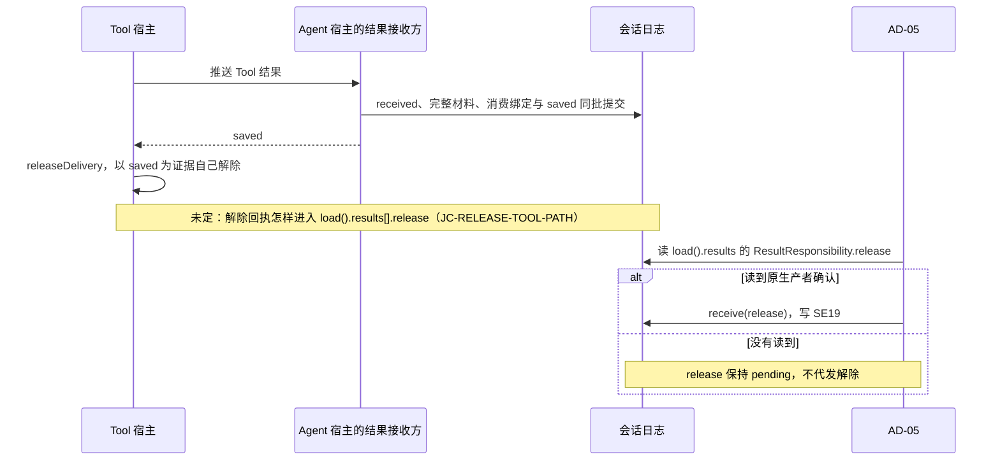

# Session长期行为规格

状态：会话与 Run 的协作身份、日志提交与查询认回、控制及逻辑终态、恢复与跨成员结果承接已由[技术接受](https://github.com/nemori-ai/omne-harness-lite/issues/262#issuecomment-6186972289)采用，是本卡范围的现行协作契约。本页及所引专题中上述范围的采用状态以此处和接受记录为准。其余专有候选及明确未定的机制保留原状态；设计接受不表示生产实现或运行验证已完成。源码支持范围：`@omne-harness/session-contract` 导出[公开接口页](docs/public-api.md)导航的类型，判定全部 23 种 `MutationName`、8 种现有 `ProducerFact`，提供九个纯领域服务及批次归约。`projectSessionLog` 接受由适配器按同日志公开读取形状归一的 Session 后果，形成第二次 Session 解释提交。completed 来自该提交。历史分页、模型视图、常驻引用与已释放作用域读取由 `./testing` 的非耐久事务替身提供。有效提供者端口均有一致性套件与替身。以下限制保留：before-admit 拦截的 SE12 路径随受理槽交付，见 [SE12 的适用范围](#se12-的适用范围)；Model ACK 确认仍停止于 [JC-Release](#jc-release)；新 scope 的业务初始化遵循 J18 与 AD-03，生产接线尚未交付。当前初始化纯核心实现[初始化来源与提交](#初始化来源与提交)的三类可加来源、严格守卫、同批事实、原结果索引与 revision 3 重建，保留 `requiredIdentities` 的原身份映射。可信来源接线与精确发布摘要见[初始化实现](docs/initialization.md)。生产采用源、真实加载及 Context 提交应用仍待对应提供者验证。失败初始化项保留任务，会话保持 initializing，直到全部必要项完成。`login-required` 仍由 `decide` 根据 `login-entry` 守卫项产出，`judgeRunStart` 不产出它。上述源码支持不证明真实存储耐久、真实外域提供者或完整运行组合。被替代的协议见[被替代的协议](#被替代的协议)。

目标成员为`packages/session/session-contract`。本规格表达已具依据的必要行为；公开类型、领域服务、`decide`/`reduce` 与 `./testing` 的替身与一致性套件已按状态行所述范围在源码声明（[公开接口页](docs/public-api.md)），不定义存储提供者或认领协议。

业务含义归[产品稿](../../../.meta_harness/design/product/sessions-and-work/design.md)，数据结构与算法归[领域架构](../session/docs/architecture/mechanisms.md)。术语以[当前统一语言](../../../.meta_harness/design/ubiquitous_language/index.md)为锚点，系统保证沿[数据与状态](../../../docs/architecture/data-and-state.md)及已接受运行架构。旧输入快照只用于追溯，不授予冲突设计继续采用。

同日志历史读取的采用状态：FR-01 至 FR-07 的历史读取、前缀准备和归一形状的采用状态是候选技术设计。其公开类型、纯决定、投影与归约校验已实现，见[同日志纯层](docs/same-log-pure.md)。session-adapters 的 `./testing` 提供组合这些纯函数的[共同日志内存提供者](../session-adapters/docs/testing.md)，实现 Agent 原提交与 Session 后续解释两个发布点。初始化来源协议的源码支持与提供者限制以上述状态行为准。上述支持及[有限模型](verification/models/frontier/README.md)不证明生产插件、真实外域来源、耐久、跨进程或完整生产运行组合。设计候选、形式模型结果与实现接受分别取得，不因实现存在而相互替代。

## 阶段范围与采用边界

本规格沿产品负责人已确认的全部能力完整支持目标，在 0.0.0 -> 0.1.0 承接 CAP-SW01 至 CAP-SW18 全部十八项能力的完整行为及失败、并发和恢复义务。不以公开类型存在或只有共同契约替代实际支持。能力含义和阶段决定只由产品正文拥有，以下表格定位技术承接。

| 能力     | 本规格承接位置                                                             | 验证重点                                                                                      |
| -------- | -------------------------------------------------------------------------- | --------------------------------------------------------------------------------------------- |
| CAP-SW01 | [创建与固定事实](#固定事实及当前状态)                                      | 固定归属、定义标识及合法创建                                                                  |
| CAP-SW02 | [固定事实与版本采用](#固定事实及当前状态)、[换代](#批次run与attempt)       | 普通恢复保版、显式 reload、原调用保持                                                         |
| CAP-SW03 | [日志不变量](#session-log-的长期不变量)、[读取与恢复](#日志读取投影及恢复) | 只追加、不可变、分页、投影和多模态引用                                                        |
| CAP-SW04 | [耐久受理](#耐久及受理确认)、[日志提交](#日志提交与查询结果)               | 同次提交认回、共同成立及未知结果                                                              |
| CAP-SW05 | [分流](#分流及命令边界)、[批次](#批次run与attempt)                         | 原去处、完整批次和唯一承接                                                                    |
| CAP-SW06 | [提醒与命令](#分流及命令边界)                                              | 受理前确认、合法展开和业务拥有者                                                              |
| CAP-SW07 | [推进治理](#批次run与attempt)                                              | 单推进、fence、独立执行生命周期                                                               |
| CAP-SW08 | [等待](#等待与结果交接)、[人工答复](#hitl等待与单次授权)                   | 原位置接续、不回答逐卡处理和无默认批准                                                        |
| CAP-SW09 | [终态](#终态与控制)                                                        | 完成检查、取消竞争及不可反转                                                                  |
| CAP-SW10 | [模式](#自动归档与模式变化)                                                | 合法用户操作、三个独立维度和恢复                                                              |
| CAP-SW11 | [目标控制](#终态与控制)                                                    | 插队、明确范围及可恢复传播                                                                    |
| CAP-SW12 | [归档](#归档与撤销)                                                        | 逻辑生效、真实收尾及撤销不复活                                                                |
| CAP-SW13 | [会话关系](#归档与撤销)、[自动归档](#自动归档与模式变化)                   | 子方级联、独立 handoff 及常驻互斥                                                             |
| CAP-SW14 | [自动归档](#自动归档与模式变化)                                            | 默认关闭、租户配置、时钟和主会话豁免                                                          |
| CAP-SW15 | [可靠交接](#等待与结果交接)、[恢复](#日志读取投影及恢复)                   | 原操作对账、不重发和跨故障恢复                                                                |
| CAP-SW16 | [追溯与账目](#故障读取与维护)                                              | 原归属、未知费用、查询资格及消费区分                                                          |
| CAP-SW17 | [模型选择与切换](#模型选择与切换)                                          | 合法目标、持久选择、固定请求不改及失败不回滚                                                  |
| CAP-SW18 | [常驻工具与会话冻结](#常驻工具与会话冻结)、[I-F1](#i-f1) 至 [I-F5](#i-f5)  | 唯一提交点、冻结不可逆、冻结后不开新 Run、在途 Run 照常收场、冻结独立于归档；VC-F01 至 VC-F07 |

完整支持的阶段目标不表示本候选已获技术接受、实际实现完整或验证已运行。提供者、精确公共签名、介质协议及尚未对齐的流式在途责任仍须形成实际交付依据；这些缺项不能缩减阶段目标。

## 业务不变式索引

以下条目定位本成员必须持续保持的业务性质。完整条件、例外及处置继续由所引章节拥有，索引不建立第二份规则。各项验证沿[持续验证义务](#持续验证义务与未覆盖)对应反例开展；明确记录不表示实现已经符合。

| 标识   | 持续保持的性质                                                                                                  | 完整行为位置                                                         |
| ------ | --------------------------------------------------------------------------------------------------------------- | -------------------------------------------------------------------- |
| SW-I01 | 同一 Session 的租户、AgentDefinition 标识、执行类型及必需身份集合随创建固定                                     | [固定事实](#固定事实及当前状态)                                      |
| SW-I02 | 同一 Run 恢复保留采用版本；合法 reload 不丢原调用或改绑定义身份                                                 | [版本采用](#固定事实及当前状态)、[换代](#批次run与attempt)           |
| SW-I03 | 已提交历史只追加且不可变，原操作认回与治理变化共同成立                                                          | [SL01至SL14](#session-log-的长期不变量)、[提交](#日志提交与查询结果) |
| SW-I04 | 已受理输入有可恢复去处，T1完整批界确定，同一输入至多一次有效承接                                                | [受理](#耐久及受理确认)、[批次](#批次run与attempt)                   |
| SW-I05 | 同 Session 至多一个未终结 Run，同 Run 至多一个有效推进者；失效推进者无新动作                                    | [推进资格](#批次run与attempt)                                        |
| SW-I06 | 等待和接续不改变原执行身份或重发原调用；可靠责任交接不留双方空档                                                | [结果交接](#等待与结果交接)                                          |
| SW-I07 | 终态至多一次有效成立，归档/撤销不复活已取消工作，迟到效果和费用如实保留                                         | [终态](#终态与控制)、[归档](#归档与撤销)                             |
| SW-I08 | HITL答复仅回原等待，不回答不授予批准，普通消息不冒充答复                                                        | [人工答复](#hitl等待与单次授权)                                      |
| SW-I09 | 模式变化不得突破结构化禁止。本会话租户可以改模式。Agent 要改模式必须走 HITL，并由人显式授权。恢复保留会话当前值 | [模式](#自动归档与模式变化)                                          |
| SW-I10 | 常驻与子会话关系互斥，自动归档按有效租户配置及真实连续空闲判断                                                  | [归档规则](#自动归档与模式变化)                                      |
| SW-I11 | 模型选择与实际请求分开，已固定请求不被切换改写，后续请求失败不回滚选择                                          | [模型切换](#模型选择与切换)                                          |
| SW-I12 | 逻辑工作控制不冒称物理停止；工具转后台不另建执行，runtime释放不自动取消独立调用                                 | [交接](#等待与结果交接)、[控制](#终态与控制)                         |

## 消费者、资格与输入

交付面、受理接入、装配协调者、Agent推进者、恢复者、控制方及读取者通过本成员契约访问会话工作。它们必须提供可核实主体、适用租户、目标Session及操作所需资格，不由连接当前选中租户反推已有工作归属。

治理登录入口显式租户冲突时遵循身份契约拒绝，不能暗中切换。系统后台入口须提供其可信身份和限定操作资格，不伪造人登录。私有查询、控制、消费和历史读取分别检查当前资格。全组织账目经账目拥有者的范围查询读取，Session 的读面只服务单租户。持有「组织成本账目读取」资格的主体不因此获得其他租户的正文或执行控制。

创建要求明确租户、AgentDefinition身份及执行类型。工作区可选。指定时，`workspace` 是 legal-identity 第六族 `WorkspaceId`，`workspaceAttachment`（工作区附着）给出实例标识 `instance` 与装载依据 `basis`，两者的合法组合见下表。附着的两个字段是非空文本，其格式与含义归[工作区域](../../../docs/domains/workspaces/README.md)。本成员自持 `WorkspaceAttachment` 形状，偏离「形状归工作区域」。退出条件：工作区契约成员发布，并由后续卡（[#837](https://github.com/nemori-ai/omne-harness-lite/issues/837) 剩余责任）迁出。指定的工作区须按附着合法装载，失败不降为无工作区。初始任务可以没有，专用派发或Job入口条件性必需输入沿其契约。本成员不从磁盘目录、外部消息正文或最近使用值猜身份与工作区。

| `workspace`                         | `workspaceAttachment`                                     | 判定             |
| ----------------------------------- | --------------------------------------------------------- | ---------------- |
| null                                | null                                                      | 合法，无工作区   |
| legal-identity 铸出的 `WorkspaceId` | `{ instance, basis }`，两个字段都是非空文本               | 合法，指定工作区 |
| null                                | 附着对象                                                  | `invalid`        |
| `WorkspaceId`                       | null                                                      | `invalid`        |
| 任意值                              | 缺 `workspaceAttachment` 键                               | `invalid`        |
| `WorkspaceId`                       | 不是对象，或 `instance`、`basis` 有一项不是文本或是空文本 | `invalid`        |
| `workspaceCodec.encode` 不接受的值  | 附着对象                                                  | `invalid`        |

本表同时约束 `create` 与 `change` 的 workspace 维度。

### 当前操作的访问裁定

`SessionAccessCheck
` 是必需构造依赖。它接收本次访问身份、公开操作及目标，返回 `allowed` 与裁定证据、`denied` 或 `unavailable`。接口只使用本域与共同值，资格政策和实现归授权适配器。主体、操作、目标及命令材料在首次异步等待前固定，不能以核验后的可变输入替换实际执行内容。

租户内操作使用 legal-identity 的 `Access
`。单会话目标绑定该租户和 `SessionId`；变更还携带原 `SessionCommand`，使授权适配器可以判断实际控制、设置和模式变更。`pending` 的目标是显式租户。`references` 与 `releasedScopes` 使用现有系统作用域主体和目录目标，不制造空租户或任意租户的 `Access`。系统读取遵循 IC-18 的限定资格，不因新增此端口获得权限。

操作集合由四个面的真实操作组成：23 种变更、`readWork`、`readInput`、`queryOperation`、`loadRecovery`、`inspectIdle`、`history.begin`、`history.next`、`history.since`、`history.readModelView`、`pending`、`references`、`releasedScopes`。操作之间不共享一次允许裁定。变更的目标、租户与命令必须一致。

每次公开读写在实际执行处调用一次 `check`，包括重复变更、原操作查询、每一页历史、恢复读与目录页。先取得本次裁定，再返回已有答案或披露正文。`allowed` 不缓存、不写进游标当作以后访问的凭据。`denied` 返回同名失败；`unavailable` 或核验抛错返回 `unavailable`，不继续读写，不推进修订、游标或操作答案。其他既有守卫仍执行，`allowed` 不证明推进权、来源或共同提交成立。

存储核心只核租户归属键与绑定本次操作和固定输入的裁定证据，不解释主体类别、权限模式或授权政策。操作执行边界调用端口，随后把证据交给存储核对；同一公开调用内部的投影、归约和存储步骤不重复裁定。直接暴露事务入口的提供者也必须经过这个边界。`SessionTransactionPort.commit` 显式携带本次 `SessionAccess`，不能从不含主体的 command 或任意 `GuardCommand` 猜出调用者。委派同一已核验操作时共享内部执行路径，不把已有证据暴露为可由调用者重放的通行证。同一已核验操作指一次面操作。Session 服务实例在面操作开头按该面操作的请求调用一次 `check`。allowed 后，服务实例以 `SessionDelegatedTransactions.bind` 取得只服务本次面操作的事务视图。本次面操作内的认回点查、权威读、`changed` 重做与提交都经该视图。视图不再调用 `check`，它按绑定核对每次调用；核对规则与失败答复只由[访问检查的委派入口](docs/access-check.md#委派入口)写定，本页不另列。证据随提交交给存储，与操作记录放在一起。委派入口只经受信装配交给 Session 服务实例，不进共享根。视图不跨面操作保留，不写进任务、缓存或游标。公开 `SessionTransactionPort` 的每个方法仍各自调用一次 `check`。从「同一已核验操作指一次面操作」到本段末尾是候选，尚未技术接受，依据是 #502 GATE-SS 的裁定 R1-D14（O1）。

模式变更资格由授权适配器根据原 `change` 命令裁定。Session 不用调用方类、模式词或历史允许推断当前资格。身份桥仍生产共同提交需要的身份材料，不能代替此裁定。

`./testing` 提供可逐次指定三类答复并记录完整请求的访问检查替身，以及按显式政策逐请求答复的替身。内存事务工厂必须显式取得 `accessCheck`，不保留默认放行或可选 boolean `authorize`。测试覆盖每种公开事务操作、重复操作与分页的调用次数，以及 allowed 后 denied、unavailable、抛错、跨租户和系统目录失败关闭。生产 Session、真实系统授权适配及持久存储组合尚未交付，替身不能证明这些运行保证。委派视图的替身不调用检查，按[委派入口](docs/access-check.md#委派入口)的核对规则答复，并把绑定证据记进操作记录。

## 固定事实及当前状态

| 状态类别     | 必须保留与解释                                                                                                                      |
| ------------ | ----------------------------------------------------------------------------------------------------------------------------------- |
| 固定身份     | Session、租户、定义身份、创建事实、用途和执行类型及类型必需身份集合                                                                 |
| 会话当前值   | 当前模式、工作区选择（`WorkspaceId` 与工作区附着 `workspaceAttachment`）、模型选择、允许的覆盖或继承声明、Context注册及自有恢复数据 |
| 采用依据     | 实际清单、来源及版本、每次调用实际输入及消费者关联                                                                                  |
| 工作事实     | Run、承接批次、attempt开始序号、等待、消费进度、取消、终态、结果和原因                                                              |
| 真实外部关联 | 原调用、实际效果及费用来源、迟到、未结及控制责任                                                                                    |
| 派生视图     | 队列、当前Run、等待及成本视图的来源和覆盖进度                                                                                       |

Session固定归属不随账号切换。同一 Session 的 AgentDefinition 标识不可变，定义版本及实现允许合法变化。新 Run 采用该标识最新合法发布版本；同一 Run 的普通恢复保留原采用，不重新求值。会话不固定任何能力的版本；延续靠按记下的形状核对同形可用的实现（[按形状核对，不钉版本](../../../docs/architecture/runtime/assembly-and-change.md#按形状核对不钉版本)）。显式 reload 经候选校验及安全交接后，可在同一 Run 采用同标识新版本并建立新 attempt，候选失败保留原合法状态。实例重建本身不改绑定义标识，不重发原调用，也不丢失原等待、卡片或结果消费责任。

通用创建的模式初值取适用默认后成为会话值；专用入口已有有效必填初值时须显式满足，缺值不得借默认创建。恢复不重新套租户新默认。会话选择和注册变化只影响本会话，明确修改共享源须由该源拥有者确认。

创建事实进入第一份有效日志批次，携带固定身份、初始值/采用依据及创建操作认回信息。初始化尚未完成的项保存明确状态和接续责任，随后追加结果，不用空值伪装就绪。无检查点重建从该创建事实开始；缺失起点、解释版本或初始依据时报告不可恢复，不从当前默认补造过去状态。

新 Run 或显式 reload 的定义与资格采用须有跨源可核验的有效裁定边界。此前已生效的新发布或撤权使旧候选重算或拒绝，Session 尾部未变不能证明外部依据仍有效。无法核验时不发布新采用，保留原合法状态或报告不可用。裁定后变化沿动态规则处理，后续实际动作仍核对当前资格；历史采用记录不永久授权。协调责任见[固定与动态输入](../session/docs/architecture/mechanisms.md#固定输入与动态输入)。

日志结构及算法见领域架构的[Session log](../session/docs/architecture/mechanisms.md#session-log-的事件模型)，以下条款拥有消费者可依赖的行为。Context共享当前值及权限不因历史引用变成会话自有源。

## 模型选择与切换

本成员保存当前选中的模型路由名、初始采用依据及切换事实；模型档案、合法集合、凭据和实际请求由模型拥有者维护。当前选择和每次实际调用分别可查，上一调用记录不因切换改写。恢复保留会话已保存选择，不按最新默认重新初始化。

用户切换须满足对应会话操作资格及当前合法目标。Agent 只代表明确的合法用户指令代办，不能自主换名；代办模型切换不授予修改三轴模式的资格。缺凭据的合法目标仍可选，并说明暂时无法调用；非法目标明确拒绝且原选择不变。目标合法性由原拥有者提供可核验依据，与会话采用沿有效裁定边界保持一致，不靠历史批准或本地 CAS 推断。

选择变更条目、当前值及原操作回执共同提交。确认后后续请求采用新选择，下一请求失败不撤销切换；提交未知继续原身份认回。切换本身不产生新 Run 或 attempt，不替换 AgentDefinition，不重发或打断在途调用。

每次尚未固定的请求按当前选择重新求有效模型及组装输入。已经固定或发出的请求保持原模型、参数和内容；单独中断仍须明确控制。新请求经适用压缩仍无法满足输入条件时，按原工作规则失败，选择和历史保留，不暗换其他模型。具体分工及合法性源见[模型选择设计](../session/docs/architecture/mechanisms.md#模型选择与切换)。

## Session log 的长期不变量

- SL01。Session 拥有跨 Run 的记录条目序列，每条保存已发生事实，具有 event 性质。消息和非消息都可成为条目，不强制关联尚不存在的 Run 或 attempt。待执行命令、工程日志、遥测及通知不能冒充已提交会话事实。
- SL02。日志 append only。可靠持久提交后，条目内容、身份、租户与会话归属、因果关联及提交顺序不可原地修改或删除。更正、补充、撤销、控制和状态变化追加新条目，显式关联原事实。压缩、卸载、归档、终态、ACK、重建投影和格式演进均不构成覆写例外。
- SL03。每条记录的身份和位置稳定，提交批次中的顺序固定。时间戳不能替代提交顺序裁定并发；晚到执行事实保留原调用及实际发生时间，不重排过去历史，也不虚构新的物理执行。
- SL04。Session 治理是日志的唯一业务写入口，生产者提交获准事实或操作，不能直接改日志与治理索引。运行恢复、控制、结果保管分别沿其资格提交，旧 attempt 无新推进资格不阻止合格消费者保存原调用的真实结果。
- SL05。纯日志投影只能由已提交日志确定性派生，不成为第二份权威。需要当前权限、共享资产、Context 数据或执行账目的视图必须标明外部来源；其当前值不能凭历史日志推测。
- SL06。已提交消息与在途流式内容分别处理。在途内容由生产者保管，Session 不逐片落盘。用户可见内容只来自两处：已提交日志的历史投影，与只发布生产者已保管批次的在途通道（[在途内容的局部对账](../../../docs/architecture/runtime/streaming-and-consumption.md#在途内容的局部对账)）。收场或中断后，实际采用内容作为历史条目提交，提交后不可覆写。中断内容不能伪装完整回复。逐片展示的耐久边界是生产者的保管，不能由收场保存或 ACK 推出；Session 不逐片落盘，也不因此允许丢失已展示的内容。

“落盘不可变”约束持久条目的身份、内容及历史语义，不要求数据库物理页、索引或副本文件永远保留相同字节布局。更换编码或存储提供者须保留原条目及其可解释依据，不通过重写历史实施业务修订。副本清理另按保留、引用及恢复责任执行，不能让应保存的历史失效。

## 日志提交与查询结果

SL07。同次操作按适用租户、Session、可信来源及原操作标识认回。相同身份及相同操作取得原提交回执；相同身份不同操作须拒绝。新的独立输入即使文本相同仍是独立操作。认回已提交操作先于检查新的尾部进度，不因后来追加或换代而产生第二批原条目；查询仍检查当前访问资格，不授予原操作再次执行的许可。

SL08。条目批次、操作认回依据、共同治理变更及其权威读取进度在一次不可分割的业务提交中成立。提供者必须在跨进程写入竞争下提供一致裁定与耐久可见点；单个进程内锁、分别成功的两次保存或独立存储上的孤立 CAS 不能兑现。可异步维护的展示投影不在该共同提交内，但不得用于裁定当前资格。具体共同对象见[提交结构](../session/docs/architecture/mechanisms.md#条目与提交结构)。

受理内容与待处理资格、完整批次承接与资格解除、attempt 换代与旧推进资格撤销、Run 终态与新发起资格撤销分别保持其共同条件。必要外部内容须先达到可恢复引用的保管条件，再确认依赖它的条目已提交；准备失败不报告受理成功，未被提交引用的准备副本不能自行成为业务事实。

| 追加或原操作查询结果 | 必须对外提供的含义                                                                                 |
| -------------------- | -------------------------------------------------------------------------------------------------- |
| 已提交               | 返回原提交身份、条目范围及回执；已达到声明的耐久边界                                               |
| 本次尝试拒绝或未提交 | 该次尝试未生效；原操作有未决尝试时仍为未知，不能据此确认整个原操作未受理                           |
| 原操作明确未提交     | 符合 SL09 的权威证据，原业务提交当时未成立且先前在途尝试不能晚到生效；后续按原身份重试仍须当前准入 |
| 并发条件已变化       | 不拼接旧的预计算条目；重新核对原操作是否已提交，再按当前事实重新判断                               |
| 结果未知             | 保留原操作及处置责任，通过原身份查询或对账，不能换身份盲重做                                       |

SL09。查询“未找到”须来自足够新的权威操作状态，只表示该读取时刻未见已提交操作，不证明另一个在途同身份提交必然失败。若重试，继续使用同一身份，由共同提交及唯一性裁定。查询服务不可用或数据损坏时保持未知，不用空记录回答。

原操作级“明确未提交”还须有持久裁定/围栏依据，终止该裁定以前的全部提交尝试；否则只能说明本次尝试被拒，原操作仍未知。之后允许重试时使用同一原操作身份及新的存储提交尝试代次，旧代次不能恢复写入。提交尝试代次与 Run 的 attempt 分别管理，裁定证据由提供者恢复，不由日志里暂时没有条目推断。

提交不把模型真实发出、工具副作用、外部物理停止或生产侧 ACK 纳入数据库事务。持久处置责任和对方执行契约各自对账；不能把“记录了发起意图”报告为“原调用确实执行”。通知发生在提交之后，同一条记录重复投递不产生新条目。丢失通知由权威状态补查恢复，不以订阅一直在线作为工作可靠性的前提。

## 日志读取、投影及恢复

SL10。每次读取、分页、导出及按原条目查询都检查当前资格。游标绑定租户、Session、来源身份、过滤条件、固定读取上界及续读位置；不得由调用方修改游标而扩大范围。错域、失效或无法核验的游标明确拒绝，不按其他会话位置继续。读取期间的新追加只在新一轮遍历中出现，同一轮不重读或漏读其固定范围内的获准条目。

SL11。分页按确定的提交位置续读，保存扫描进度，不能用最后一个可见条目代替实际扫描位置，也不能把权限过滤造成的空页误判成历史结束。没有可返回条目仍须能说明是否扫描完固定范围。权限后来撤回后不继续泄漏旧页的内容；授权范围变化不扩大原游标，需扩大过滤或范围时重新开始查询。

SL12。每份投影声明来源、确定性计算规则、覆盖到的完整提交位置、计算版本及失效条件。应用同一提交一次或重复一次得到同一结果，内容变更与覆盖位置可靠共同保存。缺批、来源不符、未知且不能证明无关的事件类型或计算版本不兼容时，停止相应投影并报告缺项，不能将未解释事实当作无待办、无 Run 或完成消费。

SL13。治理决策必须使用与当前权威尾部一致的治理状态。展示投影可以落后并公开进度，不能用落后数据授予推进、拒绝必要控制或报告确定空队列。恢复先验证检查点的来源、输入范围与计算版本，再重算尾段；无有效检查点时可从日志起点重建。重建只解释事实，不重新调用模型、执行工具、回答卡片或发送外部效果。

SL14。检查点和索引损坏可从有效权威事实重建；权威已提交日志出现缺口、损坏或未知提交状态时，隔离受影响会话并保留处置责任，不清空会话或静默丢弃已提交尾部。临时、未提交材料的处理不能误删已经提交但回执未到的批次。校验和核对完整性，不单独证明业务语义或权限正确。

当前状态、待处理输入及原等待位置有直接可定位的索引，正常推进不全量扫描历史。分页、检查点恢复、内容读取及导出按实际条目和字节控制资源。跨 Run 历史、多模态内容、块标注及压缩引用维持原保留责任；日志不要求每次模型请求读取全部历史，也不提供无限容量或未经验证的固定延迟保证。

## 原生事实与状态转移

SL15。当前采用业务的完整语义沿[原生事件目录](docs/object-model/session-log-events.md)维护，必要形状继承共同封套。记入标准见架构[必须进入日志的事实](../../../docs/architecture/runtime/session-and-run.md#必须进入日志的事实)。本规格规定种类准入、效力、整批提交，以及一条事实能否改变推进资格或 Run 终态。生产者不能任填种类或自报留痕取得准入。SystemMessage 不成为历史条目，流协议的 finish 不成为 Run 终态。具体公开枚举及兼容编码由实际成员拥有，不将目录的 SE 编号当已发布 Schema。

SL16。会话初始化/归档、Run、attempt、普通输入资格、原调用、等待/消费、控制传播、关系/空闲分别维护，沿[逻辑状态](docs/object-model/session-state-transitions.md#正交状态与唯一依据)从已提交依据解释。活跃由未终结 Run 决定，休眠允许后台执行；最大 attempt 序号仍须满足 Run 未终结、无有效取消及原资格未交还/撤销。可选退出报告不单独决定资格，缺退出报告可恢复。

SL17。每次意图形成完整业务结果，沿[命令守卫](docs/object-model/session-state-transitions.md#命令守卫与完整结果)同批满足必要条件。新 Run 与完整首批承接共同成立；首次采用和 attempt 资格保留。合法 reload 共同采用与换代。归档使仍未终结的原 Run 在同批落唯一被取消终态，归档仅引用该终态；原先已完成或失败不改写。等待结束从原结果/答复的处理或有效控制派生，不新增第二份等待结束权威，也不新增活跃/休眠事实。

SL18。归约只用已提交依据和适用解释版本，校验完整结果及末状态不变量。留痕不能暗中改变推进或恢复责任；当前权限、时钟、共享配置与外部执行查询只用于新的合法决定或组合视图。未知相关类别、缺项或因果矛盾不发布部分治理状态，不能自行补事实使其通过。Agent Loop 的阶段和扩展语义仍归 Agent，Session 不在重放时重新执行判断、授权、答卡或发效果。

这些条款细化既有 SW-I03、SW-I05、SW-I06、SW-I07、SW-I12 的表达，不建立第二套类型或状态规范。SE12、SE17 的纯留痕与日志的存储/解释可见性分别处理；同一恢复义务不能藏在瞬态通知或被误标的留痕里。

## 耐久及受理确认

凡对外确认受理、设置或控制成立，必要数据已达到普通进程崩溃、操作系统崩溃与断电后的耐久边界。介质可读及声明部署条件是前提。引用的多模态内容必须在所需期内可恢复，不能仅保存临时路径而确认全文耐久。

普通输入内容或有效引用、来源、租户、Session、同次提交标识及待处理资格在同一次不可分割业务提交中成立。没有已提交事实不得报告受理成功；拒绝留痕不取得待处理资格。卡片、控制和系统业务输入分别保存原目标与可恢复处置责任，不套普通队列状态。

受理标识先于首次发送取得并保留，在租户、Session和来源范围认回同次提交。回执丢失后查询及重试只认回原事实，不新增消息、承接或Run。用户新的提交可以同文，不按内容哈希去重。已受理内容不可被同标识不同内容覆写。未受理重试仍过当前准入，查询原事实也须当前访问资格。

| 保存结果         | 所需行为                                                                                 |
| ---------------- | ---------------------------------------------------------------------------------------- |
| 原操作明确未提交 | 按 SL09 的权威证据确定当时未受理且旧尝试不能晚到生效，发送侧保留输入，可按原身份重新准入 |
| 已提交未承接     | 本成员保存并恢复待处理责任，不要求发送方继续在线                                         |
| 已承接           | 沿原Run和批次继续，不排给另一个Run                                                       |
| 结果未知         | 保留原提交身份，查询、等待或对账；不能报告确定未受理并新建提交                           |

受理成功不等待Trigger送达。通知可以重复、合并或重建，丢通知不丢业务工作。

## 分流及命令边界

普通消息按原输入顺序入待处理视图。卡片答复认回原卡片；扩展所发卡片回原扩展等待，Tool 内部 Ask 回该 Tool 原等待，不交换接续位置。控制不进队列，系统业务输入交原流程。队列由受理输入扣除可靠承接及取消资格事实派生，不保存另一套独立决定其资格的源。

用途跑题提醒在受理前进行，不保存被拦正文或待办；确认后是新请求。消息准入拒绝另留必要干预及拒绝事实，用户拒绝可见，不能与跑题提醒的无受理前状态混同。

内容型斜杠命令采用受理时当前合法命令，展开全文和原命令关联保存，参数与Skill正文按其规则分块。失效命令明确拒绝，不当普通消息。流程命令只触发其拥有者并保留处置责任；受理摘要不能替代其实际生效依据。其他来源的`/xxx`是否识别由命令入口契约限定，本成员不自加通道。

## 批次、Run与attempt

已受理的普通输入由 Session 按业务规则调度交入执行：按到达顺序，不按来源另设优先级，只交给本会话未终结的 Run；没有未终结 Run 时先开 Run。T1承接当时已交入执行的全部普通输入，保存确定批界、顺序、Run及接续位置。已受理而尚未交入的输入保留待处理资格，留给后续批次。读取、收到唤醒、向模型发请求都不构成承接。承接及待处理解除可恢复一致，原输入保留，每输入至多一次有效承接。工程分块不能改变该轮逻辑批界，分块期间新到内容属于下一合法批次。

同Session至多一个未终结Run，同Run至多一个有效推进者。新Run成立须有合法待处理输入、没有未终结Run且当前入口准入满足。登录入口须确认登录有效；同Run恢复不重过新Run登录门，不因登录到期取消原已推进工作。后台和系统触发按其身份契约，不扩大登录条件。

Run开始须明确初始承接范围。无输入不造空Run，已有Run接续或等待不另造Run。原有效推进者继续原attempt；重新建立推进实例才产生新attempt。attempt序号在持久开始事实中明确，严格递增，不靠全历史条目计数。

新attempt生效后旧attempt不能追加输入承接、发起调用或提交推进事实。资格必须在实际发起及提交边界有效，而非仅创建时检查一次。旧执行迟到的结果与费用仍可按原身份保存，不将它们误作旧推进者越权。如何封闭检查与发出之间的竞态须由后续具体协议兑现。

恢复允许attempt有开始没有结束事实。缺失结束不等于数据损坏，也不证明调用失败。唯一推进判断、终态及队列须使用足够新的一致依据，不仅依赖可滞后的展示投影。

## 等待与结果交接

等待关联说明原工作、开始依据、目标调用或卡片、原消费位置及交付责任，不要求另建独立等待对象。释放Agent计算不解除这些关联，不取消独立Model或Tool。只查询不到句柄或执行状态时保持未知，不自动重发。

| 恢复所见                    | 继续方式                                            |
| --------------------------- | --------------------------------------------------- |
| 原调用仍在执行              | 重取合法访问关系，继续原等待                        |
| 已收场未交接                | 从原生产侧取回原结果，回原消费位置                  |
| 已可靠交接但处理未完成      | 从消费侧内容或有效引用继续，不向已ACK模型重新领全文 |
| 查询故障                    | 保持未知并按策略等待或报告，不新建原调用            |
| 原执行确实失去连续性        | 交Model或Tool自身契约处理，仍回原用途               |
| 原Run已终态或原调用不再等待 | 仅完成允许的历史、交付和结算，不恢复原工作          |

主流程、扩展、压缩和Run外消费位置分开。实际存在的原发起attempt和当前承接attempt分别可查。Run外调用保留真实调用身份和对应会话消费者，不伪造Run或attempt，不因接续重新计费，也不把内部模型判断当主流程回复。

不可用替换件沿原动作、工具身份和消费位置承接。它不是漏掉实际启动事实的半完成执行。归类、统计和是否补跑见[不可用应答的分类边界](../../../docs/architecture/runtime/tool-runtime.md#不可用应答的分类边界)。

内容或有效可恢复引用、原归属、原位置和后续责任可靠保存后，或者原消费处理已完成且必要完成事实保存后，才解除生产侧相应责任。交接和解除要可恢复一致，禁止双方都认为对方负责。展示、观察、收到通知和开始处理不等于可靠消费。

模型真实收场后由当前合法消费者按Model契约ACK，确认、清理、费用各自可查。Tool全文不自动采用此ACK，不因Run终态、归档或压缩删除。取消或归档按业务解除等待，仍保留事实及未完成交付和结算责任，不冒充消费完成。

## HITL等待与单次授权

HITL 成员拥有卡片、获准呈现、一次有效答复及可靠交回。本成员拥有原工作等待、去处和继续资格；工具或扩展解释其原问题，身份与授权解释批准。不能在会话日志另造第二个有效卡片决定，卡片记录只引用并承接原决定。信息或方案答复不自动获得授权含义。

卡片和答复关联原操作、生效参数及位置，本成员不生成另一份批准。等待不因服务超时、实例释放或单纯时间流逝结束。人明确不回答计入原卡已处理。扩展同批卡片全部处理后解除其批次阻塞，再回原扩展位置；选择不回答的卡片返回没有答案，其余答复照常返回。Tool 内部 Ask 只向该 Tool 的原等待交回其答复，不套用扩展批次屏障，也不能据此提前恢复 Agent 扩展。不回答不授予依赖批准的动作。参数或绑定变化后的决定可用性沿授权契约复核。

单次授权只覆盖明确批准动作，明确整批才覆盖该批。消费或所属Run终态后不得再使用，流水仍保留。会话授权归档后保留，撤销归档不复活取消卡片或已消费许可。全局租户授权写租户权限设置，由其拥有者校验资格及上界，不只保存在当前Session中。

## 终态与控制

Run终态只为完成、失败、被取消，每Run最多一次有效终结。完成候选先过原工作条件和适用终态前扩展，记录后才生效；后置扩展不得撤销。队列空、模型无动作、runtime退出及非常态上交均不自动证明完成。

终态成立后不新增原Run的attempt、输入承接、调用或外部动作。已发调用及未结费用可迟到保存。仍具合法后续投递资格的后台结果在未归档会话按既有输入规则交后继工作，原Run不复活。已因归档取消原业务资格的调用，其结果在撤销归档后仍不自动取得待处理资格或创建后继Run；取消提醒和结算不自造待处理资格。

控制先保存目标、发起主体、原因、级别及意图，随后按持久关联撤资格和传播，不依赖旧Agent句柄转发。请求受理不冒充实际生效或物理停止。

控制的最小对接是现行规则。租户身份是参数。缺租户或跨租户默认拒绝。内容块的形状不在本表。跨成员流程见 [F-SE03](../docs/key-flows.md#f-se03-控制传播)。

| 项         | 规则                                                                                               |
| ---------- | -------------------------------------------------------------------------------------------------- |
| 关联身份   | Run 取消用该 Run。单调用控制用原调用身份。这一次操作用提交身份。                                   |
| 必要参数   | 租户、会话、目标身份、控制种类、发起者。                                                           |
| 成功       | 意图已保存。Run 取消生效时，同时记录被取消终态并撤销新发起资格。                                   |
| 拒绝       | 无资格、目标不存在，或与已经生效的终态冲突。与终态冲突时，拒绝带回已经生效的终态，控制发起者可见。 |
| 未知       | 按原提交身份查询。不换身份重做。                                                                   |
| 同身份重试 | 相同提交身份返回原结果。                                                                           |
| 参数冲突   | 同一提交身份带上不同目标或不同种类则拒绝。                                                         |

会话日志上的查询认回见[日志提交与查询结果](#日志提交与查询结果)。调用登记的发起字段归 [Agent](../../agent/agent-contract/SPEC.md#身份范围与归属)。模型受理归 [model](../../model/model-contract/SPEC.md#调用和各次真实发出)。工具的停止和交付解除归 [tool](../../tool/tool-contract/SPEC.md#必要持久事实与确认)。Context 的注册和读取归 [runtime-context](../../context/runtime-context-contract/SPEC.md#rc-02-块声明注册与参数)。请求组装归 [request-context](../../context/request-context-contract/SPEC.md#rq-02-组装的前置输入)。

会话控制请求工具转后台时沿工具许可及转换契约；控制受理不表示转换完成。工具侧保存实际转换/收场，会话和 Agent 可靠承接后改变原步骤等待，不建立第二次执行或释放仍在执行的并发名额。后台最终结果沿原消费契约交回，原身份、效果、全文和费用保持；不默认支持后台转回前台。工具内 Ask 等待的后台限制沿工具契约，不由会话控制绕过。

| 控制目标       | 传播范围                                                                   |
| -------------- | -------------------------------------------------------------------------- |
| 单次模型或工具 | 指定原调用，不自动影响其他调用或Run                                        |
| Run取消        | 当前推进资格、该Run模型及前台工具；后台、子会话及无关Run外调用不自动跟随   |
| 仅替换Agent    | 撤旧推进，接续同Run；原Model和Tool不因旧句柄销毁停止                       |
| Session归档    | 原业务推进和等待、未承接任务、所有关联在途模型与前后台工具，以及子会话级联 |

取消一旦生效就记录被取消终态，并撤销新发起资格。优雅或强制只影响停止请求有多急，不改变终态时点。治理方继续跟踪真实收场。没有 Agent 时也继续跟踪。未收尾的外部效果保持未知。外部成功、失败和未知均如实保存，不能由错误或停止标签推导效果未发生。

插队保存共同的加急消息、处置决定、占位与提醒。已到响应及已发生效果最大程度保留，原Run不终结。允许后台的执行转换等待关系，其他按其契约请求中断。人工等待按主动插队控制记为明确拒绝回复，保留实际控制来源，不伪造用户未提交的卡片答案或授权。重复同次控制不重复插消息或发相同效果；独立多次插队仍各有原提交。

逻辑处置的原子性不表示外部执行物理停止与队列写入在一个数据库事务中。协调者须保存仍待传播及对账责任，并准确显示真实执行状态；不能给“已请求停止”显示为“物理已停止”。

## 归档与撤销

归档确认依赖业务取消、队列资格取消及后续处置责任成立，不等待全部独立执行物理停止。 同批终结仍未结束的原 Run 为被取消，归档条目只引用其唯一终态；已成立的完成或失败保持。没有原 Run 时不补造 Run 或终态。级联关系及未完成子会话处置须可恢复；独立handoff不级联。新任务与归档竞争只能为先受理后因归档取消，或明确拒绝，不得无痕丢失或归档后保持待执行资格。

归档后拒绝新任务，迟到结果与费用仍保存原归属但不入任务队列。执行方可继续真实收场，不能伪记物理中断，也不能据此恢复会话等待。归档不删除历史、会话授权、工作区或实际费用。

会话关系的两端属于同一个租户。`setRelation` 按 `Access` 的租户查找关系的两端，任一端在该租户下不存在时返回 `denied`。级联按父会话的租户查找子会话，不按会话身份跨租户查找。

撤销归档回休眠；冻结的会话撤销归档后回到冻结（[常驻工具与会话冻结](#常驻工具与会话冻结)）。两种情形都从撤销时刻重新开始空闲计时，不恢复原取消任务、Run、调用或卡片，不顺带恢复子会话。原取消调用此后迟到的结果仍不自动入队，用户需要重新工作时须显式提交新任务。当前保存的模式和注册恢复，实时权限按当前来源核对。注册恢复受 [J18](#j18-作用域引用与结束事实) 的条件约束：撤销归档铸造新代次的 scope，新代次不迁移旧 scope 的注册。新 scope 的注册恢复与初始化归 #680 与 Runtime Context 的拥有者。旧晚到reload或原调用不能重新启动已取消工作。

## 自动归档与模式变化

自动归档默认关闭，允许显式开启，并支持关闭配置与会话常驻豁免。没有有效的显式启用依据不得自动归档；仅启用、无豁免且符合连续空闲条件和时限时执行。常驻标记只允许主会话，子会话不能设置常驻。创建、标记修改、关系采用及恢复维持两者互斥；把子会话标记常驻的请求须拒绝，不静默清除标记或改变关系。不能用非法组合阻止或绕过父方的既定归档级联。常驻不是进程驻留、永久连接或手动归档禁止。

空闲判断覆盖本会话及级联相关子会话的未终结Run、待处理任务及在途Model和Tool。任何等待、后台工具或Run外调用使条件不成立；查看历史不开展工作。新工作与到期检查竞争须重新核对有效条件。成员失效不暂停或清零计时；普通重启计入可确认连续空闲，未知期间不冒充已达到条件。

权限处理、执行环境和协作模式的修改接受本会话租户的操作，实际提交边界核对当前资格。Agent 不能通过直接入口修改模式，也不能通过未经人授权的工具或委托修改模式。Agent 要改模式，必须走 HITL，由人显式授权。三个维度分别保存并可变化，不扩大结构化权限。创建默认只初始化，当前值跨恢复保留。模型可读模式变化按Context协议感知，已经固定的请求不回写。自动归档的启用开关与时限从本租户的合法设置取得，设置修改由相应拥有者校验当前修改资格。单会话常驻标记仅由具会话管理资格的用户维护自己的会话。开启自动归档或解除常驻时使用原已确认连续空闲，操作前提示可能立即归档，不重置为空闲起点；仍须重新核对无未完成工作及全部适用条件。撤销归档仍从撤销时刻重新计时。空闲时限须由本租户有效设置给出；精确配置契约仍待细化，不以旧三十天补值。

## 故障、读取与维护

必要保存不可用时，阻止依赖该保证的新动作并说明影响。提交未知先对账；读取故障不当空队列、无Run、无权限表达或执行失联。局部服务故障按责任限定，兜底优先无副作用，不授权绕过租户边界。

长会话当前状态、待处理及接续位置可直接取得，不每轮扫描全部历史。每投影声明权威来源、覆盖进度、失效和重建条件，展示迟延不能降低控制或推进正确性。分页与导出控制实际读取量，不声称所有查询常数成本。

账目真实归因到原调用；实际存在发起attempt或Run时记录相应关联和汇总，Run外按对应会话消费者，不造Run或attempt。未知费用继续待结，不当零；观察者和接续不重复收费。日志及遥测可定位原身份与因果，诊断内容按权限、隐私与外传规则筛选。

日志模型、原操作查询、共同提交及投影恢复算法已有[领域设计](../session/docs/architecture/mechanisms.md#session-log-的事件模型)。实际提供者、精确公共 Schema/API、介质协议、格式演进兑现及跨能力实际发起、认领和可靠交接协议仍须细化并验证。普通崩溃恢复不自动增加人工灾后开放审批，物理灾后恢复不恢复已撤资格或发明管理员角色。

## 关键旅程对应与验证

以下组合场景承接产品关键旅程，持续适用原不变量和[全部验证义务](#持续验证义务与未覆盖)。V-SW 是文档定位号，不新增事件、产品对象或测试通过记录。实际提供者与组合须分别取得行为证据。

### V-SW01 建立会话并更新同一定义版本

产品 [J-SW01](../../../.meta_harness/design/product/sessions-and-work/design.md#j-sw01)，协作 [F-SE10](../docs/key-flows.md#f-se10-新-run-开始的求值与重装判定)。能力 CAP-SW01、CAP-SW02 的行为归 [对应条款 1](#固定事实及当前状态)、[对应条款 2](#批次run与attempt)。

在未发送任务时创建会话，再注入指定工作区加载失败、初始化中断及创建回执丢失。核对原身份与接续责任不变；无 Run 的 reload 不得伪造 attempt，已终结 Run 的 reload 不得新增原 attempt 或恢复原工作。随后在原 Run 有在途调用及卡片时比较普通恢复、合法 reload、无效 reload 和取消先成立四条路径，检查采用版本、attempt、原调用及唯一资格。

### V-SW02 发送输入并确认工作去处

产品 [J-SW02](../../../.meta_harness/design/product/sessions-and-work/design.md#j-sw02)，协作 [F-SE01](../docs/key-flows.md#f-se01-一条输入从受理到推进)。能力 CAP-SW04、CAP-SW05、CAP-SW06 的行为归 [对应条款 1](#耐久及受理确认)、[对应条款 2](#分流及命令边界)、[对应条款 3](#批次run与attempt)。

让普通输入、命令、卡片答复、控制和业务输入经过同一入口，分别观察原去处。开启用途提醒并拒绝确认，核对系统未保管被拦正文。受理提交后丢回执和通知，按原标识恢复，再在 T1 边界并发追加输入，检查完整批界、顺序及无重复承接。另覆盖失效命令、存储不可用与归档竞争。

### V-SW03 等待执行并在故障后继续原工作

产品 [J-SW03](../../../.meta_harness/design/product/sessions-and-work/design.md#j-sw03)，协作 [F-SE05](../docs/key-flows.md#f-se05-恢复)、[F-SE09](../docs/key-flows.md#f-se09-三条流到日志)。能力 CAP-SW07、CAP-SW08、CAP-SW09、CAP-SW15 的行为归 [对应条款 1](#批次run与attempt)、[对应条款 2](#等待与结果交接)、[对应条款 3](#终态与控制)。

用两个恢复者接续同一有并行调用的 Run，检查唯一推进者、原调用和消费位置。分别在先保管后处理、先完成处理并保存必要事实两条路径切断消费者和 ACK 回执，验证无交接空档、不重发、不要求先完成分支额外保留全文。注入查询失败、不可用工具逻辑结果与模型流 finish，检查未知、无虚构执行及无提前 Run 终态。

### V-SW04 回答人工卡片并回到原等待位置

产品 [J-SW04](../../../.meta_harness/design/product/sessions-and-work/design.md#j-sw04)。能力 CAP-SW05、CAP-SW08、CAP-SW15 的行为归 [对应条款 1](#hitl等待与单次授权)、[对应条款 2](#等待与结果交接)。

使扩展发起的同批两张卡分别得到有效答复与明确不回答，在第二张处理前恢复 Agent。核对原批次保持阻塞，处理齐备才回原扩展位置，不回答不批准。另构造工具内部 Ask，核对答复只交回 Tool 原等待，不送入 Agent 扩展位置，也不套用扩展批次屏障。两类等待分别注入多端答同卡、交回中断、恢复及取消先成立后迟到答复；扩展路径另检查后续扩展再出卡。检查无第二决定、无伪造超时、无原工作复活。

### V-SW05 调整协作方式和后续请求使用的模型

产品 [J-SW05](../../../.meta_harness/design/product/sessions-and-work/design.md#j-sw05)。能力 CAP-SW10、CAP-SW17 的行为归 [对应条款 1](#自动归档与模式变化)、[对应条款 2](#模型选择与切换)。

在一个请求已固定时，合法用户改变一维模式并切换模型，核对其他维度及在途请求不变。令后续请求缺凭据或压缩后仍无法满足条件，确认已提交选择保持。覆盖 Agent 自主切换、Agent 借工具修改模式、非法目标、保存未知和恢复时租户默认变化，核对拒绝边界及原值恢复。

### V-SW06 插队或停止指定范围的工作

产品 [J-SW06](../../../.meta_harness/design/product/sessions-and-work/design.md#j-sw06)，协作 [F-SE03](../docs/key-flows.md#f-se03-控制传播)。能力 CAP-SW09、CAP-SW11 的行为归 [对应条款 1](#终态与控制)。

在模型等待、可后台工具、不可后台工具、人工卡片和取批阶段分别插队，检查加急输入只出现一次且原 Run 不终结。对单调用、Run 优雅取消、Run 强制取消分别注入控制传播失败和完成竞争，检查目标范围、唯一终态、可恢复处置及未明效果。工具转换与收场竞争沿 Tool 实际结果处理，不创建第二执行。

### V-SW07 归档会话并按需重新开启协作

产品 [J-SW07](../../../.meta_harness/design/product/sessions-and-work/design.md#j-sw07)，协作 [F-SE04](../docs/key-flows.md#f-se04-归档级联与作用域释放)。能力 CAP-SW12、CAP-SW13 的行为归 [对应条款 1](#归档与撤销)。

归档一个有未终结 Run、后台工具和子会话的父会话，并让一个子方暂时不可达。核对父方逻辑归档成立、原 Run 同批唯一被取消、子方进度独立可查。之后撤销父方归档并交回旧工具结果、旧卡片和旧 reload，检查回休眠、不自动复活子方或旧工作。独立 handoff 不纳入级联，已完成 Run 不改终态。

### V-SW08 配置自动归档并保留需要常驻的主会话

产品 [J-SW08](../../../.meta_harness/design/product/sessions-and-work/design.md#j-sw08)，协作 [F-SE04](../docs/key-flows.md#f-se04-归档级联与作用域释放)。能力 CAP-SW13、CAP-SW14 的行为归 [对应条款 1](#自动归档与模式变化)。

分别配置未开启、显式关闭、启用和主方常驻，并请求子方常驻，核对仅合法设置生效。积累可确认空闲后重启、变更成员资格、开启或解除常驻，检查原区间保持及操作前提醒。插入人工等待、后台工具、Run 外调用、子方工作和查询未知，检查不能归档。撤销归档按新起点，配置不得跨租户生效。

### V-SW09 回看历史并核对结果与费用

产品 [J-SW09](../../../.meta_harness/design/product/sessions-and-work/design.md#j-sw09)，协作 [F-SE08](../docs/key-flows.md#f-se08-时间线投影与在途收敛)。能力 CAP-SW03、CAP-SW15、CAP-SW16 的行为归 [对应条款 1](#session-log-的长期不变量)、[对应条款 2](#日志读取投影及恢复)、[对应条款 3](#故障读取与维护)。

在历史分页期间追加条目、改变访问资格并产生过滤空页，核对固定范围、扫描进度与当前资格。追加压缩、更正及中断消息，确认历史不可覆写且多模态引用可恢复。损坏派生检查点后从有效源恢复，权威损坏则隔离。对原调用重复通知、迟到费用和查询故障，检查无重复收费、不把未知当零、账目资格不扩张正文权限，并测量实际读取与重建成本。

## 持续验证义务与未覆盖

| 故障或反例                               | 必须观察的结果                                                                               |
| ---------------------------------------- | -------------------------------------------------------------------------------------------- |
| 受理提交后回执丢失                       | 同次查询或重试取得原事实，无第二消息或Run                                                    |
| 受理与Run结束竞争                        | 合法输入由原或后继Run唯一承接，或被明确取消，不丢失                                          |
| T1工程分块及新消息并发                   | 当轮批界和原顺序保持，新到按下一批次                                                         |
| 两恢复者竞争及旧Agent恢复                | 一个有效推进者，旧实例无新动作，原执行真实结果仍保存                                         |
| 等待时回收Agent                          | 原Run、卡片、调用和消费位置接续，不重发                                                      |
| 模型交接成功后ACK清理失败                | 消费側可继续，生产侧继续清理，不重复调用或收费                                               |
| 取消与完成同时到达                       | 依据有效业务事实只形成一个终态，控制收尾可追溯                                               |
| Session归档时工具仍物理执行              | 归档可业务完成，迟到效果和费用真实保存，不恢复推进                                           |
| 归档与新输入竞争                         | 先受理后取消或拒绝，无归档后隐式待执行输入                                                   |
| 撤销归档与旧结果、reload迟到             | 不复活已取消工作，当前身份和选择不被旧候选覆盖                                               |
| 成员失效及空闲恢复                       | 时钟不因身份变化重置，当前未知执行不冒充空闲                                                 |
| 已确认保存后进程、OS崩溃或断电           | 必要事实及有效内容可恢复，各故障类型各有真实证据                                             |
| 尝试覆写已提交条目、块标注或原归属       | 修改被拒绝；获准更正追加新条目，原身份与位置不变                                             |
| 同操作同意图重试且尾部已推进             | 认回原回执，无第二批条目；不同意图复用标识拒绝                                               |
| 两进程同旧位置提交或旧发布者接管后回写   | 一个有效后继，旧发布者不能写；另一操作重新判断业务条件                                       |
| 提交批次、治理变更及回执保存切点崩溃     | 整份共同单元可认回或明确未提交，无半批事实与资格裂开                                         |
| 已提交但回执丢失，原操作查询仍不可用     | 保持未知，继续原身份对账，不盲重发或清理原提交                                               |
| 翻页期间追加、权限变化或过滤后空页       | 固定上界、正确扫描进度及当前资格保持，不漏原范围、不泄漏撤权内容                             |
| 游标来自其他租户、Session或被篡改        | 明确拒绝，不泄漏内容或按错误起点续读                                                         |
| 投影重放重复、缺批或未知相关格式         | 重复无额外变化；缺批或不能解释时停止对应投影，不报告无工作                                   |
| 检查点坏、覆盖位置落后或日志损坏         | 可从有效源重建派生数据；权威损坏隔离，恢复不执行外部动作                                     |
| 压缩、卸载或更换读取格式                 | 原条目与标注不改，摘要及引用追加，所需历史仍可读                                             |
| 超长日志及稀疏过滤查询                   | 热路径使用直接索引；计量实际扫描、内容字节、尾段追赶及完整重建成本                           |
| 检查点全失且当前租户默认/定义已变化      | 从创建及初始化事实重建原状态，不按最新源补造初值                                             |
| 首次提交未知，查询未找到，重试因撤权被拒 | 原操作保持未知，旧提交仍按原身份对账；有持久围栏证据才可确认原操作未提交                     |
| 读取定义/资格后新版本发布或资格撤销      | 按可核验采用边界重算或拒绝，Session CAS成功不单独证明旧共享依据有效                          |
| 合法模型切换与在途请求、下一请求失败并存 | 当前选择可靠保存，在途模型及输入不改；下一请求用新选择，失败不回滚、不暗换模型或新建 attempt |
| 模型切换保存回执丢失或目标非法           | 未知按原操作认回；非法目标保留旧选择，不能报告切换成功                                       |
| Agent代办模型切换或试图自行换名/改模式   | 明确合法用户指令按当前资格处理；自主换名及借模型入口改模式拒绝                               |
| 转后台控制重试或与原工具收场竞争         | 原执行与效果不重做；控制受理、转换和最终收场分别可查，等待只按有效结果处理                   |
| 同卡从多个呈现端答复或与原等待终局竞争   | 沿原HITL认回一次有效决定，不创建第二批准，不恢复终局工作                                     |

新增事实与状态模型须覆盖以下语义反例。

| 反例                                               | 必须保持的结果                                                         |
| -------------------------------------------------- | ---------------------------------------------------------------------- |
| 无 Run 的初始化就绪，或休眠但有后台调用            | 生命周期为休眠，后台执行独立；未知执行不形成连续空闲证明               |
| 最大序号 attempt 已交还或取消，收到重复触发        | 不获得推进资格；原事实和当前条件决定合法接续，通知不造新工作           |
| 归档时原 Run 等人或工具仍执行，随即撤销归档        | 同批唯一被取消终态保持，撤销回休眠；原卡片/调用不复活，真实收尾可继续  |
| 成本或结果仅留痕，却被用作恢复/解除责任            | 必需依据缺项明确报告，不让留痕隐式改变状态或伪称责任解除               |
| HITL 一张已答、一张未答，或后续扩展另出卡          | 依原经过和批次保持阻塞，不提前执行获准部分，不再生成原决定             |
| 普通消息、扩展内部模型或流 finish 被误认成其他类别 | 普通输入由合法受理路径生成；内部结果回原位置，finish 不自动落 Run 终态 |
| 事件逐项合法但归档缺取消集合或首批承接缺成员       | 完整结果无效，不发布半份状态；归约失败隔离而不自行修补历史             |
| 父归档观察后新增关系或空闲观察后新调用             | 当前协调边界重新核对，不能用旧快照宣称级联范围或自动归档资格成立       |

模式修改还须覆盖这些情况。不具资格的用户被拒绝。Agent 直接调用被拒绝。未经人授权的工具或委托被拒绝。人经 HITL 显式授权后的修改被接受。合法修改不能越过结构化禁止。恢复保留当前值。自动归档须覆盖未开启、已关闭及常驻会话不自动归档；开启后的行为只按本租户的有效配置和已明确时限验证，不能以旧三十天补预期。另验证子会话常驻请求被拒绝、恢复不采用常驻与子会话并存的非法状态、父方归档按既定关系级联，以及租户配置不能影响另一租户、无会话管理资格者不能改常驻、开启或解除常驻使用已有连续空闲且操作前提示，以及撤销归档仍重新计时。

这些是长期验证义务，不是本次运行结果。技术接受前须按实际承载补并发及故障行为模型，交付前须验证真实提供者及组合，不能用文档伪代码运行替代持久存储。当前没有实际公开接口、提供者、行为模型执行或性能验证。流式在途耐久、跨能力协调、跨会话授权投递、模式修改精确授权机制、自动归档配置和计时及精确性能尺度见[问题登记](../session/docs/architecture/mechanisms.md#sw-m01-技术兑现义务)。局部纯测试、类型或静态结构通过不能代替上述组合行为证据。

## 运行契约候选

本节是候选设计，尚未技术接受，不改变前文已采用的范围。本节只细化前文条款，不削弱它们。公开形状归 [public-api](docs/public-api.md)，对象、事件目录与状态图归[对象模型](docs/object-model/README.md)，消费场景归 [context](docs/context.md)。系统层协作归 [Session、Run 与输入承接](../../../docs/architecture/runtime/session-and-run.md)与[控制、取消与故障恢复](../../../docs/architecture/runtime/control-and-recovery.md)，跨成员流程归[组的协作入口](../docs/key-flows.md)。本节写条款，不复述这些页的叙述。根入口目前没有这些操作的生产实现。

本节的公开操作供受理入口、外部协调者、恢复者与读取者使用。网络 SDK、宿主接入和人机界面归公开接入的拥有者，见[公开接入与宿主](../../../docs/architecture/runtime/runtime-contract-handoff.md#318-公开接入与宿主)。

### 条款前缀

| 前缀 | 范围                                     |
| ---- | ---------------------------------------- |
| OP   | 操作身份的派生（OP-00）与四个面的操作表  |
| JC   | 共同提交表                               |
| PA   | 与 Agent 的参加与核对                    |
| PM   | 推进映射、`claim` 与 `reload`            |
| EC   | 事件消费与交付责任解除                   |
| FR   | 同日志解释的历史材料、归一后果与发布前缀 |
| RS   | Run 两层状态机的转移                     |
| I-R  | Run 不变量                               |
| I-F  | 会话冻结不变量                           |
| P    | 具名前提                                 |
| VC   | 本节的持续验证义务                       |

SL 沿前文编号。ST 沿[状态转移页](docs/object-model/session-state-transitions.md#命令守卫与完整结果)，SE 沿[事件目录](docs/object-model/session-log-events.md#原生事实类别)。条款写前提、动作、结果、失败、未知与认回、责任。表格行省略某一项时，沿[四个面的操作表](#四个面与公开操作)。

### 五个锚点

下面五条是本节全部条款的前提，与系统页的[总前提](../../../docs/architecture/runtime/session-and-run.md#总前提)一致。

1. Session 是业务治理与耐久事实的拥有者，不是第四个 runtime。
2. Session 认识全部邻域，邻域都不认识 Session。名称与形状的翻译只在 [session-adapters](../session-adapters/SPEC.md) 里发生。
3. 需要共同成立的事实只在一条权威提交序列里成立。
4. 逻辑收口与物理收场分开。取消、归档、换代和释放只改变资格与责任。
5. 会话日志是唯一的业务写入口。每个意图经一个具名操作进入。

### Session 与 Agent 的同一日志

Agent 经 `AgentJournal` 与 `AgentJournalEntries` 写执行记录，Session 拥有这份会话日志。端口的提供者与形状翻译在 session-adapters；session-contract 不导入 Agent 类型。它不另建 Agent 事件副本传输协议。

1. Session 在同一日志提交内参加 `message`、`context-transition`、`custody`、`processed` 四种调用方交接，分别生成 SE10、SE10/SE33、SE20、SE21。打开执行与交入输入按 PA-01 第 1、2 条，挂接按 PA-01 第 3 条，条件终结按 PA-02，各做只读核对。核对与发布之间必须复核原修订，不能让提交期间新受理的输入漏出条件终结守卫。
2. Session 经同一 AgentJournal 提供者的 `output.read` / `output.events` 读取 AgentEvent 正文。`load` 读取 ExecutionSnapshot 的 entries、results 及其他快照字段，不提供 events 字段。entries 保留 start-fence、received 的提交顺序，不能作为事件序号或事件 cursor。Session 自有派生条目只存原来源身份或引用，不复制 Agent 事件正文，也不经 `receive(agent-event)` 传输副本。
3. 第一个发布点是 Agent 原提交：Agent 事实与适用的四类 CallerCommit 参加事实共同成立。open、submit、attach（按 PA-01 第 3 条）与 tryFinish 的 Session 参加只读核对，不在此写 SE14/18/19/22/25/26。received 与所引用的完整材料、消费绑定、saved 及原操作答案同批可见。首次发布前失败，该批全部不可见；发布后丢答复按 Agent 原操作查询。
4. 第二个发布点是后续 Session 解释提交：SE14/18/19/22/25/26 等派生后果、解释进度及该次 Session 操作的认回答案同批保存。解释提交失败不撤销 Agent 已提交事实，也不推进持久解释进度；未知先认回该次 Session 操作。两次提交共用会话日志，不共享成一个原子批次。
5. Agent 的输入水位线决定 SE14 的批界。Session 决定输入交入顺序，`startRun` 不预扣批次。交入受理 SE35 不等于承接 SE14。推进交还 SE16 仍以 detach 依据或同日志挂接状态成立。
6. 未解释的日志事实计入 EC-03 的未结工作。延迟解释不得造成提前空闲或完成。PA-08 的竞争不变：Agent ended 已发布而 Session 尚未解释时，cancel 可以先提交 cancelled；后续 ended 只保留原 Run 的来源引用，不改既有终态或后继。冻结后的终态提交仍同批解除余下待处理资格。

### 四个面与公开操作

四个面按调用方切分。`SessionWork` 供受理入口与外部协调者，`SessionManagement` 供会话管理与空闲维护，`SessionReconciliation` 供恢复与对账，`SessionHistory` 供读取者。调用方类（`intake`、`coordinator`、`maintainer`、`reader`）按操作授权，不按面授权。每个操作允许的调用方类写在下表，[Cordis 定义](../session-cordis-contract/docs/cordis.md#intercept-配置与调用方类)按它核对。调用方类是装配事实，不授予资格。访问边界是每个操作的调用资格。

每个变更操作按下列顺序处理。任一步失败，操作停止，不提交。

1. 核对 `Access`（本页命令表与守卫里的 `Access` 指 `SessionAccess
`，即 `Access
` 加 `session`；系统作用域读取另行注明）。缺租户返回 `invalid`，跨租户返回 `denied`。会话在 `Access` 的租户下不存在时，同样返回 `denied`；调用方不能据此区分会话不存在与跨租户。
2. 按[当前操作的访问裁定](#当前操作的访问裁定)核验本次操作，再按 [OP-00](#op-00) 派生的身份认回原操作（`resolveOperation`）。已提交时返回原回执，`recovered` 为真。认回先于新的 `expected` 检查，但不免除本次操作的当前资格检查。
3. 读权威状态，由[领域服务](#领域服务与归约)裁定。
4. 收齐参加者材料，一次提交。

失败种类见 public-api 的 `SessionFailure`。`commit-unknown` 原样交给调用方，不改写为失败或成功。表中标「参加」的操作由执行记录提供者发起提交，Session 作为提交参加者执行同一条流水线。这类操作的结果未知时，提交方按 [PA-05](#pa-05) 认回，Session 不把它们列入 `unresolved`。异常不替代业务拒绝或未知。

#### OP-00 操作身份的派生

- 前提：每个变更操作在首次提交前取得 `SessionOperationId`。每个出站调用在首次发出前取得 Agent 操作身份。同一业务意图在崩溃前后派生同一身份，不同意图不共用身份（[SL07](#日志提交与查询结果)）。
- 动作：public-api 声明的两个纯函数 `deriveSessionOperation` 与 `deriveDriveOperation` 按下表要素派生身份。输入不含时间、随机数或连接。
- 结果：同身份、同规范化参数取得原回执。同身份、不同参数返回 `conflict`。
- 失败：要素缺项返回 `invalid`，不提交。
- 未知与认回：派生本身不提交，没有未知。
- 责任：派生函数归本成员。要素的真实性归交来方。

Session 命令：

| 命令                                                                                                        | 身份要素                                                                                                                                                                                                                                                               |
| ----------------------------------------------------------------------------------------------------------- | ---------------------------------------------------------------------------------------------------------------------------------------------------------------------------------------------------------------------------------------------------------------------- |
| `accept`                                                                                                    | 受理入口交来的受理标识。受理标识就是 `Mutation.operation`，先于首次发送取得（[耐久及受理确认](#耐久及受理确认)）。普通输入的 `InputId` 是受理入口在首次发送前另外分配的输入身份，重试保持同值。同受理标识、同 `InputId`、同内容认回；同受理标识、异内容返回 `conflict` |
| `startRun`                                                                                                  | session、首条输入的 `InputId` 与前继 Run（没有前继时为 null）。前继 Run 取自会话里最近一个 Run。后继 Run 以同一 `InputId` 承接首条输入时，身份与前继 Run 不同；两个触发者并发开同一个后继 Run 时，仍派生同一身份。摘要不含推进实例身份与候选采用                       |
| 参加的 `recordMessage`、`preserveResult`、`completeConsumption`、`commitDerived(compaction)`                | execution、执行记录提供者的操作身份、提交种类                                                                                                                                                                                                                          |
| `claim`                                                                                                     | run、接手实例、`continuity` 摘要                                                                                                                                                                                                                                       |
| `reload`                                                                                                    | run、候选采用摘要、`handover` 摘要                                                                                                                                                                                                                                     |
| `release`                                                                                                   | run、attempt、交接依据摘要                                                                                                                                                                                                                                             |
| 有界收束的 `finishRun`                                                                                      | run、收束依据摘要                                                                                                                                                                                                                                                      |
| Session 提交的 `preserveResult`、`completeExternalConsumption`、`bindExternalCall`                          | 命令种类、consumption 或外部关联，以及结果版本或固定请求摘要。同一结果版本先保管、后完成处理时，两条命令派生不同身份                                                                                                                                                   |
| `commitDerived(context-reminder)`                                                                           | session、变化材料的身份                                                                                                                                                                                                                                                |
| `control`、`interrupt`、`create`、`completeInitialization`、`change`、`setRelation`、`configureAutoArchive` | 调用方交来的提交身份                                                                                                                                                                                                                                                   |
| `recordIdle`                                                                                                | session、观察摘要                                                                                                                                                                                                                                                      |
| `considerAutoArchive`                                                                                       | session、`idleEvidence`                                                                                                                                                                                                                                                |
| `freeze`                                                                                                    | session、冻结判定的证据                                                                                                                                                                                                                                                |
| `receive`                                                                                                   | 事实来源的稳定身份：交入回执的 execution 与 `InputId`；生产者记录身份与修订；子方操作；释放读回；实例退出的 attempt 与实例                                                                                                               |

出站调用（`AgentDrivePort`）：

| 出站操作       | 身份要素                                       |
| -------------- | ---------------------------------------------- |
| `invoke`       | execution、首条输入的 `InputId`、SE13 回执摘要 |
| `submit`       | execution、该输入的 `InputId`                  |
| `resume`       | execution、本 attempt 的 SE15 证据摘要         |
| `detach`       | execution、attempt                             |
| `control`      | execution、Session 控制的操作身份              |
| `recordResult` | execution、consumption、结果版本、交接种类     |
| `query`        | 被查询操作的身份，不另派生                     |

`startRun` 的身份不含修订，所以 `changed` 之后的重试仍认回同一意图。两个推进触发者并发开 Run 时派生同一身份，一方提交，另一方认回。`claim` 的身份含连续性摘要，所以两个恢复者派生不同身份，由 `judgeAdvance` 只准一个后继。参加的命令从执行记录提供者的操作身份派生，两侧查询同一回执。出站调用的身份从 Session 已提交的事实派生，所以崩溃后的重放认回原受理。

#### SessionWork

| 操作                          | 调用方类与资格                                                                                                                                      | 身份                                                                               | 固定输入                                                                                                                                     | 成功                                                                        |
| ----------------------------- | --------------------------------------------------------------------------------------------------------------------------------------------------- | ---------------------------------------------------------------------------------- | -------------------------------------------------------------------------------------------------------------------------------------------- | --------------------------------------------------------------------------- |
| `accept`                      | `intake`；业务输入分支另允许 `coordinator`。发送资格（身份桥）                                                                                      | 受理标识                                                                           | `RoutedInput`：普通输入带 `InputId`、消息与来源；卡片答复带原卡片、决定与去处；业务输入带拥有者、输入与去处                                  | `CommitReceipt`。认回时 `recovered` 为真                                    |
| `readWork`                    | `coordinator`、`maintainer`；当前读取资格                                                                                                           | 只读                                                                               | `Access`                                                                                                                                     | 一个完整权威提交位置上的 `WorkSnapshot`                                     |
| `readInput`                   | `coordinator`、`maintainer`；当前披露资格                                                                                                           | 只读                                                                               | `InputId`                                                                                                                                    | 该普通输入的消息与来源                                                      |
| `startRun`                    | `coordinator`、`maintainer`；新 Run 准入与适用的登录确认（证据桥从首条输入的 `origin` 取得，作为 `owner` 为 `login-entry` 的守卫材料交给 `decide`） | session、首条输入与前继 Run                                                        | 入口类别、候选采用、推进实例身份                                                                                                             | `StartedRun`：回执、首个 `AdvanceRef`、采用、首条输入与本成员分配的执行身份 |
| `claim`                       | `coordinator`、`maintainer`；接管资格（证据桥）                                                                                                     | run、接手实例与连续性摘要                                                          | run、实例、`continuity`                                                                                                                      | 回执与新的 `AdvanceRef`                                                     |
| `reload`                      | `coordinator`；采用资格（证据桥与 Context 输入）                                                                                                    | run、候选与交接证明摘要                                                            | run、候选、实例、`expected`、`handover`                                                                                                      | 回执与新的 `AdvanceRef`                                                     |
| `recordMessage`               | `coordinator`，参加                                                                                                                                 | 执行记录提供者的操作身份                                                           | `Participation`、经消息准入的消息、来源与准入证据                                                                                            | 回执                                                                        |
| `preserveResult`              | `coordinator`、`maintainer`，参加；Agent 记录已删除时由 Session 提交。合格保管者资格，不要求旧 attempt 有效                                         | 参加时为执行记录提供者的操作身份；Session 提交时为命令种类、consumption 与结果版本 | consumption、`ProducedResult`、保管证据                                                                                                      | 保管证据                                                                    |
| `completeConsumption`         | `coordinator`，参加；原消费资格                                                                                                                     | 执行记录提供者的操作身份                                                           | `Participation`、`Completion`                                                                                                                | 完成证据                                                                    |
| `completeExternalConsumption` | `coordinator`；原投递资格                                                                                                                           | 命令种类、consumption 与结果版本                                                   | `expected`、`qualification`、`ExternalCompletion`                                                                                            | 完成证据                                                                    |
| `bindExternalCall`            | `coordinator`；消费者拥有者的原资格材料                                                                                                             | 外部关联与固定请求摘要                                                             | `expected`、`qualification`、`initiatingAttempt` 为 null 的 `CallBinding`。写入 SE18 时的载荷映射见[稳定调用引用的读取](#稳定调用引用的读取) | 回执与 `ConsumptionId`                                                      |
| `commitDerived`               | `coordinator`。压缩分支参加；变化提醒分支由作用域持有者一侧以 Session 提交                                                                          | 参加时为执行记录提供者的操作身份；变化提醒为变化材料身份                           | `DerivedMessage` 与准入经过                                                                                                                  | 回执                                                                        |
| `release`                     | `coordinator`、`maintainer`；当前推进资格或恢复资格                                                                                                 | run、attempt 与交接依据摘要                                                        | `advance`、`expected`、交接依据                                                                                                              | 回执                                                                        |
| `control`                     | `intake`、`maintainer`；控制资格（身份桥）                                                                                                          | 控制发起者交来的提交身份                                                           | `Control`                                                                                                                                    | 回执与 `ControlProgress`                                                    |
| `finishRun`                   | `coordinator`、`maintainer`；有界收束，由 Session 提交                                                                                              | run 与收束依据摘要                                                                 | run、`expected`、`BoundedClose`                                                                                                              | 回执与 `RunTerminal`                                                        |
| `queryOperation`              | `intake`、`coordinator`、`maintainer`；当前读取资格                                                                                                 | 只读                                                                               | `SessionOperationId`                                                                                                                         | `OperationResolution`                                                       |
| `loadRecovery`                | `coordinator`、`maintainer`；当前读取资格                                                                                                           | 只读                                                                               | `Access`                                                                                                                                     | `WorkSnapshot`，含未知原操作、控制、未完调用、原等待与保管、处理和确认责任  |

| 操作                          | 拒绝的原因                                                                                                                                                                                                                                                                                                                                                                                         | 未知                                                                                           | 认回                                                                                                   | 责任                                                                  |
| ----------------------------- | -------------------------------------------------------------------------------------------------------------------------------------------------------------------------------------------------------------------------------------------------------------------------------------------------------------------------------------------------------------------------------------------------- | ---------------------------------------------------------------------------------------------- | ------------------------------------------------------------------------------------------------------ | --------------------------------------------------------------------- |
| `accept`                      | `denied`；`invalid`（内容或引用不可靠，或去处不明）；`archived`；`frozen`（普通输入到达已冻结且没有未终结 Run 的会话）；`conflict`（同身份异内容）；`unavailable`（存储或保管）                                                                                                                                                                                                                    | `commit-unknown`。未知期间不报告未受理，不新建提交                                             | `queryOperation`；同身份同内容认回                                                                     | 输入耐久与去处归 Session；业务流程拓展点的结论归命令域与 hooks 拥有者 |
| `readWork`、`loadRecovery`    | `denied`；`unavailable`（不能读）；`quarantined`（缺批、损坏或未知相关类别）。不返回部分状态                                                                                                                                                                                                                                                                                                       | 只读，没有未知                                                                                 | 不适用                                                                                                 | 归约归本成员，介质归存储提供者                                        |
| `readInput`                   | `denied`；`invalid`（不存在或不属于本会话）；`unavailable`（内容暂不可恢复）。不以空正文代替                                                                                                                                                                                                                                                                                                       | 只读，没有未知                                                                                 | 不适用                                                                                                 | 内容耐久归 Session 的保管参加者                                       |
| `startRun`                    | `no-input`；`run-active`；`archived`；`frozen`（会话已冻结时 `verdict` 为 null；候选采用带回冻结判定时 `verdict` 为该判定）；`not-ready`（初始化未完成）；`login-required`（普通输入入口而守卫材料里没有 `login-entry` 项，由 `decide` 产出）；`denied`（新 Run 准入）；`invalid`（候选）；`changed`（采用边界已变）；`unavailable`（桥或必要原材料）；`quarantined`（权威缺批、损坏或原关联矛盾） | `commit-unknown`                                                                               | `queryOperation`。认回为 `committed` 时从回执读 `AdvanceRef` 与首条输入，再发起执行（[PM-02](#pm-02)） | 两次提交的顺序归 Session                                              |
| `claim`                       | `stale-advance`；`changed`；`terminal`；`archived`；`denied`（接管资格）；`invalid`（`continuity`）                                                                                                                                                                                                                                                                                                | `commit-unknown`                                                                               | [PM-10](#pm-10)                                                                                        | 资格判断归 Session；挂接授予归执行记录提供者                          |
| `reload`                      | `invalid`（候选，或定义标识不同）；`changed`（修订或交接证明过期）；`terminal`；`archived`；`frozen`（同 `startRun`）；`conflict`；`unavailable`（桥）                                                                                                                                                                                                                                             | `commit-unknown`                                                                               | [PM-10](#pm-10)                                                                                        | 采用合法性归装配；转换证明归 Agent                                    |
| `recordMessage`               | `invalid`（执行不是本 Run 的执行，或消息分类不符）；`archived`（归档后不再追加）                                                                                                                                                                                                                                                                                                                   | 由提交方返回                                                                                   | [PA-05](#pa-05)                                                                                        | 消息准入归 Agent；历史条目归 Session 参加者                           |
| `preserveResult`              | `invalid`（版本或来源）；`conflict`（同版本异摘要）；`denied`（保管者资格）；`unavailable`（内容不可靠）                                                                                                                                                                                                                                                                                           | 参加时由提交方返回；Session 提交时为 `commit-unknown`。认回为 `committed` 之前不发交付责任解除 | 参加时 [PA-05](#pa-05)；Session 提交时 `queryOperation`，同版本认回                                    | 保管归保管者；交付责任解除见 [EC-04](#ec-04)                          |
| `completeConsumption`         | `invalid`（consumption 不属于本会话，或结果版本不符）；`conflict`（同版本异完成依据）                                                                                                                                                                                                                                                                                                              | 由提交方返回                                                                                   | [PA-05](#pa-05)                                                                                        | 原位置处理归 Agent；完成事实归 Session 参加者                         |
| `completeExternalConsumption` | `denied`（投递资格已取消）；`invalid`；`archived`                                                                                                                                                                                                                                                                                                                                                  | `commit-unknown`                                                                               | `queryOperation`                                                                                       | 投递资格判断归 Session                                                |
| `bindExternalCall`            | `denied`（资格材料）；`archived`；`invalid`；`conflict`                                                                                                                                                                                                                                                                                                                                            | `commit-unknown`                                                                               | `queryOperation`                                                                                       | 资格材料的真实性归消费者拥有者                                        |
| `commitDerived`               | `invalid`（来源分类不符，或 `judgeCompaction` 拒绝）；`archived`（归档后不再追加变化提醒）                                                                                                                                                                                                                                                                                                         | 参加时由提交方返回；变化提醒分支为 `commit-unknown`                                            | 参加时 [PA-05](#pa-05)；变化提醒分支 `queryOperation`，同变化材料认回                                  | 压缩形状归 message 包；变化材料归 Runtime Context                     |
| `release`                     | `stale-advance`（认回既有 SE16）；`terminal`；`invalid`（交接依据不指向该 attempt 的挂接）                                                                                                                                                                                                                                                                                                         | `commit-unknown`                                                                               | `queryOperation`                                                                                       | 交接依据归执行记录提供者；资格交还的事实归 Session                    |
| `control`                     | `denied`；`invalid`（目标不存在，或种类不支持）；`conflict`（同身份异目标或异种类）；`terminal`（与已生效终态冲突，带回该终态）；`archived`（归档后的 Run 控制）；`unavailable`（必要权威材料暂不可读）；`quarantined`（权威缺批、损坏或原关联矛盾）                                                                                                                                               | `commit-unknown`。认回为 `committed` 之后才开始传播                                            | `queryOperation`；同身份认回原进度                                                                     | 传播归控制传播协调；物理停止归生产者                                  |
| `finishRun`                   | `terminal`（终态已成立，带回该终态）；`archived`；`denied`（恢复者资格）；`stale-advance`（目标不是当前 Run）；`changed`；`invalid`（收束依据不成立）；`unavailable`（必要权威材料暂不可读）；`quarantined`（权威缺批、损坏或原关联矛盾）                                                                                                                                                          | `commit-unknown`                                                                               | `queryOperation`                                                                                       | 收束依据见 [P-5](#具名前提与明确缺项) 与 [PM-02](#pm-02)              |
| `queryOperation`              | `denied`；`conflict`（身份属于 control 记录，见 [SL07 冲突域](#控制与模型选择)）；`unavailable`（不返回空记录）                                                                                                                                                                                                                                                                                                                                                            | 只读，没有未知                                                                                 | 不适用。`attempt-rejected` 不证明原操作未提交（[SL09](#日志提交与查询结果)）                           | `not-committed` 的排除证明只由存储提供者给出                          |

#### 控制与模型选择

本节是 `cancelRun`、`stopCall`、`queryControlOperation`、`readModelSelection` 四个面的行为条款，调用方类同 `control`（`intake`、`maintainer`）；`queryControlOperation` 与 `readModelSelection` 为读取。读取资格按调用方类的划分由 server-entry 的访问裁定承担，本契约只给操作名，不在契约层表达 maintainer 能否读取。

- 判定顺序。当前访问裁定先于一切；仅 `stopCall`：目标为 Tool 时返回 `unsupported`，在会话存在核对、操作认回与目录查找之前，不写任何记录。随后核对租户与会话，再按操作身份认回，最后才做字段校验与查找。
- 格式拒绝。`cancelRun` 的 `run` 为空、`urgency` 不是 `graceful` 或 `force`，`stopCall` 的 `producer.kind` 不是 `model` 或 `tool`、`producer.call` 为空，返回 `invalid`（带字段名）。格式拒绝不是已受理的业务答案：不写 `answers`，不写操作记录，不进 revision，同一身份之后可以用合法输入首次提交。
- 同根查找。`runs` 与 `calls` 由提供者在提交事务内填写。缺项、重复项或 `covered` 不等于快照修订都是未知，返回 `unavailable`，不答 `not-found`。已结束目标答 `ended`；覆盖到快照的缺席答 `not-found`；这两种答案只保存操作答案，不增加条目与修订。活跃目标写条目并答 `requested`，不表示物理停止。
- 失败集合封闭。`cancelRun` 只返回 `denied`、`invalid`、`conflict`、`commit-unknown`、`unavailable`、`quarantined`；`stopCall` 另有 `unsupported`。集合之外的拒绝是未知状态，折成 `unavailable`。
- SL07 冲突域。冲突域是（租户、Session、`SessionOperationId`），一个身份只属于一个操作，无论 batch 还是 control 形式。相同身份不同操作（含跨形式）返回 `conflict`，不执行业务，不返回原操作的种类、目标或答案。`cancelRun` 与 `stopCall` 共用冲突域，不是两张各自排重的表。
- `queryOperation` 的 conflict。对 control 记录的身份，`queryOperation` 返回 `conflict`（不是 `not-committed` 也不是 `unknown`）；`queryControlOperation` 对 batch 记录的身份同样返回 `conflict`。无记录时两者走同一未知分支。
- `queryControlOperation`。返回原 `SessionControlReceipt`（`committed`）或 `unknown`；只答 control 记录，不借此读取原输入。原答案与最新状态分开：重放得原答案，不因目标后来结束而改写。
- `readModelSelection`。返回保存的选择、一致读取的修订与保存该选择的原提交来源。尚无选择返回 `not-ready`，不使用默认值补值；数据不可读返回 `unavailable`，不返回 `not-ready`。

#### SessionManagement

| 操作                     | 调用方类与资格                                                         | 身份                      | 固定输入                                           | 成功                                                                 |
| ------------------------ | ---------------------------------------------------------------------- | ------------------------- | -------------------------------------------------- | -------------------------------------------------------------------- |
| `inspectIdle`            | `maintainer`；当前读取资格                                             | 只读                      | `Access`                                           | `IdleObservation`。不写 SE31                                         |
| `recordIdle`             | `maintainer`；空闲维护资格                                             | session 与观察摘要        | `expected`、`IdleObservation`                      | 回执                                                                 |
| `create`                 | `intake`；创建资格（身份桥）                                           | 调用方交来的提交身份      | `SessionCreation`                                  | 回执与 `WorkSnapshot`                                                |
| `completeInitialization` | `intake`；原初始化项的负责方                                           | 调用方交来的提交身份      | `InitializationResult`                             | 回执                                                                 |
| `change`                 | `intake`；本会话租户。Agent 发起的模式修改另需人经 HITL 的显式授权证据 | 调用方交来的提交身份      | `DeclarationChange`                                | 回执；对应的修订计数加一                                             |
| `setRelation`            | `intake`；关系依据                                                     | 调用方交来的提交身份      | `Relation`                                         | 回执                                                                 |
| `configureAutoArchive`   | `intake`；租户设置资格                                                 | 调用方交来的提交身份      | 自动归档策略                                       | 回执                                                                 |
| `considerAutoArchive`    | `maintainer`；空闲维护资格                                             | session 与 `idleEvidence` | `idleEvidence`                                     | `archived`、`not-due`、`exempt` 或 `disabled`。`archived` 时另有回执 |
| `interrupt`              | `intake`；控制资格                                                     | 调用方交来的提交身份      | run、加急输入、处置决定                            | 回执与 `ControlProgress`                                             |
| `freeze`                 | `coordinator`；Tool 在采用点给出的冻结判定                             | session 与判定证据        | `FreezeVerdict`：原因 `tool-shape-lost` 与耐久证据 | 回执。会话已冻结时返回原回执，`recovered` 为真                       |

| 操作                     | 拒绝的原因                                                                                                                                                                                                                                                                                                                                                                                                                                                                                   | 未知                                                         | 认回                                                   | 责任                                                                                       |
| ------------------------ | -------------------------------------------------------------------------------------------------------------------------------------------------------------------------------------------------------------------------------------------------------------------------------------------------------------------------------------------------------------------------------------------------------------------------------------------------------------------------------------------- | ------------------------------------------------------------ | ------------------------------------------------------ | ------------------------------------------------------------------------------------------ |
| `inspectIdle`            | `denied`；`unavailable`（时钟或空闲输入不可用。不用系统时间补）                                                                                                                                                                                                                                                                                                                                                                                                                              | 只读，没有未知                                               | 不适用                                                 | 原始事实归各拥有者                                                                         |
| `recordIdle`             | `changed`（覆盖已失效）；`invalid`；`unavailable`；`denied`                                                                                                                                                                                                                                                                                                                                                                                                                                  | `commit-unknown`                                             | `queryOperation`；同观察认回                           | 覆盖的完整性归空闲输入的提供者                                                             |
| `create`                 | `conflict`（同身份异创建输入，不换身份）；`invalid`（缺必填项；`workspace` 不是 legal-identity 铸出的 `WorkspaceId`（`workspaceCodec.encode` 不接受的值无效，线上适配器须先 parse）、`workspace` 与 `workspaceAttachment` 只有一方为 null、缺 `workspaceAttachment` 键或附着字段不是非空文本；会话身份已存在而操作不同；省略指定失败而降为无工作区；缺真实初始定义采用来源、缺必要来源、来源重复或结果不符）；`changed`（初始注册前修订过期）；`denied`；`unavailable`（桥或核验来源不可用） | `commit-unknown`                                             | `queryOperation`                                       | 固定身份与初值归 Session；执行类型采用归其拥有者                                           |
| `completeInitialization` | `invalid`（原项、协议、输入或负责方不匹配，结果材料不完整）；`conflict`（矛盾结果）；`changed`（注册前修订过期）；`unavailable`（原证据或解释协议不可用）；`denied`                                                                                                                                                                                                                                                                                                                          | `commit-unknown`                                             | `queryOperation`；同值认回                             | 结果来源归负责方                                                                           |
| `change`                 | `denied`（资格不足；Agent 发起而没有人的授权证据）；`invalid`（越过上界、移除必需注册；加载失败时保留原值；原 workspace-load 项未 ready（含 failed）时拒绝 workspace 维度，其他维度按原规则判定；workspace 维度按 `create` 的同一规则核验（含缺 `workspaceAttachment` 键），在认回与租户、会话核对之后进行）；`conflict`（同身份异材料）；`changed`（注册的前修订过期）；`archived`                                                                                                          | `commit-unknown`。未知期间作用域持有者不先使注册生效         | `queryOperation`；同材料认回                           | 本操作提交初始化计划之外的注册变更；初始增加见 JC-01、JC-02；共享源归其拥有者              |
| `setRelation`            | `invalid`（子会话常驻，或 handoff 进入级联）；`denied`；`conflict`                                                                                                                                                                                                                                                                                                                                                                                                                           | `commit-unknown`                                             | `queryOperation`                                       | 关系后果归 Session                                                                         |
| `configureAutoArchive`   | `denied`；`invalid`（`idleMs` 不是正十进制毫秒数）；`unavailable`（设置源）                                                                                                                                                                                                                                                                                                                                                                                                                  | `commit-unknown`                                             | `queryOperation`                                       | 配置源归租户设置拥有者                                                                     |
| `considerAutoArchive`    | `unavailable`（来源不可达、观察为 `unknown` 或组合缺席）；`invalid`（`idleEvidence` 不指向已确认的 SE31）；`denied`；`quarantined`（权威缺批、损坏或原关联矛盾）                                                                                                                                                                                                                                                                                                                             | `archived` 分支为 `commit-unknown`；其他结果不提交，没有未知 | `queryOperation`；同依据认回                           | 归档复用 `control(archive)` 的完整结果。仍有未结工作时返回 `not-due`，不以空集合冒充已覆盖 |
| `interrupt`              | `terminal`；`archived`；`invalid`（加急消息准入或处置决定）；`denied`；`conflict`                                                                                                                                                                                                                                                                                                                                                                                                            | `commit-unknown`                                             | `queryOperation`；同次插队不重复插入消息               | 实际转换由 Tool 确认，经 `receive` 承接                                                    |
| `freeze`                 | `invalid`（原因不是 `tool-shape-lost`，或证据不是耐久证据）；`not-ready`（初始化未完成）；`denied`；`unavailable`（必要权威材料暂不可读）；`quarantined`（权威缺批、损坏或原关联矛盾）                                                                                                                                                                                                                                                                                                       | `commit-unknown`                                             | `queryOperation`；已冻结时按状态认回，不论证据是否相同 | 判定与证据归 Tool；状态转换归 Session（[常驻工具与会话冻结](#常驻工具与会话冻结)）         |

#### SessionReconciliation

| 操作             | 调用方类与资格                                  | 身份               | 固定输入                                          | 成功                                                                                     |
| ---------------- | ----------------------------------------------- | ------------------ | ------------------------------------------------- | ---------------------------------------------------------------------------------------- |
| `receive`        | `coordinator`、`maintainer`；事实来源的核实资格 | 事实来源的稳定身份 | `ProducerFact`                                    | 回执；对应责任或任务解除                                                                 |
| `pending`        | `maintainer`；显式租户的恢复资格                | 只读               | 租户、游标、`limit`、可选的 `reason`              | 会话身份页与下一游标                                                                     |
| `references`     | `maintainer`；系统作用域的读取资格              | 只读               | `scope` 为 `system`、`ResidentKey`、游标、`limit` | `ResidentReference` 页与下一游标                                                         |
| `releasedScopes` | `maintainer`；系统作用域的读取资格              | 只读               | `scope` 为 `system`、游标、`limit`                | `ReleasedScope` 页与下一游标：已归档会话里释放读回（SE25）记过的每个作用域及其原任务身份 |

| 操作             | 拒绝的原因                                                                                                                                                                          | 未知             | 认回                                               | 责任                                                                                   |
| ---------------- | ----------------------------------------------------------------------------------------------------------------------------------------------------------------------------------- | ---------------- | -------------------------------------------------- | -------------------------------------------------------------------------------------- |
| `receive`        | `invalid`（事实拥有者、版本或原关联不可信；`release` 缺生产者确认）；`conflict`（同身份异事实）；`denied`；`quarantined`（权威缺批、损坏或原关联矛盾）；`unavailable`（必要原材料） | `commit-unknown` | `queryOperation`；重放的事实同身份认回，不重复写入 | 事实语义归其拥有者。本操作不授予推进资格，不改变生产者的终局或费用，不复活已终态的 Run |
| `pending`        | `denied`；`invalid`（游标错域）；`unavailable`（不返回空完成）                                                                                                                      | 只读，没有未知   | 不适用                                             | 待办只在相应操作成功后由归约解除。读取不删除待办                                       |
| `references`     | `denied`；`invalid`（游标错域，或键不可解析）；`unavailable`（不返回空页）                                                                                                          | 只读，没有未知   | 不适用                                             | 引用从会话事实派生（[常驻工具与会话冻结](#常驻工具与会话冻结)）；键的含义归 Tool       |
| `releasedScopes` | `denied`；`invalid`（游标错域）；`unavailable`（不返回空页）                                                                                                                        | 只读，没有未知   | 不适用                                             | 账本是会话日志的 SE25；存储提供者维护派生索引，读取不扫描日志                          |

`PendingReason` 的取值只由快照决定，不读时间，所以提交时就能准确维护：`initialization` 指 `tasks` 中有初始化项（pending、unknown 或 failed）；`unresolved` 指 `unresolved` 非空；`controls` 指有停在 propagating 的控制；`tasks` 指 `tasks` 非空；`inputs` 指待处理输入非空；`run` 指有未终结的 Run；`idle-armed` 指自动归档已启用、未豁免且没有未终结 Run，是否到期由扫描时的 `judgeIdle` 裁定；`release` 指有已保管或已处理、交付责任解除仍为 pending 的结果版本（[EC-04](#ec-04)）。Model 结果在 MODEL-ACK-ARRIVAL 悬置期间保持 `release`，恢复扫描对它只报告，不执行动作（[JC-Release](#jc-release)）。

#### SessionHistory

| 操作            | 调用方类与资格         | 身份 | 固定输入                                                               | 成功                                                              |
| --------------- | ---------------------- | ---- | ---------------------------------------------------------------------- | ----------------------------------------------------------------- |
| `begin`         | `reader`；当前读取资格 | 只读 | `kinds`、`from`、`direction`、`pageBytes`                              | `HistoryPage`。游标固定来源、过滤、上界与扫描位置                 |
| `next`          | `reader`；当前读取资格 | 只读 | 游标                                                                   | `HistoryPage`                                                     |
| `since`         | `reader`；当前读取资格 | 只读 | `after`、`kinds`、`pageBytes`                                          | `after` 之后已提交条目的一个小页                                  |
| `readModelView` | `reader`；当前读取资格 | 只读 | 历史依据 `ModelViewBasis`（为 null 时取当前 epoch）、游标、`pageBytes` | `ModelViewRead`：一页 epoch 视图行，或 `epoch-changed` 带当前依据 |

前三个读操作的拒绝原因是 `denied`、`invalid`（游标错域、失效或被篡改，或 `pageBytes` 不合法）与 `unavailable`（不返回空页）。它们只读，没有未知，也没有认回。每页重新核权，授权扩大不扩大原游标，撤权后不继续披露（[SL10、SL11](#日志读取投影及恢复)）。空页不表示读完，`scannedThrough` 记录实际扫描位置。读路径归存储提供者。

每页的 `annotations` 带固定上界之内、目标落在本页条目上却不在本页里的标注（SE33），所以从中间位置读取也能看到后来的更正与标注。

`begin` 的 `from` 不含本身：前向从 `from` 之后开始，反向从 `from` 之前开始；为 null 时前向从第一条开始，反向从固定上界处的最新一条开始。`since` 的 `after` 是读者已持有的最新条目，前向补读不用 `HistoryPage.upper`：`upper` 只说明这一轮遍历固定的读取上界。读者还没有持有任何条目时，以 `begin` 前向重新开始。

`readModelView` 是历史持有者为 Request Context 实现的历史源读口（[历史源读口与 epoch 视图](../../context/request-context-contract/SPEC.md#历史源读口与-epoch-视图)），session-adapters 把它翻译为 `HistorySource.read`。

- epoch 视图是两次压缩之间的模型可见序列。每次 `commitDerived(compaction)` 在同一事务里开新 epoch，首行序列为保留名单、压缩记录、覆盖范围之后的行。行带序号、条目位置、字节数、前缀摘要与消息。
- 同一历史依据下的各页属于同一 epoch，上界固定。依据的 epoch 已不是当前 epoch 时返回 `epoch-changed` 与当前依据，不拼接两个 epoch 的页。
- 拒绝原因是 `denied`（按这次传入的访问身份核对）、`invalid`（缺访问身份、依据或游标错域、`pageBytes` 不合法）与 `unavailable`（不返回空页）。只读，没有未知，也没有认回：依据仍是当前 epoch 时，同一依据与游标重读得到同一页。
- 视图在压缩提交时物化，读取不重算模型视图。物化方式归存储提供者。

##### 稳定调用引用的读取

调用登记（SE18，种类短名 `call.bound`）条目的载荷保存该调用的登记记录。载荷的公开可读字段沿 Agent 契约的 [`PendingCall`](../../agent/agent-contract/SPEC.md#两态登记与完整原请求)，有下列三个。

- 载荷的 `kind` 是 `model` 或 `tool`，不同于条目的种类短名 `call.bound`。
- `reference` 在 Model 分支是稳定 `ModelInvocationRef` 文本。在 Tool 分支是 `ToolInvocationRef` 文本，尚未关联的 Tool 登记没有该字段。
- `purpose` 在 Model 分支是 `main`、`compaction` 或 `extension`，在 Tool 分支是 `action`。

Run 外登记（`bindExternalCall`）与 Run 内登记同种类，载荷使用同一组字段。Session 写 Run 外登记时把 `CallBinding` 映射为这组字段：载荷的 `kind` 取 `producer.kind`，`reference` 取 `producer.call`。Model 分支的 `purpose` 为 `main`，`producer.call` 必须是 `ModelInvocationRef` 文本，不能是其他调用标识。Tool 分支的 `purpose` 为 `action`，`producer.call` 必须是 `ToolInvocationRef` 文本。`initiatingAttempt` 为 null 表示 Run 外登记。字段清单见[事件目录](docs/object-model/session-log-events.md#e-调用与结果)的 SE18 行。

`reader` 以当前读取资格调用 `begin({ kinds: ['call.bound'], from: null, direction: 'backward', pageBytes })`，从最新一条反向定位。需要时再调用 `next`，按载荷的 `kind` 与 `purpose` 跳过读者不需要的分支，取第一条符合的 `reference`。

这是外部读者取得稳定调用引用的唯一公开路径。它不新增操作。本版不提供「最新调用」的派生索引。

读取资格、游标与空页规则同 [SL10、SL11](#日志读取投影及恢复)。同一节要求正常推进不全量扫描历史。该要求约束 Session 自己的推进路径，不限制读者的历史读取。

读者遍历到 `exhausted` 为真仍未见所需分支时，按没有稳定引用处理，不推测调用是否存在。`exhausted` 为假的空页不表示没有。

#### 值与结果项的约束

- 品牌身份与修订只防误用。服务端仍核对来源、租户、对象关系与当前资格。
- `ProducerRef` 的字符串由生产领域的编解码解析，并核对原关联。`AgentInstanceRef`、`ExecutionRef.execution`、`BatchId` 与 `ConsumptionId` 由 Agent 的受信适配解析。Session 不定义另一套生产者或执行身份格式。
- `AttemptId` 是 (Run, 序号) 的确定编码，从日志派生，不另存。
- `WorkSnapshot` 来自一个完整权威提交位置。`lifecycle` 由事实归约得出，不单独写入。取值的优先次序是 `archived`、`initializing`、`active`、`frozen`、`dormant`：初始化完成之前的会话不能开始 Run，也不会被冻结；冻结的会话有未终结 Run 时为 `active`，`frozen` 字段非空。`residents` 是 SE36 的累积，只增不减。`active` 当且仅当有未终结的 Run。`ordinal` 只是已提交 attempt 的开始顺序，不单独证明 `advance` 有效。`revisions` 公开两类修订计数：所选工作区（每次 SE05 加一）与设置声明（每次 SE06 加一）。
- `RunState.active.execution` 是 `ExecutionRef = { execution, revision, evidence, readThrough }`。它指向 Agent 的权威记录，Session 不保存接续值。`revision` 与 `evidence` 取自同根 load 的真实 head 与该 head 的原回执，或本次参加提交的原回执，第一次之前为空。事件原来源另存，见 [FR-05](#fr-05)。`readThrough` 是已读到并保存的 Agent 事件序号，初值为 `"0"`（[EC-02](#ec-02)）。
- `pending` 是有待处理资格的普通输入的有序集合。`handed` 是其中已交入执行而尚未承接的子集。`pending` 为空只在权威读成功时有意义，读取故障不变成空集合。
- `InputBatch` 是 Agent 承接事件给出的批次：批次身份、水位线与精确有序成员。Session 不重选批界或顺序。
- 一个 `Consumption` 固定原调用与消费位置。`results` 的每项按生产者、版本与交付唯一定位。Model 的交付为 null，Tool 给出真实交付身份的编码值。`preserveResult` 首次保存某版本时追加该项，重复同值认回，不覆盖已有版本的保管、完成或释放。`completeConsumption` 与 `completeExternalConsumption` 只提交 `completion.result` 指定的项。
- `release` 事实同时指明 consumption 与完整的 `ProducedResult`，并核对该版本的真实生产者确认。旧版本的确认不解除新版本的责任。Tool 的迟到版本追加在原消费绑定下，不创建新 Run 或新调用。
- `CommitReceipt.source` 是本成员在该次提交时生成的原提交记录证据，绑定操作、范围、结果种类与内容摘要，认回时保持同值。调用方不把 `EntryId` 自行包装成证据。`EntryId` 跨越边界时编码为 message 包的 `RecordEntryRef`。
- `bindExternalCall` 只用于本来就没有 Run 或 attempt 的合法会话关联调用。Run 内调用不能在取消或换代后改登记为 Run 外调用。`completeExternalConsumption` 只完成同一外部消费位置，其消息经原投递资格与普通输入准入决定是否形成后继工作。
- `HistoryEntry` 的 `kind` 与 schema 取自事件目录。读取者可以导出获准读取的未知条目，治理解释遇到不能证明无关的未知类别则隔离。本成员没有公开的追加接口。

### 命令表

下表列 23 个变更命令。`accept` 是一个命令，按 `RoutedInput` 分三类处理。每个命令先核当前租户、会话和访问资格，再调用 `resolveOperation`，表中不再列出。认回不得先披露私有原答案。事件族与 SE 编号的完整对应归[事件目录](docs/object-model/session-log-events.md#原生事实类别)。「参加者」一列说明提交由谁发起：Session 提交时，桥只提供参加者材料。

| #   | 命令                          | 面                      | 领域服务                                                    | 写入的事件族（SE）                                                                                                                                                                                                                               | 参加者                                                                     |
| --- | ----------------------------- | ----------------------- | ----------------------------------------------------------- | ------------------------------------------------------------------------------------------------------------------------------------------------------------------------------------------------------------------------------------------------ | -------------------------------------------------------------------------- |
| 1   | `accept`                      | `SessionWork`           | `routeInput`                                                | 历史消息（SE10）、受理与分流（SE11）；卡片答复另有扩展与人工决定（SE23），授权类答复另有账目、更正与授权（SE34）；拒绝时只有受理与分流的留痕（SE12）                                                                                             | Session 提交                                                               |
| 2   | `startRun`                    | `SessionWork`           | `judgeRunStart`                                             | Run、批次与 attempt（SE13、SE15）；采用变化时会话身份与声明（SE08）；新纳入常驻工具时 SE36                                                                                                                                                       | Session 提交。Agent 受理执行是第二次提交（[PM-02](#pm-02)）                |
| 3   | `claim`                       | `SessionWork`           | `judgeAdvance`                                              | Run、批次与 attempt（SE15，必要时 SE16）                                                                                                                                                                                                         | Session 提交。接续原执行是第二次提交（[PM-05](#pm-05)）                    |
| 4   | `reload`                      | `SessionWork`           | `judgeAdvance`                                              | 会话身份与声明（SE08；新纳入常驻工具时 SE36）；Run、批次与 attempt（SE15、SE16）                                                                                                                                                                 | Session 提交。接续原执行是第二次提交（[PM-06](#pm-06)）                    |
| 5   | `recordMessage`               | `SessionWork`           | `judgeAdvance`（参加分支）                                  | 历史消息（SE10）                                                                                                                                                                                                                                 | Session 参加执行记录提供者的 `message` 提交                                |
| 6   | `preserveResult`              | `SessionWork`           | 无；守卫核对版本唯一与来源                                  | 调用与结果（SE20）                                                                                                                                                                                                                               | Session 参加 `custody` 提交；Agent 记录已删除时由合格保管者经 Session 提交 |
| 7   | `completeConsumption`         | `SessionWork`           | `judgeAdvance`（参加分支）                                  | 调用与结果（SE21）                                                                                                                                                                                                                               | Session 参加 `processed` 提交                                              |
| 8   | `commitDerived`               | `SessionWork`           | 压缩分支用 message 包的 `judgeCompaction` 与 `openWork`     | 历史消息（SE10）；压缩另有账目、更正与授权（SE33）                                                                                                                                                                                               | 压缩分支 Session 参加 `context-transition` 提交；变化提醒分支 Session 提交 |
| 9   | `bindExternalCall`            | `SessionWork`           | 无；守卫核对外部关联与当前准入                              | 调用与结果（SE18）                                                                                                                                                                                                                               | Session 提交                                                               |
| 10  | `completeExternalConsumption` | `SessionWork`           | 无；守卫核对原外部位置与投递资格                            | 调用与结果（SE21）；必要时历史消息（SE10）                                                                                                                                                                                                       | Session 提交                                                               |
| 11  | `release`                     | `SessionWork`           | `judgeAdvance`                                              | Run、批次与 attempt（SE16）                                                                                                                                                                                                                      | Session 提交                                                               |
| 12  | `control`                     | `SessionWork`           | `resolveControlScope`；`archive` 另用 `resolveCascade`      | 控制与终态（SE24、SE25）；`cancel-run` 与 `archive` 同批有 SE26 与 SE16；`archive` 另有归档、冻结、关系与空闲（SE27）；`unarchive` 另有 SE28、SE31；冻结的会话里 `cancel-run` 与有 active Run 的 `archive` 另有 SE38，完整范围见 [FR-04](#fr-04) | Session 提交                                                               |
| 13  | `finishRun`                   | `SessionWork`           | `judgeAdvance`（有界收束分支）                              | 控制与终态（SE26）；Run、批次与 attempt（SE16）；准入拒绝分支另有受理与分流（SE35）；冻结的会话里另有 SE38                                                                                                                                       | Session 提交                                                               |
| 14  | `create`                      | `SessionManagement`     | 无；守卫核对真实初始定义采用与完整初始化计划                | SE01、初始 SE08；已有结果写 SE02，注册 ready 同批 SE07，首次常驻定义同批 SE36；有初始输入时另有 SE10、SE11                                                                                                                                       | Session 提交，按[初始化来源与提交](#初始化来源与提交)形成完整批次          |
| 15  | `completeInitialization`      | `SessionManagement`     | 无；守卫核对原绑定、结果与必要成功事实                      | SE02；新的注册决定同批 SE07；确有新增能力实际采用才同批 SE08、必要 SE36                                                                                                                                                                          | Session 提交；已存在的同值事实只引用，不重复写入                           |
| 16  | `change`                      | `SessionManagement`     | 无；守卫核对维度独立、上界与人的授权                        | 会话身份与声明：按维度写 SE03、SE04、SE05、SE06、SE07 或 SE09；执行环境模式同批写 SE03 与 SE06                                                                                                                                                   | Session 提交                                                               |
| 17  | `setRelation`                 | `SessionManagement`     | 无；守卫核对主子与常驻互斥                                  | 归档、冻结、关系与空闲（SE29；常驻标记为 SE30）                                                                                                                                                                                                  | Session 提交                                                               |
| 18  | `configureAutoArchive`        | `SessionManagement`     | 无；守卫核对格式与资格                                      | 会话身份与声明（SE06）                                                                                                                                                                                                                           | Session 提交                                                               |
| 19  | `considerAutoArchive`         | `SessionManagement`     | `judgeIdle`；到期时 `resolveControlScope`、`resolveCascade` | 到期时同 `control(archive)`；否则不写条目                                                                                                                                                                                                        | Session 提交；空闲输入的参加者重新核对全部范围                             |
| 20  | `recordIdle`                  | `SessionManagement`     | 无；守卫核对覆盖证明与起点连续                              | 归档、冻结、关系与空闲（SE31）                                                                                                                                                                                                                   | Session 提交；空闲输入的参加者核对覆盖                                     |
| 21  | `interrupt`                   | `SessionManagement`     | `resolveControlScope`（插队分支）                           | 历史消息（SE10）、受理与分流（SE11）、控制与终态（SE24、SE25）                                                                                                                                                                                   | Session 提交                                                               |
| 22  | `freeze`                      | `SessionManagement`     | 无；守卫核对原因、证据与初始化已完成                        | 归档、冻结、关系与空闲（SE37）；没有未终结 Run 时另有受理与分流（SE38）                                                                                                                                                                          | Session 提交                                                               |
| 23  | `receive`                     | `SessionReconciliation` | 无；守卫核对事实拥有者、版本与原关联                        | 按 `ProducerFact` 种类写下列之一：交入回执 SE35；生产者事实 SE19、SE32；实例退出 SE17；级联与作用域释放读回 SE25。交付责任解除、级联、已分流输入与作用域释放的读回更新对应责任或任务                                             | Session 提交                                                               |

### 初始化来源与提交

本节规定 `create` 与 `completeInitialization` 的初始化协议。`SessionCreation` 增加可选 `initialization`，原字段、方法签名、`InitializationResult` 和 `requiredIdentities` 保留。公开形状导航见[公开接口页](docs/public-api.md#创建声明与历史)。

#### 创建准入与来源计划

每条成功创建路径都须有已成立且可核实的初始定义实际采用。证据桥核对原租户、Session、定义标识、精确候选版本、来源裁定及其当前有效边界。缺来源或已知尚未实际采用返回 `invalid`；核验来源不可用返回 `unavailable`。两者均不发布 SE01、SE08、快照或任务。非空 candidate、Adoption、ContextMaterial、可注入实例或 prepared 回答均不能证明实际采用。`definition.adopted` 只从已提交的实际采用投影，不从 candidate 或生命周期填充。

`initialization` 包含有序 `sources` 与有序 `results`。来源头为 `item`、`owner` 和 `protocol: Adoption`，三种来源穷举如下。

| `kind`                 | 来源输入及 ready 的必要事实                                                                                                                                                                                                                                                                                                                                                                                                                               |
| ---------------------- | --------------------------------------------------------------------------------------------------------------------------------------------------------------------------------------------------------------------------------------------------------------------------------------------------------------------------------------------------------------------------------------------------------------------------------------------------------- |
| `context-registration` | `input` 复用 `DeclarationChange` 的 context-registration 分支中 need、binding、parameters 三份 `ContextMaterial`，省略 kind 与 registration。已采用翻译协议须能还原作用域、租户、块键、creating、required、前修订和完整绑定。不可序列化的翻译函数、参数 schema 及状态块 declaration 由精确已采用定义引用还原，不把函数写入 JSON；缺对应编码或来源时该项不能 ready。ready 同批形成 SE07 与 SE02；registration 保存可靠准备的依据，Session 提交才是注册决定 |
| `workspace-load`       | 不另收可变输入。从 creation 精确固定 `workspace` 与 `workspaceAttachment` 的 instance、basis。ready 证明同租户、同逻辑工作区、同实例及同加载依据，只写 SE02，不写选择变更 SE05                                                                                                                                                                                                                                                                            |
| `execution-adoption`   | 不另收可变输入。从 creation 固定 execution、definition.name、candidate、入口契约及类型要求。只延后类型准备及必需条件。初始定义实际采用必须已经通过创建准入。纯准备 ready 只写 SE02；确有新增能力实际采用时才同批 SE08、必要 SE36，不换初始定义版本                                                                                                                                                                                                        |

旧身份项仍由 `requiredIdentities` 逐项生成：item=name，owner=capability，protocol=entryContract，input 为原 `{ capability, name }`。统一原绑定为 `(tenant, session, createOperation, owner, item, protocol, originalInput)`。工作区经 `workspaceCodec` 编码，不走通用 JSON 转换。RecoveryTask.input 保存上述穷举归一化结果，恢复沿保存的协议解释，不从输入外观猜来源种类。

省略 `initialization` 只表示没有显式追加来源与结果，不免除任何创建前提。合法旧调用通过桥取得真实初始采用及完整条件证据，无需调用方新增必填材料。桥必须从原 entryContract、execution、definition 及指定工作区核对全部要求。已完成要求有可核验的初值或结果；允许延后而未完成的非身份要求必须出现在来源计划。缺必要来源为 `invalid`，核验不可用为 `unavailable`。空来源数组、空结果数组或没有身份项均不能自行产生 dormant。

身份项和新增来源的 `(owner,item)` 联合唯一，不通过去重隐藏冲突。同一原注册身份只能有一项。最多一个 workspace-load 和一个 execution-adoption；无工作区时禁止 workspace-load。workspace 与 attachment 的现行 null 组合、必填键与 ID 校验保持。results 只能指向原清单中的项；缺席为 pending，failed 保留失败与接续责任，核验及提交成立的 ready 才完成原项。来源及结果顺序参加完整创建输入判等，重排不视为同操作重试。

#### 初始化守卫编码

`SessionEvidenceBridge.prepare` 仍接收既有 `SessionCommand`，返回既有 GuardCommand 数组。初始化使用 Session 自有协议 `Adoption.owner=@omne-harness/session-contract`、name=`session-initialization`、revision=`1`。digest 绑定该精确编码的发布内容，不用占位摘要或仅比较版本文本。GuardCommand 的 owner 为 `session-initialization`，participant 为 `session-evidence`。这些值标识协议，不是授权凭据。

facts 是下表定义的封闭对象。不得接受未知字段、未知分支、重复项、隐式类型转换或任意 ready 标记。身份采用各自原 codec 编解码。Adoption、DurableEvidence 和 ContextMaterial 沿已有公开编码，不能把普通 JSON 强制转换成可信证据。

| 字段              | 精确内容与约束                                                                                                                                                                                                                                                                                                                                                                                         |
| ----------------- | ------------------------------------------------------------------------------------------------------------------------------------------------------------------------------------------------------------------------------------------------------------------------------------------------------------------------------------------------------------------------------------------------------ |
| `version`         | 整数 1，与 protocol 的精确采用一致                                                                                                                                                                                                                                                                                                                                                                     |
| `command`         | `create` 或 `completeInitialization`，与 SessionCommand.kind 相同                                                                                                                                                                                                                                                                                                                                      |
| `binding`         | tenant、session、operation、createOperation。operation 是本次提交身份，createOperation 是原创建身份；create 时二者相等                                                                                                                                                                                                                                                                                 |
| `input`           | 该命令的完整固定输入的规范 JSON 值，身份经原 codec。按字段和值比较，与实际 SessionCommand 完全相同；不以摘要代替原输入                                                                                                                                                                                                                                                                                 |
| `initialAdoption` | create 必填，completeInitialization 为 null。含 definitionName、candidate、adopted、source、boundary、inputSnapshot、capabilities、residentBindings、newResidents。candidate/adopted 为 Adoption 且指向同一精确已实际采用定义；source、boundary 为可核验 DurableEvidence；其余保存实际清单、求值输入及[常驻工具条款](#常驻工具与会话冻结)要求的完整材料，空清单也须显式给出                            |
| `requirements`    | create 必填有序清单，completeInitialization 为 null。每项含 kind、key、requirement、resolution；kind 仅为 entry-contract、identity、context-registration、workspace-load、execution-preparation。key 来自相应已采用要求协议，requirement 是该要求的耐久来源证据。resolution 仅为 `{kind:satisfied,evidence}` 或 `{kind:planned,owner,item}`，evidence 为成功依据，planned 必须唯一指向下述 plan 的原项 |
| `plan`            | create 为完整归一化项数组，completeInitialization 仅含原项。每项含 kind、owner、item、protocol、originalInput；kind 仅为 identity 及三类新增来源。identity 沿旧映射，其他项从原 creation 生成。不得由结果提交者改写原计划                                                                                                                                                                              |
| `results`         | 与命令已有 results 或单个 result 一一对应且顺序相同。每项含原 owner、item、原 InitializationResult 及 consequence。failed 的 consequence 为 null；ready 的 consequence 按下表穷举                                                                                                                                                                                                                      |

requirements 不是调用方自报的任务列表。受信适配器按已采用入口及类型协议取得完整要求，由证据桥核对。没有外域可解释的原证据时报告缺项或不可用，不新建外域 API，也不猜负责方。注册要求若在本批完成，resolution 使用 planned 指向原项，结果必须是可靠 ready 并同批生成 SE07；已经提交的同值决定才能以 satisfied.evidence 引用原 SE07。不能把 prepared 包装为已提交成功依据，也不能只有材料非空。

| 原项 kind            | ready 的 `consequence`                                                                                                                                                                                                                                              |
| -------------------- | ------------------------------------------------------------------------------------------------------------------------------------------------------------------------------------------------------------------------------------------------------------------- |
| identity             | `{kind:identity,evidence}`，证明原身份要求已满足                                                                                                                                                                                                                    |
| workspace-load       | `{kind:workspace-load,evidence}`，证明原工作区组合已合法加载                                                                                                                                                                                                        |
| context-registration | `{kind:context-registration,prepared,decision}`。prepared 是原注册准备的 DurableEvidence。decision 保存 scope、tenant、key、commit、basedOn、revision、creating、required 及原 need、binding、parameters 的完整规范材料，按下节生成                                 |
| execution-adoption   | `{kind:execution-ready,evidence,adoption}`。adoption 为 null 时只证明原类型准备；非 null 时含原 definitionName、adopted、source、boundary、inputSnapshot、capabilities、residentBindings、newResidents，格式与 initialAdoption 的对应字段相同，证明真实新增能力采用 |

事实源仍在原拥有者。桥在可信装配边界生成材料，存储参加者只接受已登记的精确协议与受信来源。最终提交重核当前资格、原绑定、完整要求及材料有效边界，随后纯 decide 解析并核对上述关系。调用方可构造相同 JSON 不构成受信来源，digest 也不授予权限。无法在提交边界证明依据仍有效时拒绝或报告 unavailable，不以 Session CAS 成功代替共享依据有效。该编码不增加 GuardCommand 的公开必填字段，也不增加 SessionContextInput 的参数分支。

#### 初始化材料的嵌套字段

initialAdoption.inputSnapshot 与 initialAdoption.capabilities 各使用既有 `ContextMaterial` 形状 `{ schema: Adoption, value: JsonValue }`。inputSnapshot 保存原拥有者版本化的完整求值输入，capabilities 保存原拥有者版本化的完整实际采用清单，包括该协议要求的清单、绑定和来源。capabilities 不是 string[]。Session 核对精确 schema、材料完整性及受信验证结果，不解析外域 value 自行授予采用。

空清单也必须由该精确材料协议显式表达。缺字段或 null 不默认空，也不默认已采用。residentBindings 使用 `ResidentAdoption['keys']`，newResidents 使用 `ResidentAdoption['residents']`，二者保留原能力身份、ResidentKey 与首次常驻定义的完整约束。execution-ready.adoption 非 null 时，其同名字段使用完全相同的形状与核验规则。

context-registration 的 decision.commit 是下一节唯一编码算法产生的字符串。decision.scope 已另存原作用域，commit 不包含 `{scope,commit}` 对象。适配器调用 Context 时把该字符串包装为原 `CommitRef = { commit: string }`，不改变编码、scope 或注册身份。此处只明确 Session 保存和翻译的材料，不增加 Context API 或实际采用来源。

#### 初始注册的身份与修订

初始注册只允许原创建计划内的 add，creating=true、required=true。Session 从受信翻译协议取得 opaque scope 和 key，按完整值比较，不解析二者取得租户或业务身份。scope 的可信绑定必须等于原 tenant、session 与创建业务代次。初始化结束之后不能再把普通变更声明为 creating。

每个原注册项的 Context CommitRef.commit 使用以下唯一编码。输入是固定七元素字符串数组 `["session-init-registration", "1", tenantText, sessionText, createOperationText, owner, item]`。前三个身份文本 tenantText、sessionText、createOperationText 取各自原 codec 的规范文本；owner 与 item 保留原字符串码元。所有元素不得先拼接、哈希、裁剪、大小写转换或 Unicode normalize，不解析外域 opaque ID。结果提交 operation 不进入这个数组。

编码器必须按以下算法构造相同文本，不能从“标准 JSON”或“无空白”推定输出唯一。

1. 按上列七元素顺序编码。数组首尾分别写 U+005B 和 U+005D，相邻元素间只写 U+002C。数组与元素边界不插入空白、换行或 BOM。字符串中的原数据仍按下列规则编码。每个字符串首尾只写 U+0022。
2. 每个字符串按原 UTF-16 码元顺序扫描，不改动原码元。使用 Unicode 标量字符串的编码器，须先把大于 U+FFFF 的标量展开为对应 UTF-16 高低代理对；若接口承载未配对代理码元，必须保留该码元参与以下编码，不把它替换为 U+FFFD。上游原 codec 的合法性限制保持。
3. U+0022 只写两个字符 `\"`，U+005C 只写两个字符 `\\`。U+0008、U+0009、U+000A、U+000C、U+000D 分别只写 `\b`、`\t`、`\n`、`\f`、`\r`。其余 U+0000 至 U+001F 只写六字符 `\u00hh`，其中 hh 是该码元的两位小写十六进制数。
4. 高代理 U+D800 至 U+DBFF 紧接低代理 U+DC00 至 U+DFFF 时，将这两个码元作为原顺序的一个代理对原样写入，扫描越过两个码元。单独的高代理或低代理只写六字符 `\uhhhh`，hhhh 是原码元的四位小写十六进制数。
5. 其余码元只写原字符。禁止可选转义，包括实心斜线、字面 a、非 ASCII 字符、U+2028 与 U+2029 的转义。以上规定的转义不得换成长转义、大小写不同的十六进制或其他等价 JSON 拼写。输出如需转成字节，使用无 BOM 的 UTF-8；有效代理对编码为其对应 Unicode 标量的 UTF-8，未配对代理已在第 4 步成为 ASCII 转义。

该算法等价于对这个纯字符串数组执行 ECMAScript 的 well-formed `JSON.stringify`，且不传 replacer 或 space。规范依据是上述完整算法。其他语言或编码器必须重建这些规则，不能把公共 json-text 写出的“无空白”直接视为已满足本规则。

下表固定字符串编码的测试向量。左列按十六进制列出 UTF-16 码元，右列给出字符串编码的精确 UTF-8 字节十六进制，包含两端双引号。空码元序列表示空字符串。向量用于核对算法，不替代上述规则。

| 原码元序列                                | 字符串输出 UTF-8 hex                                           |
| ----------------------------------------- | -------------------------------------------------------------- |
| 空                                        | `2222`                                                         |
| `0061`                                    | `226122`                                                       |
| `0022 005c 002f`                          | `225c225c5c2f22`                                               |
| `0000 0008 0009 000a 000b 000c 000d 001f` | `225c75303030305c625c745c6e5c75303030625c665c725c753030316622` |
| `4e2d 00e9 2028 2029`                     | `22e4b8adc3a9e280a8e280a922`                                   |
| `0065 0301`                               | `2265cc8122`                                                   |
| `d83d de00`                               | `22f09f988022`                                                 |
| `d800`                                    | `225c756438303022`                                             |
| `dc00`                                    | `225c756463303022`                                             |
| `d800 0061 dc00`                          | `225c7564383030615c756463303022`                               |

完整数组向量 `["session-init-registration","1","t","s","c","o","i"]` 的输出恰为该行代码字体内的文本，首尾无额外空白或换行。域标识和版本保留为 Session 此用途专有命名空间，其他 Context 提交编码不得使用该域标识。不同原键所得文本不同，重驱动及不同结果提交 operation 所得文本相同。该身份只作为 Context 的 opaque CommitRef，不另造一笔外域工作。完整原输入另存并判等。

同一 Session 批次可以有多个 SE07，每个对应一个原注册键和一个独立 CommitRef。原计划中 ready 的注册按 sources 中的顺序形成子序列。Session 对该 scope 的已提交注册修订 R 维护临时注册视图；第 i 个新决定的 basedOn 为 R+i-1，结果 revision 为 R+i，i 从 1 起。首个注册之前 R=0。修订使用 Context 的 RegistrationRevision 非负安全整数，溢出拒绝。前修订过期返回 changed，不能改序号伪装同输入重试。

桥在调用前确定最终 RegistrationChange，调用既有 prepareRegistration 核对，保存 judged.change、judged.coverage 与 currentRevision 的可靠来源。judged.change 必须等于最终完整变更，不得在 prepared 后替换 basedOn。currentRevision 与本 scope 的已提交起点 R 核对，覆盖范围沿 Context 的 full 或 declaration-independent 含义保留，不把后者报告为完整声明核验。Context 当前投影尚未应用的同批前项不要求先 applyCommit；持有者在提交内按临时视图重核前项及每份最终材料。不得把单个 prepared 的 currentRevision 当成后续所有决定的 basedOn，也不得改写已确认的决定。无法证明临时视图、最终 basedOn 或整批注册相容时不提交 ready，不新增 Context prepare 或批量 API。

SE07 保存原键、CommitRef、完整原材料、basedOn、revision、scope 与租户。SE02 的成功事实引用使用封闭联合 `{kind:batch,ordinal}` 或 `{kind:committed,entry}`。batch.ordinal 是本次最终条目序列中从 0 起计的安全整数，必须指向同批更早的必要 SE07、SE08 或 SE36；committed.entry 为可核验的原条目 DurableEvidence。引用不得跨租户、会话或原项。创建条目固定 SE01 在首位，随后初始 SE08、必要 SE36，各项新增成功事实在对应 SE02 之前。纯身份、工作区或执行准备成功由 SE02 自身保存证据，额外事实引用为空。只有整批提交才可见，重建核对引用及事实完整内容，不只核种类。已存在同值决定只引用原事实，不再增加修订；同一原键或同一注册身份的异材料拒绝，不能后写覆盖。不同注册项的决定及其 SE02、最终注册修订、原结果索引、操作答案与本次其他事实一次原子发布。

提交确认后，按 SE07 的持久顺序以原 CommitRef 和原 RegistrationChange 调用既有 applyCommit，不能把整批 Session operation 用作多个不同注册的相同 CommitRef。Context 可以短暂落后，Session 不把落后投影说成就绪可读。失败沿原提交重放；顺序不符沿既有恢复协议补齐，不能给旧决定改 basedOn。创建同 scope 的多个注册提交使用既有 creating=true 支持，不开放新的必需项窗口。注册 ready 不证明生产者已经供值，供给块暂缺的读取结果仍归 Context。

#### 结果同批与认回顺序

创建先核当前资格、真实初始定义采用及完整计划，同批写 SE01、初始 SE08、首次常驻定义的必要 SE36，以及已取得结果的 SE02 和必要 SE07。纯准备结果不重复初始 SE08。接续 ready 只写 SE02 及新的必要事实；确有新增能力实际采用才追加 SE08 和必要 SE36，固定定义身份及原初始版本不变，完整能力身份与 ResidentKey 成对保存。无真实新增采用材料、声称另一定义版本或与原实际采用矛盾时拒绝，不写成功事实。failed 只写 SE02，保留任务和诊断。

操作顺序如下。

1. 先核本次访问的当前租户、会话和资格。撤权后不披露原操作或原项的私有答案。
2. 查本次 operation 的原答案并核完整输入。同 operation 异输入为 conflict；已提交同值直接认回，即使原任务已完成或从待办移除。
3. 未认回时，按原 createOperation、owner、item 查持久计划和结果索引，再核协议、原输入及原事实。不同 operation 的同值结果认回原事实及其回执，不重复写 SE02、SE07、SE08 或 SE36。
4. 对尚未完成的原项，核新结果并提交完整批次。failed 可以沿原绑定取得 ready；重复同失败认回，新失败诊断可追加。ready 后 failed、矛盾 ready 或原绑定不符均拒绝。原状态查不清为 unavailable，未知提交不能重建任务、重换 item 或发起另一份外部工作。

原结果索引与 SE02、操作答案同提交。pending(reason=initialization) 包含 pending、unknown 和 failed。任一原项未 ready 时保持 initializing，startRun 和 freeze 为 not-ready。原 workspace-load 未 ready 时还拒绝 change 的 workspace 维度，永久 failed 也适用；其他合法维度按原契约判定。不得清空 attachment、删除失败项或换键绕过，没有有限时间恢复或失败后改选工作区的保证。

#### 初始化解释版本与重建

初始化来源协议采用 `SESSION_INTERPRETER` 的新 Adoption：owner=`@omne-harness/session-contract`，name=`session-log`，revision=`3`，digest 对应该解释器的精确发布内容。条目 schema、该批适用的已登记解释配置及 WorkSnapshot.interpreter 必须一致。批次解释配置从整批条目 schema 与已登记解释器确定，不给 CommittedBatch 或公开调用增加必填参数。SE01 的编码额外保存 initializationProtocol=1、已核实 initialAdoption、完整归一化 plan 与原创建输入。是否省略公开 initialization 字段不决定历史协议版本，新 create 都产生同一新解释版本。

解释器先核精确 Adoption 与批次配置，再解码载荷并验证整批。该版本的第一批必须有 SE01 和与 initialAdoption 一致的初始 SE08，必要首次 SE36 同批；SE02 的 ready 必须有对应的已提交或同批成功事实。缺这些依据、错原绑定或矛盾事实是本版本的畸形历史，隔离会话并报告不可恢复，不发布部分状态。

此前 session-log revision 2 使用 workspaceAttachment 键识别工作区载荷的规则保留其原适用范围。revision 2 的合法历史可能没有初始 SE08，不能按本节的新要求认定其畸形，也不能用 candidate 补造旧 SE08。新解释器本次支持范围为上述 revision 3；遇到其他精确解释采用，报告版本不兼容及原采用，按 SL12、SL14 停止治理投影并隔离受影响会话，保留原日志和处置责任。若版本元数据缺失或互相矛盾，报告缺解释依据，不猜版本。

本节不承诺旧存储字节迁移、回填或双解释器兼容。现行实验阶段政策不要求补兼容层。历史日志是否有效按其原适用承诺判断，当前解释器是否支持是另一项判断。旧公开有效调用的含义和字段保持，重新调用通过本节准入后按新版本提交，不要求调用方增加必填参数。不得把旧日志重放改成再次 create 或再次执行外部加载。

重建只使用原 SE01、SE02 和关联 SE07、SE08、SE36，重建原计划、未完成项、已完成结果索引、注册修订与采用。检查点全部失效也不重新选默认、不重新求值或改换原协议；原证据、材料或解释器不可用时报告不可恢复或 unavailable，保留责任。Session 提交与 Context applyCommit 是不同事实，本节不证明真实 Context 首次 finishReplay、生产加载器、采用提供者、Model ACK、耐久或跨进程运行已经闭合。

### 共同提交与共享事务域

一次共同提交只发生在一条权威提交序列内（[P-1](#具名前提与明确缺项)）。提交方持有存储层的操作身份并调用提交。参加者在同一事务内以版本化材料执行自己的事实语句，不自己提交。下表最后一列是提交成功后任何合格读取者在权威读里必须看到的事实。系统层的提交方与参加者关系见[共同提交与参加关系](../../../docs/architecture/runtime/session-and-run.md#共同提交与参加关系)。

| 编号  | 命令                              | 提交方                                                                                        | 参加者                                                         | 参加者交来的材料                                                                                                                                                                                | 提交后可观察的事实                                                                                                                                                                                                                                      |
| ----- | --------------------------------- | --------------------------------------------------------------------------------------------- | -------------------------------------------------------------- | ----------------------------------------------------------------------------------------------------------------------------------------------------------------------------------------------- | ------------------------------------------------------------------------------------------------------------------------------------------------------------------------------------------------------------------------------------------------------- |
| JC-01 | `create`                          | Session                                                                                       | 存储参加者；身份桥、Context 输入、证据桥的材料                 | 创建资格、真实初始定义采用、完整来源计划及已取得结果                                                                                                                                            | SE01、初始 SE08 和必要 SE36 同批；已取得结果写 SE02，注册 ready 同批 SE07；原项、结果索引、原操作答案同批。任一未完成项（含 failed）保留 `tasks.initialization` 与 initializing；全部完成且无 Run 才 dormant。详见[初始化来源与提交](#初始化来源与提交) |
| JC-02 | `completeInitialization`          | Session                                                                                       | 存储参加者；证据桥                                             | 原绑定、结果、前修订及必要成功事实                                                                                                                                                              | SE02 与新的 SE07、确有新增能力实际采用的 SE08、必要 SE36，以及结果索引和原操作答案同批；纯准备 ready 仅 SE02。已存在的同值事实只引用。全部原项 ready 且无 Run 才 dormant，失败保留原项                                                                  |
| JC-03 | `accept`（普通输入） | Session | 存储参加者；身份桥；业务流程拓展点的留痕 | 发送资格；拓展点的结论 | SE10、SE11；`pending` 含该输入。拒绝时只有 SE12（准入者的拒绝，见 [SE12 的适用范围](#se12-的适用范围)；这一读法是候选，依据 R1-D14 的 O2） |
| JC-04 | `accept`（卡片答复、业务输入）    | Session                                                                                       | 存储参加者；证据桥                                             | 卡片或业务来源                                                                                                                                                                                  | SE11，卡片答复另有 SE23，授权类答复另有 SE34；`tasks.routed-input` 含交回责任                                                                                                                                                                           |
| JC-05 | `startRun`                        | Session                                                                                       | 存储参加者；Context 输入、证据桥                               | 注册集合；候选采用与登录确认（裁定 R2：入口类别为普通输入时，`decide` 核对 `guards` 里是否有 `owner === 'login-entry'` 的 `GuardCommand`，只看存在，`facts` 不解释；缺席返回 `login-required`） | SE13、SE15，采用变化时 SE08；`run.active`，`advance` 为首个 attempt；`pending` 不变。执行记录提供者不参加本次提交                                                                                                                                       |
| JC-06 | `recordMessage`                   | 执行记录提供者（`message` 交接）                                                              | Session 参加者                                                 | [P-2](#具名前提与明确缺项) 材料；消息、来源与准入证据                                                                                                                                           | SE10；`ExecutionRef.revision` 更新                                                                                                                                                                                                                      |
| JC-07 | `claim`                           | Session                                                                                       | 存储参加者；证据桥                                             | 接管资格、连续性                                                                                                                                                                                | SE15，必要时 SE16；`advance` 为新 attempt。执行记录提供者不参加本次提交                                                                                                                                                                                 |
| JC-08 | `reload`                          | Session                                                                                       | 存储参加者；证据桥、Context 输入                               | `handover` 证明；新的注册条件                                                                                                                                                                   | SE08、SE15、SE16；`run.active.adoption` 为新采用                                                                                                                                                                                                        |
| JC-09 | `commitDerived(compaction)`       | 执行记录提供者（`context-transition` 交接）                                                   | Session 参加者；证据桥                                         | P-2 材料；压缩消息与转换证据                                                                                                                                                                    | SE10 压缩记录、SE33 与新的模型视图代                                                                                                                                                                                                                    |
| JC-10 | `bindExternalCall`                | Session                                                                                       | 存储参加者；证据桥                                             | 消费者资格材料                                                                                                                                                                                  | SE18，`initiatingAttempt` 为 null，载荷按[稳定调用引用的读取](#稳定调用引用的读取)由 `CallBinding` 映射。`run` 不变                                                                                                                                     |
| JC-11 | `preserveResult`                  | 执行记录提供者（`custody` 交接，经 `commit` 或 `recordResult`）；Agent 记录已删除时为 Session | Session 参加者或存储参加者；证据桥                             | P-2 材料；保管证据                                                                                                                                                                              | SE20；对应 `results` 项的保管非空                                                                                                                                                                                                                       |
| JC-12 | `completeConsumption`             | 执行记录提供者（`processed` 交接，经 `commit` 或 `recordResult`）                             | Session 参加者；证据桥                                         | P-2 材料；完成依据                                                                                                                                                                              | SE21；完成非空；原位置的等待从 `waiting` 移除                                                                                                                                                                                                           |
| JC-13 | `completeExternalConsumption`     | Session                                                                                       | 存储参加者；证据桥                                             | 外部位置与投递资格                                                                                                                                                                              | SE21，必要时 SE10                                                                                                                                                                                                                                       |
| JC-14 | `commitDerived(context-reminder)` | Session                                                                                       | 存储参加者；证据桥                                             | 变化材料                                                                                                                                                                                        | SE10 系统提醒                                                                                                                                                                                                                                           |
| JC-15 | `release`                         | Session                                                                                       | 存储参加者；证据桥                                             | 交接依据                                                                                                                                                                                        | SE16；`advance` 为 null；`waiting` 与 `consumptions` 保留                                                                                                                                                                                               |
| JC-16 | `control`                         | Session                                                                                       | 存储参加者；身份桥                                             | 控制资格                                                                                                                                                                                        | SE24、SE25。`cancel-run` 与 `archive` 同批有 SE26 cancelled 与 SE16；`archive` 另有 SE27、`tasks.cascade` 与 `tasks.scope-release`；`unarchive` 另有 SE28、SE31                                                                                         |
| JC-17 | `interrupt`                       | Session                                                                                       | 存储参加者；身份桥、证据桥                                     | 控制资格；处置决定                                                                                                                                                                              | SE10、SE11（加急）、SE24、SE25；`run` 不变                                                                                                                                                                                                              |
| JC-18 | `finishRun`                       | Session                                                                                       | 存储参加者；证据桥                                             | 收束依据                                                                                                                                                                                        | SE26 failed、SE16；准入拒绝分支另有首条输入的 SE35                                                                                                                                                                                                      |
| JC-19 | `change`                          | Session                                                                                       | 存储参加者；身份桥、Context 输入、证据桥                       | 资格与授权；注册或步提交材料；设置求值                                                                                                                                                          | 按维度写 SE03、SE04、SE05、SE06、SE07 或 SE09；执行环境模式同批写 SE03 与 SE06；对应修订计数加一                                                                                                                                                        |
| JC-20 | `setRelation`                     | Session                                                                                       | 存储参加者；证据桥                                             | 关系依据                                                                                                                                                                                        | SE29 或 SE30                                                                                                                                                                                                                                            |
| JC-21 | `configureAutoArchive`            | Session                                                                                       | 存储参加者；身份桥                                             | 租户设置资格                                                                                                                                                                                    | SE06（策略采用）                                                                                                                                                                                                                                        |
| JC-22 | `recordIdle`                      | Session                                                                                       | 存储参加者；空闲输入的参加者                                   | 时钟、关系、子方与在途调用的覆盖                                                                                                                                                                | SE31                                                                                                                                                                                                                                                    |
| JC-23 | `considerAutoArchive`             | Session                                                                                       | 存储参加者；空闲输入的参加者（重新核对）；归档的参加者同 JC-16 | 覆盖的重新核对                                                                                                                                                                                  | 到期时同 JC-16 的归档分支；否则没有条目                                                                                                                                                                                                                 |
| JC-24 | `receive`                         | Session                                                                                       | 存储参加者；证据桥                                             | 交入回执、生产者原记录、子方回执或释放读回                                                                                                                                                      | 按命令表第 23 行；合法 `release` 确认改为 confirmed；对应 `tasks` 项解除。不接收 Agent 事件，不推进 `ExecutionRef.readThrough`                                                                                                                          |
| JC-26 | 无 Session 命令：来源核对         | 执行记录提供者（打开执行或交入输入）                                                          | Session 参加者，只读                                           | 来源依据                                                                                                                                                                                        | 不写 Session 条目。核对失败按 [PA-01](#pa-01)                                                                                                                                                                                                           |
| JC-27 | 无 Session 命令：待交输入核对     | 执行记录提供者（条件终结）                                                                    | Session 参加者，只读                                           | 终结意图                                                                                                                                                                                        | 不写 Session 条目。有待交输入或取消已成立时按 [PA-02](#pa-02) 响应「冲突」                                                                                                                                                                              |
| JC-28 | `freeze`                          | Session                                                                                       | 存储参加者；证据桥                                             | Tool 的冻结判定与耐久证据                                                                                                                                                                       | SE37；`frozen` 非空；没有未终结 Run 时，`pending` 的全部输入以 SE38 解除待处理资格                                                                                                                                                                      |

Agent 原事实先由同一 Journal 提交保存。Session 后续按 [EC-01](#ec-01) 读取原事实，以 `projectSessionLog` 决定另一次解释提交。该次提交共同保存 SE14/18/19/22/25/26 等后果、适用 SE16/SE38、解释进度与 Session 原操作答案，不经 JC-24 的 `receive`。快照对账不推进事件 `readThrough`。

Session 参加执行的命令（JC-06、09、11、12）走同一条流水线：按 OP-00 认回、权威读、领域服务裁定、写事实。差别只在提交由执行记录提供者发起，回执经调用方交接回到 Agent。参加者只接收版本化材料，核对来源与 schema，在已登记的组合内经授权的事务端口工作。先读工作状态、再异步受理的两次成功不能声称资格与受理共同成立。执行记录提供者对未声明的共同提交种类返回 `unsupported` 时，Session 不保存任何一半。

Session 不参加 Model 的受理点守卫，也不参加 Tool 的只读守卫。Session 提交本域推进资格的撤销，并通过 Agent 公开控制与条件提交交接。Tool 启动围栏由 Agent 日志的 `start-fence` 条目承载，在 Tool 的排序域内生效，见 Agent 的[日志条目](../../agent/agent-contract/SPEC.md#日志条目)。Session 不拥有 Tool 启动资格版本，也不从本域撤销、控制受理或日志通知推断新 Tool 发起已经被阻止。

### 与 Agent 的参加与核对

本节是 [SW-M01](../session/docs/architecture/mechanisms.md#sw-m01-技术兑现义务) A 项（输入绑定与 Agent 终结的共同提交）的精确适配契约。参加者的四种响应（参加、失败、冲突、不支持）沿 Agent 契约的[提交参加者协议](../../agent/agent-contract/SPEC.md#提交参加者协议)。Session 在下文中担任该协议的外部协调者与提交参加者。

#### PA-01 来源核对

- 前提：Session 先提交输入与 Run 开始。随后经出站端口发起执行或交入输入，每次带本成员的来源依据。
- 动作：执行记录提供者在受理的同一次提交内，把来源依据交给 Session 参加者。参加者只读权威状态，按三条规则核对。
  1. `invoke`：来源依据是 SE13 回执。核对回执指向本会话已提交的 SE13，该执行等于 `run.active.execution.execution`，首条输入等于 SE13 所记的首条输入，推进资格依据指向的 attempt 等于 `run.active.advance`，Run 未终态。
  2. `submit`：来源依据是该输入的 SE11 回执。核对回执指向本会话已提交的 SE11，该 `InputId` 当前有待处理资格，去处是本 Run，该执行等于 `run.active.execution.execution`。
  3. `attach`（经出站端口 `resume` 发起）：来源依据是推进资格依据所指 attempt 的 SE15 回执。它作为 Agent `Journal.attach` 输入的推进资格依据 `grant` 到达参加者。核对回执指向本会话已提交的 SE15，并满足下列一种情形。
     - 普通推进：该执行等于 `run.active.execution.execution`，该 attempt 等于 `run.active.advance`，Run 未终态。
     - 取消收束：这里的 Run 指该执行所属的 Run，不是会话当前的 Run。该 Run 已是 cancelled 终态（SE26），该 attempt 是该 Run 在取消之前最后授予的 attempt。它的 SE16 由取消批次写入，或在取消之前已经写入。更早授予的 attempt 不能用这条收束。这样取得的挂接只带取消授权，结论只能是 cancelled，不恢复推进权（Agent SPEC [条件终结](../../agent/agent-contract/SPEC.md#条件终结)「终结授权有两种」）。

     执行已经结束时，Agent 先返回 `terminal`，不进入本核对。本条是 attach 核对的唯一规定，[PM-05](#pm-05)、[PM-06](#pm-06)、[PM-08](#pm-08) 与 [PM-13](#pm-13) 引用它。
- 结果：核对成立时响应「参加」，不写 Session 条目。`invoke` 或 `submit` 受理成功后，推进协调以 `receive` 提交交入回执（SE35），该输入进入 `handed`。
- 失败：来源依据不指向已提交条目、输入不属于本会话、去处不是本 Run，或 attempt 已被取代且不属于取消收束情形时，响应「冲突」，依据为该输入的当前去处或当前 `advance`。`attach` 上的「冲突」由执行记录提供者译为 Agent 的 `denied`，恢复者停止并交恢复协调，不按 `changed` 重读重试。参加者自身依赖故障时响应「失败」。
- 未知与认回：受理提交未知时，Session 按出站操作身份 `query`。参加者没有自己的事实，不另立待决项。
- 责任：输入内容的耐久归执行记录提供者。去处与待处理资格归 Session。

#### PA-02 条件终结时的待交输入核对

- 前提：Agent 提出条件终结。「待交输入」指 `pending` 中去处为本 Run 且没有 SE35 的输入：Session 已受理而尚未交入执行。已交入的输入在 Agent 的输入水位线之内，由 Agent 的条件终结自己核对。
- 动作：在条件终结的同一次提交内，Session 参加者只读运行 `judgeCompletion`。
- 结果：
  - 待交输入非空时响应「冲突」，依据为这些 `InputId`。执行记录提供者返回 `changed`，Session 不写条目。推进协调按 [PA-06](#pa-06) 第 3 项补交，Agent 重新求值。
  - Run 已是 cancelled 终态时响应「冲突」，依据为 SE26 cancelled。Agent 以已保存的取消依据再次条件终结，参加者核对结论为 cancelled、取消控制等于 SE26 引用的控制，然后响应「参加」（[PA-08](#pa-08) 第 3 项）。
  - 其他情形响应「参加」，不写 Session 条目。Run 终态在 Session 按 EC-01 读取结束事实并完成后续解释提交时成立（[EC-01](#ec-01)、[RS-08](#rs-08)）。
- 失败：参加者读权威状态失败时响应「失败」，两侧都不保存。
- 未知与认回：按 [PA-05](#pa-05)。
- 责任：待交输入的可见性归 Session 参加者。已交入输入的边界与重新求值归 Agent。

#### PA-03 终结先于受理

- 前提：Agent 的执行已结束。之后 `accept` 到达，或 Session 对已结束的执行交入输入。
- 动作：`accept` 经 `routeInput` 裁定。会话未归档且没有未终结的 Run 时，输入取得待处理资格，去处为下一个 Run。Session 尚未完成结束事实的解释提交、Run 仍为 active 时，输入的去处是本 Run；交入返回 `terminal` 时，Session 不对该执行重试，不改写去处，等结束事实的解释提交成立后由 `routeInput` 在新 Run 开始时重定去处。
- 结果：SE10、SE11 成立。推进触发经 `judgeRunStart` 得到 `eligible` 后开新 Run，首条输入是当时第一个合格输入，其余经 `submit` 交入（[RS-01](#rs-01)）。新 Run 的 SE13 记录前继 Run。
- 失败：会话已归档时 `accept` 返回 `archived`。
- 责任：终态后的输入路由归 Session。Agent 对交入输入只回 `terminal`。

#### PA-04 参加种类与修订

- 前提：[P-1](#具名前提与明确缺项)、[P-2](#具名前提与明确缺项)。
- 动作：
  1. 参加种类与协调模式：装配核对执行记录提供者的 `capabilities.participants` 含 `message`、`context-transition`、`custody`、`processed` 四种，并核对其 `capabilities.coordination` 为 `coordinated`、与装配配置 `coordination` 相等（Agent SPEC 的[提交参加者协议](../../agent/agent-contract/SPEC.md#提交参加者协议)）。缺一种或模式不相等就拒绝装配。Session 不声明其他参加种类。
  2. 修订：每次参加提交的材料含本次写入的 revision 与回执。提交成功后，参加者把它记入 `ExecutionRef.revision`，把回执记入 `ExecutionRef.evidence`。事件解释按 [FR-05](#fr-05) 取得同根真实 head 及原回执，不以事件序号或事件原来源代替这两项。
- 结果：`ExecutionRef` 总是指向一次已成立的 Agent 提交。Session 不以 `ExecutionRef.revision` 拒绝 Agent 的提交，因为日志解释进度与参加提交的投影进度可能不同；发布前仍复核权威 Session 修订。
- 失败：参加种类或协调模式不符时响应「不支持」。材料缺项时响应「不支持」，不保存任何一半。
- 未知与认回：没有独立提交。
- 责任：参加种类声明归 Agent。比对归装配。`ExecutionRef` 的维护归 Session。

#### PA-05 共同提交的原操作查询

- 前提：一次共同提交的结果未知，或回执在返回前丢失。
- 动作：执行记录提供者以自己的操作身份查询存储。Session 以 OP-00 派生的 `SessionOperationId` 调用 `queryOperation`。两者读同一事务域的同一回执。
- 结果：`committed` 时双方的事实同时成立，`OperationResolution.committed` 带回执与条目范围。`not-committed` 时双方的事实都不成立，可以用同一身份重试。`unknown` 时保持未知。
- 失败：查询不可用返回 `unavailable`，不等于不存在。
- 未知与认回：查不到不等于未提交。只有存储提供者构造的 `not-committed` 才排除晚到生效。`attempt-rejected` 只说明本次尝试被拒，原操作仍未知（[SL09](#日志提交与查询结果)）。
- 责任：认回由提交方发起。Session 的待决认回（`unresolved`）只处理 Session 为提交方的操作。参加提交的未知由执行记录提供者认回，Session 不把它们列入 `unresolved`。

#### PA-06 受理后未唤醒推进就崩溃

- 前提：`accept` 或 `startRun` 已提交，Session 在发起执行或交入输入之前失联。提交通知可能丢失。
- 动作：恢复扫描读 `pending(reason: 'unresolved' | 'tasks')`，或按周期读 `pending` 非空的会话。恢复协调按权威读分四种情形处理：
  1. 没有 Run 且 `pending` 非空：推进触发调用 `judgeRunStart`，结果为 `eligible` 时调用 `startRun`。OP-00 身份保证重复触发被认回。
  2. `run.active`，`advance` 非空，首条输入没有 SE35：以 OP-00 派生的出站身份重新 `invoke`。输入为首条输入的身份、来源依据为 SE13 回执、推进资格依据为本 attempt 的 SE15 证据。执行记录提供者按操作身份与执行身份认回原受理。受理后以 `receive` 提交 SE35。
  3. `run.active` 且有待交输入（去处为本 Run、没有 SE35）：对每个待交输入按到达顺序以同一 `InputId` 重新 `submit`。执行记录提供者按输入身份认回。受理后逐个以 `receive` 提交 SE35。
  4. `run.active` 且 `advance` 为空：按 [PM-14](#pm-14)。
- 结果：没有输入因通知丢失而停留，也没有第二个执行或第二份输入。
- 失败：`invoke` 返回 `denied`（推进资格依据核对失败）时，本 attempt 已被取代，停止并交恢复协调。返回 `busy` 时等该 runtime 的终态事件后重试。返回 `unavailable` 时退避。`submit` 返回 `terminal` 时按 [PA-03](#pa-03)。`invoke` 或 `submit` 返回 `invalid` 时按 [PM-02](#pm-02) 与 [PA-09](#pa-09)。
- 未知与认回：发起执行或交入输入的结果未知时，按出站操作身份 `query`。
- 责任：发现与重发归 Session。受理幂等归执行记录提供者。

#### PA-07 提交未知

- 前提：任一提交的结果未知。
- 动作：双方都不把未知改写为失败或成功。不发出依赖本次提交的外部效果：交付责任解除、发起执行、控制传播与通知。Session 为提交方时按 `queryOperation` 认回，参加时按 [PA-05](#pa-05) 由提交方认回。
- 结果：认回为 `committed` 后才继续后续效果。认回为 `not-committed` 后以同一身份重试。
- 失败：Session 为提交方的操作认回超过策略上限仍为未知时，保留该项在 `unresolved` 中并报告维护者，不清理任何提交。
- 责任：上限是策略配置的初值。处置归维护者。

#### PA-08 取消与受理、取消与终结的竞争

- 前提：`control(cancel-run)` 或 `control(archive)` 与 `accept`、条件终结、交入输入并发。
- 动作与结果：按权威提交顺序裁定，不按时间。
  1. 取消先于 `accept`：Run 已是 cancelled 终态。会话未归档时，输入照 [PA-03](#pa-03) 取得待处理资格，去处为下一个 Run。归档先成立时，`accept` 被拒绝。
  2. `accept` 先于取消：输入保留待处理资格与原归属。Run 取消不撤销待处理资格，由新 Run 承接。归档在同批撤销待处理资格并记录取消范围（SE27）。已交入执行而未承接的输入，在 Agent 一侧保留原归属与处置依据；Session 一侧仍没有 SE14，待处理资格保留，由后继 Run 以同一 `InputId` 重新交入，并在 SE13 记录前继 Run。这不是静默转入。
  3. 取消先于条件终结：条件终结带推进授权（complete 或 fail）到达时，参加者响应「冲突」，依据为 SE26 cancelled（[PA-02](#pa-02)）。Journal 与参加者读同一份权威状态时，SE26 cancelled 已使推进授权失效，Journal 按 Agent 的判定次序先返回 `stale-advance`，不调用参加者。两种回答的处置相同：Agent 重读事实，以已保存的取消依据再次条件终结。之后读到的结束事件按 [RS-10](#rs-10) 认回，不新增 SE26。
  4. 条件终结先于取消：Agent 执行已结束。Session 按 EC-01 完成结束事实的解释提交后 Run 为 completed 或 failed，`control(cancel-run)` 返回 `terminal`，带回既有终态。Session 尚未完成结束事实的解释提交时，`control(cancel-run)` 照常提交 SE26 cancelled；之后读到的结束事件按 [RS-08](#rs-08) 认回，Agent 的结论作为引用保留，终态不改。
  5. 取消已提交而没有活体挂接：按 [PM-13](#pm-13)。
- 失败：参加者读权威状态失败时响应「失败」。
- 未知与认回：`control` 未知时 `queryOperation`。参加提交未知按 [PA-05](#pa-05)。
- 责任：有效取消优先是 Agent 与 Session 共同的裁定顺序。传播归控制传播协调。

#### PA-09 交入的输入被消息准入拒收

- 前提：`submit` 返回 `invalid`（Agent 消息准入因校验或保存失败拒收）。
- 动作：推进协调以 `receive` 提交该输入的交入结果为拒收（SE35，结果为 rejected，带拒收原因）。
- 结果：该输入失去待处理资格，用户看到拒收原因。Run 继续，其他输入照常交入。
- 失败：提交未知时 `queryOperation`，不重复 `submit`。
- 责任：拒收原因归 Agent 的消息准入。资格解除与可见性归 Session。产品规则见[一次工作可以等待、恢复和并行调用](../../../.meta_harness/design/product/sessions-and-work/design.md#一次工作可以等待恢复和并行调用)。

### 推进映射、claim 与 reload

本节是 SW-M01 B 项（推进映射与重装配交接）的精确适配契约。Run 与 Agent 执行、attempt 与执行挂接的对应见系统页[与 Agent 执行的对应及执行引用](../../../docs/architecture/runtime/session-and-run.md#与-agent-执行的对应及执行引用)。Agent 一侧的路径选择沿 Agent 契约的[恢复与接管](../../agent/agent-contract/SPEC.md#恢复与接管)与[采用交接](../../agent/agent-contract/SPEC.md#采用交接)。

#### PM-01 映射与执行引用

- 前提：Run 与 Agent 执行一一对应。attempt 与执行挂接一一对应。换代与恢复沿同一个执行。
- 动作：`startRun` 在受理之前分配执行身份，并写入 SE13。`RunState.active.execution` 是 `ExecutionRef`。`AdvanceRef.instance` 由 `startRun`、`claim`、`reload` 的调用方给出，只作追溯。`judgeAdvance` 比较 run、attempt 与 `expected`，不比较实例。
- 结果：Session 不保存接续值、检查点或任何 Agent 工作状态（[I-R8](#i-r8)）。恢复者需要接续数据时，经出站端口读 Agent 的执行记录。
- 失败：`ExecutionRef.revision` 与 Agent 记录的修订不一致不是错误，见 [PA-04](#pa-04)。
- 责任：执行身份的分配归 Session。记录权威归执行记录提供者。

#### PM-02 新 Run：两次提交，顺序固定

- 前提：`judgeRunStart` 的结果为 `eligible`，带首条输入。该候选首条已按 [FR-02](#fr-02)、[FR-03](#fr-03) 核对全部原交入与必要前缀；不能把已 taken 但未解释的输入交给后继。
- 动作：
  1. 第一次提交是 `startRun`（JC-05）。它写 Run 开始与首个 attempt，不扣除任何输入的待处理资格。
  2. 第二次提交是 `invoke`：输入为首条输入（适配器经 `readInput` 取内容），来源依据为 SE13 回执，推进资格依据为本 attempt 的 SE15 证据，执行身份为 SE13 所记。执行记录提供者打开执行时，Session 参加者按 [PA-01](#pa-01) 第 1 条只读核对。
  3. 受理后，推进协调以 `receive` 提交首条输入的 SE35，再按到达顺序对其余待处理输入逐个 `submit`，每个受理后提交 SE35。
- 结果：核对成立时挂接被授予，Session 不写 attempt 条目。两次提交之间崩溃时，按 [PA-06](#pa-06) 第 2 项处理。
- 失败：
  - 核对失败时 `invoke` 返回 `denied`，执行不创建。Run 保持 active，由当前 attempt 的持有者继续。
  - `invoke` 返回 `invalid`（首条输入被消息准入拒收）时，执行不创建。Session 以这次拒绝为耐久依据，提交有界收束的 `finishRun`，终态为 failed，同批写首条输入的 SE35（结果为 rejected）。这是 Session 单方的终结，不属于 [P-5](#具名前提与明确缺项)。Run 已经 active 而执行不存在，必须有出口，终态又不可反转，所以不让 Run 回到未开始。未冻结时，其余待处理输入保留资格，交给下一个 Run。已冻结时，按 [FR-04](#fr-04) 完成相关前缀，在同批首条 SE35 rejected 解除其资格后，为其余仍 pending 的输入写精确 SE38；首条输入不重复写 SE38。
- 未知与认回：`startRun` 按 OP 表。`invoke` 与 `submit` 按出站操作身份 `query`。
- 责任：顺序由 Session 固定，两次提交不能合并为一次。

#### PM-03 候选准备（reload 第一阶段）

- 前提：显式 reload 请求，同一 AgentDefinition 标识。Run 可以是 active。
- 动作：装配求值候选，已校验候选优先。Agent 的采用交接以读得的完整快照核验原恢复闭包，给出交接证明。证明绑定执行、修订、源与目标接续摘要与目标采用。本阶段不写 Session 条目，不改 Agent 状态。
- 结果：取得交接证明。原采用与原 attempt 继续有效。
- 失败：候选不合法、交接被拒或不可用时，不写任何事实。原采用仍合法时继续使用，否则按[固定事实及当前状态](#固定事实及当前状态)报告不可用。取消或归档在本阶段先成立时，后续 `reload` 被拒绝，候选作废。
- 未知与认回：本阶段没有提交。
- 责任：候选合法性归装配。接续可解释归 Agent。是否进入下一阶段归 Session。

#### PM-04 原推进撤除

- 前提：当前 attempt 的挂接存在。
- 动作：旧 runtime 可以配合时，Session 经出站端口 `detach` 请求交还挂接，取得交接依据。随后 Session 提交 `release`（JC-15），写 SE16，`advance` 为 null。旧 runtime 不可达时跳过本阶段，撤除并入授予阶段的接管路径（[PM-05](#pm-05)）。
- 结果：`release` 成立后 Run 仍为 active，`waiting`、`consumptions` 与 `pending` 保留。
- 失败：`detach` 返回 `stale-advance` 时，挂接已被取代，Session 读执行记录取得取代依据后提交 `release`。`detach` 返回 `denied`（没有接管资格，而目标挂接属于存活的其他 runtime）时，不写任何状态，交维护者处置，或等该 runtime 自行交还。
- 未知与认回：`detach` 结果未知时按出站操作身份 `query`。`release` 按 OP-00 身份 `queryOperation`。
- 责任：交接依据归执行记录提供者。资格交还的 Session 事实归本成员。

#### PM-05 新推进授予（claim）

- 前提：`run.active`，并满足下列之一：`advance` 为 null；旧挂接已交还或已被取代；恢复者持有接管资格。`continuity` 是指向 Agent 原记录的耐久证据，绑定读得的修订与来源，不是接续值。
- 动作：
  1. 第一次提交 `claim`（JC-07）：`judgeAdvance` 核对旧 attempt 已交还或可信排除，写 SE15，序号加一。旧 attempt 尚无 SE16 时同批写 SE16。
  2. 第二次提交是 `resume`：恢复依据为 `continuity` 加恢复者材料，可以含宿主的失联判断；推进资格依据为新 attempt 的 SE15 证据。执行记录提供者授予挂接的条件提交内，Session 参加者按 [PA-01](#pa-01) 第 3 条只读核对。
- 结果：恢复路径下，旧挂接保持交还状态，新挂接 active。接管路径下，同一次条件提交内旧挂接被取代、新挂接 active，旧 runtime 的后续提交得到 `stale-advance`。两条路径由执行记录提供者按状态选择，Session 不选择。
- 失败：
  - `claim` 返回 `stale-advance`（已有其他后继）或 `changed`（旧 attempt 仍有效且未被排除）。
  - `resume` 返回 `denied`（没有接管资格，或推进资格依据核对失败）、`changed`（提交时旧挂接仍 active 而没有接管依据）、`terminal`（执行已结束，按 [RS-08](#rs-08) 至 [RS-10](#rs-10) 读结束状态写终态）或 `unavailable`。
  - `resume` 失败不撤销 `claim` 的 SE15。新 attempt 已是当前资格，由同一恢复者或下一次恢复扫描以同一推进资格依据重试。撤销 SE15 会让序号回退。
- 未知与认回：`claim` 按 OP-00 身份 `queryOperation`。`resume` 按出站操作身份 `query`。
- 责任：资格判断归 Session。挂接授予归执行记录提供者。接管资格归授权域。

`claim` 提交之后、`resume` 提交之前，旧 runtime 可能发起参加提交。此时 Session 参加者按 `judgeAdvance` 响应「冲突」，依据为「推进资格已由新 attempt 取代」，执行记录提供者返回 `changed`。旧 runtime 重读后仍得到「冲突」，直到新挂接取代旧挂接，旧 runtime 得到 `stale-advance`。Session 在 `claim` 成功后立即接续，以收窄这段窗口，窗口的上界是恢复扫描周期。消除这段窗口需要 Agent 一侧的配合，见[明确缺项](#具名前提与明确缺项)。

#### PM-06 换代映射提交（reload）

- 前提：[PM-03](#pm-03) 取得交接证明。旧推进已按 [PM-04](#pm-04) 撤除，或旧 runtime 已失联。
- 动作：
  1. 第一次提交 `reload`（JC-08）：核对同一定义标识、候选等于交接证明的目标采用、`expected` 等于当前修订、Run 未终态且会话未归档。写 SE15 与旧 attempt 的 SE16，采用变化时写 SE08。
  2. 第二次提交是 `resume`：恢复依据绑定交接证明，推进资格依据为新 attempt 的证据。执行记录提供者核验原版本仍适用，并共同保存转换后的接续。Session 参加者按 [PA-01](#pa-01) 第 3 条只读核对。
- 结果：新 attempt 按新采用推进。原调用、等待与卡片保留。新采用只影响尚未开始的经过。候选等于当前采用时不写 SE08，仍可以写新 attempt。
- 失败：
  - `resume` 返回 `changed`（原版本已变化）时，`reload` 的 SE15 已经成立。恢复者重新读执行记录、重新取交接证明，再以同一 attempt 的推进资格依据接续，不第二次提交 `reload`。否则序号会无界增长。
  - 取消或归档先成立时，`reload` 返回 `archived` 或 `terminal`。
- 未知与认回：`reload` 按 OP-00 身份。`resume` 按出站操作身份。
- 责任：采用合法性归装配。转换证明归 Agent。attempt 与采用的 Session 事实归本成员。

#### PM-07 各阶段的原操作查询与责任接管

| 阶段       | 查什么                                             | 查到已提交时谁接管                                                             | 查到未提交时                                          | 未知时               |
| ---------- | -------------------------------------------------- | ------------------------------------------------------------------------------ | ----------------------------------------------------- | -------------------- |
| 候选准备   | 没有提交                                           | 不适用                                                                         | 不适用                                                | 不适用               |
| 原推进撤除 | `detach` 的出站操作身份；`release` 的 Session 身份 | 任一恢复者继续授予阶段                                                         | 重试 `detach`；旧挂接已被取代时读记录后提交 `release` | 不授予新推进，等认回 |
| 新推进授予 | `claim` 或 `reload` 的 Session 身份                | 持有该 attempt 证据者继续接续；任何读到 `advance` 的恢复者都能重建推进资格依据 | 以同一身份重试                                        | 不发起接续           |
| 映射提交   | `resume` 的出站操作身份                            | 挂接持有者推进；Session 没有额外事实                                           | 以同一推进资格依据重试接续                            | 不第二次 `claim`     |
| 故障恢复   | 按 [PM-14](#pm-14) 逐类                            | 恢复协调                                                                       | 不适用                                                | 保留任务             |

谁读到 `run.active.advance` 并能出示它的 SE15 证据，谁就能继续映射提交。继续者不必是发起 `claim` 的同一个进程。

#### PM-08 取消优先

- 前提：换代或恢复的任一阶段与 `control(cancel-run)` 或 `control(archive)` 并发。
- 动作：
  - 取消在权威序列中先成立时，之后的 `claim`、`reload` 被拒绝，因为 `judgeAdvance` 读到终态或归档。之后的 `startRun` 为下一个 Run 照常裁定（[PA-03](#pa-03)），归档先成立时返回 `archived`。
  - `resume` 到达 Agent 时执行尚未结束，挂接是否成立按 [PA-01](#pa-01) 第 3 条的取消收束情形判定，成立的挂接只带取消授权。新挂接的第一次条件终结读到 SE26 cancelled，参加者响应「冲突」，Agent 以取消授权收束（[PA-08](#pa-08) 第 3 项）。
  - `claim` 或 `reload` 先成立时，取消照常提交，SE16 撤销新 attempt，传播到新挂接。
- 结果：任何顺序下只有一个终态。取消之后没有新授予且存活的推进资格。
- 责任：排序归存储事务域。传播归控制传播协调。

#### PM-09 候选失败

- 前提：[PM-03](#pm-03) 或 `reload` 的证据桥报告候选不合法、交接被拒或不可用。
- 结果：不写 SE08、SE15、SE16，原采用与原 attempt 保持。`reload` 返回 `invalid`（候选）或 `unavailable`（桥）。原采用自身已经不合法时，Run 不能继续推进：恢复者报告不可用，不换定义标识，不以空采用推进。
- 责任：候选失败的诊断归装配。报告归 Session。

#### PM-10 撤旧后授新回执丢失

- 前提：`claim` 或 `reload` 的提交已成立或未知，调用方没有收到回执。
- 动作：以 OP-00 身份调用 `queryOperation`。
  - `committed`：从回执的条目范围读新 `AdvanceRef`，继续接续。
  - `not-committed`：以同一身份重试。
  - `unknown`：不第二次 `claim`，由待决认回继续查询。旧 attempt 已有 SE16 时，Run 在认回之前没有推进者。
- 结果：至多一个新 attempt。序号不跳号，也不回填。
- 责任：认回归待决认回。重试归恢复协调。

#### PM-11 旧实例晚到

- 前提：attempt n 已被 attempt n+1 取代（SE16 n 与 SE15 n+1 已成立）。attempt n 的 runtime 或其恢复者晚到。
- 动作与结果：
  - 晚到的参加提交（`recordMessage`、`commitDerived(compaction)`）：`judgeAdvance` 读到执行挂接已被取代，参加者响应「冲突」；执行记录提供者自己的条件提交返回 `stale-advance`。
  - 晚到的 `custody` 与 `processed` 交接、`receive`：不要求推进资格，照常提交。旧 attempt 发起的调用的真实结果与费用归原调用，登记在原 `Consumption` 下。
  - 晚到的 Agent 事件：按事件身份照常写入。事件带产生它的挂接，Session 保存实际关联，不改接续 attempt。
  - 晚到的 `reload`：交接证明绑定的修订已过期，返回 `changed`。
  - 晚到的 `claim`（以 attempt n 为旧资格）：`judgeAdvance` 读到当前 attempt 为 n+1，返回 `stale-advance`。
  - 晚到的 `invoke` 或 `resume`（推进资格依据为 attempt n）：执行记录提供者核对失败，返回 `denied`。
- 责任：本域推进资格由 `judgeAdvance` 与执行记录提供者的条件提交共同保护。Tool 启动围栏的失效依据、`start-fence` 记录及恢复归 [Agent J03](../../agent/agent-contract/SPEC.md#tool-启动围栏)。哪些挂接变化触发失效仍属该节的 #502 未决项，不能从 Session 的 attempt 取代推导 Tool 已阻止新发起。失效推进者发起的新 Model 发出由执行记录提供者的条件提交（`stale-advance`）与 Agent 的动作发出围栏阻止，Session 不参加 Model 的受理点守卫。

#### PM-12 重复重装请求

- 前提：同一候选的 `reload` 重复到达，或两个不同候选先后到达。
- 动作与结果：
  - 同一候选、同一交接证明：OP-00 派生同一身份，认回原回执，不写第二个 attempt。
  - 同一身份、不同候选：返回 `conflict`。
  - 不同候选、不同身份：第二个请求的 `expected` 已经过期，`judgeAdvance` 返回 `changed`。调用方重新准备候选（[PM-03](#pm-03)），不拿旧证明接管新状态。
  - 候选等于当前采用：reload 入口的求值结果未变化时，装配不调用 `reload`（[比对代替求值](../../../docs/architecture/runtime/assembly-and-change.md#比对代替求值)）。调用方仍送来等于当前采用的候选时，不写 SE08；`expected` 等于当前修订时，其余照 attempt 换代处理。
- 责任：候选身份归装配。认回归 Session。

#### PM-13 没有活体时的取消

- 前提：`control(cancel-run)` 或归档已提交（SE24、SE25、SE26 cancelled、SE16）。Agent 一侧没有 active 挂接，或 runtime 已失联。
- 动作：控制传播协调按挂接状态处理。
  1. 挂接存活时，控制经出站端口 `control` 送到原执行。
  2. 没有挂接时，仍先经出站端口 `control` 送到 Agent 的长期控制入口，受理不依赖挂接。后续收束由恢复协调 `resume` 原执行，必要时取得独立接管资格。Session 参加者按 [PA-01](#pa-01) 第 3 条的取消收束情形核对。新挂接读原取消意图，以取消授权条件终结，参加者按 [PA-02](#pa-02) 响应「参加」。之后读到的结束事实按 [RS-10](#rs-10) 认回。
- Tool 启动围栏另按 [Agent J03](../../agent/agent-contract/SPEC.md#tool-启动围栏) 处理。Agent 取得 Tool 的失效证据后才写 `start-fence`，Session 不以取消提交代替该事实。哪些控制触发失效及特定失败的恢复仍属 #502 未决项，本节不规定取消必然产生围栏。失效推进者的新 Model 发出仍由执行记录提供者的条件提交（`stale-advance`）与 Agent 的动作发出围栏阻止。
- 结果：Session 的终态在提交时已经成立，不等传播。`ControlProgress` 只在原控制的传播、生产者核对与原责任交接均已对账后成为 `reconciled`，精确判据见 [AD-02 的控制对账](../session-adapters/SPEC.md#ad-02)。传播或责任仍未知时保留 `pending`、`pendingUnassociatedWaiting` 与 `propagating`。Tool 围栏不计入该进度，也不生成 Session 失效任务。超过策略上限时仍保留进度并报告。`reconciled` 不证明物理停止、效果撤回或归档任务完成。取不到挂接且 Agent 记录不可解释时，不凭无挂接或 Run 终态解除原责任。
- 失败：长期控制或后续 `resume` 返回 `terminal` 时，读取原结束状态并按 [RS-10](#rs-10) 认回。控制结果未知时先查原操作，不为取得挂接而重发控制。
- 责任：路径选择归控制传播协调。围栏归生产者与执行记录提供者。

#### PM-14 故障恢复的操作边界

恢复协调对一个会话的权威读逐类处理。每一类先查后做，查不到不当作不存在。

| 读到                                                                            | 查                                   | 做                                                                                                                                                                                    | 不做                                         |
| ------------------------------------------------------------------------------- | ------------------------------------ | ------------------------------------------------------------------------------------------------------------------------------------------------------------------------------------- | -------------------------------------------- |
| `unresolved` 非空                                                               | 每项 `queryOperation`                | `committed` 交原协调器继续；`not-committed` 由原发起者决定是否重试                                                                                                                    | 不换身份重做                                 |
| 执行尝试已授予、Agent 尚未受理：`run.active`，`advance` 非空，首条输入没有 SE35 | `invoke` 的出站操作身份              | 交 Agent 推进协调。已排除、未提交或 Agent 尚无该执行的记录：按 [PA-06](#pa-06) 第 2 项以同一操作身份重放 `invoke`；已提交：提交 SE35 后进入下一行                                     | 不新建执行身份；不把「尚无记录」当作不可解释 |
| `run.active`，有待交输入                                                        | 每个待交输入的 `submit` 出站操作身份 | 按 [PA-06](#pa-06) 第 3 项补交                                                                                                                                                        | 不重选批界                                   |
| `run.active`，`advance` 非空，执行记录显示该 attempt 的挂接 active              | 无                                   | 等 Agent 自行推进；读事件，补交待交输入                                                                                                                                               | 不 `claim`                                   |
| `run.active`，`advance` 非空，执行记录显示挂接已交还或已被取代                  | `release` 的身份                     | 认回或提交 `release`（SE16），进入下一行                                                                                                                                              | 不重发原调用                                 |
| `run.active`，`advance` 为空                                                    | 读执行记录                           | 执行挂起：`claim` 后 `resume`。挂接仍 active、本主体有接管资格、有宿主的失联判断作证据：`claim`（接管）后 `resume`。没有失联依据时等 Agent。没有资格时报告并保留                      | 不以宿主失联判断代替资格                     |
| `run.active`，执行记录显示执行已结束                                            | 同日志的结束事实，或快照的结束状态   | 从同一 Journal 读取已发布的原结束事实，经后续 Session 解释提交按 Agent 的结论写 SE26 与 SE16，并共同保存解释进度与该次操作答案（[EC-01](#ec-01)、[RS-08](#rs-08)、[RS-09](#rs-09)）。Session 未提交取消时，Agent 的 cancelled 结论按 [RS-10](#rs-10) 被拒绝，不写 cancelled | 不复活执行；不把 Agent 的结论改写为失败      |
| `run.active`，读执行记录或接续持续返回原记录不可读或精确采用不可读              | 按策略重试                           | 超过上限后按 [P-5](#具名前提与明确缺项) 提交有界收束，终态为 failed，依据为不可解释记录，写明未收尾效果                                                                               | 不猜默认下一步                               |
| `consumptions` 中结果已报告，而保管与完成都为空                                 | 生产者原调用                         | 以合格保管者经出站端口 `recordResult`（`custody`）保管，Session 参加写 SE20。Agent 记录已删除时由 Session 提交 `preserveResult`。交付责任由生产者收到 saved 后自己解除（[EC-04](#ec-04)），Tool 解除回执怎样进入日志见 [JC-RELEASE-TOOL-PATH](#jc-release-tool-path) | 不重发原调用                                 |
| `release` 为 pending，保管或完成非空，结果来自 Tool                             | 同一日志 `load().results` 的原生产者确认 | 按 [JC-Release](#jc-release) 读到确认后提交 `receive(release)`；未读到时保留该项。确认怎样进入日志见 [JC-RELEASE-TOOL-PATH](#jc-release-tool-path) | 不写 confirmed 以外的值；Session 不发出交付责任解除 |
| `release` 为 pending，保管或完成非空，结果来自 Model                            | 无                                   | MODEL-ACK-ARRIVAL 悬置期间只报告，不执行动作。该项使 `judgeIdle` 为 not-due，不进入 `openWork`（[JC-Release](#jc-release)）                                                          | 不写 confirmed；不直接调用 Model              |
| `controls` 为 propagating                                                       | 原控制操作、待核对生产者与未关联等待责任 | 交控制传播协调                                                                                                                                                                        | 不冒充已停                                   |
| `tasks` 各类                                                                    | 各拥有者                             | 初始化重驱动、已分流输入重投、级联、作用域释放                                                                                                                          | 不删除待办                                   |

任一拥有者返回 `unavailable` 时，保留该项，退避归恢复扫描的策略。

### 事件消费与交付责任解除

本节规定同日志解释与结果责任恢复。Agent 的事件语义保持其公开契约，Session 不复制一条外部事件流。

#### EC-01 同日志事实及 Session 后果

提供者经同一 AgentJournal 的 output.read / output.events 读取事件正文，经 load 读取 entries、results 与其他公开快照字段。每次读取都绑定当前资格、租户及 execution，并核对其历史 Session/Run 关系。事件按 AgentEvent 的事件序号读取，ExecutionRef.readThrough 只记录该事件序号；entries 的提交顺序与 results 快照不是事件 cursor，不能用它们虚构 input-taken 批界或推进事件进度。`input-taken` 产生 SE14；`producer` 产生 SE19，缺调用登记时同批产生 SE18；`waiting` 产生 SE18/SE22；`control` 产生 SE25；`ended` 按 RS-08 至 RS-10 产生 SE26/SE16。`message` 已经通过 AD-01 写 SE10，不重复写；`entry` 告知同一 Journal 在同一次提交里已保存的条目，不产生 Session 后果。`start-fence` 只保留 Agent 拥有的围栏含义，`received` 的材料和账目按已保存结果解释，不能推导生产者 ACK。

归一化后果必须核对租户、Session、历史 execution-to-Run 关系、原来源及完整结果版本。没有关系时拒绝推测。权威日志有缺口按 SL14 隔离会话；公开快照只在其字段足以证明具体后果时用于对账，不替代缺失事件的精确批界或事件 cursor。缺失或不可用不能当成不存在。重建不重新调用生产者执行。

#### EC-02 同日志解释进度与认回

`ExecutionRef.readThrough` 是 Session 对 Agent 事实的解释进度。每个派生后果按原 execution 与事实身份唯一认回。事件进度、真实 head 与原来源按 [FR-05](#fr-05) 分别保存；历史批次与首次调用登记按 [FR-02](#fr-02)、[FR-06](#fr-06) 核验。这些后果在 Agent 原提交之后的另一笔 Session 提交中成立。进度与派生条目、该次 Session 操作答案同批保存，条目保留原来源身份或引用，不复制事件正文。不能先推进进度再补条目。解释失败保留 Agent 已提交事实与原解释进度。不产生条目的事实可以在内存越过，持久进度随下一次共同提交前进。重读不重复写后果。

同日志解释不向 Agent `output.acknowledge` 确认另一条事件副本流。提交未知时先查原操作，查询仍未知时保持未知。任何读取、重复提交及查询都重新核验当前资格，执行键包含租户与 execution，材料读取不得绕过租户绑定。

#### EC-03 未解释日志事实计入未结工作

- 前提：Run 未终结。同日志中可能已有 Session 尚未解释的 Agent 事实。
- 动作：`openWork` 把每个未终结 Run 的执行与 `readThrough` 列为 `unreadEvents`：该序号之后的事件，不论是否已经发生，都计入未结工作。
- 结果：Run 未终结时 `judgeIdle` 不得出 `due`。Agent 结论所产生的 completed/failed 只在读取结束事件或结束状态并完成后续 Session 解释提交后成立，所以 Session 不在未解释时声称完成。取消仍可按 PA-08 在解释之前提交 cancelled。未结工作下界交给 Request Context 时带上这一项。
- 失败：不适用。
- 责任：未结工作的派生归本成员。事件的产生归 Agent。

#### EC-04 交付责任解除的时刻与责任

- 前提：SE20 的保管或 SE21 的处理已提交，原结果版本与消费位置可核对。提交未知时先认回，不能据未知发出确认。
- 生产者收到 saved 后自己解除交付责任，结果接收方只返回 saved。Session 不调用生产者解除端口。Tool 原生产者确认怎样进入同一日志是具名偏离 [JC-RELEASE-TOOL-PATH](#jc-release-tool-path)。日志中已有该确认时，Session 适配协调者 AD-05 按 [JC-Release](#jc-release) 读原确认并以 `receive(release)` 写 SE19。
- `received`、材料、消费绑定与 saved 只证明保存，不证明生产者确认。Model ACK 到达仍受 MODEL-ACK-ARRIVAL 停止点约束，不能套用 Tool 路径。
- 确认写回必须核对当前资格、租户、原 execution/Run、consumption、完整结果版本与原回执。重复确认认回，异版本不能解除。旧 attempt 失效不撤销合法保管责任。

#### EC-05 日志提交后交付责任解除丢失

- Tool 原确认已经写入日志而 Session 后果未提交时，AD-05 重读原 `ResultResponsibility.release`，按同一来源身份提交 `receive(release)`。Session 提交未知时先查原 Session operation，不换身份。
- 日志中尚无生产者确认时，Session 保留 pending，不代发解除，不重调生产者执行。Tool 原确认怎样进入日志见 [JC-RELEASE-TOOL-PATH](#jc-release-tool-path)。
- Model 未确认时按 JC-Release 使 `judgeIdle` 为 not-due，不进入 `openWork`，扫描只报告，不执行动作。不可用、查不到或 saved 均不变成 confirmed。

#### EC-06 生产者已确认后的恢复

消费侧只从 SE20 的内容或可恢复引用、SE21 的完成依据接续，不向已确认的生产者重新领取全文。Tool 确认按 EC-05 从同一日志恢复，Session 原写丢答复按原 operation 认回。内容不可恢复时报告保管者 `unavailable`，不能改写为已处理。Model 仍适用 JC-Release 的未决边界。

#### EC-07 归档后的迟到结果

- 前提：会话已归档，SE27 撤销了原调用的投递资格。生产者的结果或账目迟到。
- 动作：合格保管者经出站端口 `recordResult`（`custody`）保管，Session 参加写 SE20，登记在原 `Consumption` 下；账目以 `receive(account)` 写 SE32。Agent 记录已删除时由 Session 提交 `preserveResult`。生产者收到 saved 后按 [EC-04](#ec-04) 自己解除交付责任。
- 结果：不进队列，不 `accept(business)`，不创建后继 Run，不恢复等待。撤销归档后也不自动进队列。
- 失败：保管者不可用时生产者继续保管，责任没有空档。
- 责任：归档不删除历史与账目责任。进队列的资格由 SE27 的取消范围决定。

#### EC-08 Run 终态后到达的后台结果

- 前提：Run 已终态，会话未归档，后台工具的最终结果到达，原调用仍有后续投递资格。
- 动作：分两步，各自有身份，可以分别认回。
  1. 结果事实照来源表登记：`receive(execution)` 写 SE19；保管经出站端口 `recordResult`（`custody`），Session 参加写 SE20。
  2. 消费位置拥有者以 `accept(business)` 提交，`input` 指向真实结果的耐久引用，去处为后继工作。`routeInput` 给出业务去处，`tasks.routed-input` 记录交回责任。推进触发按 `judgeRunStart` 决定是否开新 Run。
- 结果：原 Run 不复活。后继 Run 经引用关联原调用。
- 失败：投递资格已被归档取消时，走 [EC-07](#ec-07)。
- 责任：投递资格判断归 Session。结果保管归生产者与保管者。

#### EC-09 迟到账目与收场的到达

- 前提：[P-3](#具名前提与明确缺项)。
- 动作：
  1. Agent 不在场时，Agent 宿主的结果接收方按原调用身份读取生产者的收场与账目事实，并把它们写入同一会话日志。
  2. Session 只读日志里的结果与账目。Model 一侧由 session-adapters 的 AD-05、Tool 一侧由 AD-06 读取同一日志，再以 `receive(execution)`、`receive(account)` 提交。Tool 原生产者确认怎样进入同一日志，见 [JC-RELEASE-TOOL-PATH](#jc-release-tool-path)。`receive` 的身份从生产者记录身份与修订派生。
  3. Session 不读取生产者，也不持有生产者的读取资格。
- 结果：账目归原调用与原 attempt。未知费用保持未知。重复报告按身份认回。
- 失败：P-3 不成立时保持未知，不以查不到当作未发生。
- 责任：读取资格归生产者契约，写入日志归 Agent 宿主的结果接收方。`receive` 的提交归 Session。

#### EC-10 长历史读取

- 前提：同日志解释、恢复与推进都不扫描全部历史。当前状态、待处理输入与原等待位置由直接索引定位。
- 动作：历史读取只经 `SessionHistory` 的 `begin`、`next`、`since`。
- 结果：读取量按条目与字节受控。读取期间的追加只在新一轮出现。
- 失败：游标错域、失效或被篡改时拒绝。提供者不可用时返回 `unavailable`，不返回空页。
- 责任：索引与读路径归存储提供者。上界与页大小是策略配置。

#### EC-11 提交通知

- 前提：`SessionNotifier.committed` 在提交之后发出。
- 结果：通知只唤醒推进触发、恢复扫描与订阅者。丢失、重复或合并都不改变事实，权威状态由扫描补查。
- 责任：发出归本成员。通知的可靠性不是任何条款的前提。

### 同日志解释的历史材料与发布前缀

本节规定 Session-owned 的可加值及行为。源码已声明这些公开形状并实现本域纯层校验；真实共同日志提供者的履约范围另按 AD-02 核验。这里的根、目录和原关系用于判断 Session 后果，不包含 Agent 类型、checkpoint 或运行时对象。Agent 的原事件和输出语义仍由其契约拥有。

#### FR-01 可信根、目录与可选读取材料

`WorkSnapshot` 可增加 `historyIndex: SessionHistoryIndex`，`DecideReads` 可增加 `history: SessionHistoryReads`。`projectSessionLog` 可增加第三个可选参数 `reads: SessionHistoryReads`，`reduce` 可增加第三个同名可选参数。现有参数顺序、必填字段与结果联合保持。下列字段表记录值的必要语义，公开形状以源码为准。

| 公开值                     | 必要字段及约束                                                                                                                                                                                                                                                                                                                                                                                                              |
| -------------------------- | --------------------------------------------------------------------------------------------------------------------------------------------------------------------------------------------------------------------------------------------------------------------------------------------------------------------------------------------------------------------------------------------------------------------------- |
| `SessionLogRoot`           | `tenant`、`session`、`position`、`source`。前两项使用 Session 既有身份。`position` 是该会话共同日志的非负十进制位置，Agent 与 Session 发布均使它前进。它不等于 Session revision、execution revision 或 event sequence。`source` 是提供者对该原根的完整 `DurableEvidence`。                                                                                                                                                  |
| `SessionHistoryIndex`      | `root: SessionLogRoot`、`inputs: readonly InputAdmissionBoundary[]`、`executions: readonly ExecutionHistoryBoundary[]`、`attempts: readonly SessionAttemptRecord[]`、`batches: readonly SessionBatchRecord[]`、`taken: readonly SessionTakenRecord[]`。集合只需覆盖本次决定及其完整批次涉及的关系，不要求枚举无关历史。缺少所需项表示未知。它不是空关系。                                                                   |
| `InputAdmissionBoundary`   | `input: InputId`、`directory: string`、`version: string`、`count: string`、`members: readonly InputAdmissionMember[]`、`source: DurableEvidence`。目录身份和版本非空，数量为非负十进制。目录按原受理提交顺序覆盖该输入在全部 Run 的原交入关系，固定范围为 `[0,count)`。目录的来源与数量由同根原记录索引给出，不能由请求页长度生成。                                                                                         |
| `InputAdmissionMember`     | `ordinal: string`、`run: RunId`、`execution: string`、`operation: string`、`accepted: DurableEvidence`、`attempt: AttemptId`。members 是同根权威目录的有序成员索引，序号范围与 count 相符。请求页必须逐项匹配这些原关系键，不能替换成员。                                                                                                                                                                                   |
| `ExecutionHistoryBoundary` | `run: RunId`、`execution: string`、`started: DurableEvidence`、`revision: string`、`executionEvidence: DurableEvidence`、`emittedThrough: string`、`readThrough: string`、`interpreted: DurableEvidence                                                                                                                                                                                                                     | null`、`ended: { sequence: string, source: DurableEvidence }                                                                                                                     | null`、`facts: readonly SessionFactBoundary[]`。facts 覆盖本次所需而尚未解释的事件范围。Run 与执行由原 SE13 固定。revision 与 executionEvidence 来自同根 load 的真实 head 及其原回执。readThrough 与 interpreted 来自已确认 Session 解释提交，零进度时 interpreted 为 null。ended 为该根已有的原结束事件，不能从 EOF 推导。 |
| `SessionFactBoundary`      | `sequence: string`、`source: DurableEvidence`、`kinds: readonly SessionLogConsequence['kind'][]`。kinds 是提供者从该原事件取得的 Session 后果种类及原顺序，无后果时为 observed。它来自可信根，不取请求 facts 自报值。批次正文另外由 SessionBatchRecord 固定，调用和等待的原字段真实性仍由 FR-07 的原协议校验负责。                                                                                                          |
| `SessionBatchRecord`       | `run: RunId`、`execution: string`、`sequence: string`、`source: DurableEvidence`、`batch: InputBatch`。batch 保留原事件的完整有序成员、水位线与身份；这是尚未解释或已经解释原承接的只读消费投影，不是新的业务决定。                                                                                                                                                                                                         |
| `SessionAttemptRecord`     | `run: RunId`、`attempt: AttemptId`、`execution: string`、`ordinal: string`、`started: DurableEvidence`。started 指向已成立的原 SE15；执行关系同时符合原 SE13。记录允许证明旧 attempt，不要求其当前仍有推进资格。                                                                                                                                                                                                            |
| `SessionTakenRecord`       | `run: RunId`、`execution: string`、`sequence: string`、`source: DurableEvidence`、`batch: InputBatch`、`commit: DurableEvidence`。完整批次和原事件身份来自已成立 SE14，commit 指向其原解释提交。                                                                                                                                                                                                                            |
| `SessionHistoryReads`      | `root: SessionLogRoot`、`scope: SessionInputScope`、`admissions: readonly InputAdmissionPage[]`、`prefixes: readonly SessionExecutionPrefix[]`、`attempts: readonly SessionAttemptRecord[]`、`taken: readonly SessionTakenRecord[]`。每项均与 root 同根。额外无关项不能代替缺项。attempts 与 taken 的每项必须对应 historyIndex 中同身份、同来源的原记录；reads 不能自建一个 snapshot 没有的 attempt 或已解释事实。          |
| `SessionInputScope`        | 两个分支。`{ kind: 'pending', inputs: readonly InputId[] }` 要求 inputs 与 snapshot.pending 的有序集合完整相等。`{ kind: 'selected', inputs: readonly InputId[] }` 要求 inputs 精确等于本次 startRun 候选首条、将交入输入或被解释完整批次的明确范围。不得由 reads 自选并缩小命令范围。                                                                                                                                      |
| `InputAdmissionPage`       | `input`、`directory`、`version`、`offset: string`、`next: string                                                                                                                                                                                                                                                                                                                                                            | null`、`records: readonly SessionInputAdmission[]`。offset 是本页第一项在原目录中的零起点序号；next 必须是本页结尾序号，只有结尾等于权威 count 时才为 null。非末页不允许零记录。 |
| `SessionInputAdmission`    | `ordinal: string`、`run: RunId`、`execution: string`、`runStarted: DurableEvidence`、`operation: string`、`accepted: DurableEvidence`、`attempt: AttemptId`、`attemptStarted: DurableEvidence`、`attachment: string`、`grant: DurableEvidence`。operation 与 accepted 定位原交入受理，不能用 SE35 缺席证明未受理。其原 SE13、SE15、grant 与 attachment 由提供者在原受理发布时固定。相同输入的多个合法受理各占一个目录位置。 |
| `SessionExecutionPrefix`   | `execution: string`、`run: RunId`、`after: string`、`through: string`、`facts: readonly SessionPrefixFact[]`。范围为 `(after,through]`，after 等于本轮已确认 readThrough；全部序号逐一连续，through 不超过该根 emittedThrough。facts 的每个序号、来源和后果种类顺序须匹配同根 SessionFactBoundary。已由 snapshot 证明覆盖的前缀无需重交正文。                                                                               |
| `SessionPrefixFact`        | `sequence: string`、`source: DurableEvidence`、`consequences: readonly SessionLogConsequence[]`。这是 Session 后果及其来源的消费投影。每个原事件有一项；无 Session 后果使用既有 observed。ended 后果必须与该根 ended 的序号和来源相同。原事件正文仍只存于 Agent 记录。                                                                                                                                                      |

所有证据均采用既有 `DurableEvidence`，`owner`、`record`、`revision`、`digest` 四个字段均须完整。整数文本使用 `0` 或不含前导零的正十进制，不能用浮点数处理。身份、版本、operation、attachment 和业务字符串不得为空。目录、页、execution、attempt、taken 的本域引用必须相互匹配，不得从身份字符串拆出 Run 或 attempt。

`historyIndex` 是当前读取根的投影。新提交后，提供者从新根重建或更新该投影；纯归约不铸造根证据，也不把旧根材料自动标成新根。

`historyIndex` 是权威读提供者交给纯层的可信输入。它必须由同一根上的原 SE13、SE15、SE14、Agent 原受理、原事件及原提交元数据投影或重建。目录成员键、原批次和待解释事件边界也由该根给出；它们是读取投影，不将 Agent 事件副本写入 Session 日志。原受理发布与输入目录更新同批，SE35 答复丢失不影响目录覆盖。目录为 count=0 的项，只有其同根原索引证明完整空范围时才表示未交入。单独的空数组、空页、缺字段或 `complete: true` 均不提供这个证明。

纯函数把 snapshot 作为可信根，并核验请求 reads。它不承诺识别调用者同时伪造的、内部完全自洽的整份 snapshot 与全部原材料。资格、原材料真实性及可信根取得归提供者。纯层仍必须判定本域能够表达的错租户、错会话、错根、遗漏、重复、冲突和顺序错误。不能用这一信任边界取消 pure 负例。

省略新增材料只允许两种情况：本次分支不消费这类历史，或 snapshot 已含全部所需根、完整目录和原事实。空 pending 只能免除其输入关系读取，不能证明别的所需材料存在。旧快照的 handed、taken、当前 advance 或 executions 单项不足以证明全部原交入关系；只有当前 advance 已确证的同一 attempt 可替代相应 SE15 投影。新增提供者不能通过省略已成立事实得到旧调用语义。

`decide` 与 `projectSessionLog` 对无法证明的必要材料返回既有 unavailable，owner 指向材料拥有者。过期的同域根返回既有 changed，并带回 snapshot.revision；它不把共同日志 position 转成 SessionRevision。提供者依据具体根差异重新准备。错租户或错会话返回 denied，格式和请求材料不一致返回带具体字段的 invalid；同身份异值返回 conflict。已证权威历史 gap 或互相矛盾返回 quarantined。它们均不生成部分后果。

重放先依据每条 `HistoryEntry.schema`、整批已登记解释配置和 `WorkSnapshot.interpreter` 识别精确采用。本节新增证明义务随[初始化解释版本与重建](#初始化解释版本与重建)的 session-log revision 3 生效，使用同一精确 digest，不增加第二个协议版本字段。提供者从不可剥除的原提交封套取得 schema，调用方不能改写 schema 以降级验证。版本 3 的相关 SE14、SE18/SE22、SE38 和执行引用批次必须带有足够的 snapshot 原事实或读取证明；与本次批次无关的证明不要求携带。此前版本的合法历史不因没有新增 reads 成为畸形。若已登记并使用其原精确解释器，按原承诺重放；本候选仅支持上述精确采用时，其他采用是版本不支持，沿该节的版本不兼容诊断和隔离路径，不报告为“旧历史缺新增 reads”。这里不新增名为 unsupported 的 ReduceResult 分支。

重放提供者先取得该版本和该批所需原材料。真实读源暂不可用时在服务边界返回 unavailable，不调用 reduce。已按新协议声明为完整而送入 reduce 的批次，若缺少该协议要求的依据、存在因果矛盾或相关未知类别，按 SL18 返回现有 quarantined 及具体字段诊断，不发布部分治理状态。`ReduceResult` 仍只有 reduced 与 quarantined；这一结果形状不把真实读取失败改成历史损坏。可恢复索引先按 SL14 重建。

#### FR-02 完整性与历史承接的纯层核验

凡是后继 startRun、重新交入或者包含 SE38 的新提交，纯层先核验相应材料。准备覆盖只证明捕获根以前的事实，最终资格仍按 FR-03 重核。

1. 由命令和 snapshot 推导 Q。SE38 路径取全部 pending，包含 handed 但未有效 taken 的输入。startRun 只检查按原顺序选出的候选首条，发现已 taken 则先解释并重新选择。invoke/submit 的只读参加只检查将交入的输入。pure 不接受漏掉成员的 scope。
2. 对 Q 中每个输入，从其权威目录的 offset=0 读取到 count。检查页的 input、directory、version、同根及逐项 ordinal；检查 next 精确连接后页。拒绝缺页、重复位置、未消费 next 和与 count 不同的总范围。原输入目录 count=0 时不要求虚构一页。
3. E 等于这些完整关系里的 execution 并集。每个 E 须存在原 SE13 关系、同根 head 边界和已解释进度。readThrough 须与 snapshot 的原 execution 引用相等。关系中的 attempt、grant 与 attachment 必须指回原事实。全部有序批次成员须取得自己的原受理关系，即使其中某成员不在最初 Q 内；扩展批次校验不缩小或重选批界。
4. 每个相关 execution 从已确认 readThrough 连续覆盖到所需上界。发现 ended 时，取消、冻结及有界收束的准备只到 ended.sequence−1；没有 ended 则到捕获的 emittedThrough。已有可信解释进度超过上界时核验其原覆盖，不回退。遗漏一个相关 execution、事件或必要后果都不能靠“准备完成”字段跳过。
5. 历史 SE14 首先逐项匹配可信根 SessionBatchRecord 中的完整批次，然后以原发生时点的原 Run、原受理、原 grant/attachment、批次身份、水位线、成员与顺序判定。终态清空当前 handed/taken 不否定原承接。该 SE14 仅移除相应输入仍有的 pending 资格；只在当前 Run 相同才更新 handed、taken、waiting。它不改变后继 advance、taken 或 waiting，不复活 Run。
6. 同一原事件的已成立 SE14 按原身份认回。若同一输入已经有后继交入或承接，又发现更早合法 taken，判为历史矛盾并隔离，不删除后继、不重置 pending、不改写既有 SE38。
7. 对一次待发布批次，decide/project 及 reduce 按逐项演进的临时状态核验完整结果。SE38 集合必须精确等于最终仍 pending 的集合，且与 SE37 或唯一 Run 终态共同成立。若同批有 PM-02 首条输入的 SE35 rejected，先按该拒收解除该输入，再计算其余输入的 SE38，不给首条输入再写 SE38。

原日志缺口按 SL14 处置。缺少材料不推导“从未 taken”。P-5 的不可解释记录也不能代替完整承接材料。

#### FR-03 准备前缀、重核与最终发布

适配提供者持有每个 `(tenant, session)` 的共同提交根。以下准备不是所有 Session 命令的通用前置步骤，只应用于 FR-04 所列路径。

1. 核对当前资格并认回原操作。已提交的 freeze、cancel 或终结返回原答案。未知解释提交先按原身份认回，unknown 不能表示该前缀没有发布。
2. 捕获根 G 的 Q、完整原交入目录、E、解释进度、原 SE13/SE15、head revision/receipt、emittedThrough 与当前 grant。不得把几个读取时点拼成 G。
3. 逐个相关 execution 解释所需连续前缀。准备不解释 ended。input-taken 按原完整批次产生 SE14，中间 producer、waiting、control 仍产生适用后果，无后果事件按 EC-02 越过。不能只挑 taken 而跳过其它必要后果。
4. 每段后果、解释进度与操作答案另笔共同发布。失败不撤销此前成功段。没有后果的扫描位置仅为可丢的内部准备进度，不单独提交 cursor-only 批次。
5. 必须完成本次捕获 E 的全部所需前缀，才重算 Q。某个 SE14 使 Q 缩小不提前丢掉 E 中尚未完成的前缀。然后取得最新根 G′，重新核对 Q、目录、相关 head 与当前资格，只补新增关系或必要后缀。
6. 最终提交在 G′ 上重核 lifecycle、frozen、原 Run、当前 grant、原操作和完整输入范围，以共同根 CAS 或等价串行化一次发布。CAS 失败重读重算。以前成功的前缀不是继续使用旧 pending 的授权。

若 Agent 新 taken 先取得共同根，最终 Session CAS 必须失效，解释该事实后再决定。若 Session 的冻结无 active 或 Run 终态先取得共同根，旧 grant 不能再提交业务 taken。合法结果保管、received 和独立取消资格不要求旧推进 grant 仍有效。

准备本身不能解释 ended，也不能将“Agent 已 ended”改成 Session completed。另一正常解释器可以独立提交 ended 的后果，谁先形成 Session 终态仍按 PA-08 裁定。已捕获 ended 的 execution 后续只增加保管修订时，不必为了找更多 taken 无限追逐 head；最终仍重验共同根和原材料身份。

#### FR-04 全部解除入口与原准入

| 入口                                   | 必须完成的准备及结果                                                                                                                                                            |
| -------------------------------------- | ------------------------------------------------------------------------------------------------------------------------------------------------------------------------------- |
| 后继 startRun 或重新 invoke/submit     | 先核对将消费输入的完整原交入关系和必要前缀。原事实确认未 taken 的 handed 输入保持原 InputId、顺序及 SE13 predecessor。                                                          |
| 未冻结的普通 cancel-run                | 不增加 SE38 专用前缀门槛，保留原权威读和控制守卫。取消可先成立，历史 SE14 后续解释。后继消费前执行上一行。                                                                      |
| freeze，无 active Run                  | 准备全部 pending 的相关前缀。SE37 与精确 SE38 集合同批。已由 SE27 合法解除资格的输入不在 Q，不重复释放。                                                                        |
| freeze，有 active Run                  | 只按原规则写 SE37，不因未解释前缀延迟冻结，不取消原 Run。其后仍允许原 Run 合法交入与 claim，终态走下列相应入口。                                                                |
| frozen cancel-run                      | 先完成全部 Q 的相关前缀，严格停在 ended 之前。SE24/25、SE26 cancelled、SE16 与剩余 SE38 同批。                                                                                  |
| frozen finishRun，P-5                  | 保留原恢复者资格、目标 Run、expected 修订和收束依据核验，只能对未终态 Run 写 failed。先完成完整相关前缀，SE26 failed、SE16 与剩余 SE38 同批。拿不到承接前缀时仍不能完成。       |
| frozen finishRun，PM-02 首条输入拒收   | 原执行没有创建，原拒绝依据核验通过。原准入、目标 Run 和 expected 不变。对全部 Q 核原受理目录及相关前缀。首条 SE35 rejected、SE26 failed、SE16 与其余 pending 的精确 SE38 同批。 |
| frozen archive，有 active Run          | 前缀准备停在 ended 之前，另收齐原归档材料。唯一 cancelled、SE16、剩余 SE38、SE27 及传播/释放责任同批。SE27 的取消范围不替代 SE38 的冻结原因。                                   |
| frozen 正常解释 ended                  | 先完成 ended 之前的连续前缀和全部 Q 的相关前缀，再核原 ended 来源。其后果、进度、唯一 SE26/SE16 和剩余 SE38 同批。已有终态时仅按原 Run 认回来源。                               |
| frozen archive，无 active Run          | 先核对原冻结或终态已同批解除全部 pending 的不变量。原坏批次或遗留矛盾须隔离，不能借归档补造迟到 SE38。                                                                          |
| considerAutoArchive                    | 先满足既有无未结工作、空闲覆盖与到期条件。未解释原事实不证明空闲。到期才提交原完整归档结果；不绕过 not-due、unavailable 或上述冻结核验。                                        |
| 重复 freeze 或已有终态的控制/finishRun | 先按原操作或状态认回，不重写 SE37、SE26、SE38，不借重放修补坏批次。                                                                                                             |

未冻结 archive 保持原 SE27、原控制范围、权威读及完整结果义务，不套用 SE38 的冻结原因。本节不扩大 finishRun 的准入：Run 已终态仍返回 terminal，会话已归档仍按原 archived 边界处理，目标与 expected 必须符合 judgeAdvance 的有界收束分支。Agent 已结束时按其真实结论解释，不能选择 P-5 把 completed 改成 failed。

#### FR-05 真实 head、事件进度与来源

`SessionLogObservation` 可增加 `executionEvidence?: DurableEvidence`。`revision` 固定取本次同根 load 的真实 head revision，executionEvidence 取该 head 的原 CommandReceipt 证据。`source` 始终是被解释事件或事实的原来源。`sequence` 仅为事件序号，快照、entries 或 results 对账为 null。它们不推进事件 readThrough。

`SessionLogObservation` 另增加 `operation?: SessionOperationId`，标识本次拟提交的 Session 解释操作，与原 Agent 操作及事件、结果来源不同。新同日志提供者在准备前确定并传入原 Session 操作身份；未知认回及重试沿其既有幂等规则。pure 不从任何 DurableEvidence 推导此身份。字段存在但不是非空字符串时返回 invalid，field 为 operation。跨租户或错 Session 仍先拒绝，不披露域内冲突。旧调用省略时，仅在本分支无需冲突身份且其它所需材料完整时可沿原结果处理；需要返回 conflict 却没有此身份时返回 unavailable，owner 为 @omne-harness/session-contract，诊断缺本次解释 operation。合法同身份异值的 conflict.operation 原样使用本字段，所有拒绝均不产生部分后果。原操作查询和原答案保存仍由事务提供者负责。

提供者的原提交元数据保存 execution、revision、原 receipt 以及本次 emitted sequences。Session 消费其本域引用，不解析 evidence.record，不将 event.cause.revision、load.history.revision 或材料修订当作 execution revision。新同日志提供者调用 `projectSessionLog` 时必须提供 executionEvidence。旧调用省略该字段时，只有同根可信材料证明 source 正好是该 execution/revision 的原 head 回执才能沿用 source；无法证明返回 unavailable，不能默认两个来源相同。

纯层核对 snapshot 与 reads 的执行 head、观察 revision/evidence 和原 fact.source。二者来源角色分别保存。ExecutionRef 用 head revision/evidence 更新，readThrough 只随成功解释提交前进。不得用低 head 覆盖高 head；过期根在发布前重读。SE19 的 result.source 保留生产者原来源，条目 origin 保留被解释事件来源，不用最新 head 回执覆盖任一项。

例如，message 参加已使 head revision=5，readThrough=0。解释 sequence=1 时使用 revision=5 和该 head 的原回执，readThrough 仅到 1。两事件可属于同一 Agent 提交，无事件 received 也可增加 revision；因此两个数值没有相等要求。

#### FR-06 首次登记、Tool 关联与等待

`CallBinding` 继续表示已经关联稳定 invocation reference 的调用。`producer.call` 非空，不能用空字符串或虚构 reference 表示 Tool intent。新增 `SessionCallRegistration` 与既有 CallBinding 分开表示下列值。

| 公开值或后果                                    | 必要字段及含义                                                                                                                                                                                                                       |
| ----------------------------------------------- | ------------------------------------------------------------------------------------------------------------------------------------------------------------------------------------------------------------------------------------ |
| `SessionCallRegistration` 的 `associated` 分支  | `kind: 'associated'`、`binding: CallBinding`、`purpose`。binding.producer.kind=model 时 purpose 为 main、compaction 或 extension；kind=tool 时为 action。                                                                            |
| `SessionCallRegistration` 的 `tool-intent` 分支 | `kind: 'tool-intent'`、`action: string`、`consumer: ConsumerRef`、`request: DurableEvidence`、`initiatingAttempt: AttemptId                                                                                                          | null`、`purpose: 'action'`。该分支没有 producer 或 reference。Run 内 initiatingAttempt 必须有原 SE15，null 只用于原本合法的 Run 外调用。 |
| `SessionCallRecord`                             | `consumption: ConsumptionId`、`registration: SessionCallRegistration`、`registered: DurableEvidence`、`association: DurableEvidence                                                                                                  | null`。registered 保留最初 SE18，tool-intent 的 association 为 null，后续关联另存其原关联来源。                                          |
| `SessionCallWait`                               | `consumption: ConsumptionId`、`position: string`。其绑定由同一历史或本批前段的 SessionCallRecord 决定，position 与原 consumer 的对应位置一致。                                                                                       |
| 新 `call-registration` 后果                     | `consumption`、`registration`。生成原 SE18；同消费同值认回，异值 conflict。                                                                                                                                                          |
| 新 `call-association` 后果                      | `consumption`、`binding: CallBinding`、`source: DurableEvidence`。只将已登记 tool-intent 关联到真实 Tool reference，按原关联事实追加 SE18，不重新创建消费身份。                                                                      |
| 新 `registered-waiting` 后果                    | `calls: readonly SessionCallWait[]`、`other: readonly Waiting[]`。other 可以是 extension-batch、extension-passage 或 dependency 分支。二者合成该事件报告的完整等待集合，不是增量。所有 calls 先定位原或同批前段的登记，再生成 SE22。 |

`WorkSnapshot` 可增加 `callRegistrations: readonly SessionCallRecord[]` 与 `callWaits: readonly SessionCallWait[]` 两个可选投影。已关联记录同时投影为既有 consumptions；其生产者等待同时投影为既有 waiting。未关联 Tool 不制造一个含假 producer 的 Consumption 或 Waiting。两个投影都从同一 SE18/SE22 归约，不另存一套权威事实。下表补齐这些事实的公开消费结果，旧字段、分支与函数签名保留。

| 公开结果的候选增加                                                                    | 来源与语义                                                                                                                                                                                                                                                                    |
| ------------------------------------------------------------------------------------- | ----------------------------------------------------------------------------------------------------------------------------------------------------------------------------------------------------------------------------------------------------------------------------- |
| `OpenWork.unassociatedWaiting?: readonly SessionCallWait[]`                           | 列出 callWaits 中登记仍为 tool-intent 的原等待，以及原控制尚未交清的 pendingUnassociatedWaiting。每项以 consumption 定位 SessionCallRecord，以 position 定位原 SE22 等待位置，不含 ProducerRef。后者只表示原等待的交接责任，不恢复业务等待。既有 waiting 仍只承载原 Waiting。 |
| `OpenWork.unsettledControls?: readonly SessionOperationId[]`                          | 列出 controls 中 state 尚非 reconciled，或 pending/pendingUnassociatedWaiting 尚非空的原控制操作身份。由既有 SE24/SE25 派生，为控制交接仍未结束时的保留下界入口，不借用只表示操作结果未知的 unresolved。                                                                      |
| `ControlScope` 的 `scope` 分支增加 `unassociatedWaiting?: readonly SessionCallWait[]` | 从同一原等待集合选出本次控制范围内的未关联责任。它是交给原协调者的责任清单，不是可向生产者发送的目标。范围按下文控制表和原 Run/attempt 关系确定。                                                                                                                             |
| `ControlProgress.pendingUnassociatedWaiting?: readonly SessionCallWait[]`             | 把本次控制尚待交接或核对的原未关联责任投影为清单。它随原 SE24/SE25 保存，沿原控制身份认回，不增加控制状态或端口。解除本域等待不自动清空此清单。                                                                                                                               |

`openWork` 的该清单由同一快照的 callRegistrations、callWaits 与 controls 中的 pendingUnassociatedWaiting 合并求得，按 `(consumption, position)` 去重。等待来源仍是原 SE18/SE22，控制处置及交接来源仍是原 SE24/SE25，不增加第二套权威。已解释的 intent 即使 readThrough 已越过其事件，仍在清单中，不能由 unreadEvents 或 backgroundPlaceholders 代替。后续真实关联时，仍有效的同一业务等待改映射到既有 waiting 的 producer 分支，并从 unassociatedWaiting 移除。已有相同 producer waiting 只保留一项，不产生第二个等待、消费身份或推进资格。已解除的业务等待只转换原控制核对责任，不恢复 producer waiting。该转换与登记关联共同归约。

上述可选字段的省略只兼容可由旧关联事实完整重建的合法快照和结果。只有完整原事实证明不存在未关联等待或待交接责任时，省略才等价于空集合。历史已有 intent 或未关联责任时，提供者必须重建并交出清单，不能以缺字段证明为空。必要原事实不可读时，读取或命令协调按原共同失败规则返回 unavailable，不向这些纯函数交入不完整快照，也不改变其返回联合。归约仍按该精确解释版本核投影完整性。

历史持有者把每项 unassociatedWaiting 定位到原 SE18 登记条目和仍生效的 SE22 等待条目。等待已解除但控制责任尚未交清时，定位其原 SE22 及承载该待办的原 SE24/SE25。原 action、consumer、固定请求和发起 attempt 由该 SE18 取得。AD-04 将这些条目引用纳入压缩下界，原事件仅作为来源，不用事件序号冒充 Session 条目引用。`DecideReads.compaction.open` 按同一 openWork 核对这些引用，遗漏任何一项均沿原压缩核对拒绝。原控制待办及其引用的登记沿原待交接责任保留，不能借压缩丢掉认回材料。

`judgeIdle` 读取同一清单，非空时为 not-due；待控制责任非空也沿原 controls 未完成守卫阻止 due，不以 Run 已终态或 producers 为空证明空闲。`consumptions` 中有交付责任解除不是 confirmed 的结果时，`judgeIdle` 也为 not-due。它包括 MODEL-ACK-ARRIVAL 悬置期间的 Model 结果（[JC-Release](#jc-release)）。此处不扩大 PA-02 只读条件终结的 Session 阻塞范围。

unsettledControls 从同一快照的 controls 按原控制操作身份去重求得，不新增权威状态。它保持从原 SE24 到尚未交清责任的定位。初次保存控制时，原 SE24 固定本次选中的未关联 consumption/position，后继 SE25 不改写该原范围。历史持有者以原控制操作身份定位这份原 SE24、仍生效的 SE25、尚未交清项的原 SE18/SE22 及其真实关联条目，全部纳入 AD-04 下界和 compaction.open 的一致核对。取消先解除业务等待、随后 intent 关联时，unassociatedWaiting 可变空且旧 waiting 仍为空，但原控制仍在 unsettledControls，以上引用仍保留。

转换到 pending 中的真实 producer 核对项不解除原责任；只有原控制责任依证据解除后，才能移出相应引用和 unsettledControls。必要原条目不可取得时沿原 unavailable 处理，不能交空下界。该字段同样按上文省略规则处理，judgeIdle 见非空也不得出 due。

##### 扩展经过等待

Session保存扩展原工作等待、经过、位置及卡片引用。HITL继续拥有卡片与有效答复，Agent继续拥有原扩展的replay、处理状态与等待报告。本成员不根据卡片证据重新解释准驳，也不因为有答复就认为处理完成。

Waiting保留既有extension-batch形状。该分支members.action保存原所属动作身份，不接受占位或借用卡片身份。合法扩展经过没有所属动作时，使用新增extension-passage分支：

| 字段               | 规则                                                                                  |
| ------------------ | ------------------------------------------------------------------------------------- |
| kind               | 固定extension-passage                                                                 |
| passage            | 原经过身份文本，非空                                                                  |
| position           | 原位置文本，非空                                                                      |
| members            | 按原等待cards顺序保存成员，每项有card及decision，没有action字段                       |
| members[].card     | 原卡片的完整DurableEvidence                                                           |
| members[].decision | 原卡有效chosen、declined或remark（附言）答复的evidence；尚无有效答复或原response为invalidated时为null |

新分支不含action，不以null或空串补在旧分支。旧extension-batch及其历史字节、导出和有效输入保持。两分支遵循相同的原Run、经过、等待范围、取消、终态和继续资格规则；区别只是是否存在所属动作。extension-passage不是新增HITL状态机、操作或事件。

SE22及registered-waiting.other可以保存extension-passage，既有extension-batch/dependency仍有效。纯层核非空passage/position、完整card/非null decision证据、卡片身份不重复且新分支不携带action，保存原顺序。已有投影和reduce在原Run上解释，不让旧Run报告改变后继Run。新分支仍是未结等待，进入已有waiting/openWork、空闲及收束判据；不能因为没有action就跳过阻塞。

decision非空只表示保存了原答复引用，不表示批准、已processed或已解除等待。invalidated证据不是人的有效答复，不写入decision；原卡片和失效事实继续由Agent/HITL原记录保存和解释。Session从Agent的后续完整等待报告、原有明确取消/终态规则更新本域等待，不自行把一张卡答复/失效当作整批完成。多轮ask或处理期间继续调用模型时，仍按原Agent报告保留等待。

##### 未结工作原条目引用

`WorkSnapshot.workEntryIndex?: SessionWorkEntryIndex` 是同一 Session、同一修订位置上的原条目引用投影。它由 `reduce` 从真实 `HistoryEntry.id` 与同批前段状态取得；服务可以从同根原日志按同一规则重建。它不是调用者自报的压缩内容或提交资格，不复制条目正文，不产生第二份权威日志。纯函数不证明调用者同时伪造了一份内部一致的完整快照。

| 值                              | 完整字段与含义                                                                                                                                                                                                                                                                                                                                                                        |
| ------------------------------- | ------------------------------------------------------------------------------------------------------------------------------------------------------------------------------------------------------------------------------------------------------------------------------------------------------------------------------------------------------------------------------------- |
| `SessionWorkEntryIndex`         | `calls: readonly SessionCallEntryReferences[]`、`controls: readonly SessionControlEntryReferences[]`。calls 按 consumption 唯一，controls 按 operation 唯一。                                                                                                                                                                                                                         |
| `SessionCallEntryReferences`    | `consumption: ConsumptionId`、`registered: EntryId`、`association: EntryId \| null`、`waits: readonly { position: string; entry: EntryId }[]`。registered 是第一条登记 SE18 的原条目，association 是真实关联条目或 null；waits 只列仍生效的 SE22 位置与原条目，同 position 唯一。                                                                                                     |
| `SessionControlEntryReferences` | `operation: SessionOperationId`、`intent: EntryId`、`progress: EntryId \| null`、`selected: readonly { consumption: ConsumptionId; position: string; registered: EntryId; waiting: EntryId; association: EntryId \| null }[]`。intent 为原 SE24；progress 为当前生效 SE25，尚无时为 null。selected 固定该 SE24 选中的未关联等待及其原 SE18/SE22，每个 consumption/position 组合唯一。 |

引用必须完整非空且属于同一 Session 日志；归属由原事实核对，不解析身份文本推断。同值登记认回不覆盖 registered。合法真实关联保存原关联条目。SE22 按完整当前等待集合更新 calls.waits；控制解除业务等待时清空相应当前项。SE24 在解除前捕获 selected；其 consumption、position、registered、waiting 不被后续等待或 SE25 改写。SE25 更新 progress 与既有控制投影，未知不删除责任。后续真实关联只补同消费 calls.association 与未结控制 selected.association，不恢复业务等待。

对 openWork.unassociatedWaiting，索引从 calls 或未结控制 selected 定位原登记、等待及已成立的关联。对 openWork.unsettledControls，索引定位原 intent、当前 progress 和原 selected 整组引用。一个控制只有在原责任合法 reconciled 且 pending、pendingUnassociatedWaiting 均空后才退出下界；在此之前保留该控制固定选择的整组引用。它可以比逐项结清更保守，但不枚举该控制原范围外的历史。存储只增加登记与关联身份、当前等待和未结控制固定选择，不增加事件或条目正文。

`compactionReads` 将这些必要引用加入原 open 下界，按原日志顺序排列并去重，保留已有其它合法未结工作引用。进入 Message 的 CompactionContext 时使用既有 `parseRecordEntryRef(entry.id)`，不得使用 Agent 事件序号或 opaque evidence.record 冒充条目引用。直接 `decide` 处理压缩派生提交时，先从可信 snapshot 求必要引用并核对 reads.compaction.open；任一缺失返回 invalid，field=`reads.compaction.open`，不写条目、cursor 或答案。随后仍调用原 judgeCompaction，所有其它判据不变。错租户或错 Session 的 denied 优先。

仅在上述特定责任不存在且原快照事实足以证明时，缺省 workEntryIndex 才可沿旧合法路径使用。需要的映射、索引项或原引用未知时返回 unavailable，owner=`session-history`，诊断具体缺项；服务先尝试从同根原日志重建，不能以缺字段交空下界。其它命令不消费本索引时不增加通用前置门槛。新解释版本的完整批次重放不能建立必要原引用，或索引与原事实矛盾时，按 SL18 quarantined，不发布部分快照。真实材料读取失败在调用 reduce 前按 unavailable 处理；ReduceResult 不增加分支。旧合法历史沿原精确采用规则判断，不把旧字段省略报告为畸形。

Message 的 CM-02、CM-04、CM-05 继续约束范围与 retained。SE18/22/24/25 的非消息引用不能伪装成模型可读消息；未结非消息须留在 after，covers 在最早必要非消息条目前结束。跨过该引用而不能合法 retained 的压缩仍被原 judgeCompaction 拒绝。若上次压缩留下该非消息在 after，后续压缩又须覆盖前次压缩条目，责任未解除期间可能无法再次压缩；本索引不承诺该期间的压缩可用性，也不放宽 Message 规则。

未关联等待的控制只表达[终态与控制](#终态与控制)、[归档与撤销](#归档与撤销)、[PM-13](#pm-13) 及原 SE24/SE25 的已有责任。Agent 对取消的交接、准备阶段插队及责任释放分别按其[取消、退出与结构变更](../../agent/agent-contract/SPEC.md#取消退出与结构变更)、[插队](../../agent/agent-contract/SPEC.md#插队)、[六个阶段](../../agent/agent-contract/SPEC.md#六个阶段)，不在此新增取消政策。

| 原控制                     | 未关联责任的选择与交回                                                                                                                                                                                                                                     |
| -------------------------- | ---------------------------------------------------------------------------------------------------------------------------------------------------------------------------------------------------------------------------------------------------------- |
| Run cancel-run             | 以登记的 initiatingAttempt 经原 SE15/SE13 定位目标 Run，只纳入该 Run 原前台等待。按 I-R9 排除已确认后台、子会话及无关 Run 外调用。SE24/SE25 保存清单，原 execution 的取消与交接沿 PM-13 和 AgentDrivePort.control，SE26/SE16 的原时点不变。                |
| interrupt 插队             | 只纳入原 Run 的适用前台等待，保持 SE10/SE11 加急输入及 SE24/SE25 原处置责任。准备阶段无真实 invocation 时，按 Agent 插队第 5 项只保存并交回原 execution 的插队责任，不对不存在的调用发中断或转后台，不终结 Run。                                           |
| archive                    | 按 SE27 的原取消范围纳入本会话业务等待，范围包含原有 Run 内、Run 外及前后台责任；子方仍用原级联机制。保存原登记及 SE24/SE25 后续交接、核对责任，沿 PM-13 处理实际存在的 execution，不为 Run 外登记补造 Run、attempt 或 execution。逻辑归档不等待物理停止。 |
| stop-call、background-tool | 仍只接受真实已关联的 ProducerRef，不能用 ConsumptionId、假引用或未关联清单替代。未关联登记不能成为这两个具名生产者操作的目标；无真实绑定沿原 invalid 处理。此分支不扩大到其他 intent。                                                                     |

控制提交只解除原范围内的本域业务等待。协调者仍以原控制、consumption、position、登记及历史 Run/attempt 关联认回未交清责任。只有原具名控制或合法交接事实证明对应责任已由合法保管方接管或结清，才能经 SE25 解除 pendingUnassociatedWaiting 中的该项。原 Agent 记录、交接或传播答案未知时保留并报告，按 PM-13/PM-14 恢复，不从空 producers、无挂接、Run 终态或新等待集合推导 reconciled。

后续关联只把同一责任映射为原控制范围内的真实 producer 核对项，与已有 pending 去重，不重授执行资格，不在取消后 invoke 以求得引用。原控制未覆盖的调用不因关联被追加入其范围。原事实不能证明释放或关联时继续保留未知，不默认终态或虚构外域请求。

旧 call、producer、waiting 后果及 CallBinding 保留。旧 associated 调用未提供 purpose 时，只有既有解释版本已经确定其 Model purpose 为 main、Tool purpose 为 action 才沿原映射；新的同日志归一必须提供原完整 purpose。未知目的不能按 main 处理。新增投影省略时沿可证明的旧关联登记重建，不能以省略消掉历史 intent 或等待。无法证明登记、用途或原 attempt 时返回 unavailable。

Tool 后续 associated 时，consumption、action、consumer 四字段、固定 request 与 initiatingAttempt 逐项保持，purpose 保持 action，原 registered 不变。只有 producer 的真实关联及其来源被追加。已有 associated 同值认回，改 reference 或固定绑定冲突。关联时把原 callWaits 中仍有效的同一位置映射为既有 producer waiting，不能新造消费或把它交给当前 attempt。已由控制解除的位置只沿原控制映射核对责任，不恢复该等待。

首次 waiting 对所有新消费先给 call-registration，再给 registered-waiting，在一次 observation 中产生 SE18、SE22、解释进度和操作答案。首次 producer 缺 SE18 时先完整登记再 producer，同批产生 SE18/SE19；已有 Tool intent 时先给已证明的 call-association。仅有结果而无法恢复 binding 时停止该后果，不重发生产者。

原 attempt 从原 effect/pending 的 Authority，经同根 grant-to-attachment 关系回到已成立 SE15。waiting 的报告 attachment 可以是接管后的新挂接，不能代表发起者。纯层用当前或历史 SE15 核对 initiatingAttempt，不用 ID 前缀、consumer.work、instance 或最大 ordinal 猜测。迟到登记和结果仍归原 Run/attempt，不清空后继 taken 或等待。

#### FR-07 归一责任、失败和成本边界

adapter 验证原 Agent identity decoder、Model/Tool invocation resolver、原 effect/pending/Authority、原结果 call、grant、完整材料及其同根来源。session-contract 不导入这些外域类型或解码器。纯层检查本域租户、会话、原 execution-to-Run、原 SE15、完整证据、非空版本与 request、结果 producer 与冻结 binding 相同、同身份同值、连续序号、完整 Q/目录/相关前缀以及原终态不变。归约执行同一组本域不变量，不能因为 adapter 已归一而跳过。

原结果的 producer.call 是 ModelCallId 或 ToolCallId。adapter 用 `resolveModelInvocationRef(reference, tenant)` 或 `resolveToolInvocationRef(reference, tenant)` 得到原 call，再核对该值；归一结果的 producer 才使用 Session binding 中的稳定 invocation reference。禁止 JSON 拆字段、字符串截取或正则猜测 opaque reference。错误返回实际字段位置。外租户及不存在的执行保持同一拒绝语义，根、材料、游标、答案与 alias 均不改变。

真实权威材料暂不可读返回已有 unavailable，gap、损坏或已证关联矛盾按 SL14 返回 quarantined。索引可重建时先重建。投影落后而原事实可读时主动追平，不能据落后拒绝必要控制。必须解释的后果缺材料时不得跳过、推进 cursor 或提前宣称终态成功。已提交前缀保留，最终命令尚未提交时不能报告该命令成功。

读取成本限于 Q 的目录页、全部原交入关系、相关执行未解释前缀及必要材料字节。不得为了少量 Q 枚举或 load 全会话无关旧执行。按条目和字节预算分段读取，output.read 的 limit 不超过提供者上限；load 仍返回其承诺的完整快照，不能裁剪数组冒充完整。允许复用不可变根的原材料和同修订内部分页，不为每次 head 读取反复物化全部旧 results/effects。

预算耗尽保存内部接续位置并 yield。位置包含固定根和上界、Q 的目录版本、关系页位置、捕获 E 的剩余前缀及已确认解释操作。yield 是内部接续，不新增业务成功、拒绝或失败结果。重试先认回已提交段；无后果的内存扫描丢失后可重读。根变化只重算必要差异，最终仍检查完整共同根；无关保管变化不扩大 E 或重读已验证全部 load。

SE38 的最终完整批不能按页预算拆成多个成功终态。必要完整快照或最终批超过提供者实际容量时，沿既有 unavailable 处置，不默默无界缓存。本节不规定固定容量、固定延迟或无条件无饥饿。P-5 下无法恢复承接前缀的分支仍不能释放无法证明未 taken 的输入。

### Run 两层状态机与不变量

Run 层为 `none → active → completed | failed | cancelled`，终态不可反转。attempt 层只在 `active` 内，为 `granted → advancing ⇄ waiting → released | superseded → granted`。等待不是 Run 的状态。状态图归[状态转移页](docs/object-model/session-state-transitions.md#正交状态与唯一依据)，系统层说明见 [Run 与 attempt 的两层状态](../../../docs/architecture/runtime/session-and-run.md#run-与-attempt-的两层状态)。

Session 日志能区分的 attempt 层事实是 `advance` 是否为空（SE15、SE16）与 `waiting` 集合。`granted` 与 `advancing` 的区别是挂接是否已被授予，这是 Agent 的事实，Session 不写 attempt 条目；首条输入的 SE35 说明 `invoke` 已受理。组合视图标明挂接状态的外部来源（[SL05](#session-log-的长期不变量)）。

| 编号                    | 转移                                                | 触发命令                                                                                                                                                                                       | 守卫                                                                                 | 写入                                                                          | 并发裁定                                                                                                                                       |
| ----------------------- | --------------------------------------------------- | ---------------------------------------------------------------------------------------------------------------------------------------------------------------------------------------------- | ------------------------------------------------------------------------------------ | ----------------------------------------------------------------------------- | ---------------------------------------------------------------------------------------------------------------------------------------------- |
| RS-01 | none → active，attempt 为 granted                   | `startRun`                                                                                                                                                                                     | `judgeRunStart` 为 `eligible`；采用合法                                              | SE13、SE15，采用变化时 SE08                                                   | 两个触发者同身份认回。首条输入不同的第二个 `startRun` 得到 `run-active`。`accept` 与 `startRun` 并发时，先成立者决定输入是首条输入还是后续交入 |
| RS-02 | granted → advancing                                 | `invoke` 或 `resume` 受理，执行记录提供者授予挂接；Session 只读参加                                                                                                                            | 推进资格依据指向当前 attempt；Run 未终态                                             | 没有 attempt 条目；`invoke` 受理后 `receive` 写首条输入的 SE35                | 依据过期时返回 `denied`，Session 不变                                                                                                          |
| RS-03 | advancing → waiting                                 | `receive` 读到非空的 `waiting` 事件                                                                                                                                                            | 事件属于 `run.active.execution`                                                      | SE18（新的生产者等待）、SE22                                                  | 事件按身份认回；晚到事件保存实际挂接关联                                                                                                       |
| RS-04 | waiting → advancing                                 | `completeConsumption`（`processed` 参加，原位置）；`accept(card-decision)` 使整批卡片处理齐；`control`（取消原等待）；`receive` 读到不含该项的新 `waiting` 集合                                | 参加时执行等于 `run.active.execution`；原位置匹配                                    | SE21、SE25、SE22                                                              | 没有等待结束条目。多端答同一张卡只有一个 SE23                                                                                                  |
| RS-05 | advancing 或 waiting → released                     | `release`                                                                                                                                                                                      | `judgeAdvance` 为 `ok`；交接依据指向该 attempt 的挂接                                | SE16                                                                          | 已被取代的 attempt 得到 `stale-advance`，认回既有 SE16                                                                                         |
| RS-06 | released → granted                                  | `claim`、`reload`                                                                                                                                                                              | `judgeAdvance`：`advance` 为空，或旧 attempt 可信排除                                | SE15，`reload` 另有 SE08                                                      | 两个恢复者一个成立，另一个得到 `stale-advance`                                                                                                 |
| RS-07 | advancing 或 waiting → superseded → granted（同批） | `claim`（接管）、`reload`（旧 runtime 失联）                                                                                                                                                   | 接管资格；`judgeAdvance`                                                             | 旧 attempt 的 SE16 与新 attempt 的 SE15 同批 | 旧 runtime 的后续提交得到 `stale-advance`。窗口内参加者响应「冲突」（[PM-05](#pm-05)）                                                         |
| RS-08 | active → completed                                  | 后续 Session 解释提交，结论为 complete（按 EC-01 读取同一会话日志的 Agent 结束事件或结束状态）                                                                                                 | Run 未终态；事实经历史 execution-to-Run 关系归属该 Run，关系规则见[执行归属、冻结、常驻键与执行查询](#owner-refinements)第 1 项 | SE26 completed、SE16                                                          | 取消先成立时只认回：Agent 的结论作为 SE26 cancelled 的引用保留，终态不改。条件终结之前的待交输入由 [PA-02](#pa-02) 挡住                        |
| RS-09 | active → failed                                     | 后续 Session 解释提交，结论为 fail（按 EC-01 读取同一会话日志的 Agent 结束事件或结束状态）；有界收束（[P-5](#具名前提与明确缺项)，或 [PM-02](#pm-02) 的准入拒绝）时由 Session 提交 `finishRun` | 读结束事实时同 RS-08；有界收束时核对收束依据                                         | SE26 failed、SE16；准入拒绝另有 SE35                                          | 取消先成立时只认回。完成先成立时 `finishRun` 返回 `terminal`                                                                                   |
| RS-10 | active → cancelled                                  | `control(cancel-run)`、`control(archive)`、到期的 `considerAutoArchive`。只有 Session 的控制与归档写 cancelled。同日志解释读到 Agent 结论为 cancelled 的结束事实，而 Session 没有已提交的取消时，Session 参加者拒绝该结论，不写 cancelled。该参加者拒绝的实现归 #680（[裁定第 1 项](https://github.com/nemori-ai/omne-harness-lite/issues/756#issuecomment-6490876468)） | `resolveControlScope`：Run 未终态                                                   | SE24、SE25、SE26 cancelled、SE16；归档另有 SE27                               | 完成或失败先成立时 `control` 返回 `terminal` 并带回既有终态。SE26 cancelled 已成立时，Agent 的结束事实只认回。优雅或强制不改变终态时点           |

| 编号                    | 不变量                                                                                                        | 守卫                                                                                                                                                         | 违反时怎样被拒                                                                                                 |
| ----------------------- | ------------------------------------------------------------------------------------------------------------- | ------------------------------------------------------------------------------------------------------------------------------------------------------------ | -------------------------------------------------------------------------------------------------------------- |
| I-R1   | 同一 Session 至多一个未终结 Run                                                                               | `judgeRunStart`；`startRun` 的条件提交核对 `run` 为 none                                                                                                     | 第二个 `startRun` 返回 `run-active`；同身份认回                                                                |
| I-R2   | 同一 Run 至多一个非空 `advance`；序号严格递增                                                                 | `judgeAdvance`；`claim` 与 `reload` 的条件提交核对 `expected`                                                                                                | 旧 attempt 的写入得到 `stale-advance`；并发的第二个 `claim` 得到 `stale-advance` 或 `changed`                  |
| I-R3   | 每个普通输入至多一次有效承接；批界由 Agent 的输入水位线决定，Session 不重选                                   | 承接只由 Agent 的 `input-taken` 事件派生（按 EC-01 从同日志解释；SE35 不替代 SE14），按事件身份认回；同一 `InputId` 的 `submit` 按输入身份认回，至多一次受理 | 重放的承接事件不重复写 SE14；重复的 `submit` 认回原受理；Session 没有重选批界的命令                            |
| I-R4   | 终态三选一且不可反转；终态后没有新 attempt、业务承接或发起。终态前已成立的历史承接按 FR-02 解释，不属于新承接 | `judgeAdvance` 读到 `run.terminal` 时返回 `terminal`；`judgeRunStart` 不复活 Run；后续同日志解释读到第二个结束事实时只认回                                   | 终态后的 `claim`、`reload`、`release`、`finishRun` 返回 `terminal`；终态后的 `submit` 由 Agent 返回 `terminal` |
| I-R5   | 取消生效即为 cancelled 终态；优雅或强制不改变时点                                                             | `resolveControlScope` 在同批形成 SE26                                                                                                                        | 取消之后完成的条件终结得到「冲突」；强制只改变传播的急迫程度                                                   |
| I-R6   | 等待只针对原位置；结束由处理、控制或 Agent 的新等待集合表达                                                   | `waiting` 事件的集合；`completeConsumption` 核对原位置                                                                                                       | 非原位置的处理返回 `invalid`；不存在结束等待的命令                                                             |
| I-R7   | 调用登记不冒称已发出；结果版本唯一；保管、处理与释放分别认回                                                  | SE18 只由 Agent 事件（按 EC-01 从同日志解释）或 `bindExternalCall` 写；`preserveResult` 按版本唯一；`receive(release)` 核对生产者确认                        | 同版本异摘要返回 `conflict`；没有生产者确认的 `release` 写入被拒                                               |
| I-R8   | Session 不保存第二份 Agent 工作状态                                                                           | 类型层：`ExecutionRef` 没有值字段；推进命令没有接续参数；承接、登记、等待与终态只从 Agent 事件派生                                                           | 携带接续值的命令在类型上不存在；`claim.continuity` 只接受耐久证据                                              |
| I-R9   | 后台调用、子会话与 Run 外调用不随 Run 取消                                                                    | `resolveControlScope` 的范围表                                                                                                                               | Run 取消的待核对生产者集合不含它们；归档另按 SE27 的范围                                                       |
| I-R10 | Run 未终结时不声称空闲或完成                                                                                  | `judgeIdle` 读到未终结 Run 时不得出 `due`；`openWork` 列出 `unreadEvents`                                                                                    | 未终结 Run 的会话 `considerAutoArchive` 返回 `not-due`                                                         |

有界收束是 I-R4 中 Session 以恢复者身份写 failed 终态的唯一入口。cancelled 终态由控制与归档写入，见 RS-10。它有两种依据：P-5 的不可解释记录与 PM-02 的准入拒绝。此时 `judgeAdvance` 以恢复者资格代替 attempt 核对：Run 未终态；依据指向 Agent 记录的不可解释证明或准入拒绝。有界收束写明未收尾效果的提示。Agent 执行已结束而 Session 没有终态，不是有界收束：Session 读结束事实后按 Agent 的结论写 completed 或 failed。Agent 的 cancelled 结论按 RS-10 处理。

#### 取消结论的原 Run 核验

RS-10 的拒绝同时约束当前 Run 与历史注记。解释 `ended(cancelled)` 前，Session 在同一已核租户和会话快照中定位原 execution 对应的 Run。只有该 Run 已有 Session 提交的 cancelled 终态才可认回。依据可以是当前 `run.terminal`，或 `executions` 中同一 Run、同一 execution 的 `terminal`；它们均由原 SE26 归约产生。Agent 的取消控制、结束 disposition、未知状态及 `history.annotated` 本身都不能替代该证据。

原 Run 仍 active、已 completed/failed、终态材料缺席，或只有其他 Run 的 cancelled 时，拒绝该结论。不得写 SE26 cancelled、带 cancelled 的 SE33、解释进度或该解释操作的成功答案。原 Agent 事实保持已提交。不可读沿既有 unavailable，权威关系矛盾沿隔离规则，不转成允许。

已提交取消的原 Run 收到迟到事实时，仍按原事实认回或保留原 Run 历史引用，不反转原终态，不更改后继 Run、advance 或等待。该核验不增加 `receive(agent-exit)` 的结论字段，不改变 Agent 原提交和 Session 后续解释的两个发布点。

### 领域服务与归约

九个领域服务、`reduce` 与 `decide` 是 `session-contract` 导出的纯函数。输入只有 `WorkSnapshot` 与命令参数，不读时间、随机数、连接或外部状态。结局集合是封闭的判别联合，新增结局是契约变更。`session` 的命令处理只组合调用它们，不另写允许或拒绝的规则。

| 领域服务              | 输入                                                                                              | 结局集合                                                                                                                                                                                                                                                            | 用在哪些命令                                                                                   | 由哪条守卫推出                                                           |
| --------------------- | ------------------------------------------------------------------------------------------------- | ------------------------------------------------------------------------------------------------------------------------------------------------------------------------------------------------------------------------------------------------------------------- | ---------------------------------------------------------------------------------------------- | ------------------------------------------------------------------------ |
| `judgeAdvance`        | `run` 与三种申请之一：attempt 的 `AdvanceRef` 与 `expected`；有界收束的收束依据；参加的 execution | `ok`、`stale-advance`、`changed`、`terminal`、`archived`                                                                                                                                                                                                            | `claim`、`reload`、`release`、`finishRun`；参加的 `recordMessage`、`commitDerived(compaction)` | ST08、ST09、ST10、ST11、ST20                                             |
| `routeInput`          | `RoutedInput`、`lifecycle`、`frozen`、`run`                                                       | `queue`（去处为当前 Run 或下一个 Run；冻结的会话只有当前 Run）、`card`、`business`、`rejected`（`archived`、`frozen` 或 `invalid`）                                                                                                                                 | `accept`                                                                                       | ST03、ST04、ST05                                                         |
| `judgeRunStart`       | 快照、入口类别                                                                                    | `eligible`（带首条输入）、`not-ready`、`archived`、`frozen`、`run-active`、`no-input`、`login-required`（结局集保留；本函数只看快照，快照不含登录状态，所以从不产出它。`login-required` 由 `decide` 按登录门材料的存在与否产出，裁定 R2）                           | `startRun`；推进触发                                                                           | ST06                                                                     |
| `openWork`            | 快照                                                                                              | `OpenWork`：待处理输入、已交入未承接的输入、已承接而其后还没有模型调用登记（SE18）的输入、等待中的执行（含 FR-06 的 unassociatedWaiting）、后台占位、结果未知的操作、未读的 Agent 事件。CM-04 的「模型尚未读取的输入」对应前三项，未读的 Agent 事件使下界只会更保守 | 历史持有者的未结工作下界；`judgeCompletion`；`judgeIdle` 的本会话部分                          | ST20、ST24b；message 包的 [CM-04](../../common/message/SPEC.md#模型视图) |
| `judgeCompletion`     | 快照、execution                                                                                   | `allowed`、`blocked`（待交输入）、`cancelled`（SE26 cancelled 已成立）、`terminal`（其他终态已成立）                                                                                                                                                                | 条件终结的只读参加（[PA-02](#pa-02)）                                                          | ST20                                                                     |
| `resolveControlScope` | 快照、`Control` 或 `ControlIntent`                                                                | `scope`（待核对的生产者、FR-06 未关联等待责任、撤销的资格、是否同批形成 cancelled 终态、传播责任、级联与作用域释放任务）、`terminal`、`invalid`                                                                                                                     | `control`、`interrupt`、到期的 `considerAutoArchive`                                           | ST18a、ST18b、ST19a、ST19b、ST21                                         |
| `resolveCascade`      | 快照中的关系、子会话列表                                                                          | 级联任务列表；handoff 不在其中                                                                                                                                                                                                                                      | `control(archive)`、`considerAutoArchive`                                                      | ST21、ST23                                                               |
| `judgeIdle`           | `IdleObservation`、自动归档策略、关系、`openWork`、`consumptions` 中未 confirmed 的交付责任解除、`IdleCoverage` | `due`、`not-due`、`exempt`、`disabled`、`unavailable`                                                                                                                                                                                                               | `considerAutoArchive`；空闲与自动归档调度                                                      | ST24a、ST24b                                                             |
| `resolveOperation`    | 操作身份、规范化参数摘要、已提交记录                                                              | `new`、`recovered`（原回执）、`conflict`                                                                                                                                                                                                                            | 全部变更命令核权后的首个领域步骤；`queryOperation`                                             | [SL07](#日志提交与查询结果)                                              |
| `reduce`              | 前状态、已提交的完整批次                                                                          | 新 `WorkSnapshot`、`quarantined`                                                                                                                                                                                                                                    | 全部权威读                                                                                     | [SL12、SL13](#日志读取投影及恢复)、[SL18](#原生事实与状态转移)           |

`decide` 把一个命令变成一次提交的内容：认回原操作，调用上表的领域服务，核对守卫材料（`startRun` 的登录门按裁定 R2 只核存在；初始化材料按[初始化守卫编码](#初始化守卫编码)解析，其余 `facts` 沿所属协议解释），产出条目批次或拒绝结局。它是 `reduce` 的逆：同一解释版本下，`reduce` 解释 `decide` 产出的批次得到命令要求的后态。存储参加者在提交事务里调用 `decide`，命令到条目的编码只此一份，不在 `session` 或存储成员里另写。全部拒绝、认回与条件变化都由 `decide` 判定。存储提供者按尝试代次判断时（[session-storage-sql 的 W1 尝试代次](../session-storage-sql/SPEC.md#w1-attempts)），`attempt-rejected` 还表示没有仍未决的尝试，原发起者可以用同一身份重做；这是对 SL09 的加强，不改变「原操作仍未知时不得当作未提交」。`receive` 不接收 Agent 事件，不推进 `readThrough`。同日志解释由 `projectSessionLog` 准备，序号不大于 `readThrough` 的事件按原 execution 与事实身份认回（[EC-02](#ec-02)）。`commitDerived(compaction)` 需要的历史输入由存储参加者在同一事务里从权威日志读出、经 `DecideReads.compaction` 交入：`covered` 是覆盖范围内的全部条目，`after` 是覆盖范围之后、压缩点之前按历史顺序排列的全部条目，形状同 `covered`，每项为 `{ ref, message }`，非消息条目的 `message` 为 `null`；`open` 是 `openWork` 列出的未结工作所在的条目引用（由存储参加者按索引定位）；`decide` 核对 `open` 与快照的 `openWork` 一致。缺这一输入时 `decide` 返回 `invalid`。

`openWork` 只有一个实现，供三处共用：历史持有者交给 Request Context 的未结工作下界、条件终结只读参加的阻塞依据、空闲裁定的本会话部分。三处读同一结果，所以不会对「还有未结工作」给出不同答案。`judgeIdle` 的跨会话部分（子方与在途调用）不在纯函数里计算，由 `SessionIdleInput.inspect` 收集成 `IdleCoverage` 后传入。`reduce` 的算法见[纯批次归约算法](docs/object-model/session-state-transitions.md#纯批次归约算法)。

### 事件来源与日志准入

事件按事实拥有者分为九族，完整目录与 SE 编号归[事件目录](docs/object-model/session-log-events.md#原生事实类别)，系统层说明见[事件九族与不进入日志的内容](../../../docs/architecture/runtime/session-and-run.md#事件九族与不进入日志的内容)。本节写准入与效力规则。

- 一条事实进入日志，是因为会话以后要据此判断，或人以后要据此理解发生过什么。
- 调用方不能自填种类取得准入。种类由命令处理按命令表决定（[SL15](#原生事实与状态转移)）。
- `kind` 用「族.事实」形式的短名。SE 编号只用于文档导航。旧 `kind` 永不复用。
- 治理解释遇到未知 `kind` 时隔离受影响的投影，不跳过。
- 条目封套记录 `origin.owner`（事实拥有者）与 `origin.via`（经由方）。经由方只供人与诊断使用，不参与治理。
- 依据与留痕按事件目录的效力判断。留痕不改变队列、推进资格、等待或终态。

调用方与 Session 治理来源（不经邻域）：

| 事实                       | 经由                         | 条目 | 提交路径                                                                                                                              | 效力 |
| -------------------------- | ---------------------------- | ---- | ------------------------------------------------------------------------------------------------------------------------------------- | ---- |
| 会话创建                   | 合法创建者                   | SE01 | `create`                                                                                                                              | 依据 |
| 定义、能力与装配的实际采用 | 装配协调者的候选采用材料     | SE08 | `create`；确有新增能力实际采用的 `completeInitialization`；采用变化时的 `startRun`；`reload`。初始化纯准备 ready 只写 SE02，不写 SE08 | 依据 |
| Run 开始                   | 工作治理                     | SE13 | `startRun`                                                                                                                            | 依据 |
| attempt 开始               | 治理认领者                   | SE15 | `startRun`、`claim`、`reload`                                                                                                         | 依据 |
| 会话归档                   | 合法归档者，或到期的自动归档 | SE27 | `control(archive)`、`considerAutoArchive`                                                                                             | 依据 |
| 撤销归档                   | 具会话管理资格的用户         | SE28 | `control(unarchive)`                                                                                                                  | 依据 |
| Context scope 的结束事实   | 会话归档的同一次提交         | SE27 的 `scope` 字段 | `control(archive)`、`considerAutoArchive`。`scope.ended` 为归档提交的来源（[J18](#j18-作用域引用与结束事实)）                   | 依据 |
| 新业务代次与新 scope 的绑定 | 撤销归档的同一次提交        | SE28 的 `scope` 字段 | `control(unarchive)`（[J18](#j18-作用域引用与结束事实)）                                                                      | 依据 |

这张表只列不经邻域的六类条目，以及 SE27、SE28 中承载 J18 事实的字段。其余调用方条目的提交路径见[命令表](#命令表)，全部 SE 编号见事件目录的族表。

Agent 来源按 EC-01 从同一日志解释；以下 Session 提交路径表示归一化后果，不是公开事件副本端口：

| 事实                                                     | 经由                                | 条目                | 提交路径                                                        | 效力     |
| -------------------------------------------------------- | ----------------------------------- | ------------------- | --------------------------------------------------------------- | -------- |
| 交入受理或拒收                                           | 出站回执                            | SE35                | `receive(input-handover)`                                       | 依据     |
| 承接一批输入                                             | 同日志解释                          | SE14                | EC-01 的同日志派生                                              | 依据     |
| 助手消息、工具消息、系统提醒、后台占位消息（经消息准入） | 参加                                | SE10                | `recordMessage`                                                 | 依据     |
| 结果保管、处理完成                                       | 参加（`custody`、`processed` 交接） | SE20、SE21          | `preserveResult`、`completeConsumption`                         | 依据     |
| 调用登记                                                 | 同日志解释                          | SE18                | EC-01 的同日志派生，或首次出现该 consumption 的 `producer` 事件 | 依据     |
| 等待集合、出卡                                           | 同日志解释                          | SE22                | EC-01 的同日志派生                                              | 依据     |
| 压缩转换                                                 | 参加（`context-transition` 交接）   | SE10 压缩消息、SE33 | `commitDerived(compaction)`                                     | 依据     |
| 控制阶段到达                                             | 同日志解释                          | SE25                | EC-01 的同日志派生                                              | 依据     |
| 执行结束                                                 | 同日志结束事实，或快照的结束状态    | SE26、SE16          | EC-01 的同日志派生                                              | 依据     |
| 挂接交还或被取代                                         | `detach` 回执，或执行记录           | SE16                | `release`、`claim`                                              | 依据     |
| 实例退出                                                 | 可信实例适配                        | SE17                | `receive(agent-exit)`                                           | 可选留痕 |

`receive(agent-exit)` 核对原关联：退出报告的 attempt 必须是本会话已开始的 attempt。仍持有推进资格的 attempt 按 run、attempt 与实例三项核对。已交还推进资格的 attempt 按历史索引里原 SE15 的 run 与 attempt 核对，原 SE15 不记实例。当前推进资格指向同一 attempt、而 run 或实例不同时，或历史索引里该 attempt 的原 SE15 属于另一 run 时，返回 `invalid`，不写 SE17。历史索引里没有该 attempt 的原 SE15 时，按 [FR-01](#fr-01)「缺少所需项表示未知」返回 `unavailable`（owner `session-history`），不写 SE17；索引的覆盖范围归历史读取的提供者。SE17 是可选留痕，这样拒绝不影响推进资格或恢复。

Model 来源：

| 事实               | 经由                                                                                                           | 条目                             | 提交路径                                    | 效力                 |
| ------------------ | -------------------------------------------------------------------------------------------------------------- | -------------------------------- | ------------------------------------------- | -------------------- |
| 真实收场           | Agent 的 `producer` 事件；迟到时由 Agent 宿主的结果接收方按原调用读取生产者后写入同一日志（[P-3](#具名前提与明确缺项)、[EC-09](#ec-09)） | SE19 | EC-01 的同日志派生，或 Session 适配协调者读日志后的 `receive(execution)` | 影响对账的部分为依据 |
| 完整回复、中断回复 | Agent 形成消息                                                                                                 | SE10                             | `recordMessage`                             | 依据                 |
| 账目               | Agent 的 `producer` 事件不带账目。Agent 宿主的结果接收方把在途与迟到的账目写入同一日志：在途账目随 `received` 条目，迟到账目按原调用读取生产者后写入（[P-3](#具名前提与明确缺项)、[EC-09](#ec-09)） | SE32 | Session 适配协调者读日志后的 `receive(account)` | 结算恢复所需为依据   |
| 交付责任解除的回执 | 没有写入者：MODEL-ACK-ARRIVAL 未决（[JC-Release](#jc-release)） | 不写；`release` 保持 pending | `receive(release)` 对 Model 结果返回 `unavailable` | 不适用 |

Tool 来源：

| 事实                                   | 经由                                                                                                           | 条目                             | 提交路径                                                                     | 效力                 |
| -------------------------------------- | -------------------------------------------------------------------------------------------------------------- | -------------------------------- | ---------------------------------------------------------------------------- | -------------------- |
| 受理回执与固定请求                     | Agent 的 `waiting` 事件                                                                                        | SE18                             | EC-01 的同日志派生                                                           | 依据                 |
| 真实收场、效果确定性                   | Agent 的 `producer` 事件；迟到时由 Agent 宿主的结果接收方按原调用读取生产者后写入同一日志（[P-3](#具名前提与明确缺项)、[EC-09](#ec-09)） | SE19 | EC-01 的同日志派生，或 Session 适配协调者读日志后的 `receive(execution)` | 影响对账的部分为依据 |
| 最终结果（Run 仍活）                   | Agent                                                                                                          | SE19，以及 SE20 或 SE21 与 SE10  | EC-01 的同日志派生、`preserveResult`、`completeConsumption`、`recordMessage` | 依据                 |
| 转后台确认与占位                       | Tool 的转换确认经消费位置拥有者；占位消息由 Agent 提交                                                         | SE19、SE21 占位、SE10 占位消息   | `receive(execution)`、`completeConsumption`、`recordMessage`                 | 依据                 |
| 后台最终结果（Run 已终态，会话未归档） | 消费位置拥有者                                                                                                 | SE19、SE20，随后 SE11 业务输入   | 先登记结果，再 `accept(business)`（[EC-08](#ec-08)）                         | 依据                 |
| 迟到版本                               | 合格保管者                                                                                                     | SE20                             | `recordResult(custody)` 的参加；记录已删除时 `preserveResult`                | 依据                 |
| 交付责任解除的回执                     | Tool 宿主收到 saved 后自己解除。原生产者确认怎样写入同一日志未定（[JC-RELEASE-TOOL-PATH](#jc-release-tool-path)）。日志中已有该确认时，Session 适配协调者读 `load().results`（[JC-Release](#jc-release)） | SE19；`release` 派生为 confirmed | `receive(release)` | 依据 |
| 账目                                   | Agent 的 `producer` 事件不带账目。Agent 宿主的结果接收方把在途与迟到的账目写入同一日志：迟到账目按原调用读取生产者后写入（[P-3](#具名前提与明确缺项)、[EC-09](#ec-09)） | SE32 | Session 适配协调者读日志后的 `receive(account)` | 结算恢复所需为依据   |
| 常驻工具的首次定义                     | 采用点的候选采用材料（证据桥）                                                                                 | SE36                             | `create`、有新增实际采用的 `completeInitialization`、`startRun`、`reload`    | 依据                 |
| 冻结判定                               | 新 Run 或显式 reload 的候选采用材料                                                    | SE37；没有未终结 Run 时另有 SE38 | `freeze`                                                                     | 依据                 |

SE36 的内容（能力身份、资产版本、shape）由 Tool 规定，种类准入由本成员规定：缺了它，会话就不能恢复常驻工具在会话内不变的 name 与参数形状。常驻工具当前记下的登记键从 Run 的采用依据（SE08）派生，不另写条目，规则见 Tool 的[R4](../../tool/tool-contract/SPEC.md#会话常驻规则r1r5)。

其他来源：

| 来源             | 事实                                                 | 条目                                                                                           | 提交路径                                                                                                         |
| ---------------- | ---------------------------------------------------- | ---------------------------------------------------------------------------------------------- | ---------------------------------------------------------------------------------------------------------------- |
| 受理入口与用户   | 输入受理、拒绝留痕、控制意图、模式与选择、关系       | SE10、SE11、SE12、SE24、SE03 至 SE06、SE29、SE30                                               | `accept`、`control`、`interrupt`、`change`、`setRelation`                                                        |
| HITL             | 原决定交回；授权类答复的授权关联                     | SE23；SE34                                                                                     | `accept(card-decision)`                                                                                          |
| Runtime Context  | 注册准备与步提交的材料、变化材料；注册决定归 Session | SE07、SE09、SE10 变化提醒                                                                      | 初始注册增加由 `create`、`completeInitialization`；后续由 `change`；变化提醒由 `commitDerived(context-reminder)` |
| Request Context  | 压缩记录                                             | SE10、SE33                                                                                     | `commitDerived(compaction)`（经 Agent 参加）                                                                     |
| 装配             | 定义与装配的实际采用                                 | SE08                                                                                           | `create`、确有新增能力实际采用的 `completeInitialization`、`startRun`、`reload`；初始化纯准备 ready 不写采用     |
| 子会话           | 级联回执                                             | SE25                                                                                           | `receive(cascade)`                                                                                               |
| 执行环境         | 作用域释放的读回                                     | SE25；解除或保留 `tasks.scope-release`                                                         | `receive(scope-release)`                                                                                         |
| 时钟与空闲输入   | 连续空闲依据                                         | SE31                                                                                           | `recordIdle`                                                                                                     |
| 初始化项的负责方 | 原项结果及核验依据                                   | SE02，成功事实按 JC-01、JC-02                                                                  | `create`、`completeInitialization`                                                                               |

下列内容不进日志。它们的可追溯义务由各自拥有者的保管协议承担。

- Model 的流片段、受理诊断与重试诊断。
- Tool 的过程块与内部调度。
- Agent 的消息事件（消息已在参加时成立）、内部状态、拓展结论的正文与检查点。
- 调度器唤醒。

### 推理续接状态

assistant 消息里的推理续接状态部件随所在消息作为 SE10 的内容块写入日志，不另存。形状归 message 包的[推理续接状态](../../common/message/SPEC.md#推理续接状态)。

- 部件的载荷是租户数据，隐私与保留规则与会话历史相同。
- 部件写入之后不改写。换模型也不改写历史。
- 对人的时间线不展示部件。
- Session 不按推理回放范围建索引，也不缓存筛选结果。存储提供者的派生索引不含部件。
- 每次发出带哪些推理状态由 Model 决定。

系统层说明见[推理续接状态的保存](../../../docs/architecture/runtime/session-and-run.md#推理续接状态的保存)。

### 守卫条款

命令守卫与完整结果归[状态转移页](docs/object-model/session-state-transitions.md#命令守卫与完整结果)的 ST01 至 ST27。整号没有缺号。ST27 是会话冻结。带字母后缀的 ST16a/b、ST17a/b/c、ST18a/b、ST19a/b/c、ST24a/b 是同一转移在不同时间分别成立的阶段，不另编整号。本节新增的分支并入现有条目，不新建 ST 编号：

| 新分支                                          | 并入                                        | 细化                                                                                                               |
| ----------------------------------------------- | ------------------------------------------- | ------------------------------------------------------------------------------------------------------------------ |
| `bindExternalCall`                              | ST14                                        | Run 外调用不要求推进资格，守卫核对外部关联与当前准入                                                               |
| `receive(input-handover)`                       | ST07                                        | 交入受理写 SE35 结果为 accepted，输入进入 `handed`；拒收写 SE35 结果为 rejected，解除待处理资格                    |
| EC-01 的同日志派生                              | ST07                                        | 承接事实从 Agent 事件派生；按事件身份认回                                                                          |
| EC-01 的同日志派生                              | ST14、ST17a                                 | 登记与等待从 Agent 事件派生；拓展结论的正文归 Agent                                                                |
| EC-01 的同日志派生                              | ST20                                        | 按 Agent 的结论写 completed 或 failed；cancelled 结论按 [RS-10](#rs-10) 处理；已有终态只认回                       |
| `change(context-step-commit)`                   | ST12                                        | 步提交材料与注册集合同属会话声明；不改其他维度                                                                     |
| `change(declaration)`、`change(recovery-input)` | ST12                                        | 分别写 SE06、SE09，对应修订计数加一                                                                                |
| `change(environment-mode)`                      | ST12                                        | SE03 与会话层目标环境设置声明（SE06）同批，设置声明修订加一                                                        |
| 有界收束的 `finishRun`                          | ST20                                        | 只写 failed；依据为 P-5 的不可解释记录或 PM-02 的准入拒绝                                                          |
| `commitDerived(compaction)`                     | ST25                                        | 压缩记录与对人时间线的标注同批；`judgeCompaction` 失败时整体拒绝                                                   |
| `commitDerived(context-reminder)`               | ST25                                        | 同一变化材料认回；归档后不追加                                                                                     |
| 归档同批产生的作用域释放任务                    | ST21                                        | `tasks.scope-release` 与 SE27 同批                                                                                 |
| `receive(scope-release)`                        | ST26                                        | 按[作用域释放的处置](#构造依赖端口与出站端口)解除或保留任务                                                        |
| 解释进度的推进                                  | ST07、ST14、ST17a、ST20（EC-01 的同日志派生） | `readThrough` 随解释提交与它产生的后果同批保存；不产生后果的事件不单独提交，持久进度随下一次解释提交前进（[EC-02](#ec-02)） |
| 采用点纳入常驻工具                              | ST01、有新增能力实际采用的 ST02、ST06、ST11 | 候选采用材料列出的新常驻工具写 SE36；已纳入的能力身份不再写。ST02 纯准备 ready 只写 SE02                           |
| 冻结的会话收到普通输入                          | ST03                                        | 有未终结 Run 时去处为当前 Run；没有时拒绝，原因 `frozen`                                                           |
| 冻结的会话里 Run 终结                           | ST20                                        | 仍有待处理资格的输入在终态同批以 SE38 解除                                                                         |
| 冻结的会话撤销归档                              | ST22                                        | 回到冻结，不回休眠                                                                                                 |

ST09 的「旧实例已交还或失去连续性」细化为：失去连续性的判定归执行记录提供者的挂接状态与接管资格（[PM-05](#pm-05)）。Session 不从目录为空、超时或最大序号推断。

### 会话块声明与设置值的固定时点

Session 作为作用域持有者，向 Runtime Context 声明并供给一个块。块声明是 `session-contract` 导出的值，适配成员把它翻译为 Runtime Context 的声明（[RC-02](../../context/runtime-context-contract/SPEC.md#rc-02-块声明注册与参数)）。

| 块              | 内容             | 种类       | 恢复        | 易变性   | 消费者类               |
| --------------- | ---------------- | ---------- | ----------- | -------- | ---------------------- |
| `session.modes` | 三轴模式的当前值 | `supplied` | `persisted` | `stable` | `model`、`coordinator` |

- 模式词到各消费者取值的翻译是 session-adapters 里带来源证据的纯函数，经 Runtime Context 的需要绑定交给消费者。授权域与元能力宿主只读自己的值，不认识模式词。Tool 与扩展不是这个块的消费者。
- 执行环境模式变化时，`change` 在同一次提交里写一条会话层的目标环境设置声明。这条声明是 SE06 的一种，设置声明修订随之加一。
- 目标环境设置的有效值由设置求值的拥有者按默认、组织、租户、工作区、会话的次序求出，上层锁定照常生效。Tool 装载时取得有效值，并固定在固定请求的设置里。Session 不在发起执行时翻译设置，也没有供 Agent 调用的设置端口。
- 之后的模式变化只影响后续工具调用。已发出的请求保持发出时的模式与设置。
- 设置缺项或求值不可用时，这次工具调用不发出。系统不回退到工具声明的缺省值，因为缺项说明会话层有没有覆盖值仍未知。
- 本成员的契约不出现执行环境的类型。

模式的产品规则与系统层说明见[会话模式](../../../docs/architecture/runtime/session-and-run.md#会话模式)。

Runtime Context 重建后，作用域持有者用 [RC-09](../../context/runtime-context-contract/SPEC.md#rc-09-作用域结束恢复会话与恢复后供值) 的恢复会话恢复本会话：

1. 先开始恢复会话，输入作用域、租户、检查点与被取代的恢复引用。
2. 再用一份完整恢复材料结束恢复会话。材料有三部分，全部限定于本次恢复的原 scope：该 scope 的全部注册提交（含移除意图，SE07）的耐久顺序；每个 `checkpointed` 状态块最近一次步提交的全值，更新清单为空，全值从该 scope 的 `change(context-step-commit)` 条目归约得出；该 scope 已确认的结束。跨业务代次的保存与初始化边界见 J18。
3. `ready(open)` 后按当前普通权限重签读取资格。旧资格与旧读者在开始恢复时已经失效。签发不以恢复供值完成为前提；合法普通读取触发待刷新供值，必要输入齐备后才允许首个模型请求。`ready(ended)` 不签发资格，恢复授权不授予普通读取。精确顺序见 J18。
4. 首次正常创建作用域也先用空材料完成一次恢复，围栏打开之后才接受普通的注册与步提交。

保留上一份快照与补拉上界的规则归 [session-adapters](../session-adapters/SPEC.md)。

### 常驻工具与会话冻结

常驻工具是 Agent 不经发现即可调用的工具。一个会话的常驻工具构成它的常驻集合。会话常驻规则、同形判据与采用点的判定表归 Tool 契约（[P-8](#具名前提与明确缺项)）。本节只写会话一侧。这里的「常驻工具」与主会话的常驻标记（SE30）是两个概念，正文指工具时写「常驻工具」或「常驻集合」。

采用点是会话初始化、新 Run 开始与显式 reload。初始化包括 create 的真实初始采用，以及 completeInitialization 中确有新增能力实际采用的完成；纯准备 ready 不是新增采用。Run 进行中没有采用点。

- 纳入：采用点的候选采用材料列出本次新纳入的常驻工具。`create`、确有新增能力实际采用的 `completeInitialization`、`startRun` 与 `reload` 在各自同一次提交里为每一项写 SE36，内容是能力身份、资产版本与 shape。已纳入的能力身份不再写。常驻集合只增不减（`WorkSnapshot.residents`）。
- 记下：候选采用材料同时按能力身份列出本次采用为常驻工具记下的登记键（能力身份与 `ResidentKey` 成对），随 SE08 保存。带键对的 SE08 保存本次完整的键对集合。不带键对的 SE08 表示没有新声明，不清除已有键对。会话当前记下的登记键取自最近一条带键对的 SE08，不另写条目。
- 冻结判定：装配协调者只在新 Run 或显式 reload 的采用点调用 Tool 公开纯函数 `planAdoption`，把判定放入本次候选采用材料。会话初始化不判冻结，`create` 的材料不带判定。常驻工具暂时缺席、状态未知或被撤权时，按 Tool 契约用同形不可用件，不给出冻结判定。
- 唯一提交点：候选采用材料是冻结判定的唯一到达路径。`startRun` 或 `reload` 返回 `frozen` 且不提交后，Session 的推进触发以同一判定和 `coordinator` 调用方类调用 `freeze`。推进触发属于 Session 的协调器与调度器，不是 Agent 推进者。这个 `SessionAccess` 与原 `startRun` 或 `reload` 的同一 actor、租户与会话，主体不沿用原对象（崩溃之后它已不存在），按 cp-access 重新取：由 `SessionWorkPrincipals.forSession` 以 `coordinator` 为 actor 按该会话签发，不用 `SessionInternalPrincipals`（[session CP-01](../session/SPEC.md#cp-access)；候选，依据 R1-D14 的 O3）。`maintainer` 发起 `startRun` 得到 `frozen` 时不开 Run，也不以另一调用方类提交冻结；下一个合法采用点重新判定，由 coordinator 提交。租户始终来自原 SessionAccess，不经会话目录反查。

| 编号                  | 不变量                                    | 守卫                                                                             | 违反时怎样被拒                                                                                                                                                                             |
| --------------------- | ----------------------------------------- | -------------------------------------------------------------------------------- | ------------------------------------------------------------------------------------------------------------------------------------------------------------------------------------------ |
| I-F1 | 冻结不可逆，每个会话至多一条 SE37         | `freeze` 读到 `frozen` 非空时按状态认回；没有清除冻结的命令                      | 重复的 `freeze` 返回原回执，`recovered` 为真，不写条目                                                                                                                                     |
| I-F2 | 冻结的会话不开始新 Run，也不采用新版本    | `judgeRunStart` 与 `reload` 的守卫读 `frozen`                                    | `startRun` 与 `reload` 返回 `frozen`。`claim` 不受影响，原 Run 沿原采用接续                                                                                                                |
| I-F3 | 冻结时未终结的 Run 不被取消，按原规则收场 | `freeze` 不调用 `resolveControlScope`，不写 SE24 至 SE26                         | 冻结不产生控制或终态。待处理输入照常交入这个 Run                                                                                                                                           |
| I-F4 | 冻结的会话里，每个已受理普通输入都有去处  | 普通输入只在有未终结 Run 时受理；没有可承接的 Run 时，待处理输入以 SE38 解除资格 | 没有未终结 Run 时 `accept` 返回 `frozen`。`freeze` 提交与冻结后 Run 终态的提交同批写 SE38                                                                                                  |
| I-F5 | 冻结独立于归档                            | `freeze` 不核对归档；`control(unarchive)` 读 `frozen`；`judgeIdle` 不读 `frozen` | 冻结的会话可以手动归档，也照常参加自动归档裁定；撤销归档后冻结的会话 `lifecycle` 为 `frozen`，不为 `dormant`；归档已同批取消未终结 Run，撤销归档不恢复它。已归档会话收到的冻结判定照常提交 |

引用查询 `references` 回答：哪些会话还在引用一个登记键。它服务常驻引用读取。应用成员的 `tool-residency` 桥接插件把其结果投影给 Tool 的 `ToolResidencyReader`，提供者不属于 Session 组。

- 引用的定义：会话当前记下的登记键含该键，并且会话未归档。冻结而未归档的会话算引用。已归档的会话不算：归档在同一批里取消未终结 Run（JC-16），已归档会话没有未终结 Run。
- 返回会话的租户、会话身份、能力身份与该能力的 SE36 shape。不返回定义正文。
- 这是系统作用域读取：输入是 `{ scope: 'system', key }`，不用 `Access
`，跨租户返回。调用方类是 `maintainer`，调用方仍须出示系统作用域的读取资格。
- 存储提供者在提交 SE08、SE26、SE27 与 SE28 时维护「登记键到会话」的派生索引。读取不扫描会话日志。查询按游标分页，读不到时返回 `unavailable`，不返回空页冒充没有引用。

### 被替代的协议

Session 不声明 Tool 启动资格失效端口或生产者交付解除端口。Tool 启动围栏归 Agent 的 `start-fence` 条目。生产者收到 saved 后自己解除，结果接收方只返回 saved，Session 确认投影沿 [JC-Release](#jc-release)。本页的推进、控制与恢复条款直接采用这些拥有者。

`ProducerFact` 不增加 `agent-event` 变体。Agent 经 Journal 写同一日志，Session 按 EC-01 解释承接、等待、结果、控制与结论，不恢复事件副本协议。当前纯层和非耐久内存组合的支持不证明生产提供者或完整运行组合。

### 构造依赖端口与出站端口

本成员声明八个构造依赖端口与两个出站端口（`AgentDrivePort`、`ScopeReleasePort`），另声明一个由应用装配交付的值 `SessionInternalPrincipals`：本组系统维护用的内部主体，适用的操作见 [session CP-01](../session/SPEC.md#cp-access)，由应用装配的维护拥有者签发，身份桥核实。另有三个只经受信装配交付的接口：委派入口 `SessionDelegatedTransactions`、会话工作主体 `SessionWorkPrincipals` 与会话归属读口 `SessionPrincipalBindingSource`，见[访问检查](docs/access-check.md#委派入口)；下表另列委派入口与会话工作主体两行。接口与类型在本成员，服务键在 [session-cordis-contract](../session-cordis-contract/docs/cordis.md#端口服务键)，实现在提供者与 session-adapters。

Session 服务实例的必需依赖是 `SessionAccessCheck`、`SessionDelegatedTransactions`、内部主体与 `SessionWorkPrincipals`，任一缺席不构造实例。`SessionTransactionPort` 不是 Session 服务实例的必需依赖：服务实例只为 `pending`、`references` 与 `releasedScopes` 三项目录读取按调用现取它；直接调用者与符合性套件经它读写。委派入口与 `SessionTransactionPort` 必须由同一存储核心提供，读写同一份会话事实与待办索引；应用装配的 `session-storage` 行兑现这一点。其余端口按调用现取，缺席时只使需要它的操作返回 `unavailable`，不使整个服务停下。下表的「缺席或失败时」一列与 Cordis 定义的端口表一致。本段关于必需依赖与同一存储核心的说法，以及下表委派入口与会话工作主体两行，是候选，依据 R1-D14 的 O1 与 O3。

| 端口                              | 提供什么                                                                       | 必需性                                                                   | 缺席或失败时                                                                                     |
| --------------------------------- | ------------------------------------------------------------------------------ | ------------------------------------------------------------------------ | ------------------------------------------------------------------------------------------------ |
| `SessionAccessCheck`              | 本次主体、操作与目标的当前访问裁定                                             | 必需，进 `inject`                                                        | 缺席不启动服务；`denied`、`unavailable` 或抛错时不继续本次读写                                  |
| `SessionTransactionPort`          | 共同提交、权威读、原操作查询、历史读、待办扫描                                 | 直接调用者必需；Session 服务实例只为三项目录读取按调用现取，不进 `inject` | `pending`、`references` 与 `releasedScopes` 返回 `unavailable`；单会话读写经委派入口，不受影响 |
| `SessionDelegatedTransactions` | 受信委派入口：面操作已核验后的事务视图 | Session 服务实例必需，受信 `inject` | 缺席不启动服务 |
| `SessionWorkPrincipals` | 受信：按会话签发协调器与维护者的主体 | Session 服务实例必需，受信 `inject` | 缺席不启动服务；`forSession` 失败时不推进该会话，任务保留（[session CP-01](../session/SPEC.md#cp-access)） |
| `SessionIdentityBridge`           | 可信主体到身份参加者材料的适配                                                 | 变更操作必需                                                             | 变更返回 `unavailable`，`owner` 为身份来源；读取照常                                             |
| `SessionEvidenceBridge`           | 按命令取采用、来源、保管与解释材料                                             | 按命令局部必需                                                           | 只拒绝需要该材料的命令；不依赖它的读、控制与已持久任务的核对继续                                 |
| `SessionClock`                    | 时间采样与等待                                                                 | 空闲取证与等待必需                                                       | 空闲取证与等待返回 `unavailable`；不用系统时间补默认                                             |
| `SessionIdleInput`                | 空闲观察（`inspect`）与参加者材料（`prepare`）                                 | 空闲维护与裁定必需                                                       | 空闲维护与裁定返回 `unavailable`；不阻断无关的读与控制                                           |
| `SessionContextInput`             | 创建、声明修改与推进采用的注册材料                                             | 这些命令必需                                                             | 对应命令返回 `unavailable`                                                                       |
| `SessionNotifier`                 | 提交后的唤醒                                                                   | 可选，每次提交后现取                                                     | 缺席或失败不回滚提交；工作由扫描恢复                                                             |
| `AgentDrivePort`                  | 驱动 Agent：发起、交入、接续、控制、交还、迟到结果记录、查询、读执行记录、预热 | 推进、恢复与控制传播必需；预热在 [P-7](#具名前提与明确缺项) 闭合前不调用 | 出站调用不发出，任务保留，由调度器按策略重放                                                     |
| `ScopeReleasePort`                | 请执行环境释放会话作用域                                                       | 归档后的作用域释放必需                                                   | 任务保留并报告                                                                                   |

#### SessionAccessCheck

本端口的操作、目标、结果、构造与失败规则归[当前操作的访问裁定](#当前操作的访问裁定)。授权适配器提供实现；Session 两契约不导入 authorization。Cordis 键为 `sessionAccessCheck`，提供者与 Session 执行边界必须显式绑定同一检查实例，缺席不启动服务。系统目录资格需要 IC-18 的真实系统授权来源；首批 `AdmissionCheck` 只支持租户准入，对系统请求必须拒绝或报告不可用，不能用虚构租户适配。

#### SessionTransactionPort

- 提交校验命令所需的完整参加者集合，不信任调用方挑选的材料。提交使用固定的组合版本，把条目、操作认回、治理变更、当前权威进度与本命令的参加者放在同一个真实存储事务中。
- 材料缺席、协议版本不符、跨租户、来源无权或最新条件改变时，提交被拒绝或返回 `changed`。
- 临时文件引用只有经保管参加者保证必要耐久后，才能进入已确认条目。命令身份摘要固定语义参数，不把每次新生成的临时认证封套当作新业务输入。
- 存储层的回滚不等于原业务操作从未提交。同身份仍有旧写未决时，只能返回 `attempt-rejected`，原操作仍未知。`not-committed` 的排除证明由存储提供者产生，前端或 Agent 不能自填。
- 公开事务入口执行当前访问裁定；存储核心仅核租户归属及本次裁定证据。直接 commit 显式携带访问身份，认回已有操作也先核当前资格。与四面委派的去重核验边界见[当前操作的访问裁定](#当前操作的访问裁定)；委派入口是 `SessionDelegatedTransactions`。
- 每个执行的解释进度 `readThrough` 与会话状态一起保存（[EC-02](#ec-02)）。

#### 身份桥、证据桥与 Context 输入

- 身份桥核实主体的可信来源，生成绑定租户、会话、操作与命令的身份材料。材料不能用于另一命令，不序列化主体的秘密。
- 证据桥按命令种类取材料：`startRun` 与 `reload` 核当前定义采用（`startRun` 另从首条输入的 `origin` 取登录确认，交出 `owner` 为 `login-entry` 的材料；`decide` 只核对它存在），`preserveResult` 核生产来源与耐久保管，`completeConsumption` 核原消费位置，`receive` 核原生产记录、交入回执及其他合法 ProducerFact 的来源；后续同日志解释另按 EC-01 核 Agent 原事实，`create` 核真实初始定义采用、入口、资产、声明条件与完整来源计划，`completeInitialization` 核原绑定、结果与必要成功事实，`change` 核声明条件。材料准备失败时保留原状态，报告对应的拥有者，不缺一项材料仍提交。
- 预求值与预热调度可以对尚未提交的 `startRun` 命令调用证据桥的 `prepare`，取得当时的候选采用材料。已校验候选按采用变更计数由装配协调者缓存（[比对代替求值](../../../docs/architecture/runtime/assembly-and-change.md#比对代替求值)）。这一调用不提交、不改变任何状态；缓存的材料不是采用依据，只有在新 Run 入口或显式 reload 时经同一桥重新核对后才被采用。本成员不为预求值另设出站端口。
- `GuardCommand.participant` 标识材料的拥有者（身份桥、证据桥、Context 输入或空闲输入），不是存储参加者的名字。材料随命令交给本组的存储参加者，不各自成为存储参加者。
- `GuardCommand` 是参加者拥有的版本化材料，不是签名后的允许标记。Session 自己的参数、原操作身份与共同结果封闭在 `SessionCommand` 中。
- `SessionContextInput.prepare` 按 `create`、`change`、`startRun`、`reload` 生成注册材料。`context-registration` 的材料是已可靠准备、尚未生效的增加、更新或移除，不是 Runtime Context 先提交的注册决定。Session 是本会话注册决定的唯一提交拥有者。原初始化计划内的初始增加由 `create` 或 `completeInitialization` 提交，之后的变更由 `change` 提交。拒绝时材料仍只是候选；未知时按同一操作身份查询，Runtime Context 不先生效。`SessionContextInput.prepare` 的命令联合保持不变；初始化接续的注册核验由证据桥复用现有注册适配函数，不新增 Context 操作。更新核对前状态，不改固定块身份；移除不破坏必需项。

#### SessionClock 与 SessionIdleInput

- 时钟采样失败时不用系统时间补默认。墙钟差本身不证明连续空闲。
- `SessionIdleInput` 组合时钟连续性、会话原区间、关系与生产者的全部在途工作。它不能只看 Run 或活体目录。来源无法证明离线区间、时钟回拨，或有未决工作时，观察为 `unknown`。普通进程重启不重置已确认的起点。
- `inspectIdle` 先采样时钟，再调用 `inspect`，不写 SE31。`recordIdle` 经 `prepare` 取得参加者，复核观察及其来源，与 SE31 共同提交。新增工作、关系改变或调用变更使旧覆盖失效，`recordIdle` 返回 `changed`。
- `considerAutoArchive` 的 `idleEvidence` 指向已确认 SE31 的原回执证据。`prepare` 在裁定时重新核对租户配置、常驻与关系、全部子方、全部工作与调用及连续时间。这些参加者与归档在同一事务域内保护，不先查空闲再单独归档。启用或解除常驻不重置起点，可能立即到期。撤销归档建立新的起点。

#### SessionNotifier

`committed` 的载荷带租户、会话、修订、原提交证据与本次提交的事件种类集合。修订与证据取自该次提交的原回执，重试保持原值。先提交的通知晚到时，仍带它自己的修订，不拼接最新快照。只把通知当唯一唤醒路径而不扫描耐久待办的装配，不符合可靠受理。

#### AgentDrivePort

出站端口的参数只含本成员的值与不透明证据，不出现 Agent 的类型。输入只带身份：`invoke` 与 `submit` 带 `InputId`，适配器经 `readInput` 取内容。每个操作与 Agent 契约操作的对应由 session-adapters 实现，Agent 的行为沿其[托管协调与运行实例](../../agent/agent-contract/SPEC.md#托管协调与运行实例)。

| 操作           | 对应的 Agent 操作                                                                       | 用途                                              | 结果                                                                                                                |
| -------------- | --------------------------------------------------------------------------------------- | ------------------------------------------------- | ------------------------------------------------------------------------------------------------------------------- |
| `invoke`       | 发起执行，带首条输入                                                                    | [PM-02](#pm-02)、[PA-06](#pa-06)                  | 受理回执（修订与证据）、`denied`、`busy`、`invalid`（带拒收原因）、`unavailable`、`commit-unknown`                  |
| `submit`       | 交入一条输入                                                                            | [PM-02](#pm-02)、[PA-06](#pa-06)                  | 受理回执、`terminal`、`invalid`（带拒收原因）、`unavailable`、`commit-unknown`                                      |
| `resume`       | 接续原执行                                                                              | [PM-05](#pm-05)、[PM-06](#pm-06)                  | 挂接回执、`denied`、`changed`、`terminal`、`unavailable`、`commit-unknown`                                          |
| `control`      | 执行内控制                                                                              | [PM-13](#pm-13)                                   | 受理、`denied`、`conflict`、`terminal`、`unavailable`、`commit-unknown`                                                                   |
| `detach`       | 经恢复入口交还挂接                                                                      | [PM-04](#pm-04)                                   | 交接依据、`stale-advance`、`denied`、`terminal`（执行已结束，按 [RS-10](#rs-10) 认回）、`unavailable`、`commit-unknown`                                                |
| `recordResult` | 合格保管方记录迟到结果，交接为 `custody`、`processed` 或无                              | [EC-07](#ec-07)、[EC-08](#ec-08)、[PM-14](#pm-14) | 回执、`conflict`、`denied`、`unavailable`、`commit-unknown`                                                         |
| `query`        | 原操作查询                                                                              | [PA-05](#pa-05)、[PM-07](#pm-07)                  | `committed`、`excluded`（排除证明，等于 Session 的 `not-committed`）、`unknown`、`unavailable`。Agent 的 `rejected` 只来自 `recordControl`，不属于本端口发起的操作；收到时的处置归出站适配 [AD-14](../session-adapters/SPEC.md#ad-14) |
| `inspect`      | 读执行记录                                                                              | [PM-14](#pm-14)、[EC-01](#ec-01)                  | 执行状态、挂接状态、修订、结束结论与依据；`missing`（成功状态，记录不存在或已删除）；失败仅 `denied`、`unavailable` |
| `prewarm`      | 请 Agent 宿主按新采用预建空闲实例；Agent 一侧尚无对应入口（[P-7](#具名前提与明确缺项)） | 预求值与预热                                      | 已请求；失败仅 `denied`、`unsupported`、`unavailable`                                                               |

- `invoke` 与 `resume` 携带本 attempt 的 SE15 证据作为推进资格依据。`submit` 不要求挂接，带该输入的 SE11 回执作为来源依据。
- 结果未知时，不换操作身份重发，先 `query`。
- `recordResult` 的交接为 `custody` 或 `processed` 时，执行记录提供者在自己的共同提交边界发起，Session 以 `preserveResult` 或 `completeConsumption` 参加。
- `inspect` 返回 `missing` 而 Session 的 `ExecutionRef` 曾记有该执行的修订时，视为记录已按保留政策删除；此后结果保管由 Session 单方提交（[EC-07](#ec-07)）。`missing` 的前提是 Agent 的公开读取能证明该执行在租户内不存在，这个前提的拥有者是 Agent 契约。Agent 契约给出这项证明之前，EC-07 中 Session 单方保管的分支不可达，保管责任留在生产者。`ExecutionRef.revision` 为空时的 `missing` 表示 Agent 尚未受理（[PM-14](#pm-14)）。
- P-7 闭合之前，预求值与预热调度只做预求值，不调用 `prewarm`。闭合之后，`prewarm` 也只是优化：`unsupported` 或 `unavailable` 不阻止任何推进，也不改变采用依据。已校验候选只在新 Run 入口或显式 reload 时成为采用依据。

同日志读取不经本端口：session-adapters 的解释器经同一 AgentJournal 提供者的 output.read / output.events 读事件正文，经 load 读 entries、results 与其他快照字段。它从 readWork 取 ExecutionRef.readThrough 作为事件读取起点，并按 EC-02 在后续 Session 提交里共同保存后果、进度与认回答案。不执行旧 receive 后确认事件副本的步骤。此约束不改变 Agent.acknowledge 的公共契约。

#### ScopeReleasePort

归档同一次提交产生 `tasks.scope-release`。执行环境契约规定作用域释放由维护者发起，维护者由应用装配层的协调者担任。应用装配层把这个维护者角色交给 session-adapters 的作用域释放插件，它以恢复授权调用执行环境的作用域释放。恢复授权由应用装配层的维护拥有者签发，经装配注入端口实现，不是会话用户的访问身份。用户撤权或退出不阻断回收。端口的参数只有租户、会话、任务的操作身份与本成员铸造的作用域引用，不含恢复授权。

- 会话日志里的释放读回事实（SE25）是已释放作用域的耐久账本。执行环境不保存这份账本。
- 执行环境提供者换代时，释放插件重跑，经 `releasedScopes` 按页取得已归档会话的作用域，重新调用作用域释放。每个作用域沿原任务的操作身份，重复释放认回。
- 已有 SE25 的作用域由 `releasedScopes` 扫描；归档已提交但尚无 SE25 的原释放任务由租户内 `pending(tasks)` 与 `loadRecovery` 接续。两路都按原任务身份，任一目录页失败不能当作读完。
- 原获取的 `OriginalAcquisition` 归发起获取的集成方保存。释放适配只沿公开原查询与恢复接口使用完整原描述，不重新获取、采用或执行效果。
- 执行环境重启到重新释放之间的窗口是[明确缺项](#具名前提与明确缺项)之一。Context 已结束或本实例封口均不能证明未知目录已全部扫描。

读回结果归入下列五类处置。一次读回可以同时落入几类。只要还有待续、不可用或未获授权的部分，任务就保留。`release` 结果未知或抛出时，任务状态记为 `unknown`，以同一操作身份重试。

| 处置             | 读回                                              | Session 的动作                                                   |
| ---------------- | ------------------------------------------------- | ---------------------------------------------------------------- |
| `released`       | 资源与 acquisition 两路枚举完整，全部资源已停、全部原获取责任已结清，且没有 pending、unsupported 或不可用项          | 解除任务                                                         |
| `pending`        | 有待停资源或 pending/unknown 的原获取责任，资源列表为空也保留                                      | 保留任务，由级联推进按同一操作再次驱动                           |
| `unsupported`    | 有不支持恢复的提供者、资源或原获取责任                        | 记录这一部分并交人处理                                           |
| `unavailable`    | 任一路枚举、查询不可用或未知，或执行环境以 `unavailable` 拒绝 | 保留任务，按策略退避后重试。枚举失败表示资源未知，不表示没有资源 |
| `not-authorized` | 执行环境以 `notAuthorized` 拒绝                   | 保留任务并报告维护拥有者。不改用会话用户的访问身份重试           |

拒绝原因的来源见执行环境契约的[拒绝原因](../../execution/execution-environment-contract/SPEC.md#拒绝原因)与[恢复](../../execution/execution-environment-contract/SPEC.md#恢复)。释放不发起新的获取。逻辑归档在归档提交时已经成立，不等待物理全停。对人的时间线只记录「已发起释放」与读回结果。系统层说明见[作用域释放](../../../docs/architecture/runtime/control-and-recovery.md#作用域释放)。

### 具名前提与明确缺项

下列前提是本节条款成立的条件。本成员不能单方兑现它们。

| 编号 | 前提                                                                                                                                                                                                                                                                                                                                             | 拥有者                                                                                                           | 不成立时                                                                                                                                            |
| ---- | ------------------------------------------------------------------------------------------------------------------------------------------------------------------------------------------------------------------------------------------------------------------------------------------------------------------------------------------------ | ---------------------------------------------------------------------------------------------------------------- | --------------------------------------------------------------------------------------------------------------------------------------------------- |
| P-1  | 共享事务域：`SessionTransactionPort` 与执行记录提供者在同一个存储事务域登记同一个组合版本。参加者列表同时含 Session 参加者与执行记录提供者的参加者                                                                                                                                                                                               | 存储与 Agent 的拥有者联合                                                                                        | 装配被拒绝。执行记录提供者创建时返回 `unsupported`；Session 服务构造时报告 `unavailable`，`owner` 为存储参加者，不启动任何协调器                    |
| P-2  | 参加者材料的最小内容：执行身份、提交种类（四种之一）、该种调用方交接的载荷、本次写入的 revision 与回执                                                                                                                                                                                                                                           | Agent（参加者声明的形状）                                                                                        | 缺项时参加者响应「不支持」，不保存任何一半                                                                                                          |
| P-3  | 生产者事实的读取资格：Agent 宿主的结果接收方可以按原调用身份读取生产者已收场的账目与收场事实，不要求 Agent 在场，并把它们写入同一会话日志。Session 只读日志，不读取生产者                                                                                                                                                                       | Model 与 Tool 的拥有者                                                                                           | 迟到的收场只能经 Agent 事件到达，Agent 不在时保持未知。迟到的账目保持未知，结算依据缺席。在途账目仍随结果接收方写入的 `received` 条目到达。不以查不到当作未发生 |
| P-5  | 有界恢复者：恢复者只在一种情形下以原事实收束失败终态：Agent 记录不可解释。「不可解释」指读执行记录或接续按策略重试到上限，仍返回原记录不可读或精确采用不可读。Agent 尚无该执行的记录不属于「不可解释」，按 [PM-14](#pm-14) 的「已授予、尚未受理」重放发起。执行已结束也不属于它，按 Agent 的结论写终态。上限是调度策略的配置字段，默认值只是初值 | Agent 的拥有者（合法恢复者「沿原记录收束」的边界）                                                               | 恢复者不收束。Run 保持 active，恢复任务保留并报告                                                                                                   |
| P-6  | 交付责任解除的认回：生产者对同一原调用、同一结果版本、同一消费位置的重复确认返回原确认与当前清理状态，不按发起者区分                                                                                                                                                                                                                             | 已由 Model 契约与 Tool 契约承诺，本条只引用                                                                      | 不适用                                                                                                                                              |
| P-7  | Agent 宿主创建实例的入口：Agent 一侧定义宿主按指定采用预建空闲实例的公开入口                                                                                                                                                                                                                                                                     | Agent 的拥有者（[宿主创建实例的入口](../../../docs/architecture/runtime/session-and-run.md#联合前提与具名待决)） | 预求值与预热调度只做预求值，不调用 `AgentDrivePort.prewarm`                                                                                         |
| P-8 | Tool 契约提供常驻规则、同形判据、采用点纯判定与 Reader 形状；应用装配的 `tool-residency` 行提供 Reader | Tool 拥有者与应用装配拥有者 | 缺有效采用材料时不补造纳入或冻结；Reader 缺席时 Tool 换代按自己的依赖规则停止。Session 只提供 `references`，不登记 Tool 端口 |

可选前提：Agent 若将来提供输入承接与调用登记的参加种类，Session 可以把 SE14 与 SE18 改为在 Agent 的提交里共同成立。Session 不依赖它，这两类事实从事件派生。

明确缺项：

| 缺什么                                                                                                        | 谁来补                                             | 补上之前本契约怎样表现                                                                                                                                                       |
| ------------------------------------------------------------------------------------------------------------- | -------------------------------------------------- | ---------------------------------------------------------------------------------------------------------------------------------------------------------------------------- |
| 压缩转换在协调者一侧的唯一提交点                                                                              | 压缩转换的协调者拥有者                             | Session 只承担历史持有者一侧：作为参加者在协调者的权威提交里执行 `commitDerived(compaction)`。协调者一侧的形状不由本成员决定                                                 |
| 共享事务域不成立时的退化方案（两次提交加对账）                                                                | 存储与 Agent 的拥有者联合                          | 不提供。P-1 不成立的装配被拒绝                                                                                                                                               |
| Agent 宿主创建实例的入口（P-7）                                                                               | Agent 的拥有者                                     | 预求值照常进行，已校验候选由装配协调者缓存；不调用 `prewarm`                                                                                                                 |
| 执行环境重启到重新释放之间的窗口                                                                              | 执行环境契约的拥有者与发起获取的集成方（工具宿主） | 接受这个窗口。释放插件在执行环境提供者换代后按页重新释放；窗口内已归档会话的作用域可能尚未释放                                                                               |
| 每个租户一个恢复扫描者的租约协议                                                                              | 存储的拥有者与 Session 的装配                      | 第一版靠应用装配只装一个扫描者兑现（[IC-19](../../../docs/architecture/cordis-integration-conventions.md#ic-19)）。换成多实例之前，必须先定义租约协议                        |
| 存储契约的参加者业务响应通道：参加者的拒绝、冲突与依据随提交结果交回提交方，不只得到回滚                      | 存储与 Agent 的拥有者联合                          | Session 自己提交的命令在事务外重算拒绝原因。Agent 发起的共同提交里，Session 的「冲突」只表现为提交回滚，依据要由 Agent 按原操作查询取得                                      |
| 事务域目录：本部署有哪些租户及其存储事务域。`references`、`releasedScopes` 与恢复扫描的启动扫描都按它枚举租户 | 应用装配                                           | 第一版单机部署只有一个存储事务域集合，由装配交给存储提供者。目录缺席时两个读取返回 `unavailable`，不返回空页；启动扫描不覆盖任何租户，每个租户在它的下一次提交通知时才被扫描 |
| 会话级 Agent runtime 实例的释放入口：Agent 宿主按会话作用域保有空闲实例时，归档后由谁请求释放                 | Agent 宿主的拥有者                                 | Session 不调用任何实例释放入口；实例按 Agent 宿主自己的空闲回收规则结束                                                                                                      |
| 超过单条命令字节上限的内容先由内容拥有者保管、再以耐久引用进入条目的链路                                      | 存储的拥有者与各内容拥有者                         | 条目只带已达到耐久条件的引用（[SL08](#日志提交与查询结果)）；拿不到耐久引用时命令返回 `unavailable`                                                                          |
| 迟到账目与收场的读取资格（P-3）                                                                               | Model 与 Tool 的拥有者                             | 迟到的收场只能经 Agent 事件到达；迟到账目保持未知。结果接收方没有读取资格时不写入日志，Session 不代读                                                                        |
| 把「推进资格已被取代」的参加者冲突映射为 `stale-advance`                                                      | Agent 的拥有者                                     | 旧 runtime 在 `claim` 与接续之间得到 `changed`，窗口的上界是恢复扫描周期（[PM-05](#pm-05)）                                                                                  |

Runtime Context 作用域的结束与已签发资格的撤销不在本表。它们由 [J18](#j18-作用域引用与结束事实) 规定。

### 候选的持续验证义务

下表是本节的持续验证义务，不是已执行的测试。前文[持续验证义务与未覆盖](#持续验证义务与未覆盖)的义务继续适用。

| 编号   | 场景                                                                                                                                                                                | 必须观察的结果                                                                                                   | 条款                                                                     |
| ------ | ----------------------------------------------------------------------------------------------------------------------------------------------------------------------------------- | ---------------------------------------------------------------------------------------------------------------- | ------------------------------------------------------------------------ |
| VC-A01 | 受理已提交、尚未交入时条件终结到达                                                                                                                                                  | 参加者响应「冲突」，不写条目；输入补交后由同一 Run 承接                                                          | [PA-02](#pa-02)                                                          |
| VC-A02 | 执行已结束后新输入到达                                                                                                                                                              | 交入返回 `terminal`，不改写去处；结束事实的解释提交成立后输入去处为下一个 Run                                    | [PA-03](#pa-03)                                                          |
| VC-A03 | 参加种类缺一种，或材料缺项                                                                                                                                                          | 装配被拒绝，或参加者响应「不支持」；不保存任何一半                                                               | [PA-04](#pa-04)                                                          |
| VC-A04 | 共同提交的回执丢失，查询暂不可用                                                                                                                                                    | 双方保持未知；认回为 `not-committed` 后以同一身份重试；`attempt-rejected` 保持未知                               | [OP-00](#op-00)、[PA-05](#pa-05)                                         |
| VC-A05 | 受理或 `startRun` 已提交，发起执行或交入之前崩溃，通知丢失                                                                                                                          | 恢复扫描找到会话，以同一出站操作身份重发；没有第二个执行或第二份输入                                             | [PA-06](#pa-06)、[PM-14](#pm-14)                                         |
| VC-A06 | 提交未知期间到达依赖它的外部效果                                                                                                                                                    | 效果不发出，直到认回为 `committed`                                                                               | [PA-07](#pa-07)                                                          |
| VC-A07 | 取消与受理、取消与条件终结的四种先后顺序                                                                                                                                            | 每种顺序只有一个终态；输入不丢失，也不静默转入                                                                   | [PA-08](#pa-08)                                                          |
| VC-A08 | 后续输入在 `submit` 被消息准入拒收                                                                                                                                                  | 该输入失去待处理资格，拒收原因可见；Run 继续，其他输入照常交入                                                   | [PA-09](#pa-09)                                                          |
| VC-A09 | 首条输入在 `invoke` 被消息准入拒收                                                                                                                                                  | Run 以 failed 终态结束，首条输入失去资格；其余输入保留待处理资格，交给下一个 Run                                 | [PM-02](#pm-02)                                                          |
| VC-B01 | 候选准备期间取消或归档先成立                                                                                                                                                        | 后续 `reload` 被拒绝，候选作废                                                                                   | [PM-03](#pm-03)                                                          |
| VC-B02 | 旧 runtime 可配合与不可达两条撤除路径                                                                                                                                               | 可配合时经 `detach` 后写 SE16；不可达时并入接管                                                                  | [PM-04](#pm-04)                                                          |
| VC-B03 | `claim` 成立后接续失败                                                                                                                                                              | SE15 不撤销；同一恢复者以同一推进资格依据重试                                                                    | [PM-05](#pm-05)                                                          |
| VC-B04 | `reload` 之后接续返回 `changed`                                                                                                                                                     | 不第二次提交 `reload`；重取交接证明后接续                                                                        | [PM-06](#pm-06)、[PM-02](#pm-02)                                         |
| VC-B05 | 各阶段的回执丢失，由另一个进程接手                                                                                                                                                  | 能出示 SE15 证据者继续映射提交                                                                                   | [PM-07](#pm-07)                                                          |
| VC-B06 | 换代各阶段与取消并发                                                                                                                                                                | 只有一个终态；取消之后没有存活的新推进资格                                                                       | [PM-08](#pm-08)                                                          |
| VC-B07 | 候选不合法，原采用也已不合法                                                                                                                                                        | 不写 SE08、SE15、SE16；报告不可用，不以空采用推进                                                                | [PM-09](#pm-09)                                                          |
| VC-B08 | 撤旧后授新的回执丢失，查询为未知                                                                                                                                                    | 不第二次 `claim`；序号不跳号                                                                                     | [PM-10](#pm-10)                                                          |
| VC-B09 | 被取代的 attempt 晚到参加提交、`reload`、`claim` 与发起执行                                                                                                                         | 分别得到「冲突」、`changed`、`stale-advance` 与 `denied`；迟到结果与事件仍登记在原调用与实际挂接下               | [PM-11](#pm-11)                                                          |
| VC-B10 | 同一候选重复 `reload`，或两个候选先后到达                                                                                                                                           | 同候选认回；不同候选的第二个得到 `changed`                                                                       | [PM-12](#pm-12)                                                          |
| VC-B11 | 没有活体挂接时取消                                                                                                                                                                  | 终态在提交时成立；进度停在 propagating 直到核对完成，不冒充已停                                                  | [PM-13](#pm-13)                                                          |
| VC-B12 | 恢复读到的每一类未结事项                                                                                                                                                            | 先查后做；查不到不当作不存在                                                                                     | [PM-14](#pm-14)                                                          |
| VC-B13 | 任何推进命令携带接续值                                                                                                                                                              | 类型上不能构造；Session 的状态里没有接续值                                                                       | [PM-01](#pm-01)、[I-R8](#i-r8)                                           |
| VC-B14 | 执行尝试已授予而 Agent 尚无该执行的记录                                                                                                                                             | 以同一出站操作身份重放 `invoke`；不按有界恢复者收束                                                              | [PM-14](#pm-14)、[P-5](#具名前提与明确缺项)                              |
| VC-B15 | claim/reload 撤旧后接续 | 本域旧 attempt 失效；不生成另一套 Tool 围栏任务，也不以本域提交宣称 Tool 已阻止发起 | [PM-05](#pm-05)、[PM-06](#pm-06) |
| VC-C01 | 承接、等待、生产者、控制、结束、消息与 `entry` 事件到达                                                                                                                                    | 承接、登记、等待、控制阶段与终态各写一次；消息与 `entry` 事件不写条目；重放认回                                         | [EC-01](#ec-01)                                                          |
| VC-C02 | 解释进度之前的同日志事实被再次读到（例如从 `"0"` 重读）                                                                                                                                             | 重放认回，不重复写入；同日志解释不向 Agent `output.acknowledge` 确认                                           | [EC-02](#ec-02)                                                          |
| VC-C03 | Run 未终结、事件尚未完成解释提交时裁定空闲或完成                                                                                                                                    | 不得出 `due`；Agent 结论的终态只在结束事实的解释提交成立后成立                                                   | [EC-03](#ec-03)、[I-R10](#i-r10)                                         |
| VC-C04 | 保管或完成提交之后，交付责任解除的时刻                                                                                                                                              | 解除只在提交成功之后发出；数据库事务不包含它                                                                     | [EC-04](#ec-04)                                                          |
| VC-C05 | 日志提交后交付责任解除的回执丢失                                                                                                                                                    | 以同一操作身份重发；没有重复调用或重复收费                                                                       | [EC-05](#ec-05)                                                          |
| VC-C06 | 生产者已确认并清理后恢复                                                                                                                                                            | 从消费侧数据继续；不重新领取全文                                                                                 | [EC-06](#ec-06)                                                          |
| VC-C07 | 归档后结果或账目迟到；Agent 记录存在与已删除两种情形                                                                                                                                | 经 `recordResult` 参加保管，或记录已删除时单方保管；不进队列，撤销归档后也不进                                   | [EC-07](#ec-07)                                                          |
| VC-C08 | Run 终态后后台结果到达，会话未归档                                                                                                                                                  | 先登记结果，再作为业务输入受理；原 Run 不复活                                                                    | [EC-08](#ec-08)                                                          |
| VC-C09 | Agent 不在场时账目与收场迟到                                                                                                                                                        | 结果接收方写入日志后，Session 适配协调者读日志并 `receive`；Session 不读取生产者；P-3 不成立时保持未知          | [EC-09](#ec-09)                                                          |
| VC-C10 | 超长历史与稀疏过滤                                                                                                                                                                  | 读取量按条目与字节受控；热路径不扫描全部历史                                                                     | [EC-10](#ec-10)                                                          |
| VC-R01 | 两层状态机的每个转移及其并发情形                                                                                                                                                    | 结果与转移表一致；终态不可反转                                                                                   | [RS-01](#rs-01) 至 [RS-10](#rs-10)                                       |
| VC-R02 | 违反 I-R1 至 I-R10 的每一种尝试                                                                                                                                                     | 按不变量表被拒                                                                                                   | [I-R1](#i-r1) 至 [I-R10](#i-r10)                                         |
| VC-R03 | 有界收束的两种依据，以及依据不成立的情形                                                                                                                                            | 依据成立时只写 failed；不成立时 Run 保持 active，任务保留                                                        | [P-5](#具名前提与明确缺项)、[RS-09](#rs-09)、[PM-14](#pm-14)             |
| VC-R04 | 执行已结束而 Session 没有终态                                                                                                                                                       | 按 Agent 的结论写 completed 或 failed，不改写为失败。Session 没有已提交的取消时，Agent 的 cancelled 结论被拒绝，不写 cancelled | [PM-14](#pm-14)、[RS-08](#rs-08) 至 [RS-10](#rs-10)                      |
| VC-O01 | 每个变更操作的结果未知                                                                                                                                                              | 不改写为失败或成功；按表中的认回方式取得原结果                                                                   | [四个面与公开操作](#四个面与公开操作)                                    |
| VC-O02 | 作用域释放读回的五类处置及其组合，以及执行环境提供者换代                                                                                                                            | 只在全部为已释放时解除任务；未获授权不改用用户身份重试；换代后按页重新释放已归档会话的作用域                     | [ScopeReleasePort](#scopereleaseport)                                    |
| VC-O03 | 取消或归档后的控制传播 | 本域撤销成立；Tool 围栏生效只依 Agent J03 原事实，不以控制受理替代物理阻止 | [PM-13](#pm-13) |
| VC-O04 | 执行环境模式变化，随后发起工具调用；设置求值不可用                                                                                                                                  | 模式与会话层目标环境设置声明同批；Tool 装载时固定设置；不可用时调用不发出，不回退工具缺省                        | [会话块声明与设置值的固定时点](#会话块声明与设置值的固定时点)            |
| VC-O05 | 调用方类不在操作允许的范围内                                                                                                                                                        | 调用被拒绝；调用方类核对不替代资格核对                                                                           | [四个面与公开操作](#四个面与公开操作)                                    |
| VC-O06 | 同一历史依据分页读 epoch 视图，期间提交压缩                                                                                                                                         | 各页同一 epoch 与上界；压缩之后以旧依据读取返回 `epoch-changed` 与当前依据；视图行与从日志朴素推导的模型视图一致 | [SessionHistory](#sessionhistory)                                        |
| VC-O07 | 执行环境提供者换代，已归档会话的作用域此前已释放                                                                                                                                    | 经 `releasedScopes` 取全所有作用域，按原任务身份重新释放，重复释放认回                                           | [ScopeReleasePort](#scopereleaseport)                                    |
| VC-O08 | 保管或处理已提交而确认未投影，重启或丢答复 | Tool 从原 Journal 确认认回；Model 无合法 ACK 路径时保持 pending，扫描只报告 | [EC-05](#ec-05)、[JC-Release](#jc-release) |
| VC-F01 | 两条路径先后交来同一会话的冻结判定，证据相同或不同                                                                                                                                  | 只有一条 SE37；第二次返回原回执，`recovered` 为真                                                                | [I-F1](#i-f1)                                                            |
| VC-F02 | 冻结后到达新 Run 触发、`reload` 与 `claim`                                                                                                                                          | `startRun` 与 `reload` 返回 `frozen`；`claim` 照常，原 Run 接续                                                  | [I-F2](#i-f2)                                                            |
| VC-F03 | 冻结时有未终结 Run 与待处理输入                                                                                                                                                     | Run 不被取消；待处理输入交入这个 Run；Run 终态同批以 SE38 解除余下的待处理输入                                   | [I-F3](#i-f3)、[I-F4](#i-f4)                                             |
| VC-F04 | 冻结时没有未终结 Run，有待处理输入；随后普通输入到达                                                                                                                                | 冻结同批写 SE38；新输入以 `frozen` 拒绝                                                                          | [I-F4](#i-f4)                                                            |
| VC-F05 | 冻结的会话归档后撤销归档；已归档会话收到冻结判定                                                                                                                                    | 撤销归档后不为 `dormant`；冻结判定照常提交                                                                       | [I-F5](#i-f5)                                                            |
| VC-F06 | 采用点纳入常驻工具，随后同一能力身份再次出现在候选采用材料里                                                                                                                        | 首次写 SE36；再次出现不写；`residents` 只增不减                                                                  | [常驻工具与会话冻结](#常驻工具与会话冻结)                                |
| VC-F07 | 引用查询：未归档、冻结未归档、已归档三类会话；索引不可读                                                                                                                            | 前两类返回，已归档的不返回；不返回定义正文；索引不可读时返回 `unavailable`                                       | [常驻工具与会话冻结](#常驻工具与会话冻结)                                |

## 同日志细化与具名偏离

本节条款已经独立的选择评审，评审记录见 [#756](https://github.com/nemori-ai/omne-harness-lite/issues/756)。本节条款是现行条款，可以作为依赖实现的输入。本节不扩大 Agent 公共端口。

### 执行归属、冻结、常驻键与执行查询

1. SE13 提交时固定 execution 所属 Run，reload 只变 attempt，不把旧 execution 转绑后继。后继开始后首次迟到的 complete、fail 或 cancelled 结论仍定位原 Run。原 Run 已有终态时，追加或引用原来源作为认回证据，不改写历史 SE26，不撤销后继的推进资格。关系缺失、错租户或错会话均不得采用。
2. freeze 只在初始化完成后成立。没有 active Run 时，SE37 与全部剩余 pending 输入的 SE38 同批提交。有 active Run 时不取消它，其后每条终态路径都在终态批次解除全部剩余待处理资格，包括 handed 但未 taken 的输入。集合须先按 [FR-02](#fr-02) 至 [FR-04](#fr-04) 核对原承接，不能使用落后的 pending。未冻结时，原事实确认未承接的这些输入保留原 InputId、顺序和资格，经 SE13 的 predecessor 关系交给后继，可再次交入，SE14 的有效承接仍至多一次。
3. create、有新增实际采用的 completeInitialization、startRun 与 reload 的采用材料明确携带新增常驻定义和本次完整的能力身份/ResidentKey 对。SE36 对每个首次纳入能力保存资产版本与 shape，已有能力不重复写。带键对的 SE08 保存本次完整的当前采用键对。可选新增材料省略只表示没有新声明：这时 SE08 不带键对，不以空投影清除已有键。读者取最近一条带键对的 SE08，与[常驻工具与会话冻结](#常驻工具与会话冻结)的「记下」一致。references 保留冻结未归档会话，排除归档会话，按系统 maintainer 资格读取提交时维护的索引，目录不可用返回 unavailable。
4. inspect 失败集合封闭为 denied、unavailable，missing 是成功的执行状态。只有公开读取能证明执行不存在或已删除时才返回 missing，拒绝和不可用均不能映射为 missing。missing 的前提是 Agent 的公开读取能证明该执行在租户内不存在，这个前提的拥有者是 Agent 契约。Agent 契约给出这项证明之前，[EC-07](#ec-07) 中 Session 单方保管的分支不可达，保管责任留在生产者。prewarm 失败集合封闭为 denied、unsupported、unavailable。保留现有宽 DriveReply 导出，方法约束是其子集。P-7 未解除前不调用 prewarm，也不引入假定的 commit-unknown 路径。

### J04 流观察消费义务

Session 历史只保存实际采用消息，收场或中断后提交，中断内容带不完整含义。观察者按 Journal 的稳定调用引用经 Model.current 取得当前 StreamRef，重新挂接重新 current，直接经生产者观察端口先取快照后取增量。观察资格由授权与接入侧签发，生产者核验。StreamRef 不带凭据，观察请求另带 Access，两处租户必须一致。Agent 不签发观察资格，也不把流引用写 Journal。Agent 的事件只有 Agent 自身的种类（`AgentEventBody`），不带生产者的流内容。观察结束和取消不能证明 Run 终态。这里规定 Session 消费责任，实时观察适配及其运行验证不在本节范围内。

### J18 作用域引用与结束事实

Session 铸造 Context scope，引用由租户、持有者标识和业务代次保证唯一。权威租户来自可信绑定与 Access，不能解析引用取得授权。旧引用不转绑租户，也不重新开放。

归档成功的同一次会话提交保存该业务代次的已确认 Context scope 结束事实，关联原 scope 和归档提交身份。结束事实落在 SE27（`session.archived`）的 `scope` 字段：它带原业务代次、原 scope 引用和铸造该 scope 的操作身份，`scope.ended` 是归档提交的来源。提交失败或未知未认回时，不向 Runtime Context 应用结束。确认后通过现有 applyCommit 或完整恢复材料应用，较旧恢复不能覆盖已结束。撤销归档恢复业务时铸造新代次，原 scope 永不重开。

归档提交后，Session 向 Runtime Context 应用结束并撤销已签发的读取资格。Runtime Context 返回 unavailable 时，本契约接受一个窗口（[裁定第 3 项](https://github.com/nemori-ai/omne-harness-lite/issues/756#issuecomment-6490876468)）：窗口内结束事实已经提交，但尚未应用到 Runtime Context。窗口的上界是下一次恢复会话（[RC-09](../../context/runtime-context-contract/SPEC.md#rc-09-作用域结束恢复会话与恢复后供值)、session-adapters [AD-03 第 1a 项](../session-adapters/SPEC.md#ad-03-1a)）。恢复材料带该 scope 已确认的结束。

Session 在撤销归档的同一次提交中，持久保存新业务代次、可信租户、持有者、所铸 scope 引用及该操作身份的绑定。这条绑定落在 SE28（`session.unarchived`）的 `scope` 字段：它带新业务代次、新 scope 引用和撤销归档的操作身份。可信租户与持有者是本会话日志的租户与会话身份，scope 引用由租户、持有者与业务代次派生（[src/decide-management.ts](src/decide-management.ts) 的 `scopeBinding`）。未知时先认回原操作，不能再铸一个 scope 绕过未知。恢复按这条绑定找回新 scope，不从进程内缓存或旧 scope 推导。注册提交、步提交检查点与已确认结束事实都带其原 scope 归属，并按原 scope 保留和恢复。旧 scope 的注册提交、检查点与结束不得重放到新 scope。新代次绑定本身不迁移旧注册或旧值，也不授予新 scope 读取资格。

新 scope 首次恢复前没有本 scope 的注册或步提交时，只交经权威记录证明完整的空材料；后续只恢复本 scope 已提交的记录。`ready(open)` 后，AD-03 按当前合法声明准备尚需的注册，经现有 `change` 提交归属本 scope 的 SE07，再按原 CommitRef 应用。已经提交的注册从本 scope 的完整材料恢复，不重复建立，也不迁入旧 scope 的注册、检查点或结束。

普通资格、恢复供值与首个模型请求分别核验。作用域开放且当前普通授权、可信绑定及所需注册核验通过后，持有者可签发新资格并绑定读者，不要求供给值已经恢复。合法普通读取按 [RC-09](../../context/runtime-context-contract/SPEC.md#恢复后的普通供值) 触发待刷新供值，生产者仍须有本次普通供值授权。需要初始状态的块由原合法生产者或步提交建立。恢复授权只准恢复投影，不能签代租户凭据或代替普通读取与供值授权。

必要注册、可信来源或普通资格缺失、不可用或未知时，不放行依赖它们的读取或动作。取得合法资格不表示必要输入已齐；只有首个模型请求所需输入全部可读，才允许发出该请求。注册已提交但初始化未完成就重启时，先完整恢复该 scope 的原注册与已有检查点，再核普通资格，由合法读取补供给值并继续尚未完成的初始化。失败保留待刷新状态与原初始化责任，首个模型请求继续暂停，不以默认值补齐。该过程使用现有注册与提交形状，不改变本节的代次绑定及原结束时点。

逻辑结束与执行环境物理释放是不同事实。归档同批仍保存 scope-release 任务，只有后续 SE25 的完整 released 读回才解除任务。pending、unsupported、unavailable、not-authorized 或 unknown 均保留任务；releasedScopes 保留原作用域和原任务身份，提供者换代沿原身份再释放。不得用归档、Context scope-ended 或撤销资格冒充物理 released。

### JC-Release 原生产者确认的写入与未决路径

Tool 结果按已采用的推送路径交付。结果接收方实现 Tool 的 `ToolResultReceiver`，只返回 saved。Tool 宿主收到 saved 后，以 saved 的证据经 `releaseDelivery` 自己解除交付责任（Agent 契约的[结果接收](../../agent/agent-contract/SPEC.md#结果接收)，Tool 契约的[结果推送与保存](../../tool/tool-contract/SPEC.md#结果推送与保存)）。Session 不调用生产者解除端口。同一日志中已有 Tool 原生产者确认时，Session 适配协调者（session-adapters 的 AD-05）读取 AgentJournal.load().results 的 ResultResponsibility.release，核对租户、原 execution 所属 Run、consumption、完整结果版本及确认依据，以原 receipt 为 source 调用现有 receive(release)，写 SE19。重复投影认回，异版本不解除责任。

具名偏离 JC-RELEASE-TOOL-PATH：Tool 宿主以 `releaseDelivery` 解除交付责任之后，它的解除回执怎样进入同一日志的 `load().results[].release`，尚未确定。日志中已有该确认时由 AD-05 写 SE19，这一点按上文成立。Agent 一侧的登记见 Agent 的开放问题 [AGENT-M05](../../agent/agent/docs/architecture/open-questions.md#agent-m05)。闭合归 Agent 契约与宿主拥有者，放在 M2 之后的里程碑。

下图是推送路径上的解除顺序。标「未定」的一步是本偏离。

闭合之前，日志中没有原生产者确认的 Tool 结果按下列规则处置：

1. `release` 保持 pending，不代发解除，不重调生产者执行（[EC-05](#ec-05)）。恢复扫描保留该项（[PM-14](#pm-14)）。
2. `judgeIdle` 为 not-due（[FR-06](#fr-06)）。该项不进入 `openWork`。
3. 闭合之前，推送路径没有把 Tool 解除回执写进日志。由此推出：用过工具的会话都不会自动归档。这一范围由本偏离的拥有者在闭合时一并处理。

这一偏离与下文的 MODEL-ACK-ARRIVAL 并列。

Model ACK 到达是具名未决义务 MODEL-ACK-ARRIVAL。冻结 Agent SPEC 的 recordResult 路径明确排除 Model 的结果采用与账目接收，AgentReceivedCommits 又明确不执行生产者 ACK。received、材料、消费绑定与 saved 同提交只证明保存，不证明 ACK。不得把 Tool 路径套给 Model，不得新增 release-confirmed JournalEntry、ACK 回调或 Agent 端口。无合法公开确认路径时保持 pending，只停止 Model confirmed 投影。control.duty-released 也不是结果交付回执。Session 不直接 inject modelRuntime 来绕过此缺口。

MODEL-ACK-ARRIVAL 的闭合归 Agent 契约与宿主拥有者（[裁定第 3 项](https://github.com/nemori-ai/omne-harness-lite/issues/756#issuecomment-6488685009)），放在 M2 之后的里程碑。Agent 一侧的登记见 Agent 的开放问题 [AGENT-M05](../../agent/agent/docs/architecture/open-questions.md#agent-m05)。Model 材料的公开 facts 解释入口同样归 Agent 契约与宿主拥有者：session-adapters 的 AD-05 依 Agent 契约[结果接收](../../agent/agent-contract/SPEC.md#结果接收)第 11 条核对 schema，不自定解释规则。

MODEL-ACK-ARRIVAL 悬置期间，Model 一侧未确认的交付责任解除按下列规则处置（[裁定第 2 项](https://github.com/nemori-ai/omne-harness-lite/issues/756#issuecomment-6490876468)）：

1. 它阻止空闲：`PendingReason.release` 保持，`judgeIdle` 经 `consumptions` 为 not-due，空闲到期与自动归档被阻止。它不进入 `openWork`，所以不阻塞条件终结，也不计入 Request Context 的未结工作下界。
2. 恢复扫描对它只报告，不执行动作（[PM-14](#pm-14)）。
3. 代价：有 Model 结果的会话在 MODEL-ACK-ARRIVAL 闭合前不会自动归档。

### SE12 的适用范围

SE12 记准入者的拒绝：before-admit 槽（用途提醒、内容型斜杠命令展开、用户提示提交的 hook）拦截，或展开槽明确拒绝失效命令（[session EX-1](../session/SPEC.md#ex-1)）。拦截结论以该槽拥有者的 `GuardCommand` 进入 `accept`。`accept` 在原受理标识下只写 SE12，不保管被拦正文，不取得待处理资格（[事件目录](docs/object-model/session-log-events.md#c-受理与分流) SE12）。JC-03 与命令表的「拒绝时只有 SE12」指这一类拒绝。本小节是候选读法，尚未技术接受，依据是 #502 GATE-SS 的裁定 R1-D14（O2）。

`routeInput` 的三个拒绝是操作失败，不是准入者的拒绝：会话已归档答 `archived`；会话已冻结且没有未终结 Run 答 `frozen`，`verdict` 为 null；输入没有身份或内容答 `invalid`。它们按[变更操作次序](#四个面与公开操作)停止，不提交，不写 SE12。原受理标识此后仍按[耐久及受理确认](#耐久及受理确认)重新准入。现行 `decideAccept` 与本条一致。

现行实现没有 SE12 路径：`HistoryEntry` 没有 `intake.rejected`，`decide` 不读拦截材料，`accept` 的回执不区分受理与拦截。受理槽的服务键尚未定义，`accept` 只能不经槽（装配声明 `admission: 'none'`）或答 `unavailable`（[session-cordis 性质 8](../session-cordis/SPEC.md#唤醒调用方与扫描者)），所以不会出现没有留痕的拦截。条目、`decide` 分支与回执形状由交付受理槽（[AD-08](../session-adapters/SPEC.md#ad-08)）的卡一并交付。

### 细化条款的持续验证

下表是本节条款的持续验证义务。测试位置一列只列已有的测试，没有专门测试时如实写明。

| 编号   | 场景                                                                                         | 必须观察的结果                                                                                 | 条款                                                       | 测试位置                                                                                                                                       |
| ------ | -------------------------------------------------------------------------------------------- | ---------------------------------------------------------------------------------------------- | ---------------------------------------------------------- | ---------------------------------------------------------------------------------------------------------------------------------------------- |
| VC-D01 | 首次采用带键对，其后的采用点省略键对                                                         | 已有键对保持不变；读者取最近一条带键对的 SE08                                                  | [第 3 项](#owner-refinements)                              | `tests/extended-behavior.spec.ts` 的「resident shapes are recorded once, keys survive omission, and archive excludes the reference」          |
| VC-D02 | inspect 返回 denied、unavailable 或 missing；prewarm 返回 denied、unsupported 或 unavailable | 失败只在封闭集合内；unavailable 不被标为 missing                                               | [第 4 项](#owner-refinements)                              | `src/testing-provider-conformance.ts` 的 drive 套件；`tests/providers-conformance.spec.ts` 的「the drive suite detects an unavailable inspect mislabeled missing」 |
| VC-D03 | 归档后撤销归档；撤销归档的提交结果未知                                                       | SE27 的 `scope.ended` 非空；SE28 绑定新代次与新 scope 引用；未知时认回原操作，不铸第二个 scope | [J18](#j18-作用域引用与结束事实)                           | `tests/extended-behavior.spec.ts` 的「archive ends one scope, mixed release keeps its task, and unarchive creates a new bound generation」覆盖前两项。未知分支没有专门测试 |
| VC-D04 | 以另一结果版本、consumption、execution 或会话复用 Tool 的原生产者确认                         | 不解除责任，`release` 保持 pending                                                             | [JC-Release](#jc-release)                                  | `../session-adapters/tests/result-release.spec.ts` 的「does not release another version, consumption, execution or Session by reusing a confirmation」 |

### 同日志前缀与归一的持续验证

以下为必要验证条件，不是通过记录。具体运行结果与适用精确解释采用分别提交。每个直接纯层负例先建立合法租户、SE13、SE15、原目录、根和版本一致的可通过基线，再只改变所判的一项；另保留合法对照。不能以先在无关字段失败代替目标不变量被触发。

| 标识     | 安排与禁止结果                                                                                                                                                                                                                                                                                                                                                                                          |
| -------- | ------------------------------------------------------------------------------------------------------------------------------------------------------------------------------------------------------------------------------------------------------------------------------------------------------------------------------------------------------------------------------------------------------- |
| VC-FR01  | taken 已发布但未解释，普通取消后启动后继。先解释历史 SE14，输入不重交；仅 handed 且原目录证明确实未 taken 时可按原身份交后继。                                                                                                                                                                                                                                                                          |
| VC-FR02  | 对 FR-04 的每个 SE38 入口安排 taken/ended 未解释，含 PM-02 首条 rejected。最终 SE38 只含真正剩余集合，与唯一终态或 SE37 同批。                                                                                                                                                                                                                                                                          |
| VC-FR03  | captured E 含多个未完成前缀，其中一个 SE14 使 Q 缩小。完成原 E 后再重算；cancel 准备不解释 ended，独立正常 ended 先发布仍按 PA-08 返回 terminal。                                                                                                                                                                                                                                                       |
| VC-FR04  | taken 与最终 CAS 分别先赢，另安排页预算、字节预算、yield、前缀发布后丢答复。前者迫使重新准备，后者拒绝旧 grant 的新业务 taken；保管不被误拒。                                                                                                                                                                                                                                                           |
| VC-FR05  | 直接调用纯层，漏 Q、原目录页、相关 execution、批次成员或一个事件，伪报结束，或替换页成员、根和 cursor。按 FR-01/02 明确拒绝，零部分条目和进度。完整批次的矛盾历史按 SL18 隔离。                                                                                                                                                                                                                         |
| VC-FR06  | head revision=5 时解释 sequence=1，同 commit 多事件，无事件 received，sequence=null 的结果对账。head 真实依据与原事件/result.source 分离，cursor 只按事件变化。                                                                                                                                                                                                                                         |
| VC-FR07  | 首次 waiting 含多个新调用，producer 先到，接管后报告旧 waiting。SE18 与 SE22/19 同批，发起 attempt 来自原 effect/grant/SE15，不取报告者或最新 attempt。                                                                                                                                                                                                                                                 |
| VC-FR08  | Model 的 main、compaction、extension 和 Tool action；Tool intent 后续关联。无假 reference，同 consumption/consumer/fixed，不新造调用或丢等待。                                                                                                                                                                                                                                                          |
| VC-FR08a | Tool intent 的 SE18/SE22 已解释且 readThrough 已越过原事件，无 invocation reference。openWork 仍以原 consumption/position 列出未关联等待；AD-04 与 compaction.open 都含原登记及生效等待条目，漏任一引用被拒，judgeIdle 不出 due。真实关联与重复 producer waiting 同时存在时只保留原责任一份。                                                                                                           |
| VC-FR08b | 对同一 intent 分别执行 Run 取消、插队、归档及具名 stop-call/background-tool。按 FR-06 选原范围，保存 SE24/SE25 未关联责任；无真实 producer 不发虚构请求。未知不清空责任或 reconciled，合法交接才解除，迟到关联只映射原责任，不恢复资格。另保留后台、Run 外与子方范围对照。                                                                                                                              |
| VC-FR08c | cancel 已解除原业务等待，pendingUnassociatedWaiting 仍在，随后原 intent 真实关联。未关联投影移除并转既有 pending producer 核对项，旧 waiting 仍为空。unsettledControls 持续定位原 SE18/SE22/SE24/SE25 及关联条目，AD-04 和 compaction.open 不掉下界；只有原控制责任按证据解除后才退出。                                                                                                                 |
| VC-FR08d | 直接 pure 的 intent登记→等待→cancel解除→真实关联→unknown控制进度对照：下界保持原SE18/SE22/SE24、当前SE25及关联，waiting不恢复。分别删除每个必要open引用均invalid；缺必要索引unavailable；新完整历史矛盾quarantined；旧无相应责任路径保持。多控制共享调用去重，原selected不被新等待覆盖；责任合法reconciled且两种pending均空后退出。合法压缩covers止于最早必要非消息前；跨过非消息、伪造retained均拒绝。 |
| VC-FR09  | 合法同域输入里替换 reference 为外租户/错 call，或直接 pure 提交 unrelated attempt、空版本、空 request/source、错误 producer、同版本异值。原入口按其职责拒绝，不变根、材料、cursor、答案或 alias。                                                                                                                                                                                                       |
| VC-FR09a | 直接 pure 提交同 consumption 异绑定或同版本异结果，operation 与历史登记及 Agent 操作不同。合法本次身份返回 conflict 且回显本字段；缺省返回 unavailable；非法 operation 返回 invalid，field 为 operation；错租户先 denied。省略且合法无冲突分支仍按所需材料判定，均不得半写。                                                                                                                            |
| VC-FR10  | 大量无关旧 execution 有迟到保管，只准备少量 Q。读集合限于相关目录和必要后缀，不全历史 load。P-5 缺承接前缀仍不可释放未知输入。                                                                                                                                                                                                                                                                          |

恢复排序机制须取得有限行为模型、精确配置和边界、实际结果及具名负控制，再核对模型前提。实现后另交公共入口、同根故障、跨租户、纯层负例及模型动作到真实发布点的对应。模型或轻量文档检查不证明实现接受、真实耐久、跨进程、Model ACK、新 scope 初始化或 SE12 拦截路径已经交付。
