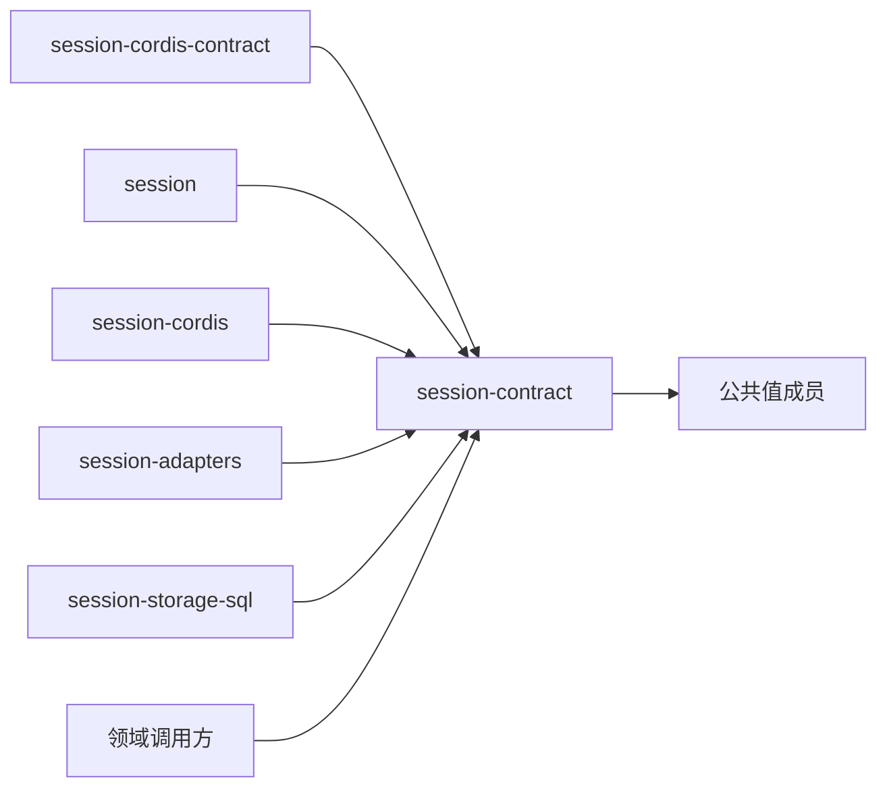

# Session 纯契约的架构边界

本成员是会话组的纯契约成员。它声明 Session 的值、身份、操作形状、端口接口与纯判断，不执行任何调用。运行接口仍是候选，精确采用范围见 [SPEC](../SPEC.md)。组内六个成员的分工与落位判据见[组根架构](../../docs/architecture.md)。

## 本成员拥有什么

| 类别 | 内容 | 形状与行为的位置 |
| --- | --- | --- |
| 值与身份 | 品牌身份（`SessionId`、`RunId`、`AttemptId`、`InputId`、`ResidentKey` 等）、`WorkSnapshot`、`RunState`、`ExecutionRef`、`Consumption`、`CommitReceipt`、`SessionFailure` 与各操作的结果联合 | [公开入口](public-api.md#值当前工作与原位置)、[值与结果项的约束](../SPEC.md#值与结果项的约束) |
| 四个面 | `SessionWork`、`SessionManagement`、`SessionReconciliation`、`SessionHistory` 的接口，以及聚合它们的 `SessionFaces
`；调用方类的取值 | [四个面与公开操作](../SPEC.md#四个面与公开操作) |
| 会话侧的常驻工具与冻结 | 常驻集合的值（`ResidentTool`）、冻结状态（`SessionFrozen`）、冻结命令 `freeze` 与它的入参 `FreezeVerdict`、引用查询 `references` 与它的结果 `ResidentReference` | [常驻工具与会话冻结](../SPEC.md#常驻工具与会话冻结) |
| 端口接口 | 七个构造依赖端口与三个出站端口（`AgentDrivePort`、`ToolStartFencePort`、`ScopeReleasePort`） | [构造依赖端口与出站端口](../SPEC.md#构造依赖端口与出站端口) |
| 领域服务与归约 | 九个领域服务、`reduce`，以及两个操作身份派生函数 `deriveSessionOperation` 与 `deriveDriveOperation` | [领域服务与归约](../SPEC.md#领域服务与归约)、[OP-00](../SPEC.md#op-00) |
| 事件目录 | 条目的 `kind` 与载荷 `schema`，以及按批次解释版本解释条目的规则 | [事件目录](object-model/session-log-events.md#原生事实类别)、[事件来源与日志准入](../SPEC.md#事件来源与日志准入) |
| 块声明 | `session.modes` 的声明值 `sessionModesBlock` | [会话块声明与设置值的固定时点](../SPEC.md#会话块声明与设置值的固定时点) |

本成员不拥有下列内容：

- 服务键 `session`、调用方类的 intercept 绑定、出站端口的服务键与 `Events` 归 [session-cordis-contract](../../session-cordis-contract/docs/cordis.md)。
- 命令处理流水线、协调器与调度器的算法、三层缓存与 `SchedulingPolicy` 归 [session](../../session/README.md)。
- Service 实现、真实时钟、提交通知订阅与扫描者绑定归 [session-cordis](../../session-cordis/README.md)。
- 邻域名称与形状的翻译、入站适配插件与出站端口的实现归 [session-adapters](../../session-adapters/SPEC.md)。
- 存储介质、权威表与读路径归 [session-storage-sql](../../session-storage-sql/README.md)。
- Agent 的执行状态、检查点与接续值归 Agent。本成员只定义指向它们的 `ExecutionRef`。
- 两个驻留端口 `ToolResidencyReader` 与 `ToolResidencyActions` 归 Tool：形状与服务键由 Tool 契约定义，实现由 session-adapters 用 `references` 与 `freeze` 提供。会话常驻规则、同形判据与冻结判定也归 Tool 契约。本成员只定义会话一侧的操作与值，见[由本组实现的 Tool 端口](../SPEC.md#由本组实现的-tool-端口)。

## 依赖方向

本成员只依赖公共值成员。按[公开入口](public-api.md#值当前工作与原位置)的候选形状，这些成员是 `operation-result`、`legal-identity`、`message` 与 `json-text`。本成员不依赖任何邻域契约，不依赖 Cordis，也不依赖本组的其他成员。

本组其他五个成员都依赖本成员，本成员不反向依赖它们。出站端口的接口在本成员声明：Session 用自己的值说明它需要邻域做什么。邻域契约的翻译只在 session-adapters 里发生。所以邻域契约变化时，本成员不变。

两个驻留端口的方向相反：Tool 声明它需要什么，session-adapters 按 Tool 的形状实现。本成员不导入这两个端口的类型。Tool 宿主也不导入本成员。

当前 `package.json` 没有运行依赖。实现时按公开入口的实际导入补齐依赖，范围不超出公共值成员。

## 值与行为

本成员的行为全部是纯函数。它们没有 I/O，不读时间、随机数、连接或外部状态。

- 领域服务的输入只有 `WorkSnapshot` 与命令参数，结果是封闭的判别联合。新增一种结局是契约变更。
- `reduce` 把前状态与一个已提交的完整批次归约为新的 `WorkSnapshot`，或给出 `quarantined`。同一前缀与同一解释版本得到同一快照。
- `openWork` 只有一个实现。历史持有者的未结工作下界、条件终结的待交输入核对与空闲裁定的本会话部分都读它的结果。
- 两个派生函数从业务意图的要素派生操作身份。输入不含时间、随机数或连接，所以崩溃前后派生同一身份。
- 品牌身份与修订只防误用，不证明资格。服务端仍核对来源、租户、对象关系与当前资格。
- 遇到不能证明无关的未知 `kind` 时，治理解释隔离受影响的投影，不跳过。

有副作用的能力都在端口后面。提交、权威读、身份与证据材料、时钟、空闲观察、Context 材料、提交通知和对邻域的调用，都经本成员声明的端口接口进入。命令处理怎样组合这些纯函数与端口，见[通用实现的机制](../../session/docs/architecture/mechanisms.md)。

## SOLID 与扩展边界

| 原则 | 本成员的选择 | 必须防止的反例 |
| --- | --- | --- |
| 单一职责 | 本成员只裁定允许或拒绝，并声明形状。领域服务给出裁定，`reduce` 给出状态。编排、计时、调用邻域与介质都不在本成员 | 在本成员里写提交顺序、重试或退避；在领域服务里调用端口 |
| 开闭 | 新的控制种类、派生消息、恢复任务类型与事实种类是联合类型与事件目录的新变体。新的入站邻域只增加一个适配插件，本成员不变。新的出站方向在本成员增加一个出站端口接口，这是唯一允许的结构性扩展 | 为接入一个入站邻域而修改本成员的类型；改变已有 `kind` 的含义或复用旧 `kind` |
| 里氏替换 | 端口接口规定完整结局集合，包括 `unavailable`、`commit-unknown` 与 `changed`。替身与真实实现都只能在这些结局里返回 | 接口只写成功形状，使替身省略未知或冲突结局 |
| 接口隔离 | 四个面按调用方切分。`SessionHistory` 没有变更操作。`SessionWork` 不含 `create`。调用方类按操作授权 | 一个包含全部操作的面；读取者能取得写入操作 |
| 依赖倒置 | 出站端口的参数只含本成员的值与不透明证据，不出现 Agent、Tool 或执行环境的类型。Tool 需要的两个驻留端口由 Tool 声明，本成员只提供 `references` 与 `freeze`，由 session-adapters 翻译 | 在本成员导入邻域契约的类型；在端口参数里携带 Agent 的接续值；在本成员声明 `ToolResidencyReader` 或 `ToolResidencyActions` |

## 当前设计限制

- 源码只有模板入口：`src/index.ts` 为 `export {}`。[公开入口](public-api.md)的声明是尚未技术接受、尚未实现的候选。
- [运行契约候选](../SPEC.md#运行契约候选)尚未技术接受。它的条款依赖本成员不能单方兑现的具名前提，也列出了明确缺项，见[具名前提与明确缺项](../SPEC.md#具名前提与明确缺项)。
- 常驻工具与冻结依赖 Tool 契约的会话常驻规则（[具名前提](../SPEC.md#具名前提与明确缺项)的 P-8）。它闭合之前，候选采用材料不带常驻工具与冻结判定，本成员不写常驻工具纳入与冻结的条目。
- Session 是工作治理服务。Run 与 attempt 是治理记录，不是运行实例。本成员没有每会话的根 Context 或实例目录。
- 端口接口不证明耐久、授权或提交原子性。这些性质由具体提供者证明，验证义务见 SPEC 的[候选的持续验证义务](../SPEC.md#候选的持续验证义务)。
