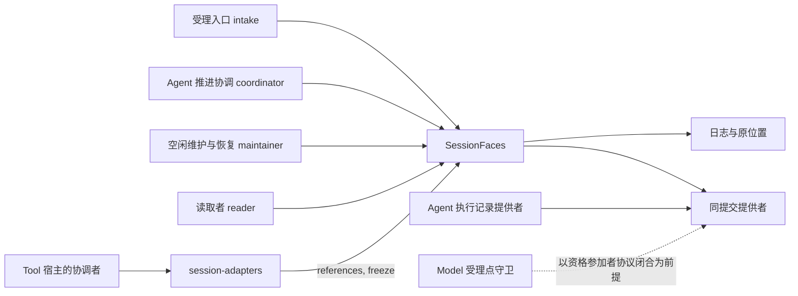
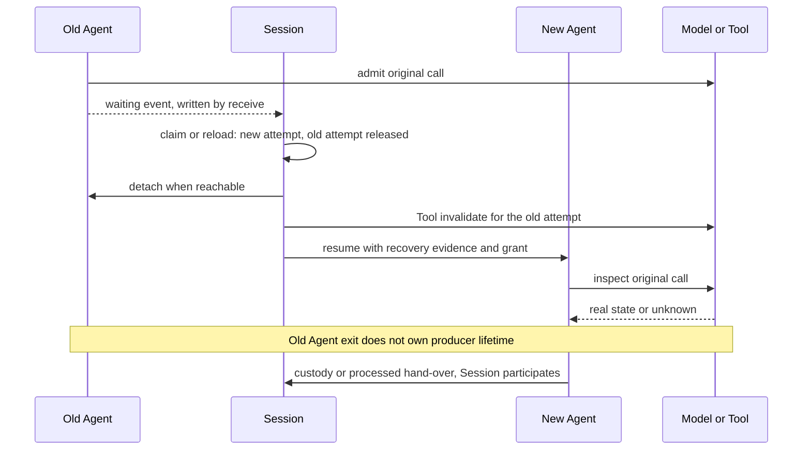

# Session 消费与系统定位

本页说明谁消费本成员、按什么顺序消费，以及在故障与竞争下必须得到什么结果。图表投影 [SPEC](../SPEC.md) 的现有条款，不改变采用范围，也不表示运行实现或真实提供者验证已完成。

## 系统位置与消费入口

本成员面向受理入口、Agent 推进协调、空闲维护者、恢复者、读取者与 Tool 宿主的协调者。它承担会话工作身份、日志、当前推进资格、原消费位置、Run 的逻辑终态与会话的生命周期。系统保证归[运行架构](../../../../docs/architecture/runtime/README.md)，组内责任归[组入口](../../README.md)。

Session 分三层，每层的变化由不同的一方处理。完整说明见系统页的 [Session 的三层与邻域角色](../../../../docs/architecture/runtime/session-and-run.md#session-的三层与邻域角色)。

| 层 | 内容 | 本成员的关系 |
| --- | --- | --- |
| 服务层 | Session 服务、适配成员与存储成员的装配 | 本成员只给出它们实现的接口。升级或换配置不写会话事实 |
| 会话采用层 | 定义与装配的实际采用、工作区选择、设置声明、Context 注册集合 | 这些是日志事实。本成员定义它们的值与写入命令 |
| 作用域资源层 | Agent runtime 实例、Runtime Context 作用域、执行环境的落点与租约 | 资源归各自拥有者。本成员只定义关联、释放请求与读回的形状 |

从 Session 看，会话建立之后只有两个入口会因重装写 SE08：新 Run 的 `startRun`（采用变化时），与显式 `reload`。`create` 写的 SE08 是初始采用，不是重装。执行实例失去连续性（崩溃、失联、宿主停用）而 Run 仍为活动时，恢复按原采用新建实例或挂接，不写 SE08。模式改变、模型选择切换、模型档案与凭据改变、工具或 MCP 的合法刷新、Skill 的增量装载都不经 Session 重装。哪些变化导致重装、哪些不导致，完整判据见系统页的[何时重装](../../../../docs/architecture/runtime/assembly-and-change.md#何时重装)。

调用方类按操作授权，不按面授权。每个操作允许的调用方类见 SPEC 的[四个面与公开操作](../SPEC.md#四个面与公开操作)。调用方类是装配事实，不授予资格。

Tool 宿主的协调者不导入本成员。它调用 Tool 契约定义的两个驻留端口，session-adapters 把它们翻译为本成员的操作：

| Tool 一侧的调用 | 本成员的操作 | 调用方类 | 作用 |
| --- | --- | --- | --- |
| `ToolResidencyReader.referencing` | `references` | `maintainer`，系统作用域的读取资格 | 列出仍引用一个登记键的会话，跨租户返回，读不到时返回 `unavailable`，不返回空页 |
| `ToolResidencyActions.freeze` | `freeze` | `coordinator` | 以 Tool 的冻结判定提交会话冻结。会话已冻结时认回原回执 |

两个端口的形状与服务键归 Tool 契约的会话常驻规则，见 SPEC 的[由本组实现的 Tool 端口](../SPEC.md#由本组实现的-tool-端口)与[具名前提](../SPEC.md#具名前提与明确缺项)的 P-8。

会话的 `lifecycle` 由事实归约得出，取值按优先次序为 `archived`、`initializing`、`active`、`frozen`、`dormant`。冻结不可逆，每个会话至多一次，并且独立于归档：冻结的会话可以归档，撤销归档后回到 `frozen` 或 `active`。冻结的会话不开始新 Run，也不采用新版本。冻结时未终结的 Run 不被取消，按原规则收场。规则见 SPEC 的[常驻工具与会话冻结](../SPEC.md#常驻工具与会话冻结)。

独立消费使用显式的 `SessionFaces` 及其注入的端口，不要求 Cordis。候选形状见 [public-api](public-api.md)，装配依赖与资源撤除见 [Cordis 定义](../../session-cordis-contract/docs/cordis.md)。可靠状态由相应的提供者兑现。

Session 不发起模型调用或工具执行，也不控制它们。它对 Tool 只调用 `invalidate` 与交付责任解除。Tool 一侧没有读 Session 守卫的保护点：Session 是启动围栏的资格版本拥有者，撤销资格后经 `ToolStartFencePort` 调用 `invalidate`。Model 一侧的受理点守卫以资格参加者协议闭合为前提，见 SPEC 的[具名前提与明确缺项](../SPEC.md#具名前提与明确缺项)中的 P-4。

## 原消费场景的前提

本页消费 [public-api](public-api.md) 的候选定义，不提供生产实现或接受声明。Session 的权威治理与 Model、Tool 的真实执行分别验证。公开接入的 SDK 与服务端入口归公开接入的拥有者。

Run 与 Agent 执行的对应是下文全部场景的前提。系统层说明见[与 Agent 执行的对应及执行引用](../../../../docs/architecture/runtime/session-and-run.md#与-agent-执行的对应及执行引用)，条款见 [PM-01](../SPEC.md#pm-01)。

| Session 一侧 | Agent 一侧 | 规则 |
| --- | --- | --- |
| Run | Agent 执行 | 一一对应。reload 与恢复都沿同一个执行 |
| attempt | 执行挂接 | 一一对应。挂接被取代或交还时，attempt 失去资格 |
| attempt 序号 | 挂接的围栏代次 | 两边各自保存，不互相替代 |
| 推进实例身份 | Agent runtime 实例 | 只作追溯。`judgeAdvance` 不比较它 |
| `ExecutionRef` | 执行的权威记录 | Session 只保存执行身份、最后已知修订、耐久证据与事件读取位置，不保存接续值 |

Agent 对 Session 有两条通道：提交参加与事件流。分工见 SPEC 的 [Session 与 Agent 的两条通道](../SPEC.md#session-与-agent-的两条通道)。

## 一轮正常推进

1. 受理入口经 `create` 保存合法创建与初值，再以 `completeInitialization` 完成具名初始化项。
2. 受理入口经 `accept` 保存普通输入的内容、去处与待处理资格。
3. 推进触发读 `readWork`，经 `judgeRunStart` 得到 `eligible` 与首条输入，交给 Agent 推进协调。
4. Agent 推进协调（调用方类 `coordinator`；恢复时也可以是 `maintainer`）调用 `startRun`，交入入口类别、候选采用与推进实例身份。`startRun` 的操作身份只由会话与首条输入的 `InputId` 派生，不含推进实例身份与候选采用。Session 在一次提交里写 Run 开始与首个 attempt，并分配执行身份。采用变化时同批写会话身份与声明，新纳入常驻工具时同批写纳入事实。这次提交不扣除任何输入的待处理资格。候选采用带回冻结判定时，`startRun` 返回 `frozen`，不提交。推进协调随后以该判定调用 `freeze`。
5. Agent 推进协调经出站端口 `invoke` 发起执行。它只带首条输入的身份，以 SE13 回执作来源依据，以本 attempt 的 SE15 证据作推进资格依据。适配器经 `readInput` 取得输入内容。Agent 打开执行时，Session 参加者只读核对来源依据与 attempt（[PA-01](../SPEC.md#pa-01)）。
6. 受理后，推进协调以 `receive` 提交首条输入的交入回执。随后它按到达顺序对其余待处理输入逐条 `submit`，每条受理后提交交入回执。
7. Agent 每一步取当时已交入的全部输入。批界由 Agent 的输入水位线决定。Session 读到 Agent 的承接事件时，解除这些输入的待处理资格。

Agent 推进期间的承接、调用登记、等待与出卡、控制阶段与执行结束，都经 Agent 的事件流到达。事件消费适配按序读取，以 `receive` 写入会话事实，并在同一次提交里推进 `ExecutionRef.readThrough`。游标持久之后，它才向 Agent 确认该前缀。

模型回复与工具消息进历史、压缩转换、结果保管与处理完成这四件事，由 Agent 的执行记录提供者提交。Session 作为参加者，在同一事务里写会话事实。

原执行收场后，当前合格消费者有两条路径：

- 先保管：`custody` 交接，Session 参加写 SE20。
- 生产者继续保管时先处理：`processed` 交接，Session 参加写 SE21。

取得相应的耐久证据后，消费适配向生产者发出交付责任解除：Model 的 ACK，或 Tool 的交付释放。生产者确认后，消费适配以 `receive(release)` 写回确认。发出请求时不提前标为 confirmed（[EC-04](../SPEC.md#ec-04)）。

本轮完成候选经 Agent 的终态前判断与条件终结。在条件终结的提交里，Session 参加者只读核对待交输入与已生效的取消（[PA-02](../SPEC.md#pa-02)）。Run 的终态有三个入口，每个 Run 只成立一个终态，成立后不可反转：

| 入口 | 终态 | 怎样成立 |
| --- | --- | --- |
| 读到执行结束 | completed、failed 或 cancelled | Session 读到 Agent 的结束事件或执行记录的结束状态后，以 `receive` 按 Agent 的结论写 SE26 与 SE16（[RS-08](../SPEC.md#rs-08) 至 [RS-10](../SPEC.md#rs-10)） |
| 取消 | cancelled | `control(cancel-run)`、`control(archive)` 或到期的 `considerAutoArchive` 在提交时同批写 SE26 cancelled，不等传播 |
| 有界收束 | failed | Session 以 `finishRun` 提交。只有两种依据：Agent 记录不可解释（P-5），或首条输入在 `invoke` 被消息准入拒收（[PM-02](../SPEC.md#pm-02)） |

执行已结束而 Session 尚未写终态时，不属于有界收束。Session 读结束事实后按 Agent 的结论写终态。终态后置扩展归 Agent，不能反转终态。在已冻结的会话里，Run 终态的提交同批解除其余待处理输入的资格，因为不会再有承接它们的 Run（[I-F4](../SPEC.md#i-f4)）。

## 换代与控制

图中的换代已满足两个条件：旧执行者已被排除或已交还挂接，新执行者取得了资格。恢复不能只凭目录为空或最大 attempt 序号取得推进权。M 返回 unknown 时，New 保留原调用，不发替代请求。

| 初始条件与交错 | 必须结果 | 权威责任 |
| --- | --- | --- |
| 两个推进触发者同时 `startRun` | 同一首条输入派生同一身份，一方提交，另一方认回。首条输入不同的第二个 `startRun` 得到 `run-active` | Session 原子提交（[RS-01](../SPEC.md#rs-01)） |
| 已交入输入与新受理并发 | 新输入照常受理，并交入同一执行。批界由 Agent 的输入水位线决定，Session 不重选 | Agent 输入水位线；Session 待处理资格 |
| 同一输入的回执丢失后重提 | 同一受理标识、同一内容认回，不新建消息或 Run。新的独立受理标识携带同样文本时，仍是新输入 | Session 原操作唯一性 |
| 后续输入在 `submit` 被消息准入拒收 | Session 以 `receive` 写拒收事实，该输入失去待处理资格，用户看到原因。Run 继续 | Agent 消息准入；Session 资格解除（[PA-09](../SPEC.md#pa-09)） |
| 首条输入在 `invoke` 被拒收 | 执行不创建。Session 以 `finishRun` 写 failed 终态。其余输入保留待处理资格，交给下一个 Run | Session（[PM-02](../SPEC.md#pm-02)） |
| `claim` 已提交，旧执行者在接续之前参加提交 | 参加者响应「冲突」，执行记录提供者返回 `changed`。新挂接取代旧挂接后，旧执行者得到 `stale-advance`。旧执行者不产生新的发起责任 | Session 与执行记录提供者的围栏（[PM-05](../SPEC.md#pm-05)） |
| 取消先成立，reload 候选随后校验完成 | 保留 cancelled，拒绝迟到的换代，不复活原 Run | Session 与采用源 |
| 取消先于条件终结 | 参加者响应「冲突」。Agent 以已保存的取消依据再次终结。之后读到的结束事件只认回 | Session 与 Agent 的裁定顺序（[PA-08](../SPEC.md#pa-08)） |
| 归档之前收到普通输入，回执晚到 | 原受理与后续取消都可查，不能声称未曾受理 | Session 提交与控制 |
| Agent 退出，Model 或 Tool 仍在运行 | 恢复原等待。旧 Agent 卸载不停止生产者 | 独立宿主与 Session 关联 |
| 执行已结束，Session 尚未读到结束事件 | Run 仍为 active，不声称空闲或完成。读到后按 Agent 的结论写终态 | Session 事件消费（[EC-03](../SPEC.md#ec-03)） |
| Run 已终态，原结果迟到 | 合格保管者经 Agent 的 `recordResult` 保管，Session 参加。Agent 记录已删除时由 Session 单方保管。迟到结果不取得旧推进权。是否形成新工作，由仍有效的原投递资格决定 | Session 与原消费者（[EC-07](../SPEC.md#ec-07)、[EC-08](../SPEC.md#ec-08)） |
| 归档后撤销归档，旧结果迟到 | 已取消的旧业务不重新入队，原事实保留 | Session 原取消事实 |
| 保管成功，生产者确认未知 | 保管责任继续。按原操作查询 ACK 或交付释放，不重新领取已清理的 Model 全文 | 双方原操作协议（[EC-05](../SPEC.md#ec-05)） |
| 历史过滤后得到空页，扫描尚未结束 | 返回扫描进度与 next，不报告历史已结束 | `SessionHistory` |
| 权威日志缺批，或有未知相关类别 | 隔离受影响的会话，不发布部分治理状态或空队列 | Session 解释提供者 |
| 休眠会话有合法的 Run 外调用 | `bindExternalCall` 保存原关联，`completeExternalConsumption` 完成原位置。不新建 Run 或 attempt | Session 与实际消费者的拥有者 |
| Tool 控制已提交，传播之前进程退出 | `loadRecovery` 给出原 `stop-call` 或 `background-tool` 意图，不按目标猜测 | Session 控制责任 |
| Run 进行中提交冻结 | Run 不被取消，按原规则收场。待处理输入照常交入这个 Run。之后的新 Run 触发与 `reload` 得到 `frozen`，`claim` 照常 | Session 冻结守卫（[I-F2](../SPEC.md#i-f2)、[I-F3](../SPEC.md#i-f3)） |
| 没有未终结 Run 时提交冻结，有待处理输入；随后普通输入到达 | 冻结同批解除待处理输入的资格。新输入以 `frozen` 拒绝 | Session 冻结守卫（[I-F4](../SPEC.md#i-f4)） |
| 推进协调与 Tool 宿主的协调者对同一会话交来冻结判定 | 只成立一次冻结。后到者按状态认回原回执，不论证据是否相同 | Session（[I-F1](../SPEC.md#i-f1)） |
| 父会话归档已提交，子会话不可达 | 原子方操作、目标与归档意图持续可恢复。核对回执之后才解除 | Session 级联责任 |

## 资格与输入分类检查

主体、租户、Session、Run、attempt、原操作与当前动作的参数都显式传入。固定定义归装配，固定请求归生产者与 Agent 的执行记录。Session 只保存指向它们的耐久证据。Session 不保存接续值，只保存指向 Agent 权威记录的 `ExecutionRef`（[值与结果项的约束](../SPEC.md#值与结果项的约束)）。当前权限由参加者在提交时或实际发起点核对。

本成员声明七个构造依赖端口与四个出站端口。`SessionTransactionPort` 与应用装配交付的内部主体 `SessionInternalPrincipals` 是装配的必需依赖。其余端口按调用现取，缺席时只使需要它的操作返回 `unavailable`（[构造依赖端口与出站端口](../SPEC.md#构造依赖端口与出站端口)）。调度策略是 `session` 工厂的配置，不进本成员。Context 与 Fiber 不进入这份业务数据契约。

本成员没有公开的 `append(events)`，也没有直接修改推进布尔值的方法。`receive` 交来的 Agent 事件须经精确 schema、执行身份与序号核对。未知 JSON 不能得到可信结论。生产者事实同样核对原来源，任意调用方不能自报工具完成或 Model ACK。

类型消费只核对参数与返回形状。唯一推进、输入批界、原操作未知、终态竞争、实际外部动作与跨进程提交，都需要另外的模型与提供者证据。状态图、静态类型与文档链接不证明断电耐久或授权源已经实现。

## 空闲维护与原提交通知

空闲维护者（调用方类 `maintainer`）按下列顺序处理空闲：

1. 调用 `inspectIdle`，取得带时钟来源、完整子方与调用覆盖的观察。这一步不写条目。
2. 以 `expected` 与该观察调用 `recordIdle`。回执未知时查询同一操作。重启后读取 `readWork.idle`，保持已确认的起点。
3. 开启自动归档时，把该记录的 `CommitReceipt.source` 作为 `idleEvidence` 交给 `considerAutoArchive`。它重新核对当前配置与全部相关事实，不只比较时间。

有未终结的 Run 时，裁定为 `not-due`，因为 Agent 可能已提交了 Session 尚未读到的事件（[I-R10](../SPEC.md#i-r10)）。新子方或 Run 外工具在两步之间受理时，旧覆盖失效：`recordIdle` 返回 `changed`，或归档裁定返回 `not-due`。来源不明时返回 `unavailable`，不认定空闲。

提交通知只起唤醒作用。例如提交 R1 完成后通知延迟，随后 R2 已提交。R1 的通知仍带 R1 回执的修订与来源，不经 `readWork` 取 R2 的来源给 R1 使用。通知失败不回滚 R1，扫描按持久事实继续（[EC-11](../SPEC.md#ec-11)）。

首次添加 Context 块时，接入准备绑定原操作、尚未生效的变更材料，再调用 `change`。Session 一并提交注册与恢复事实之后，Runtime Context 才消费这个决定。Session 拒绝时注册不变。结果未知时查询同一操作，不先注册再补日志。更新与移除同样由 Session 提交，并核对材料引用的前注册仍是当前版本。

## 与 Agent Loop 的分界

Session 的协调器与调度器只在 Agent 执行之外决定三件事：何时开始、何时续入输入、何时恢复。执行之内的一切归 Agent，所以它们不构成第二个 Loop。系统层说明见[协调器与调度器](../../../../docs/architecture/runtime/session-and-run.md#协调器与调度器)。

| 事项 | Agent 拥有 | Session 拥有 |
| --- | --- | --- |
| 推进 | 一个执行内的 Loop 节点、等待与唤醒，挂接的交还与接续 | Run 的业务状态：何时开 Run、何时交入输入、何时读到终态 |
| 等待 | 执行内对模型、工具与卡片的等待，以及等待集合的事实 | 跨执行的等待位置与资格的派生副本：原等待、人工答复的分流 |
| 恢复 | 执行的对账与原节点接续；提供查询、读执行记录与接续 | 发现哪些会话要恢复、何时扫描、怎样退避 |
| 控制 | 控制在执行内的处置，以及向 Model 与 Tool 的传播 | 控制意图的保存、范围解析、传播责任与对账、取消终态的时点 |
| 终态 | 执行的结束与结论 | Run 的唯一终态：读到执行结束时按 Agent 的结论写入；取消在提交时成立；有界收束只用于 Agent 记录不可解释或首条输入被拒收 |
| 输入 | 输入水位线、批次与承接的事实 | 受理、分流、待处理资格、交入顺序与承接事实的派生副本 |
