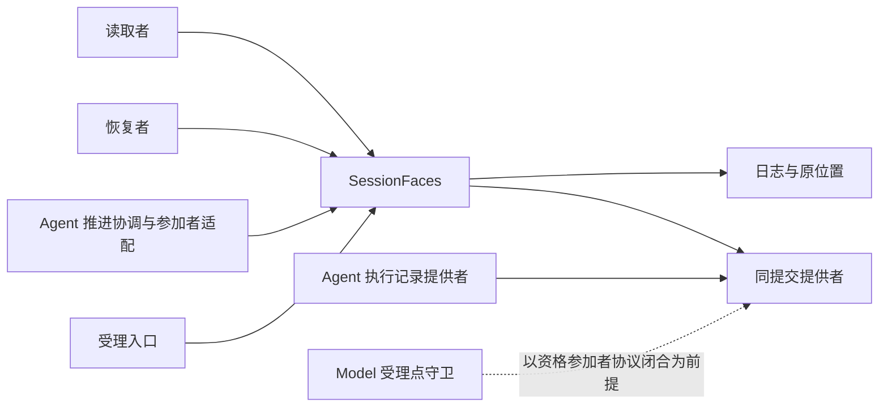
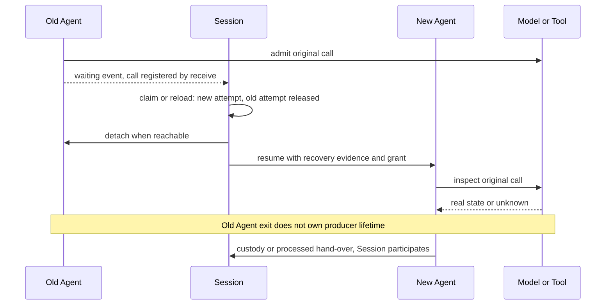

# Session 消费与系统定位

本页说明谁消费本成员、按什么顺序、在故障与竞争下必须得到什么结果。图表投影现有设计，不改变采用范围，也不表示运行实现或真实提供者验证已完成。

## 系统位置与消费入口

本包面向受理入口、外部协调者、Agent 的提交参加者适配、恢复者及读取者，承担会话工作身份、日志、当前推进资格、原消费位置和逻辑终态。以下图示只投影本包消费关系，系统保证仍归[运行架构](../../../../docs/architecture/runtime/README.md)，组内责任归[组入口](../../README.md)。

独立消费与 Harness 接入的候选形状见 [public-api](public-api.md)，当前实际导出与候选分开标明。独立包消费使用显式 `SessionFaces` 及其注入能力，不要求 Cordis。可靠状态仍须由相应提供者兑现。装配依赖和资源撤除见 [Cordis](../../session-cordis-contract/docs/cordis.md)。Tool 一侧没有读 Session 守卫的保护点：Session 作为启动围栏的资格版本拥有者，在撤销资格后调用 `invalidate`。Model 一侧的受理点守卫以资格参加者协议闭合为前提，见 SPEC 的 [P-4](../SPEC.md#具名前提与明确缺项)。

## 原消费场景的前提

本页消费[工作契约候选](public-api.md)，不提供生产实现或接受声明。Session 的权威治理与 Model、Tool 的真实执行分别验证。公开接入的 SDK 与服务端入口归公开接入的拥有者。

## 一轮正常推进

受理入口先经 `management.create` 保存合法创建和初值，完成具名初始化项。普通输入通过 `work.accept` 保存内容、去处与待处理资格。

推进触发读 `readWork`，经 `judgeRunStart` 得到 `eligible` 与首条输入，向 `startRun` 提交入口类别、候选采用和推进实例身份。Session 在一次提交里写 Run 开始与首个 attempt，分配执行身份，不扣除任何输入的待处理资格。

Agent 推进协调以该 attempt 的耐久证据作推进资格依据，经出站端口 `invoke` 交出首条输入（内容由适配器经 `readInput` 取得）。Agent 打开执行时，Session 参加者只读核对该 attempt 仍然有效。受理后，推进协调以 `receive` 写交入回执，再按到达顺序对其余待处理输入逐条 `submit`。Agent 每一步取当时已交入的全部输入；Session 读到 Agent 的承接事件时解除这些输入的待处理资格。

Agent 推进期间的承接、调用登记、等待与出卡、控制阶段与执行结束，由 Agent 的事件流带到 Session 门口，事件消费适配按序读取，以 `receive` 写入会话事实并推进游标，提交后再向 Agent 确认。模型回复与工具消息进历史、压缩转换、结果保管与处理完成四件事，由 Agent 的执行记录提供者提交，Session 作为参加者在同一事务里写会话事实。

原执行收场后，当前合格消费者先保管（`custody` 交接，Session 参加写 SE20）或在生产者继续保管时完成处理（`processed` 交接，Session 参加写 SE21）。得到相应耐久证据后，消费适配调用 Model ACK 或 Tool 的交付释放；`reconciliation.receive` 认回其真实确认。不能在发出请求时提前标 confirmed。

本轮完成候选经 Agent 的终态前判断与条件终结。条件终结的提交里，Session 参加者只读核对待交输入与已生效的取消。Agent 的执行结束后，Session 读到结束事件，按 Agent 的结论写 Run 的唯一终态。终态后置扩展归 Agent，不能反转终态。

## 换代与控制

图中换代已满足旧执行者排除或交还与新资格条件。恢复不能只凭目录为空或最大 attempt 序号取得推进权。M 返回 unknown 时 New 保留原 call，不发替代请求。

| 初始条件与交错 | 必须结果 | 权威责任 |
| --- | --- | --- |
| 两个协调者同时 `startRun` | 只准一个 Run 与首次 advance；另方认回或报告条件变化 | Session 原子提交 |
| 已交入输入与新受理并发 | 新输入照常受理并交入同一执行；批界由 Agent 的输入水位线决定，Session 不重选 | Agent 输入水位线；Session 待处理资格 |
| 同一输入回执丢失后重提 | 原 operation 同内容认回，不新消息或 Run；新独立 operation 的同文仍是新输入 | Session 原操作唯一性 |
| 新 attempt 生效后旧者参加提交 | 参加者响应「冲突」，提供者返回 stale-advance，不产生新发起责任 | Session 及执行记录提供者围栏 |
| 取消先成立，reload 候选随后校验完成 | 保留 cancelled，拒绝迟到换代，不复活原 Run | Session 与采用源 |
| 已归档前收到普通输入，回执晚到 | 原受理与后续取消均可查，不能声称未曾受理 | Session 提交与控制 |
| Agent 退出，Model 或 Tool 还运行 | 恢复原等待，不因旧 Agent 卸载停止生产者 | 独立宿主及 Session 关联 |
| 执行已结束，Session 尚未读到结束事件 | Run 仍为 active，不声称空闲或完成；读到后按 Agent 结论写终态 | Session 事件消费 |
| Run 已终态，原结果迟到 | 经 Agent 的 `recordResult` 保管或补账，Session 参加；不获旧推进权；是否新工作由仍有效原投递资格决定 | Session 与原消费者 |
| 归档后撤销归档，旧结果迟到 | 旧已取消业务不重新入队，原事实仍保留 | Session 原取消事实 |
| 保管成功，生产确认未知 | 保管责任继续，从原 operation 查认 ACK 或交付解除，不新领已清理 Model 全文 | 双方原操作协议 |
| 历史过滤后空页但扫描未结束 | 返回扫描进度及 next，不能误报历史结束 | SessionHistory |
| 权威日志缺批或未知相关类别 | 隔离受影响会话，不能发布部分治理状态或空队列 | Session 解释提供者 |
| 休眠会话有合法 Run 外调用 | `bindExternalCall` 保存原关联，`completeExternalConsumption` 完成原位置；不造 Run 或 attempt | Session 与实际消费者拥有者 |
| Tool 控制提交后、传播前退出 | `loadRecovery` 给出原 stop-call 或 background-tool 意图，不能仅按 target 猜测 | Session 控制责任 |
| 父归档提交后子方不可达 | 原 childOperation、目标和 archive 意图持续可恢复，回执核验后才解除 | Session 级联责任 |

## 资格与输入分类检查

principal、tenant、Session、Run、attempt、原操作及当前动作参数显式传入。固定定义归装配，固定请求归生产者与 Agent 的执行记录；Session 只保存指向它们的耐久证据。Session 不保存接续值，只保存指向 Agent 权威记录的执行引用（[值与结果项的约束](../SPEC.md#值与结果项的约束)）。当前权限仍由参加者在提交或实际发起点核验。identity、evidence、transactions、clock、idle、context 是构造能力，notifier 是调用期可选取得，页容量属于纯配置。Context 与 Fiber 不进入这份业务数据契约。

本成员的根操作没有公开 append(events) 或直接修改推进布尔的方法。`receive` 交来的 Agent 事件须经精确 schema、执行身份与序号验证；未知 JSON 不能得到可信结论。原生产 facts 同样验证原 source，不让任意调用者自报工具完成或 Model ACK。

类型消费只验证参数和返回形状。唯一推进、输入批界、原操作未知、终态竞争、实际外部动作及跨进程提交需另有模型和提供者证据。状态图、静态类型和文档链接均不证明断电耐久或授权源已经实现。

## 空闲维护与原提交通知

自动归档关闭时，恢复协调者也可 `inspectIdle`，取得带时钟来源、完整子方与调用覆盖的观察，再以原 operation 和 expected 提交 `recordIdle`。回执未知时查询该 operation；重启读取 `readWork.idle`，保持已确认起点。开启自动归档后，将该记录的 `CommitReceipt.source` 交 `considerAutoArchive`，后者重新核当前配置和全部相关事实，不能仅比较时间。有未终结 Run 时裁定为 `not-due`，因为 Agent 可能已经提交了 Session 尚未读到的事件。新子方或 Run 外工具在两步之间受理时，旧覆盖失效；`recordIdle` 返回 changed，或归档裁定返回 not-due。来源不明返回 unavailable，不能认定空闲。

R1 完成后 notifier 延迟，R2 已提交。通知仍传 R1 回执的 revision 与 source；不能通过 `readWork` 取 R2.source 给 R1 使用。通知失败不回滚 R1，扫描按原持久事实接续。

首次添加 Context 块时，接入准备绑定原 operation 的未生效变更材料，调用 `change`。Session 共同提交注册与恢复事实后，Runtime Context 才消费该决定。Session 返回拒绝不改变注册；返回未知则查询同 operation，不能先注册再补日志。更新与移除同样由 Session 提交，并核材料所引用的前注册仍是当前版本。

## 与 Agent Loop 的分界

Session 的协调器与调度器只在 Agent 执行之外决定三件事：何时开始、何时续入输入、何时恢复。执行之内的一切归 Agent。所以它们不构成第二个 Loop。条款见 [SPEC 的运行契约候选](../SPEC.md#运行契约候选)，系统层说明见[协调器与调度器](../../../../docs/architecture/runtime/session-and-run.md#协调器与调度器)。

| 事项 | Agent 拥有 | Session 拥有 |
| --- | --- | --- |
| 推进 | 一个执行内的 Loop 节点、等待与唤醒，挂接的交还与接续 | Run 的业务状态：何时开 Run、何时交入输入、何时读到终态 |
| 等待 | 执行内对模型、工具与卡片的等待，等待集合的事实 | 跨执行的等待位置与资格的派生副本：原等待、人工答复的分流 |
| 恢复 | 执行的对账与原节点接续；提供查询、读执行记录与接续 | 发现哪些会话要恢复、何时扫描、怎样退避 |
| 控制 | 控制在执行内的处置，以及向 Model 与 Tool 的传播 | 控制意图的保存、范围解析、传播责任与对账、Run 取消的终态时点 |
| 终态 | 执行的结束与结论 | Run 的 completed、failed 或 cancelled：取消由 Session 提交；完成与失败按 Agent 的结论在读到结束事件时写入；有界收束只在 Agent 记录不可解释或首条输入被拒收时 |
| 输入 | 输入水位线、批次与承接的事实 | 受理、分流、待处理资格、交入顺序与承接事实的派生副本 |
