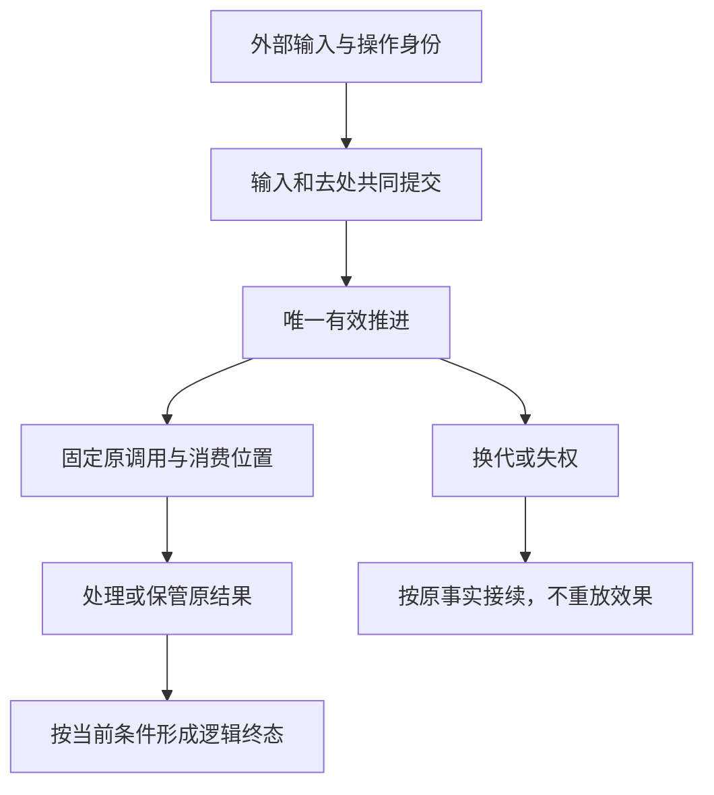

# Session 业务与数据流

本页按 #343 的文档主题组织 #342 候选。图表投影现有设计，不改变采用范围，也不表示运行实现或真实提供者验证已完成。

下图只给出主干阅读次序，不穷举控制优先级、状态或并发交错。完整行为和失败条件归 [SPEC](../../SPEC.md)，各参与者只通过自己的公开能力交接。

## 关键流程与失败分支

[关键协作流程](scenarios.md)保存本包业务 UML、数据来源和去向，以及控制、恢复和终态分支。[消费场景](../context.md)给出 #342 的独立或托管调用、原结果交接和反例。两者保留各自的状态说明，图示不代替真实存储、外部效果或故障试验。

## 生命周期与验证入口

逻辑工作、执行实例和结果保管分别定位到[对象模型](../object-model/README.md)。插件撤除及依赖换代见 [Cordis](../../../session-cordis-contract/docs/cordis.md)。后继实现的验证范围见[共同交接](../../../../../docs/architecture/runtime/runtime-contract-handoff.md)，当前未覆盖项继续保留在原场景及规格中。
