# Session 契约的协议级流程

> 本页带「（已被替代）」标记的名字是历史叙述：替代拥有者与现状见 [SPEC 被替代的协议](../../SPEC.md#被替代的协议)。

状态：候选。本页把[运行契约候选](../../SPEC.md#运行契约候选)的条款展开成协议级流程。每条流程写参与者、时序、数据去向与失败分支，并链到它依据的条款。流程不新增条款。条款没有写的内容标为「契约未定」，并汇总在 [README 的缺项表](README.md#缺项与持续验证入口)。

参与者是逻辑角色，不表示部署、进程或共同寿命。「提交」指一次权威提交。提交结果未知时各方按 [PA-05](../../SPEC.md#pa-05) 与 [PA-07](../../SPEC.md#pa-07) 认回。Session 与 Agent 之间的「参加」「冲突」「失败」「不支持」沿 Agent 契约的[提交参加者协议](../../../../agent/agent-contract/SPEC.md#提交参加者协议)。事件含义归[事件目录](../object-model/session-log-events.md#原生事实类别)，守卫与完整结果归[状态转移页](../object-model/session-state-transitions.md#命令守卫与完整结果)，操作形状归 [public-api](../public-api.md)。本页只引用它们。

## 编号表

F-SC 是本页的文档定位号。每条流程细化组根的一条或几条[跨成员流程](../../../docs/key-flows.md)，组根写各成员怎样分工，本页写契约层的操作与事实。

| 编号 | 流程 | 细化的组根流程 | 主要条款 |
| --- | --- | --- | --- |
| [F-SC01](#f-sc01-打开执行与交入输入) | 打开执行与交入输入 | [F-SE01](../../../docs/key-flows.md#f-se01-一条输入从受理到推进) | OP-00、JC-03、JC-05、PA-01、PA-03、PA-06、PA-09、PM-02 |
| [F-SC02](#f-sc02-消息进历史的共同提交) | 消息进历史的共同提交 | [F-SE02](../../../docs/key-flows.md#f-se02-agent-事件到日志条目) | JC-06、PA-04、PA-05、PM-11 |
| [F-SC03](#f-sc03-压缩转换的共同提交与-epoch-新代) | 压缩转换的共同提交与 epoch 新代 | [F-SE06](../../../docs/key-flows.md#f-se06-压缩共同提交与模型视图新代) | JC-09、PA-04、PA-05 |
| [F-SC04](#f-sc04-结果保管的共同提交) | 结果保管的共同提交 | [F-SE09](../../../docs/key-flows.md#f-se09-三条流到日志) | JC-11、PA-05、EC-04 |
| [F-SC05](#f-sc05-处理完成的共同提交) | 处理完成的共同提交 | [F-SE09](../../../docs/key-flows.md#f-se09-三条流到日志) | JC-12、PA-05、RS-04、EC-04 |
| [F-SC06](#f-sc06-交付责任解除与重发) | 原生产者确认的日志恢复 | [F-SE05](../../../docs/key-flows.md#f-se05-恢复)、[F-SE09](../../../docs/key-flows.md#f-se09-三条流到日志) | EC-04/05/06、JC-Release |
| [F-SC07](#f-sc07-从同日志-agent-条目派生事实) | 从同日志 Agent 条目派生事实 | [F-SE02](../../../docs/key-flows.md#f-se02-agent-事件到日志条目) | EC-01、EC-02、EC-03、JC-24 |
| [F-SC08](#f-sc08-条件终结与-run-终态) | 条件终结与 Run 终态 | [F-SE03](../../../docs/key-flows.md#f-se03-控制传播)、[F-SE05](../../../docs/key-flows.md#f-se05-恢复) | PA-02、PA-08、PM-13、PM-14、RS-08 至 RS-10、P-5 |
| [F-SC09](#f-sc09-推进映射与换代) | 推进映射与换代 | [F-SE05](../../../docs/key-flows.md#f-se05-恢复)、[F-SE10](../../../docs/key-flows.md#f-se10-新-run-开始的求值与重装判定) | PM-03 至 PM-12、JC-07、JC-08、JC-15 |
| [F-SC10](#f-sc10-迟到结果与终态后的后台结果) | 迟到结果与终态后的后台结果 | [F-SE09](../../../docs/key-flows.md#f-se09-三条流到日志) | EC-07、EC-08、EC-09、P-3 |
| [F-SC11](#f-sc11-时间线投影与在途收敛) | 时间线投影与在途收敛 | [F-SE08](../../../docs/key-flows.md#f-se08-时间线投影与在途收敛) | SessionHistory、SL10、SL11、EC-10、EC-11 |
| [F-SC12](#f-sc12-流到日志) | 流到日志 | [F-SE09](../../../docs/key-flows.md#f-se09-三条流到日志) | EC-01、事件来源表、JC-06、JC-11、JC-12 |
| [F-SC13](#f-sc13-epoch-视图读取) | epoch 视图读取 | [F-SE07](../../../docs/key-flows.md#f-se07-模型可见历史的读取) | SessionHistory 的 `readModelView`、JC-09 |
| [F-SC14](#f-sc14-会话冻结) | 会话冻结 | 无组根流程 | JC-28、I-F1 至 I-F5、ST27 |
| [F-SC15](#f-sc15-引用查询) | 引用查询 | 无组根流程 | SessionReconciliation 的 `references`、P-8 |
| [F-SC16](#f-sc16-作用域释放与换代后重新释放) | 作用域释放与换代后重新释放 | [F-SE04](../../../docs/key-flows.md#f-se04-归档级联与作用域释放) | JC-16、ScopeReleasePort、`releasedScopes` |

## F-SC01 打开执行与交入输入

细化 [F-SE01](../../../docs/key-flows.md#f-se01-一条输入从受理到推进)。依据：[OP-00](../../SPEC.md#op-00)、JC-03 与 JC-05（[共同提交表](../../SPEC.md#共同提交与共享事务域)）、[PA-01](../../SPEC.md#pa-01)、[PA-03](../../SPEC.md#pa-03)、[PA-06](../../SPEC.md#pa-06)、[PA-09](../../SPEC.md#pa-09)、[PM-02](../../SPEC.md#pm-02)、[RS-01](../../SPEC.md#rs-01)、[RS-02](../../SPEC.md#rs-02)。

`startRun` 不扣除任何输入。`invoke` 只带首条输入，其余待处理输入按到达顺序经 `submit` 交入同一执行。批界由 Agent 的输入水位线决定，待处理资格在 Session 读到承接事件（F-SC07）时解除。

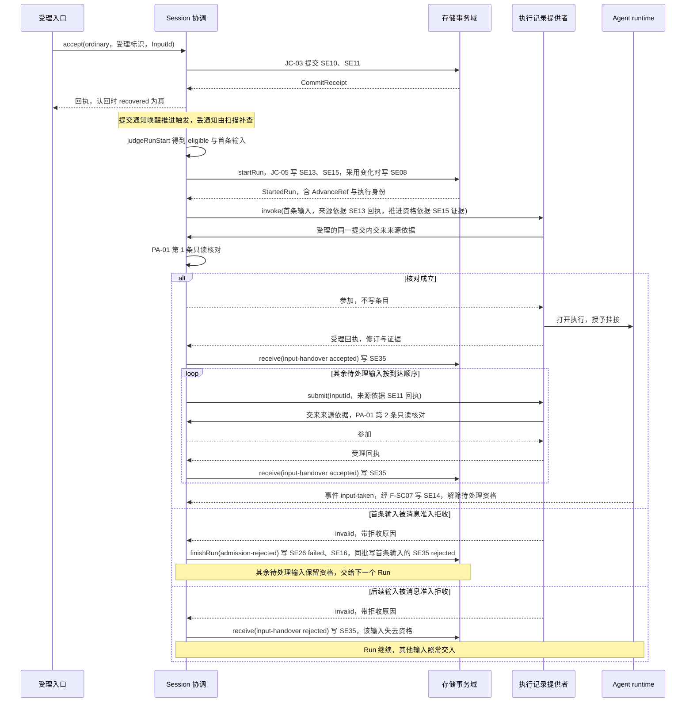

数据去向：

| 事实 | 条目 | 提交 |
| --- | --- | --- |
| 输入内容、来源与待处理资格 | SE10、SE11 | `accept`，Session 提交（JC-03） |
| Run 开始、首条输入、执行身份、首个 attempt | SE13、SE15，采用变化时 SE08，新纳入常驻工具时 SE36 | `startRun`，Session 提交（JC-05） |
| 交入受理或拒收 | SE35 | `receive(input-handover)`，身份为执行与 `InputId` |
| 承接 | SE14 | F-SC07 |
| 首条输入拒收导致的终态 | SE26 failed、SE16、SE35 | `finishRun`，Session 提交（JC-18） |

失败分支：

| 情形 | 行为 | 条款 |
| --- | --- | --- |
| `accept` 结果未知 | 不报告未受理，不新建提交。按受理标识 `queryOperation` | OP-00、[耐久及受理确认](../../SPEC.md#耐久及受理确认) |
| 两个推进触发者并发 `startRun` | 同一首条输入派生同一身份，一方提交，另一方认回。首条输入不同的第二个得到 `run-active` | OP-00、RS-01 |
| `invoke` 返回 `denied` | 推进资格依据核对失败，本 attempt 已被取代。执行不创建，Run 保持 active，由当前 attempt 持有者继续 | PM-02、PA-06 |
| `invoke` 返回 `busy` | 等该 runtime 的终态事件后重试 | PA-06 |
| `submit` 返回 `terminal` | 执行已结束。不重试，不改写去处。结束事实的解释提交成立后 `routeInput` 在新 Run 开始时重定去处 | PA-03 |
| `invoke` 或 `submit` 结果未知 | 按出站操作身份 `query`，不换身份重发 | PA-06、[AgentDrivePort](../../SPEC.md#agentdriveport) |
| `startRun` 提交后、`invoke` 发出前崩溃 | 恢复扫描读到 `run.active`、`advance` 非空、首条输入没有 SE35，以同一出站身份重放 `invoke` | PA-06 第 2 项、PM-14 |
| `accept` 提交后有待交输入、`submit` 未发出 | 对每个待交输入按到达顺序以同一 `InputId` 重新 `submit` | PA-06 第 3 项 |
| 会话已归档 | `accept` 返回 `archived` | PA-03 |
| 会话已冻结且没有未终结 Run | `accept` 返回 `frozen`，`startRun` 返回 `frozen` | F-SC14 |

## F-SC02 消息进历史的共同提交

细化 [F-SE02](../../../docs/key-flows.md#f-se02-agent-事件到日志条目)。依据：JC-06、[PA-04](../../SPEC.md#pa-04)、[PA-05](../../SPEC.md#pa-05)、[PM-11](../../SPEC.md#pm-11)、`recordMessage` 的操作表行（[SessionWork](../../SPEC.md#sessionwork)）。

提交由执行记录提供者发起。Session 作为参加者执行同一条流水线：按 OP-00 认回、权威读、`judgeAdvance`、写事实。回执经调用方交接回到 Agent。

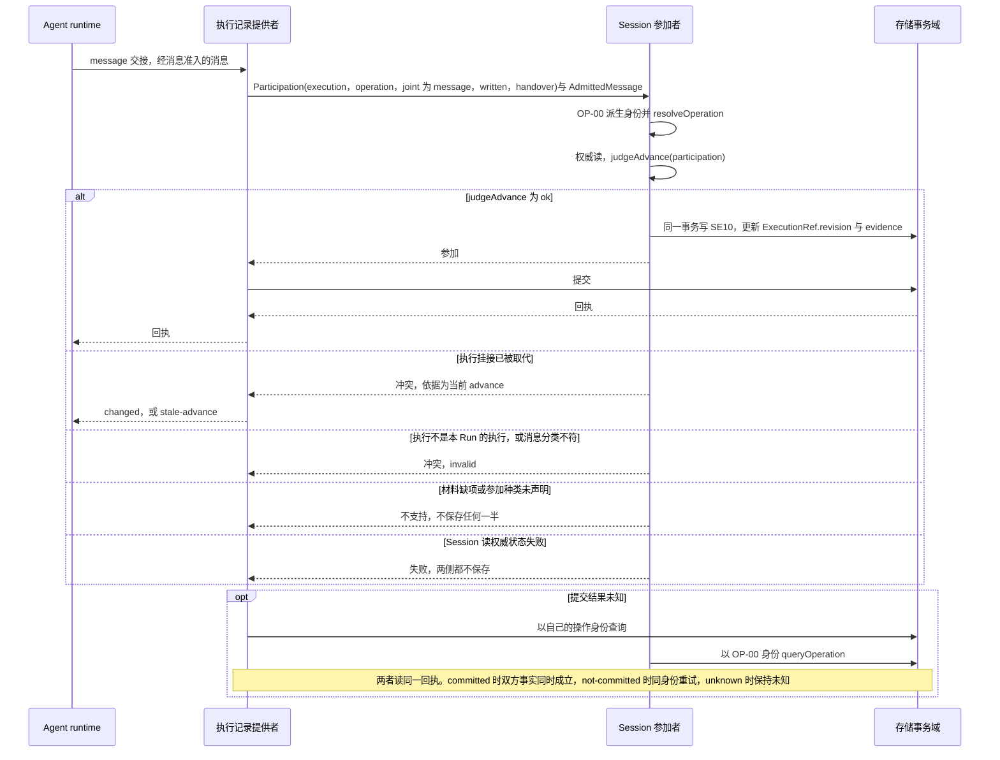

数据去向：SE10 由 `recordMessage` 在参加时写入。同日志里的 `message` 事实不再写条目，只推进游标（F-SC07）。工具消息与后台占位消息的 `AdmittedMessage.consumption` 指向原消费位置，其他消息为 null。

失败分支：

| 情形 | 行为 | 条款 |
| --- | --- | --- |
| 归档后的消息 | `archived`，不再追加 | 操作表 |
| 回执丢失 | 由提交方认回。Session 不把参加提交列入 `unresolved` | PA-05 |
| 同日志解释与参加提交的投影进度可能不同 | Session 不以 `ExecutionRef.revision` 拒绝提交 | PA-04 |
| `claim` 之后、`resume` 之前的旧 runtime 提交 | 响应「冲突」，直到新挂接取代旧挂接，旧 runtime 得到 `stale-advance` | [PM-05](../../SPEC.md#pm-05)、PM-11 |

## F-SC03 压缩转换的共同提交与 epoch 新代

细化 [F-SE06](../../../docs/key-flows.md#f-se06-压缩共同提交与模型视图新代)。依据：JC-09、[PA-04](../../SPEC.md#pa-04)、[PA-05](../../SPEC.md#pa-05)、`commitDerived` 的操作表行、[SessionHistory](../../SPEC.md#sessionhistory) 的 epoch 视图条款、[守卫条款](../../SPEC.md#守卫条款)并入 ST25 的分支。

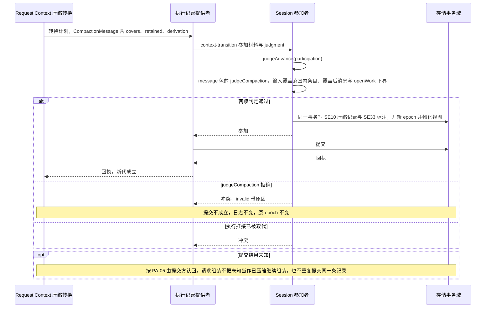

数据去向：SE10 压缩记录与 SE33 在同一提交。对人的时间线不删除原消息，按压缩记录加标注（F-SC11）。模型可见的 epoch 视图在同一事务物化，之后的组装读新代（F-SC13）。

契约未定：压缩转换在协调者一侧的唯一提交点。Session 只承担历史持有者一侧，见[明确缺项](../../SPEC.md#具名前提与明确缺项)。

## F-SC04 结果保管的共同提交

细化 [F-SE09](../../../docs/key-flows.md#f-se09-三条流到日志)的保管步。依据：JC-11、[PA-05](../../SPEC.md#pa-05)、[EC-04](../../SPEC.md#ec-04)、`preserveResult` 的操作表行、[值与结果项的约束](../../SPEC.md#值与结果项的约束)、[I-R7](../../SPEC.md#i-r7)。

保管不要求推进资格。执行记录存在时由执行记录提供者提交（`commit` 或 `recordResult` 的 `custody` 交接），Session 参加。记录已删除时的 Session 单方提交见 F-SC10。

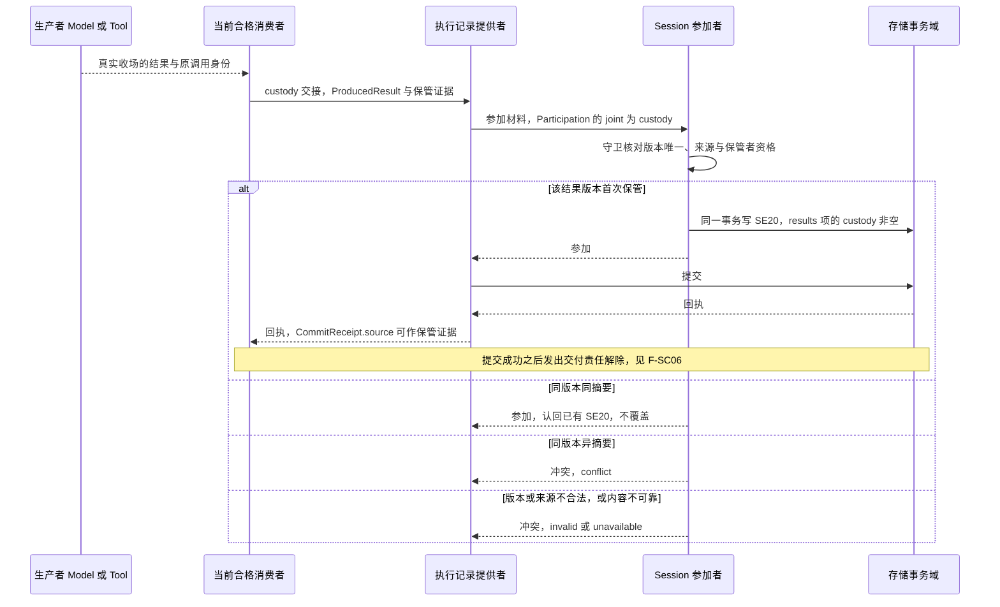

数据去向：SE20 登记在原 `Consumption` 的对应结果版本下。保管不表示已处理。Tool 的迟到版本追加在原消费绑定下，不创建新 Run 或新调用。

失败分支：认回为 `committed` 之前不发交付责任解除（PA-07）。保管者资格不足返回 `denied`。回执丢失按 PA-05 由提交方认回。

## F-SC05 处理完成的共同提交

细化 [F-SE09](../../../docs/key-flows.md#f-se09-三条流到日志)的处理步。依据：JC-12、[PA-05](../../SPEC.md#pa-05)、[RS-04](../../SPEC.md#rs-04)、[I-R6](../../SPEC.md#i-r6)、[EC-04](../../SPEC.md#ec-04)、`completeConsumption` 的操作表行、[等待与结果交接](../../SPEC.md#等待与结果交接)。

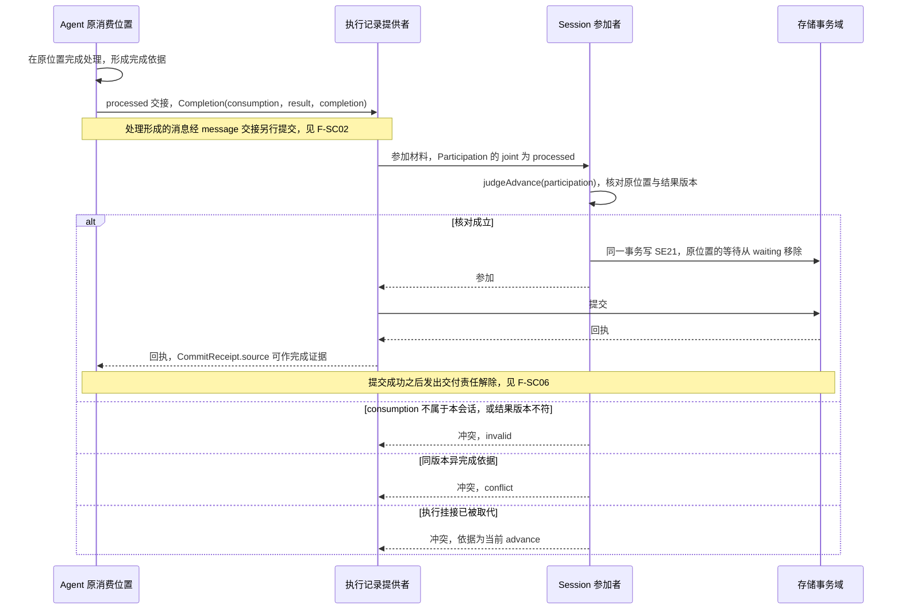

数据去向：SE21 只提交 `completion.result` 指定的结果版本。先完成处理的分支不要求 SE20，接续从完成依据继续，不要求额外保留可重领全文。

失败分支：非原位置的处理返回 `invalid`（I-R6）。晚到的 `processed` 交接不要求推进资格，照常提交（[PM-11](../../SPEC.md#pm-11)）。

## F-SC06 交付责任解除与重发

本流程按 [JC-Release](../../SPEC.md#jc-release)、[EC-04](../../SPEC.md#ec-04)、[EC-05](../../SPEC.md#ec-05) 与 [EC-06](../../SPEC.md#ec-06) 展开原确认恢复。

1. 保管或处理须已提交，提交未知先认回。生产者收到 saved 后按原协议自己解除，结果接收方只返回 saved。
2. Tool 原确认怎样写入同一日志未定（[JC-RELEASE-TOOL-PATH](../../SPEC.md#jc-release-tool-path)）。日志中已有该确认时，AD-05 核当前资格、租户、原 execution/Run、consumption 与完整结果版本后，提交 receive(release) 写 SE19。
3. 确认已在而 Session 后果未提交时，按同一来源身份重读，Session 提交未知先认原 operation。确认未到保持 pending，不重调生产者执行或重新领取全文。
4. Model ACK 到达仍未决，扫描只报告、不执行动作。received、材料与 saved 不构成 ACK；异版本不能解除。

内容不可恢复时报告保管者 unavailable，不能改成已处理。真实结果接收方恢复与生产插件未验证。

## F-SC07 从同日志 Agent 条目派生事实

本流程展开 [EC-01](../../SPEC.md#ec-01) 至 [EC-03](../../SPEC.md#ec-03)。session-contract 的纯层与 session-adapters `./testing` 的内存提供者实现本流程，支持范围以 [SPEC](../../SPEC.md) 开头的状态行为准。它们不证明生产提供者、耐久或完整生产运行组合。

1. Agent 经 Journal 首次发布原事实、适用的四类 CallerCommit 参加事实与 Agent 原操作答案。received、完整材料、消费绑定与 saved 同批。open/attach/submit/tryFinish 的 Session 参加只读核对。
2. 解释器经同一 AgentJournal 提供者的 output.read / output.events 读事件正文，经 load 读 entries、results 等快照字段，不读取 load.events。readThrough 使用事件序号，entries 提交顺序与 results 快照不能替代事件 cursor。
3. 解释器核验当前资格、租户、原 execution-to-Run 关系及来源身份。input-taken 派生 SE14，producer 派生 SE19/SE18，waiting 派生 SE18/SE22，control 派生 SE25，ended 派生 SE26/SE16。
4. 在 Agent 原提交之后的另一笔 Session 提交中，后果、解释进度及该次操作答案一次发布。只保存原来源身份或引用，不复制事件正文。message 不重复写历史，stream 不逐片保存。不执行旧 receive 后确认事件副本的步骤。
5. 首次发布失败只影响首次批次。后续解释失败只影响解释批次，不撤销 Agent 已提交事实，也不推进持久解释进度。各批次丢答复均查询各自原操作。缺口隔离，不可用保持未知。
6. 未解释记录继续计入未结工作，不能使 Session 提前空闲或完成。Agent ended 先发布而 Session 尚未解释时，cancel 可先写 cancelled；后续 ended 只保留原 Run 的来源引用，不改终态或后继。冻结后的终态批次仍解除余下待处理资格。

## F-SC08 条件终结与 Run 终态

细化 [F-SE03](../../../docs/key-flows.md#f-se03-控制传播)与 [F-SE05](../../../docs/key-flows.md#f-se05-恢复)的终态部分。依据：[PA-02](../../SPEC.md#pa-02)、[PA-08](../../SPEC.md#pa-08)、[PM-13](../../SPEC.md#pm-13)、[PM-14](../../SPEC.md#pm-14)、[RS-08](../../SPEC.md#rs-08) 至 [RS-10](../../SPEC.md#rs-10)、[I-R4](../../SPEC.md#i-r4)、[I-R5](../../SPEC.md#i-r5)、[P-5](../../SPEC.md#具名前提与明确缺项)。Agent 一侧沿[条件终结](../../../../agent/agent-contract/SPEC.md#条件终结)。

Run 终态有三个入口。完成与失败在 Session 读取并解释 Agent 结束事实的后续提交中成立。Agent 原 tryFinish 提交只读核对 Session，不写 SE26。取消在 Session 的控制提交时成立。有界收束的失败在 finishRun 提交时成立。Agent ended 已发布而 Session 尚未解释时，cancel 可先写 cancelled；后续 ended 只保留原 Run 引用，不改终态或后继。

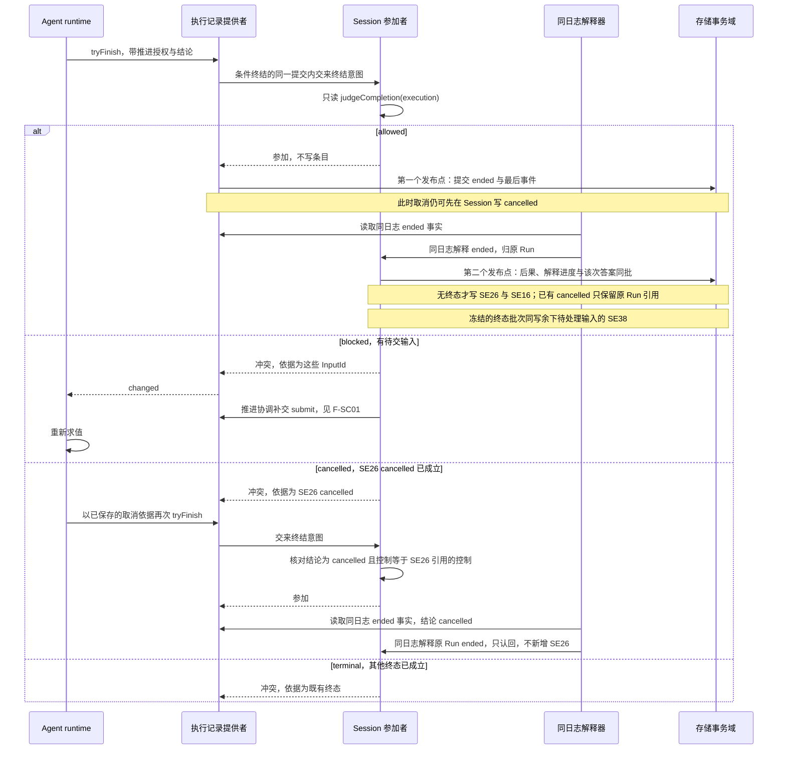

取消与有界收束由 Session 提交：

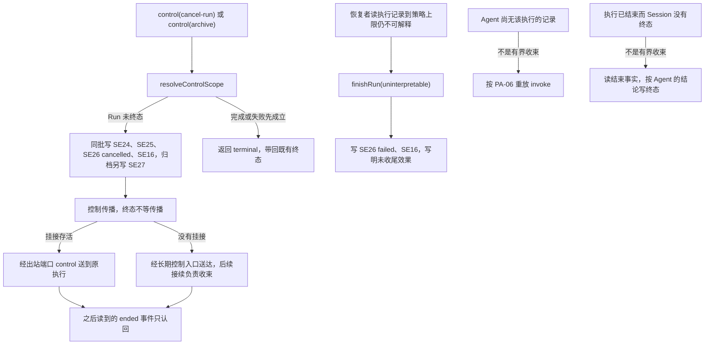

取消与受理、取消与终结的先后（PA-08，按权威提交顺序裁定）：

| 顺序 | 结果 |
| --- | --- |
| 取消先于 `accept` | Run 已是 cancelled。会话未归档时输入取得待处理资格，去处为下一个 Run。归档先成立时 `accept` 被拒绝 |
| `accept` 先于取消 | 输入保留待处理资格。Run 取消不撤销它，由新 Run 承接。归档同批撤销待处理资格并记录取消范围（SE27）。已交入而未承接的输入在 Session 一侧没有 SE14，由后继 Run 以同一 `InputId` 重新交入，SE13 记录前继 Run |
| 取消先于条件终结 | 参加者响应「冲突」，Agent 以取消依据再次终结。之后的结束事件按 RS-10 认回 |
| 条件终结先于取消 | Session 的结束事实解释提交已成立时 `control` 返回 `terminal`。解释提交尚未成立时照常提交 SE26 cancelled，之后的结束事件按 RS-08 认回，Agent 的结论作为引用保留 |
| 取消已提交而没有活体挂接 | 按 PM-13 经长期控制入口传播，后续接续负责收束。`ControlProgress` 在传播或原责任未知时保持 propagating，全部对账后才为 reconciled；Tool 围栏不计入该进度，超过上限时报告，不冒充已停 |

失败分支：首次 Agent 提交中的参加者读权威状态失败时响应「失败」，该次共同提交两侧都不保存。后续 Session 解释提交失败时，Agent 已发布事实仍保留，解释进度不推进；解释提交未知时先认回该次操作。`control` 未知时 `queryOperation`，认回为 `committed` 之后才开始传播。`finishRun` 与既有终态冲突时返回 `terminal`。

契约未定：Agent J03 的 #502 仍未决定哪些控制触发 Tool 启动失效及特定失败怎样恢复。取消不因此必然产生 start-fence，也不以围栏作为本域 reconciled 条件。P-5 是具名前提，有界收束的边界由 Agent 拥有者确认。

## F-SC09 推进映射与换代

细化 [F-SE05](../../../docs/key-flows.md#f-se05-恢复)的接续部分与 [F-SE10](../../../docs/key-flows.md#f-se10-新-run-开始的求值与重装判定)的 reload 入口。依据：[PM-01](../../SPEC.md#pm-01) 至 [PM-12](../../SPEC.md#pm-12)、JC-07、JC-08、JC-15、[RS-05](../../SPEC.md#rs-05) 至 [RS-07](../../SPEC.md#rs-07)、[I-R2](../../SPEC.md#i-r2)、[I-R8](../../SPEC.md#i-r8)。Agent 一侧沿[恢复与接管](../../../../agent/agent-contract/SPEC.md#恢复与接管)与[采用交接](../../../../agent/agent-contract/SPEC.md#采用交接)。

Run 与 Agent 执行一一对应，attempt 与执行挂接一一对应。Session 不保存接续值。`claim.continuity` 与 `reload.handover` 都是耐久证据。

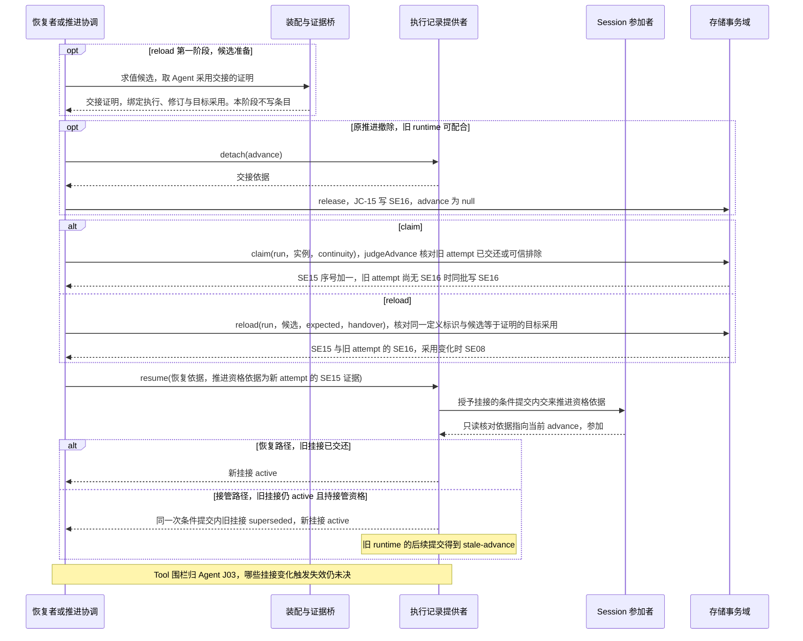

失联接管：恢复者读执行记录（`inspect`）显示挂接仍 active，恢复者持接管资格，并有宿主的失联判断作证据时，`claim`（接管）后 `resume`。没有失联依据时等 Agent，没有资格时报告并保留（PM-14）。宿主的失联判断不代替接管资格。

旧实例晚到（PM-11）：

| 晚到的动作 | 结果 |
| --- | --- |
| 参加提交（`recordMessage`、`commitDerived(compaction)`） | 参加者响应「冲突」，执行记录提供者返回 `stale-advance` |
| `custody` 与 `processed` 交接、`receive` | 不要求推进资格，照常提交。结果与费用归原调用 |
| Agent 事件 | 按事件身份照常写入，保存实际挂接关联 |
| `reload` | 交接证明的修订已过期，`changed` |
| `claim`（以旧 attempt 为旧资格） | `stale-advance` |
| `invoke` 或 `resume`（推进资格依据为旧 attempt） | 执行记录提供者核对失败，`denied` |

失败分支：

| 情形 | 行为 | 条款 |
| --- | --- | --- |
| 候选不合法、交接被拒或不可用 | 不写 SE08、SE15、SE16。`reload` 返回 `invalid` 或 `unavailable`。原采用已不合法时报告不可用，不以空采用推进 | PM-03、PM-09 |
| `detach` 返回 `stale-advance` | 读执行记录取得取代依据后提交 `release` | PM-04 |
| `detach` 返回 `denied` | 目标挂接属于存活的其他 runtime 且没有接管资格。不写状态，交维护者或等它自行交还 | PM-04 |
| `claim` 返回 `stale-advance` 或 `changed` | 已有其他后继，或旧 attempt 仍有效且未被排除 | PM-05 |
| `resume` 失败 | 不撤销 `claim` 的 SE15。同一恢复者或下一次扫描以同一推进资格依据重试 | PM-05 |
| `reload` 之后 `resume` 返回 `changed` | 重新取交接证明，以同一 attempt 的依据接续，不第二次 `reload` | PM-06 |
| 取消或归档先成立 | `claim`、`reload` 被拒绝，候选作废。`claim` 或 `reload` 先成立时取消照常提交，SE16 撤销新 attempt | PM-08 |
| `claim` 或 `reload` 回执丢失 | `queryOperation`。`committed` 读新 `AdvanceRef` 继续，`unknown` 时不第二次 `claim` | PM-10 |
| 重复 reload | 同候选同证明认回，同身份异候选 `conflict`，不同候选的第二个 `changed` | PM-12 |
| 各阶段由另一进程接手 | 谁读到 `advance` 并能出示它的 SE15 证据，谁就能继续映射提交 | PM-07 |
| Tool 围栏状态未知 | 按 Agent J03 保留原事实与未知；哪些挂接变化触发失效及特定失败恢复仍属 #502。Session 不以本域撤销或控制受理宣称已阻止新发起 | PM-05/06、Agent J03 |

契约未定：宿主失联判断的证据形状归 Agent 宿主。「推进资格已被取代」的参加者冲突映射为 `stale-advance` 归 Agent 拥有者，补上之前旧 runtime 在 `claim` 与接续之间得到 `changed`，见[明确缺项](../../SPEC.md#具名前提与明确缺项)。

## F-SC10 迟到结果与终态后的后台结果

细化 [F-SE09](../../../docs/key-flows.md#f-se09-三条流到日志)的迟到步。依据：[EC-07](../../SPEC.md#ec-07)、[EC-08](../../SPEC.md#ec-08)、[EC-09](../../SPEC.md#ec-09)、[PM-14](../../SPEC.md#pm-14) 的保管行、[AgentDrivePort](../../SPEC.md#agentdriveport) 的 `recordResult` 与 `inspect`、[P-3](../../SPEC.md#具名前提与明确缺项)、[终态与控制](../../SPEC.md#终态与控制)。

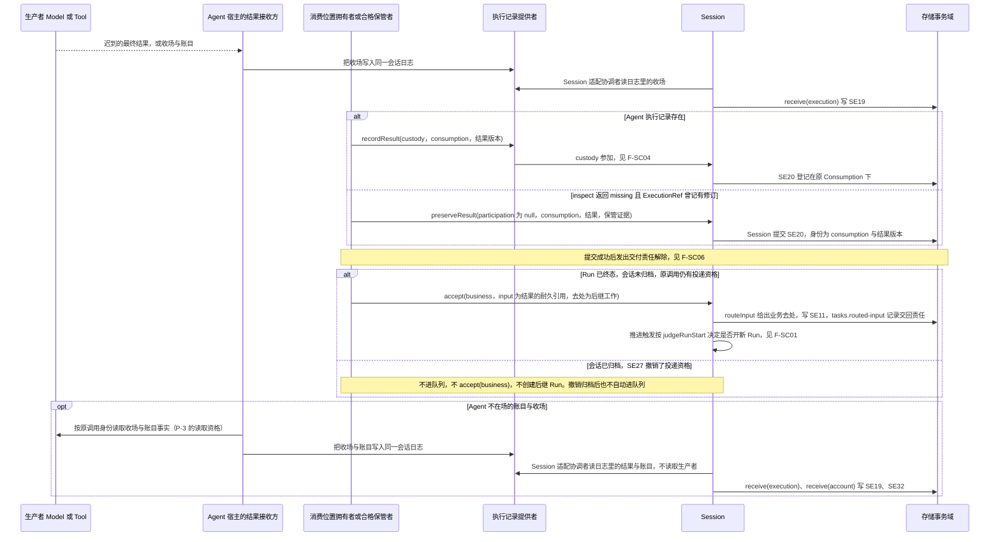

数据去向：结果事实 SE19，保管 SE20，账目 SE32。账目归原调用与原 attempt，未知费用保持未知。后继 Run 经引用关联原调用，原 Run 不复活。

失败分支：

| 情形 | 行为 | 条款 |
| --- | --- | --- |
| 保管者不可用 | 生产者继续保管，责任没有空档 | EC-07 |
| `recordResult` 返回 `conflict` | 结果项、版本、消费位置与交接不一致，拒绝 | AgentDrivePort |
| `ExecutionRef.revision` 为空时的 `missing` | 表示 Agent 尚未受理，按 PM-14 处理，不是记录已删除 | AgentDrivePort |
| P-3 不成立 | 结果接收方不能写入迟到的收场与账目。迟到的收场只能经 Agent 事件到达，Agent 不在时保持未知。迟到的账目保持未知。Session 不代为读取生产者，不以查不到当作未发生 | EC-09、P-3 |
| 重复报告 | 按生产者记录身份与修订派生的身份认回 | EC-09 |

契约未定：结果接收方读取迟到账目与收场的资格（P-3）归 Model 与 Tool 的拥有者。

## F-SC11 时间线投影与在途收敛

细化 [F-SE08](../../../docs/key-flows.md#f-se08-时间线投影与在途收敛)。依据：[SessionHistory](../../SPEC.md#sessionhistory) 的 `begin`、`next`、`since`、[SL10、SL11](../../SPEC.md#日志读取投影及恢复)、[EC-10](../../SPEC.md#ec-10)、[EC-11](../../SPEC.md#ec-11)、[SessionNotifier](../../SPEC.md#sessionnotifier)、[值与结果项的约束](../../SPEC.md#值与结果项的约束)中的 `AdmittedMessage.consumption`。系统层说明见[用户可见内容的两处来源](../../../../../docs/architecture/runtime/streaming-and-consumption.md#用户可见内容的两处来源)。

用户看到的内容只来自两处：已提交日志的历史投影，与在途实时增量通道。进程内缓冲不是来源。

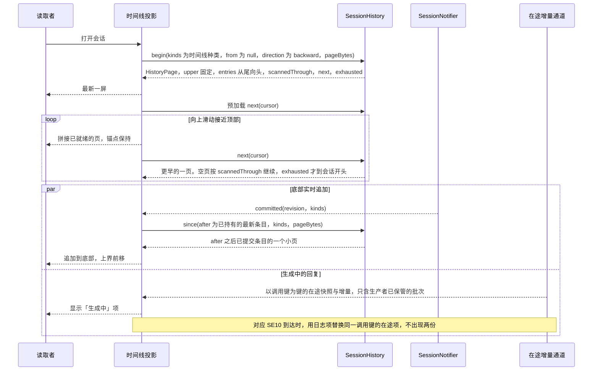

数据去向：只读，不写日志。每页重新核权。游标固定来源、过滤、上界与扫描位置，调用方不能修改游标扩大范围。

时间线项与来源：

| 时间线项 | 来源 |
| --- | --- |
| 消息（用户、助手、工具、工具内部、提醒） | SE10 |
| 压缩标记 | SE10 压缩记录与 SE33，覆盖范围折叠显示，保留名单标「保留」 |
| Run 分隔与终态 | SE13、SE26 |
| 控制、插队、转后台、释放已发起 | SE24、SE25 |
| 卡片与决定 | SE22、SE23。卡片正文按条目里的引用向 HITL 读取，不读日志 |
| 附件 | 页内只带引用与尺寸。内容在需要显示时按引用读取 |
| 等待指示 | `WorkSnapshot.waiting`，治理读 |
| 正在生成的回复 | 在途增量通道，不读日志 |
| 工具过程 | 按结果引用读 Tool，不读日志 |
| 后台运行中的工具 | SE19 的转后台确认。确认到达后，该工具项显示「后台运行中」 |
| 费用 | SE32，按权限 |

列表与位置：

- 列表项以条目的 `id`（`EntryId`）为键。向顶部拼接更早的一页时，客户端补偿滚动偏移，使视口内的内容不跳动。
- 位置恢复：客户端记住视口顶部条目的 `id`，以及它下面一条的 `id`。`begin` 的 `from` 不含本身，所以重开时以下面一条为 `from` 调 `begin(backward)`，首页从顶部条目开始；再以顶部条目为 `from` 调 `begin(forward)`，补上视口下方的内容。之后向两端预加载。
- 同一调用重试时，「生成中」项保持不变，内容清空后重新显示。

失败分支：

| 情形 | 行为 | 条款 |
| --- | --- | --- |
| 权限撤回 | 旧游标被拒绝（`denied` 或 `invalid`），不继续披露。读取者清缓存后重新开始查询 | SL10、SL11 |
| 游标错域、失效或被篡改 | `invalid` | SessionHistory |
| 读路径不可用 | `unavailable`，不返回空页 | SessionHistory、EC-10 |
| 过滤造成的空页 | 不表示读完，`scannedThrough` 记录实际扫描位置 | SL11 |
| 通知丢失、重复或合并 | 事实不变。读取者以已持有的最新条目为 `after` 调 `since` 补读 | EC-11 |
| 崩溃后 | 只可能缺从未展示过的在途片段。恢复后的显示说明缺口，不补造 | F-SC12 |

契约未定：

- 时间线显示哪些事件种类。归 `session` 投影与公开接入的策略配置。
- 在途通道的订阅入口（订阅 Agent 句柄，或直接观察生产者）。归 Agent、Model、Tool 契约与公开接入。
- 助手消息的条目怎样关联原调用。`AdmittedMessage.consumption` 只在工具消息与后台占位消息上非空。归 message 包与 Agent 的消息形成。

`from` 的含义与 `since.after` 的取法已由 [SessionHistory](../../SPEC.md#sessionhistory) 规定，不在未定之列。

下列几项归客户端，不是 Session 的契约义务：

- 客户端页缓存以 (session, H, direction, cursor) 为键，H 是这一轮遍历固定的上界。缓存只淘汰，不失效，重连后复用。
- 预加载阈值与页字节数是客户端的策略配置，初值分别为 1.5 屏与 64 KiB。
- 上面「列表与位置」中的列表项键、滚动补偿、位置恢复与重试时的显示。

## F-SC12 流到日志

细化 [F-SE09](../../../docs/key-flows.md#f-se09-三条流到日志)。依据：[EC-01](../../SPEC.md#ec-01)、[事件来源与日志准入](../../SPEC.md#事件来源与日志准入)的 Model 与 Tool 来源表、JC-06、JC-11、JC-12、[终态与控制](../../SPEC.md#终态与控制)的转后台段。系统层说明见[三条流不逐块进会话日志](../../../../../docs/architecture/runtime/streaming-and-consumption.md#三条流不逐块进会话日志)与[崩溃后的恢复](../../../../../docs/architecture/runtime/streaming-and-consumption.md#崩溃后的恢复)。

模型回复流、工具内部事件流与面向观察者的显示流都不逐块写入会话日志。Agent 不转发生产者的流，观察者按生产者的 StreamRef 观察。会话日志只在收场、消费与记账三个时点写入。

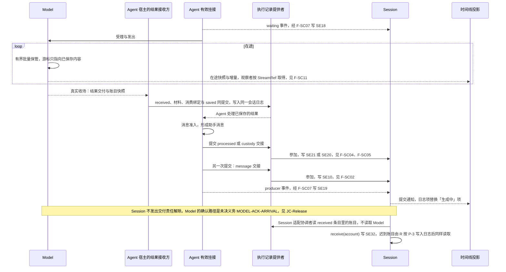

模型回复流的规则：

| 编号 | 规则 | 契约位置 |
| --- | --- | --- |
| F1 | Session 在流途中零写入。首次写入是收场后 Agent 的同一次提交 | EC-01、JC-06、JC-11、JC-12 |
| F2 | 「生成中」项以调用键为键。日志里的 SE10 经消费位置回到同一调用，时间线据此替换，不出现两份 | F-SC11 |
| F3 | 中断：`control(stop-call)` 或 `interrupt` 先成立 SE24。Model 以中断收场，Agent 把已交付内容形成带中断标记的消息。收场写 SE19，控制阶段写 SE25 | [终态与控制](../../SPEC.md#终态与控制)、EC-01 |
| F4 | 首内容到达之前失败并重试：同一调用的新一次发出。日志没有新条目，SE18 不变 | 事件来源表 |
| F5 | 首内容到达之后失败：不重发同一逻辑回复。Model 记故障收场，Agent 形成失败来源消息或拒绝。写 SE19，可能写 SE10 | 事件来源表 |
| F6 | 账目可以迟到。SE32 不依赖 Agent 在场 | EC-09 |

工具内部事件流：

| 阶段 | 保管 | 会话日志 |
| --- | --- | --- |
| 在途过程块 | Tool 先保存过程块与游标，再发布。时间线按结果引用读 Tool 的过程 | 不写 |
| 等待（Ask 或资源） | Agent 的 `waiting` 事件 | SE18 阻塞范围、SE22 |
| 转后台 | `control(background-tool)` 或 `interrupt` 写 SE24。Tool 的转换确认经消费位置拥有者 `receive(execution)` 写 SE19。占位经 Agent 的 `processed` 与 `message` 交接写 SE21 与 SE10 占位消息 | SE24、SE19、SE21、SE10 |
| 收场 | Agent 处理最终结果，`processed` 或 `custody` 交接与 `message` 交接 | SE19（含效果确定性）、SE21 或 SE20、SE10 |
| 后台最终结果 | Run 仍活时经依赖等待唤醒，走收场。Run 已终态时按 F-SC10 | 同上，或 SE19、SE20 与 SE11 |

崩溃矩阵：每一种情形的规则相同，保管了内容的一方持有内容，Session 只持有事实与证据。逐提交点的恢复动作归通用实现的 [CR 崩溃矩阵](../../../session/SPEC.md#cr-崩溃矩阵)。

契约未定：

- 中断回复的消息形状与标记。归 message 包与 Agent 的消息准入。
- 在途项的调用键中「本次发出」一级的来源。归 Model 契约。
- 在途通道的订阅入口，同 F-SC11。

## F-SC13 epoch 视图读取

细化 [F-SE07](../../../docs/key-flows.md#f-se07-模型可见历史的读取)。依据：[SessionHistory](../../SPEC.md#sessionhistory) 的 `readModelView` 条款、JC-09、[VC-O06](../../SPEC.md#候选的持续验证义务)。Request Context 一侧沿[历史源读口与 epoch 视图](../../../../context/request-context-contract/SPEC.md#历史源读口与-epoch-视图)。

epoch 视图是两次压缩之间的模型可见序列。它在压缩提交时物化（F-SC03），读取不重算。

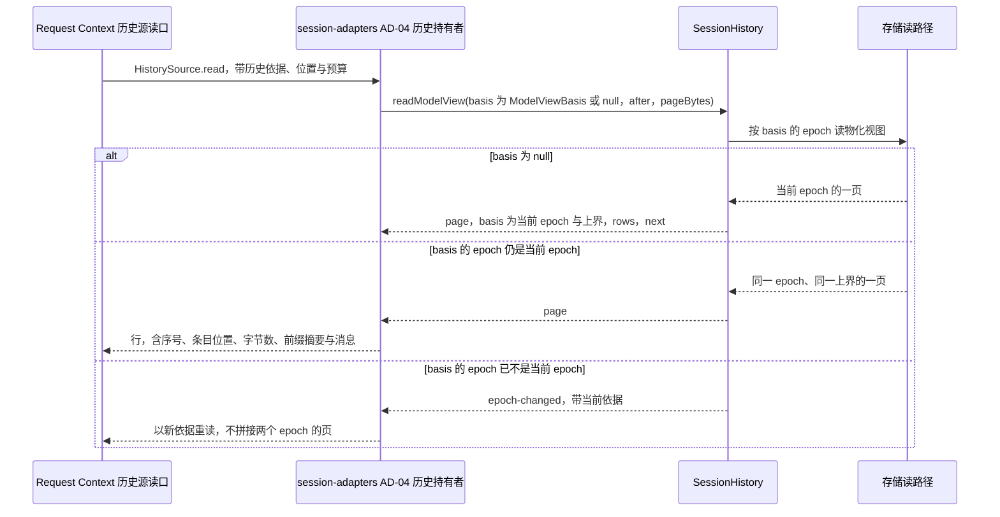

数据去向：只读，不写日志。同一历史依据下的各页属于同一 epoch，上界固定。

失败分支：

| 情形 | 行为 |
| --- | --- |
| 访问身份不合格 | `denied`，按这次传入的访问身份核对 |
| 缺访问身份、依据或游标错域、`pageBytes` 不合法 | `invalid` |
| 读路径不可用 | `unavailable`，不返回空页 |
| 分页期间提交压缩 | 之后以旧依据读取返回 `epoch-changed`。已返回的页仍属旧 epoch |

契约未定：无。物化方式归存储提供者。

## F-SC14 会话冻结

没有对应的组根流程。依据：[常驻工具与会话冻结](../../SPEC.md#常驻工具与会话冻结)、JC-28、[I-F1](../../SPEC.md#i-f1) 至 [I-F5](../../SPEC.md#i-f5)、`freeze` 的操作表行（[SessionManagement](../../SPEC.md#sessionmanagement)）、`startRun` 与 `reload` 的 `frozen` 失败、[守卫条款](../../SPEC.md#守卫条款)并入 ST03、ST06、ST20、ST22 的冻结分支、ST27、[常驻工具与会话冻结](../../SPEC.md#常驻工具与会话冻结)、[P-8](../../SPEC.md#具名前提与明确缺项)。生命周期视图见[五个生命周期视图](../object-model/session-state-transitions.md#五个生命周期视图)。

冻结判定只经新 Run 或显式 reload 的候选采用材料到达。会话初始化不判冻结。Tool 的 planAdoption 归 Tool，Session 协调器只消费其真实判定。

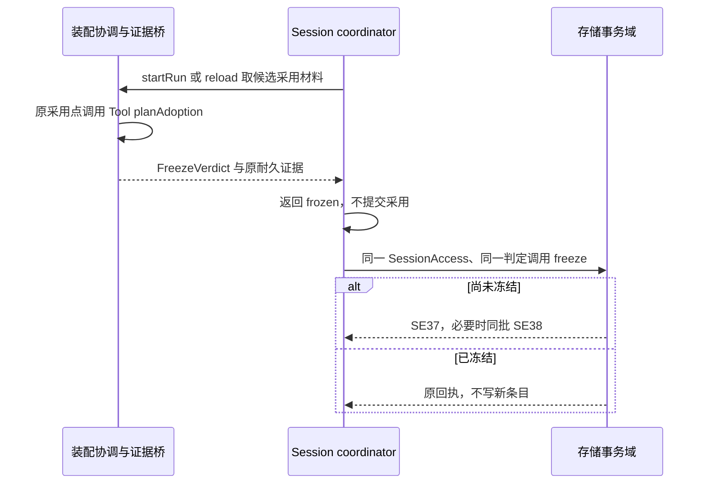

maintainer 发起 startRun 得到 frozen 时不开 Run，不切换为 coordinator 提交冻结。下一个合法采用点重新判断，由 coordinator 提交。租户来自原 SessionAccess，不反查会话目录。

冻结后的行为：

| 到达的意图 | 行为 | 条款 |
| --- | --- | --- |
| `startRun`、`reload` | 返回 `frozen`，`verdict` 为 null | I-F2 |
| `claim` | 照常，原 Run 沿原采用接续 | I-F2 |
| 未终结的 Run | 不被取消，按原规则收场。`freeze` 不调用 `resolveControlScope`，不写 SE24 至 SE26 | I-F3 |
| 待处理输入，有未终结 Run | 照常交入这个 Run。Run 终态同批以 SE38 解除余下的待处理输入 | I-F4、ST20 |
| 普通输入到达，没有未终结 Run | `accept` 返回 `frozen` | I-F4、ST03 |
| 归档与自动归档 | 照常。冻结独立于归档，`judgeIdle` 不读 `frozen` | I-F5 |
| 撤销归档 | 回到冻结，不回休眠。`lifecycle` 为 `frozen` 或 `active` | I-F5、ST22 |
| 已归档会话收到冻结判定 | 照常提交 | I-F5 |

失败分支：

| 情形 | 行为 |
| --- | --- |
| 原因不是 `tool-shape-lost`，或证据不是耐久证据 | `invalid` |
| 初始化未完成 | `not-ready` |
| 资格不足 | `denied` |
| 提交未知 | `commit-unknown`，按 `queryOperation` 认回 |
| 候选返回与冻结提交之间崩溃 | 下一次推进触发重新取候选材料，Tool 再次给出判定，`freeze` 首次提交或认回 |
| 常驻工具暂时缺席、状态未知或被撤权 | Tool 以同形的不可用件替代，不给出冻结判定 |

常驻规则及采用点判定归 Tool。引用读取桥接归应用装配并显式限定 tenant，Session 组不提供驻留动作端口。冻结判定在新 Run/reload 候选采用时返回，精确生产桥仍见 P-8；未交付时 unavailable，不能伪造冻结。

## F-SC15 引用查询

没有对应的组根流程。依据：[常驻工具与会话冻结](../../SPEC.md#常驻工具与会话冻结)的引用查询段、`references` 的操作表行（[SessionReconciliation](../../SPEC.md#sessionreconciliation)）、[常驻工具与会话冻结](../../SPEC.md#常驻工具与会话冻结)、[VC-F07](../../SPEC.md#候选的持续验证义务)。

`references` 本身是具备系统资格的 maintainer 读取，不用租户 Access。应用装配的 Tool Reader 另带显式 tenant；桥接在系统结果上筛选该租户后才返回，不把跨租户目录暴露给普通租户调用方。目录或授权不可用时 unavailable，不交空页。

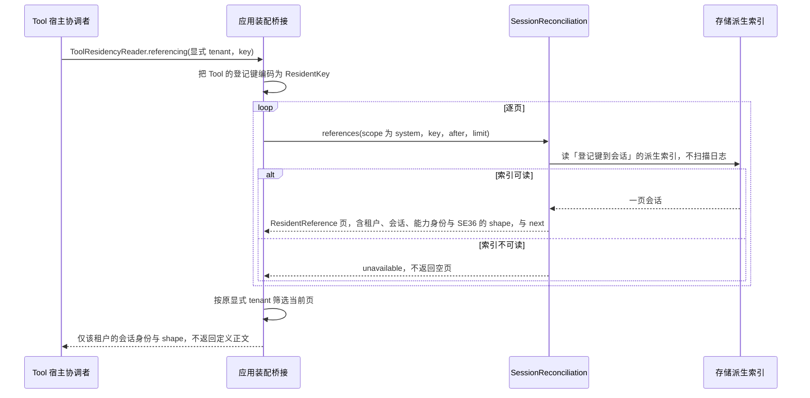

引用的定义：会话当前记下的登记键含该键，并且会话未归档。冻结而未归档的会话算引用。已归档的会话不算：归档在同一批里取消未终结 Run（JC-16），已归档会话没有未终结 Run。存储提供者在提交 SE08、SE26、SE27 与 SE28 时维护索引。

失败分支：`denied`（系统作用域的读取资格），`invalid`（游标错域，或键不可解析），`unavailable`（不返回空页冒充没有引用）。只读，没有未知。

契约未定：同 F-SC14 的 P-8。

## F-SC16 作用域释放与换代后重新释放

细化 [F-SE04](../../../docs/key-flows.md#f-se04-归档级联与作用域释放)的释放部分。依据：JC-16、[ScopeReleasePort](../../SPEC.md#scopereleaseport) 与它的五类处置表、`releasedScopes` 的操作表行（[SessionReconciliation](../../SPEC.md#sessionreconciliation)）、[守卫条款](../../SPEC.md#守卫条款)并入 ST21 与 ST26 的分支、[VC-O02](../../SPEC.md#候选的持续验证义务)、[VC-O07](../../SPEC.md#候选的持续验证义务)。系统层说明见[作用域释放](../../../../../docs/architecture/runtime/control-and-recovery.md#作用域释放)，执行环境一侧沿[恢复](../../../../execution/execution-environment-contract/SPEC.md#恢复)与[拒绝原因](../../../../execution/execution-environment-contract/SPEC.md#拒绝原因)。

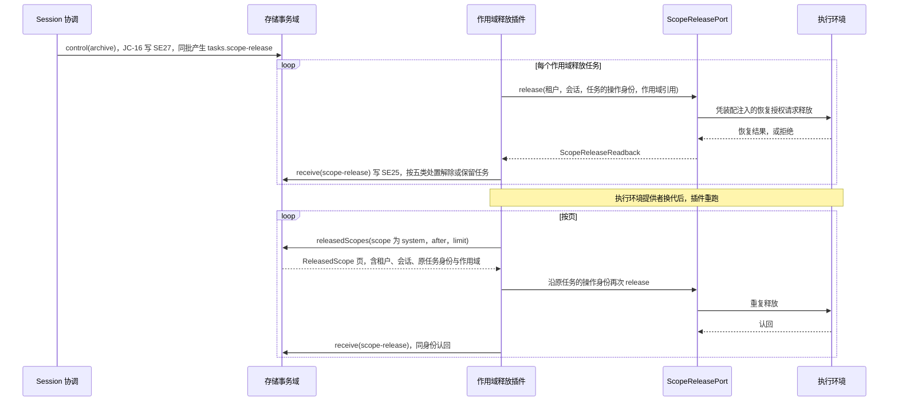

读回的处置：

| 处置 | 读回 | Session 的动作 |
| --- | --- | --- |
| `released` | 没有待停资源、不支持项或枚举失败的提供者 | 解除任务 |
| `pending` | 有待停的资源 | 保留任务，由级联推进按同一操作再次驱动 |
| `unsupported` | 有不支持恢复的提供者或资源 | 记录这一部分并交人处理 |
| `unavailable` | 有提供者枚举失败，或执行环境以不可用拒绝 | 保留任务，按策略退避后重试 |
| `not-authorized` | 执行环境以未获授权拒绝 | 保留任务并报告维护拥有者。不改用会话用户的访问身份重试 |

一次读回可以同时落入几类。只要还有待续、不可用或未获授权的部分，任务就保留。`release` 结果未知或抛出时任务状态记为 `unknown`，以同一操作身份重试。

数据去向：会话日志里的释放读回事实（SE25）是已释放作用域的耐久账本，执行环境不保存这份账本。`releasedScopes` 从存储提供者维护的派生索引读取，不扫描日志。对人的时间线只记录「已发起释放」与读回结果。

失败分支：`releasedScopes` 返回 `denied`、`invalid`（游标错域）或 `unavailable`（不返回空页）。重复释放由执行环境认回。超过策略上限时任务保持未结并报告维护拥有者，不冒充已释放。

契约未定：执行环境重启到重新释放之间的窗口。契约接受这个窗口，窗口内已归档会话的作用域可能尚未释放，见[明确缺项](../../SPEC.md#具名前提与明确缺项)。
