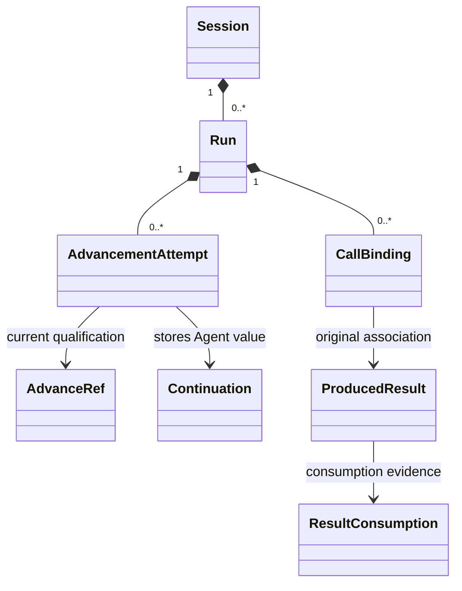

# Session 对象模型

本页按 #343 的文档主题组织 #342 候选。图表投影现有设计，不改变采用范围，也不表示运行实现或真实提供者验证已完成。

本图描述领域对象与候选接口的关系，不要求实现采用 class。属性和操作的精确定义只维护在 [public-api](../public-api.md)，行为条件只维护在 [SPEC](../../SPEC.md)。

## 对象与生命周期

| 对象或表示 | 身份与职责 | 状态及寿命边界 |
| --- | --- | --- |
| SessionId | 持久会话身份 | 租户、归属及定义关系由 Session 维护 |
| RunId | 一轮逻辑工作 | 每 Session 至多一个未终结 Run |
| AttemptId / AdvanceRef | 当前有效推进及实例关联 | 最大序号不能代替当前资格 |
| CallBinding | 原调用与原消费位置的关联 | 不转给碰巧活动的后继工作 |
| ProducedResult / ResultConsumption | 原结果版本及消费事实 | 处理、保管和确认分别认回 |
| Continuation | Agent 定义的版本化接续值 | Session 保管，不能保存闭包或 Context |

图中逻辑工作名用于解释关联，不新增同名源码导出。普通关联箭头不表示生命周期组成。外域对象只作为本包使用的引用，原事实与规则仍由其拥有者维护。跨四成员的完整关系见[共同对象模型](../../../../../docs/architecture/runtime/runtime-contract-model.md#对象与身份)。

## 值、参数与依赖

请求身份、固定采用和原位置作为显式值传递。存储、当前资格判断、环境或传输等可调用能力通过构造依赖取得。实际分类与必需性沿 [SPEC 候选](../../SPEC.md#342-主干运行契约候选)逐操作核对，Cordis 只在[集成主题](../../../session-cordis-contract/docs/cordis.md)中装配这些能力。对象存在不构成权限证明。
