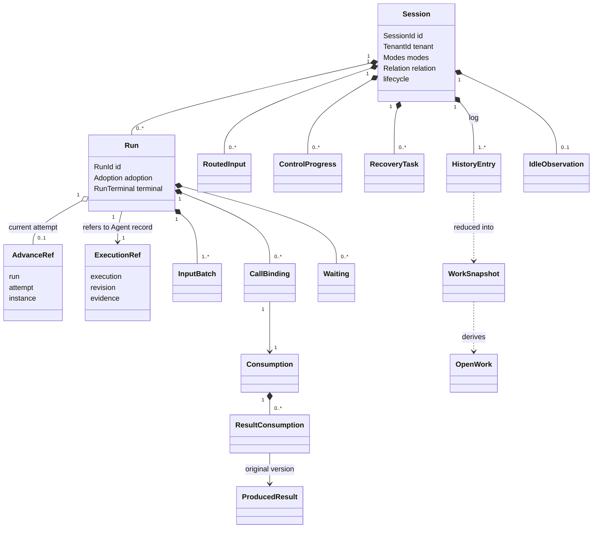

# Session 对象模型

Session 是会话治理的聚合根。Run 是聚合内的实体，记录一次逻辑工作的治理事实。attempt 是 Run 的值属性，表示当前推进资格。会话日志的一次提交是聚合的一致性边界。执行本身归 Agent 的执行，模型调用归 Model，工具执行归 Tool。

本页拥有对象的身份、构造、状态、所有者以及保留条件。精确签名归 [public-api](../public-api.md)，行为条件归 [SPEC](../../SPEC.md)。事实种类归[事件目录](session-log-events.md)，状态、守卫与归约归[状态与转移](session-state-transitions.md)。图表投影候选设计，不表示运行实现或真实提供者验证已经完成。图中的技术对象不自动新增产品领域对象，也不要求实现采用 class。

## 调用方怎样使用

本节是候选修订，技术接受前不扩大本页既有承诺。

下例是职责伪代码。每个操作都要处理成功、拒绝和未知，不表示当前包已有运行导出。

```text
装配者创建 Session 服务，注入事务端口、身份与证据桥、时钟、空闲与 Context 输入
受理入口调用 accept，Session 在一次提交里保存消息、去处与待处理资格

推进触发者发现待处理输入，调用 startRun
    Session 提交 Run 开始、首批承接与首个 attempt
    协调者以该 attempt 的耐久证据作为推进资格依据，调用 Agent 的 invoke
    Agent 打开执行时，Session 参加者只读核对该 attempt 仍然有效

Agent 推进期间的承接、调用登记、进度、派生消息、消费完成与条件终结
    由 Agent 的 Journal 提供者提交，Session 参加者在同一事务里写会话事实

迟到的生产者事实、控制回执、子方与作用域释放回执
    由 Session 的消费适配器读取后调用 receive

恢复者调用 claim 或 reload 取得新 attempt
    再从 Agent 的执行恢复服务读取原记录，请 Agent 接续原执行
    Session 不保存接续值
```

共同提交表与参加者条款归 [SPEC](../../SPEC.md)。一轮正常推进的跨成员顺序见 [context](../context.md)。

## 跨域概念与内部可见范围

本节是候选修订，技术接受前不扩大本页既有承诺。

Session 只建模会话治理所需的外域事实。外域对象以引用或耐久证据出现，原身份与契约含义保持，Session 不复制对方完整状态机。

| 分类 | Session 内的表示 | 原拥有者保留的责任 |
| --- | --- | --- |
| 本域对象 | Session、Run、attempt、输入、批次、调用登记与消费、等待、控制进度、恢复任务、关系、空闲依据、日志条目 | Session 拥有受理、承接、推进资格、等待位置、控制范围、终态、归档与日志 |
| Agent 执行 | `ExecutionRef`：执行身份、最后已知修订与耐久证据；`AdvanceRef.instance` 只作追溯 | 执行检查点、Loop 下一步、执行挂接与围栏代次，见 Agent [托管协调与运行实例](../../../../agent/agent-contract/SPEC.md#托管协调与运行实例) |
| Model 与 Tool 事实 | 原调用登记、结果版本与保管、处理、交付责任解除状态、账目关联 | 请求、执行、流片段、过程块、重试与清理 |
| Context | 注册集合、状态块步提交、变化提醒消息、压缩记录 | 块声明、读取资格、请求组装、压缩规则，压缩形状见[消息成员](../../../../common/message/SPEC.md#模型视图) |
| HITL 与授权 | 卡片决定、原授权关联与消费 | 答复资格、唯一决定、授权算法 |
| 执行环境 | 作用域释放的恢复任务与回执 | 作用域、落点与 `releaseScope` |
| 共享值 | Message、内容块、TenantId、`DurableEvidence`、`Adoption` | 复用公共契约，不建立 Session 版本的同义类型 |

## 对象与生命周期

本节是候选修订，技术接受前不扩大本页既有承诺。

一次操作在一次提交中改变聚合内若干事实。跨聚合的事实，例如另一个会话、Agent 的 Journal 或 Context 注册表，只能经参加者协议共同成立。

| 对象 | 类 | 身份 | 拥有者 | 生灭 | 不变量 |
| --- | --- | --- | --- | --- | --- |
| Session | 聚合根 | `SessionId`，租户内唯一 | Session | 创建（SE01）后长期保留；归档不删除 | 租户、定义标识与执行类型随创建固定；至多一个未终结 Run |
| Run | 实体 | `RunId` | Session | 开始（SE13）到唯一终态（SE26） | 终态三选一，不可反转；至多一个有效推进者 |
| attempt（`AdvanceRef`） | 值，属于 Run | `AttemptId`，严格递增 | Session | 开始（SE15）到交还、撤销或被取代（SE16） | 最大序号不是充分授权；旧 attempt 不再推进；`instance` 只作追溯 |
| `ExecutionRef` | 值，指向 Agent 权威 | `{ execution, revision, evidence }` | Session 保存引用；记录归 Agent 的 Journal 提供者 | 随 Run 开始分配执行身份；每次共同提交更新修订 | 不含接续值、检查点或 Agent 工作状态 |
| `RoutedInput` | 实体 | `InputId` 或原来源 | Session | 受理（SE11）；普通输入到被承接（SE13、SE14）或取消 | 一个输入至多一次有效承接；卡片决定与业务输入不进普通队列 |
| `InputBatch` | 值 | `BatchId` 加批界 | Session | 一次承接 | 当时全部合格输入的精确集合；分块不改批界 |
| `CallBinding` | 值 | 随 `Consumption` | Session 登记；原调用归生产者 | 登记（SE18） | 登记不表示已发出；Run 外调用的发起 attempt 为空 |
| `Consumption` | 实体 | `ConsumptionId` | Session | 登记到交付责任解除确认 | 每个结果版本按生产者、版本和交付唯一 |
| `ProducedResult`、`ResultConsumption` | 值 | 随结果版本 | 结果归生产者；保管与处理事实归 Session | 保管（SE20）、处理（SE21）、解除确认 | 保管、处理与解除分别认回；保管不表示已处理 |
| `Waiting` | 值 | 随原位置 | Session；卡片归 HITL | 等待开始到原位置处理或控制 | 阻塞只针对原位置；没有等待结束事件 |
| `ControlProgress` | 实体 | `SessionOperationId` | Session | 受理（SE24）到传播与核对完成（SE25） | 请求不等于物理停止；Run 取消生效即唯一被取消终态 |
| `RecoveryTask` | 值 | 随原操作 | Session | 产生到确认或拒绝 | 四类：初始化、级联、路由输入、作用域释放 |
| 日志条目（`HistoryEntry`，身份 `EntryId`） | 实体，记录事件 | `EntryId` 与 `SessionRevision` | Session | 提交后不可变 | 依据与留痕分开；业务写入只经 Session 命令 |
| `WorkSnapshot` | 投影 | 随 `revision` | Session 归约 | 可丢，可重建 | 来自同一权威提交位置；不是第二份权威 |
| `OpenWork` | 值，派生 | 随 `revision` | Session 归约 | 随快照 | 待处理、等待、后台占位、结果未知四个子集只从快照派生 |
| `CommitReceipt`、`OperationResolution` | 值 | `SessionOperationId` | Session | 随操作 | 同操作同参数认回原回执；未知不换身份 |
| 会话当前值 | 值集合 | 随 Session | Session 保存；共享源归各拥有者 | 创建初值到变更（SE03 至 SE09） | 不复制共享源；恢复不重新套用默认 |
| `Modes` | 值 | 随 Session | Session 保存；上界归权限、执行环境、协作各拥有者 | 创建初值（SE01）到各维独立变更（SE03） | 一次只改一维；Agent 发起的变更须有 HITL 授权证据；不突破结构化禁止 |
| `Relation` | 值 | 随 Session | Session | 采用（SE29）；常驻标记（SE30） | 子会话不能常驻；handoff 不入级联；父方不随子方变化 |
| `AutoArchivePolicy` | 值 | 随租户设置 | 租户设置拥有者为源；Session 保存采用 | `configureAutoArchive` 采用（SE06） | 默认关闭；时限是正的十进制毫秒数 |
| `IdleObservation`、`IdleCoverage` | 值 | 随 Session | Session（SE31） | `recordIdle` 到被新工作、关系或调用变化中断 | 区间要有覆盖证明；未知不证明空闲；重启不清零已确认起点 |
| `ClockSample` | 值 | 随采样 | 时钟端口 | 每次采样 | 来源可追溯；采样失败不用系统时间代替 |



Run 外调用的 `CallBinding` 也归 Session，发起 attempt 为空，图中省略这条组成关系。普通关联箭头不表示生命周期组成。外域对象只作为引用，原事实与规则仍由其拥有者维护。跨四成员的完整关系见[共同对象模型](../../../../../docs/architecture/runtime/runtime-contract-model.md#对象与身份)。

## 无状态性与有状态性

本节是候选修订，技术接受前不扩大本页既有承诺。

领域服务是纯函数。输入只有 `WorkSnapshot` 与命令参数，输出是封闭的裁定结果。`reduce` 把已提交条目归约为 `WorkSnapshot`。同一前缀与同一解释版本得到相同快照。时钟、连接存活和外部实时账目不在归约中读取，必要的非确定输入先作为采用事实保存。

会话的权威状态只在日志里。`WorkSnapshot`、模型可见历史的物化视图、消费游标和检查点都是派生物，丢失后可以从日志重建。消费游标随它产生的条目同提交，没有条目的事件只推进游标。

Session 不保存 Agent 的接续值。Agent 的检查点是执行当前状态的唯一权威物化，Session 只保存 `ExecutionRef`。恢复者需要接续数据时从 Agent 的执行恢复服务读取原记录，见架构[与 Agent 执行的对应及执行引用](../../../../../docs/architecture/runtime/session-and-run.md#与-agent-执行的对应及执行引用)。

## 状态与转移

本节是候选修订，技术接受前不扩大本页既有承诺。

会话的生命周期视图、各正交维度及其唯一依据、命令守卫、批次归约与并发裁定归[状态与转移](session-state-transitions.md)。Run 分两层状态：

- Run 层：`none → active → completed | failed | cancelled`。终态不可反转。
- attempt 层：只在 `active` 内，`granted → advancing ⇄ waiting → released | superseded`，再由新 attempt 回到 `granted`。

等待是 attempt 层的阶段，不是 Run 的状态。两张状态图与每个转移的触发命令见[Run 与 attempt 的两层状态](session-state-transitions.md#run-与-attempt-的两层状态)。Run 与 Agent 执行一一对应，attempt 与执行挂接一一对应，reload 与恢复沿同一个执行。

## 值、参数与依赖

本节是候选修订，技术接受前不扩大本页既有承诺。

输入按「谁决定、何时变化、能否序列化、与授权的关系」分为四类。

| 分类 | 内容 | 决定时点 | 能否序列化 | 与授权的关系 |
| --- | --- | --- | --- | --- |
| 单次操作参数 | `Access` 的主体、租户与会话，`SessionOperationId`，推进写的 `advance` 与 `expected`，业务输入、控制、耐久证据 | 每次操作 | 能 | 每次操作核对租户与资格。对象存在不构成权限证明 |
| 构造依赖端口 | `SessionTransactionPort`、`SessionIdentityBridge`、`SessionEvidenceBridge`、`SessionClock`、`SessionIdleInput`、`SessionContextInput`，可选 `SessionNotifier` | 构造注入 | 不能，是能力对象 | 身份桥提供资格材料。其他端口的使用同样受每次操作的资格约束 |
| 出站端口 | `AgentDrivePort`、`ScopeReleasePort` | 构造注入 | 不能 | 参数只含 Session 自己的值与不透明证据。作用域释放使用装配层维护者签发的恢复授权，不使用会话用户的访问身份 |
| 可序列化配置 | `SchedulingPolicy` 等调度策略 | 工厂创建时校验 | 能，不含业务身份、权限或秘密 | 无。配置归 `session` 工厂，不进本成员 |

请求身份、固定采用和原位置作为显式值传递。存储、当前资格判断、时钟、空闲覆盖与 Context 材料通过构造依赖取得。逐操作的必需性与缺席行为沿 [SPEC](../../SPEC.md) 核对。Cordis 只在[集成主题](../../../session-cordis-contract/docs/cordis.md)中装配这些能力。

## 领域特有的结果与提交

本节是候选修订，技术接受前不扩大本页既有承诺。

| 对象 | 状态 | 条件与排序的拥有者 |
| --- | --- | --- |
| 日志条目 | 一经提交不可变，身份是 `EntryId` 与提交修订 | [事件目录](session-log-events.md) |
| 共同提交 | 提交方持有存储操作身份；参加者在同一事务内写自己的事实，不自己提交 | SPEC 的共同提交表 |
| `ResultConsumption.release` | `pending`、`confirmed` | SPEC 的事件消费与交付责任解除 |
| `ControlProgress` | `committed`、`propagating`、`reconciled` | [命令守卫与完整结果](session-state-transitions.md#命令守卫与完整结果) |
| `RecoveryTask` | 各类的 `pending`、`unknown`、`failed` 或 `denied` | SPEC 的控制、恢复与保管边界 |
| `RunTerminal` | `completed`、`failed`、`cancelled` | [Run 与 attempt 的两层状态](session-state-transitions.md#run-与-attempt-的两层状态) |

开始 Run 与 Agent 受理执行是两次提交，顺序固定。Session 先提交 Run 开始与首个 attempt，再由协调者以该 attempt 的耐久证据调用 Agent。`claim` 与 `reload` 同样先于 Agent 的接续提交。压缩记录、变化提醒与后台占位经派生提交进入日志，压缩记录的提交步骤见架构[压缩记录的提交](../../../../../docs/architecture/runtime/session-and-run.md#压缩记录的提交)。

## SOLID 与扩展边界

本节是候选修订，技术接受前不扩大本页既有承诺。

| 原则 | 具体选择 | 必须防止的反例 |
| --- | --- | --- |
| 单一职责 | Session 管治理事实，Agent 管执行与 Loop，Model 与 Tool 管各自执行 | Session 保存 Agent 检查点，或从流片段推导 Run 终态 |
| 开闭原则 | 新事实种类经拥有者定义、准入与归约版本加入 | 生产者自填种类或自报留痕取得治理权 |
| 里氏替换 | 替代存储与适配保留耐久、未知、认回与隔离语义 | 只验证类型，不验证提交未知与重放 |
| 接口隔离 | 四面按调用方切分：`SessionWork`、`SessionManagement`、`SessionReconciliation`、`SessionHistory` | 历史读者能写条目，受理入口能终结 Run |
| 依赖倒置 | Session 定义窄端口，适配成员实现对 Agent、Context、执行环境与存储的接入 | 本成员导入执行环境类型或 Agent 内部类型 |

## 产品能力覆盖与验收

能力到事实种类的对应见[对已采用能力的承接](session-log-events.md#对已采用能力的承接)。关键旅程与验证义务归 SPEC 的[关键旅程对应与验证](../../SPEC.md#关键旅程对应与验证)。这些义务是后继实现的验收要求，文档检查不证明运行行为。
