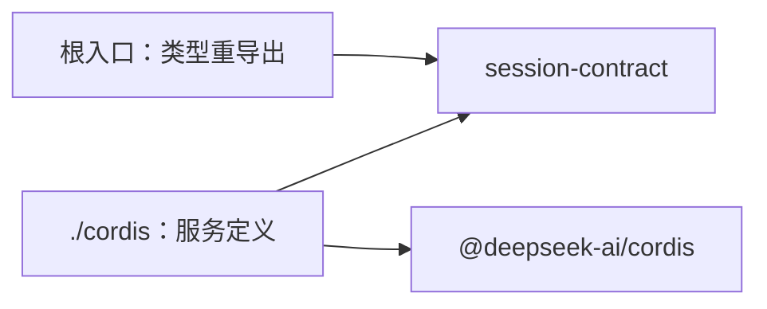

# Session Cordis 定义的内部架构

本页说明本成员怎样组织两个入口与依赖，来兑现 [SPEC](../SPEC.md)。服务键、抽象类、intercept 配置、端口服务键与事件的正文归 [Cordis 说明](cordis.md)。组内六个成员的分解与依赖方向归[组架构](../../docs/architecture.md)。本页不另立公共规则。

本成员没有运行实现，不持有状态，也不持有资源。会话事实、修订与操作认回归 [session-contract](../../session-contract/docs/architecture.md) 与事务端口的提供者。治理机制归 [session](../../session/docs/architecture/README.md)。Service 实现与撤除归 [session-cordis](../../session-cordis/docs/cordis.md)。

## 模块与依赖

本成员有两个入口，各一个源文件。根入口重导出契约类型，`./cordis` 导出服务定义。

| 入口 | 源文件 | 承载 | 现状 |
| --- | --- | --- | --- |
| `@omne-harness/session-cordis-contract` | `src/index.ts` | 只重导出契约词汇所需的类型，没有运行值，不导入 Cordis（[IC-4](../../../../docs/architecture/cordis-integration-conventions.md#ic-4)） | 已导出 |
| `@omne-harness/session-cordis-contract/cordis` | `src/cordis.ts` | 抽象类 `SessionService` 与各端口抽象类、键常量、intercept 配置类型、`Context` 与 `Events` 增补 | 已导出 |

包外依赖只有两项：

- `@omne-harness/session-contract`：四个面的操作类型、`SessionCallerClass` 与端口接口。只做类型导入。
- `@deepseek-ai/cordis`：`Service`、`Context` 与事件增补，只由 `./cordis` 使用。

本成员不导入 `@omne-harness/session`、`@omne-harness/session-cordis`、`@omne-harness/session-adapters` 或 `@omne-harness/session-storage-sql`（[性质 7](../SPEC.md#唯一性)）。依赖方向是提供者依赖本成员，反方向不成立。

## 关键选择与理由

这些选择的详细依据在 [Cordis 说明](cordis.md)，此处只写为什么这样组织。

### 服务定义单独成为一个成员

服务定义与纯契约的变化原因不同。操作与事件目录随会话治理的语义变，服务键、调用方类的读取方式、端口怎样被取得随装配约定变。分成两个成员后，只用领域值的消费者与实现机制的成员不加载 Cordis（[IC-4](../../../../docs/architecture/cordis-integration-conventions.md#ic-4)）。服务定义也不和提供者放在一起，所以调用方插件只依赖定义，不依赖被选择的实现（[IC-5](../../../../docs/architecture/cordis-integration-conventions.md#ic-5)）。

代价：组内多一个包，契约的操作类型改变时要同步抽象类。

### 一个服务键，四个面

四个面挂在同一个键 `session` 上，因为它们共享同一条权威提交序列与同一组构造依赖。按调用方切分由每个操作允许的调用方类表达，不由服务键表达。代价：一个调用方插件拿到的服务对象上有它用不到的面，核对靠调用方类与调用资格。

### 访问检查、委派事务入口与两类主体进 `inject`

访问检查缺席时不能执行公开读写；委派事务入口缺席时，单会话的读写都不成立；内部主体或会话工作主体缺席时，本组的协调器与调度器不能提交命令。任一缺席，服务停在 `PENDING`。公开事务端口只为三项目录读取按调用现取。内部主体是应用装配交付的运行时对象，按 IC-16 经服务键提供，不进插件配置。其余端口按调用现取，一个端口缺席只影响需要它的操作。`inject` 没有可选形式，如果把这些端口也放进 `inject`，任何一个缺席都会让整个服务停下（[inject-has-no-optional-form](../../../../.meta_harness/design/basis/cordis/inject-has-no-optional-form.md)）。

访问检查的 Service 定义与键已导出。真实 Context 测试只覆盖独立检查子类的装卸和委派。生产必需注入及操作检查仍未实现。

### 调用方类由装配声明

调用方类写在调用方插件的 intercept 配置里，调用方在运行时不能改。服务把它与操作允许的调用方类核对。这条核对是一致性检查，不计为访问控制。访问边界是每个操作的调用资格（[IC-18](../../../../docs/architecture/cordis-integration-conventions.md#ic-18)）。代价：这条机制现在只有源码读数，见 Cordis 说明的[机制读数与假设](cordis.md#机制读数与假设)。

### 事件只做唤醒

事件只带租户、会话身份、修订、原提交证据与事件种类集合，不带正文。唤醒丢失不影响正确性，权威扫描补查。

## SOLID 与扩展边界

| 原则 | 本成员的具体选择 | 必须防止的反例 |
| --- | --- | --- |
| 单一职责 | 根入口只因契约类型改而改，`./cordis` 只因装配约定改而改 | 在本成员里写会话治理或提交的逻辑 |
| 开闭 | 新提供者 `extends` 对应抽象类，本成员不改 | 为某个调用方或某个邻域加一个服务键或特例方法 |
| 里氏替换 | 任何提供者都 `extends` 同一个抽象类，实现同一组面的类型 | 某个提供者用 `ctx.provide` 另写键 |
| 接口隔离 | 四个面在契约里分开。每个操作只允许自己的调用方类 | 让 `reader` 类的调用方调用变更操作 |
| 依赖倒置 | 本成员只依赖契约类型与 Cordis。提供者依赖本成员，调用方依赖本成员，二者互不依赖 | `./cordis` 导入机制实现或提供者实现 |

## 验证与维护

| 保证 | 现在的验证 | 后续义务 |
| --- | --- | --- |
| 根入口没有运行值 | [public-entry.spec.ts](../tests/public-entry.spec.ts) 断言根入口没有导出 | 类型重导出进入后，仍断言运行导出为空 |
| `./cordis` 只有定义 | [cordis-entry.spec.ts](../tests/cordis-entry.spec.ts) 断言导出集合与键常量 | 提供者继续从定义取得键 |
| 不导入实现成员（性质 7） | public-entry 测试检查源入口 | 核对源码、生成声明与产物的导入 |
| 调用方类与端口缺席的表现 | 没有 | 提供者的测试，见 [Cordis 说明的验证义务](cordis.md#验证义务) |

维护规则：

1. 契约的四个面或端口接口改变时，同步抽象类、端口服务键与本页。
2. 改服务键、intercept 配置或事件时，同步 Cordis 说明、[公开接口页](public-api.md)与提供者 [session-cordis](../../session-cordis/README.md)。
3. Cordis 升版时，先重跑 Cordis 说明列出的 basis probe。
