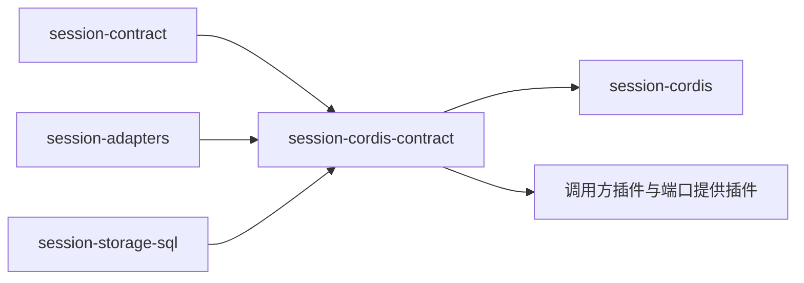

# Session Cordis 定义的使用与定位

本页说明谁依赖本成员、怎样依赖，以及本成员在能力组中的位置。系统关系归[运行契约集成](../../../../docs/architecture/runtime/runtime-contract-integration.md)，组内分解归[组入口](../../README.md)。本页不另立架构，也不写会话的业务消费场景。业务消费场景、换代与控制归 [session-contract 的使用与定位](../../session-contract/docs/context.md)。

## 使用方式

本成员现在没有导出。下面的写法是 SPEC 与 [Cordis 说明](cordis.md)固定的目标用法，随 `./cordis` 的实现生效。

| 依赖方 | 做法 | 细节所在 |
| --- | --- | --- |
| 调用方插件 | 对象形式 `inject: { session: { caller } }`，`caller` 取 `intake`、`coordinator`、`maintainer`、`reader` 之一。不能用 `ctx.get` 现取，因为那样没有 intercept 配置 | [intercept 配置与调用方类](cordis.md#intercept-配置与调用方类) |
| 端口提供插件 | `extends` 对应的端口抽象类，不另写键 | [端口服务键](cordis.md#端口服务键) |
| 只监听唤醒的一方 | 不 `inject`，用 `ctx.on` 监听 `session-cordis-contract/committed`，按载荷里的租户与会话身份自行过滤 | [事件](cordis.md#事件) |
| 服务提供者 | `extends SessionService`，不自己 `ctx.provide` 这个键 | [session-cordis](../../session-cordis/docs/cordis.md) |
| 只需要契约类型的包 | 安装 [session-contract](../../session-contract/README.md)，不需要本成员 | [session-contract 的 Cordis 说明](../../session-contract/docs/cordis.md) |

## 谁不需要安装本成员

只使用领域值或纯接口的消费者、实现治理机制的 [session](../../session/README.md)，以及不使用 Cordis 的独立调用方，都只依赖 session-contract。应用选择具体提供者归应用装配，见 [session-cordis](../../session-cordis/README.md)。

## 在组内的位置

组内成员的依赖方向与落位判据归[组架构](../../docs/architecture.md#成员分解与邻接协作)。
