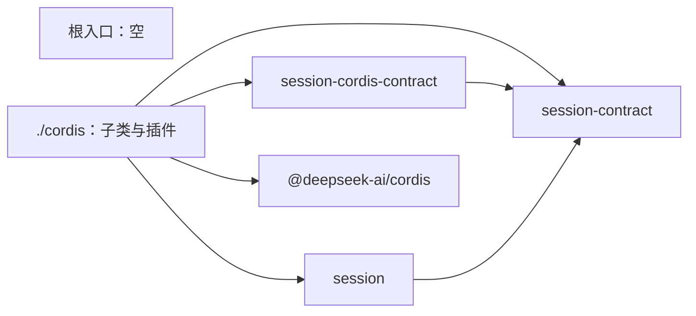

# session-cordis 的内部架构

本页说明本成员怎样组织两个入口与依赖，来兑现 [SPEC](../SPEC.md)。插件、配置、端口现取、通知、扫描者绑定与撤除的正文归 [Cordis 说明](cordis.md)。机制归 [session](../../session/docs/architecture/README.md)。组内六个成员的分解、依赖方向与落位判据归[组架构](../../docs/architecture.md)。本页不另立公共规则。

本成员没有运行实现。`src/index.ts` 与 `src/cordis.ts` 只有模板标记。下文是 SPEC 固定的结构，文件名由实现确定。

## 模块与依赖

| 入口 | 源文件 | 承载 | 现状 |
| --- | --- | --- | --- |
| `@omne-harness/session-cordis` | `src/index.ts` | 不导出任何东西（[IC-4](../../../../docs/architecture/cordis-integration-conventions.md#ic-4) 的空根入口）。独立宿主从 session 取工厂 | 模板标记 |
| `@omne-harness/session-cordis/cordis` | `src/cordis.ts` | `SessionService` 的具体子类（即插件）与配置 Schema | 模板标记 |

`./cordis` 内部按 Cordis 责任分成六块：

| 模块 | 职责 | 依据 |
| --- | --- | --- |
| 配置 | 静态 `Config` 的 Standard Schema：`policy` 的逐字段覆盖与 `disposeWaitMs`；合成完整的 `SchedulingPolicy` | 性质 3 |
| 端口接线 | 用本插件 Context 现取端口：按命令必需的端口包成代理，按调用现取的端口包成 `Current`；缺席与抛出映射为 `unavailable` | 性质 2、[端口接线](../SPEC.md#端口接线) |
| 服务子类 | 持有实例；四个面属性做调用方类的第一层核对后转给 `facesFor` | 性质 1、4、6 |
| 通知 | 组合通知者：派发 `committed`、转发 `sessionNotifier`；`ctx.on` 监听外来通知并交给实例 | 性质 5 |
| 扫描者绑定 | 租户到维护句柄的表；首次见到租户时 `maintain` | 性质 7 |
| 撤除 | 一个 effect 内完成标记、释放句柄、限时 `close` | 性质 9 |

包外依赖都只由 `./cordis` 使用：

- `@omne-harness/session-contract`：四个面、端口接口与失败的类型。
- `@omne-harness/session-cordis-contract`：抽象类、键常量、调用方类与事件增补。
- `@omne-harness/session`：工厂 `createSessionInstance`、`SchedulingPolicy` 与 `defaultSchedulingPolicy`。
- `@deepseek-ai/cordis`：Service、Context 与事件。

`package.json` 已经列出这四项。本成员不依赖 session-adapters、session-storage-sql、任何邻域契约或存储后端（性质 11）。端口的实现由装配接上：session-adapters 与存储成员提供端口，本成员按键现取，双方没有编译期依赖。没有包应依赖本成员的 `./cordis` 来调用四个面，调用方依赖服务定义，提供者选择归应用装配（[IC-5](../../../../docs/architecture/cordis-integration-conventions.md#ic-5)）。

## 关键机制与理由

### 只 inject 事务端口

`inject` 的含义是「它换代或不在，本插件就卸载重跑」（[plugin-body-reruns-on-provider-change](../../../../.meta_harness/design/basis/cordis/plugin-body-reruns-on-provider-change.md)）。事务端口缺席时任何读写都不成立，重跑是正确的反应。其余端口缺席时只有需要它的操作失败。把它们写进 `inject`，会让一个身份桥或时钟的换代停下全部会话的读取、控制与恢复。

代价：每次调用多一次服务表查找。理由是查找是常数开销，而全服务重跑会丢掉调度计时与缓存，并让所有调用方插件一起重跑。

### 端口用本插件的 Context 现取

服务方法里的 `this.ctx` 是调用方的 Context（[service-method-ctx-is-caller](../../../../.meta_harness/design/basis/cordis/service-method-ctx-is-caller.md)）。协调器与调度器的调用又没有调用方。所以端口接线在装载时捕获本插件的 Context，所有现取都经它进行。这样同一个实例在任何调用路径上看到同一个端口视图，也不会因调用方在别的 isolate 而取到另一份端口。

### 缺席与抛出映射为不可用，不补默认

session 的工厂要求身份、证据、时钟、空闲与 Context 输入是完整接口，并要求宿主在底层能力缺席时让方法返回 `unavailable`（[参数与依赖](../../session/docs/public-api.md#依赖)）。代理正好承担这件事。代理不补默认值：用系统时间代替时钟采样，或用空材料代替证据，会把依赖丢失变成看似成功的提交。

### 本成员派发提交通知

定义成员规定事件由派发方在提交之后派发，存储成员也不派发它。工厂的唯一出口是 `notifier`，所以本成员把派发放进交给工厂的组合通知者。应用装配另外提供的 `sessionNotifier` 只作转发，例如跨进程转发。这样在 Cordis 装配下事件总在场，而外部通知者仍然可选，缺席或失败都不影响提交。

### 扫描者在首次见到租户时绑定

第一版靠装配单实例兑现每租户一个扫描者。租户是操作参数，不能从 Context、isolate 或配置推断（[IC-18](../../../../docs/architecture/cordis-integration-conventions.md#ic-18)），本成员又不导入租户领域的契约。提交通知是本成员唯一能看到租户的地方，所以扫描者在首次见到租户的通知时绑定。代价是重启后的启动扫描只覆盖有新提交的租户。这个代价写在 [SPEC 的明确缺项](../SPEC.md#明确缺项)里，不隐去。

### 撤除放在一个 effect 里，并限时等待

撤除有严格次序：先拒绝新调用，再停扫描者，最后停实例。不同 effect 的撤除函数并发运行（[effect-disposal-concurrent-not-ordered](../../../../.meta_harness/design/basis/cordis/effect-disposal-concurrent-not-ordered.md)），所以几步写在一个 effect 里按顺序 `await`。等待 `close` 设上限，因为事务端口可能正在离开，在途命令可能长时间不返回。超时只结束本插件的等待，不改变在途命令的结局，也不声称实例已经停止。

## SOLID 与扩展边界

| 原则 | 本成员的具体选择 | 必须防止的反例 |
| --- | --- | --- |
| 单一职责 | 本成员只承担 Cordis 接线：配置校验、端口现取、调用方类的第一层核对、通知派发与订阅、扫描者绑定、撤除。允许与拒绝、流水线、协调器与调度器都在 session | 在子类或代理里判断一条命令可否提交、重算重试次数或自己调度扫描 |
| 开闭 | 定义成员新增端口键时，在端口接线里加一行，按它的缺席表现选择代理、`Current` 或 `inject`。新增可调参数加到配置 Schema，不改机制 | 为某个邻域或某个端口加特例分支，或在本成员导入邻域契约来接线 |
| 里氏替换 | 子类遵守抽象类的全部承诺：键只来自抽象类，四个面的结局集合与 session 的工厂一致，事件只做唤醒。经 Cordis 与不经 Cordis 时，同一命令的结局集合相同，只多出调用方类缺失时的 `denied` 与撤除后的 `unavailable` | 端口缺席时返回成功或空结果；把事件当作事实源；撤除时把在途命令报告为失败 |
| 接口隔离 | 调用方只看到服务定义的四个面，按调用方类分别取得。端口提供者只看到自己的端口键 | 让调用方导入 `./cordis` 的子类，或让一个调用方类拿到全部操作 |
| 依赖倒置 | 本成员依赖端口接口、服务定义与工厂。端口实现由装配按键接上，租户与会话随参数进入 | 直接构造存储或适配插件的实现；从 `ctx`、isolate 标签或插件配置推断租户 |

## 验证与维护

| 保证 | 现在的验证 | 后续义务 |
| --- | --- | --- |
| 根入口为空 | [public-entry.spec.ts](../tests/public-entry.spec.ts) 断言根入口没有导出 | 实现进入后仍断言根入口没有导出 |
| `./cordis` 只有本成员的子类与配置 | [cordis-entry.spec.ts](../tests/cordis-entry.spec.ts) 断言草稿入口没有导出 | 实现进入后核对导出集合 |
| SPEC 的九项验证义务 | 没有 | 见 [Cordis 说明的验证义务](cordis.md#验证义务) |

维护规则：

1. 服务定义改变时，同步子类、端口接线、[Cordis 说明](cordis.md)与测试。
2. session 的工厂签名、依赖分类或 `SchedulingPolicy` 改变时，同步配置 Schema、端口接线与[公开接口页](public-api.md)。
3. 定义成员补上内部主体、受理槽或变化通知的键时，同步 SPEC 的明确缺项、`inject`、[Cordis 说明](cordis.md)与本页。
4. Cordis 升版时，先重跑服务定义成员与 [Cordis 说明的机制读数与假设](cordis.md#机制读数与假设)列出的 basis probe。
