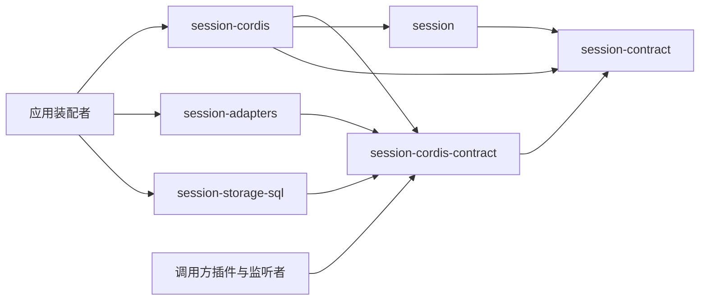

# session-cordis 的使用与定位

本页说明谁使用本成员、怎样使用，以及本成员在会话组中的位置。系统关系归[会话与工作](../../../../docs/architecture/runtime/session-and-run.md)，组内分解与 Cordis 落位归[组架构](../../docs/architecture.md#cordis-落位)。本页不另立架构。

## 使用方式

本成员现在没有导出。下面是 SPEC 固定的用法，随实现生效。

### 装配

应用装配者在插件树里加一行本插件，并给出配置。插件树的格式与两层叠加归 [IC-15](../../../../docs/architecture/cordis-integration-conventions.md#ic-15) 与 [IC-16](../../../../docs/architecture/cordis-integration-conventions.md#ic-16)，候选行 id 见[配置与插件树](../../../../docs/architecture/runtime/runtime-contract-integration.md#配置与插件树)：

```text
行 id：session-provider
插件：@omne-harness/session-cordis 的 ./cordis 导出
配置：{ policy: { 需要覆盖的 SchedulingPolicy 字段 }, disposeWaitMs, admission?: 'none' }
```

`policy` 里省略的字段取 session 的初值。在全部进程里只加一行。这一行同时兑现每租户一个扫描者，所以不在两个 isolate 标签下各加一行（[扫描者绑定](cordis.md#扫描者绑定)）。配置错误时装载失败，装配者据此停下装配。

同一个装配还要装：

1. 委派事务入口的提供者，即应用的会话存储组合（基于 [session-storage-sql](../../session-storage-sql/README.md)）。没有它，本插件停在 `PENDING`。公开事务端口由同一组合提供，缺席时只有目录读取返回 `unavailable`。
2. [session-adapters](../../session-adapters/README.md) 的端口提供者与入站插件。缺哪个端口，只有需要它的操作返回 `unavailable`。
3. 装配入口经服务键 `sessionPrincipals` 提供的内部主体与经受信键 `sessionWorkPrincipals` 提供的会话工作主体，由维护拥有者签发（[端口服务键](../../session-cordis-contract/docs/cordis.md#端口服务键)、[受信服务键](../../session-cordis-contract/docs/cordis.md#受信服务键)）。缺任一项，本插件停在 `PENDING`。
4. 装配生命周期 `assemblyLifecycle`。没有它，本插件停在 `PENDING`。它没有正式定义，本插件读装配入口的私有键 `s0.assemblyLifecycle`，登记行 `session-provider`、阶段 `business`（[SPEC 的实现现状](../SPEC.md#实现现状)）。

装载后，其他插件经服务定义使用服务：调用方插件用对象形式 `inject: { session: { caller } }` 声明调用方类，只监听唤醒的一方用 `ctx.on`。这些用法归 [session-cordis-contract 的使用与定位](../../session-cordis-contract/docs/context.md)。

### 独立使用

本成员的根入口不导出任何东西。不装配 Cordis 的宿主直接用 session 的工厂，自己传入端口、按调用方类分发、接通唤醒并按顺序停止，做法见 session 的[独立装配](../../session/docs/context.md#独立装配)。两种装配下实例的行为相同，区别只在接线的拥有者（[框架装配](../../session/docs/context.md#框架装配)）。

### 初始化与释放

装配者装载插件即初始化，卸载插件即释放。卸载按 [Cordis 说明的撤除顺序](cordis.md#撤除顺序)进行。本成员不读取资源，不直接访问存储，只经事务端口工作。

## 消费者与定位

本成员处在会话组依赖的最上层，只被应用装配者使用。下图投影[组架构](../../docs/architecture.md#安装与源码依赖)里与本成员相关的边，两者不一致时以组架构为准。



| 使用方 | 怎样使用 | 用什么 |
| --- | --- | --- |
| 应用装配者 | 在插件树里加一行本插件，并装上事务端口与其他端口的提供者 | `./cordis` 的插件与配置 |
| 调用方插件 | 不使用本成员。按键 `session` 与调用方类取用四个面 | 服务定义 |
| 端口提供者 | 不使用本成员。按端口键提供实现，本插件按键现取 | 服务定义 |
| 不装配 Cordis 的宿主 | 不使用本成员，从 session 取工厂 | 无 |

调用方、端口提供者与监听者都不依赖本成员（[IC-5](../../../../docs/architecture/cordis-integration-conventions.md#ic-5)）。session-adapters 与本成员之间没有编译期依赖，端口靠服务键在装配时接上。

### 现在的真实消费者

现在没有应用装配本插件，也没有包依赖本成员。本成员的 `package.json` 依赖 session、session-contract、session-cordis-contract、legal-identity 与 operation-result。插件只在本成员的测试里装载运行，测试的装配写法在 [assembly.ts](../tests/fixtures/assembly.ts)。

### 上层页面

- 系统关系：[会话与工作](../../../../docs/architecture/runtime/session-and-run.md)。
- 四个运行成员的共同生命周期、事件与插件树：[运行契约集成](../../../../docs/architecture/runtime/runtime-contract-integration.md)。
- 组内成员与装配者的阅读路径：[组入口](../../README.md)、[组协作入口](../../docs/key-flows.md)。
- 共同集成规则：[IC 约定](../../../../docs/architecture/cordis-integration-conventions.md)。
