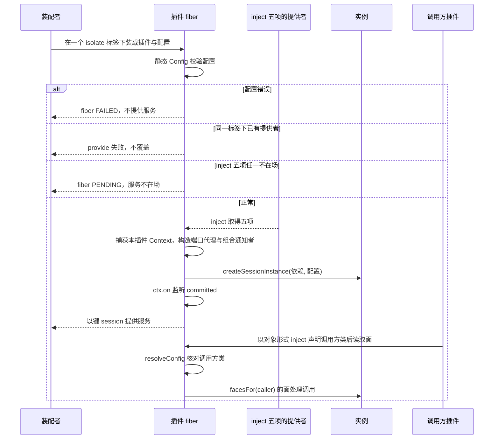
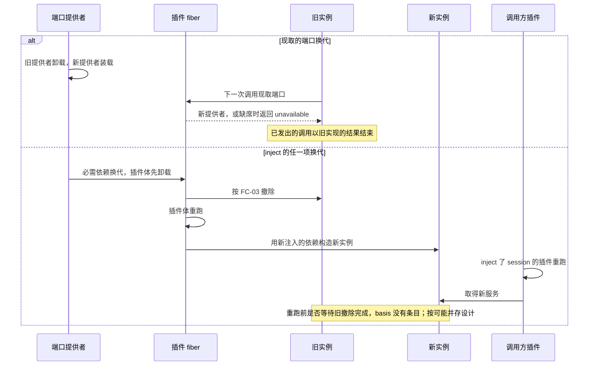
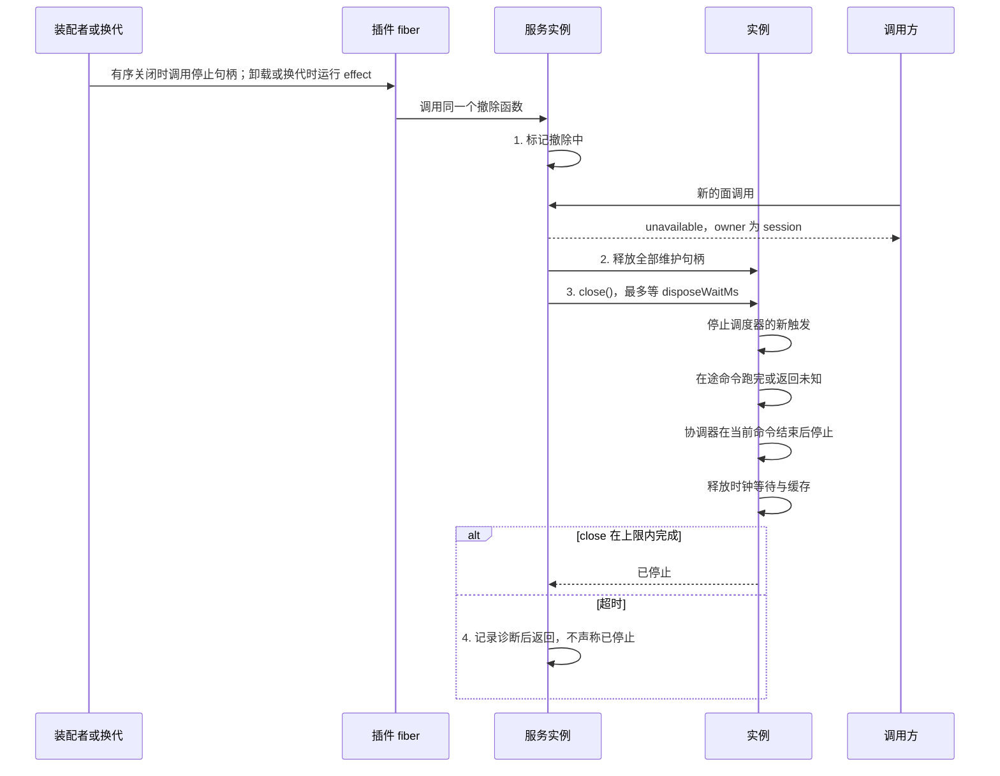
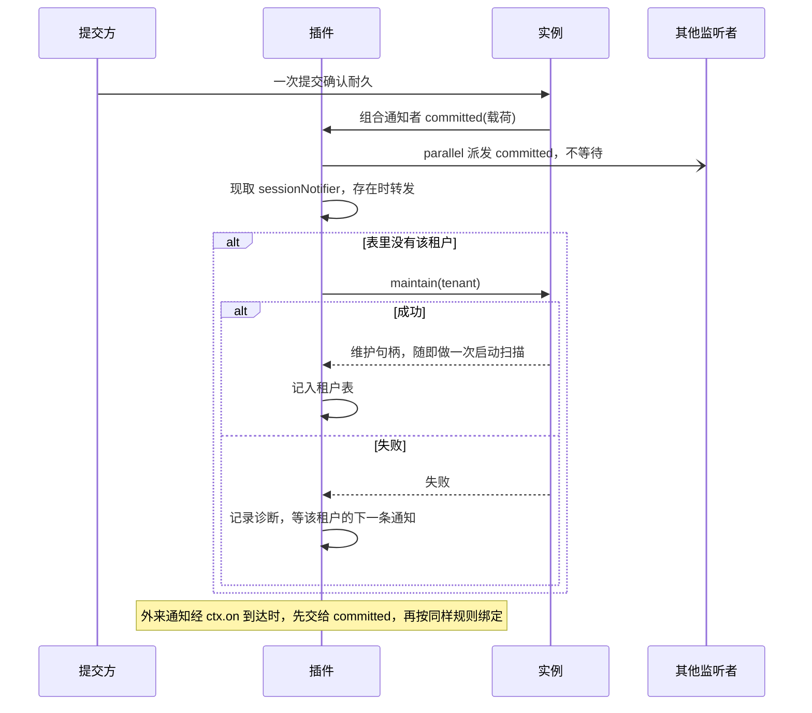

# session-cordis 的生命周期流程

本页给出本成员的四条生命周期流程：装载与启动、端口换代、撤除、扫描者接管。每条有一张时序图和一张「失败与责任交接」表。行为以 [SPEC](../SPEC.md) 和 [Cordis 说明](cordis.md)为准，图只投影它们，不表示运行实现已经存在。

命令处理、协调器与调度器的机制流程归 [session 的流程](../../session/docs/flows.md)，适配插件的流程归 [session-adapters 的流程](../../session-adapters/docs/flows.md)，跨成员的协作顺序归[组的协作入口](../../docs/key-flows.md)。图中的「插件」是本成员的具体子类所在的插件 fiber，「实例」是它拥有的 `SessionInstance`。

本页未交付的生产提供者、真实重启与装配场景均为「未执行：提供者或装配尚未交付」。规格映射或非耐久替身不证明这些场景已通过。

## 流程

### FC-01 装载与启动

依据：[性质 1 至 5、7](../SPEC.md#提供者责任)、[IC-6](../../../../docs/architecture/cordis-integration-conventions.md#ic-6)、[IC-14](../../../../docs/architecture/cordis-integration-conventions.md#ic-14)。

| 环节 | 结果 | 失败与责任交接 |
| --- | --- | --- |
| 配置校验 | 配置合法才继续 | 配置错误时 fiber `FAILED`，装配者修正配置 |
| 登记服务 | 一个标签下一份 | 重复装载失败。装配者不在两个标签下各装一份，因为那样每租户会有两个扫描者 |
| 等 inject 的五项 | 五项都在场才运行插件体 | 任一不在场时 `PENDING`，与 `FAILED` 分别诊断。`inject` 了 `session` 的调用方插件也等待 |
| 构造实例 | 工厂得到完整依赖 | inject 的五项均已注入。工厂的配置校验失败时插件加载失败 |
| 共享事务域不成立 | 面上的读写与 `maintain` 返回 `unavailable` | 本插件原样报告，`owner` 为存储参加者。存储与 Agent 的拥有者修正装配 |
| 调用方类核对 | 取到合法调用方类才转给实例 | 取不到配置或调用方类不合法时返回 `denied`。调用方插件改用对象形式 `inject` |

### FC-02 端口换代

依据：[性质 2、10](../SPEC.md#提供者责任)、[IC-8](../../../../docs/architecture/cordis-integration-conventions.md#ic-8)、[IC-9](../../../../docs/architecture/cordis-integration-conventions.md#ic-9)。

| 环节 | 结果 | 失败与责任交接 |
| --- | --- | --- |
| 现取端口换代 | 插件体不重跑。下一次调用取到新提供者 | 端口缺席期间，只有需要它的操作返回 `unavailable`；出站端口缺席时任务保留，由调度器重放 |
| 换代途中的端口调用 | 不改投新提供者，以旧实现的结果结束 | 结果未知时，session 的协调器按原操作身份查询 |
| inject 的任一项换代 | 旧实例撤除，新实例重新构造 | 旧实例的在途命令按 FC-03 收场 |
| 新旧实例并存 | 同一命令按操作身份认回，不产生第二次效果 | 第二道保护是操作幂等、`expected` 核对与条件提交围栏，不是先后顺序 |
| 调用方插件重跑 | 在途操作按原操作身份认回，不因重跑换身份 | 调用方以同一身份重试或 `queryOperation` |

### FC-03 撤除

依据：[性质 9](../SPEC.md#提供者责任)、[资源与替换](../../session/SPEC.md#资源与替换)、[effect-disposal-concurrent-not-ordered](../../../../.meta_harness/design/basis/cordis/effect-disposal-concurrent-not-ordered.md)。

| 环节 | 结果 | 失败与责任交接 |
| --- | --- | --- |
| 四步顺序 | 写在同一个函数里按顺序 `await`；停止句柄与 effect 两条路径调用它，后到的一次只等先到的一次结束，不重复执行；后到的是 effect 时仍退登记两个句柄 | 某一步抛出时本插件捕获、记录诊断，并继续后续步骤 |
| 撤除开始后的面调用 | `unavailable`，`owner` 为 `session` | 调用方插件随本插件卸载或重跑后，在新的提供者上重试 |
| 撤除期间确认的提交 | 调用方得到回执，不发通知 | 下一个实例的扫描按待办找回后续工作 |
| 未确认的提交 | `commit-unknown` 或 `unavailable` | 调用方以同一操作身份重试或 `queryOperation` |
| 已提交、出站调用未发出 | 不补发 | 重启或换代后的 S3 找回并以同一身份重放 |
| 超时 | 本插件返回，仍在途的命令以自己的结果结束 | 物理等待的上界归部署 |
| 外部效果 | 不回滚，不取消 Model、Tool、Agent 执行或子会话 | 外部效果的拥有者 |

### FC-04 扫描者接管

依据：[性质 5、7](../SPEC.md#提供者责任)、[S3](../../session/SPEC.md#s3)、[IC-19](../../../../docs/architecture/cordis-integration-conventions.md#ic-19)。

| 环节 | 结果 | 失败与责任交接 |
| --- | --- | --- |
| 派发 | 每次提交一次，载荷不含正文 | 监听者失败或 `AggregateError` 只记录诊断，回执不变 |
| 转发 | `sessionNotifier` 存在时转发同一载荷 | 缺席或失败只记录诊断 |
| 首次见到租户 | 调用 `maintain`，启动扫描 | 失败时不进表，下一条通知再试，不立即重试 |
| 再次见到租户 | 不再调用 | 无 |
| 外来通知 | 交给 `committed`，按同样规则绑定 | 本插件自己派发的通知可以跳过，重复交入也无害 |
| 换代或重启后 | 租户表是空的，从新的通知重新建立 | 有待办而没有新提交的租户，在下一条通知之前不被启动扫描覆盖（[SPEC 的明确缺项](../SPEC.md#明确缺项)） |
| 两份插件装在不同 isolate 标签 | 一个租户两个扫描者，违反性质 7 | 装配拥有者不得这样装。第二道保护是操作幂等与条件提交围栏 |

## 失败与生命周期

| 情形 | 结果 | 责任方 | 依据 |
| --- | --- | --- | --- |
| 配置错误 | fiber `FAILED` | 装配者 | [IC-14](../../../../docs/architecture/cordis-integration-conventions.md#ic-14) |
| inject 的五项任一缺席 | fiber `PENDING` | 装配者装载会话存储组合，或提供内部主体、会话工作主体与装配生命周期 | 性质 2、性质 8 |
| 重复装载 | 第二份失败 | 装配者 | [IC-6](../../../../docs/architecture/cordis-integration-conventions.md#ic-6) |
| 现取端口缺席或抛出 | 只有需要它的操作返回 `unavailable` | 端口的提供者 | [SPEC 的端口接线](../SPEC.md#端口接线) |
| 调用方类缺失或不合法 | `denied` | 调用方插件 | 性质 6 |
| 插件卸载 | 按 FC-03 撤除 | 本插件 | 性质 9 |
| 本插件卸载后 | `inject` 了 `session` 的插件卸载或重跑 | 各依赖方 | [plugin-body-reruns-on-provider-change](../../../../.meta_harness/design/basis/cordis/plugin-body-reruns-on-provider-change.md) |
| 进程失败 | 本成员没有可恢复的东西。重启后扫描者随通知重新绑定 | 存储保存事实与待办 | [S3](../../session/SPEC.md#s3) |
| 运行 disposer | 不撤回已提交的事实或外部效果 | 外部效果的拥有者 | 性质 9 |
