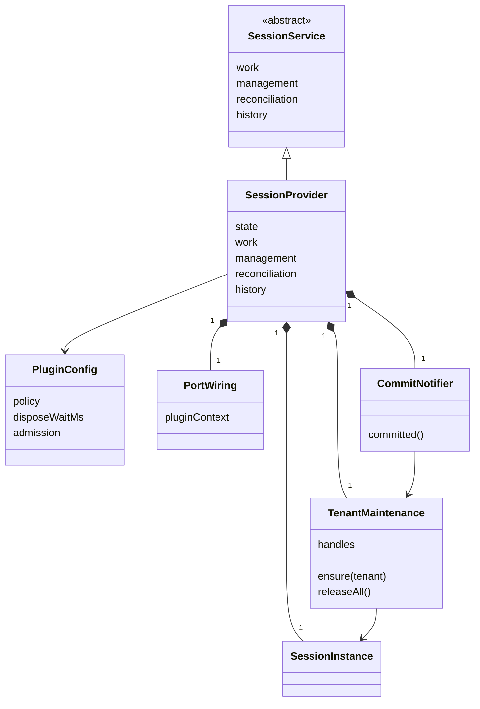

# session-cordis 的对象模型

本成员没有自己的领域对象。会话、Run、执行尝试、命令、条目与回执归 [session-contract 的对象模型](../../session-contract/docs/object-model/README.md)。实例、协调器、调度器、租户扫描者与缓存归 [session 的对象模型](../../session/docs/object-model.md)。本成员只有几个技术对象：服务实例、插件配置、端口接线、组合通知者与租户维护表。它们不自动成为产品领域对象。

本成员没有运行实现。类名与字段名随实现确定。

## 对象与关系

| 对象 | 身份 | 拥有者 | 可变性 | 关联 |
| --- | --- | --- | --- | --- |
| 服务实例 | 一个 isolate 标签下的服务键 `session` | 本插件的 fiber | 实例状态：开放、撤除中 | `extends` 定义成员的 `SessionService`。拥有一个 `SessionInstance`、一份端口接线、一个组合通知者与一张租户维护表 |
| 插件配置 | 一次装载 | 装配者给出，静态 `Config` 校验 | 装载后不变。改配置即重新装载 | `policy` 合成后传给工厂；`disposeWaitMs` 留在服务实例，用于撤除；`admission` 决定受理槽缺席时 `admission.current()` 的结果 |
| 端口接线 | 随服务实例 | 服务实例 | 不变。它不持有端口，只持有本插件 Context | 为按命令必需的端口提供代理，为按调用现取的端口提供 `Current`，交给工厂 |
| 组合通知者 | 随服务实例 | 服务实例 | 不变 | 作为工厂的 `notifier`。派发 `committed`，转发 `sessionNotifier`，并把租户交给租户维护表 |
| 租户维护表 | 随服务实例 | 服务实例 | 首次见到租户时增加一项；撤除时清空 | 每项是租户到 `maintain` 返回的维护句柄。是可丢的派生物 |

图中的类名是说明用的名字。`SessionService` 归 [session-cordis-contract](../../session-cordis-contract/docs/object-model.md)，`SessionInstance` 归 [session](../../session/docs/public-api.md#工厂与实例)。

## 生命周期

| 对象 | 创建 | 变化 | 结束 |
| --- | --- | --- | --- |
| 插件配置 | 装配者装载插件 | 不变 | 插件卸载 |
| 服务实例 | 配置校验通过、inject 的五项都在场后构造子类，以键登记 | 开放 → 撤除中 | 撤除的四步完成，键上不再有服务 |
| 端口接线与组合通知者 | 服务实例构造时，捕获本插件 Context 后建立 | 不变 | 随服务实例 |
| `SessionInstance` | 服务实例调用工厂 | 见 session | 撤除第 3 步的 `close` |
| 租户维护表 | 服务实例构造时为空 | 首次见到租户时增加一项 | 撤除第 2 步释放全部句柄 |

本成员的接线还约束三类运行期事物，它们的实例都不归本成员：

| 事物 | 拥有者 | 结束 |
| --- | --- | --- |
| 端口的实现 | 提供该端口的插件 | 该插件卸载 |
| 调用方类声明 | 调用方插件的 intercept 配置 | 随调用方 fiber |
| 提交通知的其他监听 | 监听者的 fiber | 监听者卸载 |

进程失败时这些对象都丢失。本成员没有可恢复的东西。租户维护表在重启后从新的通知重新建立（[SPEC 的所有权与生命周期](../SPEC.md#所有权与生命周期)）。
