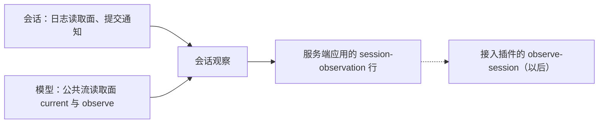

# 使用与定位

本文件说明消费侧怎样使用本包、具名上层消费者、典型调用关系，以及本包在系统与能力组中的位置。它引用系统架构与真实消费者，不成为新的架构源。

## 使用方式

最小用法见包根 [README_ZH.md](../README_ZH.md) 的「使用」。要点：

- 独立使用：`createSessionObservation(ports)` 返回领域面，调用方给出端口。端口的实现是会话日志读取面、模型的公共流读取面，加通知与计时的实现。
- 树上使用：装载 `createSessionObservationPlugin`，从 `ctx.sessionObservation` 取服务，调 `open`。
- 释放：观察者中止 `signal`，或对帧序列调 `return`。观察者持有观察的全部生命周期；本包只收掉自己的订阅与计时，不取消模型调用。
- 调用方必须传观察者自己的主体。读日志、读流都用它，本包不拿自己的身份替他读。

## 消费者与定位

消费者：

- 服务端应用的 `session-observation` 行，发布服务 `sessionObservation`，并用 `LOCAL_HISTORY_KINDS` 填 `historyKinds`。
- 服务端应用的演示脚本与正式装配上的用例，在树上取服务直接调 `open`。
- 接入组的插件以后把它接成 `observe-session` 的帧来源；那一步尚未做，也不在本包。

定位：本包是会话组里认识会话与模型两份契约的集成成员。会话与模型互不认识，只有集成成员同时认识两边。

系统级位置见[系统分层](../../../../docs/architecture/layers-and-dependencies.md)。
