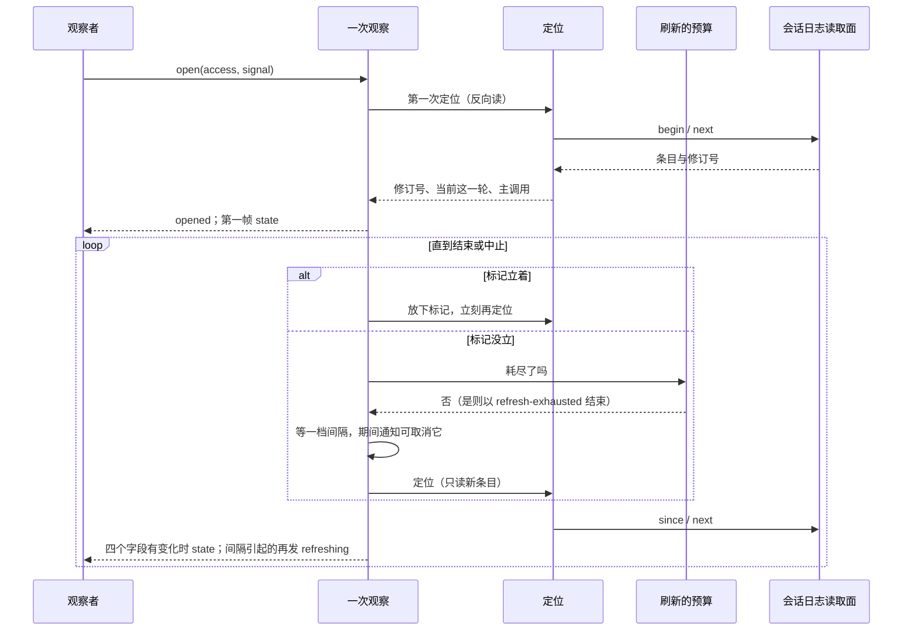

# 关键流程

本文件用可维护的文本图源描述本包的关键业务流程与数据流：参与者、调用时序、数据来源与去向、状态变化、失败分支与生命周期。行为的唯一正文是 [SPEC.md](../SPEC.md)，这里不复制规则。

## 流程

参与者：观察者（调用方）、一次观察、定位、刷新的预算、会话日志读取面、提交通知。

一次观察的主循环。流这一侧在后面的段落里单列：

间隔与通知的区别：

- 间隔到期引起的定位发 `refreshing`、计一次尝试、进下一档。
- 通知引起的定位不发 `refreshing`、不计尝试、按现在这一档重新等。

流这一侧：

- 定位给出新的主调用，或现在没有目标时，观察以观察者的主体向模型取当前的流。给了流就订阅，发 `state` 与后续的 `snapshot`、`delta`。
- 观察中，流事件进入收件箱，主循环按次序处理。目标的流结束：转发 `gap`（如有），发 `state`（`target` 为 `null`）与 `refreshing`，回到没有目标，开始等间隔。订阅中断但目标还在：转发 `gap`（如有），发 `refreshing`，间隔到期后重新订阅同一个目标，不重新定位。
- 模型撤资格：结束，原因 `denied`。观察者自己中止之后订阅不再交帧；现在这一份交来的 `observer-closed` 只能是生产者关的，按目标的流结束了处理。

具体每格见 SPEC 的结果表与流轴表。

提交通知的数据流：会话日志写完一批条目，发 Cordis 事件 `session-cordis-contract/committed`；`./cordis` 里唯一的监听者按租户和会话过滤，交给各次观察；观察按种类集合判断，有交集就立标记并取消等待。通知不带内容，内容总是从日志读。

## 失败与生命周期

- 建立时读被拒、会话不存在、标识不合法：`open` 答 `denied`，没有订阅留下。日志暂时不可得：答 `unavailable`。
- 之后读被拒：结束，原因 `denied`。自己的游标不合法：丢掉游标，下一次从头反向读。别的不合法：结束，原因 `unavailable`。暂时不可得：当作没有新内容。
- 预算用完：结束，原因 `refresh-exhausted`。
- 取流时模型拒绝：结束，原因 `denied`；答引用无效（调用已登记、尚未受理除外）：结束，原因 `unavailable`；取流超过 `currentTimeout`：当作没有新内容。
- 值投影失败：结束，原因 `unavailable`。
- 中止：收掉流的订阅、通知订阅与全部等待，不再读，帧序列返回 `undefined`。定位中途中止，那次的结果丢掉。
- 本包不写日志，不取消模型调用，所以没有需要回滚的外部副作用。
