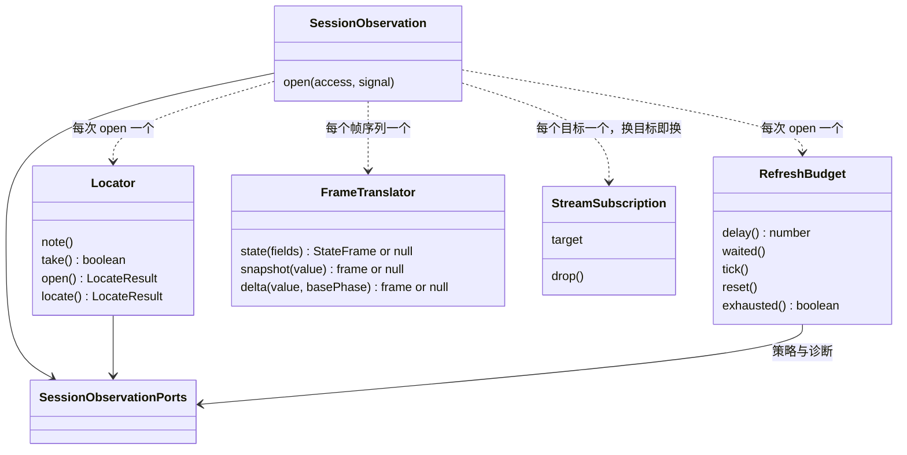

# 对象模型

本文件描述本包内部对象的职责、身份、状态、关联、组合、继承与生命周期，配类图。行为条款归 [SPEC.md](../SPEC.md)。

## 对象与关系

`createSessionObservation` 是工厂函数，返回领域面 `SessionObservation`；一次观察不是 class，是 `open` 里的闭包加一个生成器。定位、刷新的预算、帧的翻译是 class。没有继承。

| 对象 | 身份 | 状态 | 关联 |
| --- | --- | --- | --- |
| 一次观察 | 一次 `open` 调用 | 帧的生成器、等待的取消器、退订函数 | 拥有前三个对象各一个，并按目标持有零或一份流的订阅 |
| `Locator` | 一次观察内唯一 | 读到哪了、当前这一轮、主调用、视图、标记 | 读端口里的日志读取面 |
| `RefreshBudget` | 一次观察内唯一 | 当前一档间隔、次数、累计等待 | 读端口里的策略 |
| `FrameTranslator` | 一个帧序列内唯一 | 上一次发出的状态字段 | 调用模型契约的投影函数 |
| `StreamSubscription` | 一个目标一份，换目标即新建 | 目标（调用引用与流引用）、自己的中止信号 | 调用端口里的模型观察面，把每一帧连同自己交给观察 |

每个对象独占的内容与单独成对象的理由见 SPEC 的「五个对象」。

## 生命周期

- 一次观察在 `open` 里创建，订阅通知后做第一次定位。第一次定位失败或已被中止，立刻收场，不返回帧序列。
- 流的订阅在定位给出新目标时创建，在换目标、目标的流结束、订阅中断或观察收场时 `drop`；等着重新观察时，用同一个目标新建一份。
- 定位、预算与帧的翻译随一次观察存在，不共享：一个会话有几次观察，就有几套。
- 一次观察在三种情况下销毁：帧序列走完、观察者对生成器调 `return`、`signal` 中止。三种都收掉通知订阅和等待，收场只发生一次。
- 观察者既不读帧也不中止，订阅会留到 `signal` 中止为止。调用方负责最终中止。
