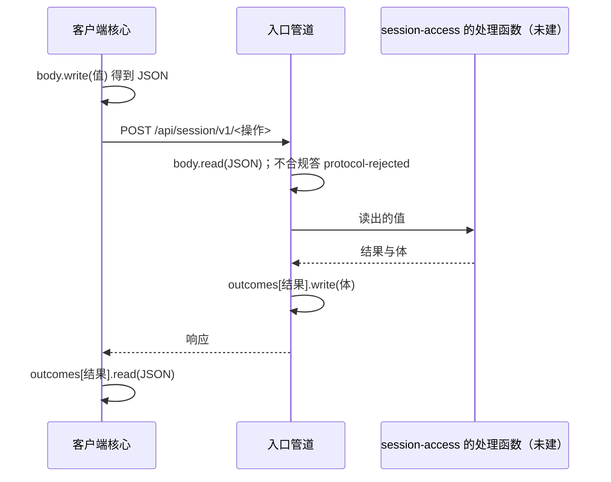

# 关键流程

本文件用可维护的文本图源描述本包的关键业务流程与数据流：参与者、调用时序、数据来源与去向、状态变化、失败分支与生命周期。图旁写前提与边界，不编造流程。

## 流程

本包没有自己的流程：它是两端共用的一个值。消息怎样流经它：

观察相同：客户端写建立点，入口读它交给帧来源，逐帧用 `frame.write` 写出，客户端用 `frame.read` 读回。

## 失败与生命周期

读写的失败由规则引擎给出 `ok: false`，不抛出，也不给部分值。哪个情形答哪个结果归处理函数。本包没有生命周期，没有要释放的资源。
