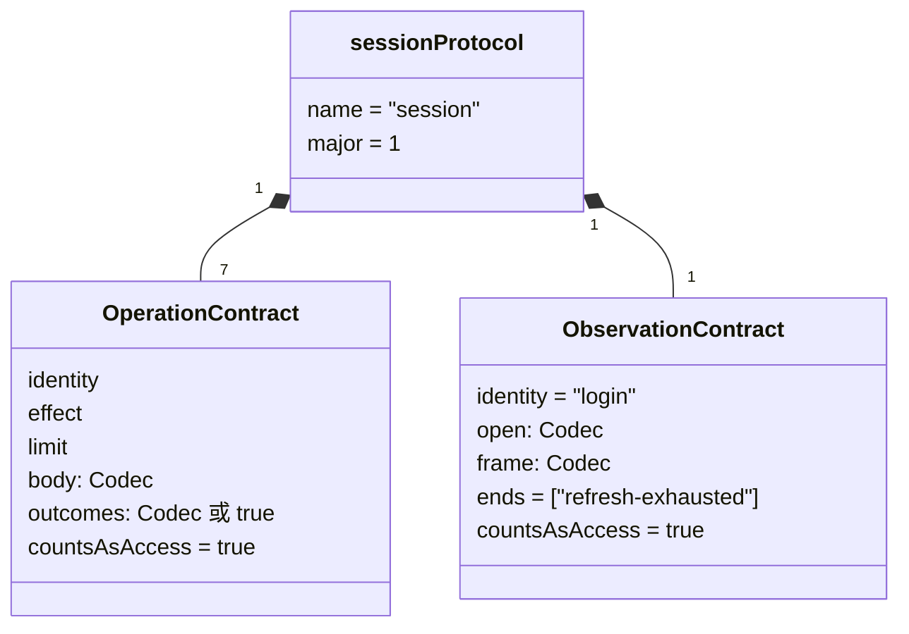

# 对象模型

本文件描述本包内部对象的职责、身份、状态、关联、组合、继承与生命周期，配类图。它不强迫实现改成 class；纯函数或值包写实际模型与不适用项。

## 对象与关系

本包是值包，只有一个对象：`sessionProtocol`，一个 `DefinedProtocol`。它由名字 `session`、主版本 1、一组操作契约和一个观察契约组成；每个操作契约有身份要求、效果、体上限、消息体的读写器和每个结果的读写器或 `true`。

没有身份与状态：值在模块加载时建好，之后不变。

## 生命周期

不适用。值随模块加载创建，不变化，没有销毁责任。
