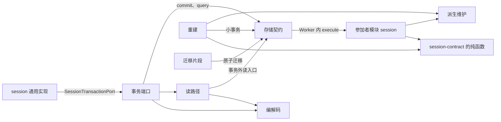

# 内部架构

本文件说明本包怎样兑现 [SPEC.md](../SPEC.md)：包内模块划分、依赖方向、状态与资源归属、关键机制及设计理由。它引用组级与系统级约束，不另立公共规则。组内落位归[组架构](../../docs/architecture.md)，表与索引的形状归[对象模型](object-model.md)，时序归[关键流程](flows.md)。

本成员已有实现，覆盖范围见 [SPEC 的实现现状](../SPEC.md#实现现状)。下文的七个模块是设计目标：事务端口、参加者模块、读路径、编解码、游标与迁移片段已进入 `src/`；重建尚未实现，派生维护现在在参加者模块内。文件名见[对象模型](object-model.md#进程内对象)。

## 模块与依赖

本成员是 Session 组里唯一接触介质的成员。它把 `session-contract` 声明的 `SessionTransactionPort
` 翻译成存储契约的一次提交与一组事务外 SQL 读取。根入口分成下列模块。进程内对象的身份与状态见[对象模型的进程内对象](object-model.md#进程内对象)。

| 模块 | 运行位置 | 持有的状态与资源 | 承担的 SPEC 行为 |
| --- | --- | --- | --- |
| 事务端口 | 调用方进程 | 每个事务域一个实例。只有预编译语句缓存与游标签名密钥的引用 | `commit` 的身份构造与结果映射（[W1](../SPEC.md#w1) 第 1、2、8、9 步）；把读操作交给读路径 |
| 参加者模块 `session` | 存储提供者的 Worker，存储事务之内 | 无状态。每次执行只用交入的语句端口 | 材料核对、原操作认回、条件核对、调用领域判断、写条目（[W1](../SPEC.md#w1) 第 3 至 7 步、[W2](../SPEC.md#w2)、[W5](../SPEC.md#w5)、[W6](../SPEC.md#w6)） |
| 派生维护 | 与参加者模块同一事务；也由重建调用 | 无状态 | 按条目与新旧快照生成派生行（[W3](../SPEC.md#w3)），压缩时写新 epoch（[W4](../SPEC.md#w4)） |
| 读路径 | 调用方进程，经存储的事务外读入口 | 每个事务域一个实例。只缓存 [RT-04](../SPEC.md#rt-04) 允许的派生物 | 读路径 R1 至 R3、R5、R7、R8、R10、R11，R6 在历史 handler 内；R4 未实现 |
| 重建 | 调用方进程，按批小事务写回 | `sl_rebuild` 进度行在库里，进程内不持有 | 快照追赶与派生索引重建（[R9](../SPEC.md#r9)） |
| 编解码 | 纯函数 | 无 | 64 位位置与品牌字符串互转（[TB-03](../SPEC.md#tb-03)）；游标签名与校验（[C-03](../SPEC.md#c-03)） |
| 迁移片段 | 随提供者的原子迁移执行 | 按版本排序的只读列表 | 权威表与派生表的 DDL 与数据迁移 |

依赖方向：

1. 本成员实现 `session-contract` 的 `SessionTransactionPort
`，并导入它导出的纯函数：OP-00 的身份派生、`decide`、`reduce` 与 `openWork`。本成员不直接依赖 message 包的判定函数：压缩判定在 `decide` 里调用 `judgeCompaction`。本成员只用 message 包的类型解码消息与压缩记录，符合性重算的视图按 [CM-01 至 CM-06](../../../common/message/SPEC.md#模型视图) 推导（[编码与归约的拥有者](../SPEC.md#编码与归约的拥有者)）。
2. 本成员依赖 sql-contract 的公开形状（根入口与 `./worker`）：`SqlStorage` 的 `commit`、`query`、`read`，参加者与读 handler 的模块接口，材料描述类型。写连接、事务、Worker 与写者代际都归存储提供者，本成员不打开连接，也不依赖 `packages/storage/**` 内部或 sqlite-provider（[public-entry.spec.ts](../tests/public-entry.spec.ts) 检查）。
3. SQL 现在是手写的 SQLite 语句，经语句端口执行，只有一套方言。设计目标是 SQLite 与 PostgreSQL 共用表名与列名（[介质差异表](../SPEC.md#sqlite-与-postgresql)），PostgreSQL 与 Kysely 尚未进入（[技术基础](../../../../docs/architecture/technical-foundations.md#共同技术选择)）。
4. 根入口不导入 `@deepseek-ai/cordis`（[IC-4](../../../../docs/architecture/cordis-integration-conventions.md#ic-4)）。本包没有 Cordis 入口，会话存储组合由应用承担，见[装配边界](cordis.md)。
5. 本成员不导入 `session`、`session-cordis`、`session-adapters` 或任何邻域契约。领域判断只来自 `session-contract` 与 message 包的纯函数，本成员不另写允许或拒绝的规则。

`package.json` 的依赖是 legal-identity、operation-result、session-contract、session-cordis-contract 与 sql-contract。

## 关键机制与理由

### 一个参加者，材料打包进同一条命令

本成员只向存储契约登记一个参加者，名字是 `session`（[参加者模块与材料](../SPEC.md#参加者模块与材料)）。Session 为提交方时，`{ command, guards }` 进同一条 `FactCommand`。`GuardCommand.participant` 是材料拥有者的标识，不是存储参加者名（[session-contract 的身份桥与证据桥](../../session-contract/SPEC.md#身份桥证据桥与-context-输入)）。参加者模块在事务里按命令种类核对材料集合。

理由：桥的材料不是能独立执行事实语句的拥有者。让每份材料各自成为存储参加者，装配要为每个桥登记 Worker 内模块，组合版本随桥的数量增长，而它们的事实最终只写 Session 的表。

### 命令到条目只编码一次

参加者模块在事务里调用 `session-contract` 的 `decide`，得到条目批次、原回执或拒绝结局，再调用 `reduce` 得到新快照（[领域服务与归约](../../session-contract/SPEC.md#领域服务与归约)）。本成员只为批次分配位置、写行和维护派生物，不另写编码。

理由：`decide` 的编码与 `reduce` 的解码必须互逆。两者同归一个拥有者并共用归约版本号，追赶与符合性重算才会得到与提交时相同的快照。写路径的逐步顺序见 SPEC 的 [W1](../SPEC.md#w1)。

### 派生物在提交时维护

快照（`sl_state`）与七个派生索引在条目的同一事务里写入（[W3](../SPEC.md#w3)、[TB-02](../SPEC.md#tb-02)）。压缩提交在写入时物化新 epoch 的模型视图行（[W4](../SPEC.md#w4)）。读路径只读这些行，不在请求路径上重放日志或重算视图。

理由：读路径的成本必须与历史长度 N 无关（R1、R3、R5、R7、R8）。派生物在变化时算出一次，读取只做点查与范围扫描。代价是每次提交多写派生行，压缩提交多复制 O(|retained| + 保留尾) 行索引。按条目计，写放大约为 3～6 行索引加一次 `sl_state` 替换。换来的是每条读路径都是点查或有界范围扫描。会话日志读多写少：每次模型请求、时间线翻页和恢复都读日志，而条目只在提交时写一次，所以采用这项取舍。派生物可以从 `sl_entry` 重算，所以它们不是第二份权威，[C-01](../SPEC.md#c-01) 以影子表集合差检查两者相等。

重判条件：某个读路径的退化条件在实测中成为常态，例如 R2 的稀疏过滤经常达到 `maxScanPerPage`，再考虑为它增加派生索引。新索引必须同时进入 W3、C-01 与重建。

### 读路径固定上界并签名游标

历史分页在 `begin` 时固定上界 H，游标是签名的自描述值，服务端不保存读会话（[R2](../SPEC.md#r2)）。epoch 视图读取以 `ModelViewBasis` 固定 epoch 与上界（[R5](../SPEC.md#r5)）。

理由：长期运行的会话持续追加。固定上界使一轮分页不重不漏（[C-02](../SPEC.md#c-02)），也不受并发提交影响。游标不在服务端存状态，读者断开不留下需要回收的资源。签名使篡改的游标得到 `invalid`（[C-03](../SPEC.md#c-03)）。签名密钥归装配，缺席时依赖游标的读操作返回 `unavailable`。

### 响应证据与诚实的未知

sql-contract 给参加者一条业务响应通道，响应证据与回执同事务保存（[XP-2](../SPEC.md#xp-table)）。本成员的参加者模块把拒绝结局放进「冲突」响应的依据里。事务端口在 `rolled_back` 回执里读出这份依据并原样返回，不在事务外重算（[W1](../SPEC.md#w1) 第 9 步）。`unknown` 与 `writer_not_current` 映射为 `commit-unknown`。`query` 给出明确未提交时才返回 `not-committed`（[R7](../SPEC.md#r7)），代次 1 的差异见 [SPEC 实现现状](../SPEC.md#实现现状)。

理由：重算会在事务外重新读状态，得到的结局可能与事务内不同，也可能因重算允许提交而丢失原因。保存的依据是历史证据。把存储层回滚写成业务拒绝，或把尝试未生效写成从未提交，都会让调用方基于错误事实重做。不能证明时返回未知，由调用方按原身份认回。

### 不删除

本成员没有删除条目、回执或旧 epoch 行的操作（[RT-01](../SPEC.md#rt-01)）。设计目标里 `sl_entry` 缺口时隔离会话的机制（[R9](../SPEC.md#r9)）尚未实现：现在 `sl_state` 未覆盖 `tail` 时，handler 回答 `behind`，端口返回 `unavailable`，不清空尾部。

理由：日志是会话唯一的权威历史。交付责任解除之后，SE20 是消费侧唯一可恢复的来源（[RT-02](../SPEC.md#rt-02)）。静默修剪或丢弃尾部会让恢复读到与事实不同的状态，而且无法发现。

## SOLID 与扩展边界

| 原则 | 本成员的具体选择 | 必须防止的反例 |
| --- | --- | --- |
| 单一职责 | 事务端口只做提交翻译与结果映射；参加者模块只在事务里执行事实语句；派生维护只按条目生成派生行；读路径只读；重建只解释已提交事实 | 读路径写行或发通知；参加者模块里写允许或拒绝的规则；重建调用模型、工具或外部效果 |
| 开闭 | 新的事件种类经 `decide` 与 `reduce` 进入，本成员只在 W3 表加派生规则。阈值、分页上限与重建方式是配置 | 为某个命令种类在参加者模块里写特例编码；把内联阈值或 `maxScanPerPage` 写成常量 |
| 里氏替换 | 本成员是 `SessionTransactionPort
` 的一个实现。另一个存储提供者实现同一端口，就能替换本成员，`session` 不改 | 返回契约没有的结局；把 `rolled_back` 写成业务拒绝；索引重建中返回空页 |
| 接口隔离 | 事务端口只暴露契约的十一个操作。语句端口、Worker 模块与迁移片段不经事务端口外露 | 让 `session` 拿到语句端口或 `sl_*` 表的读入口 |
| 依赖倒置 | 本成员依赖 `session-contract` 的端口接口与存储契约的抽象，本包没有 Cordis 绑定。`session` 只依赖端口接口，不依赖本成员 | 根入口导入 Cordis；从连接、事务域或 Cordis 上下文推断租户 |

## 当前设计限制

下列限制各有拥有者。本成员不自造替代实现，也不用内存实现代替缺席的入口。

| 限制 | 现在的表现 | 拥有者与依据 |
| --- | --- | --- |
| `commitEntries` | 同批原子性由一次存储提交给出。同一通道的并发互斥来自租户事务域的串行写，不来自本成员。RD-1 至 RD-3 只在提交路径核对，因为没有快照重建 | 规则归 session-contract 拥有者，互斥归应用装配，见 [SPEC 已知限制](../SPEC.md#已知限制)第 1 条 |
| 夹具不经过 sqlite-provider | 用例在 `node:sqlite` 上直接运行 participant 与 handler。Worker、持久、关闭、队列与限额没有覆盖 | 本成员与提供者拥有者，见 [SPEC 已知限制](../SPEC.md#已知限制) |
| 尚未实现的设计 | `sl_batch`、`sl_blob`、`sl_ref_idx`、R9 追赶与重建、PostgreSQL、`maxScanPerPage` | 本成员，见 [SPEC 实现现状](../SPEC.md#实现现状) |
| R7 代次 1 | 源码返回 `not-committed`，规格要求 `unknown` | 待 Session 契约拥有者裁定 |
| 对象存储作为 blob 去向 | 没有 blob 去向，载荷一律内联 | 对象或文件存储契约的拥有者（[issue 541](https://github.com/nemori-ai/omne-harness-lite/issues/541)） |
| 登记键到能力身份的绑定 | 假定 SE08 的登记键按能力身份列出。不成立时 R10 不可用 | Tool 契约与事件目录 |
| 数值目标 | 不声明任何数值 | 本成员，按[验证义务](verification-obligations.md)实测后写进 SPEC |
| 断电耐久 | 只依赖提供者读回的 `synchronous=FULL`，不宣称断电耐久 | [SQL-T01](../../../../docs/architecture/deployment/infrastructure-policy.md#sql-t01) 的承接方 |

## 验证与维护

SPEC 的[自有义务的验证](../SPEC.md#自有义务的验证)列出对应关系，方法、前提与未覆盖在[验证义务](verification-obligations.md)。现有用例跑在 `node:sqlite` 夹具上，只证明模块的 SQL 语义，不证明提供者行为。

| 保证 | 现在的验证 | 后续义务 |
| --- | --- | --- |
| 导出集合、无 `./cordis`、只经 sql-contract 公开入口、每条 SELECT 有 LIMIT | [public-entry.spec.ts](../tests/public-entry.spec.ts) | 保持 |
| 租户隔离、事务域目录（别的租户、目录缺项、目录答了别的租户） | [tenant-isolation.spec.ts](../tests/tenant-isolation.spec.ts) | 保持 |
| 派生等于重算（C-01） | 没有 | 随机命令序列加影子表集合差 |
| 分页完整、游标不可篡改、前缀摘要（C-02 至 C-04） | 没有 | 属性测试与篡改用例 |
| 写路径与并发写裁定（W1 至 W6） | 没有 | 每个共同提交行一个用例；两个进程基于同一 `tail` 提交 |
| 读路径复杂度与退化（R1 至 R11） | 没有 | 基准，N 从 10³ 到 10⁶ |
| 两种介质行为一致 | 没有，PostgreSQL 未实现 | 同一套符合性用例分别跑 SQLite 与 PostgreSQL |

维护规则：

1. `session-contract` 的事务端口、`decide`、`reduce` 或事件目录改变时，同步 SPEC 的 W1 至 W5 与读路径、本页与[关键流程](flows.md)。归约版本号改变时，按 R9 重建 `sl_state`。
2. 新增事件种类或引用种类时，同步 W3 的派生表、C-01 的重算表与重建。
3. 表或索引的结构改变时，同步[对象模型](object-model.md)与迁移片段。权威表只增列。
4. 新增配置项时，同步[公开接口导航](public-api.md#配置)。
5. sql-contract 的公开形状改变时，同步 SPEC 的 XP 表、本页的设计限制表与[装配边界](cordis.md)。
