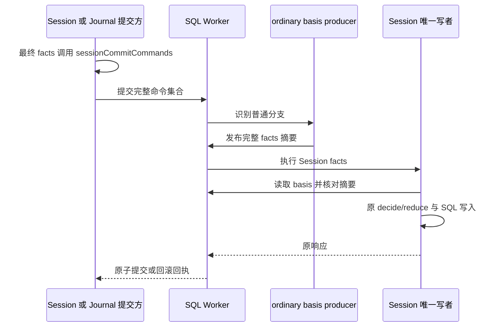

# Session 提交依据

Session 写参加者协议为 `SESSION_PROTOCOL`，当前值为 `2`。读取 handler 使用独立的 `SESSION_READ_PROTOCOL`，当前值为 `1`。写协议升级不会改变读取协议。公开类型、校验和构造函数归 [commit-basis.ts](../src/commit-basis.ts)，外部调用者从 [participants.ts](../src/participants.ts) 导入。

## 普通提交

普通 Session 命令、查询、检查、条目解释和日志解释都需要同一事务中的 `session.commit-basis/1`。普通提交方在完成最终 facts 组装后调用 `sessionCommitCommands`。它只为唯一的 Session command 添加 `session-ordinary-basis`；没有 Session command 时保持原命令集合。重复 Session command 或已含普通 basis 参加者时明确抛错。

ordinary producer 不拥有表，不核定访问资格。它正向识别已知普通分支，发布完整 Session fact-command 的规范摘要。摘要包括 guards、evidence、intakeLimits 等所有事实。Session 写者在执行任何 intent 前重算并核对摘要，然后执行原来的业务校验。缺少 producer 时存储准入拒绝；分类或摘要不符时事务回滚。普通 basis 不能使 permission-assignment 通过。

execution-record 仍在 Session 之前执行，使联合核对看到本次发布。ordinary basis 到 Session 的顺序由事实依赖声明；当前可运行节点按名称排序使 execution-record 先运行。改名或增加其他依赖时须重新验证该顺序。提交方按 participant 身份取 Session 响应，不按数组位置取值。Journal 发布遥测计算实际提交的完整命令集合字节，包括普通 producer。

## 受保护提交

permission-change basis 包含原协调引用与权限写材料。Session 只接受 permission-assignment 分支，保留原 operation、commandDigest、权限修订及 authority；不能改写 operation 来消除错绑。领域 decide 再核对完整命令身份、修订和定义。

受保护写者成功参加后发布 `session.commit-result/1`，包含原协调引用、commandsDigest、operation 和公开响应。停止或失败不发布成功结果，普通提交也不发布该结果。原操作 planner 的资格裁定、Identity 保管、Governance 终态与结算属于协调拥有者。公开 schema 和 Session 写者支持不表示这些生产提供者已经装配。

普通 producer 与受保护 producer 是不同组合的依据来源；一个组合不能给同一 fact 声明两个 producer。受保护提交不能调用普通组装函数来取得资格。

## 验证与演进边界

[实际 Worker 用例](../tests/commit-basis-real.spec.ts)覆盖缺依据、完整命令错绑及普通路径伪造权限写。[联合提交用例](../tests/real-joint.spec.ts)覆盖同提交可见性、回滚和进程重启认回。Journal 的真实消费者验证归 session-adapters。

该协议不改写历史事件、原回执或旧摘要，也不承诺旧 manifest 可在新组合下直接重放。跨 manifest 认回与持久升级须独立验证。权限写资格、Governance 协调和权限当前关系由受保护写组合实现；普通路径测试不能替代这条组合的独立验收。
