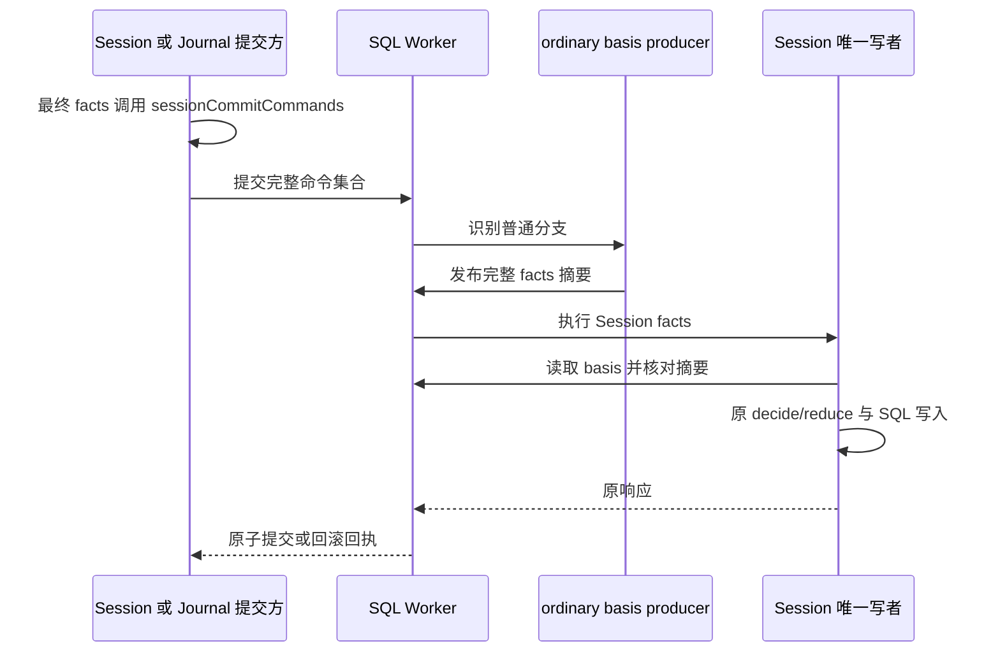
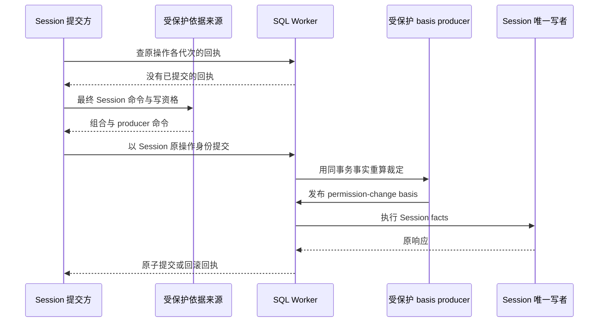

# Session 提交依据

Session 写参加者协议为 `SESSION_PROTOCOL`，当前值为 `2`。读取 handler 使用独立的 `SESSION_READ_PROTOCOL`，当前值为 `1`。写协议升级不会改变读取协议。公开类型、校验和构造函数归 [commit-basis.ts](../src/commit-basis.ts)，外部调用者从 [participants.ts](../src/participants.ts) 导入。

## 普通提交

普通 Session 命令、查询、检查、条目解释和日志解释都需要同一事务中的 `session.commit-basis/1`。普通提交方在完成最终 facts 组装后调用 `sessionCommitCommands`。它只为唯一的 Session command 添加 `session-ordinary-basis`；没有 Session command 时保持原命令集合。重复 Session command 或已含普通 basis 参加者时明确抛错。

ordinary producer 不拥有表，不核定访问资格。它正向识别已知普通分支，发布完整 Session fact-command 的规范摘要。摘要包括 guards、evidence、intakeLimits 等所有事实。Session 写者在执行任何 intent 前重算并核对摘要，然后执行原来的业务校验。缺少 producer 时存储准入拒绝；分类或摘要不符时事务回滚。普通 basis 不能使 permission-assignment 通过。

execution-record 仍在 Session 之前执行，使联合核对看到本次发布。ordinary basis 到 Session 的顺序由事实依赖声明；当前可运行节点按名称排序使 execution-record 先运行。改名或增加其他依赖时须重新验证该顺序。提交方按 participant 身份取 Session 响应，不按数组位置取值。Journal 发布遥测计算实际提交的完整命令集合字节，包括普通 producer。

## 受保护提交

权限配值没有普通依据。它的依据来自另一个组合，由受保护依据来源供应。来源的类型是 `SessionProtectedBasisSource`。本包声明这个类型，应用通过 `SessionStorageOptions.protectedBasis` 装配实现。没有装配来源时，权限配值走普通组装，普通 producer 拒绝它。

提交按以下顺序执行：

1. 准入通过后，提交方组好最终的 Session fact-command。允许裁定必须带写资格。没有写资格时答 `denied`，不调用来源。
2. 提交方查原操作各代次的回执。已有提交的回执时认回原结果，不调用来源。
3. 没有已提交的回执时，提交方调用来源。来源按当前事实给出一个已登记的组合，以及产生 `session.commit-basis/1` 的参加者命令。
4. 来源答失败时，提交方再查一次回执。这期间有投递已提交时，认回原结果。否则答这个失败。这次失败不占用代次，不留持久裁定。来源抛出异常时答 `unavailable`。
5. 来源给出计划时，提交方用 Session 的原操作身份提交 Session 命令和来源的命令。计划含 Session 命令或普通 basis 参加者时答 `invalid`，不提交。

permission-change basis 包含 commandsDigest 和权限写材料：原 operation、commandDigest、权限修订、定义及 authority。Session 只接受 permission-assignment 分支，不能改写 operation 来消除错绑。领域 decide 再核对完整命令身份、修订和定义。

producer 在事务里停下时，这一代次滚回。参加者报告的失败按暂时失败答 `unavailable`。调用方带同一原操作再来时，提交方使用下一代次，来源按当时的事实重新给出计划。

来源怎样核对写资格、怎样读取其他域的事实、组合含哪些参加者，都属于装配它的应用。公开类型和 Session 写者支持不表示生产提供者已经装配。

普通 producer 与受保护 producer 是不同组合的依据来源。一个组合不能给同一 fact 声明两个 producer。

## 验证与演进边界

[实际 Worker 用例](../tests/commit-basis-real.spec.ts)覆盖缺依据、完整命令错绑及普通路径伪造权限写。[受保护提交用例](../tests/protected-basis-real.spec.ts)用一个具名的 producer 夹具覆盖提交与认回、来源失败不留痕、来源失败期间已提交的投递被认回、producer 停下后占用一个代次、缺写资格、计划夹带 Session 命令及来源抛出异常。[联合提交用例](../tests/real-joint.spec.ts)覆盖同提交可见性、回滚和进程重启认回。Journal 的真实消费者验证归 session-adapters。

该协议不改写历史事件、原回执或旧摘要，也不承诺旧 manifest 可在新组合下直接重放。跨 manifest 认回与持久升级须独立验证。权限写资格和权限当前关系由受保护写组合实现。夹具用例和普通路径测试不能替代这条组合的独立验收。
