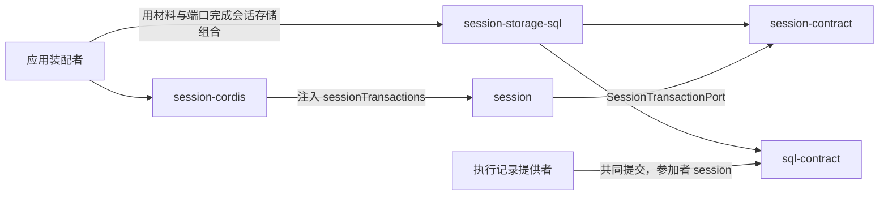

# 使用与定位

本文件说明消费侧怎样使用本包、具名上层消费者、典型调用关系，以及本包在系统与能力组中的位置。它覆盖独立消费与适用的 Harness 接入，引用系统架构与真实消费者，不成为新的架构源。系统关系归[会话与工作](../../../../docs/architecture/runtime/session-and-run.md)，组内分解归[组架构](../../docs/architecture.md)。

## 使用方式

本包的根入口导出 `createSessionStorage`、`sessionStorageMaterials` 与 `SESSION_PARTICIPANT`（[公开接口导航](public-api.md)）。本包没有 Cordis 入口，会话存储组合由应用承担（[装配边界](cordis.md)）。

### 装配怎样选它

`session` 服务只要求一个必需依赖：服务键 `sessionTransactions` 上的 `SessionTransactionPort`（[端口服务键](../../session-cordis-contract/docs/cordis.md#端口服务键)）。本成员是这个端口的 SQL 实现。其他存储提供者实现同一端口，也可以替换本成员。

应用要用 SQL 介质保存会话日志时，做下列事：

1. 装入 sql-contract 的存储服务与提供者（例如 sqlite-provider），并实现租户事务域目录（`TenantDomainAccess`）。
2. 调用 `sessionStorageMaterials()`，把参加者、迁移与读 handler 并入应用的材料目录。
3. 声明组合：参加者列表是 `SESSION_PARTICIPANT`（值 `session`）加执行记录提供者声明的参加者名，两者在同一个事务域（契约 [P-1](../../session-contract/SPEC.md#具名前提与明确缺项)）。P-1 不成立时组合被拒绝。拒绝由 `registerCombination` 报告，处置归应用。
4. 准备游标签名能力与访问裁定。两者都没有默认值。
5. 调用 `createSessionStorage({ storage, domains, accessCheck, cursorSigning, combination })`，其中 `combination` 是应用为该租户作用域登记的版本与清单摘要。把返回的端口交给 `sessionTransactions`。
6. 让迁移随提供者的原子迁移执行。迁移完成之前，读与写都返回 `unavailable`。

### 独立使用

不装配 Cordis 的调用方直接调用工厂，把得到的端口交给 [session](../../session/docs/public-api.md) 工厂的 `transactions` 依赖。下例是职责伪代码：

```text
存储 = sql-contract 的 SqlStorage（由提供者给出）
目录 = TenantDomainAccess（由应用给出）
材料 = sessionStorageMaterials()                  并入材料目录，经应用声明组合

端口 = createSessionStorage({ storage: 存储, domains: 目录, accessCheck, cursorSigning, combination })
会话服务 = session 工厂({ transactions: 端口, … })
```

独立使用的条件：

- 存储提供者可用，组合已声明，迁移已完成。
- 执行记录提供者与本成员在同一事务域登记同一组合版本。没有执行记录提供者时，只有 Session 自己提交的命令可用。
- 每次操作显式传入租户与会话，并通过访问裁定。本成员不从连接、事务域或装配树推断租户。

### 初始化与释放

端口没有关闭函数，只持有应用交入的对象。已提交的行不因端口被丢弃而变得可撤回（[迁移与生命周期](../SPEC.md#迁移与生命周期)）。提供者的关闭归提供者的拥有者。

## 消费者与定位

本成员是 Session 组里唯一接触介质的成员。下图投影[组架构](../../docs/architecture.md#安装与源码依赖)里与本成员相关的边，两者不一致时以组架构为准。



| 使用方 | 怎样使用 | 本成员给什么 |
| --- | --- | --- |
| 应用装配者 | 并入材料、声明组合、构造端口、交给 `sessionTransactions` | 材料与端口工厂 |
| [session-cordis](../../session-cordis/README.md) | 经 `inject` 取 `sessionTransactions`，交给 `session` 工厂 | 端口的全部操作 |
| [session](../../session/README.md) | 命令处理流水线调用 `commit`；读面与恢复调用读操作 | 同上。`session` 只依赖端口接口，不知道本成员 |
| 存储提供者 | 在 Worker 内、提交事务里执行参加者模块 `session`，在读事务里执行 handler | 事实语句、材料核对、派生行 |
| 执行记录提供者（Agent 一侧） | 在自己的提交里放一条 `participant` 为 `session` 的命令（共同提交表的 JC-06、JC-09、JC-11、JC-12 与只读参加） | Session 一侧的参加与冲突响应 |

经 `session` 的读面，Request Context 的历史源读口间接读到本成员的 epoch 视图（[R5](../SPEC.md#r5)），session-adapters 的常驻工具端口间接读到引用查询（[R10](../SPEC.md#r10)）。它们不直接依赖本成员。

### 现在的真实消费者

现在没有包依赖本成员。`session-cordis` 的 `package.json` 不列出本成员，它只依赖服务键。应用的会话存储组合尚未实现。

### 上层页面

- 系统关系：[会话与工作](../../../../docs/architecture/runtime/session-and-run.md)、[已确认保存的耐久边界](../../../../docs/architecture/data-and-state.md#已确认保存的耐久边界)。
- 端口义务：[SessionTransactionPort](../../session-contract/SPEC.md#sessiontransactionport)。
- 存储契约：[sql-contract 规格](../../../storage/sql-contract/SPEC.md)。
