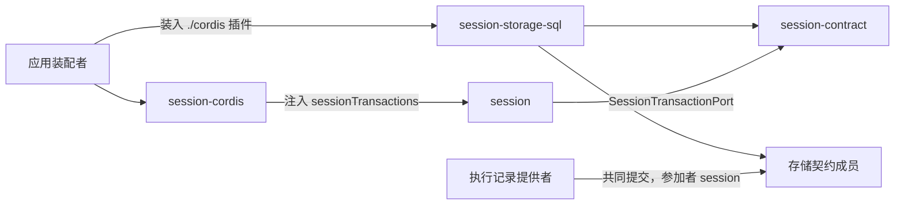

# 使用与定位

本文件说明消费侧怎样使用本包、具名上层消费者、典型调用关系，以及本包在系统与能力组中的位置。它覆盖独立消费与适用的 Harness 接入，引用系统架构与真实消费者，不成为新的架构源。系统关系归[会话与工作](../../../../docs/architecture/runtime/session-and-run.md)，组内分解归[组架构](../../docs/architecture.md)。

## 使用方式

本成员现在没有导出。下面是 SPEC 固定的用法，随实现生效。

### 装配怎样选它

`session` 服务只要求一个必需依赖：服务键 `sessionTransactions` 上的 `SessionTransactionPort`（[端口服务键](../../session-cordis-contract/docs/cordis.md#端口服务键)）。本成员是这个端口的 SQL 实现。装配要用 SQL 介质保存会话日志时，装入本成员的 `./cordis` 插件，见 [Cordis 集成](cordis.md)。其他存储提供者实现同一端口，也可以替换本成员。

选择本成员时，装配还要做下列事：

1. 装入存储契约的提供者，并把介质配置设为与该提供者相同的 SQLite 或 PostgreSQL。
2. 用本成员给出的组合登记材料调用 `registerCombination`。参加者列表是 `session` 加执行记录提供者声明的参加者名，两者在同一个事务域（契约 [P-1](../../session-contract/SPEC.md#具名前提与明确缺项)）。P-1 不成立时装配被拒绝。
3. 注入游标签名密钥，给出没有初值的策略配置（[配置](public-api.md#配置尚未实现)）。
4. 让迁移片段随提供者的原子迁移执行。迁移完成之前，读与写都返回 `unavailable`。

### 独立使用

不装配 Cordis 的调用方从根入口取提供者工厂，把得到的端口交给 [session](../../session/docs/public-api.md) 工厂的 `transactions` 依赖。下例是职责伪代码，不表示当前包已有运行导出：

```text
存储 = 存储契约的提供者(介质, 事务域)
存储.registerCombination(本成员的组合登记材料)      参加者模块 session 进 Worker
执行迁移片段                                        随提供者的原子迁移

端口 = 提供者工厂({ 介质, 内联阈值, pageBytes 上限, maxScanPerPage, 重建方式 },
                  存储, 游标签名密钥)
会话服务 = session 工厂({ transactions: 端口, … })

结束：关闭端口（释放语句缓存）；关闭存储提供者（由存储的拥有者负责）
```

独立使用的条件：

- 存储契约的提供者可用，并给出 SPEC [XP 表](../SPEC.md#xp-table)的入口。缺哪一项，对应操作返回 `unavailable`。现在存储契约没有可依赖的 workspace 成员，所以独立使用要等[存储线](https://github.com/nemori-ai/omne-harness-lite/issues/540)。
- 执行记录提供者与本成员在同一事务域登记同一组合版本。没有执行记录提供者时，只有 Session 自己提交的命令可用。
- 每次操作显式传入租户与会话。本成员不从连接、事务域或装配树推断租户。

### 初始化与释放

调用工厂的一方拥有端口实例，负责关闭它。关闭只释放语句缓存与签名密钥的引用，不关闭提供者的连接或 Worker，不回滚任何提交。参加者模块随提供者的 Worker 退出。已提交的行不因关闭而变得可撤回（[迁移与生命周期](../SPEC.md#迁移与生命周期)）。

## 消费者与定位

本成员是 Session 组里唯一接触介质的成员。下图投影[组架构](../../docs/architecture.md#安装与源码依赖)里与本成员相关的边，两者不一致时以组架构为准。



| 使用方 | 怎样使用 | 本成员给什么 |
| --- | --- | --- |
| [session-cordis](../../session-cordis/README.md) | 经 `inject` 取 `sessionTransactions`，交给 `session` 工厂 | 提交、权威读、原操作查询、历史读、epoch 视图读、待办扫描、引用查询与已释放作用域读 |
| [session](../../session/README.md) | 命令处理流水线调用 `commit`；读面与恢复调用读操作 | 同上。`session` 只依赖端口接口，不知道本成员 |
| 存储契约的提供者 | 在 Worker 内、提交事务里执行参加者模块 `session` | 事实语句、材料核对、派生行 |
| 执行记录提供者（Agent 一侧） | 在自己的提交里放一条 `participant` 为 `session` 的命令（共同提交表的 JC-06、JC-09、JC-11、JC-12 与只读参加） | Session 一侧的参加与冲突响应 |
| 独立调用方 | 直接调用提供者工厂 | 同上，装配步骤由调用方自己承担 |

经 `session` 的读面，Request Context 的历史源读口间接读到本成员的 epoch 视图（[R5](../SPEC.md#r5)），session-adapters 的常驻工具端口间接读到引用查询（[R10](../SPEC.md#r10)）。它们不直接依赖本成员。

### 现在的真实消费者

现在没有包依赖本成员。`session-cordis` 的 `package.json` 不列出本成员，它只依赖服务键。应用装配随实现选用本成员。

### 上层页面

- 系统关系：[会话与工作](../../../../docs/architecture/runtime/session-and-run.md)、[已确认保存的耐久边界](../../../../docs/architecture/data-and-state.md#已确认保存的耐久边界)。
- 端口义务：[SessionTransactionPort](../../session-contract/SPEC.md#sessiontransactionport)。
- 存储契约：[存储事务行为](../../../storage/docs/storage-contract/SPEC.md)。
