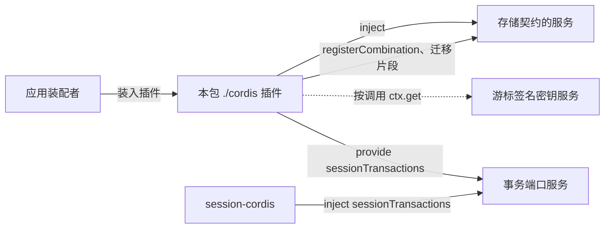

# Cordis 集成

本文件说明本包怎样作为 `SessionTransactionPort` 的 SQL 提供者进入 Cordis：插件与服务、依赖与注入、配置、加载与组合登记、撤除与资源清理，以及 IC 符合性。绑定只从 `src/cordis.ts` 导出，根入口不导入 `@deepseek-ai/cordis`（[IC-4](../../../../docs/architecture/cordis-integration-conventions.md#ic-4)）。共同集成规则引用仓库的 [IC 约定](../../../../docs/architecture/cordis-integration-conventions.md)，不在本文件复制。

服务键 `sessionTransactions` 与它的抽象类归 [session-cordis-contract](../../session-cordis-contract/docs/cordis.md#端口服务键)。端口接口、十一个操作与失败归 [session-contract](../../session-contract/SPEC.md#sessiontransactionport)。表、写路径、读路径与失败分类归 [SPEC](../SPEC.md)。本页只写这些东西进入 Cordis 之后的装配责任。

现状：`src/cordis.ts` 与 `src/index.ts` 只有模板标记，两个入口都没有导出。下文是 SPEC 固定的目标形状，不是源码事实。存储契约现在没有可依赖的 workspace 成员，所以下文提到的「存储契约的服务」没有键名与形状，见[尚未固定的事项](#尚未固定的事项)。机制事实按已采用的 Cordis 4.0.4 核对。有 basis 条目的写条目链接，只有源码读数的标明「源码读数」。

## 集成入口

`./cordis` 导出一个插件。插件体装入后，在自己的 fiber 上提供一个服务：服务键 `sessionTransactions`，类型是 [session-cordis-contract](../../session-cordis-contract/docs/cordis.md#端口服务键) 为 `SessionTransactionPort` 定义的抽象类的具体子类。

- 子类 `extends` 这个抽象类，不写键，不自己 `ctx.provide`（[IC-2](../../../../docs/architecture/cordis-integration-conventions.md#ic-2)、[service-subclass-provides-its-key](../../../../.meta_harness/design/basis/cordis/service-subclass-provides-its-key.md)）。抽象类的 JSDoc 写 `@owner`，归 session-cordis-contract，本包不复制（[IC-3](../../../../docs/architecture/cordis-integration-conventions.md#ic-3)）。
- 服务的操作与结果就是契约的十一个操作。服务把每次调用交给事务端口实现，不增加操作，不改结果的形状。
- 本包不提供第二个服务键，不声明事件，不增补 `Events`。提交之后的唤醒通知归 `session-cordis-contract/committed`，由 session-cordis 一侧派发，本包不派发也不监听。
- 服务名里的限定「sql」只出现在包名。键是能力名词 `sessionTransactions`，不写成实现名（[IC-7](../../../../docs/architecture/cordis-integration-conventions.md#ic-7)）。

消费者只引用服务键与契约，不导入本包（[IC-5](../../../../docs/architecture/cordis-integration-conventions.md#ic-5)）。session-cordis 的 `package.json` 不列出本包，它按键 `inject`。别的存储提供者提供同一个键，也可以替换本包。

## 依赖与注入

| 依赖 | 怎样取得 | 缺席或换代时 |
| --- | --- | --- |
| 存储契约的服务（提供者） | 写在 `inject`，数组字面量，元素取自存储契约定义包的键常量（[IC-8](../../../../docs/architecture/cordis-integration-conventions.md#ic-8)）。没有它，任何读写都不成立 | 缺席时插件停在 `PENDING`，不提供 `sessionTransactions`，Session 服务随之停在 `PENDING`。换代时插件体卸载再重跑，在途操作按原身份经 [R7](../SPEC.md#r7) 认回（[plugin-body-reruns-on-provider-change](../../../../.meta_harness/design/basis/cordis/plugin-body-reruns-on-provider-change.md)） |
| 游标签名密钥 | 运行时对象，不进配置数据。装配把它提供成服务，本插件按调用用 `ctx.get` 现取（[IC-9](../../../../docs/architecture/cordis-integration-conventions.md#ic-9)） | 缺席时 R2、R5、R8、R10、R11 返回 `unavailable`，提交与其余读不受影响（[失败分类](../SPEC.md#失败分类)）。密钥轮换使旧游标 `invalid` |
| 事务域对应 | 装配按租户给出（[身份与所有权](../SPEC.md#身份与所有权)），见[尚未固定的事项](#尚未固定的事项) | 找不到某租户的事务域时，该租户的操作返回 `unavailable`，不借用别的租户的事务域 |

本插件不 `inject` 别的 Session 成员。它不导入 `session`、`session-cordis` 与 `session-adapters`，领域判断只来自 session-contract 的纯函数（[依赖方向](architecture.md#模块与依赖)）。

租户是每次操作的参数，不从 Context、isolate 标签或「谁装了本插件」推断（[IC-18](../../../../docs/architecture/cordis-integration-conventions.md#ic-18)）。会话不是 fiber 或 isolate，本插件不为会话建任何 Context（[IC-17](../../../../docs/architecture/cordis-integration-conventions.md#ic-17)）。

## 配置

插件配置用 Standard Schema 校验，`Service` 子类用静态 `Config` 声明（[IC-14](../../../../docs/architecture/cordis-integration-conventions.md#ic-14)）。配置只放可序列化的数据，运行时对象（存储服务、签名密钥）不进插件树，由装配提供（[IC-16](../../../../docs/architecture/cordis-integration-conventions.md#ic-16)）。字段的含义与初值归[公开接口导航的配置](public-api.md#配置尚未实现)，本页不重复。

| 字段 | 初值 | 缺省时 |
| --- | --- | --- |
| 介质 | 无 | 装配必须给出，缺省则插件加载失败 |
| 内联阈值 | 16 KiB | 取初值。它只是配置初值，不是常量 |
| 大对象去向 | 同库 `sl_blob` | 取初值。对象存储待 [issue 541](https://github.com/nemori-ai/omne-harness-lite/issues/541) |
| `pageBytes` 上限、`maxScanPerPage` | 无 | 装配必须给出。数值待验证计划实测 |
| 快照重建方式 | 无 | 装配必须给出 |
| 尝试代次上限 | 16 | 取初值。它只是配置初值，不是常量 |

配置错误时插件加载失败，fiber 进入 `FAILED`，不提供服务（[plugin-throw-fails-fiber](../../../../.meta_harness/design/basis/cordis/plugin-throw-fails-fiber.md)）。本插件不静默回退到某个默认值：没有初值的字段缺省时，回退会让装配者以为自己选的配置在用。basis 只核验了函数插件，`Service` 子类静态 `Config` 的路径没有单独核验，所以「配置错误即 `FAILED`」对本插件还是假设，由本包的测试补证。

保留、缓存与耐久都不是配置项（[RT-01 至 RT-04](../SPEC.md#保留与缓存)）。

## 加载与组合登记

插件按下列顺序加载：

1. 静态 `Config` 校验配置。不合即失败。
2. 存储契约的服务就绪后，构造事务端口实现与读入口，传入配置、存储服务与签名密钥的取用入口。
3. 把参加者模块 `session` 与迁移片段交给存储提供者，并以参加者列表调用 `registerCombination`。列表是 `session` 加执行记录提供者声明的参加者名（[参加者模块与材料](../SPEC.md#参加者模块与材料)）。登记入口与迁移挂接是存储契约的期望 XP-1 与 XP-5。
4. 提供服务 `sessionTransactions`。

登记与迁移完成之前，服务的读与写都返回 `unavailable`（[迁移与生命周期](../SPEC.md#迁移与生命周期)）。XP 表里任一入口缺席时，对应操作返回 `unavailable`，`owner` 为存储参加者，本插件不用内存实现代替。

`registerCombination` 的结果按存储契约的[登记规则](../../../storage/docs/storage-contract/SPEC.md#登记)处理：

| 结果 | 本插件的处理 |
| --- | --- |
| `registered`，含同一登记键下参加者列表相同的已保存登记 | 继续加载。重启后重复登记因此幂等 |
| `registration_conflict`、`domain_occupied`、`participant_empty`、`participant_repeated`、`field_missing` | 装配错误，插件加载失败，带原因。本插件不改写登记，不换组合版本 |
| `writer_not_current` | 提供者的旧写代际还没排除。插件加载失败，由装配按自己的重启策略重试。本插件不自带重试循环 |

组合登记是存储提供者保存的耐久事实。它不是挂在本插件 fiber 上的效应，所以撤除插件不会撤销它。本插件也不为此声称可逆（[IC-13](../../../../docs/architecture/cordis-integration-conventions.md#ic-13)）。契约 P-1 要求执行记录提供者与本包在同一事务域登记同一组合版本；不成立时装配被拒绝（[具名前提](../../session-contract/SPEC.md#具名前提与明确缺项)）。

## 生命周期与清理

一个 isolate 标签下只装一份本插件（[IC-6](../../../../docs/architecture/cordis-integration-conventions.md#ic-6)）。同一标签下重复装载时，第二份在 `provide` 时失败，不静默覆盖（源码读数：Cordis 4.0.4 `reflect.ts` 的 `provide`）。要两份实现并存，分到不同的 isolate 标签下，由装配拥有者写明谁看见哪一份。isolate 只隔离服务实例的可见性，不隔离数据，所以不用它分隔租户（[isolate-hides-instances-not-data](../../../../.meta_harness/design/basis/cordis/isolate-hides-instances-not-data.md)）。

插件卸载时，撤除函数按下列顺序执行，三步写在同一个 effect 里。不同 effect 的释放并发进行，抛出的错误只记日志，不上抛（[effect-disposal-concurrent-not-ordered](../../../../.meta_harness/design/basis/cordis/effect-disposal-concurrent-not-ordered.md)）。所以每一步自己捕获错误，保证后续步骤仍然执行。

1. 拒绝新的操作。此后经本服务的新 `commit` 与读返回 `unavailable`，原因为提供者关闭。
2. 在途语句跑完，不打断。`commit` 没有取消，调用方按原身份经 R7 对账。读的取消只释放调用方。
3. 释放预编译语句缓存、迁移与归约版本缓存、SE36 载荷缓存，以及签名密钥的引用。

撤除不关闭存储提供者的连接或 Worker，不回滚任何提交，不撤销组合登记。已提交的条目不因 disposer 运行而变得可撤回（[迁移与生命周期](../SPEC.md#迁移与生命周期)）。读入口随提供者关闭而不可用。

注入了 `sessionTransactions` 的 session-cordis 随本插件卸载或重跑，它的撤除与本插件的撤除并发运行。所以本插件的撤除函数要能在对方已经停止时安全返回，不抛出。已被调用方持有的旧端口实例在撤除后对所有操作返回 `unavailable`，不复活；新实例由重跑后的插件提供。

进程失败后，本包没有进程内的耐久状态要恢复。缓存可以重建，会话快照与派生索引按 [R9](../SPEC.md#r9) 追赶。

## IC 符合性映射

| 规则 | 本包怎样符合 | 现在的证据 |
| --- | --- | --- |
| [IC-2](../../../../docs/architecture/cordis-integration-conventions.md#ic-2) 服务键只写一次 | 子类 `extends` 端口抽象类，不写键，不自己 `ctx.provide` | 没有源码 |
| [IC-3](../../../../docs/architecture/cordis-integration-conventions.md#ic-3) 抽象 Service 与归属标注 | 抽象类与 `@owner` 在 session-cordis-contract，本包只写子类 | 没有源码 |
| [IC-4](../../../../docs/architecture/cordis-integration-conventions.md#ic-4) 根入口与 Cordis 无关 | 根入口不导入 Cordis，绑定只在 `./cordis` | [public-entry.spec.ts](../tests/public-entry.spec.ts) 与 [cordis-entry.spec.ts](../tests/cordis-entry.spec.ts) 现在断言两个入口导出为空 |
| [IC-5](../../../../docs/architecture/cordis-integration-conventions.md#ic-5) 消费者不依赖提供者实现 | 消费者按键 `inject`，不导入本包 | 没有源码 |
| [IC-6](../../../../docs/architecture/cordis-integration-conventions.md#ic-6) 一个 isolate 标签一个提供者 | 同标签重复装载在 `provide` 时失败 | 源码读数，测试随实现进入 |
| [IC-7](../../../../docs/architecture/cordis-integration-conventions.md#ic-7) 实现限定词与键名 | 包名带 `sql`，键是 `sessionTransactions` | 没有源码 |
| [IC-8](../../../../docs/architecture/cordis-integration-conventions.md#ic-8)、[IC-9](../../../../docs/architecture/cordis-integration-conventions.md#ic-9) 必需与可选依赖 | 存储服务进 `inject`；签名密钥按调用 `ctx.get` 现取，缺席走契约的 `unavailable` | 没有源码 |
| [IC-12](../../../../docs/architecture/cordis-integration-conventions.md#ic-12) 通知失败处理 | 不适用：本包不派发也不监听事件 | 不适用 |
| [IC-13](../../../../docs/architecture/cordis-integration-conventions.md#ic-13) 登记即效应 | 组合登记是提供者保存的耐久事实，不是 fiber 效应，撤除不撤销 | 登记幂等与撤除后仍在的测试随实现进入 |
| [IC-14](../../../../docs/architecture/cordis-integration-conventions.md#ic-14) 配置校验 | 静态 `Config` 用 Standard Schema，无初值字段缺省即 `FAILED`，不回退 | `Service` 子类路径没有 basis，测试随实现进入 |
| [IC-16](../../../../docs/architecture/cordis-integration-conventions.md#ic-16) 插件树只放数据 | 存储服务与签名密钥由装配提供，不进配置 | 没有源码 |
| [IC-17](../../../../docs/architecture/cordis-integration-conventions.md#ic-17)、[IC-18](../../../../docs/architecture/cordis-integration-conventions.md#ic-18) 作用域与租户 | 租户与会话是操作参数，不建会话 fiber 或 isolate | 没有源码 |
| [IC-19](../../../../docs/architecture/cordis-integration-conventions.md#ic-19) 同进程保证写明兑现方式 | 同会话的并发提交由 `tail` 条件裁定，不靠进程内锁或内存 CAS（[W6](../SPEC.md#w6)）。缓存是可重建的进程内副本。每租户单一恢复扫描者归 session-cordis | 写在 SPEC |

## 尚未固定的事项

| 事项 | 现状 | 拥有者 |
| --- | --- | --- |
| 存储契约服务的键名与形状，以及 SPEC 的 [XP-1 至 XP-6](../SPEC.md#xp-table) | 存储契约没有可依赖的 workspace 成员。缺哪一项，对应操作返回 `unavailable` | 存储契约拥有者（[storage 契约](../../../storage/docs/storage-contract/README.md)） |
| 游标签名密钥的服务键 | 还没有定义。缺席时依赖游标的读返回 `unavailable` | 装配与本成员。定键时，同步 session-cordis-contract 的[端口服务键表](../../session-cordis-contract/docs/cordis.md#端口服务键)是否收录它 |
| 租户到事务域的对应怎样进入插件 | 配置数据，或存储契约的事务域目录（XP-6）。SPEC 只要求装配按租户给出 | 装配与存储契约拥有者 |
| 介质与存储提供者介质是否一致 | 存储契约现在没有读取提供者介质的入口，一致性由装配保证。入口出现后改为加载时核对，不一致即 `FAILED` | 存储契约拥有者 |
| 机制读数 | 同一 isolate 标签下重复 `provide` 抛出只有源码读数；`Service` 子类静态 `Config` 失败使 fiber `FAILED` 的 basis 只核验了函数插件 | 本包的测试补证。Cordis 升版时按 IC 约定重跑相关 probe |

## 验证义务

本包的测试随实现进入 `tests/`，在真实 Cordis 4.0.4 上运行，不用替身。存储提供者用真实的 SQLite 提供者，没有内存替身，所以这些测试要等存储契约给出入口。

1. 插件提供 `sessionTransactions`，键只在抽象类声明。
2. 存储服务缺席时插件停在 `PENDING`，Session 服务随之停在 `PENDING`。存储服务到场后继续。
3. 配置缺少无初值字段或不合 Schema 时 fiber 进入 `FAILED`。
4. 同一 isolate 标签下重复装载失败。
5. 重启与插件重跑后重复登记返回已保存的登记；登记冲突使加载失败。
6. 签名密钥缺席时 R2、R5、R8、R10、R11 返回 `unavailable`，`commit` 与 R1、R3、R7 不受影响。
7. 撤除后新操作返回 `unavailable`，在途语句跑完，已提交条目经新实例仍可读，提供者连接未被关闭。
8. 根入口不导入 `@deepseek-ai/cordis`，也不导入 `./cordis`。

不覆盖：事务端口的写读行为本身，它归 SPEC 的 W 与 R 义务（[验证义务](verification-obligations.md)）；多实例恢复扫描者的租约；真实 session-cordis 与执行记录提供者的端到端组合。
