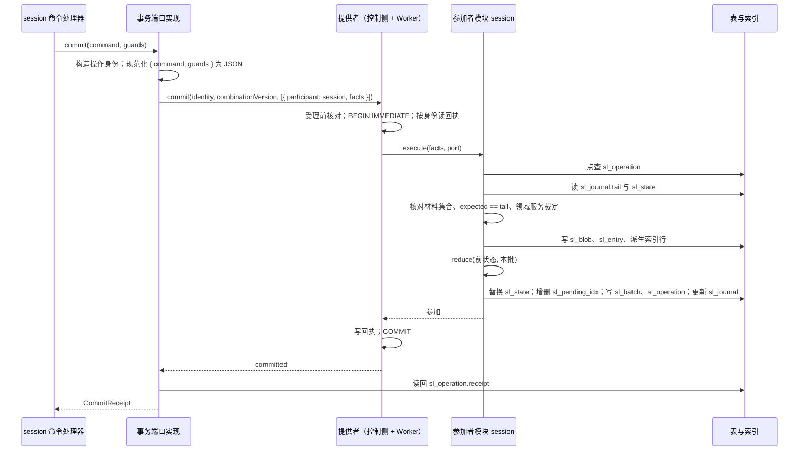
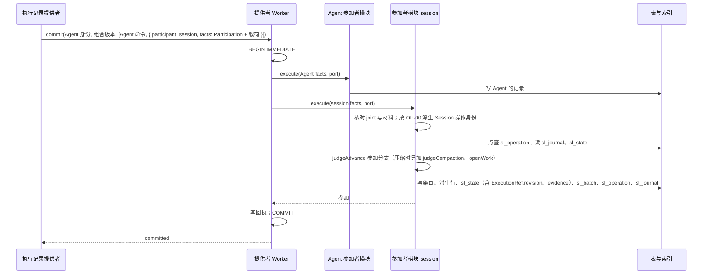
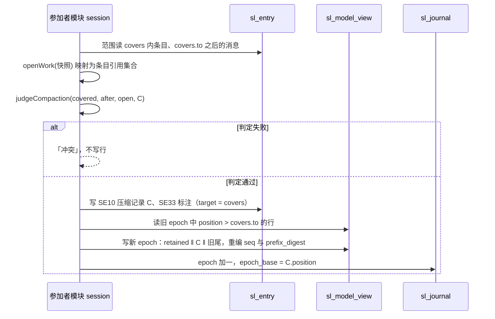
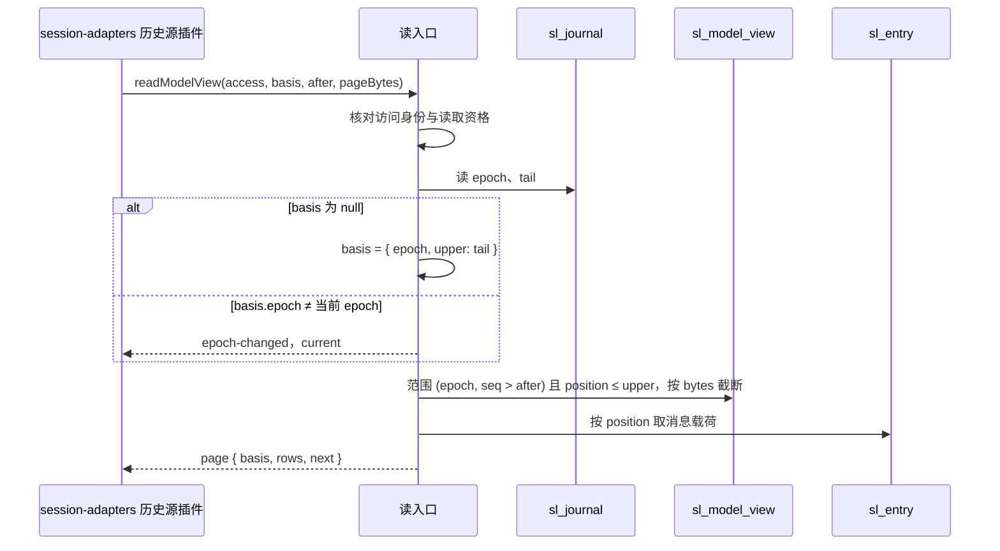
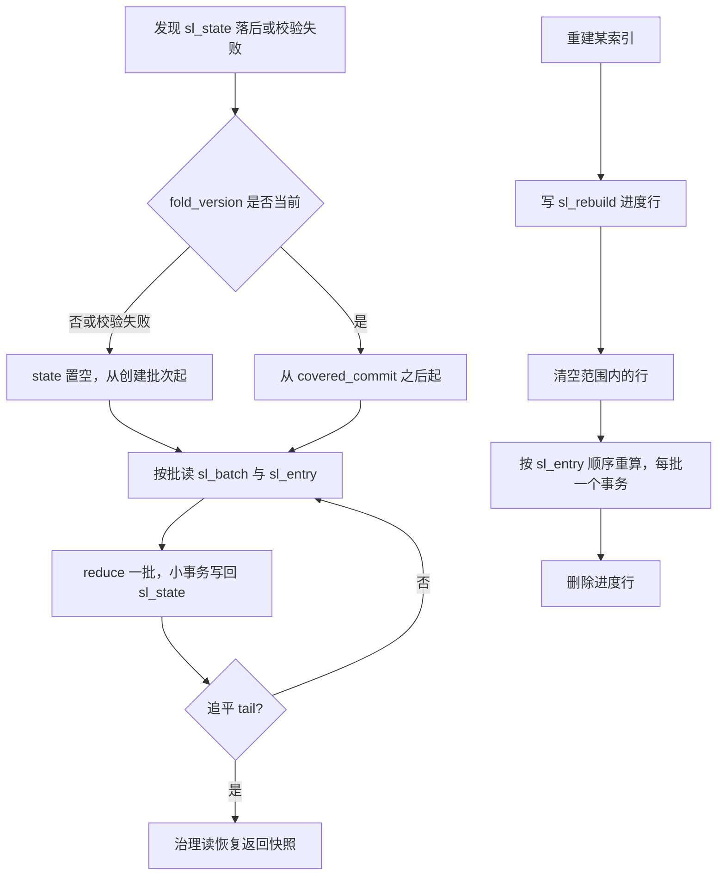

# 关键流程

本文件给出本包四条关键流程的时序：Session 为提交方的写路径、Session 为参加者的写路径、压缩提交、派生重建，再加 epoch 视图读取。参与者、数据去向、状态变化与失败分支随图写出。规则归 [SPEC](../SPEC.md)，表与列归[对象模型](object-model.md)。图里的「提供者」是存储契约的 SQLite 或 PostgreSQL 提供者，它不是本包的成员。

## 流程

### 写路径：Session 为提交方

前提：`session` 的命令处理器已经完成事务外的认回、权威读、裁定与收材料（[CP-01](../../session/SPEC.md#cp-01) 第 1 至第 4 步）。本包从 [W1](../SPEC.md#w1) 接手。

数据去向：条目、批次、回执、快照与派生行进同一事务。状态变化：`sl_journal.tail` 前进一批，`sl_state.covered` 等于新 `tail`。

| 分支 | 发生在 | 结果 |
| --- | --- | --- |
| 受理前拒绝 | 提供者 | `unavailable`，`owner` 为存储参加者，不进事务 |
| 同身份同摘要 | 提供者第 13 步或模块点查 | 不写行，返回原回执，`recovered` 为真 |
| 同身份异摘要 | 提供者 | `conflict` |
| 材料集合不符 | 模块 | 「不支持」，映射为 `invalid`，明确回滚 |
| `expected ≠ tail` | 模块 | 「冲突」，`changed` 带当前 `revision`，明确回滚；`session` 重做流水线 |
| 领域服务拒绝 | 模块 | 「冲突」，明确回滚；没有响应通道时本包在事务外重算拒绝原因（W1 第 9 步） |
| `sl_state` 落后 | 模块 | 「失败」，`unavailable`；R9 追赶 |
| 语句失败 | 提供者关闭端口 | 「失败」，`rolled_back` 或 `unknown` |
| `COMMIT` 结果不确定、锁等待超时 | 提供者 | `commit-unknown`；调用方按原身份 `queryOperation` |

### 写路径：Session 为参加者

前提：执行记录提供者发起 `message`、`context-transition`、`custody` 或 `processed` 交接（[JC-06、JC-09、JC-11、JC-12](../../session-contract/SPEC.md#共同提交与共享事务域)），它的提交里含 `participant` 为 `session` 的命令。本包按 [W2](../SPEC.md#w2) 执行。

两侧的事实在同一事务成立。提交方失败时两侧都不保存。只读参加（JC-26、JC-27）走同一路径，模块只执行核对与裁定，不写行。

| 分支 | 结果 |
| --- | --- |
| `joint` 不是四种之一，或 `Participation` 缺项 | 「不支持」，提交方得到 `unsupported`，不保存任何一半 |
| 结局为拒绝类（`stale-advance`、`terminal`、`archived`） | 「冲突」，提交方得到 `changed` 并带依据。缺响应通道时依据丢失，见 [XP-2](../SPEC.md#xp-table) |
| 同 Session 身份已提交 | 「参加」，不写第二份 |
| 桥材料不可用或语句失败 | 「失败」，提交方得到 `unavailable` 或 `commit-unknown` |

### 压缩提交

前提：Request Context 形成压缩记录，经执行记录提供者的 `context-transition` 交接到达。本包按 [W4](../SPEC.md#w4) 在参加者路径的裁定与写入两步里执行。

数据去向：旧 epoch 的行保留。只复制索引行，不复制内容。写成本 O(|retained| + 保留尾)。

### epoch 视图读取

前提：Request Context 经 `session-adapters` 调用 `readModelView`（[R5](../SPEC.md#r5)）。

同一 `basis` 下各页同一 epoch、同一上界。前缀对齐由插件比较 `prefixDigest`。

### 派生重建

前提：R9 发现 `sl_state` 落后或校验失败，或运维要求重建某个派生索引。

重建期间依赖该索引的读返回 `unavailable` 并带进度。重建只解释事实，不发外部效果。重建写入的行必须与 [C-01](../SPEC.md#c-01) 的重算一致，重建本身就是重算。

## 失败与生命周期

| 情形 | 流程 | 结果 |
| --- | --- | --- |
| Worker 在参加者语句途中退出 | 两条写路径 | 事务不存在；调用方按原身份 `queryOperation`，提供者的恢复完成后给出结果 |
| 提交后、回执读回前进程崩溃 | 写路径（提交方） | 重启后 `session` 以同身份重放，模块点查 `sl_operation` 认回 |
| 压缩提交写新 epoch 途中语句失败 | 压缩提交 | 整个事务回滚，旧 epoch 仍是当前 epoch，Request Context 按原操作查询 |
| 读取途中 `sl_journal` 被另一次提交推进 | epoch 视图读取、历史分页 | 本轮上界固定不受影响；下一轮或 `epoch-changed` 才看到新尾 |
| 重建途中崩溃 | 派生重建 | `sl_rebuild` 行仍在，重启后从头重建该索引；权威表不受影响 |
| 游标密钥轮换 | 分页读取 | 旧游标 `invalid`，调用方从 `begin` 重新开始 |
| 撤除本包 | 全部 | 在途语句跑完；已提交的行不撤回；缓存丢弃 |

取消：`commit` 没有取消。读取的取消只释放调用方，不中断 Worker 内正在执行的语句。资源释放：读入口与事务端口实现在撤除时释放语句缓存；提供者的连接与 Worker 由提供者关闭。
