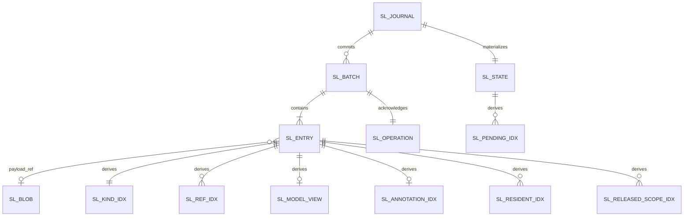

# 对象模型

本文件描述本包的表、索引与进程内对象：列、键、约束、关联与生命周期。行为与读写规则归 [SPEC](../SPEC.md)，本页只给形状。表名与列名是设计定位，精确 DDL 归 `src/` 的迁移片段。

## 对象与关系

本包没有领域对象。它的对象是两类：介质上的表与索引，进程内的六个对象：三个运行对象（事务端口实现、参加者模块、读入口），两个纯函数编解码器与一份迁移片段列表，见[进程内对象](#进程内对象)。领域对象 `WorkSnapshot`、`HistoryEntry`、`CommitReceipt` 归 [session-contract](../../session-contract/docs/public-api.md)，本页只写它们怎样落到列。

（设计目标）左侧五表与 `sl_blob` 在共同提交内写入，是权威。右侧七个索引同一提交内维护，可以从 `sl_entry` 与重算的 `sl_state` 重建（[C-01](../SPEC.md#c-01)）。

### 当前实现的表

head 的实际表集由 [src/worker/schema.ts](../src/worker/schema.ts) 定义，迁移是 `session/001-session-log`。十张表都是 SQLite `STRICT` 表，位置、序号与提交序号是 `INTEGER`（以 `bigint` 读写），其余为 `TEXT`。每张表的第一列或主键都含 `tenant`，每条语句都按它过滤。下文「权威表」与「派生索引」是设计目标的表集，与本节不一致处以本节为准（[SPEC 实现现状](../SPEC.md#实现现状)）。

| 表 | 列 | 主键 | 说明 |
| --- | --- | --- | --- |
| `sl_journal` | `tenant`、`session`、`tail`、`commit_seq`、`epoch` | `(tenant, session)` | `epoch` 是文本，创建时为 `epoch:0`，压缩后为 `epoch:<压缩记录的条目 id>`。没有 `source`、`epoch_base` |
| `sl_entry` | `tenant`、`session`、`position`、`revision`、`kind`、`entry`、`bytes` | `(tenant, session, position)` | `entry` 是整条 `HistoryEntry` 的 JSON 文本。二级索引 `sl_kind_idx (tenant, session, kind, position)` |
| `sl_operation` | `tenant`、`session`、`operation`、`input_digest`、`form`、`revision`、`receipt`、`result` | `(tenant, session, operation)` | `form` 为 `batch`、`control` 或 `answer`。`answer` 行的 `revision` 为 NULL，不属于任何批次。`result` 是原结果的 JSON，认回时还原。二级索引 `sl_operation_revision_idx (tenant, session, revision)` |
| `sl_state` | `tenant`、`session`、`snapshot`、`covered` | `(tenant, session)` | `snapshot` 是 `WorkSnapshot` 的 JSON。没有 `fold_version`、`covered_commit`、`digest` |
| `sl_input` | `tenant`、`session`、`input`、`value` | `(tenant, session, input)` | 普通输入的原值，`readInput` 点查它 |
| `sl_model_view` | `tenant`、`session`、`epoch`、`seq`、`entry`、`bytes`、`prefix_digest`、`message` | `(tenant, session, epoch, seq)` | `message` 是消息的 JSON，读取时不再读 `sl_entry`。没有 `position` 列 |
| `sl_annotation_idx` | `tenant`、`session`、`target`、`position` | 全部四列 | `target` 是单个目标位置，不是范围 |
| `sl_pending_idx` | `tenant`、`reason`、`session` | 全部三列 | `reason` 有八个取值，含 `initialization` |
| `sl_resident_idx` | `resident_key`、`tenant`、`session`、`capability`、`shape` | `(resident_key, tenant, session, capability)` | `shape` 是 SE36 首次载入形状的 JSON，没有 `admitted_position` |
| `sl_released_scope_idx` | `tenant`、`session`、`scope`、`data` | `(tenant, session, scope)` | `data` 是已释放作用域的 JSON |

没有 `sl_batch`、`sl_blob`、`sl_ref_idx` 与 `sl_rebuild`。

### 权威表（设计目标）

列类型写 SQLite 的类型，PostgreSQL 的对应见 [SPEC 的介质差异表](../SPEC.md#sqlite-与-postgresql)。`tenant` 与 `session` 都是文本。JSON 列是 `TEXT`，内容按应用层 schema 校验。

**`sl_journal`** 每会话一行。

| 列 | 类型 | 含义 |
| --- | --- | --- |
| `tenant`、`session` | TEXT | 主键 |
| `source` | TEXT | 来源身份：这份权威日志及其已验证前缀的标识。提供者替换不改它 |
| `tail` | INTEGER | 最后一条条目的 `position`。没有条目时为 0 |
| `commit_seq` | INTEGER | 已提交批次数 |
| `epoch` | INTEGER | 当前 epoch。创建时为 1 |
| `epoch_base` | INTEGER NULL | 当前 epoch 的压缩记录位置。第一个 epoch 为 NULL |

**`sl_batch`** 每次提交一行。

| 列 | 类型 | 含义 |
| --- | --- | --- |
| `tenant`、`session`、`commit_seq` | TEXT、TEXT、INTEGER | 主键 |
| `operation` | TEXT | 提交该批的 `SessionOperationId` |
| `first_position`、`last_position` | INTEGER | 批内首末条目位置 |
| `entry_count`、`bytes` | INTEGER | 条目数与载荷字节数 |
| `committed_at` | TEXT | 提交时间，ISO 8601 |
| `interpreter` | TEXT | 解释版本 `Adoption`，JSON |
| `receipt_source` | TEXT | `CommitReceipt.source`，JSON |

约束：`(tenant, session, first_position)` 唯一；`first_position = 前一批 last_position + 1`。

**`sl_entry`** 每条目一行。封套字段沿[事件目录的共同封套](../../session-contract/docs/object-model/session-log-events.md#共同封套)。

| 列 | 类型 | 含义 |
| --- | --- | --- |
| `tenant`、`session`、`position` | TEXT、TEXT、INTEGER | 主键。`EntryId` 是 `position` 的十进制文本 |
| `commit_seq`、`ordinal` | INTEGER | 所属批次与批内序号 |
| `kind` | TEXT | 种类短名，`<族>.<事实>` |
| `schema` | TEXT | 载荷的精确采用 `Adoption`，JSON |
| `effect` | TEXT | `deciding` 或 `explaining` |
| `origin_owner`、`origin_via`、`origin_operation` | TEXT | 事实拥有者、经由方、提交它的操作 |
| `origin_source` | TEXT | 拥有者一侧的耐久证据，JSON |
| `refs` | TEXT | `run`、`attempt`、`consumption`、`input`、`card`、`control`、`target` 中实际存在的，JSON |
| `cause` | TEXT NULL | 同批更早条目或已提交条目的引用，JSON |
| `occurred_at` | TEXT | 拥有者报告的发生时间 |
| `payload` | TEXT NULL | 内联载荷，JSON |
| `payload_ref` | TEXT NULL | 外置载荷的摘要，指向 `sl_blob` |
| `payload_bytes` | INTEGER | 载荷的 UTF-8 字节数，内联或外置都填 |
| `digest` | TEXT | 载荷的 SHA-256，十六进制小写 |

约束：`payload` 与 `payload_ref` 恰有一个非 NULL；`(tenant, session, commit_seq, ordinal)` 唯一。

**`sl_operation`** 每个 Session 操作一行。

| 列 | 类型 | 含义 |
| --- | --- | --- |
| `tenant`、`session`、`operation` | TEXT | 主键 |
| `input_digest` | TEXT | 规范化参数摘要，`resolveOperation` 用它区分同身份异事实。只覆盖语义参数，不含认证封套、`expected` 与材料内容（[W1 的尝试代次](../SPEC.md#w1-attempts)） |
| `commit_seq` | INTEGER | 该操作提交的批次 |
| `receipt` | TEXT | `CommitReceipt`，JSON：`operation`、`revision`、`first`、`last`、`source` |

一个批次恰对应一行。尝试代次不进本表：提供者的回执表按存储操作身份 `<operation>#<代次>` 保存每次尝试的回执与存储输入摘要，不在本包。

**`sl_state`** 每会话一行。

| 列 | 类型 | 含义 |
| --- | --- | --- |
| `tenant`、`session` | TEXT | 主键 |
| `snapshot` | TEXT | `WorkSnapshot` 的未结部分，JSON |
| `fold_version` | TEXT | 归约版本 |
| `covered` | INTEGER | 物化时的 `tail` |
| `covered_commit` | INTEGER | 物化时的 `commit_seq` |
| `digest` | TEXT | `snapshot` 的 SHA-256 |

`snapshot` 里的 `ExecutionRef.readThrough` 就是解释进度，没有单独的进度表（[W5](../SPEC.md#w5)）。

**`sl_blob`** 每段外置载荷一行。

| 列 | 类型 | 含义 |
| --- | --- | --- |
| `tenant`、`digest` | TEXT | 主键 |
| `bytes` | BLOB | 内容 |
| `size` | INTEGER | 字节数 |
| `media_type` | TEXT | 媒体类型 |

### 派生索引

| 索引 | 列 | 主键 | 来源 |
| --- | --- | --- | --- |
| `sl_kind_idx` | `tenant`、`session`、`kind`、`position` | 全部四列 | 每条 `sl_entry` |
| `sl_ref_idx` | `tenant`、`session`、`ref_kind`、`ref_id`、`position` | 全部五列 | `sl_entry.refs` 的每个引用 |
| `sl_model_view` | `tenant`、`session`、`epoch`、`seq`、`position`、`bytes`、`prefix_digest` | `(tenant, session, epoch, seq)` | `toModel` 消息与压缩记录 |
| `sl_annotation_idx` | `tenant`、`session`、`target_from`、`target_to`、`position` | 全部五列 | `refs.target` 非空的条目 |
| `sl_pending_idx` | `tenant`、`reason`、`session` | 全部三列 | `sl_state` 的待办原因 |
| `sl_resident_idx` | `resident_key`、`tenant`、`session`、`capability`、`admitted_position` | `(resident_key, tenant, session)` | 最近一条 SE08 的登记键，按归档状态过滤 |
| `sl_released_scope_idx` | `tenant`、`session`、`scope`、`task`、`position` | `(tenant, session, scope)` | 当前已归档会话的 SE25 释放读回。撤销归档（SE28）同批删除该会话的行 |
| `sl_rebuild` | `tenant`、`index_name`、`session` NULL、`progress`、`started_at` | `(tenant, index_name, session)` | R9 重建进度，重建完成后删除 |

`sl_model_view` 一个 epoch 内 `seq` 从 1 起连续。`prefix_digest` 的第一行是 `H(空 ‖ 条目 digest)`。`sl_rebuild` 是进度元数据，不是派生物，也不进 C-01 的等式。

### 进程内对象

下表的对象名是设计目标的名字。源码里没有同名类：端口是 `createSessionStorage` 返回的对象，参加者模块是 `src/worker/participant.ts` 的默认导出，读入口是 `src/reads.ts` 与 `src/worker/read-*.ts`，编解码是 `src/codec.ts`，游标是 `src/cursor.ts`，迁移是 `src/worker/migration.ts`。

| 对象 | 职责 | 身份与状态 |
| --- | --- | --- |
| `SqlSessionTransactionPort
` | 实现 `SessionTransactionPort
`：把 `commit` 翻译为存储契约的提交，把读操作交给读入口 | 每个事务域一个实例。状态只有预编译语句缓存与游标签名密钥的引用 |
| `SessionParticipant` | 存储契约的参加者模块 `session`：在 Worker 内按 [W1](../SPEC.md#w1) 第 3 至第 7 步或 [W2](../SPEC.md#w2) 执行 | 无状态。每次 `execute(facts, port)` 只用交入的语句端口 |
| `SessionReadPort` | 事务外读入口的消费者：R1 至 R11 的 SQL | 每个事务域一个实例。只缓存 [RT-04](../SPEC.md#rt-04) 允许的派生物 |
| `PositionCodec` | `EntryId`、`SessionRevision`、`seq`、`epoch` 与 64 位整数的互转 | 纯函数 |
| `CursorCodec` | R2、R5、R8、R10、R11 游标的签名与校验 | 纯函数，密钥由装配注入 |
| `MigrationFragments` | 权威表与派生表的 DDL 与数据迁移 | 按版本排序的只读列表 |

`SessionParticipant` 导入 `session-contract` 的 OP-00 派生、`decide` 与 `reduce`。`decide` 是命令到条目批次的唯一编码，它在内部调用领域服务与守卫。`SessionParticipant` 不另调用领域服务（[编码与归约的拥有者](../SPEC.md#编码与归约的拥有者)）。`decide` 产出的 `EncodedEntry` 没有 `id` 与 `revision`，`SessionParticipant` 分配 `position` 后补上，见下表的 `HistoryEntry` 一行。

`SessionReadPort` 在 R2 的每一页经 R6 读 `sl_annotation_idx`，填充 `HistoryPage.annotations`（[R6](../SPEC.md#r6)）。

### 领域类型到列的对应

| 契约类型 | 落在哪 |
| --- | --- |
| `EntryId` | `sl_entry.position` 的十进制文本 |
| `SessionRevision` | `sl_journal.tail` 的十进制文本 |
| `HistoryEntry` | `sl_entry` 一行：`id` 取 `position`，`revision` 取 `commit_seq` 所属批次的 `last_position`，`kind`、`schema`、`payload`（内联或从 `sl_blob` 取回）、`origin` 三列 |
| `EncodedEntry` | `decide` 的产出。写入时成为 `sl_entry` 一行，`position` 由本包分配 |
| `HistoryPage.upper` | 游标里的 H |
| `HistoryPage.annotations` | `sl_annotation_idx` 中目标与本页位置范围相交、`position ≤ H` 且不在本页的行，按 `position` 读出的 `sl_entry` |
| `CommitReceipt` | `sl_operation.receipt` |
| `WorkSnapshot` | `sl_state.snapshot`，加 `revision = covered`、`source = sl_journal.source` |
| `ModelViewBasis` | `sl_journal.epoch` 与读取时的 `tail` |
| `ModelViewRow` | `sl_model_view` 一行加 `sl_entry` 的消息载荷 |
| `ResidentReference` | `sl_resident_idx` 一行加 `admitted_position` 处 SE36 的 `shape` |
| `ReleasedScope` | `sl_released_scope_idx` 一行 |
| `PendingReason` | `sl_pending_idx.reason` |

## 生命周期

| 对象 | 创建 | 变化 | 销毁 |
| --- | --- | --- | --- |
| `sl_journal` 行 | 创建批次（SE01）的提交 | 每次提交更新 `tail`、`commit_seq`；压缩提交更新 `epoch`、`epoch_base` | 不删除 |
| `sl_batch`、`sl_entry`、`sl_operation` 行 | 提交 | 不变 | 不删除 |
| `sl_state` 行 | 创建批次的提交 | 每次提交替换；R9 追赶时按批替换 | 不删除。归约版本升级时整行重算 |
| `sl_blob` 行 | 外置载荷的提交，先于条目写入 | 不变 | 不删除 |
| 派生索引行 | 与来源条目或快照变化同一提交 | `sl_resident_idx` 与 `sl_pending_idx` 按规则增删；其余只增 | 只在重建时整体清空重算 |
| `sl_rebuild` 行 | 重建开始 | 每批更新进度 | 重建完成时删除 |
| 事务端口实现与读入口 | 本包 Cordis 入口在提供者就绪后创建 | 无业务状态 | 撤除时释放语句缓存，不关闭提供者连接 |
| 参加者模块 | 装配时登记到提供者 | 无 | 随提供者 Worker 退出 |

进程内对象的销毁不撤回任何已提交的行。

### 冷数据与归档会话

本包不分冷热存储层。「冷」只表示条目不在当前 epoch。压缩之后，旧 epoch 的 `sl_model_view` 行与它们对应的条目不再进入模型视图读取，但它们仍在同一组表里，按 [RT-01](../SPEC.md#rt-01) 保留。对人时间线的历史分页（[R2](../SPEC.md#r2)）照常按位置读到它们。

归档会话在 `sl_pending_idx` 里与其他会话按同一规则维护：行只跟随 `sl_state` 的待办原因增删（[W3](../SPEC.md#w3)）。归档没有另外的增删规则。归档提交同批取消未终结 Run，`run` 原因随之离开快照，行随之删除。归档后快照仍有待办原因时，行保留，例如作用域释放任务尚未读回，或交付责任解除仍为 pending。原因全部离开快照后，行随之删除。没有未结工作的归档会话在该索引里没有行。
