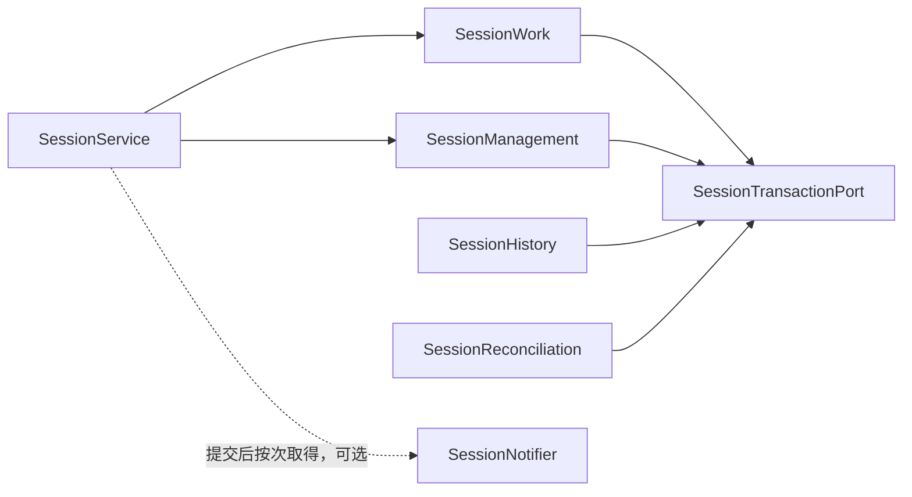

# Session 内部架构

本包拥有通用实现机制，候选工厂与依赖聚合见 [构造入口](../public-api.md)。图表投影现有设计，不改变采用范围，也不表示运行实现或真实提供者验证已完成。

本包的目标实现负责会话工作身份、日志、当前推进资格、原消费位置和逻辑终态。公开结果和失败的唯一行为源是 [SPEC](../../../session-contract/SPEC.md)，具体候选定义见 [public-api](../../../session-contract/docs/public-api.md)。

## 模块与状态责任

| 角色 | 责任 | 隔离的变化或生命周期 |
| --- | --- | --- |
| SessionService / SessionWork | 工作治理与当前推进操作 | Session 没有第四个执行 runtime 或活体目录 |
| SessionManagement | 创建、采用、控制与空闲维护 | 控制意图与外部真实收场分开 |
| SessionTransactionPort | 同提交日志、治理事实及原操作认回 | 参与者必须满足共同提交前提 |
| SessionHistory / SessionReconciliation | 固定范围读取与原操作核实 | 通知和投影不成为权威 |

图中箭头表示使用关系，不表示共享线程、存储事务或父子资源寿命。具体依赖是否必需、何时取得以及失败时保留什么责任，分别由 [SPEC 候选](../../../session-contract/SPEC.md#342-主干运行契约候选)和 [Cordis 设计](../../../session-cordis-contract/docs/cordis.md)确定。

SessionService 的提交协调逻辑在原提交成功后取得通知能力。TransactionPort 不依赖 SessionNotifier。通知缺席或失败不改变原成功回执，完整条件归 [SPEC](../../../session-contract/SPEC.md#342-当前增量与后续接口)。

## 机制与设计理由

[既有内部设计](mechanisms.md)保留本包的机制分解、采用前提和未决。Agent 会话集成的待细化项分别归[输入与终结](mechanisms.md#sw-m01-a-输入绑定与-agent-终结的共同提交)、[推进与重装配](mechanisms.md#sw-m01-b-推进映射与重装配交接)、[日志与消费交接](mechanisms.md#sw-m01-c-日志消费责任与恢复投影的集成)。[对象模型](../../../session-contract/docs/object-model/README.md)区分持久身份与临时对象，[流程](../../../session-contract/docs/flows/README.md)定位各阶段的数据与失败去向。共同领域关系仍归[系统运行架构](../../../../../docs/architecture/runtime/README.md)，本页不另定跨域保证。

## 包与安装边界

本包只依赖纯契约与所需通用能力，不依赖 Cordis、具体插件或固定存储实现。实际根入口尚为空。框架适配由 [session-cordis](../../../session-cordis/README.md) 承担；Service 定义由 [session-cordis-contract](../../../session-cordis-contract/README.md) 唯一拥有。
