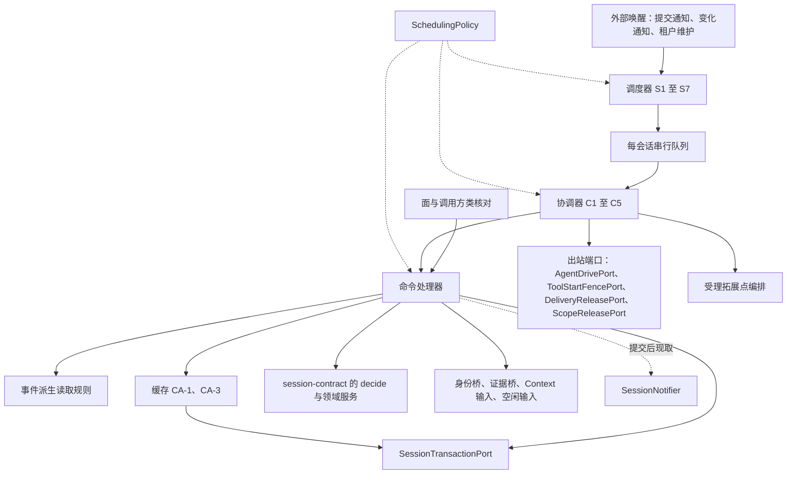

# Session 通用实现的内部架构

本页说明本成员怎样组织机制来兑现 [SPEC](../../SPEC.md)：包内模块怎样划分、依赖朝哪个方向、状态归谁、为什么这样分。公开行为归[会话契约](../../../session-contract/SPEC.md)，Cordis 绑定归 [session-cordis](../../../session-cordis/README.md)，内部对象的身份与生灭归[对象模型](../object-model.md)，候选工厂与依赖归[构造入口](../public-api.md)。组内六个成员的分法与落位判据归组根的[成员分解](../../../docs/architecture.md#成员分解与邻接协作)。

状态为候选技术设计。根入口目前为空，`src/index.ts` 只有模板标记。下文是 SPEC 固定的结构，文件名与类名由实现确定。

## 模块与状态责任

工厂返回一个服务实例。实例内部分成下列模块。每个模块只做一件事，模块之间不共享可变状态；需要的事实都从权威读取得。

| 模块 | 承担的 SPEC 行为 | 持有的状态 | 不做什么 |
| --- | --- | --- | --- |
| 面与调用方类核对 | 按调用方类返回四个面，核对操作允许的调用方类（[四个面与公开操作](../../../session-contract/SPEC.md#四个面与公开操作)） | 无 | 不授予资格；资格由事务端口与身份桥核对 |
| 命令处理器 | 每个变更命令的六步流水线（[CP-01](../../SPEC.md#cp-01)）、参加者变体（[CP-02](../../SPEC.md#cp-02)）、读操作（[CP-03](../../SPEC.md#cp-03)） | 一次调用内的操作身份、`expected` 与 `changed` 重做次数 | 不写允许或拒绝的规则；裁定只来自契约的纯函数 `decide` 与领域服务 |
| 受理拓展点编排 | before-admit 与 after-admit 两组槽的顺序与提交边界（[EX-1](../../SPEC.md#ex-1)） | 无 | 不定义槽的语义；语义归命令域与 hooks 的拥有者 |
| 协调器 C1 至 C5 | 读到事实后决定发出哪些命令或出站调用（[C1](../../SPEC.md#c1) 至 [C5](../../SPEC.md#c5)） | 无持久状态；内存里只有退避位置与重发计数 | 不直接写日志，只经命令处理器提交；不在提交事务里发出站调用 |
| 调度器 S1 至 S7 | 决定什么时候再检查哪个会话（[S1](../../SPEC.md#s1) 至 [S7](../../SPEC.md#s7)、[SR](../../SPEC.md#sr-1)） | 计时、在途标记、扫描游标与重放计数，全在内存 | 不写日志（SR-1）；不裁定资格 |
| 每会话串行队列 | 同一会话同一时刻只有一个协调动作（[SR-2](../../SPEC.md#sr-2)） | 每会话一个待执行动作的队列 | 不替代跨进程保护；跨进程靠操作幂等、`expected` 与条件提交围栏 |
| 事件派生读取 | `receive(agent-event)` 的身份派生、游标前进与去重规则（[RD-01](../../SPEC.md#rd-01) 至 RD-07） | 无；持久游标 `ExecutionRef.readThrough` 由存储随条目保存 | 不读 Agent 输出，不向 Agent 确认；读取与确认在 session-adapters |
| 缓存 | 条目缓存与快照缓存（[CA-1](../../SPEC.md#ca-1)、[CA-3](../../SPEC.md#ca-3)） | 按字节或会话数淘汰的内存项 | 不使用失效通知保证正确；缓存命中不替代核权 |
| 策略 | 全部间隔、上限与退避（[SchedulingPolicy](../../SPEC.md#schedulingpolicy)） | 工厂传入的策略对象 | 不改变任何命令的结局集合 |
| 生命周期 | 停止顺序（[资源与替换](../../SPEC.md#资源与替换)） | 实例状态：运行、停止中、已停止 | 不回滚已提交的事实，不取消外部执行 |

依赖方向只有一个：外层模块调用内层模块，内层模块不知道外层。调度器调用协调器，协调器调用命令处理器与出站端口，命令处理器调用事务端口、桥与 `decide`。

图中箭头表示调用关系，不表示线程、进程或存储事务的边界。虚线表示读取配置或提交后的可选调用。

### 状态归属

本成员不持有任何耐久状态。会话事实、操作记录、治理状态、派生索引与消费游标都由事务端口的提供者在同一次提交里保存（[SessionTransactionPort](../../../session-contract/SPEC.md#sessiontransactionport)）。本成员内存里的计时、计数、队列与缓存全部可丢。丢失后，S3 的启动扫描从权威读重建要做的事，重复的命令由操作身份认回（[AP-4](../../SPEC.md#ap-应用层六条规矩)）。

### 与 Agent Loop 的分界

本成员的协调器与调度器只在 Agent 执行之外决定三件事：

1. 何时开始一个 Run：S1 调用 `judgeRunStart`，C2 提交 `startRun` 后发出 `invoke`。
2. 何时交入输入：C2 对去处为本 Run、还没有 SE35 的输入按到达顺序调用 `submit`。
3. 何时恢复：S3 发现要恢复的会话，C5 按 [PM-14](../../../session-contract/SPEC.md#pm-14) 逐类处理，C2 执行 `claim` 与 `resume`。

执行之内的步骤求值、等待、对模型与工具的调用都归 Agent。本成员没有 Loop 节点，不求下一步，不调用 Model 或 Tool 的发起操作，所以不构成第二个 Loop。推进、等待、恢复、控制、终态与输入六项事务在两方之间的完整划分是契约正文，见[与 Agent Loop 的分界](../../../session-contract/docs/context.md#与-agent-loop-的分界)；系统层说明见[协调器与调度器](../../../../../docs/architecture/runtime/session-and-run.md#协调器与调度器)。

## 机制与设计理由

### 裁定只有一份

命令到条目批次的编码只有契约导出的纯函数 `decide`。命令处理器在事务外调用 `decide` 只为得到拒绝原因与要收的材料种类；存储参加者在提交事务里再调用一次，产出真正写入的批次（[CP-01](../../SPEC.md#cp-01) 第 3 步与第 5 步）。

理由：`decide` 是纯函数，同一快照与同一参数两次给出同一结局。事务内核对 `expected` 保证两次读的是同一快照，所以事务外结果可以安全地丢弃。若本成员另写一份编码，两份编码迟早分歧，存储写入的批次就会与本成员预期的不同。

### 协调器与调度器不持状态

协调器与调度器的输入只有权威读、出站回执与会话身份。重放用 [OP-00](../../../session-contract/SPEC.md#op-00) 派生的同一身份，由 `resolveOperation` 认回（[AP-3](../../SPEC.md#ap-应用层六条规矩)、[AP-4](../../SPEC.md#ap-应用层六条规矩)）。

理由：进程随时可能崩溃。只要要做的事能从耐久事实重建，崩溃就只延迟工作，不丢失工作。重放用同一身份，重复动作就不会产生第二个 Run、第二份输入或第二个终态（[CR 崩溃矩阵](../../SPEC.md#cr-崩溃矩阵)）。

### 外部效果在提交之后

对 Agent、Tool 启动围栏、生产者与执行环境的出站调用都在提交确认之后发出，回执作为新事实再提交（[AP-5](../../SPEC.md#ap-应用层六条规矩)）。提交未知期间不发出依赖它的效果（[PA-07](../../../session-contract/SPEC.md#pa-07)）。

理由：出站调用不能放进日志事务。先提交后调用，崩溃时日志里已有要调用的事实，S3 可以找回并以同一身份重放。先调用后提交，崩溃时外部效果已经发生，日志里却没有记录。

### 缓存只淘汰，不失效

条目缓存的键是 `(session, position)`，已提交条目不可变，命中永不过期。快照缓存在每次权威使用前做一次尾部点查，修订不等就丢弃。流水线第 5 步的 `expected` 核对是最后一道保护（[CA 缓存](../../SPEC.md#ca-缓存)）。

理由：多进程下不需要缓存一致性协议。过期快照最多导致一次 `changed` 重做，不会导致错误提交。认回、恢复读与原操作查询要追到裁定位置，所以不走缓存。

### 机制细节的位置

本目录下的[既有内部设计](mechanisms.md)保存日志与提交的结构说明：条目与提交结构、追加与共同提交算法、固定边界读取、投影与恢复算法，以及固定输入、受理、换代、交接、控制与自动归档的设计取舍。它的「SW-M01 技术兑现义务」一节给出三项跨能力义务的闭合位置：[输入与终结](mechanisms.md#sw-m01-a-输入绑定与-agent-终结的共同提交)、[推进与重装配](mechanisms.md#sw-m01-b-推进映射与重装配交接)、[日志与消费交接](mechanisms.md#sw-m01-c-日志消费责任与恢复投影的集成)。本页的模块划分以 SPEC 为准；该页与 SPEC 不一致时，以 SPEC 与契约为准。流程时序见[实现流程](../flows.md)，故障场景见[故障场景](../../verification/fault-scenarios.md)。共同领域关系归[系统运行架构](../../../../../docs/architecture/runtime/README.md)，本页不另定跨域保证。

## SOLID 与扩展边界

本节沿组根的 [SOLID 与扩展边界](../../../docs/architecture.md#solid-与扩展边界)，写本成员的选择。

| 原则 | 本成员的选择 | 必须防止的反例 |
| --- | --- | --- |
| 单一职责 | 命令处理器编排一次提交；协调器决定发出什么；调度器决定何时检查；缓存只加速读取；策略只给数值。允许与拒绝只来自契约的纯函数 | 协调器里写允许或拒绝的分支（[AP-1](../../SPEC.md#ap-应用层六条规矩)）；调度器调用变更命令；缓存结果用作裁定依据 |
| 开闭 | 新的控制种类、派生消息与恢复任务类型是契约联合类型的新变体，本成员在协调器的穷尽分支里各加一支。新的入站邻域是 session-adapters 的新插件，本成员不改。策略的数值经配置替换 | 为接入一个入站邻域改本成员；把间隔、上限或退避写成代码里的常量（[SR-3](../../SPEC.md#sr-1)） |
| 里氏替换 | 事务端口、桥、时钟、空闲与 Context 输入的替身与真实实现可以互换。调度器可以整体换成外部工作流引擎，只要它只产生带同一操作身份的命令并遵守 SR-1 至 SR-3 | 替身返回真实实现不会给出的结局；替换后的调度器自己写日志或以新身份重做 |
| 接口隔离 | 工厂按调用方类给出四个面；受理方拿不到 `startRun`，读取方拿不到任何变更操作。依赖按端口分开，一个端口缺席只影响需要它的操作 | 一个什么都能做的服务对象；把全部端口合成一个必需依赖，使一个端口缺席就停下整个服务 |
| 依赖倒置 | 本成员只依赖 `session-contract` 的端口接口与纯函数。出站端口的接口在契约成员，服务键在 session-cordis-contract，实现在 session-adapters | 本成员导入任何邻域契约、Cordis 或存储实现 |

不能替换的部分：命令处理器与协调器是本成员的机制本体（[资源与替换](../../SPEC.md#资源与替换)）。替换它们等于另写一个实现，必须重新满足 SPEC 的全部验证义务。

## 包与安装边界

本成员只依赖 `@omne-harness/session-contract`。它不依赖 Cordis、任何邻域契约、具体插件或存储实现。根入口不加载 Cordis，见 [Cordis 说明](../cordis.md)。

| 方向 | 成员 | 关系 |
| --- | --- | --- |
| 本成员依赖 | [session-contract](../../../session-contract/README.md) | 类型、端口接口、`decide`、领域服务与 `reduce` |
| 依赖本成员 | [session-cordis](../../../session-cordis/README.md) | 调用工厂，把 Cordis 服务适配为端口，把实例装进服务 `session` |
| 依赖本成员 | 不用 Cordis 的独立宿主 | 直接调用工厂，自己提供端口与唤醒 |
| 不依赖本成员 | [session-adapters](../../../session-adapters/README.md)、[session-storage-sql](../../../session-storage-sql/README.md) | 它们经服务定义 [session-cordis-contract](../../../session-cordis-contract/README.md) 或契约端口与本成员协作 |

服务定义由 session-cordis-contract 唯一拥有。本成员不导出 Cordis 服务类，也不登记服务键。
