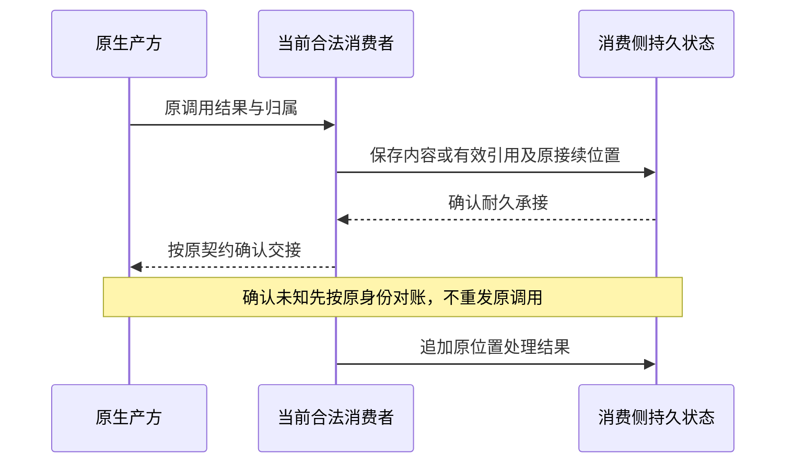

# session 内部设计

状态为候选技术设计。正式维护位置不授予技术接受、实施或支持。

## Session log 的事件模型

本文先说明封套与共同提交机制。当前采用业务的完整[原生事件目录](../../../session-contract/docs/object-model/session-log-events.md)定义每类事实的必要数据、出处、因果、效力和后果；[逻辑状态与转移](../../../session-contract/docs/object-model/session-state-transitions.md)定义正交状态、命令守卫、完整结果、并发裁定和纯批次归约。精确公开 Schema/API 继续由实际成员拥有。

Session log 是同一 Session 跨 Run 的记录条目序列。一条 log 的本质是已发生事实的记录，具有 event 性质；正式术语是历史条目 `HistoryEntry`，条目身份是 `EntryId`。它不是待执行命令、传输通知、工程日志或一次模型请求的上下文。一件事可先产生控制请求事实，后来再产生实际结果，两条事实以因果关联连接，不因同一业务动作而合并覆写。

日志 append only。条目可靠持久提交后，身份、内容、租户与会话归属、因果关联和提交顺序不可原地修改。更正、撤销和新的状态追加表达，原事实仍保留。日志是会话事实的权威来源；治理状态和索引是这些事实的确定性结果，与依赖它们的提交共同成立。Session 不因此成为其他领域全部数据的权威，也不要求全系统事件溯源。

### 条目与提交结构

以下是目标逻辑数据模型，说明必须保存什么及如何关联。字段名用于设计定位，精确公开 Schema、存储编码及 API 随实际成员确定；不将 Cordis Context、句柄、连接或活体 runtime 序列化成数据契约。

| 结构 | 必要数据及约束 |
| --- | --- |
| 会话作用域 | 固定租户身份及 Session 身份。条目、操作认回、索引、引用和游标均显式绑定该作用域。 |
| 历史条目 `HistoryEntry` | 稳定条目标识、作用域、条目种类、格式版本、效力、寿命宿主、出处、因果引用、实际发生时间及业务载荷。涉及外部效果时保存其确定性，不以取消标签推断效果不存在。 |
| 工作与执行关联 | Session 关联始终存在。Run、原发起 attempt、step、动作和调用只在实际存在时记录；当前接续 attempt 另记，不能覆盖原发起身份。Run 外调用保留原消费者，不补造 Run。 |
| 业务载荷 | 按种类区分创建/初始化、消息、受理与去处、承接批次、attempt 开始、版本采用、等待与答复、调用关联、消费、控制、终态、归档或模式变化。保存完整必要数据或所需期限内可恢复的引用。 |
| 原操作身份 `OperationKey` | 作用域、可信来源身份及首次提交前取得的稳定操作标识。原意图的目标、参数和前置条件保留规范表示，用于比较同次重试。摘要可加速核对，不能只靠摘要声称业务内容相同。 |
| 提交批次 `CommitBatch` | 一个原操作、预期前一提交位置、有序非空条目、原回执及格式信息。该批次整体可见，不对外暴露半批受理或半批取消。 |
| 提交位置 | 本会话提交序号及批内序号，按二元组排序。成功批次的提交序号递增，批内从第一条顺序排列；稳定条目标识用于引用，不用时间戳充当位置。 |
| 当前治理状态 | 来源提交位置、当前模式及关系、唯一未终结 Run、有效 attempt、终态、待处理有序索引、等待及未结控制/消费责任。只能是所标位置的确定性解释。 |
| 操作回执与索引 | 原操作的规范意图、提交批次、条目范围及原回执。共同提交，恢复后仍能认回未知结果，不靠内存中的最近请求表。 |
| 提交尝试裁定 | 提供者保存原操作的提交尝试代次及其裁定/围栏依据，区分一次尝试未提交与原操作已提交。代次不等于 Run 的 attempt。未提交围栏是提交协议元数据，不冒称可由已提交日志重建的投影。SQL 存储成员的兑现见[尝试代次](../../../session-storage-sql/SPEC.md#w1-attempts)：每个代次一个存储操作身份，代次由存储回执推出，不另存状态。 |
| 投影及检查点 | 来源身份、完整批次边界、确定性归约规则版本、覆盖位置及可校验的派生数据。检查点是重建加速数据，不裁定新的业务事实。 |
| 历史游标 | 作用域、来源身份、固定上界、扫描位置、筛选条件及游标格式。由服务核验完整性，每页仍核对当前资格。 |

来源身份辨认这份权威日志及其已验证的提交前缀，不等于提供者进程或临时实例身份。提供者替换不能重置条目标识或提交位置；恢复出的分支无法证明原前缀连续时，原检查点和游标不可继续采用。条目所属批次及其稳定标识由共同提交记录认回，未提交候选没有对外有效的历史位置。各批次保存采用的解释版本，按该版本及明确兼容规则解释，不用最新规则悄悄改变旧治理结论。

日志起点不是第一条用户消息。第一份有效批次包含创建事实，固定 Session、租户、AgentDefinition 标识、执行类型、必需身份集合及用途，保存创建输入、初始模式/关系/注册的已确定值和采用依据。尚未确定的初始化项明确保留初始化状态及接续责任，不能用空值假装初始化完成。后续初始化结果追加，创建与初始化失败仍可定位原会话。归约从空的“会话尚未创建”状态应用创建批次，不从当前租户默认或最新定义猜初值；只有满足初始化条件才能开展相应工作。

效力沿统一语言的依据、留痕和瞬态分类，不把“写进日志”理解为“交给模型”。依据说明哪些事实参与后续判断，留痕解释发生过什么；授权展示与块标注分别沿其拥有者求取。生产者不得通过自填效力或种类取得治理权限，Session 按已知种类校验其资格、必要字段及允许状态变化。

条目引用同一批内更早条目或已经提交的原事实；跨领域引用携带拥有者及稳定身份，并核对访问范围。日志中的执行结果是对原调用报告的承接记录，真实执行与账目仍由原拥有者裁定。日志更正只能修订会话如何解释某份事实，不能把外部真实成功改成从未执行。

“落盘不可变”约束已提交条目，不要求数据库物理页或重建索引保持同一字节布局。读取格式适配不得改写保存的原事实；迁移须保留身份、内容与解释依据。副本整理和清理遵守保留及引用责任，不能借存储维护删除应保存的历史。

### 追加与共同提交算法

消费者使用一个会话业务提交入口，另有原操作查询、当前状态读取及历史读取入口。输入受理、控制、恢复和原结果承接交给同一拥有者裁定；调用者不分两次写日志和队列，也不直接提交任意 `HistoryEntry`。以下名称是逻辑操作，不是已发布签名。

```text
提交(actor, scope, operationKey, intent)
    校验主体、明确作用域及操作形状。
    读取同一权威提交边界的原操作与治理状态。
    原操作已提交且原意图相同：按当前读取资格返回原回执。
    同身份不同原意图：拒绝复用。
    未见原提交：核对当前业务资格及原意图前置条件。
    从当前治理状态推导条目、治理变更和处置责任。
    准备承诺所需内容，确认内容或引用可恢复。
    条件提交完整批次、原回执及治理/索引变更。
    并发冲突：先认回原操作，再按新状态重做业务判断。
    提交未知：保留原操作，通过权威查询对账。
    确认完整耐久后返回成功，再通知消费者检查权威状态。
```

1. 校验入口取得可信主体和作用域，Session 验证该类操作的资格。原操作认回先于尾部比较；尾部后来变化、attempt 换代或通知重试不能让已提交操作变成新操作。重试只读原回执，不取得重复动作许可。
2. 对未提交操作，读取一致的治理状态和来源位置，校验当前 Run、attempt、取消、终态及必要当前资格。决定与记录由本域推导，不能信任生产者自报“现在仍有推进权”。原意图固定的目标、参数和前置条件不能在竞争重算时暗改。
3. 构造一份共同提交单元，包含条目批次、操作认回依据、原回执、治理状态变化及裁定资格所需索引。受理与待处理资格的原子性由这份共同对象兑现。承接由 Agent 自己提交；Session 读到承接事件后，在自己的一次提交里保存批次并解除这些输入的待处理资格。展示投影可随后更新，不能参与当前资格裁定。
4. 提交提供者在同一 Session 的权威提交域比较预期位置、保证原操作唯一，并安装完整单元。两个进程基于同一旧位置竞争，只允许一个有效后继。分区两侧各自可写的副本不合格；无法访问权威的一侧不能确认提交。发布者接管须围栏旧写者，不仅回收其本机对象。
5. 条目、共同治理变更及回执都达到[已确认耐久边界](../../../../../docs/architecture/data-and-state.md#已确认保存的耐久边界)后，提交才对普通读取可见并返回成功。候选写入、内存 CAS、进程锁或头指针先更新后异步刷盘都不足以确认。提供者选择事务或可恢复提交日志，但须说明共同对象、裁定点、刷新条件及恢复证据。
6. 竞争失败先查询原操作；确未包含时，重新读取和判断，不把旧条目改个序号接到新尾部。查询“未找到”只说明该读取时刻尚未提交，重试仍用同一身份，防止原在途提交随后成功。超时或服务故障保持未知，不返回确定失败后换身份重做。

一次重试被拒绝或回滚，只证明该次存储尝试未生效。若该原操作还有先前结果未知的在途尝试，原操作继续为未知，不能向用户报告确定未受理。报告原操作“明确未提交”须由提供者在权威边界证明当时未提交，并持久围栏该裁定以前的全部在途尝试，使它们不能晚到提交。之后获准按原身份重试时，进入新的提交尝试代次，原操作的业务提交仍最多一次；旧代次不能复活。不能核实这一证据时只能继续未知对账，不能从一次拒绝或查询未找到拼出终局。

内容可内联，或在提交前由内容拥有者可靠准备并提供有效引用。外部内容与本地事务不自动同提交；依赖内容确认受理前须确保其保管及引用保证成立。未被业务提交引用的准备内容可按保管协议回收，回收必须先排除已提交、在途提交及有效读取引用。

交入由 Session 调度，批次由 Agent 从已交入的输入中取。`startRun` 不扣除任何输入的待处理资格；Session 按会话业务规则，以到达顺序把待处理输入逐个交入执行（[PM-02](../../../session-contract/SPEC.md#pm-02)）。Agent 承接一批输入时，按自己的输入水位线取当时已交入的全部输入。Session 读到承接事件后，保存精确成员、原顺序、所属 Run 与批次身份，并解除这些成员的待处理资格（[Session 与 Agent 的两条通道](../../../session-contract/SPEC.md#session-与-agent-的两条通道)）。Session 不重选批界或顺序。水位线之后交入的输入留给后续批次。工程可以分批搬运或处理，但不改变这次承接可见输入的边界。

提交记录外部发起许可或取消意图，不等于执行已经发出或停止。实际模型/工具发起仍由调用拥有者参加有效推进资格的围栏裁定，避免旧 attempt 在校验后失效却仍发起新效果。跨能力实际发起、控制传播、ACK 及外部副作用不在日志事务中；日志保存原调用及可恢复处置责任，具体协议继续由相应协调者兑现。

### 固定边界读取与分页

日志按作用域及提交位置建立有序索引，按稳定条目标识建立直接定位索引。当前治理、原操作、Run、待处理及等待分别有键或有序索引，正常读取不扫完整历史。内部树、页或分段是提供者选择，不进入领域公开契约。

第一页取得一致的尾部上界 H，读取 H 范围内的完整提交事实。后续游标固定 H，从上次实际扫描位置之后继续。新追加不进入这轮遍历，读者需要新增历史时开始新一轮。筛选按条目种类、原工作及资格应用，不采用随追加移动的 offset。

每页校验主体、当前资格、作用域、来源和游标完整性。游标错域、来源无法核验、过滤被篡改或固定范围不再可读取时明确拒绝或报告不可用，不重设起点伪装成功。返回续读位置按实际检查过的条目推进；过滤后可以是空页，仍说明是否已扫描完 H。权限变化不能凭旧游标继续读取已撤权内容，也不能自动扩大原筛选范围。

设 N 为该 Session 的历史条目数，K 为本页实际扫描条目数，B 为所读内容字节，M 为当前索引规模。采用有序树时范围定位约为 O(log N)，页读取约为 O(log N + K + B)，索引点查约为 O(log M)。K 不是过滤后返回条目数；没有适用过滤索引时稀疏筛选可能检查更多历史，须限制单页扫描及字节并继续返回进度，不声称任意筛选恒定耗时。具体规模、资源上界及 SLO 按提供者实际验证。

### 投影与恢复算法

归约器将一个完整已提交批次应用于其前一位置的派生状态，产出新状态和覆盖位置。归约只解释保存的数据，不读取当前时间、随机数、权限或最新共享配置来改变旧事实，也不发送外部请求。投影需要的非确定输入必须已成为适用事实；需要外部当前源的查询按组合视图处理。

```text
追赶(projection, fixedHead)
    核对来源、归约版本及已覆盖位置属于同一提交前缀。
    按顺序读取至 fixedHead 的完整批次。
    已覆盖批次认回，不重复应用。
    缺批或无法解释的相关种类/版本：停止该投影并报告不可用。
    应用下一批，共同保存新派生状态与新覆盖位置。
    覆盖 fixedHead 后，才作为该位置的治理依据。

恢复(scope)
    从提交提供者对账最后有效权威位置及未知操作。
    验证同来源、正确规则版本的检查点及其输入前缀。
    从有效检查点追赶；没有有效检查点则从权威起点重建。
    对账未结调用、控制及消费，再核对当前共享源与资格。
    取得有效推进资格后接续原工作，不重做原执行。
```

投影状态与覆盖位置共同保存，重复同批无额外变化；更换规则版本必须明确重建或兼容解释，不能用新代码默默重释历史。未知条目可以在获准历史查询中按可识别封套显示为不透明数据，但不能仅凭作者自报“留痕”就跳过未知业务语义并继续授予治理资格。

治理读取要追到其裁定位置；展示读取可以返回有进度的旧视图。追赶尚未完成、来源不符、权限查询不可用或日志缺口时，不回答“当前没有工作”。恢复检查点校验身份、范围和完整性，还须由实际验证说明归约正确性；哈希不是语义符合证明。

坏检查点或索引从更早有效点重建。已提交日志损坏、缺批或无法判定提交结果则隔离受影响会话，保留原责任；不回退到旧缓存继续写，不清空会话，也不把回执丢失的已提交批次当候选删除。未提交材料的回收由提供者恢复协议判定。

有序索引下，检查点后 D 条事件的追赶约为 O(D log M) 加所需内容读取量；完整重建约为 O(N log M)。检查点生成和增量索引维护按实际条目及字节配置资源预算，避免尾段随总历史无界扩大。预算耗尽时明确限流或报告追赶中，不以全量热路径代替维护，也不据此降低已确认耐久要求。

### 消息、流式与压缩

消息是记录条目的一类，块及原标注在历史提交后同样不可改。控制、attempt、消费或费用关联不是消息，不因写入日志就自动发送给模型。原调用的完整结果仍由相应拥有者保管，会话保存所需内容及可靠引用，模型组装只取获准的消息和块。

在途流式内容不进会话日志。生产者保管在途批次，在途通道只发布生产者已保管的批次；Session 不逐片落盘，也不保存未封口的流式块。用户可见内容只来自两处：已提交日志的历史投影与在途通道。收场或中断后，按协议把实际采用内容及真实结局提交为历史。已提交的增量事实只能追加后续记录，不能反向更新旧条目。已展示内容的故障保留以生产者的保管为耐久边界，见[在途内容的局部对账](../../../../../docs/architecture/runtime/streaming-and-consumption.md#在途内容的局部对账)。这不由 append only 推出必须每片同步落盘，也不授予丢弃已展示内容的例外。

压缩记录追加摘要和确定的原块引用，改变后续模型组装视图，不删除或翻转原消息的标注。引用校验、哪些块可压缩及请求组装算法由 Context 拥有者决定，本域保证压缩条目和它声明的引用一致持久提交。多模态原件、工具全文、卸载和取回分别维护自己的有效引用及保留责任。

## 固定输入与动态输入

同一 Session 的 AgentDefinition 标识不可变，租户、执行类型及类型必需身份集合也随创建固定。新 Run 采用同标识最新合法发布版本，同一 Run 普通恢复保留原采用，不重新求值。会话不固定能力版本，延续靠按记下的形状核对同形可用的实现（[按形状核对，不钉版本](../../../../../docs/architecture/runtime/assembly-and-change.md#按形状核对不钉版本)）。显式 reload 经校验和安全交接后可以采用同标识新版本，保留原 Run 并建立新 attempt；无效候选保持原合法采用状态，不改绑另一个定义标识。工作区选择、模式、模型选择、Context注册及允许覆盖的设置分别保存，并按各自规则变化。实际采用的定义、清单和请求输入用于解释原工作，不授权未来动作。

“最新合法”以本次采用裁定的有效一致边界为准，不以首次读候选或响应送达时刻为准。装配及资格拥有者提供来源版本与可核验有效性依据，协调者把这些依据和 Session 变更绑定到同一次采用裁定。若版本发布或撤权在该裁定之前生效，旧候选须重算或拒绝；不能只因 Session 尾部未变就采用旧共享依据。裁定之后的变化按各源动态规则影响后续使用，不改写原已捕获输入，实际发起仍检查当前资格。

跨源有效边界可由参与式校验或等价的可验证协调协议实现，不能由 Session 单独给旧快照盖章，也不要求全部领域共用数据库。若无法取得该边界的依据，保持未采用或原合法采用状态，报告冲突/不可用，不发布新 Run 的采用或半份 reload。具体协议须由装配、身份/资产与会话拥有者共同完成，并验证“读取 v2 后 v3 发布或撤权”的交错。

治理消费身份与授权、资产多层求值、装配、Context注册及执行环境的公开保证。共享源内容留在原拥有者；本域保存恢复所需引用、选择、覆盖和采用依据。当前资格及可用性每次按适用边界重新取得。将全部现状从日志历史重算或将全部共享数据复制进Session均不成立。

初始化不强制三类runtime同时出现。没有Run时可以校验装配输入，不伪造attempt；没有Session的独立能力调用也不强行造会话。

### 模型选择与切换

Session 保存当前选中的模型路由名、来源及变更事实；模型拥有者提供合法目标和档案求值，Context 拥有者组装输入，Agent 推进使用这些结果。所选路由名、每次实际采用档案/参数/供应商及历史模型分别关联，不用最近实际调用反推会话选择。初始选择依据随创建或初始化保存，恢复不重新套新默认。

切换入口取得对应会话操作资格及模型拥有者的合法性依据，再沿同一会话提交算法追加选择变更并共同更新当前值。模型候选合法性与实际采用的跨源边界继续沿本节的有效裁定约束，不能靠 Session CAS 独自证明外部依据有效。非法目标保留旧选择；合法但缺凭据的选择可提交并说明不可调用。已经提交的选择不会因下一请求失败而回滚，未知提交按原操作认回。

Agent 代表用户执行明确的合法切换指令，沿相同主体资格和目标校验，不因失败自行改选。模型切换可代办，不因此授予模式修改资格。模式资格见[三个独立模式](../../../../../.meta_harness/design/product/sessions-and-work/design.md#按协作需要调整三个独立模式)。单纯选择变化不建立新 Run 或 attempt，也不要求替换 AgentDefinition 或执行实例。

尚未固定的下一请求重新求有效模型并由 Context 组装、计量和检查；已固定或已发请求保留原输入，不被切换改写或中断。需要同时中断原请求时走明确的独立控制操作，不能由选择变化暗示取消。合法选择导致后续输入无法满足时，按原消费/工作契约处理失败，历史及选择保持。具体模型列表、档案层序、模态和凭据规则由[已接受模型产品设计](../../../../../.meta_harness/design/product/model-invocation/design.md#用户看到的列表与切换)维护。

## 受理与工作承接

1. 入口确定主体、租户、目标及输入类别，完成其必须的当前资格检查。
2. 受理协调者可靠保存实际内容或有效引用、来源、提交身份及去处责任。普通输入的受理与待处理资格共同成立。
3. 成功后可返回受理回执，通知推进方检查。回执和通知不是事实源。
4. 推进方读取权威工作状态，确认是否新建Run、继续有效attempt或建立新attempt。不得靠收到通知的次数认领工作。
5. Session 按会话业务规则，以到达顺序把待处理的普通输入交入执行。Agent 按自己的输入水位线承接当时已交入的全部普通输入。Session 读到承接事件后保存批次、顺序与所属 Run，并解除这些输入的待处理资格。Session 不重选 Agent 已承接的批次。
6. Agent在有效资格下继续；原卡片答复和控制沿各自位置生效，不混入该批。

受理、承接与Run创建的并发须能裁定共同结果。队列投影落后时回权威事实对账，不制造第二个未终结Run。投影可异步展示，但决定推进、重复受理及消费时不能将旧状态当当前依据。

## 单推进与换代

同Session至多一个未终结Run，同Run至多一个有效推进者。attempt序号来源于持久尝试开始事实，严格递增。新attempt生效后旧attempt不能追加新推进或外部发起；原已发调用的结果和费用仍能合法保存。

认领、资格检查与实际提交边界须防止两个恢复者同时取得资格，以及旧实例恢复后再次发动作。序号比较说明逻辑资格，不单独证明外部效果绝不重复。调用身份和幂等范围还须区分同step多个动作，不能只用Session、Run、step生成相互碰撞的效果身份。

换代先保存进度、等待和消费关联，撤旧推进资格后建立有效新attempt。它保留原Run及独立调用，不由Agent句柄释放取消Model或Tool。新实例先对账原工作，再求下一步。模式或资产数据合法热更新不机械等于新attempt，完整实例交接只在需要替换捕获构成时发生。

## 结果与等待的可靠交接

本会话关联调用记录租户和Session，有Run及发起attempt时才记录相应关联。Run外调用保留自己的会话消费者，不借用碰巧活跃的Run或伪造attempt；适用时还关联step、动作、用途和原消费位置。主流程回复、扩展判断、压缩计算和Run外消费位置分别识别。接续者身份另记，不覆盖发起身份。



该图是先保管再处理分支。已经完成处理时保存其必要完成事实，也须使责任解除可恢复判定。模型真实收场后的ACK、模型侧清理及费用结算各自继续由Model拥有；Tool结果不自动获得同样清理语义。

人的答复等待可释放Agent计算资源。卡片原事实保留，时间超时和查询故障不制造答复。参数、权限或实现变化时，原决定能否继续使用沿授权契约检查，不由会话模式变化偷换原批准。

HITL 保管/呈现卡片并交回一次有效答复，本域保存原等待位置和工作资格，工具及扩展解释其原问题。可靠答复交回只改变明确的原等待，不自动成为普通队列输入或独立批准副本；不回答计为处理完成，不取得批准。两侧接续和失效竞态由协调者兑现，但卡片决定、授权含义和会话工作终态各自保持唯一拥有者，见[HITL边界](../../../../../docs/domains/human-intervention/README.md)。

## 控制与终态

控制协调方保存目标、发起者、原因、意图及可恢复处置责任，然后撤销或改变相应工作资格，并向独立执行传播控制。请求已受理、逻辑生效、真实收场和效果撤销各自可查。

Run取消只控制其Agent推进、相关模型及前台工具，不隐式取消后台、子会话或无关Run外调用。取消一旦生效就记录逻辑终态。优雅或强制只影响停止有多急，不改变这个时点。真实收场之后另报。不能等待已销毁 Agent 写下这个终态。两者沿同一目标范围。

前台转后台沿工具拥有者的许可及转换契约完成，仍是原执行。会话提交插队等控制意图及待处置责任；工具侧确认转换及实际执行状态，Agent 侧可靠承接占位/结果并解除相应步骤等待，分别保存自己的事实。提交控制不等于转换已完成，转换不等于执行收场或释放并发名额。原执行身份、效果、全文及费用不变，后续投递须保持原消费范围；不推定后台可再转回前台，见[工具等待与交付](../../../../../.meta_harness/design/product/tool-execution/design.md#前台和后台是等待与交付方式)。

归档按会话业务取消生效，解除原等待、取消队列资格和推进，保存级联及未完成控制责任。若仍有未终结 Run，归档批次共同形成其唯一被取消终态；归档条目引用该终态，不产生第二份结局。已经成立的完成或失败保持，撤销归档不因旧收尾待办恢复活跃。Model和Tool实际停止另由执行方负责；只要原业务取消和处置责任成立，不能以某个独立执行尚未停止拒绝确认归档。级联协调由 [C4 归档与级联协调器](../../SPEC.md#c4) 与[级联推进](../../../../../docs/architecture/runtime/control-and-recovery.md#级联推进)兑现，不要求全部执行与子会话在一个分布式事务里物理全停。

Run终态仅为完成、失败、被取消，恰一次有效成立。终态候选与取消竞争通过有效资格、控制意图和原工作依据裁定，不能两个出口分别追加相反结局。终态后不允许新attempt、输入承接或原Run发起新效果。迟到真实事实仍记录；它们是否进入后继工作的队列取决于原调用后续投递资格、业务类别和Session状态，而非执行刚好晚到。归档已取消原业务资格的调用，其结果在撤销归档后仍不自动入队或创建后继Run。

## 模式与自动归档

本域保存各维模式的初值、当前值、变更及消费者采用依据。创建默认与当前会话值分开；专用入口已有有效必填初值时不得用通用默认补缺，设置层不凭继承重写既有模式。模式修改资格见[三个独立模式](../../../../../.meta_harness/design/product/sessions-and-work/design.md#按协作需要调整三个独立模式)。Context 提供当前值及变化不构成修改授权。修改同样不能覆盖结构化禁止。

自动归档默认关闭，通过显式配置才可启用，支持会话常驻豁免；系统归档责任有自己的限定操作资格。会话冻结与归档是两件事：冻结判定来自 Tool 在采用点的判定，不来自空闲或显式启用依据；冻结不是归档，不改变归档状态，规则见[常驻工具与会话冻结](../../../session-contract/SPEC.md#常驻工具与会话冻结)。计时依据须跨普通故障保存，成员无效和runtime替换不自动重置时钟。当前执行未知不冒充空闲。撤销归档以撤销时刻为新的空闲起点。常驻与子会话关系互斥，本域须在创建、标记修改及关系采用边界维持这一不变量；恢复不能把非法组合当作有效状态，也不能静默清除标记或改父子关系来掩盖冲突。父方归档按既定关系级联，不提供常驻子方例外。启用开关和时限由租户设置拥有者提供；本域保存单会话常驻标记，仅具会话管理资格的用户维护自己会话的标记。开启或解除常驻采用已有连续空闲，并由操作入口在操作前提示可能立即归档；不因此改变撤销归档的新计时起点。实际时限由本租户有效设置给出；精确配置契约仍需设置拥有者细化，未明配置不能被解释为已启用或已到期。

## 故障、长期读取与观测

已确认业务事实耐久含进程、操作系统崩溃及断电，依赖声明的部署和介质条件。提交未知按原身份查询，不立刻重做外部效果。必要保存不可用时，相应新动作不能假装成功；可选依赖故障限定影响，不扩为全系统停机。

超长会话当前状态、资格和待处理位置可直接定位，不要求每轮扫描全历史。投影维护来源、进度、恢复和失效条件，分页及历史读取按实际范围计成本。不能从这些目标编造常数时间或统一SLO。

观测分别关联受理、排队、Run、attempt、step、原调用、控制、消费、费用和清理。遥测不替代业务持久事实；正文、附件、凭据及租户内容不因调试默认对外输出。

## SW-M01 技术兑现义务

本节列三项技术兑现义务，每项给出闭合位置：精确适配契约与参加者条款在[会话契约](../../../session-contract/SPEC.md#运行契约候选)，机制、协调器与崩溃矩阵在本成员的 [SPEC](../../SPEC.md)，故障场景在[故障场景](../fault-scenarios.md)。闭合指条款与机制已写定，不表示技术接受、实现或验证已经完成。下面每项只给闭合位置；尚需实测的部分列在[明确缺项](#尚需实测的明确缺项)。

### SW-M01-A 输入绑定与 Agent 终结的共同提交

| 闭合条件 | 位置 |
| --- | --- |
| 精确适配契约与参加者协议 | [Session 与 Agent 的两条通道](../../../session-contract/SPEC.md#session-与-agent-的两条通道)、[与 Agent 的参加与核对](../../../session-contract/SPEC.md#与-agent-的参加与核对)（PA-01 至 PA-09）、[共同提交与共享事务域](../../../session-contract/SPEC.md#共同提交与共享事务域)（JC 表） |
| 参与者版本 | [PA-04](../../../session-contract/SPEC.md#pa-04)、[P-2](../../../session-contract/SPEC.md#具名前提与明确缺项) |
| 原操作查询 | [OP-00](../../../session-contract/SPEC.md#op-00)、[PA-05](../../../session-contract/SPEC.md#pa-05) |
| 受理与终结两种顺序、接受后未唤醒崩溃、提交未知、取消竞争 | 契约 [VC-A01 至 VC-A09](../../../session-contract/SPEC.md#候选的持续验证义务)；机制 [C2](../../SPEC.md#c2)、[CR-02 至 CR-07](../../SPEC.md#cr-崩溃矩阵)；场景 [FS-A-01 至 FS-A-10](../fault-scenarios.md#组-a输入绑定与-agent-终结的共同提交) |
| 无法兑现的组合拒绝装配 | [P-1](../../../session-contract/SPEC.md#具名前提与明确缺项) |

### SW-M01-B 推进映射与重装配交接

| 闭合条件 | 位置 |
| --- | --- |
| 候选准备、原推进撤除、新推进授予、映射提交、故障恢复的操作边界 | [推进映射、claim 与 reload](../../../session-contract/SPEC.md#推进映射claim-与-reload)（PM-01 至 PM-14） |
| 各阶段的原操作查询与责任接管 | [PM-07](../../../session-contract/SPEC.md#pm-07) |
| 取消优先 | [PM-08](../../../session-contract/SPEC.md#pm-08) |
| 候选失败、撤旧后授新回执丢失、旧实例晚到、重复重装请求、无活体取消 | 契约 [VC-B01 至 VC-B15](../../../session-contract/SPEC.md#候选的持续验证义务)；机制 [C2](../../SPEC.md#c2)、[C5](../../SPEC.md#c5)、[CR-10 至 CR-13](../../SPEC.md#cr-崩溃矩阵)；场景 [FS-B-01 至 FS-B-09](../fault-scenarios.md#组-b推进映射与重装配交接) |
| 实际发出的围栏 | Tool 经[ToolStartFencePort](../../../session-contract/SPEC.md#toolstartfenceport)；Model 以 [P-4](../../../session-contract/SPEC.md#具名前提与明确缺项) 为前提 |
| 何时重装 | 系统页[何时重装](../../../../../docs/architecture/runtime/assembly-and-change.md#何时重装) |

### SW-M01-C 日志、消费责任与恢复投影的集成

| 闭合条件 | 位置 |
| --- | --- |
| 存储参加者与日志映射 | [事件来源与日志准入](../../../session-contract/SPEC.md#事件来源与日志准入)、[事件目录](../../../session-contract/docs/object-model/session-log-events.md#原生事实类别)、[SessionTransactionPort](../../../session-contract/SPEC.md#sessiontransactionport) |
| 消费游标与确认 | [EC-01](../../../session-contract/SPEC.md#ec-01)、[EC-02](../../../session-contract/SPEC.md#ec-02)；机制 [RD](../../SPEC.md#rd-01) |
| 原操作认回 | [OP-00](../../../session-contract/SPEC.md#op-00)、[EC-04](../../../session-contract/SPEC.md#ec-04) 至 [EC-06](../../../session-contract/SPEC.md#ec-06) |
| 保留政策与读路径 | [存储成员](../../../session-storage-sql/SPEC.md) |
| 日志提交后确认丢失、生产者已确认后恢复、归档后迟到结果、长历史读取 | 契约 [VC-C01 至 VC-C10](../../../session-contract/SPEC.md#候选的持续验证义务)；机制 [CR-06 至 CR-09](../../SPEC.md#cr-崩溃矩阵)、[CA](../../SPEC.md#ca-1)；场景 [FS-C-01 至 FS-C-10](../fault-scenarios.md#组-c日志消费责任与恢复投影) |
| 逐片展示耐久 | 流式拥有者，见[三条流不逐块进会话日志](../../../../../docs/architecture/runtime/streaming-and-consumption.md#三条流不逐块进会话日志) |

### 尚需实测的明确缺项

| 缺什么 | 谁来补 | 补上之前怎样表现 |
| --- | --- | --- |
| 规模：超长会话的恢复快照读取、事件消费吞吐与分页读取的实际尺度 | 存储提供者与本成员的验证计划 | 不发布统一 SLO。读取量按条目与字节受控的规则已写定，数值待实测后写进存储提供者的声明边界 |
| 断电耐久：已确认提交在操作系统崩溃与断电下的耐久 | 存储提供者，按声明的部署与介质条件 | 沿[已确认保存的耐久边界](../../../../../docs/architecture/data-and-state.md#已确认保存的耐久边界)。未实测的介质不声称耐久 |
| 并发：两个进程对同一会话的协调器并发、每租户多扫描者 | 存储拥有者与 Session 的装配，先定义租约协议 | 第一版靠应用装配单实例兑现（[IC-19](../../../../../docs/architecture/cordis-integration-conventions.md#ic-19)）。跨进程的第二道保护是操作幂等与条件提交围栏 |
| Model 受理点守卫参加者协议（P-4）、Agent 宿主创建实例的入口（P-7） | Model 与存储拥有者；Agent 拥有者 | 按契约的[具名前提与明确缺项](../../../session-contract/SPEC.md#具名前提与明确缺项) |

技术缺项不缩减产品的完整阶段目标。确需改变可见行为时，只就具体影响由产品负责人裁定。
