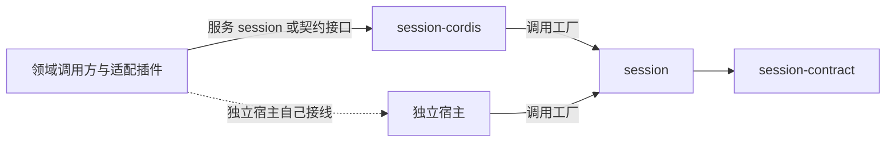

# Session 通用实现的使用与定位

本页说明谁在什么场景构造与使用本成员，独立使用与经 Cordis 使用有什么区别，以及本成员在会话组中的位置。系统关系归[会话与工作](../../../../docs/architecture/runtime/session-and-run.md)，组内分解归[组架构](../../docs/architecture.md)。本页不另立架构。

本成员现在没有导出。下面是 [SPEC](../SPEC.md) 与[构造入口](public-api.md)固定的用法，随工厂的实现生效。

## 谁使用本成员

| 使用方 | 场景 | 怎样使用 |
| --- | --- | --- |
| [session-cordis](../../session-cordis/README.md) | 应用以 Cordis 装配会话服务 | 插件装载时调用工厂，把实例的四个面挂到服务 `session`，插件卸载时停止实例 |
| 不用 Cordis 的独立宿主 | 测试台、单进程工具或其他框架的宿主 | 直接调用工厂，自己提供全部端口与唤醒 |
| 本成员的测试 | 以替身跑完整个状态机 | 用替身端口调用工厂，按 [verification](../verification/README.md) 的场景驱动 |

只消费领域接口的调用方不安装本成员。它们安装 [session-contract](../../session-contract/README.md)；经 Cordis 调用的插件安装服务定义 [session-cordis-contract](../../session-cordis-contract/README.md)。受理入口、Agent 适配、Model 与 Tool 适配、历史读取者都属于这一类，它们不知道本成员的存在。



图投影[组架构的安装与源码依赖](../../docs/architecture.md#安装与源码依赖)里与本成员相关的边。两者不一致时以组架构为准。

## 独立装配

独立宿主直接调用工厂。下例是职责伪代码，不表示当前包已有运行导出：

```text
实例 = createSessionInstance(依赖, { policy: defaultSchedulingPolicy 或替换后的策略 })

依赖：accessCheck           = 每次实际操作核验当前访问（启动条件，尚未实施）
      transactions          = 存储提供者的事务端口（启动条件，与 accessCheck、principals 一起）
      identity、evidence、clock、idle、context
                            = 完整接口；底层能力缺席时方法返回 unavailable
      notifier、agentDrive、scopeRelease、admission
                            = 现取函数；返回 null 表示当前缺席
      principals            = 维护拥有者签发的 coordinator 与 maintainer 主体（启动条件）

调用方：受理入口   使用 实例.facesFor('intake')
        外部协调者 使用 实例.facesFor('coordinator')
        维护者     使用 实例.facesFor('maintainer')
        读取者     使用 实例.facesFor('reader')

唤醒：对每个要服务的租户调用 实例.maintain(租户)，保存返回的句柄
      其他进程的提交通知到达时调用 实例.committed(通知)
      资产、工作区或设置的变化通知到达时调用 实例.changed(通知)

结束：释放各租户的维护句柄，再调用 实例.close()
```

独立宿主要自己承担 session-cordis 替它做的事：

1. 按调用方类分发面。一个调用方只拿它那一类的面，不把全部面交给所有调用方。
2. 把底层能力缺席翻译为端口方法返回 `unavailable`，不传入空实现或默认成功。
3. 每个租户在全部进程里只有一个扫描者。第一版只装一个实例即可兑现；多实例之前必须先有租约协议（[S3](../SPEC.md#s3)）。
4. 接通提交通知与变化通知。通知丢失不影响正确性，S3 的周期扫描会补查（[CR-24](../SPEC.md#cr-崩溃矩阵)），只是工作会延迟到下一个扫描周期。
5. 停止时先释放维护句柄，再停止实例。停止不取消任何外部执行，外部效果也不因停止而撤回。

业务身份仍是每次调用的参数。宿主不把租户或会话写进依赖或配置，也不为每个会话构造一个实例。一个实例服务全部会话，租户隔离靠每次调用的 `Access` 与事务端口的核权。

## 框架装配

装配 Cordis 的应用不直接导入本成员。[session-cordis](../../session-cordis/docs/cordis.md) 承担下列接线，独立调用不需要安装它：

| 事项 | session-cordis 怎样做 | 独立宿主怎样做 |
| --- | --- | --- |
| 构造 | 插件装载时调用工厂；`sessionTransactions` 缺席时服务停在 `PENDING`，不构造实例 | 直接传入事务端口 |
| 端口 | 以[端口服务键](../../session-cordis-contract/docs/cordis.md#端口服务键)取得端口；按调用现取的端口经 `ctx.get` 在调用点取得 | 自己传入实现或现取函数 |
| 配置 | 以 Standard Schema 校验插件配置，再交给工厂 | 自己构造 `SchedulingPolicy`，工厂仍校验 |
| 调用方类 | 读 intercept 配置里的调用方类，调用 `facesFor` | 自己按调用方分发 |
| 唤醒 | 订阅 `session-cordis-contract/committed` 事件转给 `committed`；把来源拥有者的变化事件转给 `changed`；绑定每租户扫描者 | 自己接通 |
| 停止 | 插件卸载时释放维护句柄并停止实例；服务换代时新旧实例可能短暂并存，安全靠操作身份、`expected` 核对与提交围栏，不靠先后顺序（撤除时序的假设见 [session-cordis](../../session-cordis/SPEC.md#明确缺项)） | 自己按顺序停止 |

经 Cordis 时，本成员的行为不变。区别只在接线的拥有者：Cordis 的注入、生命周期与事件派发归 session-cordis，机制与失败语义仍归本成员 SPEC。卸载插件不改变已经提交的业务事实（[Cordis 说明](cordis.md)）。

### 现在的真实消费者

session-cordis 的 `package.json` 已经列出本成员，但两边的根入口都还没有导出，所以现在没有运行中的调用。其他包不依赖本成员。
