# Session 实现流程

本页把 [SPEC](../SPEC.md) 的机制展开成流程：命令处理器怎样完成一次提交，五个协调器与七个调度器各自在什么时候动、调用什么、把回执写到哪里。契约层的协议流程归[契约流程](../../session-contract/docs/flows/README.md)，跨成员分工归组根的[关键流程](../../docs/key-flows.md)。本页只引用契约条款，不新增条款。图中参与者是逻辑角色，不表示进程或共同寿命。运行实现目前为空。

## 构造与调用

工厂以依赖聚合与配置构造服务。构造顺序：核对当前访问检查、事务端口与内部主体在场，否则服务停在不可用，不启动任何协调器与调度器；装入 `SchedulingPolicy`；注册五个协调器与七个调度器；S3 做一次启动扫描。宿主把框架服务适配为端口，本成员经端口调用依赖。

### 命令处理器的一次提交

对应 [CP-01](../SPEC.md#cp-01)。每个变更命令走同一条流水线，一次提交。

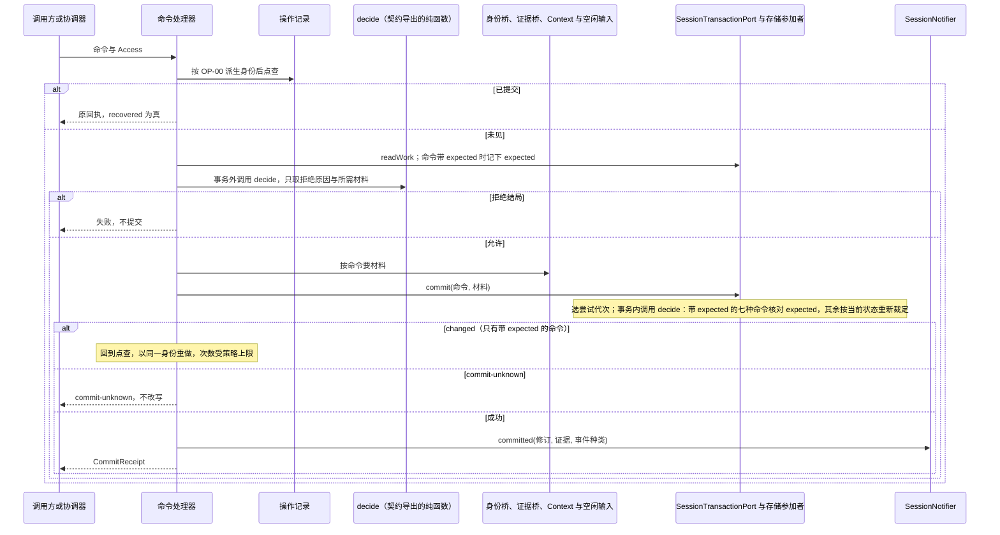

命令到条目的编码只在 `decide` 里。事务外的 `decide` 只决定是否拒绝与要收哪些材料，结果不进入提交。重做与同一意图的重试沿用同一操作身份，存储参加者为每次尝试开新的尝试代次（[尝试代次](../../session-storage-sql/SPEC.md#w1-attempts)）。Session 为参加者时（[CP-02](../SPEC.md#cp-02)），存储参加者在执行记录提供者的事务里调用 `decide` 并写条目，由提交方提交。

### C1 受理流水线

对应 [C1](../SPEC.md#c1) 与 [EX](../SPEC.md#ex-1)。细化组根的 [F-SE01](../../docs/key-flows.md#f-se01-一条输入从受理到推进)。

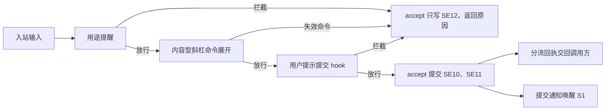

### C2 Agent 推进协调器：开 Run 与交入

对应 [C2](../SPEC.md#c2) 的开 Run 与续入两行，依据 [PM-02](../../session-contract/SPEC.md#pm-02)、[PA-01](../../session-contract/SPEC.md#pa-01)、[PA-09](../../session-contract/SPEC.md#pa-09)。

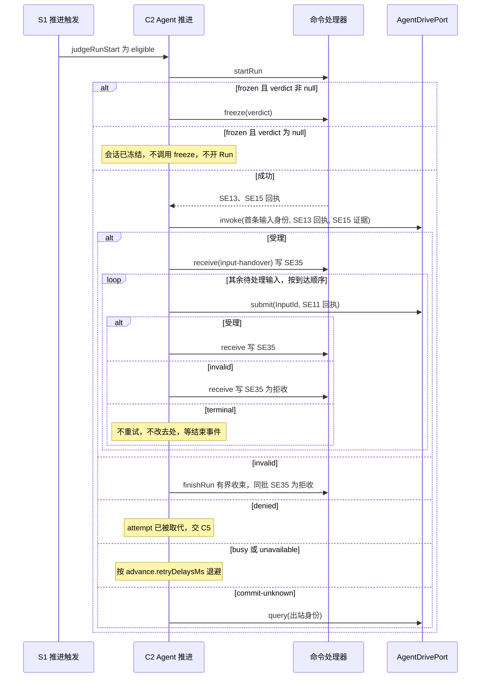

### C2 Agent 推进协调器：同日志解释与进度

对应 [RD-01](../SPEC.md#rd-01) 至 RD-07，依据 [EC-01](../../session-contract/SPEC.md#ec-01)、[EC-02](../../session-contract/SPEC.md#ec-02)。读取与解释在 session-adapters 的 [AD-02](../../session-adapters/SPEC.md#ad-02)。不产生后果的事件不单独提交，持久进度随下一次解释提交前进，这是 EC-02 的规则。细化组根的 [F-SE02](../../docs/key-flows.md#f-se02-agent-事件到日志条目)。

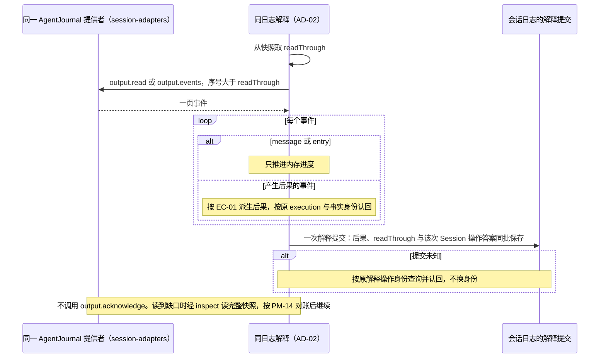

### C2 Agent 推进协调器：恢复、接管与换代

对应 [C2](../SPEC.md#c2) 的恢复与换代两行，依据 [PM-03](../../session-contract/SPEC.md#pm-03) 至 [PM-06](../../session-contract/SPEC.md#pm-06)、[PM-14](../../session-contract/SPEC.md#pm-14)。

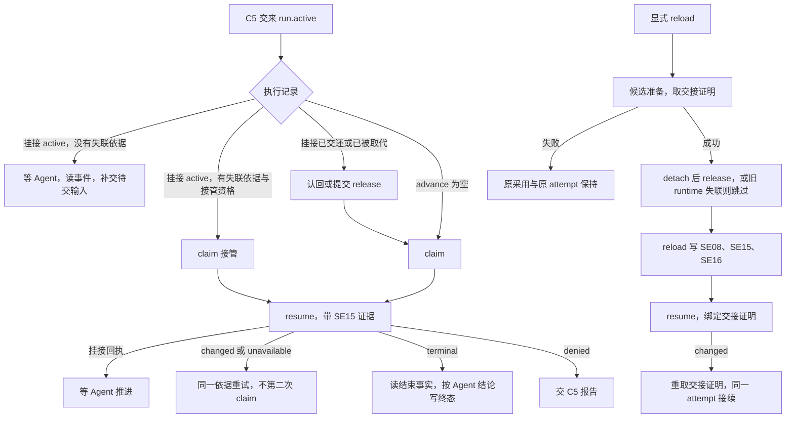

### C2 Agent 推进协调器：冻结判定到达

对应 [C2](../SPEC.md#c2) 的冻结行，依据[常驻工具与会话冻结](../../session-contract/SPEC.md#常驻工具与会话冻结)。

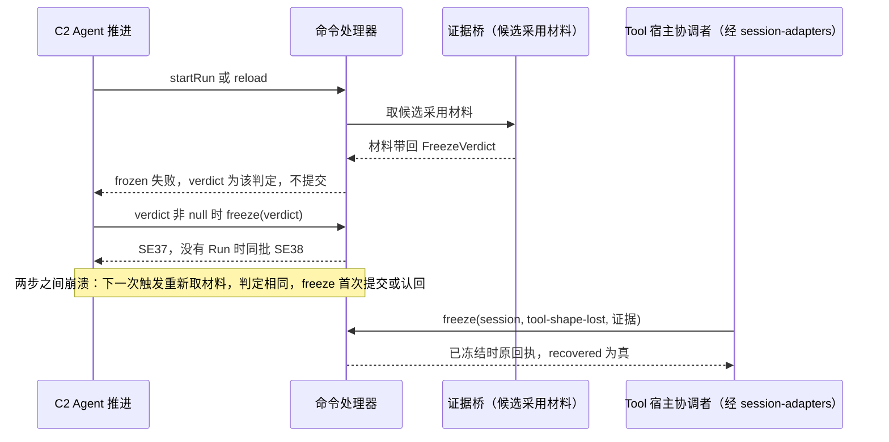

### C3 控制传播协调器

对应 [C3](../SPEC.md#c3) 与 [PM-13](../../session-contract/SPEC.md#pm-13)。

1. 控制提交成功后，协调器按原 operation 经 AgentDrivePort.control 送到 Agent 长期控制入口，不先取得挂接。
2. Agent 的控制结果、收束与 resume 顺序按 [J07 映射](../../session-adapters/SPEC.md#ad-14)。受理与实际停止分别核对，未知保留责任。
3. S5 以原身份重放未核对责任。超过上限仍保留 propagating 并报告。原控制的传播、生产者核对与原责任交接全部对账后才成为 reconciled。

Tool 围栏归 Agent/Tool J03，不计入该进度。取消或 claim 不必然触发 start-fence，触发政策仍属 #502 未决项。Session 不发失效调用，也不生成另一套围栏任务。

### C4 归档与级联协调器

对应 [C4](../SPEC.md#c4)，依据 [ScopeReleasePort](../../session-contract/SPEC.md#scopereleaseport)、[级联推进](../../../../docs/architecture/runtime/control-and-recovery.md#级联推进)。细化组根的 [F-SE04](../../docs/key-flows.md#f-se04-归档级联与作用域释放)。

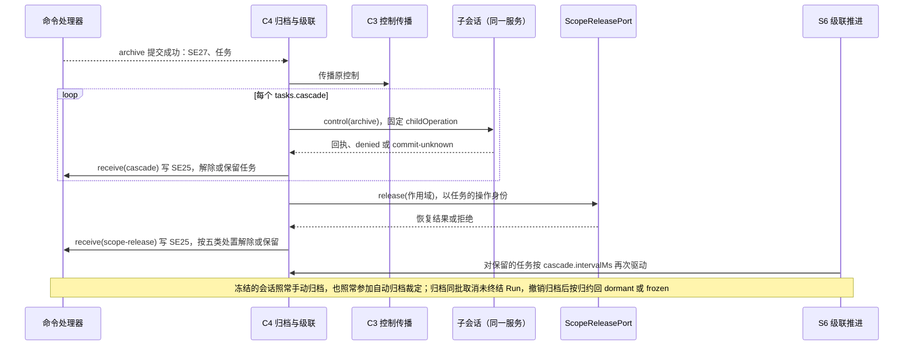

### C5 恢复协调器

对应 [C5](../SPEC.md#c5)，依据 [PM-14](../../session-contract/SPEC.md#pm-14)、[P-5](../../session-contract/SPEC.md#具名前提与明确缺项)。细化组根的 [F-SE05](../../docs/key-flows.md#f-se05-恢复)。

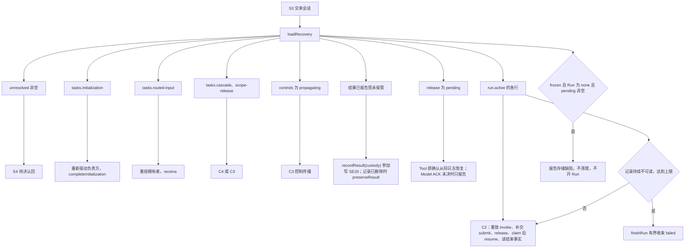

任一拥有者返回 `unavailable` 时保留该项，退避归 S3。

### C5 原生产者确认的恢复

对应 [C5](../SPEC.md#c5-release)，依据 [JC-Release](../../session-contract/SPEC.md#jc-release) 与 EC-04/05。

Tool 宿主收到 saved 后自己解除交付责任，Tool 原确认怎样写入同一日志未定（[JC-RELEASE-TOOL-PATH](../../session-contract/SPEC.md#jc-release-tool-path)）。日志中已有该确认时，AD-05 核对原版本后 receive(release)。确认未到保持 pending，Session 扫描不代发解除。Session 提交未知先查询原 operation。Model ACK 未决时只报告，不执行动作，不以 received/saved 写 confirmed。

### 调度器与协调器的接续

对应 [S1](../SPEC.md#s1) 至 [S7](../SPEC.md#s7) 与 [SR](../SPEC.md#sr-1)。调度器只决定何时再检查，不写日志。

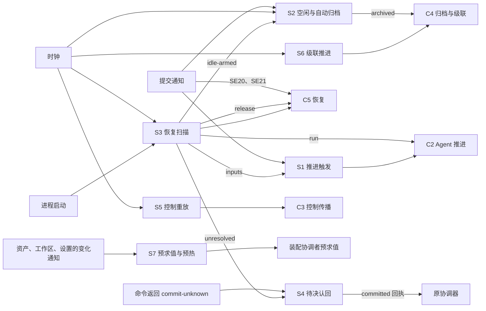

#### S1 推进触发

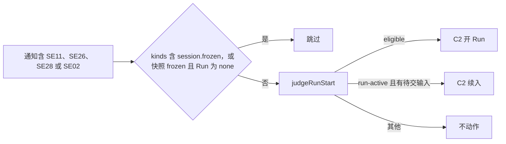

#### S2 空闲与自动归档

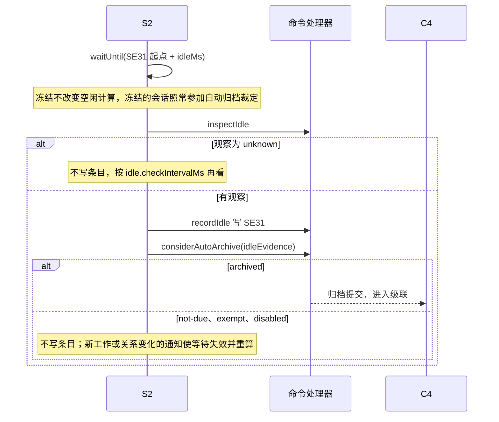

#### S3 恢复扫描

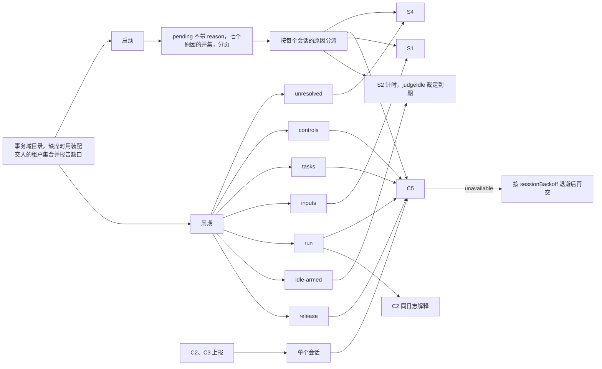

#### S4 待决认回

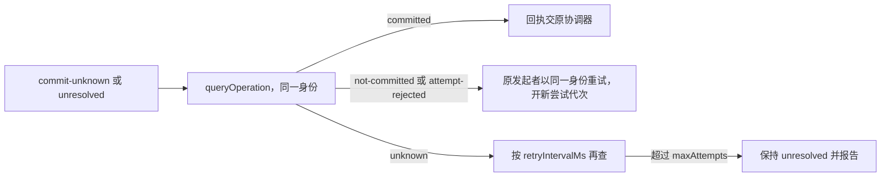

#### S5 控制重放与 S6 级联推进

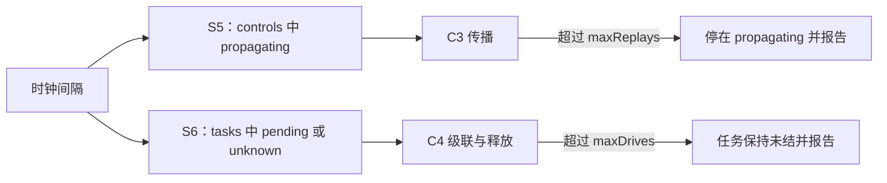

#### S7 预求值与预热

依据[比对代替求值](../../../../docs/architecture/runtime/assembly-and-change.md#比对代替求值)。细化组根的 [F-SE10](../../docs/key-flows.md#f-se10-新-run-开始的求值与重装判定)。

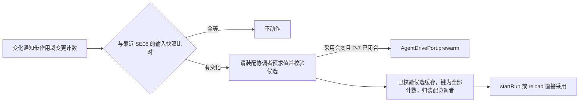

## 退出

退出先保留原工作与未完成责任，再交还本成员持有的资源。顺序：调度器停止接受新的触发；在途命令跑完或返回未知；协调器在当前命令结束后停止；释放时钟等待与缓存。退出不回滚已提交的事实，不补发未发出的出站调用，不发通知。重启后 S3 找回未完成的任务、传播中的控制与未知操作，以同一操作身份重放。具体 Cordis 插件的注入撤除与换代见 [session-cordis](../../session-cordis/docs/cordis.md)。
