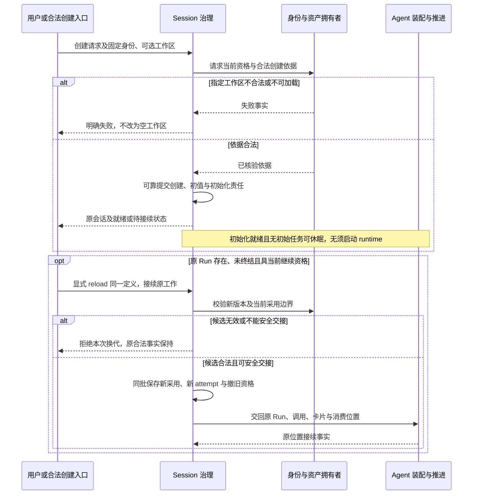
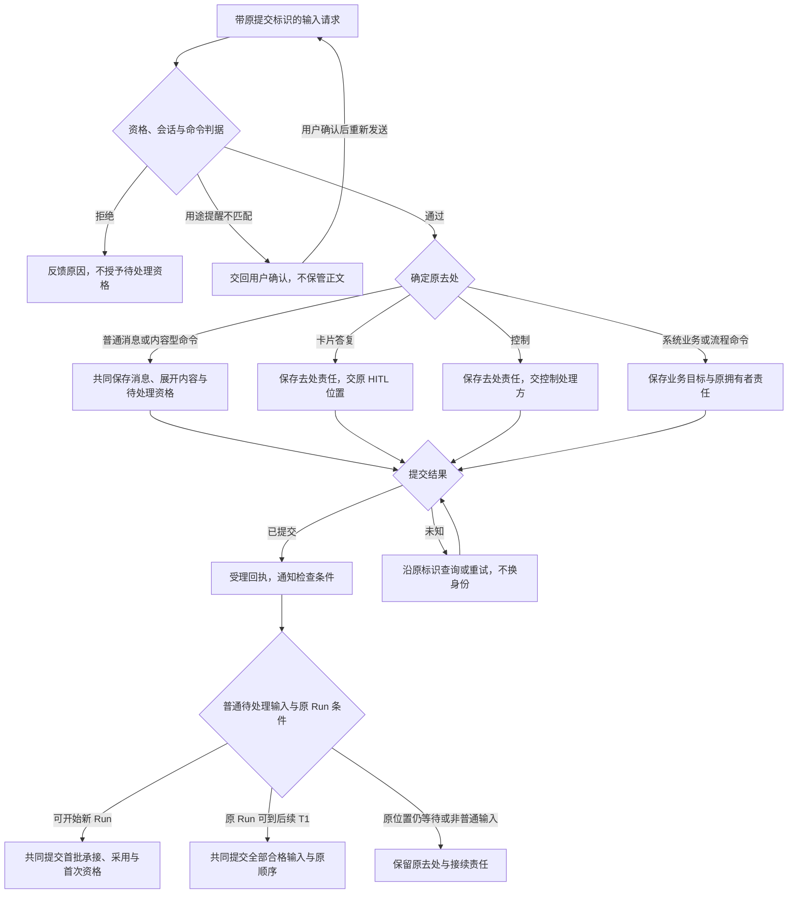
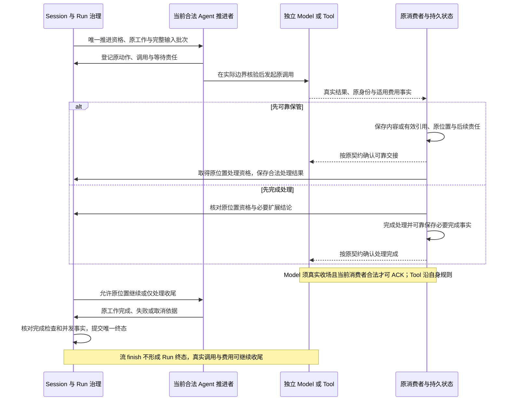
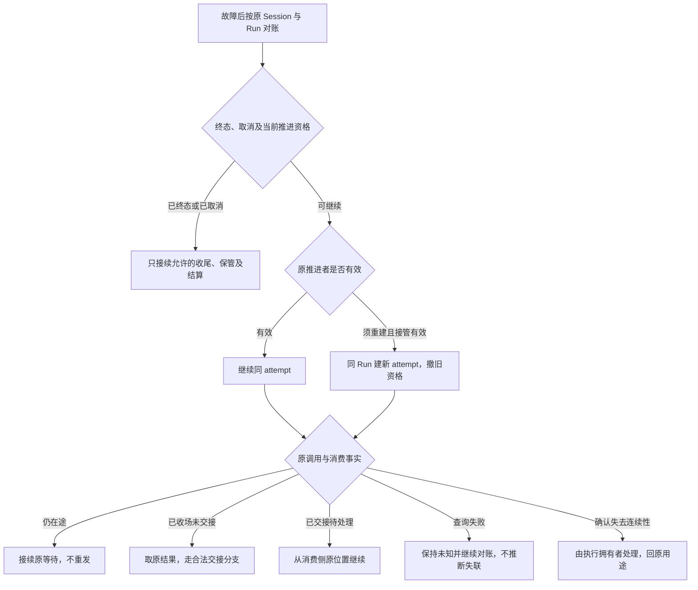
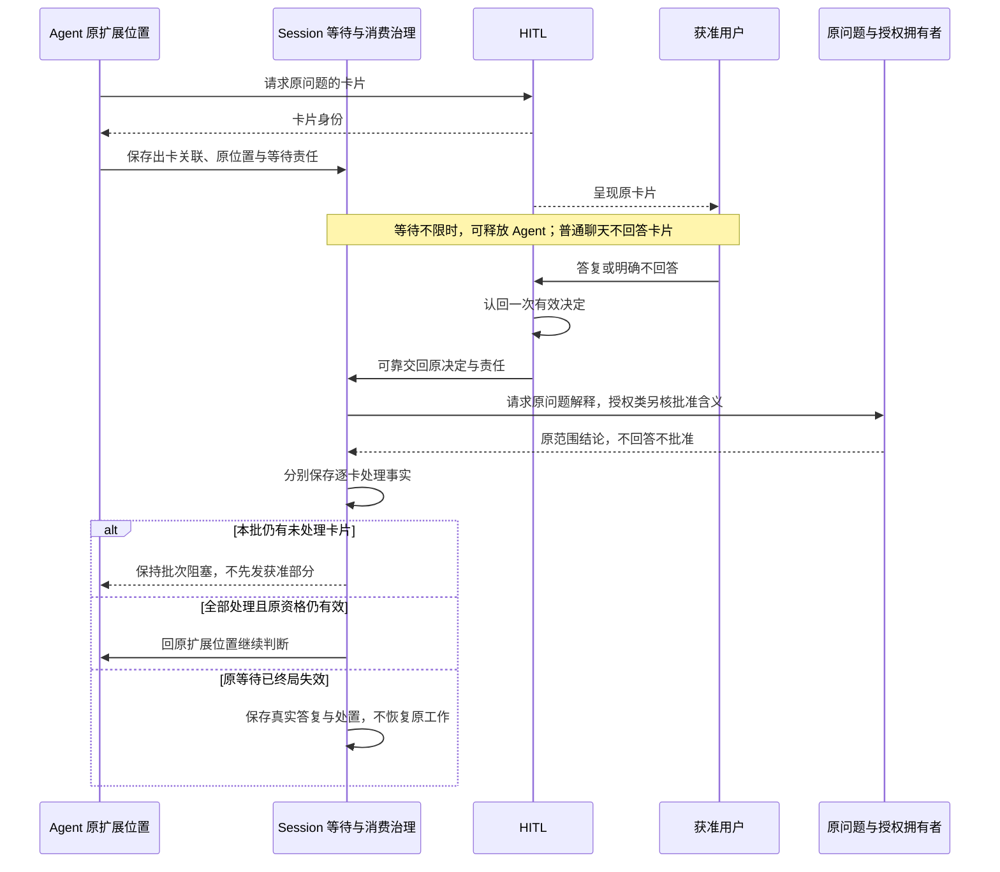
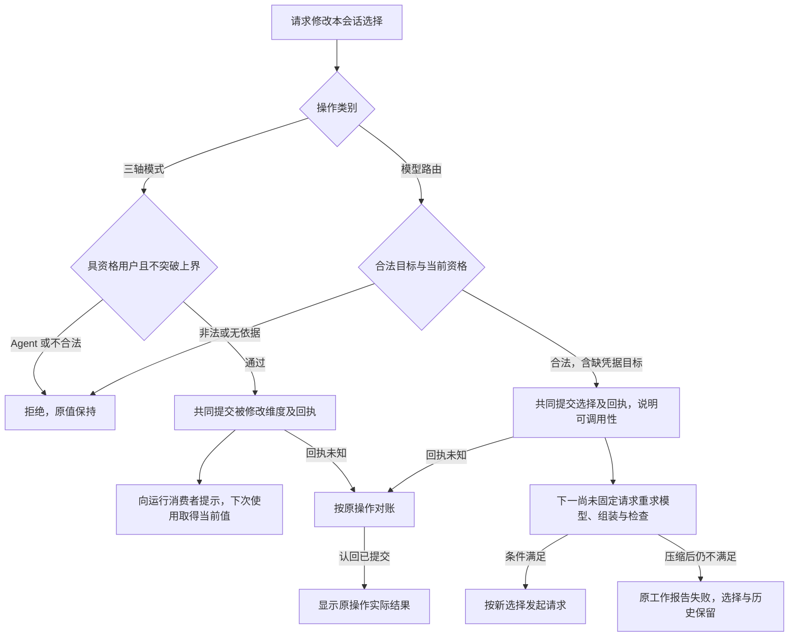
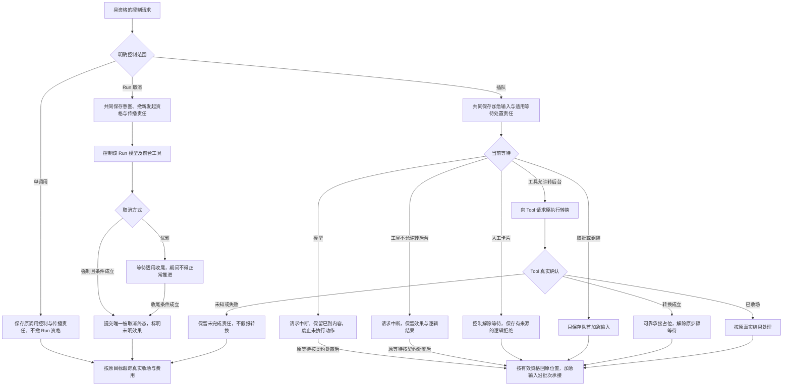
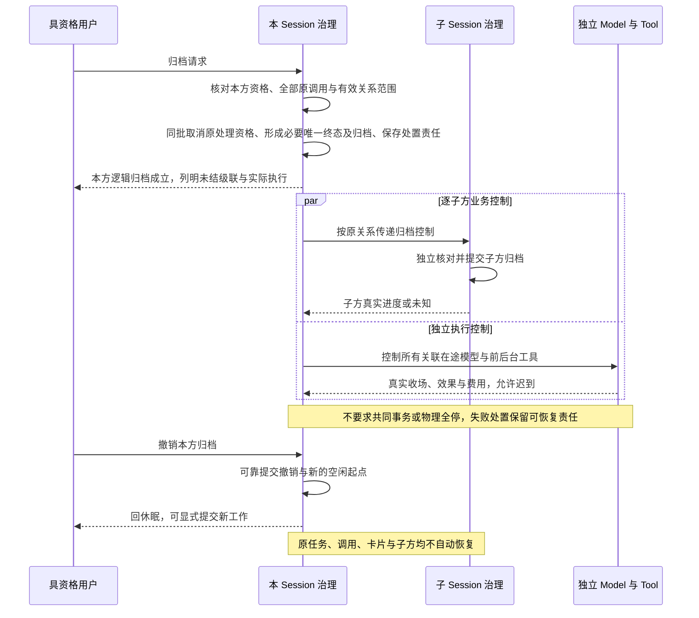
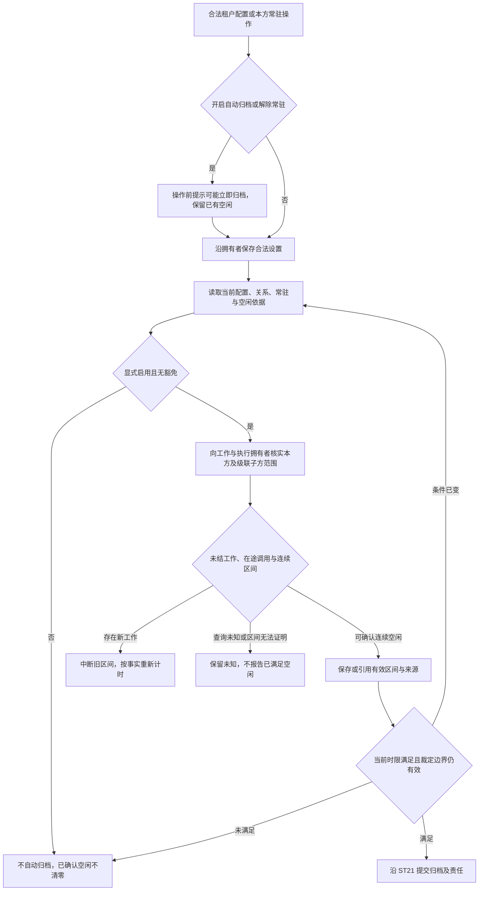
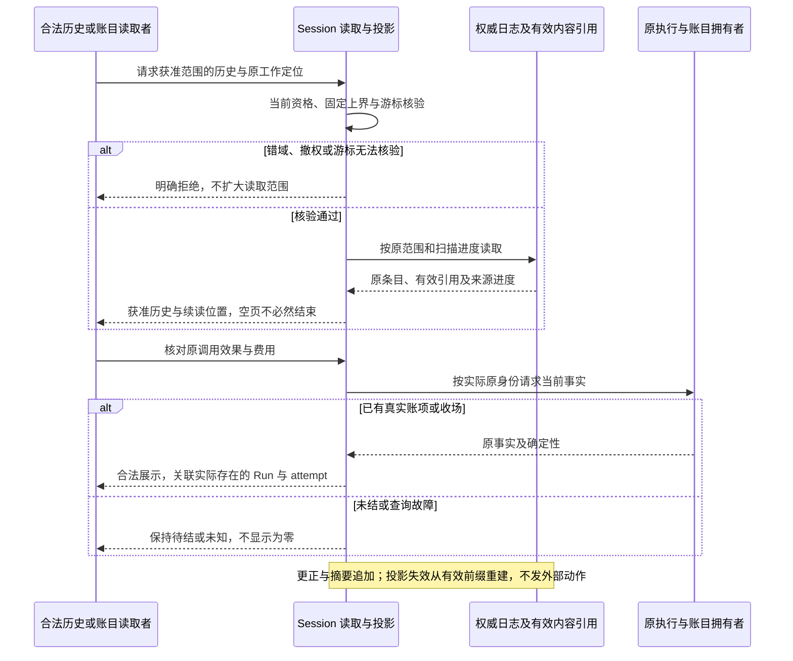

# session 关键协作流程

状态为待审技术设计。正式维护位置不授予技术接受、实施或支持；精确公开形状仍待定义。

## 流程适用范围

状态为候选，待用户确认。本页对应[产品关键用户旅程](../../../../.meta_harness/design/product/sessions-and-work/design.md#关键用户旅程)，表达 Session 受理、治理及原结果消费的协作顺序。F-SW 只是文档定位号。事件含义唯一归[SE01 至 SE34](session-log-events.md#原生事实类别)，状态、守卫及完整提交结果唯一归[ST 转移表](session-state-transitions.md#命令守卫与完整结果)。本页不增加状态或事件。

Session 保存会话事实，Agent 决定 Loop 下一步，Model 和 Tool 保存真实执行，HITL 保存卡片决定，授权拥有者解释资格与批准，Context 负责相应输入。图中箭头标明请求、控制、事实或保管交接，参与者是逻辑角色，不表示部署或共同寿命。共同提交只约束本会话必需事实与责任，不包揽外部发起、ACK 或物理停止。下列 flowchart 表示活动与依赖，不是严格 UML 或算法证明。

所有变更先核验作用域、当前资格与原操作。同次已提交操作认回原结果；提交未知保持原身份对账。一次尝试被拒或查询未找到，不能证明所有旧尝试均未提交。只有持久裁定足以阻止旧尝试晚到生效时，才可报告原操作明确未提交。机制归[共同提交算法](internals.md#追加与共同提交算法)。各图中“可靠提交”均受该规则约束。

## F-SW01 创建、版本采用与 reload

对应 [J-SW01](../../../../.meta_harness/design/product/sessions-and-work/design.md#j-sw01)。创建采用 ST01/ST02，新 Run 采用 ST06，普通接续及 reload 采用 ST08 至 ST11。身份、设置、定义与工作区拥有者提供当前可核验依据，Session 负责本会话采用。换代时，撤销旧推进权和保存接续依据一起成立，否则换代还没发生。原执行不因撤权销毁。

无 Run 时可以校验装配输入，不能创建 attempt；原 Run 已终结后不能用 reload 新增它的 attempt 或恢复推进。上述换代段只表达合法未终结 Run 的交接，不规定其他 reload 产品行为。创建或 reload 回执丢失按原操作核对。普通恢复采用原版本，不走显式 reload。新 Run 采用最新合法发布版本的跨源裁定不能仅靠 Session 尾部 CAS 证明；精确接口及围栏仍属 [SW-M01](internals.md#sw-m01-技术兑现义务)。已固定外部调用保留原输入。

## F-SW02 可靠受理、分流与完整批次

对应 [J-SW02](../../../../.meta_harness/design/product/sessions-and-work/design.md#j-sw02)，采用 ST03 至 ST07。入口受理协调者拥有提交责任，命令专有行为交命令拥有者。

受理与后续承接是不同提交。首批承接与 Run 创建共同成立，后续 T1 则按原位置确定完整批界。不能从上述通知直接跳到新 Run。存储不可用不报告受理成功，通知丢失由权威状态补查。分块、归档竞争及回执未知的完整结果按 ST 表处理。

## F-SW03 工作推进、结果交接与恢复

对应 [J-SW03](../../../../.meta_harness/design/product/sessions-and-work/design.md#j-sw03)，采用 ST06 至 ST10、ST14 至 ST16、ST20 和 ST26。Session 的责任止于合法工作及交接，Loop、流式和真实执行仍由各自拥有者维护。正常发出时，发起者在登记时生成稳定调用身份。固定输入、调用身份和准入一起提交。模型受理和结果容量预留在同一真实事务里成立，否则不算已经发出。

两条交接路径不是两个必须依次执行的阶段。先完成处理分支不强制额外保存一份可重领全文或 SE20；它须保存足以恢复责任的完成依据。先保管分支不要求扩展已完成或工作仍可推进，之后的业务处理另核原资格。消息准入拒绝不改写原执行事实。ACK、生产侧清理和结算各自可查，不能让清理失败回滚已成立交接。

已知工具不可用的逻辑结果只说明未执行原因，恢复不补做工具。实际发起围栏、原消费位置公开形状、ACK 协调和在途耐久仍由 SW-M01 对应拥有者细化。

## F-SW04 出卡、答复与原扩展位置接续

对应 [J-SW04](../../../../.meta_harness/design/product/sessions-and-work/design.md#j-sw04)中的扩展等待，采用 ST17a、ST17b、ST17c。下图只表达扩展发起的原批次，工具内部 Ask 的答复回 Tool 自身原等待，见[TL-F04](../../../../packages/tool/tool/docs/key-flows.md#tl-f04)。两者不能互换接续位置。出卡、答复交回及处理可以在不同时间提交，各阶段引用已经成立的原事实。

接续后可能得到后续结论或再出新卡，不一律跳到工具发起。断线恢复认回原卡片与决定，交回失败保留原责任，不能假造超时答复。插队解除等待的逻辑拒绝来自控制事实，不成为 HITL 的人类决定。精确交接与失效竞态仍归 SW-M01，单次许可消费及参数绑定归授权契约。

## F-SW05 模式变化与模型选择

对应 [J-SW05](../../../../.meta_harness/design/product/sessions-and-work/design.md#j-sw05)，采用 ST12/ST13。Session 拥有当前值，权限及设置拥有者核对修改资格，模型拥有者裁定合法路由，Context 和 Agent 采用后续输入。

图中的提交未知分支没有确认变更成功，后续采用须以权威已提交值为准。当前在途或已固定调用不走 NEXT，其输入保持。模型切换不换定义或 attempt。模式初值与恢复值沿 ST01/ST12，不能以租户默认覆盖既有值。实际修改资格及跨源合法目标裁定仍归 SW-M01。

## F-SW06 插队、单调用控制与 Run 取消

对应 [J-SW06](../../../../.meta_harness/design/product/sessions-and-work/design.md#j-sw06)，采用 ST18、ST19 及 ST20。控制发出、逻辑处置、真实确认分别保存。取消一旦生效，会话就记录 Run 的逻辑终态。真实收场之后另报。强制或非强制只影响停止有多急。

工具转换不重建 Tool、不释放仍在执行的名额；单独请求转后台也可走 ST19b，不额外制造插队消息。Run 取消不隐式传播到后台、子会话及无关 Run 外调用。完成已先成立时保持原终态，控制报告已终结。控制传播失败、回执未知或协调者退出后按原责任接续，不能把未确认停止标成已停止。精确控制与转换协调归 SW-M01。

## F-SW07 归档、级联与撤销

对应 [J-SW07](../../../../.meta_harness/design/product/sessions-and-work/design.md#j-sw07)，采用 ST21 至 ST23。四态仍只由[原状态图](session-state-transitions.md#四个生命周期视图)解释；下面展示跨参与者顺序。

未终结 Run 与归档同批形成一个 SE26，SE27 引用它，已有终态保持。归档后新任务明确拒绝，先受理后归档则取消已受理资格。迟到结果只完成仍合法的保管、历史和结算，不入旧任务队列；撤销归档也不恢复其投递资格。父方撤销不能撤销子方已成立的归档，独立 handoff 排除在子方集合外。关系采用与父归档的并发范围、逐方恢复协议仍归 SW-M01，不用一次快照证明级联完整。

## F-SW08 连续空闲取证与自动归档

对应 [J-SW08](../../../../.meta_harness/design/product/sessions-and-work/design.md#j-sw08)，采用 ST23、ST24a、ST24b，成立后复用 F-SW07 的归档流程。

空闲取证可在开关关闭或常驻时独立维护，并不依赖归档结果。子会话常驻拒绝。普通重启、成员失效和配置关闭不清零已成立区间，无法确认的时间不当空闲证明；撤销归档以撤销时刻重新起算。当前合法设置、连续区间及所有在途调用不能只靠本地日志或 CAS 证明。跨源取证及设置接口归 SW-M01。

## F-SW09 历史读取、结果定位与账目核对

对应 [J-SW09](../../../../.meta_harness/design/product/sessions-and-work/design.md#j-sw09)，行为归 SL01 至 SL14、ST25/ST26 及读取规格。Session 只提供获准历史与真实账目关联，不裁定执行成本或以遥测代账本。

流式未封口状态按原交付协议展示，不能把当前快照当完整历史。压缩不覆写消息或标注，工具全文保管规则不套模型清理。当前权限撤回后下一页重新拒绝，账目资格不授予正文读取权。有效前缀缺失或解释不明时隔离相关投影；性能与逐片耐久须由 SW-M01 的实际提供者和流式拥有者给出证据。

## 缺项与持续验证入口

以上流程不发布精确 Schema/API，也不确定存储布局、全局锁或部署参数。[SW-M01](internals.md#sw-m01-技术兑现义务)保留共同提交与发起围栏、控制及级联、ACK、在途耐久、连续空闲和规模证据的责任。每一旅程的规格定位及组合场景见[旅程验证](../SPEC.md#关键旅程对应与验证)。图与场景存在不证明行为已经实现或获得接受。
