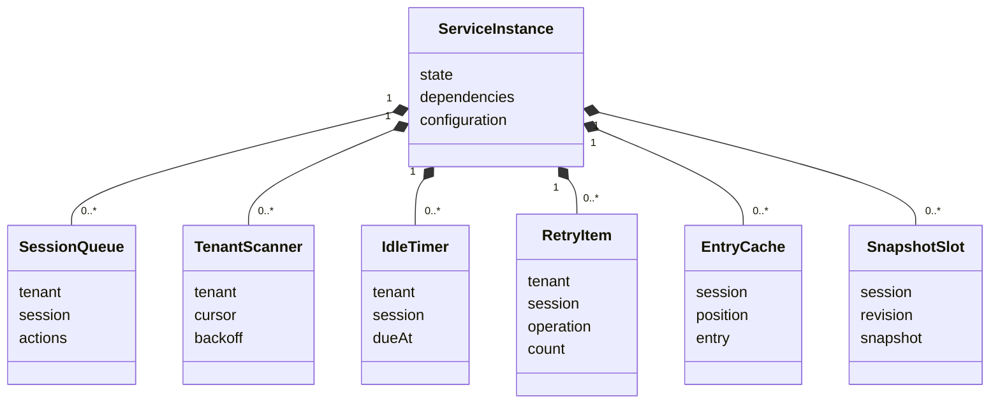

# Session 通用实现的对象模型

本页描述本成员的实现内部对象：服务实例、调度与协调用的内存项、缓存项，以及一次命令调用的临时对象。它们是技术对象，不自动成为领域对象。`WorkSnapshot`、`CommitReceipt`、`ExecutionRef`、`ControlProgress`、`RecoveryTask`、`OperationRecord` 等契约对象归 [session-contract 的公开定义](../../session-contract/docs/public-api.md)与[契约对象模型](../../session-contract/docs/object-model/README.md)，本页只说明本成员怎样持有或引用它们。

状态为候选技术设计。根入口目前为空。下面的对象由 [SPEC](../SPEC.md) 固定，类名与字段名随实现确定。

## 构造对象

工厂的两个参数与一个返回值。具体形状只在[构造入口](public-api.md)维护。

| 对象 | 身份 | 持有什么 | 拥有者 | 生灭 |
| --- | --- | --- | --- | --- |
| `SessionDependencies` | 一次工厂调用的参数 | 契约声明的构造依赖端口与出站端口；协调与维护动作使用的主体；受理拓展点的槽 | 调用工厂的一方 | 工厂调用时传入；实例停止后不再使用 |
| `SessionConfiguration` | 一次工厂调用的参数 | `SchedulingPolicy` | 调用工厂的一方 | 工厂调用时校验并固定；运行中不改。改策略要停止旧实例、构造新实例 |
| 服务实例 | 一次工厂调用 | 下文全部内存项、实例状态与对两个参数的引用 | 调用工厂的一方，负责停止它 | 工厂调用时创建，状态为运行；`close` 后经停止中变为已停止 |

业务身份不在构造对象里。租户、会话与原操作身份是每次调用的输入（[资源与替换](../SPEC.md#资源与替换)）。

## 状态拥有者

本成员不持有耐久状态。耐久事实的唯一拥有者是事务端口的提供者，它在同一次提交里保存条目、操作记录、治理状态、派生索引与消费游标（[SessionTransactionPort](../../session-contract/SPEC.md#sessiontransactionport)）。下表的内存项全部可丢。丢失后由 S3 的启动扫描从权威读重建，重复的命令由操作身份认回（[AP-4](../SPEC.md#ap-应用层六条规矩)）。

每个按会话或操作建立的内存项都以租户与会话共同定位。不同租户的项不共用一个槽，一个租户的扫描、计时或重放不会读到另一个租户的会话。

### 调度与协调的内存项

| 对象 | 身份 | 持有什么 | 拥有者 | 创建 | 消失 |
| --- | --- | --- | --- | --- | --- |
| 每会话串行队列 | 租户与会话 | 待执行的协调动作，按到达顺序 | 服务实例 | 该会话第一次有协调动作时 | 队列为空时；实例停止时丢弃未开始的动作 |
| 推进触发项（S1） | 租户与会话 | 在途标记；在途期间到达的新通知合并成的一次重查标记 | 服务实例 | 提交通知或启动扫描触发该会话时 | 触发完成且没有待重查时 |
| 空闲计时（S2） | 租户与会话 | 从已确认 SE31 起点算出的到期时刻；时钟等待的取消信号 | 服务实例 | S3 交来带 `idle-armed` 原因的会话，或提交通知触及启用自动归档的会话时 | `recordIdle` 返回 `changed` 时换新计时；归档、停用自动归档或实例停止时 |
| 租户扫描者（S3） | 租户 | 当前扫描游标；每会话退避表 | 服务实例，按租户维护句柄 | 宿主为该租户开始维护时，随即做一次启动扫描 | 宿主释放维护句柄或实例停止时。游标不持久，重启后从零扫描 |
| 每会话退避项（S3、C5） | 租户与会话 | 下一次检查时刻与当前间隔 | 租户扫描者 | 该会话的处理返回不可用或失败时 | 处理成功或扫描者消失时 |
| 待决查询项（S4） | 租户、会话与操作身份 | 查询次数与下一次查询时刻 | 服务实例 | 命令返回 `commit-unknown`，或 S3 交来 `unresolved` 时 | 查询得到 `committed`、`not-committed` 或 `attempt-rejected` 时；超过 `pendingResolution.maxAttempts` 时停止查询并报告，项保留到实例停止 |
| 控制重放项（S5） | 租户、会话与控制操作身份 | 重放次数 | 服务实例 | 控制进度仍为 `propagating` 时 | 进度变为 `reconciled`，或超过 `controlReplay.maxReplays` 并报告后 |
| 任务驱动项（S6） | 租户、会话与任务的操作身份 | 驱动次数 | 服务实例 | 级联或作用域释放任务仍保留时 | 任务解除，或超过 `cascade.maxDrives` 并报告后 |
| 预求值项（S7） | 租户与会话 | 在途预求值的取消信号；本次比对用的计数 | 服务实例 | 变化通知的计数与最近 SE08 的输入快照不同时 | 预求值结束；同会话新的变化通知先取消它再新建 |
| 推进退避项（C2） | 租户、会话与出站操作身份 | 在 `advance.retryDelaysMs` 序列中的位置 | 服务实例 | Agent 返回 `busy` 或 `unavailable` 时 | 出站调用受理时；序列用尽后交 S3 |
| 原确认恢复项（C5） | 租户、会话与原结果版本 | 本轮扫描位置 | 服务实例 | Tool 原确认未投影，或 Model release 仍 pending | 原确认合法投影后结束；Model ACK 未决时只报告，不发生产者解除 |
| 有界恢复计数（C5） | 租户、会话与执行身份 | 读执行记录或接续的失败次数 | 服务实例 | `inspect` 或接续返回原记录不可读时 | 读取成功时；达到 `boundedRecovery.maxInspectAttempts` 后提交 `finishRun` 时 |

全部计数只在一个进程寿命内有效。重启后计数从零开始，所以每个上限是每个进程寿命内的上限（[S4](../SPEC.md#s4)、[S5](../SPEC.md#s5)、[S6](../SPEC.md#s6)）。

协调器 C1 至 C5 本身不是有状态对象。一个协调实例是串行队列里正在执行的一个动作，结束即消失。C2 的「每 Run 一个协调实例」由每会话串行队列兑现，因为一个会话至多一个未终结 Run。

### 缓存项

| 对象 | 身份 | 持有什么 | 拥有者 | 创建 | 消失 |
| --- | --- | --- | --- | --- | --- |
| 条目缓存项（[CA-1](../SPEC.md#ca-1)） | `(tenant, session, position)` | 从已确认提交前缀读到的解码条目，含内联载荷 | 服务实例 | 读取已确认条目后 | 按字节 LRU 淘汰，预算为 `cache.entryBudgetBytes`。从不因失效而删除 |
| 快照缓存槽（[CA-3](../SPEC.md#ca-3)） | `(tenant, session)` | 一份 `WorkSnapshot` 与它的 `revision` | 服务实例 | 权威读成功后 | 被同会话新快照替换；尾部修订不等或提交通知带来更大修订时丢弃；超过 `cache.snapshotSessions` 时按 LRU 淘汰 |

`SessionId` 只在租户内唯一，所以缓存键都带租户。缓存命中前先完成核权：CA-3 命中前的尾部点查经事务端口按调用身份核权；CA-1 命中只省去载荷读取，分页、披露核对与位置仍由事务端口的历史读取完成。缓存不省去访问核对。视图前缀摘要缓存（CA-2）归 session-adapters 的历史源插件，不在本成员。已校验装配候选的缓存归装配协调者。

### 一次调用的临时对象

| 对象 | 身份 | 持有什么 | 生灭 |
| --- | --- | --- | --- |
| 流水线调用 | 一次变更命令的调用 | 派生的操作身份与参数摘要；带 `expected` 的命令在第 2 步读到的 `expected`；`changed` 重做次数；收到的材料。重做沿用同一操作身份 | 命令调用时创建；返回回执、失败或 `commit-unknown` 时消失。重做次数不超过 `command.retriesOnChanged` |
| 参加调用 | 提交方事务里的一次参加 | 提交方交来的 `Participation` 与载荷；`decide` 的结局 | 提交方调用参加者时创建；参加者响应后消失。提交方提交成功并回传确认后才发通知 |
| 受理拓展点运行 | 一次 `accept` 之前的槽链运行 | 原提交、各槽的输出与结论 | C1 开始时创建；结论作为材料交给 `accept` 后消失。重复进入时重新运行 |

### 持久游标与内存游标

每个执行的持久游标是解释进度 `ExecutionRef.readThrough`。它是契约对象的字段，由存储随解释提交与其后果一起保存（[RD-01](../SPEC.md#rd-01)、[EC-02](../../session-contract/SPEC.md#ec-02)）。本成员不另存游标。只推进内存游标的 `message` 与 `entry` 事件，其内存游标由执行读取循环的一方持有，读取循环在 session-adapters 的 AD-02。空闲与完成的裁定只信持久游标（[RD-04](../SPEC.md#rd-01)）。

`RetryItem` 在图中合并表示待决查询项、控制重放项、任务驱动项、推进退避项、原确认恢复项与有界恢复计数。它们的身份与上限不同，生灭见上表。
