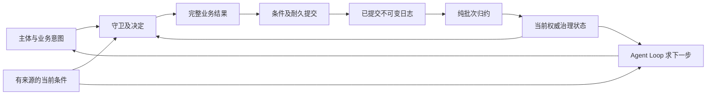
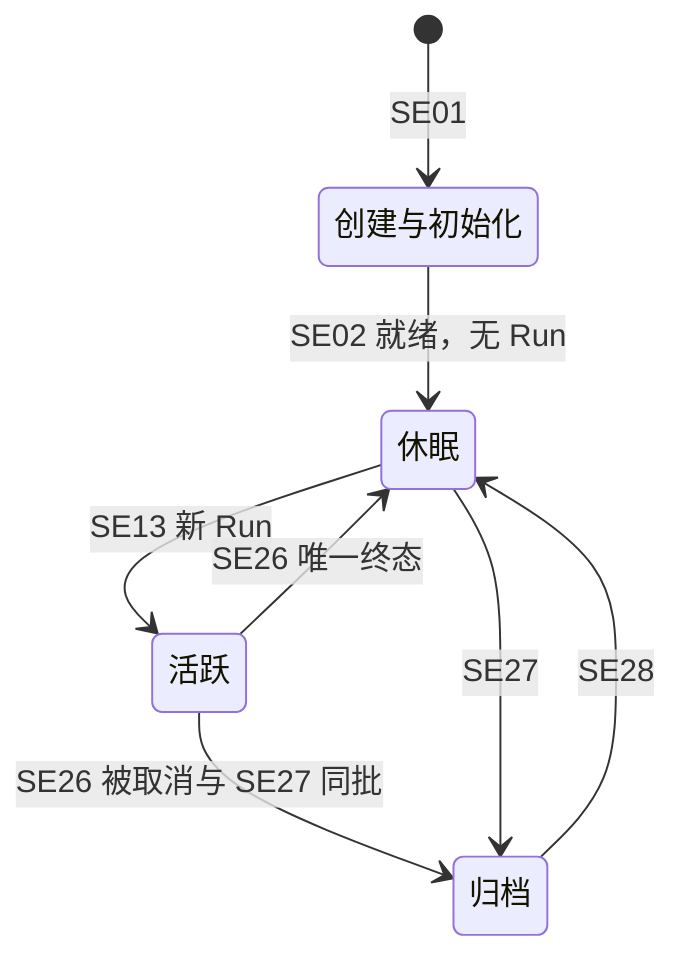

# Session 的逻辑状态、守卫与日志归约

状态为候选，待用户确认。本文说明已提交事实怎样构成会话治理，以及一次合法意图必须共同改变什么。[事件目录](session-log-events.md)拥有事实语义，[主架构](internals.md)拥有共同提交、原操作认回、固定读取及恢复。[Agent Loop 规格候选](../../../../packages/agent/agent-contract/docs/flows/loop.md)拥有下一步求值和扩展顺序，本文不建立第二套 Loop。

## 三个计算分别做什么



守卫决定当前是否允许提交。归约解释已经成立的事实，不重新授权。Agent Loop 在原事实和有来源的当下条件上求出下一步，实际执行仍由三个 runtime 各自负责。历史授权、当时资产版本或某个提交成功不能无限期授权将来的外部发起。

## 正交状态与唯一依据

以下是逻辑结构，不是公开类型或表布局。各结构有来源位置，治理必须覆盖其裁定边界；当前物理执行有效性和外部实时资格是组合判断，不能冒充日志纯投影。

| 维度 | 逻辑形状与唯一依据 | 不能由它推导什么 |
| --- | --- | --- |
| 身份与初始化 | 未创建，或 SE01 的固定身份及 SE02 的逐项状态、缺项和接续责任；就绪需全部必需条件成立 | 初始化失败不删除历史，不默认创建空 Run |
| 归档 | 未归档，或 SE27 的归档及取消范围；SE28 撤销只关闭该归档状态，旧取消事实保留 | 归档不证明物理全停，撤销不使旧工作复活 |
| 会话当前值 | SE03 至 SE09 的模式、选择、覆盖/继承、注册、自有恢复输入与实际采用；原授权关联沿 SE34 | 不把共享源复制成 Session 权威，不从最新默认补历史 |
| Run | 无未终结 Run，或唯一未终结 Run；每个 Run 的初始承接、追加承接与唯一 SE26 终态保留 | 未终结不要求存在驻留 Agent；后台未收场不恢复已终结 Run |
| attempt 与资格 | 每个 Run 最大已开始序号、采用依据及已交还/撤销事实；新 SE15 围栏旧序号 | 最大序号不是充分授权，SE17 退出报告不是治理终态 |
| 普通输入 | 有序已受理集合，扣除 SE13/SE14 承接以及 SE25/SE27 取消资格集合；去处由 SE11 固定 | 读取、通知、调用或看到消息不是承接 |
| 原调用关联 | SE18 的实际用途、原发起和消费位置；SE19 的原拥有者报告及后续投递资格 | 登记不证明真实发出，查询未知不证明从未执行 |
| 等待与处理 | SE18/SE22 原调用或整批卡片关联，SE20 保管、SE21 原位置处理、SE23 原答复及控制后果 | 到达不等于处理；一个工具收场不等于整批就绪 |
| 控制及收尾 | SE24 的意图和目标，SE25 的逻辑结果、传播/核对进度；真实执行与结算沿 SE19/SE32 | 请求停止不等于停止，取消等待不等于成功消费 |
| 关系与空闲 | SE29 关系、SE30 主方常驻、SE31 可确认空闲区间及归档时的配置/覆盖依据 | 休眠不等于连续空闲，空闲当前观察不是无限期有效证明 |
| 历史及解释 | SE10 消息、SE12 拒绝、SE17 可选退出、SE33 合法补充，来源和标注保持 | 留痕不授予新工作，摘要或更正不覆盖原事实 |

有效推进须同时满足原 Run 未终结、Session 允许该工作、没有已生效取消、attempt 为当前最大序号且未交还/撤销，并持有可核验的当前执行资格。日志重建的是逻辑资格范围；实际实例是否连续有效、是否需要换代由治理和资源拥有者检查，不由一条开始事实证明。

### 四个生命周期视图

创建/初始化保存未完成项和接续责任，只有必要初始化条件成立才能进入相应工作。就绪且未归档时，有未终结 Run 则活跃，没有则休眠。归档由已提交归档事实决定。正常活跃与休眠由 Run 事实派生，不追加独立生命周期开关。



图及 ST21/ST22 说明已就绪会话的正常归档路径，不增加删除、过期或失败这类第五状态。初始化阶段的接续或结束沿原创建/初始化契约裁定，不从图中推导未就绪会话归档后即成为就绪休眠。初始化缺项仍单独可查，不能靠生命周期标签假装工作可开展。未成立的创建/初始化操作沿其原责任处理，不把资源清理报告成成功归档。归档后旧执行的真实收尾只改变关联和待办，不改变四态；休眠可仍有后台或 Run 外调用。

## 命令守卫与完整结果

所有变更先取得可信主体与明确作用域，认回原操作，再以一致治理状态检查当前资格、原目标和业务条件。并发变化重新决定，不能给旧计算条目改序号后直接提交。下表按一次可独立提交的业务阶段列必要事实组合。同组字母分支可以在不同时间分别成立，只引用已经取得的前置事实，不要求后续阶段提前出现。一次提交中的结果必须完整，不是要求调用者手工拼接。SE26 在一批内也只存在一个有效终结事实，SE27 仅引用该事实，不另造归档专属 Run 终态。

| 转移 | 额外守卫或必要输入 | 必须共同成立的结果 | 拒绝或不变的情况 |
| --- | --- | --- | --- |
| ST01 创建 | 合法固定身份、类型要求与初始化输入；指定工作区须合法加载 | SE01 及已经取得的初值/采用；完成的项用 SE02 表达，初始普通输入用 SE10+SE11 | 已有创建按原操作认回；身份冲突拒绝，不更换身份 |
| ST02 初始化接续 | 原项与负责方匹配，合法结果可核实 | SE02 的取得值或失败及仍待接续责任；全体必要条件满足才就绪 | 旧或矛盾结果不覆盖已采用结果；查询故障不当作已就绪 |
| ST03 普通输入受理 | 目标允许受理，实际内容及引用可靠，准入通过 | SE10 消息、SE11 去处与待处理资格、原回执 | 归档先成立拒绝；未知不报告未受理 |
| ST04 拒绝与受理前提醒 | 原入口判据和必要反馈 | 适用 SE12 或业务干预留痕，不授予待处理资格 | 用途提醒确认前不保存被拦正文，不制造 Run |
| ST05 卡片/控制/业务分流 | 明确原目标与拥有者、合法责任承接 | SE11 的原去处；分别关联 SE23、SE24 或原业务处置 | 不当普通聊天输入，接入回执不证明原业务已执行 |
| ST06 新 Run | 已就绪未归档、无未结 Run、有非空合格普通输入，当前准入及适用登录确认成立 | SE13 的完整初始承接、合法 SE08 采用及首次 SE15 资格，精确批界和原接续位置 | 空队列不造 Run；并发两创建只准一个合法后继 |
| ST07 后续 T1 承接 | 原 Run 可推进、有效 attempt，Agent 给出的原位置允许取输入，无须先接续的本步骤调用 | SE14 的全部合格输入集合及顺序、资格解除和接续位置 | 不能挑一条、重领或把工程分块当新批界 |
| ST08 原实例继续 | 原实例及 attempt 仍有效，原等待或下一步条件已满足 | 继续同 attempt；只有确实发生的采用/处理事实按类别保存 | 通知本身不写 SE15；等待未满足不反复创建实例 |
| ST09 重建推进实例 | 原 Run 未终结、无有效业务取消，旧实例已交还/失去连续性，可核验接管资格 | SE15 的递增序号、原进度、等待与采用，围栏旧推进 | 双恢复只准一后继；旧执行的合法事实报告仍可承接 |
| ST10 交还推进资格 | 原 attempt 和接续位置一致，治理可恢复原等待或工作责任 | 必要 SE16 或已有换代/控制事实表达撤资格；不必有 SE17 | 不因此终结 Run 或取消独立执行，旧资格不能自行重新有效 |
| ST11 合法 reload | 同 AgentDefinition 标识、候选合法、跨源采用边界有效、安全交接可成立 | SE08 新采用、SE15 新 attempt 与旧资格失效同批，原调用/等待保留 | 校验失败保原合法采用；归档/取消先成立不能重新推进 |
| ST12 模式及会话声明变更 | 本会话租户可以改。Agent 要改必须由人经 HITL 显式授权。上界有效，维度独立，注册必需项保持 | 实际改变的 SE03/SE05/SE06/SE07/SE09。不改其他维及共享源 | 直接写或未经人授权不改模式。指定加载失败保原合法值。无变更不造变化事实 |
| ST13 模型选择 | 合法用户指令、目标合法，必要当前资格通过 | SE04 与当前选择，缺凭据时说明不可调用 | 非法保旧选择；不改固定请求或创建新 attempt，不因后续失败回滚 |
| ST14 原调用登记 | 原位置、稳定动作/调用身份、固定输入及当前实际发起资格明确 | SE18 及可恢复等待/发起责任，实际发出在原拥有者边界另裁定 | 原调用尚待对账不重建新调用；终态后不发原 Run 新效果 |
| ST15 接收原执行事实 | 原拥有者、事实身份/版本及原关联可信 | SE19 的真实报告与所需对账责任，必要 SE32 账目关联 | 旧推进者无新动作，但原已发执行可以迟到保存；未知不补成失败或成功 |
| ST16a 结果可靠保管 | 原结果身份、来源及内容可信，合法承接方能够可靠保有 | SE20 与保管位置、范围及后续处理/交付责任共同成立；可以引用先前 SE19，不要求同批 SE21 | 不要求业务推进仍有效或扩展已完成；保管不冒称处理，不重跑原调用 |
| ST16b 原位置处理 | 原结果身份/来源可信，原消费资格、必要扩展结论及当前位置成立；已可靠保管，或本次完成处理并可靠保存必要完成事实 | SE21、必要 SE10 与处理后责任共同成立。先保管分支引用已有 SE20，未保管则同批保存 SE20；先完成处理分支保存结论、原位置及足以恢复责任的完成依据，不要求额外 SE20 或可重领全文 | 开始处理不等于完成；先完成处理须符合原生产消费契约；资格取消不继续原业务，消息拒收不改真实结果 |
| ST17a 扩展结论或出卡 | 原经过、实际参数和适用动作/批次明确；出卡另需合法卡片身份 | SE22 的已得结论或出卡关联、原位置及等待责任；无卡结论不要求 SE23/SE34，出卡不要求已有答复 | 不自行补人答复；新的判断只覆盖其原范围 |
| ST17b HITL 答复交回 | 原卡片及唯一有效决定可核实，合法交回目标明确 | SE23 的原决定和交回责任，授权类答复另带必要 SE34；引用已有 SE22，不要求同批完成 SE21 | 不回答不批准；终局失效不伪造人拒绝；答复到达不自动完成整批处理 |
| ST17c 原扩展位置接续 | 原经过可恢复，所需答复已交回，整批卡片均已按原规则处理；无卡分支已有有效结论 | 保存 SE22 的后续结论及适用 SE21 原位置进度；引用已有答复/授权依据，重新出卡则建立新等待 | 整批未处理完不发获准部分；不一律跳到工具发起 |
| ST18a 单调用控制 | 当前目标控制资格、精确调用身份及所支持控制明确 | SE24 原意图与承接/传播责任；逻辑处置及真实确认分别由 SE25/SE19 后续表达 | 不撤整个 Run 的推进资格，不制造 SE26；其他调用保持其原资格 |
| ST18b Run 取消 | 当前 Run 的取消资格、原控制范围和持久调用关联明确 | 取消生效时，SE24、SE25 与唯一 SE26 被取消共同成立 | 优雅或强制不改变 SE26 的时点。真实收场之后另报。不自动取消后台、子方及无关 Run 外调用。未知效果继续核对 |
| ST19a 插队受理 | 原 Run 未终结、加急消息合法，原控制范围明确；涉及工具转换时另核其声明支持 | 加急 SE10+SE11 与 SE24/SE25 的适用处置及后续责任共同成立；仅模型在途也可按模型控制路径处置 | 不终结 Run，不以不存在的工具支持作为模型插队前提；工具转换请求不冒称完成 |
| ST19b 独立转后台请求 | 原前台工具身份和控制资格明确，Tool 声明支持，当前状态允许申请 | SE24 与该工具的处置/传播责任；不要求加急 SE10/SE11 | 不额外制造消息或取消 Run；请求不证明已转换 |
| ST19c 转后台确认及原位置处理 | Tool 的 SE19 真实转换确认已取得，原位置允许处理 | 可靠承接转换事实及 SE21 合法占位/原位置进度；引用已得 SE19，尚未保存则共同保存 | 不另建执行、不释放仍执行的名额；原已收场则依 Tool 实际结果处理，不伪造转换 |
| ST20 Run 终结 | 统一出口；完成须无应承接输入及阻塞等待、适用模式与终态前检查成立；失败/取消按原依据 | 唯一 SE26，撤原推进和新发起资格；原单次许可不可再用，后置责任保留 | 取消先有效则不能完成；运行时退出、模型无动作或队列空均不单独证明完成 |
| ST21 会话归档 | 合法归档者及本会话全部原资格/调用、当前关系与级联责任可定位 | SE27 引用未结 Run 同批的唯一 SE26 被取消，或已成立终态，没有 Run 则不补造；取消全部待处理、原等待/调用投递资格，保存 SE25 传播/级联责任 | 不等物理全停；已完成/失败 Run 不改成被取消；级联另在子方提交 |
| ST22 撤销归档 | 合法管理者，原归档可认回 | SE28 和新的 SE31 空闲起点，回休眠 | 不恢复原 Run、卡片、调用、待处理任务或子方，不把迟到结果重新入队 |
| ST23 关系与常驻 | 合法关系依据及双方范围，主子/常驻互斥，归档关系边界可核验 | SE29 或 SE30，以及必要的级联责任 | 不自行改父或把 handoff 纳入原方级联；子会话常驻请求拒绝 |
| ST24a 空闲依据维护 | 起点、中断或重置有可核验依据，覆盖所需工作/调用/关系范围 | SE31 的有效区间、来源及未知范围；可独立成立，不要求归档结果 | 自动归档关闭、常驻或未到时限均可维护；新工作中断，未知不证明连续空闲 |
| ST24b 自动归档裁定 | 当前租户显式启用、时限已满足、主方无常驻豁免；本会话及级联子方无未结 Run/任务/全部在途调用，现证据仍有效 | ST21 完整归档结果与采用的配置、裁定时刻及覆盖依据；引用有效 SE31，新增必要证据则共同保存 | 未开启、常驻、未知执行或不能核实当前源时不归档；重启/开关/解除常驻不重置已确认空闲 |
| ST25 历史补充与账目 | 原事实身份及语义拥有者匹配，合法新解释/事实依据 | SE10 新表示或 SE33 合法补充、SE32 原账项关联；完整旧事实保留 | 不由补充反转终态、恢复取消资格、覆盖原块/效果或重复收费 |
| ST26 原责任解除对账 | 内容/处理已可靠承接，原生产消费协议的确认可核实 | SE19/SE21/SE25/SE32/SE34 各自实际确认及剩余责任，原操作未知按原身份认回 | Model ACK、清理、费用分别判断；Tool 全文不套此清理，取消不冒称消费完成 |

首次 SE15 表达为原 Run 创建推进实例的资格与采用，不证明该实例已经物理运行。提交后实例尚未启动或随即失联时，已确认 Run、承接和 attempt 事实仍保持，由治理对账并依法换代。物理创建失败不得用新 Run 身份重做已承接工作。

Run 取消的有效受理必须与禁止新推进、发起及后续责任共同成立。取消一旦生效就记录被取消终态，该 Run 不再未终结。恢复不能在控制传播尚未完成时继续正常业务。优雅或强制只影响停止有多急。真实收场之后另报。会话归档的逻辑终结也不等待完整物理收场。归档取消范围包含本会话所有原业务调用及下级关系，不把它缩成 Run 取消范围。

### 等待不是一把总开关

一个 Run 可以有多个调用、内部判断和卡片批次。阻塞只针对明确的原位置。模型真实收场、可靠保管、消息准入和原位置处理分别成立。后台转换确认和合法占位可使当前步骤继续，原执行和最终投递责任仍未结束。HITL 逐卡处理齐备后回出卡的扩展位置，不一律跳到工具发起。

暂停业务等待与完成消费不同。归档或终态取消原继续资格，仍保留执行事实、内容保管、控制核对、清理和结算责任；原结果迟到只能按仍有效的原契约处理。合法后台后续提醒在未归档会话中可以经新的 SE11 成为后继工作，已因归档取消的原投递资格不会随 SE28 恢复。

## 纯批次归约算法

决定与提交的入口沿主架构。已提交批次的逻辑计算如下。

```text
归约(前状态, 完整批次)
    核对来源、前位置、批次完整性及采用的解释版本。
    已覆盖同一批次：认回已保存的状态，不再次应用。
    按批内顺序解释已知封套、因果和原拥有者事实。
    用“依据”更新相应逻辑结构；“留痕”只更新解释视图。
    校验该类完整结果所需事实组合及末状态不变量。
    缺项、矛盾或未知相关语义：该投影不可用，不发布部分状态。
    同时保存完整新状态及覆盖位置。
```

SE01/SE02 建立和补齐起点，SE03 至 SE09 采用会话当前输入。SE10/SE11 建立已受理输入，SE13/SE14 改变承接集合。SE15/SE16、SE24/SE25 和 SE26 共同决定推进资格。SE18 至 SE23 与 SE34 按原位置维护等待、保管、处理及授权关联。SE27/SE28 改变归档，SE29/SE30/SE31 维护关系及空闲依据，SE32 维护必要对账责任。SE12/SE17 纯留痕不改变这些治理值；SE33 只按获准后继含义追加解释，不给更正接口任意改状态的权力。

批内中间值只用于解释更早条目的引用，不对外可见，也不授权外部动作。跨批必须有连续前缀。共享源当前变化、时钟、随机数、连接存活、实时外部账均不在归约时读取，必要非确定输入必须已成为采用事实。发现历史违反不变量时隔离受影响投影，不自动补消息、补终态或删旧事实使其通过。

正常推进、待处理、调用及控制按既有索引定位。批次成员、原位置和引用可分段保存，但须能精确还原；不为重建方便反过来规定每轮扫描全部历史。派生检查点只是加速数据，不能用一份快照暗改已提交前缀。

## 并发与未知怎样裁定

| 竞争或故障 | 唯一合法结果 |
| --- | --- |
| 同原操作回执丢失，尾部已变 | 同意图认回原结果，不新增条目；同身份不同意图拒绝 |
| 原提交超时、查询未找到、重试被拒 | 原操作仍可能未知，不能认定原操作未提交；持久围栏证据才可裁定旧尝试不再生效 |
| 受理与 T1 | 在承接一致边界前成立则属于本批，之后成立则后续批；冲突重算精确集合 |
| 新输入与完成 | 输入先成立且仍具资格则阻止完成；完成先成立则输入留后继 Run，不丢失或复活旧 Run |
| 取消与完成候选 | 取消先有效撤资格则完成拒绝；完成先成立则保持原终态，控制报告已终结，不落第二终态 |
| 归档与受理/reload | 先受理后明确取消，或归档后拒绝；旧 reload 不能重新推进已归档或已取消工作 |
| 双恢复与旧实例 | 新 attempt 至多一个有效后继，旧推进拒绝；旧调用真实结果、效果和成本仍保存 |
| 原执行报告倒序或重复 | 认回原拥有者事实身份和版本；不能用旧运行态覆盖终局，不以重复报告另记成本 |
| 多端答同卡，与业务等待取消竞争 | 原 HITL 决定最多一次；工作资格已取消时只保留合法事实和交回处置，不重新批准或恢复原位置 |
| 转后台与工具收场 | 由 Tool 真实确认决定能否转换；转换、合法占位与最终结果分别承接，原执行不重做 |
| 父归档与子方关系采用 | 关系与归档协调边界须防止遗漏子方；无法核验时不能宣称级联范围已完整成立 |
| 自动归档观察后新调用/子方工作出现 | 重新核对当前源及资格范围，旧空闲快照不足以继续归档；未知不证明连续空闲 |
| 重放重复或投影中途失败 | 同批幂等，新状态与覆盖位置共同保存；不发送外部效果或再次消费生产结果 |

父方归档保存明确子方集合或可恢复遍历范围及逐方处置责任。每个子 Session 有独立提交；父方回执分别说明本方逻辑归档及级联进度，不伪称跨会话同事务完成。父方撤销归档不撤销子方已成立的归档。

连续空闲取证依赖全部相关工作和执行的可核验范围。新工作中断原区间，普通重启不重置；开关变化或解除常驻采用已有可确认区间，操作入口先提示可能立即归档。撤销归档从撤销时刻建立新起点。归约只读取已保存依据，实际自动归档命令仍须核对租户当前配置、执行源及关系边界。具体跨源协议及配置接口由拥有者细化，不以本地 Session CAS 独自证明这些条件。

## 与 Agent Loop 的交接

Session 输出与裁定位置一致的工作事实、合格输入范围、原 Run/attempt、原等待和责任，并核对承接、发起及终态提交资格。Agent 拥有 Loop 下一步、原扩展位置、整批动作判断、参数绑定及完成检查。T1 至 T8 的业务含义沿 Agent Loop 的正常转移与恢复位置，不在 Session 新增一套阶段枚举。

原模型或内部调用未完成时先回原位置；整批 HITL 未答完不发获准部分；全动作被否仍由 Loop 判断下一步；前台所需逻辑结果齐备后继续。Loop 需要继续思考而普通队列为空时，使用已经可靠采用的原结果/拒绝/占位作为继续依据，不伪造新用户输入或空 Run。持久工作需求可重建，是否创建实例还须当前资格与有效推进者判断。

step 的精确切分、扩展经过和消费位置公开身份、跨能力实际发起围栏、控制/级联/ACK 协议、连续空闲证据、在途耐久及公共格式仍由实际成员细化。本次提供可评审的逻辑模型和守卫，未运行提供者、故障模型或性能验证，不能据此宣称全十七项已实现。
