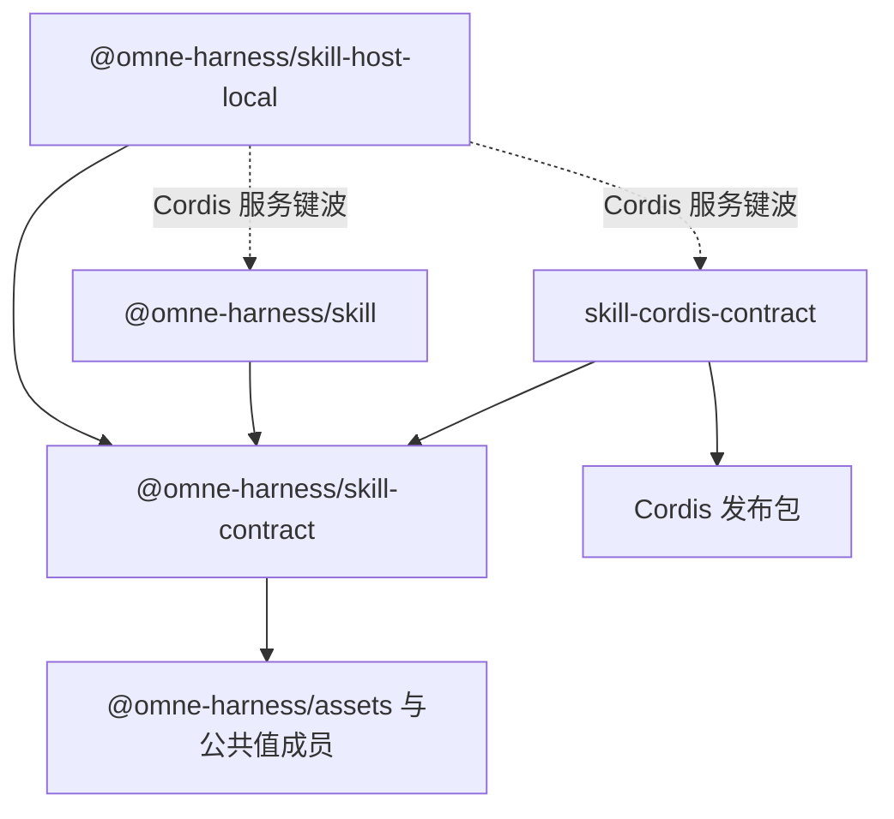

# Skill能力组

状态：本组有三个 workspace 成员。`@omne-harness/skill-contract` 提供已接受的 `skill` 类别端口。它实现了值、纯函数、包检查、端口与服务接口、端口的符合性套件，以及 `skill` 类别端口的可加扩展（保留字段与 `name-invalid`）。这些是候选，尚未取得技术接受。`@omne-harness/skill` 与 `@omne-harness/skill-host-local` 在第二波有了实现（候选，尚未取得技术接受）：`@omne-harness/skill` 实现包检查、摘要与检索、描述、读取、列出与导出，`@omne-harness/skill-host-local` 实现本机目录来源。组的分解、模型、端口与服务是工程设计草案，全部为候选决定，尚未取得技术接受。发布仍没有服务实现。脚本执行不归本组。

## 责任与范围

本组承接Skill专有工程责任，领域边界沿[已接受领域责任](../../docs/domains/skills/README.md)。产品规则、阶段及政策沿[产品第四章](../../.meta_harness/design/product/skills/design.md#未决问题与待定事项)。许可、原消息、工具执行、环境资源和逻辑工作继续由相邻拥有者承担，不能因组合在本组中集中改写。本组认识谁、不认识谁、需要什么与提供什么，见[工程设计「边界」](docs/architecture.md#边界)。

## 成员与依赖

本组有三个 workspace 成员。纯契约成员由原 `@omne-harness/skill` 改名为 `@omne-harness/skill-contract`，与 Tool 组的 `tool-contract` 和 MCP 组的 `mcp-contract` 命名一致。通用实现 `@omne-harness/skill` 与本地宿主 `@omne-harness/skill-host-local` 已有实现与成员 SPEC（候选），各自的行为以成员 SPEC 为准。职责与允许的生产依赖都是候选决定，尚未取得技术接受。

| 成员 | 当前状态 | 职责 | 允许的生产依赖 | 阅读入口 |
| --- | --- | --- | --- | --- |
| `@omne-harness/skill-contract`（`packages/skills/skill-contract`，纯契约） | 已实现已接受的 `skill` 类别端口 `skillBodyContract`。其余已实现（候选），包括类别端口的扩展（保留字段与 `name-invalid`）。行为以成员规格为准。不依赖 Tool。服务只有接口，不提供发现、读取、导出或发布 | 值、纯函数、包检查、端口与服务接口、`skill` 类别端口，以及 `./testing` 符合性设施，见下文 | 见下文 | [成员入口](skill-contract/README.md)与[规格](skill-contract/SPEC.md) |
| `@omne-harness/skill`（`packages/skills/skill`，通用实现） | 已实现（候选）。公开根交出工厂 `createPackageInspection`、`createSkillCatalog`、`createSkillAccess` 与类型 `SkillPorts`。本成员还没有独立的示例文件，可运行的示例要以 `@omne-harness/skill-host-local` 作真实来源，见[成员示例说明](skill/examples/README.md) | 三个应用服务：`PackageInspection`、`SkillCatalog`、`SkillAccess`。名字对应领域的「方法与资源取用」。只依赖本组纯契约与公共值成员，不依赖 Cordis，也不依赖任何调用方的成员 | `@omne-harness/skill-contract`，以及 `@omne-harness/skill-contract` 允许的公共值成员 | [成员入口](skill/README.md)与[规格](skill/SPEC.md) |
| `@omne-harness/skill-host-local`（`packages/skills/skill-host-local`，本地宿主） | 已实现目录来源部分（候选）。公开根交出工厂 `createDirectorySource` 与接缝类型 `DirectoryFs`、`EntryKind`、`Opened`。失败映射见[成员入口「Behavior」](skill-host-local/README.md#behavior)。Cordis 插件部分在 Cordis 服务键波补 `src/cordis.ts` | 两部分。目录来源部分：本机目录来源 `DirectorySource`。Cordis 插件部分：本组的 Cordis 插件，在 Cordis 服务键波。内容存储来源等存储契约就绪后再加 | 目录来源部分：`@omne-harness/skill-contract` 与宿主依赖。Cordis 插件部分另加 `@omne-harness/skill` 与 `skill-cordis-contract` | [成员入口](skill-host-local/README.md)与[规格](skill-host-local/SPEC.md) |

`@omne-harness/skill-contract` 有三个入口，各入口的内容见成员规格[入口](skill-contract/SPEC.md#entries)：

| 入口 | 给谁 | 内容 |
| --- | --- | --- |
| `@omne-harness/skill-contract`（`.`） | 调用方 | 值、守卫、失败、`SkillCatalog` 与 `SkillAccess` 的接口及结果值、纯函数、`skillBodyContract` |
| `@omne-harness/skill-contract/provider` | 来源、资产登记与端口的实现方 | 三个需求端口及其答复类型、`PackageInspection` 接口、`SkillRef`、`PackageLocator`、`sealSnapshot` 与 `SnapshotDefect` |
| `@omne-harness/skill-contract/testing` | 端口实现方的测试；`SkillAccess` 实现方的测试 | `SkillPackageSource`、`SkillReadCheck` 与 `SkillResolution` 的符合性套件，这三个端口的内存替身，以及 `SkillAccess` 的符合性套件 `skillAccessConformance` 与它的夹具类型 |

公开根不导出 `SkillRef`、包定位、`PackageInspection` 与 `sealSnapshot`，调用方拿不到包定位。`SkillReadCheck` 与 `SkillResolution` 的套件核对：对无权主体，答复不随该身份是否存在而变。`SkillAccess` 的符合性套件 `skillAccessConformance` 已以可加改动加入 `./testing`，见成员规格[符合性套件](skill-contract/SPEC.md#conformance)。这些都是候选，尚未取得技术接受。它的生产依赖逐个列出：`@omne-harness/assets`、`@omne-harness/operation-result`、`@omne-harness/legal-identity`、`@omne-harness/json-text`，以及解析 `SKILL.md` 头部的 `yaml`。它不依赖 `@omne-harness/content-block`：读取交出文本或字节。

组设计另有一个具名文档目标。它尚非 workspace 成员：没有包、源码或运行实例。名字、职责与依赖都是候选决定，尚未取得技术接受。建包时随成员规格确定。分波只有三种：第一波、第一波之后、Cordis 服务键波，见[成员承接表](docs/architecture.md#完整行为候选的正式承接缺口)。

| 具名文档目标 | 状态 | 职责 | 允许的生产依赖 |
| --- | --- | --- | --- |
| `skill-cordis-contract`（Cordis 契约） | 尚非 workspace 成员 | 服务键与抽象 Service。不含实现。暂不进应用插件树。在 Cordis 服务键波 | `@omne-harness/skill-contract` 与 Cordis 发布包 4.0.4，版本依据[技术基础](../../docs/architecture/technical-foundations.md#共同技术选择)「产品与工程运行时」 |

依赖方向照 Tool 能力组的先例：`@omne-harness/skill-host-local` 指向 `@omne-harness/skill`、`skill-cordis-contract` 与 `@omne-harness/skill-contract`。其中指向 `@omne-harness/skill` 与 `skill-cordis-contract` 的两条随 Cordis 插件部分在 Cordis 服务键波加入，图中用虚线。第一波的目录来源部分只指向 `@omne-harness/skill-contract`。`@omne-harness/skill` 与 `skill-cordis-contract` 各自指向 `@omne-harness/skill-contract`，彼此不依赖。成员间的依赖只由各成员 `package.json` 声明，`pnpm run lint:deps` 的通用规则检查成员与组之间不成环。本组没有在 `docs/architecture/constraints.json` 登记方向行。

各成员与目标的模型、端口、服务、失败种类与分波见[工程设计](docs/architecture.md)。各候选由哪个成员承接，见[成员承接表](docs/architecture.md#完整行为候选的正式承接缺口)。定义拥有者维护自己的公开形状。调用方显式给出访问上下文与作用域。本组不创建组根统一 SPEC。

## 关键协作

[组内流程](docs/key-flows.md)表达本组服务与端口的协作。[领域流程](../../docs/domains/skills/key-flows.md)与[领域交接设计](../../docs/domains/skills/architecture.md)表达跨领域交接。[工程设计](docs/architecture.md)维护模型、失败与技术处置，不在本入口复制。

## 组合验证

组技术拥有者协调方法定义、取用与导出，以及需求端口的真实实现，验证授权、版本一致、未知与取消。证据须绑定成员与端口实现的精确版本与故障前提。第一波的验证候选见[工程设计「验证」](docs/architecture.md#验证)。`@omne-harness/skill` 的读取与目录有有限范围的 TLA+ 模型与探索器结果，见[性质账本](skill/verification/README.md#ledger)，它们不是无条件证明。真实端口与该成员的组合没有验证。攻击、资源与耐久没有核实。替身与结构检查不代替真实组合验证。

## 维护

具名组维护者尚待指定。成员边界与实际公开形状明确并取得技术采用后，维护者完整承接行为，同步本入口、局部登记、产品技术导航与真实消费者，不能以搬迁薄化条件或把候选升级为采用。包创建沿[成员文档规范](../../docs/member-documentation.md)及[开发入口](../../docs/development.md#创建和整改产品包)。具名文档目标建成 workspace 成员后，从具名文档目标表移到成员表。
